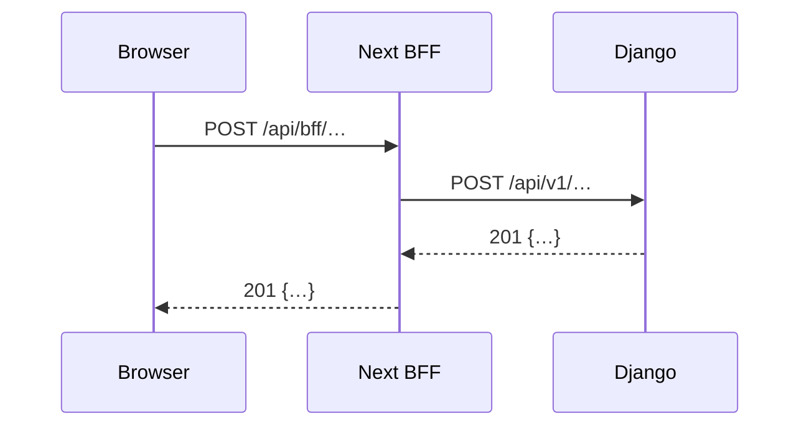

<!--
TEMPLATE — Track 1 API page (English). Copy to docs/api/domains/NN-<slug>/<mXX-name>.md
(or docs/api/overview/<topic>.md). Delete these comments and any section that does not apply,
but keep the section order. One page may hold several endpoint groups: repeat §4 per group,
in the order of the DOC tasks that feed the page.
Rules: Arabic messages verbatim in «…» copied from code; money only as server display strings;
examples from fixtures / mock mode only; discrepancies flagged, never silently fixed.
-->

# <Module name> API — <MXX> (<Arabic module name>)

> **Source**: DOC-XXX, DOC-YYY · INT-0xx (MXX) · inventory Domain N
> **Live key**: `<key>` (`SHARWA_LIVE_MODULES`) — or *Django-first, no switch*
> **Django provider**: `sharwa_saas/api/views_<x>.py` · `sharwa_saas/products/services/<x>_service.py` · serializers `api/serializers_<x>.py`
> **Frontend contract**: `sharwa-frontend/src/features/<module>/schemas.ts` · fixture `src/mocks/<module>/` · BFF `src/app/api/bff/<path>`
> **Tests**: `sharwa_saas/api/test_<x>_api.py` (N) · mock E2E `scripts/<module>-check.ts`
> **Last verified against code**: YYYY-MM-DD (step NN)

## 1. Overview

What the module does for the caller, in 3–6 sentences. Which identity calls it (see `docs/api/overview/auth.md`), on which host (store host / platform origin / console), and how it relates to neighbouring modules.

## 2. Access — gate chain

Evaluated in this order (see `docs/api/overview/conventions.md`). The first failing gate answers.

| # | Gate | Requirement | Failure |
|---|---|---|---|
| 1 | Session | <identity> | `401` `{"detail": "…"}` |
| 2 | Plan feature | `<feature_code>` | `403` «…» |
| 3 | Permission key | read `<key>` · write `<key>` | `403` «…» |
| 4 | Owner-only | <which writes> | `403` «…» |
| 5 | Resource state | <e.g. draft only> | `404` / `409` «…» |

## 3. Endpoint summary

| Method | Django path (`/api/v1/…`) | BFF path (`/api/bff/…`) | Purpose | Gate |
|---|---|---|---|---|
| `GET` | `…/` | `…` | | |

## 4. <Endpoint group name>

### `METHOD /api/v1/<path>/`

**Query parameters**

| Name | Type | Default | Notes |
|---|---|---|---|

**Request body** (`application/json` | `multipart/form-data`)

| Field | Type | Required | Rules / limits |
|---|---|---|---|

**Response `200`/`201`**

```json
{
  "example": "from the fixture or a Django test — matches the Zod schema"
}
```

| Field | Type | Meaning (Django source when mapped) |
|---|---|---|

**Errors**

| Status | Body | When |
|---|---|---|
| `400` | `{"field": ["«…»"]}` | |
| `409` | `{"detail": "«…»", "current_version": 7}` | stale `version` |
| `429` | `{"detail": "«…»"}` + `Retry-After` | |

**Rules** — business rules the server enforces (Django is the authority).
**Mapping** — field/value translations between the contract and Django models.
**Side effects** — Celery tasks, webhooks (`order.*`…), notifications, audit-log rows, stock movements, cache invalidation.
**Idempotency / concurrency** — keys, row locks, `version` (see `docs/api/overview/idempotency.md`).

<!-- Optional when the task asks for it -->


## 5. Gaps closed, bugs fixed and migrations

What Phase 002 changed in Django for this contract: migration names and fields, and bugs fixed that change behaviour callers can observe.

## 6. Open items and legacy-only behaviour

Items not built or not wired (inventory A.13), plus legacy HTML features outside the contract.

## 7. Related pages

- Guide: `../../../guides/merchant/NN-<slug>/<page>.md`
- Architecture: `../../../architecture/<page>.md`
