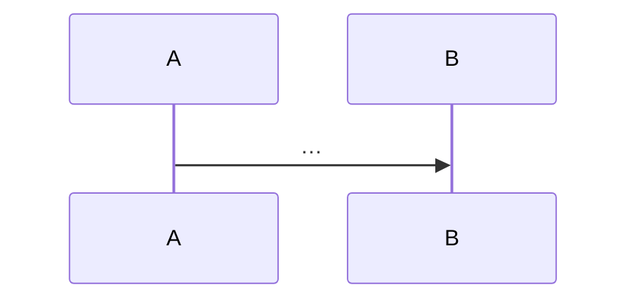
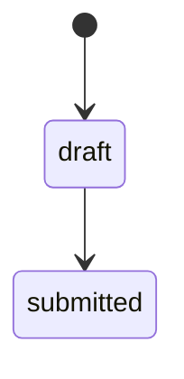

<!--
TEMPLATE — Track 3 architecture page (English). Copy to docs/architecture/<page>.md,
docs/architecture/data-model/NN-<slug>.md or docs/architecture/jobs/<job>.md.
Rules: name real files, models, tasks, settings; every claim checked against the code;
discrepancies flagged per docs/README.md §5.2. Delete these comments and unused sections.
-->

# <Component / concern name>

> **Source**: DOC-XXX · inventory A.x / Domain N · INT-0xx
> **Code**: `sharwa_saas/<path>` · `sharwa-frontend/<path>`
> **Last verified against code**: YYYY-MM-DD (step NN)

## 1. Purpose

What this component is responsible for, and what it is not responsible for.

## 2. Components

| Component | Location | Role |
|---|---|---|
| | `sharwa_saas/…` | |

## 3. Data model

| Model | Schema (public / store) | Key fields | Constraints / indexes | Added or changed by |
|---|---|---|---|---|
| | | | | migration `products/0xxx_…` |

## 4. Flows

or a state diagram for lifecycles:

## 5. Invariants

Rules that must always hold, and where they are enforced: transaction, row lock, unique constraint, validator.

## 6. Background work

Celery tasks / Beat schedules involved: trigger, queue, retry, idempotency (see `docs/architecture/jobs/`).

## 7. Configuration

Settings and environment variables with defaults (see `docs/ops/`).

## 8. Failure modes and fixes

| Failure | Symptom | Cause | Handling / fix (with the INT task that fixed it) |
|---|---|---|---|

## 9. Open items

## 10. Related pages
