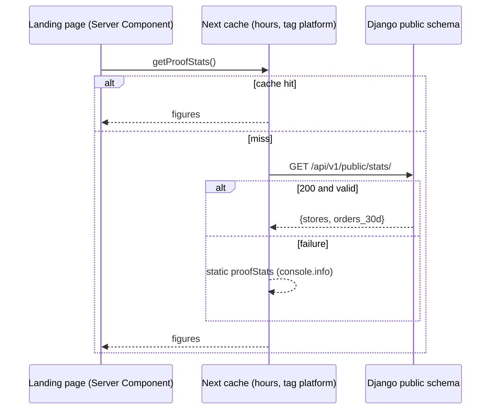

# Landing page API — M01 (الصفحة الترويجية)

> **Source**: DOC-048 · INT-001 (M01) · inventory Domain 1
> **Live key**: *Django-first, no switch* — the server fetchers call Django on every render of an uncached page; the BFF rows call Django on every request; a fixture answers only when Django fails **and** `SHARWA_MOCKS=on` ([`bff.md#django-first`](../../overview/bff.md#django-first))
> **Django provider**: `sharwa_saas/api/views_public.py` (`PublicPlansView`, `PublicStatsView`, `public_plans_payload`, `public_stats_payload`) · wired in `api/urls.py` · models `billing.Plan`, `billing.Feature`, `billing.PlanFeature`, `billing.PlatformBillingSettings`, `tenants.Client`
> **Frontend contract**: `sharwa-frontend/src/features/landing/schemas/{plans,stats}.ts` · fetchers `src/features/landing/api/{plans,stats}.ts` · fixtures `src/mocks/public/{plans,stats}.ts` · BFF `src/app/api/bff/public/{plans,stats}/route.ts`
> **Tests**: `sharwa_saas/api/test_public_api.py` (`PublicLandingApiTests`, 7 tests)
> **Last verified against code**: 2026-10-27 (step 06)

## 1. Overview

The marketing landing page needs two public facts: the **plans** for the pricing section and two **proof numbers** (how many stores are live, how many orders they took in the last 30 days). Both are platform-level: they describe the whole Sharwa platform, not one store, so they are served by the **public schema** only and need **no login**.

Callers are the Next.js server (Server Components that render the page) and, for completeness, the browser through the two BFF rows. No merchant, staff or buyer identity is involved. The identity matrix is in [`../../overview/auth.md`](../../overview/auth.md).

Neither route blocks the page: if Django is down, slow to answer, or returns something the Zod schema rejects, the landing page renders from static content. The visitor sees no error (FR-01.04); only a server-side `console.info` line is written.

## 2. Access — gate chain

| # | Gate | Requirement | Failure |
|---|---|---|---|
| 1 | Schema | the request must resolve to the **public** schema (the platform origin). `PublicOnlyMixin.initial()` checks `connection.schema_name` | `404` `{"detail": "غير موجود."}` on a store host |
| 2 | Session | none — `authentication_classes = []` | — |
| 3 | Plan feature / permission key | none | — |
| 4 | CSRF | not applicable (`GET` only) | — |
| 5 | Rate limit | none in the views (`PublicOnlyMixin` sets no throttle) | — |

## 3. Endpoint summary

| Method | Django path (`/api/v1/…`) | BFF path (`/api/bff/…`) | Purpose | Cache |
|---|---|---|---|---|
| `GET` | `public/plans/` | `public/plans` | plans for the pricing section | Django: none. Next: `"use cache"`, `cacheLife("hours")`, tag `platform` |
| `GET` | `public/stats/` | `public/stats` | proof-bar numbers | Django: **1 hour** (`public:landing_stats:v1`). Next: `"use cache"`, `cacheLife("hours")`, tag `platform` |

> ⚠️ Discrepancy — roadmap says both routes are "cached 1 h" / code caches only **stats** in Django (`STATS_CACHE_SECONDS = 3600`). `public_plans_payload()` runs its queries on every request. The Next.js fetchers cache both answers with `cacheLife("hours")`, so in practice the landing page asks Django for plans about once an hour per Next instance, but a direct caller of `GET /api/v1/public/plans/` is never served from a Django cache.

## 4. Landing endpoints

### `GET /api/v1/public/plans/`

**Query parameters**: none.

**Response `200`**

```json
{
  "subscriptions_enabled": false,
  "plans": [
    {
      "code": "free",
      "name": "مجاني",
      "is_free": true,
      "price": "0.00",
      "currency": "SAR",
      "billing_interval": "monthly",
      "max_products": null,
      "max_orders_per_month": null,
      "features": ["لوحة الطلبات", "نقطة البيع"]
    }
  ]
}
```

The example is the shape the Django test fixture builds (`test_plans_match_the_frontend_contract`) trimmed to one plan; the front-end fixture `plansMock()` returns the same shape with `code: "is_default_free"`.

| Field | Type | Meaning (Django source) |
|---|---|---|
| `subscriptions_enabled` | boolean | `PlatformBillingSettings.load().subscriptions_enabled`. `false` is today's platform state: every store sits on the default free plan and the page shows one column |
| `plans[]` | array | `Plan.objects.filter(is_active=True)`, ordered by `display_order`, then `price`, then `id` |
| `plans[].code` | string | `Plan.code` |
| `plans[].name` | string | `Plan.name` |
| `plans[].is_free` | boolean | `Plan.is_free` |
| `plans[].price` | string | `str(Decimal(plan.price).quantize(Decimal("0.01")))` — a **display string**, never a number (`"0.00"`, `"49.50"`) |
| `plans[].currency` | enum | `SAR` · `USD` · `YER_OLD` · `YER_NEW` (`PlanCurrencySchema`) |
| `plans[].billing_interval` | enum | `monthly` · `yearly` · `lifetime` (`BillingIntervalSchema`) |
| `plans[].max_products` | number \| null | `null` = no limit (the page prints «بلا حد») |
| `plans[].max_orders_per_month` | number \| null | same |
| `plans[].features` | string[] | **names** (not codes) of the features this plan really grants, ordered by `module_group` then `name` — see Rules |

**Errors**

| Status | Body | When |
|---|---|---|
| `404` | `{"detail": "غير موجود."}` | called on a store host |
| `5xx` | Django default | database failure; the Next fetcher swallows it (see Mapping) |

**Rules** — which features a plan lists (the same hierarchy as `_resolve_feature_enabled` in `billing/models.py`, without a store override because there is no store here):

1. A feature switched off globally (`is_active_globally = False`) never appears.
2. If the feature does not require a plan (`requires_plan = False`) it appears on **every** plan.
3. If subscriptions are off (`subscriptions_enabled = False`, today's default) every globally active feature appears on every plan — this is what the page means by «مجاني الآن — كل الميزات».
4. Otherwise it appears only on plans that have a `PlanFeature` row with `is_enabled = True`.

With no active plan the answer is `{"subscriptions_enabled": false, "plans": []}`.

**Mapping** — Next side (`getPublicPlans()`):

| Django answer | Next result |
|---|---|
| `200` and valid by `PublicPlansResponseSchema` | the parsed payload |
| `200` but invalid | `console.info` "did not match the contract", then the fallback |
| non-`2xx`, or network error | `console.info`, then the fallback |
| fallback | `plansMock()` when `SHARWA_MOCKS` is on; `{subscriptions_enabled: false, plans: []}` when it is off |

The pricing section (`components/pricing.tsx`) shows one column when `subscriptions_enabled` is false **or** there is at most one plan; the comparison table (and per-plan tabs under `md`) appears only when subscriptions are on and several plans are returned. The free column lists `plan.features`; **when a live plan lists none** (an empty feature catalogue) it falls back to the page's own `freePlanHighlights` so the column is never blank.

**Side effects** — none. Read-only.

**Idempotency / concurrency** — not applicable.

### `GET /api/v1/public/stats/`

**Query parameters**: none.

**Response `200`**

```json
{ "stores": 1200, "orders_30d": 48500 }
```

The numbers are those of the front-end fixture `statsMock()` (stable on purpose, for screenshots). Django's numbers come from the real database.

| Field | Type | Meaning (Django source) |
|---|---|---|
| `stores` | number | count of `Client` rows with `is_active = True` and `provisioning_status = "ready"`, excluding the public schema |
| `orders_30d` | number | the sum, over those stores' schemas, of orders created in the last 30 days, **excluding** status `pending_payment` (a payment that did not complete is not an order yet) |

**Errors**: `404` «غير موجود.» on a store host; otherwise none.

**Rules**

- The loop over every store schema is expensive, so the result is cached for **3600 seconds** under the key `public:landing_stats:v1`. A new store does not appear until the key expires.
- A schema whose orders cannot be read (an incomplete schema, `DatabaseError`) is skipped with a log warning and counts as `0`; the answer is still `200`.

**Mapping** — Next side (`getProofStats()`): the proof bar has three figures. Stores and orders are replaced with `formatNumber(parsed.data.stores)` and `formatNumber(parsed.data.orders_30d)` plus the unit `"+"`; the third figure (duration) is static content. On any failure the whole bar uses the static `proofStats`.

**Side effects** — fills the Django cache key above on the first call after expiry.



## 5. Gaps closed, bugs fixed and migrations

- INT-001 closed the `[NEEDS BACKEND]` marker on both routes: `views_public.py` provides them, and its module docstring states that the contract is copied verbatim from the frontend schemas. The views only read existing tables (`billing`, `tenants`); no migration belongs to them.

## 6. Open items and legacy-only behaviour

- The `public/plans` and `public/stats` BFF rows are not used by the landing page itself (it reads Django from the server). They remain for client-side callers.
- Both BFF rows turn **any** non-OK or non-JSON Django answer into the fixture (mocks on) or `501` «غير متاح بعد.» (mocks off) — they do not forward Django's error status ([`bff.md#django-first`](../../overview/bff.md#django-first)).
- `README.md` in `src/app/api/bff/` still labels both rows "target → mock"; see the discrepancy in [`bff.md#live-keys`](../../overview/bff.md#live-keys).

## 7. Related pages

- [`../../overview/bff.md#django-first`](../../overview/bff.md#django-first) — the adapter rules
- [`../../overview/errors.md`](../../overview/errors.md) — error bodies
- [`m02-onboarding.md`](m02-onboarding.md) — what the «ابدأ» button leads to
