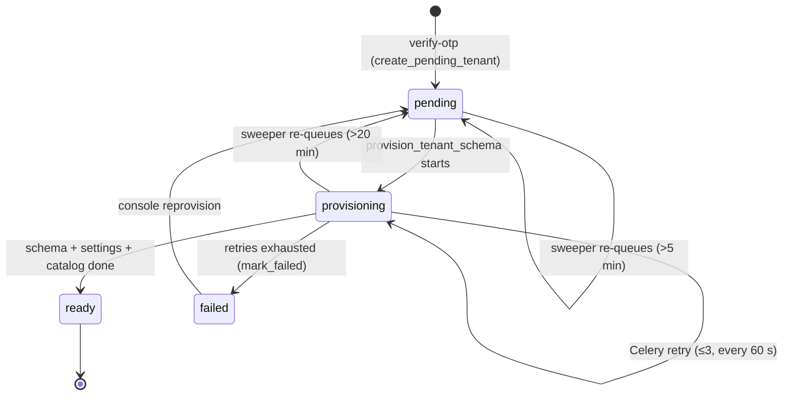

# Store registration API — M02 (التسجيل وتأسيس المتجر)

> **Source**: DOC-051, DOC-052, DOC-053 · INT-004 (M02), INT-002, INT-030 · inventory Domain 1/16
> **Live key**: *Django-first, no switch* — every BFF row asks Django first (`tryTarget`, or the legacy `upstreamFetch` adapter); a fixture answers only when the route is missing (`404/405/501`) or Django is unreachable **and** `SHARWA_MOCKS=on`; with mocks off the answer is `501` «غير متاح بعد.» ([`bff.md#django-first`](../../overview/bff.md#django-first))
> **Django provider**: `sharwa_saas/api/views_onboarding.py` (`MarketCategoryListView`, `RegisterView`, `VerifyOtpView`, `ResendOtpView`) · `tenants/registration.py` (`create_pending_tenant`) · `tenants/provisioning.py` · `tenants/tasks.py` · `tenants/views.py` (`check_subdomain_availability`, `tenant_provisioning_status`) · `tenants/validators.py` · `config/urls_public.py`
> **Frontend contract**: `sharwa-frontend/src/features/onboarding/{schemas.ts,handoff.ts,onboarding.content.ts}` · `src/lib/schemas/provisioning.ts` · fixtures `src/mocks/public/*` · BFF `src/app/api/bff/public/{market-categories,check-subdomain,register,register/verify-otp,register/resend-otp,provisioning/[token]}/route.ts`
> **Tests**: `sharwa_saas/api/test_onboarding_api.py` (`OnboardingApiTests` 16 tests, `SubdomainRuleTests`, `StatusLinkTests`, `SetupPasswordApiTests`, `DebugOtpBypassTests`)
> **Last verified against code**: 2026-10-27 (step 06)

## 1. Overview

A visitor on the platform site creates a store in three moves:

1. **Register** — name, WhatsApp number, store address (subdomain), interests, terms. Django validates the draft, sends a six-digit code on WhatsApp and keeps the draft **in the cache** (no store exists yet).
2. **Verify** — the visitor types the code. Django creates the store row as `pending` and queues the background job that builds its database schema.
3. **Wait** — the browser polls the status route until the store is `ready`, then moves to the store's first-password screen.

The three groups of this page are anchored `#register`, `#otp` and `#provisioning`.

Every route here is **public** (no login) and lives on the **platform origin** only. On a store host the four `/api/v1/public/…` routes answer `404` `{"detail": "غير موجود."}` (`PublicOnlyMixin`). Identity and tenant resolution are described in [`../../overview/auth.md`](../../overview/auth.md).

The mock runtime used to implement the same journey; the contract below is what Django does today. Where the fixtures differ from Django it is listed in §6.

## 2. Access — gate chain

| # | Gate | Requirement | Failure |
|---|---|---|---|
| 1 | Schema | public schema only (`PublicOnlyMixin.initial`) | `404` `{"detail": "غير موجود."}` on a store host |
| 2 | Session | none — `authentication_classes = []`, `permission_classes = []` | — |
| 3 | CSRF | none (token-in-body API; no session cookie is used) | — |
| 4 | Rate limit | by phone number (strict) and by IP (wide ceiling, CGNAT-safe) — per route below | `429` `{"detail": "محاولات كثيرة، حاول بعد N ثانية"}` + `Retry-After` |

> Sharwa sits behind CGNAT: thousands of legitimate Yemeni users can share one public IP. The strict limits are therefore **per phone**; the IP limits are only a wide ceiling against automated flooding and can be tuned in `settings` without a deploy (owner decision 2026-10-21).

## 3. Endpoint summary

| Method | Django path | BFF path (`/api/bff/…`) | Group | Purpose |
|---|---|---|---|---|
| `GET` | `/api/v1/public/market-categories/` | `public/market-categories` | register | categories the merchant may tick |
| `GET` | `/register/check-subdomain/?subdomain=` (legacy, outside `/api/v1/`) | `public/check-subdomain` | register | live availability of the store address |
| `POST` | `/api/v1/public/register/` | `public/register` | register | validate the draft, send the WhatsApp code |
| `POST` | `/api/v1/public/register/verify-otp/` | `public/register/verify-otp` | otp | check the code, create the `pending` store |
| `POST` | `/api/v1/public/register/resend-otp/` | `public/register/resend-otp` | otp | send a new code for the same draft |
| `GET` | `/register/status/<token>/` (legacy, outside `/api/v1/`) | `public/provisioning/[token]` | provisioning | status of the store being built |

<a id="register"></a>

## 4. Register (DOC-051)

### `GET /api/v1/public/market-categories/`

**Response `200`** — a bare array, not an envelope:

```json
[{ "id": 1, "name": "أزياء" }]
```

| Field | Type | Meaning |
|---|---|---|
| `id` | number | `MarketCategory.id` — the value the register body sends back in `interested_categories` |
| `name` | string | display name |

**Rules**: only `is_active = True` rows, ordered by `display_order`, then `name`. The categories are administered in the platform console (M46 `market-categories/`, INT-032) — there is no merchant-side write.

**Errors**: `404` on a store host.

### `GET /register/check-subdomain/?subdomain=<value>` (legacy route)

This is a **Django view on the public URLConf** (`config/urls_public.py`), not a DRF route. It is Ready and was kept as-is; the BFF adapter `public/check-subdomain` calls it with no `X-Store-Domain`.

**Query**: `subdomain` — trimmed and lower-cased by both the BFF and Django.

**Response `200`**

```json
{ "available": false, "reason": "مستخدم بالفعل" }
```

```json
{ "available": true }
```

`reason` is **absent** when the address is available (the Zod schema defaults it to `""`).

**Rules** — the check order is fixed and shared with the register route (`tenants/validators.py`, `subdomain_reason`):

| Order | Rule | `reason` (verbatim) |
|---|---|---|
| 1 | empty | «فارغ» |
| 2 | not `^[a-z0-9]+$` | «أحرف إنجليزية وأرقام فقط» |
| 3 | in `RESERVED_SUBDOMAINS` (22 names, e.g. `www`, `admin`, `api`, `ai`, `console`) | «محجوز للنظام» |
| 4 | length outside **3–50** | «يجب أن يكون بين 3 و50 حرفاً» |
| 5 | a `Client` with `schema_name = subdomain` exists | «مستخدم بالفعل» |

Reserved is checked **before** length, so a short reserved name such as `ai` is reported as reserved, not as too short. The 3–50 rule has one source on each side: `SUBDOMAIN_MIN_LENGTH` / `SUBDOMAIN_MAX_LENGTH` in `tenants/validators.py` and `SUBDOMAIN_MIN` / `SUBDOMAIN_MAX` in `src/lib/tenant.ts` (owner decision 2026-10-21; 50 is the old form-field limit and sits under the 63-character PostgreSQL schema limit).

**BFF mapping**

| Django answer | BFF result |
|---|---|
| JSON | `{available, reason}` with Django's status |
| non-JSON | `502` `{"detail": "استجابة غير متوقعة من الخادم."}` |
| unreachable, mocks on | `checkSubdomainMock(sub)` (`x-sharwa-mock: 1`, 150 ms delay) |
| unreachable, mocks off | `502` `{"detail": "الخادم غير متاح حالياً."}` |

The register form debounces the call by 400 ms. This check never replaces the real check at submit: a rare race is possible, and `register` and `verify-otp` repeat the rules.

### `POST /api/v1/public/register/`

**Request body**

```json
{
  "store_name": "متجر النور",
  "merchant_phone": "0770000011",
  "subdomain": "alnoor",
  "interested_categories": [1, 3],
  "agree_terms": true
}
```

| Field | Type | Rule (Django `_validate_registration`) |
|---|---|---|
| `store_name` | string | trimmed, **3–100** characters (`STORE_NAME_MIN/MAX`) |
| `merchant_phone` | string | required; cleaned by `clean_phone_number` and must match `^(967|966)\d{9}$` — a local number such as `0770000011` becomes `967770000011` |
| `subdomain` | string | trimmed, lower-cased, passes the table above |
| `interested_categories` | number[] | optional (`null` or missing = `[]`); every value must be an integer (not a boolean) and an **active** category id, else one error on the field; duplicates are collapsed and sorted |
| `agree_terms` | boolean | must be exactly `true` |

The fixture phone numbers used on this page are not real.

**Response `200`**

```json
{ "otp_token": "…43 url-safe characters…", "ttl_seconds": 600, "masked_phone": "967•••••011" }
```

| Field | Type | Meaning |
|---|---|---|
| `otp_token` | string | `secrets.token_urlsafe(32)` — the key of the pending draft in the cache. It is **not** a login token |
| `ttl_seconds` | number | `OTP_TTL_SECONDS` = 600; the code is valid for ten minutes |
| `masked_phone` | string | `phone[:3] + "•••••" + phone[-3:]` (the same function as `maskPhone` in the frontend) |

**Errors**

| Status | Body | When |
|---|---|---|
| `400` | `{field: [message]}` | a field fails validation — messages below |
| `400` | `{"merchant_phone": ["هذا الرقم مرتبط بمتجر"]}` | the number already belongs to a `Client` |
| `400` | `{"subdomain": ["مستخدم بالفعل"]}` | the address is taken |
| `400` | `{"store_name": ["اسم المتجر مستخدم بالفعل. يرجى اختيار اسم مختلف."]}` | a store with this name exists (case-insensitive) |
| `400` | `{"merchant_phone": ["تعذّر إرسال رمز التحقق إلى هذا الرقم على واتساب. تأكد من الرقم وحاول مرة أخرى."]}` | WhatsApp refused the message; the error is put on the phone field |
| `429` | `{"detail": "محاولات كثيرة، حاول بعد N ثانية"}` + `Retry-After` | send limit — see Rules |
| `404` | `{"detail": "غير موجود."}` | store host |

Field-validation messages (verbatim from `views_onboarding.py`):

| Field | Message |
|---|---|
| `store_name` | «اسم المتجر من 3 إلى 100 حرف» |
| `merchant_phone` (empty) | «أدخل رقم الواتساب» |
| `merchant_phone` (not a Yemeni/Saudi number) | «رقم واتساب غير صحيح» |
| `subdomain` | one of the five short reasons above |
| `interested_categories` | «اختر من الأقسام المتاحة.» |
| `agree_terms` | «يجب الموافقة على الشروط» |

The frontend shows each message under its own field. For `merchant_phone` = «هذا الرقم مرتبط بمتجر» it also shows the merchant-login link.

**Rules**

- Order: validate fields → check conflicts (phone, subdomain, store name) → check the send limit → send the code. A request stopped by a field error or a conflict does not use a send.
- **Send limit**: 3 sends per phone per 600 s; IP ceiling 1500 sends per hour (`ONBOARDING_SENDS_PER_IP_PER_HOUR`). A blocked request still counts as an attempt. `Retry-After` is the **whole window** (600 for the phone, 3600 for the IP), not the time that is left.
- The code is `randbelow(900000) + 100000` (six digits). Only an HMAC of `token:code` (salt `sharwa.onboarding.otp`) is stored.
- The WhatsApp message carries the code only — no link. Under `DEBUG=True` nothing is sent: the code is logged and `123456` is accepted (see §5).
- The draft is kept in the cache for **1800 s** (`PENDING_TTL_SECONDS`) — long enough for several resends — while each code lives 600 s.

**Side effects** — one WhatsApp message (`WhatsAppService.send_message`) and a cache entry `onboarding:pending:<otp_token>`. **No database row** is created.

**Idempotency** — none. Posting the same draft again creates a new token and a new code and spends another send.

**BFF mapping** — `tryTarget` forwards the JSON body and every status unchanged. Fixture `registerMock` only when the route is missing or Django is down with mocks on.

<a id="otp"></a>

## 5. OTP verify and resend (DOC-052)

### `POST /api/v1/public/register/verify-otp/`

**Request body** — `{ "otp_token": "…", "code": "123456" }`

**Response `200`**

```json
{ "status_token": "…signed…", "status_url": "/register/status/<status_token>/" }
```

| Field | Type | Meaning |
|---|---|---|
| `status_token` | string | `signing.dumps({"c": client_id}, salt="tenants.provisioning.status")` — signed, not guessable, valid for **3600 s** |
| `status_url` | string | `reverse("tenant_provisioning_status")` — a path on the platform origin, outside `/api/v1/` |

**Errors**

| Status | Body | When |
|---|---|---|
| `400` | `{"code": ["الرمز غير صحيح"]}` | wrong code (the first and second failure) |
| `400` | `{field: [message]}` | at creation time the phone, subdomain or store name turned out taken, or the address became reserved — **the pending draft is deleted** |
| `410` | `{"detail": "انتهت صلاحية الرمز"}` | the draft is gone (past 1800 s) **or** the code is past its 600 s |
| `429` | `{"detail": "محاولات كثيرة، حاول بعد N ثانية"}` + `Retry-After: 600` | the third wrong code (it answers 429, not 400), or a call while the phone is locked |
| `429` | `{"detail": "تم الوصول للحد الأقصى من عمليات إنشاء المتاجر خلال ساعة. يرجى المحاولة لاحقاً."}` + `Retry-After: 3600` | IP ceiling of 500 creations per hour (`ONBOARDING_CREATIONS_PER_IP_PER_HOUR`) |
| `400` | conflicts, else `{"detail": "حدث خطأ غير متوقع أثناء إعداد متجرك. يرجى المحاولة مرة أخرى لاحقاً أو التواصل مع الدعم الفني."}` | `IntegrityError` — a parallel registration took the number or address between the check and the insert (the draft is deleted) |
| `500` | `{"detail": "حدث خطأ غير متوقع أثناء إعداد متجرك. يرجى المحاولة مرة أخرى لاحقاً أو التواصل مع الدعم الفني."}` | any other failure while creating the store (logged) |
| `502` | `{"detail": "استجابة غير متوقعة من الخادم."}` | **BFF only**: a `200` that does not match `verifyResponseSchema` |

**Rules**

- **Lock-out**: 3 wrong codes per phone inside 600 s lock the phone for 600 s. The counter is per phone, so a second browser using the same draft shares it. A correct code clears the counter.
- The comparison is `constant_time_compare` on the HMAC. With `DEBUG=True` the fixed code `123456` is also accepted; with `DEBUG=False` this path does not exist.
- The rules are re-checked at creation: the reserved list may have changed and a parallel registration may have won.
- The creation ceiling is counted only **after** the code is right.
- `create_pending_tenant` (one transaction): `Client` (`schema_name` = subdomain, `provisioning_status = "pending"`, `auto_create_schema = False`, `terms_accepted_at`), the primary `Domain`, the chosen categories, and — when subscriptions are enabled — the default free plan; then `transaction.on_commit(queue_provisioning)`. The pending draft is deleted from the cache.

**Side effects** — rows in the public schema; one Celery message `provision_tenant_schema` (§6). If the broker is down `queue_provisioning` logs and returns `False`; the store stays `pending` and the sweeper picks it up.

**BFF mapping** — `tryTarget`; on a `2xx` the body is validated with `verifyResponseSchema` (otherwise `502`) and the BFF sets the cookie **`sharwa_prov`** = the status token (HttpOnly, 30 min, `SameSite=Lax`, platform host only, `Secure` on https). The cookie lets the visitor resume the wait page after a refresh or a closed tab. Non-2xx statuses are forwarded unchanged and no cookie is set.

### `POST /api/v1/public/register/resend-otp/`

**Request body** — `{ "otp_token": "…" }`

**Response `200`** — `{ "ttl_seconds": 600 }`

**Errors**

| Status | Body | When |
|---|---|---|
| `410` | `{"detail": "انتهت صلاحية الطلب، ابدأ من جديد."}` | the draft is past 1800 s or unknown |
| `429` | `{"detail": "محاولات كثيرة، حاول بعد N ثانية"}` + `Retry-After` | cooldown (30 s since the last send; `Retry-After` is the time that is left) or the send limit (600 / 3600, the whole window) |
| `502` | `{"detail": "تعذّر إرسال رمز التحقق إلى هذا الرقم على واتساب. تأكد من الرقم وحاول مرة أخرى."}` | WhatsApp refused |

**Rules** — the new code **replaces** the old one (`code_hash`, `code_expires_at`, `last_sent_at` are overwritten and the draft keeps its 1800 s from this send); the old code stops working at once. The send limit is shared with `register`: three sends per phone in 600 s *including* the first.

**Idempotency** — none; every accepted call sends a message.

### Frontend behaviour (`otp-form.tsx`)

| Answer | Behaviour |
|---|---|
| verify `400` | the six cells are cleared; the field message is shown |
| verify `400` with draft-field keys | `returnToDetails(errors)` and `router.replace("/register")` — the visitor returns to the first panel with the server messages under their fields |
| verify `410` | the "code expired" state with a resend button |
| verify or resend `429` | the form locks for `Retry-After` seconds (default 60 for verify, 30 for resend) |
| resend `410` | **INT-004 fix**: `returnToDetails({})` and `router.replace("/register")` — back to panel 01 with the draft kept, instead of a dead end |

Why the fix matters: Django keeps the draft for 30 minutes while a code lives 10, so a visitor who waits 11–30 minutes still has a draft and can resend; a visitor who waits more than 30 minutes gets `410` from `resend-otp`, which before the fix left the form stuck.

The frontend constants are `OTP_LENGTH = 6` and `DEFAULT_OTP_TTL_SECONDS = 300`; the latter is used only when the server sends no `ttl_seconds`.

**Tests** — `OnboardingApiTests` covers: market categories; the register contract; local phone normalisation; field-error texts; reserved and invalid subdomains; taken phone, subdomain and store name; a WhatsApp failure landing on the phone field; the send limit per phone; a CGNAT IP not being blocked; a configurable IP ceiling; refusal on a store host; verify creating a pending store and queueing provisioning; wrong code then lock-out; unknown and expired token `410`; a number taken while waiting; the resend cooldown then a new code replacing the old one; resend with an unknown token `410`. `SubdomainRuleTests` covers the shared rule; `DebugOtpBypassTests` covers the fixed code.

<a id="provisioning"></a>

## 6. Provisioning status and lifecycle (DOC-053)

### `GET /register/status/<token>/` (legacy route)

A Django view on the **public URLConf** (`config/urls_public.py`, name `tenant_provisioning_status`). It is not under `/api/v1/` and uses no DRF. The BFF adapter `public/provisioning/[token]` calls it with no `X-Store-Domain`.

**Response `200`**

| `status` | Extra fields | Meaning |
|---|---|---|
| `pending` | — | the row exists; the job has not started |
| `provisioning` | — | the job is building the schema |
| `ready` | `store_url`, `dashboard_url`, `setup_token` | the store can be opened |
| `failed` | `message` «تعذّر تجهيز متجرك تلقائياً. فريق الدعم أُبلغ وسيتواصل معك قريباً.» | automatic provisioning gave up |

The internal error text is never exposed. The Zod `provisioningStatusSchema` accepts `status`, `store_url`, `dashboard_url` and `setup_token` and **drops `message`**, so the BFF does not forward it; the frontend shows its own text.

**`ready` details**

- `store_url` and `dashboard_url` come from `build_store_urls_for_request(request, domain)`. The domain always comes from the `Domain` row. The BFF sends the visitor's host and protocol in `X-Forwarded-Host` / `X-Forwarded-Proto`, and Django takes **only the port and the scheme** from them, so a forged header cannot point the link at another store. Without those headers the old behaviour stays. Test: `StatusLinkTests` — `localhost:3000` forwarded → `http://shop10.localhost:3000/dashboard/`; no headers → `http://shop10.localhost:8000/dashboard/`.
- `setup_token` = `signing.dumps({"s": schema_name}, salt="tenants.setup_password")`, valid **3600 s**, bound to this store's schema. It is the proof that the browser holding it passed the WhatsApp code; the first-password screen refuses a request without a matching token and refuses any attempt after the password is set (owner decision 2026-10-21, item 9). It travels once, as `?setup=` on the redirect.

**Errors**

| Status | Body | When |
|---|---|---|
| `429` | `{"status": "throttled"}` | more than 3000 polls per minute from one IP (`PROVISIONING_STATUS_POLLS_PER_IP_PER_MINUTE`; the poll is every 3 s, so about 20 per minute per browser) |
| `400` | `{"status": "invalid"}` | bad or expired signature |
| `404` | `{"status": "invalid"}` | the signed id has no `Client` |

**BFF mapping** (`public/provisioning/[token]`)

| Situation | BFF answer |
|---|---|
| Django `200` JSON that passes `provisioningStatusSchema` | forwarded; the `sharwa_prov` cookie is cleared when the status is `ready` and the request carried it |
| any other Django answer for a **signed** token (it contains `:`), including `429`, `400` and `5xx` | `404` `{"detail": "لم نجد طلب التأسيس هذا."}` |
| a fixture token (`st-…`, `pend…`, `ready…`), mocks on | the fixture answer (`x-sharwa-mock: 1`), or `404` if the fixture does not know it |
| a fixture token, mocks off | `404` `{"detail": "لم نجد طلب التأسيس هذا."}` |
| Django unreachable, mocks on | fixture, else `404` |
| Django unreachable, mocks off | `502` `{"detail": "الخادم غير متاح حالياً."}` |

The signed token is percent-encoded by Next; `decodeStatusToken` decodes it up to three times before the BFF encodes it once for Django (otherwise every `:` became `%253A` and every poll was a `400`).

> ⚠️ Discrepancy — roadmap/UX says an unknown token is a "404", and Django's `429` throttle and any `5xx` are *temporary*. The BFF turns **every** non-OK answer for a signed token into the same `404` «لم نجد طلب التأسيس هذا.», and the platform poller treats a `404` as final. A throttle or a short Django outage during the wait can therefore end the wait page with "request not found" although the store is being built. (The `sharwa_prov` cookie then lets the visitor resume.)

### Backend lifecycle

| Step | Where | What |
|---|---|---|
| 1 | `create_pending_tenant` | `Client.provisioning_status = "pending"`; `on_commit` calls `queue_provisioning(client.pk)` |
| 2 | `queue_provisioning` | `provision_tenant_schema.delay(client_id)`; never raises — a dead broker only logs |
| 3 | Celery `provision_tenant_schema` (`tenants/tasks.py`) | `acks_late`, `max_retries = 3`, retry delay 60 s, soft/hard time limits 900 / 960 s |
| 4 | `run_provisioning` | takes the cache lock `tenant-provisioning-lock:<id>` for 20 min; sets `provisioning`; runs `migrate_schemas` if the schema already exists, else `create_schema`; then `_init_store_settings`, `_seed_catalog` (35 sectors); sets `ready`; sends the welcome message |
| 5 | after the retries | `mark_failed` → `failed` |
| 6 | sweeper `retry_stalled_tenant_provisioning` (Celery beat, every 5 min) | re-queues a store that is `pending` for **more than 5 min** or `provisioning` for **more than 20 min**. A `failed` store is **never** re-queued by the sweeper |
| 7 | platform console (INT-030) | `POST /api/v1/platform/stores/reprovision/` `{"schemas": […]}`, and the admin action «🔁 إعادة تجهيز», set the store back to `pending` and call `queue_provisioning` |



### Frontend behaviour

| Aspect | Store host with a token | Store host without a token | Platform host |
|---|---|---|---|
| Source | `status` route | `HEAD /api/v1/config/` | `status` route |
| Interval | 3 s for about 30 s, then 10 s | 10 s | 3 s; 15 s while `failed`; exponential back-off up to 30 s on errors |
| `failed` | stops | never reported (a `res.ok` is "ready") | keeps polling slowly |
| `404` | drops to the visitor path | — | final |

On `ready` the page confirms for 2 s, then runs `window.location.assign(firstEntryUrl)`: `…/setup-password?t=<token>&setup=<setup_token>`. `handoff.ts` holds `PROV_COOKIE = "sharwa_prov"` and the storage key `sharwa.onboarding.status`.

The same lifecycle feeds the store-side guard: a store that is not `ready` answers `503` and the storefront shows the provisioning page ([`m47-tenant-guard.md`](m47-tenant-guard.md)).

## 7. Gaps closed, bugs fixed and migrations

- INT-004 closed `[NEEDS BACKEND]` for `market-categories`, `register`, `verify-otp` and `resend-otp`. The four routes use the cache for the draft, so **no migration** belongs to them; the store row uses the existing `tenants.Client` / `Domain` tables.
- INT-004 UX fix: resend `410` returns to the first panel with the draft kept (§5).
- 2026-10-21: status link follows the visitor's port and scheme (`X-Forwarded-*`) instead of Django's own port; the first-password screen requires `setup_token`; poll ceiling raised from 120 to 3000 per IP per minute; the IP limits of the send and create routes widened for CGNAT.
- 2026-10-21: store-address length rule 3–50 shared by the form, the live check, the API and the console.

## 8. Open items and discrepancies

> ⚠️ Discrepancy — the mock fixtures use different numbers from Django: OTP lifetime **300 s** and lock-out after **5** wrong codes for **60 s** (mock) against **600 s** and **3** wrong codes for **600 s** (Django). With mocks on, the lock-out UI therefore behaves differently from production. The fixtures also issue status tokens that start with `st-`, and the mock `status_url` is `/register/status/<token>/`, like Django's.

> ⚠️ Discrepancy — the roadmap's lifecycle wording says a stalled store is "re-provisioned from the console". The sweeper does re-queue `pending` (>5 min) and `provisioning` (>20 min) stores by itself; only `failed` stores need the console action.

- The status poll turns a Django throttle or outage into a final `404` (§6, discrepancy). Decision needed: map `429`/`5xx` to a temporary state in the BFF?
- `register` returns the WhatsApp failure on the **phone field** (`400`), while `resend-otp` returns it as `502 {detail}`. The frontend handles both, but the two shapes differ.
- The legacy Django HTML register flow (`/register/`, `/register/verify-otp/`) still exists on the public URLConf with its own session-based OTP (`OTP_TTL_SECONDS` in `tenants/views.py`); the Next.js app does not call it.

## 9. Related pages

- [`../../overview/bff.md#django-first`](../../overview/bff.md#django-first) — adapter rules for these six BFF rows
- [`../../overview/errors.md`](../../overview/errors.md) — error bodies and `Retry-After`
- [`m01-landing.md`](m01-landing.md) — where the registration starts
- [`m47-tenant-guard.md`](m47-tenant-guard.md) — what a visitor of a not-yet-ready store sees
- [`config.md`](config.md) — the `/config/` probe used by the store-side poll
