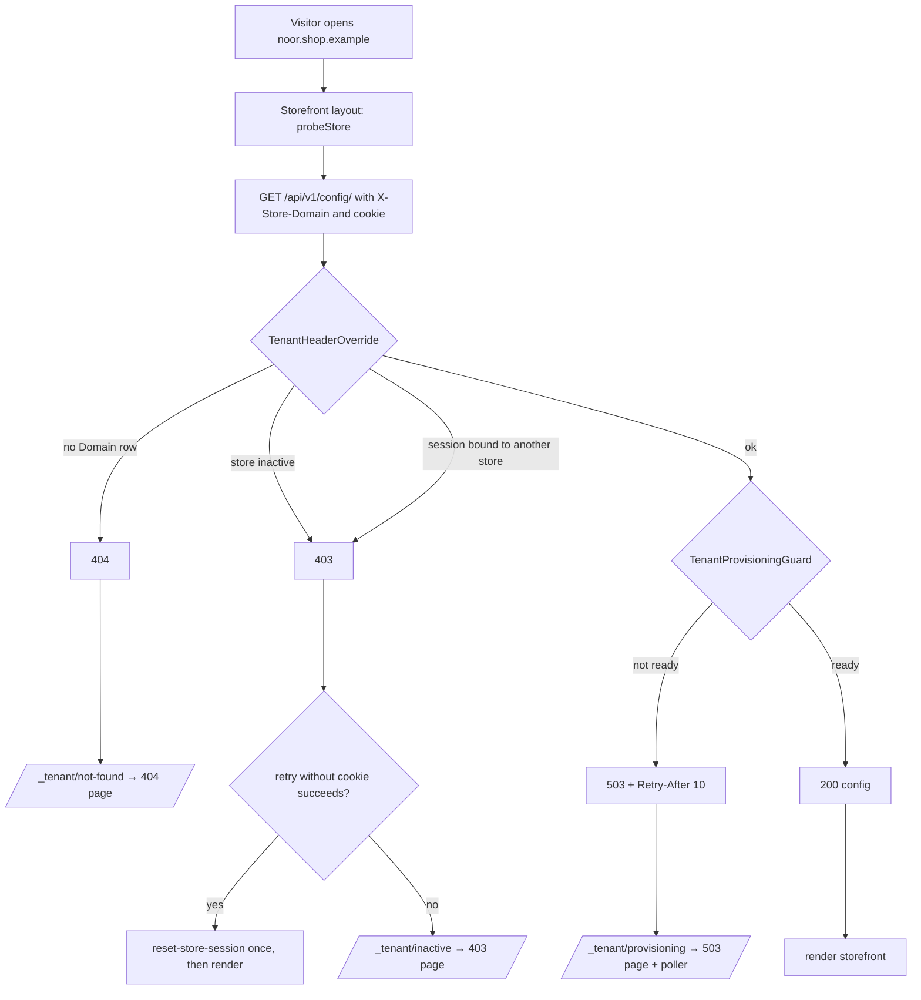

# Tenant resolution & guard API — M47 (تحديد المتجر وحارس التجهيز)

> **Source**: DOC-049 · INT-002 (M47) · inventory Domain 1
> **Live key**: *Django-first, no switch* (status «Already Integrated») — `probeStore()` calls Django on every store-origin request; a fixture answers only when Django has no row for the host (`404`) or is unreachable, and only while `SHARWA_MOCKS=on` ([`bff.md#django-first`](../../overview/bff.md#django-first))
> **Django provider**: `sharwa_saas/api/middleware.py` (`TenantHeaderOverrideMiddleware`) · `sharwa_saas/tenants/middleware.py` (`TenantProvisioningGuardMiddleware`) · `tenants/templates/tenants/store_provisioning_wait.html` · the probed route is `GET /api/v1/config/` (payload in [`config.md`](config.md))
> **Frontend contract**: `sharwa-frontend/src/features/tenant/{schemas,api/probe}.ts` · `src/lib/schemas/{store-config,provisioning}.ts` · fixtures `src/mocks/tenant/config.ts` · proxy `src/proxy.ts` · layout `src/app/(storefront)/%5Fs/[store]/layout.tsx` · error pages `src/app/(onboarding)/%5Ferrors/{store-not-found,store-inactive,store-provisioning}/page.tsx`
> **Tests**: `sharwa_saas/api/test_tenant_guard_api.py` (`TenantGuardProbeTests`, 5 tests — the probe contract)
> **Last verified against code**: 2026-10-27 (step 06)

## 1. Overview

Every store is reached by its own host (`<sub>.<base>` or a custom domain). Before the storefront renders anything, its layout asks Django one question: **what is the state of the store behind this host?** The question is `GET /api/v1/config/` with the header `X-Store-Domain: <host>`. The status code is the answer:

| Status | Meaning |
|---|---|
| `200` | the store is ready; the body is its config |
| `404` | no store is linked to that host |
| `403` | the store exists but is inactive, **or** the visitor's session belongs to a different store |
| `503` + `Retry-After: 10` | the store's schema is not ready (`pending`, `provisioning` or `failed`) |

There is no dedicated "probe" endpoint. The three non-`200` answers are produced by two Django middlewares that run **before** the config view; the view is only reached when the store is fine. The same state check also protects every other `/api/` route of that store — a `pending` store answers `503` on all of them, never a `500` (`relation does not exist`).

Callers: the Next.js storefront layout (server-side, uncached), the onboarding wait page's poller (`HEAD` on the same URL), and any API client that sends `X-Store-Domain`. No login is needed.

## 2. Access — gate chain

Middleware order in `config/settings.py` (the first that answers wins):

| # | Middleware | Requirement | Failure |
|---|---|---|---|
| 1 | `RealIpMiddleware` | none — records the real client IP for later rate limits | — |
| 2 | `TenantMainMiddleware` (django-tenants) | resolves a store from `Host` | public schema when the host is the platform |
| 3 | `SessionMiddleware` | none — makes `request.session` available | — |
| 4 | `TenantHeaderOverrideMiddleware` | **only for paths starting with `/api/`** and only when `X-Store-Domain` is present (trimmed, lower-cased) | `404`, `403` — see §4.2 |
| 5 | `TenantProvisioningGuardMiddleware` | the resolved store is on a non-public schema and `provisioning_status != "ready"` | `503` HTML + `Retry-After: 10` — see §4.3 |
| 6 | the view | `HasTenantContext` for `/config/` | — |

## 3. Endpoint summary

| Method | Django path | BFF path | Purpose | Answers |
|---|---|---|---|---|
| `GET` | `/api/v1/config/` | none — read server-side by `probeStore()` (not through `/api/bff`) | state of the store behind the host | `200` · `404` · `403` · `503` |
| `HEAD` | `/api/v1/config/` | `/api/v1/config/` through the same-origin passthrough ([`bff.md#passthrough`](../../overview/bff.md#passthrough)) | the visitor's waiting page polls this every 10 s | same statuses, no body |

## 4. The probe

### 4.1 `GET /api/v1/config/` as a probe

**Request headers** (what `probeStore()` sends)

| Header | Value |
|---|---|
| `accept` | `application/json` |
| `x-store-domain` | the store host, e.g. `noor.localhost` (the slug or the full custom domain) |
| `x-forwarded-host` | the same host |
| `cookie` | the browser's `Cookie` header, so Django sees the real session |

The call uses `cache: "no-store"` and `redirect: "manual"`.

**Response `200`** — the config payload. The guard contract only requires these nine fields to be present (`REQUIRED_CONFIG_FIELDS` in `test_tenant_guard_api.py`); the rest is in [`config.md`](config.md).

```json
{
  "store_name": "متجر نور",
  "primary_color": "#…",
  "secondary_color": "#…",
  "background_color": "#…",
  "text_color": "#…",
  "heading_font": "…",
  "body_font": "…",
  "design_style": "…",
  "theme_preset": "…",
  "sections": []
}
```

Values are from the front-end tenant fixture `noor` (`src/mocks/tenant/config.ts`), abbreviated.

### 4.2 `404` and `403` — `TenantHeaderOverrideMiddleware`

Why the header exists: a mobile app or Postman reaches the API through one fixed host and has no store subdomain; `X-Store-Domain` names the store explicitly. It works **only under `/api/`**; store and dashboard pages stay bound to their `Host`, so a forged header on a browser page cannot reach another store.

| Case | Status | Body |
|---|---|---|
| no `Domain` row equals the header value | `404` | `{"detail": "لا يوجد متجر مرتبط بالنطاق \"<domain>\" في ترويسة X-Store-Domain."}` |
| the store has `is_active = false` | `403` | `{"detail": "هذا المتجر غير نشط حالياً."}` |
| the session is bound to another store (`auth_tenant_schema` ≠ this store) | `403` | `{"detail": "الجلسة الحالية موثَّقة على متجر مختلف — لا يمكن التحويل إلى متجر آخر بهذه الجلسة."}` |

For the third case the connection is put back on the public schema before answering, so no later query touches the store's data. An unauthenticated request (or one whose session carries no binding) switches normally.

Both `403` bodies are JSON with a `detail` key, and **they are not distinguishable by status**; the front end tells them apart by behaviour (§4.4).

### 4.3 `503` — `TenantProvisioningGuardMiddleware`

A new store gets its `Domain` row at once, but its database schema is created by a background task within a minute or two. A request in between would have hit `ProgrammingError`. The guard answers instead:

| Condition | Answer |
|---|---|
| `provisioning_status` is `pending` or `provisioning` | `503`, an HTML page titled «المتجر قيد التجهيز» (`<h2>` «<store name> قيد التجهيز»), `<meta http-equiv="refresh">` every 10 s |
| `provisioning_status` is `failed` | `503`, the HTML variant «تعذّر تجهيز <store name>» with «واجهنا مشكلة أثناء تجهيز هذا المتجر. فريق الدعم أُبلغ وسيتواصل مع صاحب المتجر قريباً.» and no auto-refresh |

Headers on both: `Retry-After: 10`, `Cache-Control: no-store`. The page is rendered with `render_to_string` without a request because the project's context processors query store tables that do not exist yet. The public schema is never guarded. The body is HTML, not JSON — API clients should read the status and `Retry-After`, not the body.

States and how a store moves between them: [`m02-onboarding.md#provisioning`](m02-onboarding.md#provisioning).

### 4.4 What the storefront does with each answer

`probeStore()` maps the HTTP answer to one of five outcomes (`resolutionOutcomes` in `src/lib/schemas/provisioning.ts`); the storefront layout acts on the outcome.

| Django answer | `probeStore()` outcome | Storefront behaviour |
|---|---|---|
| `200` and the body passes `storeConfigSchema` | `ok` | render the store |
| `200` but the body does **not** pass the schema | `not_found` | the "no store" page (the config would crash the page, so it is treated as missing; logged with `console.error`) |
| `404` | `not_found`; with `SHARWA_MOCKS=on` and a fixture slug (`noor`, `shop`, …) the fixture answers instead | `redirect("/_tenant/not-found")` → the proxy rewrites to `/_errors/store-not-found` with a real **`404`**. Page «لم نجد متجراً بهذا العنوان», body «تحقّق من العنوان الذي كتبته، أو أنشئ متجرك الآن.», button «أنشئ متجرك على شروة» → `<platform>/register` |
| `403`, cookie present, and the same call **without the cookie** succeeds | `session_bound_elsewhere` (with the config) | the session belongs to another store. The layout redirects once to `/api/bff/public/reset-store-session?next=/`, which expires `sessionid` and sets a 60-second `sharwa_session_reset` cookie, then returns to `/`. With the cookie set it renders the store (or, if the retry gave no config, the inactive page) — this prevents a loop |
| `403` otherwise | `inactive` | `redirect("/_tenant/inactive")` → real **`403`**. Page «هذا المتجر غير متاح حالياً», body «إن كنت صاحب المتجر، تواصل مع دعم شروة لمعرفة السبب.», a WhatsApp support button |
| `503` | `provisioning` with `retryAfter` = the `Retry-After` header (default 10) | `redirect("/_tenant/provisioning")` → real **`503`** + `Retry-After: 10`. Page «جارٍ تجهيز متجرك» with a poller that opens the store as soon as it is ready |
| any other status (e.g. `500`) | `provisioning`, retry 10 | same wait page — an unexpected status is treated as "not ready yet", not as "not found" |
| Django unreachable | the fixture for a fixture slug (mocks on), otherwise `provisioning`, retry 10 | a dead backend is a platform outage, not a tenant state; the wait page is shown rather than claiming the store does not exist |

Why the redirect through `/_tenant/*`: a Server Component cannot set an HTTP status. The proxy (`src/proxy.ts`) rewrites `/_tenant/not-found`, `/_tenant/inactive` and `/_tenant/provisioning` to the `(onboarding)` error pages **with** the contract's status (404, 403, 503 + `Retry-After: 10`). The visible URL stays on the store's own host and carries no tenant identifier. The probe is awaited without a `<Suspense>` boundary above it for the same reason: a boundary would let Next flush a `200` shell first.



### 4.5 `HEAD /api/v1/config/` for the visitor poll

When a visitor reaches a store that is still being prepared and has no status token (for example they opened the store URL directly), the wait page polls `HEAD /api/v1/config/` every 10 s through the same-origin passthrough. The passthrough strips the body from `HEAD` answers. `res.ok` means ready: the page confirms for two seconds, then navigates (`window.location.assign`). Any other answer — including `503` — counts as "still provisioning"; the HEAD path can never report `failed`. With a token the poller uses the status route instead — [`m02-onboarding.md#provisioning`](m02-onboarding.md#provisioning).

## 5. Gaps closed, bugs fixed and migrations

- **2026-09-16 — critical isolation fix.** Before it, a session logged in to store A could send `X-Store-Domain: B` and work inside store B, because `is_merchant_authenticated` is a global flag in the session. Now a session that carries `auth_tenant_schema` can never switch store through the header; only unauthenticated requests can use it.
- **2026-10-20 — session read from the wrong schema.** The BFF reaches Django on one host (`localhost:8000`), so the request starts on the public schema and the session was loaded from the public sessions table: login answered `204` and `/auth/me/` answered `401` forever. After switching the tenant, the middleware now re-creates the session store with the same key so it loads from the store's schema.
- **Task 2.1 — provisioning guard.** Added `TenantProvisioningGuardMiddleware` so an incomplete store answers `503` instead of `500`.
- No migration belongs to this module; it reads `tenants.Client.provisioning_status`, `tenants.Client.is_active` and `tenants.Domain`.

## 6. Open items and legacy-only behaviour

- A store whose provisioning **failed** also answers `503` + `Retry-After: 10`, and `probeStore()` maps it to the same `provisioning` outcome as a store that is merely waiting. The visitor sees "جارٍ تجهيز متجرك" indefinitely unless the poller learns the failure from the status route. Only the Django HTML variant (not shown by the Next page) says «تعذّر تجهيز …». Decision needed: expose `failed` as its own outcome.
- An unexpected `5xx` from `/config/` is shown as "provisioning" rather than as an error page.
- The `/_tenant/*` routes exist on store origins only; on the platform origin and reserved hosts the proxy blocks them.
- `demo` is a reserved subdomain and can never be a store, which is why no fixture uses it.

## 7. Related pages

- [`config.md`](config.md) — the `200` payload
- [`m02-onboarding.md#provisioning`](m02-onboarding.md#provisioning) — provisioning states, the status route and the sweeper
- [`../../overview/auth.md`](../../overview/auth.md) — tenant pinning of sessions
- [`../../overview/bff.md#passthrough`](../../overview/bff.md#passthrough) — `HEAD` through the passthrough
- [`../../overview/errors.md`](../../overview/errors.md) — error bodies
