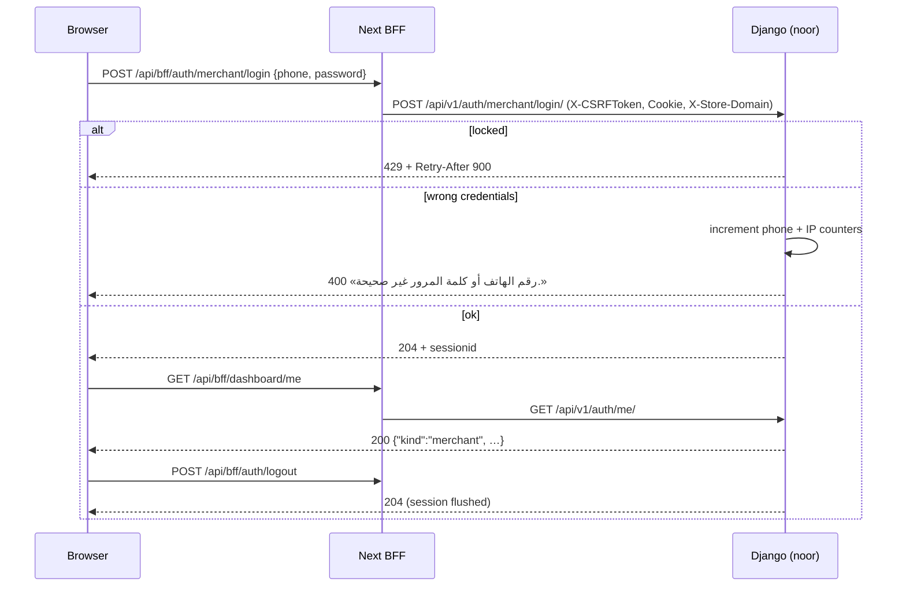
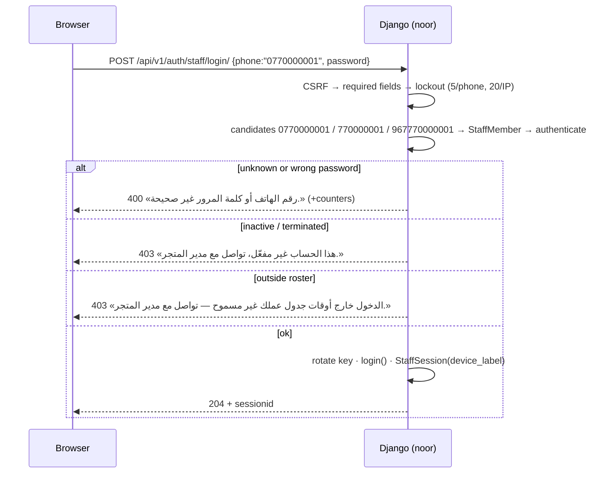
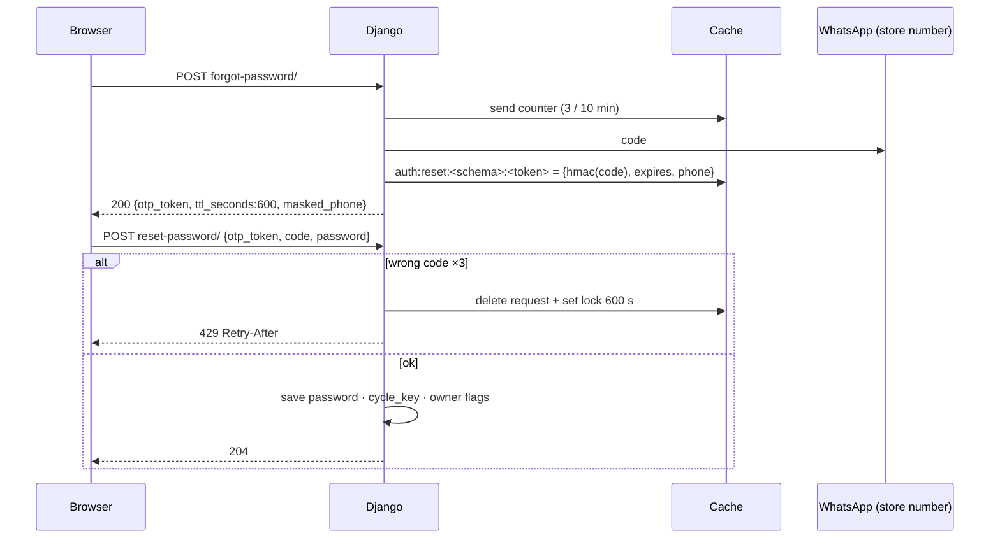

# Dashboard auth API — M03 (المصادقة وهيكل اللوحة)

> **Source**: DOC-017, DOC-018, DOC-019 · INT-003 (M03), INT-022 (M18) · inventory Domain 2
> **Live key**: *Django-first, no switch* — the BFF calls Django on every request; the fixture answers only when Django is unreachable (or answers 404/405/501) **and** `SHARWA_MOCKS=on`
> **Django provider**: `sharwa_saas/api/views_auth.py` · `products/views/auth_security.py` (shared lockout constants, messages) · `products/middleware.py` (`StaffSessionMiddleware`) · `products/services/staff_service.py` (`roster_allows`, `device_label`) · `tenants/provisioning.py` (setup token) · `tenants/views.py` (`tenant_provisioning_status`)
> **Frontend contract**: `sharwa-frontend/src/features/dashboard-shell/schemas.ts` (`sessionSchema`, `staffContextSchema`) · fixtures `src/mocks/dashboard/{auth,me}.ts` · BFF `src/app/api/bff/auth/**`, `src/app/api/bff/dashboard/me/route.ts`
> **Tests**: `sharwa_saas/api/test_auth_api.py` (13) · `api/test_dashboard_api.py` (staff login 7, forgot/reset 7) · `api/test_onboarding_api.py` (`SetupPasswordApiTests`, status poll) · `api/test_staff_api.py` (`test_roster_enforced_at_login`)
> **Last verified against code**: 2026-10-27 (step 03)

## 1. Overview

M03 owns how a person gets into the dashboard of **one store**: the owner (store's WhatsApp phone + dashboard password), a staff member (phone + password issued by the owner), and the recovery of a lost owner password. Every route lives under `/api/v1/auth/…` on the **store host** (or any host with `X-Store-Domain`) and answers with the store's own session cookie. The session model, CSRF, lockouts and the identity matrix are described in [`../../overview/auth.md`](../../overview/auth.md) and [`../../overview/csrf.md`](../../overview/csrf.md); this page documents the routes.

Credentials are the **same** as the legacy Django screens (`merchant_login`, `staff_login_view`): the Next.js routes are JSON versions of them, they share the lockout counters in the cache (a lock set on the Django screen holds on the Next.js screen and the reverse), and they write the same session keys.

## 2. Access — gate chain

| # | Gate | Requirement | Failure |
|---|---|---|---|
| 1 | Tenant | a store is resolved (`Host` or `X-Store-Domain`), active, provisioned — [`auth.md#tenant-pinning`](../../overview/auth.md#tenant-pinning) | `404` / `403` / `503` before the view; `403` «لم يتم تحديد المتجر المطلوب. …» from `HasTenantContext` · with **no session cookie** on the public host the answer is `403` «لم يتم تزويد بيانات الدخول.» instead ([rule](../../overview/auth.md#no-store-no-session)) |
| 2 | CSRF | `X-CSRFToken` matching the `csrftoken` cookie on every `POST` (explicit `_enforce_csrf` on the login/password routes, `MerchantSessionAuthentication` on logout/me) | `403` `{"detail": "CSRF Failed: …"}` |
| 3 | Session | only `logout` and `me` look at it; the others have no session yet | `me`: `401` «انتهت جلستك، سجّل الدخول مجدداً.» |
| 4 | Plan feature / permission key | none — auth is open to every plan and has no permission key | — |
| 5 | State | `setup_required` (store has no password yet) is a `409` on login, forgot, reset | see each route |

## 3. Endpoint summary

| Method | Django path (`/api/v1/auth/…`) | BFF path (`/api/bff/…`) | Purpose | Success |
|---|---|---|---|---|
| `GET` | `csrf/` | `auth/csrf` | CSRF token ([`csrf.md`](../../overview/csrf.md)) | `200 {csrfToken}` |
| `POST` | `merchant/login/` | `auth/merchant/login` | owner login | `204` + cookie |
| `POST` | `merchant/setup-password/` | `auth/setup-password` | first password of a new store | `204` + cookie |
| `POST` | `merchant/forgot-password/` | `auth/forgot-password` | WhatsApp code to the store's number | `200 {otp_token, ttl_seconds, masked_phone}` |
| `POST` | `merchant/reset-password/` | `auth/reset-password` | code + new password | `204` + cookie |
| `POST` | `staff/login/` | `auth/staff/login` | staff login | `204` + cookie |
| `POST` | `logout/` | `auth/logout` | owner **or** staff logout | `204` |
| `GET` | `me/` | `dashboard/me` | current session | `200` session object |

BFF behaviour (all rows): `tryTargetAuth` (`src/lib/bff/auth-adapter.ts`) calls the Django route; if Django answers **404/405/501** or is unreachable it returns `null` and the route falls back to the fixture **only** when `SHARWA_MOCKS=on` (otherwise `notAvailable()`). Any other Django answer is forwarded verbatim, with its cookies. The BFF uses the browser's `x-csrftoken` or, when absent, fetches one server-side with the browser's cookie. `GET /api/bff/dashboard/me` resolves the session from Django and removes `csrf_token` from the body (the token travels only as a layout prop); it flags **only fixture sessions** with `x-sharwa-mock: 1` — a live session never lights the dev «بيانات تجريبية» strip.

<a id="owner"></a>
## 4. Store owner: login, logout, me, setup-password

**Credentials.** `phone` = the store's registered WhatsApp number (`StoreSetting.whatsapp_number`), `password` = `StoreSetting.admin_password` (hashed). The phone is compared after `clean_phone_number`, so `770000011`, `0770000011` and `967770000011` are one number.

### `POST /api/v1/auth/merchant/login/`

**Request body** (`application/json`)

| Field | Type | Required | Rules |
|---|---|---|---|
| `phone` | string | yes | trimmed; normalised with `clean_phone_number` |
| `password` | string | yes | trimmed |

```bash
# fixture: store noor, token from GET /api/v1/auth/csrf/ (see csrf.md)
curl -i -c jar -b jar -H "X-Store-Domain: noor.localhost" -H "X-CSRFToken: $TOKEN" \
     -H "Content-Type: application/json" \
     -d '{"phone":"967770000011","password":"sharwa-local-demo"}' http://localhost:8000/api/v1/auth/merchant/login/
```

**Response `204 No Content`** with `Set-Cookie: sessionid=…; HttpOnly; SameSite=Lax`. No body.

**Errors**

| Status | Body | When |
|---|---|---|
| `400` | `{"phone": ["أدخل رقم الهاتف."], "password": ["أدخل كلمة المرور."]}` (only the missing ones) | a field is missing or blank |
| `400` | `{"detail": "رقم الهاتف أو كلمة المرور غير صحيحة."}` | wrong phone **or** wrong password — one message for both; `check_password` always runs so the timing is the same |
| `403` | `{"detail": "CSRF Failed: CSRF token missing."}` | no/invalid `X-CSRFToken` |
| `409` | `{"detail": "لم تُعيَّن كلمة مرور لوحة التحكم بعد — عيّنها أولاً من «تعيين كلمة المرور».", "code": "setup_required"}` | the store has no password yet |
| `429` | `{"detail": "تم تجاوز عدد محاولات الدخول المسموح بها. يرجى المحاولة بعد 15 دقيقة."}` + `Retry-After: 900` | lockout |

**Rules**

- Check order: CSRF → required fields → `setup_required` (409) → lockout (429) → password. **The lockout is checked before the password**, so the right password is refused while locked.
- Lockout counters (cache, shared with the Django screen): `rl:<schema>:merchant_login:phone:<cleaned phone>` limit **5**, `rl:<schema>:merchant_login:ip:<ip>` limit **20**, window **900 s**. Each failed attempt increments both; a success deletes only the phone counter. The per-IP ceiling is loose on purpose (several shops behind one carrier address — [`rate-limits.md`](../../overview/rate-limits.md)).
- On success: `session.cycle_key()` (new session key, data kept — blocks session fixation), then `session["is_merchant_authenticated"] = True` and `session["auth_tenant_schema"] = <schema>`.

### `POST /api/v1/auth/merchant/setup-password/`

First password of a **new** store. Decision of the owner (2026-10-21, item 9): a new store without a password must not open to whoever reaches it first, so this route requires a short-lived signed **setup token**.

**Where the token comes from.** After registration the browser polls `GET /register/status/<status-token>/` (public schema, **not** under `/api/v1`; `tenants/views.py::tenant_provisioning_status`, 3-second poll, 429 `{"status":"throttled"}` per IP). When the store is `ready` the answer contains the store links (`store_url`, `dashboard_url`) and **`setup_token`** — a `django.core.signing` value (salt `tenants.setup_password`) bound to the store's schema, valid **1 hour** (`SETUP_TOKEN_MAX_AGE_SECONDS = 3600`). Only the browser that holds the status token (that passed the WhatsApp code at registration) can read it; the dashboard link carries it to the first-password screen.

**Request body**

| Field | Type | Required | Rules |
|---|---|---|---|
| `password` | string | yes | ≥ 8 characters, at least one letter (Latin or Arabic), at least one digit (`validate_password_strength`) |
| `password_confirm` | string | yes | equal to `password` |
| `setup_token` | string | yes | valid, unexpired, for **this** store |

**Response `204`** + session cookie (same session keys as login: `cycle_key()`, `is_merchant_authenticated`, `auth_tenant_schema`).

| Status | Body | When |
|---|---|---|
| `400` | `{"password": ["كلمة المرور يجب أن تتكون من 8 خانات على الأقل."]}` · `{"password": ["كلمة المرور يجب أن تحتوي على حرف واحد على الأقل."]}` · `{"password": ["كلمة المرور يجب أن تحتوي على رقم واحد على الأقل."]}` · `{"password_confirm": ["كلمتا المرور غير متطابقتين."]}` | strength / confirmation |
| `403` | `{"detail": "رابط تفعيل المتجر غير صالح أو منتهٍ. افتح الرابط من صفحة تجهيز المتجر، أو فعّل المتجر برمز واتساب من لوحة التحكم.", "code": "setup_token_invalid"}` | token missing, forged, expired, or issued for another store |
| `409` | `{"detail": "كلمة مرور المتجر معيّنة بالفعل — سجّل الدخول.", "code": "already_set"}` | the store already has a password (checked **first**; the token is single-use in effect) |
| `429` | `{"detail": "محاولات كثيرة، حاول بعد 900 ثانية"}` + `Retry-After: 900` | more than 10 calls / 15 min from one IP (`rl:<schema>:setup_password:ip:<ip>`) |

Order: CSRF → `already_set` (409) → IP limit (429) → token (403) → password rules (400) → save. The password is stored with `make_password`.

> ⚠️ Discrepancy — roadmap says «`/register/status/<token>/` carries `setup_token`» (implying once) / code does: `tenant_provisioning_status` adds a **fresh** `setup_token` to **every** `ready` poll for as long as the status token is valid (1 hour, `STATUS_TOKEN_MAX_AGE_SECONDS`). Single use is enforced by the `409 already_set` check, not by the token itself.

### `POST /api/v1/auth/logout/`

Shared by owner and staff. Authentication: `MerchantSessionAuthentication` (CSRF enforced when a session exists). Ends the matching `StaffSession` row (`revoked_at = now`) if the caller is staff, then `session.flush()` (destroys the session and all its keys). **`204` with or without a session.** A request without a valid CSRF token but with a session is `403`.

### `GET /api/v1/auth/me/`

Authentication: `MerchantSessionAuthentication`; `HasTenantContext`. The caller is the owner when `is_merchant_authenticated` is true and `auth_tenant_schema` is `None` or this store; otherwise a staff member when `request.staff` is set. No match: **`401`** `{"detail": "انتهت جلستك، سجّل الدخول مجدداً."}` — the frontend treats any non-2xx as «no session» and redirects to login.

```json
{
  "kind": "merchant",
  "store_name": "متجر noor",
  "store_host": "noor.localhost",
  "features": ["inventory", "refunds", "pos"]
}
```

Staff add a `staff` object (`kind: "staff"`):

```json
{
  "kind": "staff",
  "store_name": "متجر noor",
  "store_host": "noor.localhost",
  "staff": {
    "full_name": "سارة الحربي",
    "roles": ["كاشير"],
    "permissions": ["customers.view", "orders.update_status", "orders.view"],
    "locations": [{"id": 1, "name": "الفرع الرئيسي"}]
  },
  "features": ["inventory", "refunds", "pos"]
}
```

| Field | Type | Source |
|---|---|---|
| `kind` | `"merchant"` \| `"staff"` | `staff` when `request.staff` is set |
| `store_name` | string | `StoreSetting.store_name` |
| `store_host` | string | `X-Store-Domain` or `Host`, lower-cased, port removed |
| `features` | string[] | plan feature codes enabled for the store (`FeatureFlags`), sorted by code |
| `staff.full_name` | string | `StaffMember.full_name` |
| `staff.roles` | string[] | distinct role names over the member's active `StaffLocationRole` rows |
| `staff.permissions` | string[] | `resolve_context(staff).permissions`, sorted |
| `staff.locations` | `{id, name}[]` | locations of those assignments, by id |

> ⚠️ Discrepancy — the Zod `sessionSchema` also accepts `staff.max_discount_percent` and `behavior` (optional) and `csrf_token`. Django's `MeView` returns none of them (the shell defaults them), and `csrf_token` is injected by the Next.js server, never by this route.

The live shell resolves the session server-side (`GET /api/v1/auth/me/` with the browser's cookie); `GET /api/bff/dashboard/me` exists for client re-checks.

**Mapping.** Owner phone ⇄ `StoreSetting.whatsapp_number`; password ⇄ `StoreSetting.admin_password`; session flags ⇄ `is_merchant_authenticated`, `auth_tenant_schema` (the same keys the Django dashboard reads).
**Side effects.** None besides session rows (`django_session`) and, for staff, `StaffSession` rows. **Idempotency.** Not applicable; replaying a login just rotates the session again.



<a id="staff"></a>
## 5. Staff login

### `POST /api/v1/auth/staff/login/`

Staff are created by the owner/manager (M18, [`staff_service.create_staff`](../../overview/auth.md#staff)): a `StaffMember` plus a Django `User` whose username is the phone, with a **temporary password** (`xxxxx-xxxxx` shape) returned **once** by `POST /api/v1/staff/` and by `POST /api/v1/staff/<id>/reset-password/`.

**Request body**

| Field | Type | Required | Rules |
|---|---|---|---|
| `phone` | string | yes | any equivalent form (below) |
| `password` | string | yes | not trimmed (spaces count) |

**Phone matching.** The username is whatever the manager typed (`700…`, `0770…`), while the frontend sends the unified `967…` form, so `_phone_candidates` searches every equivalent: the raw value, `clean_phone_number(raw)`, and for values starting `967`/`966` the local part with and without a leading `0`. `077…`, `77…` and `96777…` therefore reach the same member.

**Response `204`** + session cookie. On success the view: removes any `is_merchant_authenticated` left by a previous owner login in the same browser; ends the `StaffSession` of the browser's previous key and rotates the key (`rotate_staff_session`); runs Django `login()`; stores `_staff_id` and `auth_tenant_schema`; creates the `StaffSession` row:

| `StaffSession` field | Value |
|---|---|
| `staff` | the member |
| `session_key` | the new key (unique) |
| `token_version_at_issue` | `staff.token_version` now |
| `device_fingerprint` | first 40 hex chars of SHA-256 of the `User-Agent` |
| `device_label` | readable label from the `User-Agent`, e.g. «Chrome · Android» (`device_label()`, migration `0223_staff_api`) |
| `ip_address` | `REMOTE_ADDR` (real client IP after `RealIpMiddleware`) |

**Errors**

| Status | Body | When |
|---|---|---|
| `400` | `{"phone": ["أدخل رقم الهاتف."], "password": ["أدخل كلمة المرور."]}` | missing field |
| `400` | `{"detail": "رقم الهاتف أو كلمة المرور غير صحيحة."}` | unknown phone or wrong password (an unknown phone still runs a dummy `check_password`, same timing) |
| `403` | `{"detail": "هذا الحساب غير مفعّل، تواصل مع مدير المتجر."}` | correct password but `StaffMember.is_active = False` (deactivated **or terminated**) |
| `403` | `{"detail": "الدخول خارج أوقات جدول عملك غير مسموح — تواصل مع مدير المتجر."}` | correct password, active, but outside the roster |
| `403` | `{"detail": "CSRF Failed: …"}` | CSRF |
| `429` | `{"detail": "تم تجاوز عدد محاولات الدخول المسموح بها. يرجى المحاولة بعد 15 دقيقة."}` + `Retry-After: 900` | lockout |

**Rules**

- **Account state is revealed only after the password is right** (no account enumeration): wrong password → the generic 400 even for a deactivated account.
- **Lockout** — same window and message as the owner: **5 failures per phone** (`rl:<schema>:staff_login:phone:<cleaned phone>`) and **20 per IP** (`rl:<schema>:staff_login:ip:<ip>`), 900 s. Checked before the password. A success deletes the phone counter. (The staff counters are **separate** from the owner's.)
- **Roster (INT-022, `enforce_roster_schedule`).** `roster_allows(staff)`: allowed when `enforce_roster_schedule` is false, **or** the member has no `RosterSchedule` rows (no roster = no restriction), **or** now (converted to the store timezone, `StoreSetting.timezone`, default `Asia/Aden`) falls in a slot: `weekday == (local.weekday()+1) % 7` (0 = Sunday … 6 = Saturday) and `starts_at <= local time < ends_at`. This closes the flag that existed but was never enforced.
- **Terminated staff** (`terminated_at` set, `is_active=False`, `token_version+1`, sessions and PATs revoked by `terminate_staff`) cannot log in: they reach the `403` inactive message. Existing sessions die at the next request (`StaffSessionMiddleware`: revoked row / `is_active` false / token version mismatch ⇒ `session.flush()`).
- A staff session never inherits an owner flag (removed on login), and an owner login does not create a `StaffSession`.
- `StaffSessionMiddleware` re-checks every request: row not revoked, member active, `token_version_at_issue == token_version`. `POST /api/v1/staff/<id>/revoke-sessions/` and `reset-password/` bump the version / end sessions, which logs the member out everywhere.

> ⚠️ Discrepancy — roadmap says «15-minute lockout after failed attempts» (phone only implied) and «terminated staff cannot log in» / code does: the staff lockout has a second **per-IP counter of 20** on top of the per-phone 5 (same as the owner), and a terminated member does not get a dedicated message: the answer is the generic inactive `403` «هذا الحساب غير مفعّل، تواصل مع مدير المتجر.», and only after the password is correct.

**Tests.** `api/test_dashboard_api.py`: `test_normalized_phone_logs_in_and_opens_a_staff_session`, `test_local_formats_are_accepted`, `test_relogin_from_the_same_browser_rotates_the_session`, `test_wrong_password_and_unknown_phone_share_one_message`, `test_missing_fields_are_field_errors`, `test_inactive_staff_is_403_only_with_the_right_password`, `test_lockout_blocks_even_the_right_password`, `test_a_previous_owner_flag_is_not_inherited`; `api/test_staff_api.py::test_roster_enforced_at_login`.



<a id="password-reset"></a>
## 6. Owner password reset (forgot / reset)

The code always goes to the **store's registered WhatsApp number** (`StoreSetting.whatsapp_number`); the client never supplies a phone, so nothing can be guessed or redirected. The two routes are the JSON form of the Django `forgot_password` / `reset_password` screens, without a session: the client carries an opaque `otp_token`.

### `POST /api/v1/auth/merchant/forgot-password/`

No body. **Response `200`**

```json
{ "otp_token": "<url-safe random, 43 chars>", "ttl_seconds": 600, "masked_phone": "967•••••011" }
```

| Field | Meaning |
|---|---|
| `otp_token` | `secrets.token_urlsafe(32)`; the handle of this reset request |
| `ttl_seconds` | `RESET_OTP_TTL_SECONDS = 600` |
| `masked_phone` | first 3 + `•••••` + last 3 digits |

**Storage.** Cache key `auth:reset:<schema>:<otp_token>` → `{code_hash, expires_at, phone}` for 600 s. `code_hash` is `salted_hmac("sharwa.dashboard.reset", "<schema>:<otp_token>:<code>")`; the **plain code is never stored**. Code = 6 digits (`secrets.randbelow(900000)+100000`). WhatsApp text: «🔐 *منصة شروة - استعادة كلمة المرور* … رمز التحقق لمتجرك (<store>): *<code>*». With `DEBUG` the code is logged instead of sent, and the static `123456` is also accepted.

| Status | Body | When |
|---|---|---|
| `400` | `{"detail": "لا يوجد رقم واتساب مسجَّل لهذا المتجر. تواصل مع الدعم."}` | the store has no WhatsApp number |
| `403` | `CSRF Failed` | CSRF |
| `409` | `{"detail": "لم تُعيَّن كلمة مرور لوحة التحكم بعد — عيّنها أولاً من «تعيين كلمة المرور».", "code": "setup_required"}` | no password yet (use setup-password) |
| `429` | `{"detail": "محاولات كثيرة، حاول بعد 600 ثانية"}` + `Retry-After: 600` | 3 sends per 10 min per store phone (`rl:<schema>:merchant_reset_send:phone:<phone>`); the counter is checked **before** the send |
| `502` | `{"detail": "تعذّر إرسال رمز التحقق إلى رقم واتساب المتجر. حاول مرة أخرى."}` | WhatsApp delivery failed (no token stored) |

### `POST /api/v1/auth/merchant/reset-password/`

**Request body**

| Field | Type | Required | Rules |
|---|---|---|---|
| `otp_token` | string | yes | from forgot-password |
| `code` | string | yes | 6 digits |
| `password` | string | yes | same strength rules as setup-password |
| `password_confirm` | string | no | if present it must equal `password` (the client already checks it locally) |

**Response `204`** + session cookie: the password is replaced (`make_password`), the pending request and its failure counter are deleted, then `cycle_key()` + `is_merchant_authenticated` + `auth_tenant_schema` — **the owner is signed in**.

| Status | Body | When |
|---|---|---|
| `400` | `{"detail": "انتهت صلاحية الرمز، اطلب رمزاً جديداً."}` | unknown / used / expired `otp_token` |
| `400` | `{"code": ["الرمز غير صحيح."]}` | wrong code (1st and 2nd time) |
| `400` | `{"password": ["كلمة المرور يجب أن تتكون من 8 خانات على الأقل."]}` (or the letter / digit message) | weak password — **the code is not consumed**; fix the password and resend with the same code |
| `400` | `{"password_confirm": ["كلمتا المرور غير متطابقتين."]}` | only when `password_confirm` is sent and differs |
| `409` | `setup_required` body (as above) | no password yet |
| `429` | `{"detail": "محاولات كثيرة، حاول بعد 600 ثانية"}` + `Retry-After` (seconds left) | the **third** wrong code: the request is invalidated and the store phone is **locked for 600 s** (`rl:<schema>:merchant_reset_verify:lock:<phone>`); while locked every reset answers 429 with the remaining seconds |

Counters: wrong codes are counted in `rl:<schema>:merchant_reset_verify:fail:<phone>` (window 600 s); at 3 the counter and the pending request are deleted and the lock is set. A correct code compares with `constant_time_compare` on the HMAC.

Order: CSRF → `setup_required` → token valid/unexpired (400) → lock (429) → code (400/429) → password rules (400) → confirmation (400) → save.

**Examples** (fixture store `noor`; the code arrives on WhatsApp, in DEBUG it is `123456`)

```bash
curl -s -c jar -b jar -H "X-Store-Domain: noor.localhost" -H "X-CSRFToken: $TOKEN" -X POST \
     http://localhost:8000/api/v1/auth/merchant/forgot-password/
# 200 {"otp_token":"…","ttl_seconds":600,"masked_phone":"967•••••011"}

curl -s -i -c jar -b jar -H "X-Store-Domain: noor.localhost" -H "X-CSRFToken: $TOKEN" \
     -H "Content-Type: application/json" \
     -d '{"otp_token":"<from above>","code":"123456","password":"New-demo-pass-1"}' \
     http://localhost:8000/api/v1/auth/merchant/reset-password/
# 204 + sessionid
```

Rate limit (4th send in 10 minutes): `429 {"detail":"محاولات كثيرة، حاول بعد 600 ثانية"}` with `Retry-After: 600` (always the full window). Lock (3rd wrong code): `429 {"detail":"محاولات كثيرة، حاول بعد 600 ثانية"}` with `Retry-After: 600`.

> ⚠️ Discrepancy — roadmap says «3 sends per 10 minutes … lock after 3 wrong codes» / code does the same, but two details are not in the roadmap: (1) the **send** limit's 429 always says «600 ثانية» and `Retry-After: 600` (it does not count down — `too_many(RESET_SEND_WINDOW_SECONDS)`), unlike the lock which reports the remaining seconds; (2) **other owner sessions are not revoked** after a reset — the route only signs the caller in; sessions opened with the old password stay valid until they end (`SESSION_EXPIRE_AT_BROWSER_CLOSE`).

> The fixture `forgotPasswordMock` (`src/mocks/dashboard/auth.ts`) answers `ttl_seconds: 300`; Django answers **600**. Django is the authority; the fixture is only used while Django is unreachable.

**Tests.** `api/test_dashboard_api.py::ForgotResetApiTests`: `test_forgot_matches_the_contract`, `test_reset_with_the_right_code_sets_the_password_and_signs_in`, `test_unknown_token_is_expired`, `test_wrong_code_is_a_field_error_then_locks`, `test_weak_password_keeps_the_code_usable`, `test_mismatched_confirmation_when_sent`, `test_send_limit_and_send_failure`, `test_store_without_a_password_is_setup_required`. Setup password: `api/test_onboarding_api.py::SetupPasswordApiTests`.



## 7. Gaps closed, bugs fixed and migrations

- **INT-003 (2026-10)**: the seven routes above shipped as JSON providers of the Next.js contract; lockout counters and session keys are shared with the legacy Django screens.
- **Session read from the wrong schema (2026-10-20)**: `TenantHeaderOverrideMiddleware` now reloads the session after switching tenant, which fixed «login 204 then `auth/me/` 401» ([`auth.md#tenant-pinning`](../../overview/auth.md#tenant-pinning)).
- **Duplicate `StaffSession` on re-login (2026-10-24)**: `rotate_staff_session` ends the old row and cycles the key before `login()`.
- **Setup token (2026-10-21)**: first password requires the signed token.
- **Migration `0223_staff_api`** (INT-022): `StaffSession.device_label`, `PersonalAccessToken.name` / `last_used_at`, `RosterSchedule.location` (now nullable = all locations), `TrustedDevice.staff` / `last_seen_at`, plus `BehaviorAlert` fields documented with Domain 12. `device_label()` returns browser · system from the `User-Agent` (Edge, Opera, Samsung Internet, Firefox, Chrome, Safari · Android, iPhone, iPad, Windows, macOS, Linux) and «جهاز غير معروف» when neither is recognised.

## 8. Open items and legacy-only behaviour

- No logout-everywhere for the owner and no owner session list (staff only: M18).
- Reset-password does not revoke the owner's other sessions (see discrepancy above).
- The Django HTML screens (`/dashboard/login/`, `/dashboard/staff-login/`, `/dashboard/forgot-password/`) remain; they share counters and session keys with these routes.

## 9. Related pages

- [`../../overview/auth.md`](../../overview/auth.md) · [`../../overview/csrf.md`](../../overview/csrf.md) · [`../../overview/otp.md`](../../overview/otp.md) · [`../../overview/rate-limits.md`](../../overview/rate-limits.md)
- Staff management (create, terminate, sessions, tokens): Domain 12.
