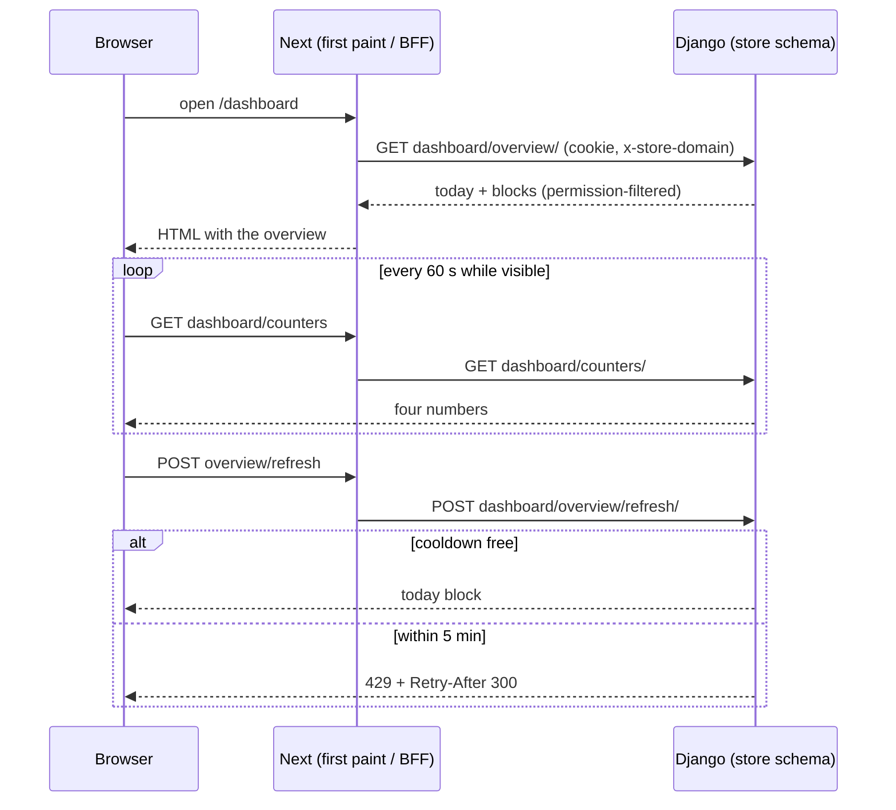

# Dashboard overview API — M03 (النظرة العامة وعدّادات اللوحة)

> **Source**: DOC-054, DOC-055 · INT-003 (M03), INT-049 (M43) · inventory Domain 2
> **Live key**: *Django-first, no switch* — the first paint and the three BFF rows call Django on every request; a fixture answers only when Django is unreachable or lacks the route (`404/405/501`) **and** `SHARWA_MOCKS=on` ([`bff.md#django-first`](../../overview/bff.md#django-first))
> **Django provider**: `sharwa_saas/api/views_dashboard.py` (`DashboardOverviewView`, `DashboardOverviewRefreshView`, `DashboardCountersView`) · `sharwa_saas/products/services/dashboard_service.py` · `products/services/reports_aggregation.py` (`save_daily_metrics`) · `api/views_reports.py` (`REFRESH_COOLDOWN_SECONDS`, `REFRESH_PERMISSION`) · wired in `api/urls.py`
> **Frontend contract**: `sharwa-frontend/src/features/dashboard-shell/schemas.ts` (`overviewSchema`, `todayMetricsSchema`, `attentionSchema`, `topProductSchema`, `countersSchema`) · first paint `features/dashboard-shell/api/overview.ts` (`getOverview`) · fixtures `src/mocks/dashboard/{overview,counters}.ts` · BFF `src/app/api/bff/dashboard/{overview,overview/refresh,counters}/route.ts` (the `account/stores` route and `stores.ts` fixture were removed in Step 52, §7)
> **Tests**: `sharwa_saas/api/test_dashboard_api.py` — `DashboardApiTests` (6 tests)
> **Last verified against code**: 2026-10-27 (step 06)

## 1. Overview

After login the owner or a staff member lands on the dashboard home. It needs, in as few requests as possible:

- **today's numbers** (orders, completed, cancelled, refunded, gross and net revenue);
- **new orders** waiting to be handled;
- **needs your attention** (pending approvals, behaviour alerts, low stock, unread conversations);
- **today's top products** and **visit sources**;
- the **four sidebar badges** on a 60-second poll.

Django computes none of these numbers freshly on each request: today's block, the top products and the sources are read from the single `DailyStoreMetrics` row of today — the same row the reports screen (M25) uses. The rest are live counts.

All three routes live on the **store host**. They are the first example of a block-by-block permission model: the same URL returns different content to the owner and to each staff member (§5).

## 2. Access — gate chain

| # | Gate | Requirement | Failure |
|---|---|---|---|
| 1 | Tenant | `HasTenantContext` — the request resolves to a store schema | `404`/`503` from the tenant guard ([`m47-tenant-guard.md`](../01-public-onboarding/m47-tenant-guard.md)) |
| 2 | Session | `MerchantSessionAuthentication`, then `DashboardAPIMixin.viewer()`: either a staff member (`resolve_request_staff`) **or** an owner session (`is_merchant_authenticated` and `auth_tenant_schema` empty or equal to this store's schema) | `401` `{"detail": "انتهت جلستك، سجّل الدخول مجدداً."}` |
| 3 | Permission | only `refresh`: `reports.sales.view` for staff (the owner has every permission) | `403` `{"detail": "ليست لديك صلاحية لهذا الإجراء."}` |
| 4 | CSRF | `MerchantSessionAuthentication.enforce_csrf` runs for any request that carries an owner or staff session: `POST refresh` needs a valid CSRF token ([`../../overview/csrf.md`](../../overview/csrf.md)); the two `GET`s are not affected | `403` (CSRF failure) |
| 5 | Cooldown | only `refresh`: 5 minutes per store | `429` + `Retry-After: 300` |

The identity matrix and why a pinned owner session of another store gets `401` are in [`../../overview/auth.md`](../../overview/auth.md).

## 3. Endpoint summary

| Method | Django path (`/api/v1/…`) | BFF path (`/api/bff/…`) | Purpose | Cache |
|---|---|---|---|---|
| `GET` | `dashboard/overview/` | `dashboard/overview` (+ server fetch `getOverview` for the first paint) | the whole home screen | `Cache-Control: no-store` |
| `POST` | `dashboard/overview/refresh/` | `dashboard/overview/refresh` | recompute today's numbers | none |
| `GET` | `dashboard/counters/` | `dashboard/counters` | the four sidebar badges | `Cache-Control: no-store` |
| `GET` | *(no Django route)* | ~~`account/stores`~~ | **removed in Step 52** — see [§7](#deprecated) | — |

## 4. Dashboard endpoints

### `GET /api/v1/dashboard/overview/`

**Query parameters**: none.

**Response `200`**

```json
{
  "today": {
    "orders_count": 7,
    "completed_orders_count": 4,
    "cancelled_orders_count": 0,
    "refunded_orders_count": 0,
    "display_gross_revenue": "1,250 ر.س",
    "display_net_revenue": "1,000 ر.س",
    "refreshed_at": "2026-10-27T09:14:02.511234+03:00"
  },
  "new_orders": [
    {
      "id": 41,
      "customer_name": "زبون",
      "customer_phone": "967700000001",
      "display_total": "120 ر.س",
      "status": "new",
      "payment_status": "unpaid",
      "fulfillment_status": { "id": 2, "name": "قيد التجهيز", "color": "#F59E0B" },
      "sales_channel": "online",
      "created_at": "2026-10-27T08:50:00+03:00"
    }
  ],
  "attention": {
    "pending_approvals": 1,
    "unread_behavior_alerts": { "warning": 2, "critical": 0 },
    "low_stock_products": 3,
    "unread_conversations": 5
  },
  "top_products": [
    { "id": 17, "name": "منتج", "image": "http://…/media/p.jpg", "qty": 3, "display_revenue": "30 ر.س" }
  ],
  "traffic_sources": {
    "tiktok": 4, "whatsapp": 2, "instagram": 0, "snapchat": 0, "facebook": 0,
    "telegram": 0, "amazon": 0, "noon": 0, "direct": 0
  }
}
```

The numbers in the example are illustrative; `1,250 ر.س`, `120 ر.س` and `30 ر.س` follow the formats asserted in `test_dashboard_api.py`. Every `display_*` value is a **server-formatted string** (`format_money(amount, currency)`) — the browser never formats or sums money. The values `payment_status`, `sales_channel` and the order `status` are the enums of `schemas.ts`.

| Block | Field | Type | Source |
|---|---|---|---|
| `today` | `orders_count`, `completed_orders_count`, `cancelled_orders_count`, `refunded_orders_count` | number | the `DailyStoreMetrics` row of `timezone.localdate()` |
| `today` | `display_gross_revenue`, `display_net_revenue` | string | `format_money(row.gross_revenue / net_revenue, row.currency)` |
| `today` | `refreshed_at` | string \| null | `row.computed_at` ISO; `null` when there is no row (see Rules) |
| `new_orders[]` | `id`, `customer_name`, `customer_phone`, `display_total`, `status`, `payment_status`, `sales_channel`, `created_at` | — | `Order` with `status = "new"`, newest first, **at most 8** |
| `new_orders[]` | `fulfillment_status` | object \| null | `{id, name, color}` of the order's `OrderStatus`; `color` is the merchant's hex, shown only as a dot |
| `attention` | `pending_approvals` | number | `ApprovalRequest` with `status = "pending"` |
| `attention` | `unread_behavior_alerts` | `{warning, critical}` | unread `BehaviorAlert` counts by level |
| `attention` | `low_stock_products` | number | `product_service.low_stock_count()` — the same number as the products strip |
| `attention` | `unread_conversations` | number | `Conversation` with `unread_count > 0` |
| `top_products[]` | `id` | number | the current `Product` with the same name; **negative** (`-(index+1)`) when the product was deleted or renamed — a display key only, never a link |
| `top_products[]` | `name`, `qty`, `display_revenue` | — | the row's `top_products_snapshot` as sold; `qty = int(total_sold)` |
| `top_products[]` | `image` | string \| null | absolute URL of the product image (`request.build_absolute_uri`), else `image_url`, else `null` |
| `traffic_sources` | nine keys | number | `traffic_source_breakdown`; keys `tiktok, whatsapp, instagram, snapchat, facebook, telegram, amazon, noon, direct` are always present (0 when absent) |

**Errors**

| Status | Body | When |
|---|---|---|
| `401` | `{"detail": "انتهت جلستك، سجّل الدخول مجدداً."}` | no staff session and no owner session for this store |

**Rules**

- **Today is computed on first open.** If no `DailyStoreMetrics` row exists for today, the first overview request computes it once with `save_daily_metrics` (the single allowed on-demand case of the reports aggregation). If that computation raises, the error is logged, the response is still `200`, and `today` is the zero block with `refreshed_at: null` — the overview never fails because of it.
- `top_products` is at most 5 entries (`TOP_PRODUCTS_LIMIT`); `new_orders` at most 8 (`NEW_ORDERS_LIMIT`).
- `traffic_sources` keeps any extra key found in the stored breakdown (the Zod schema is `record<string, int>`), so the UI must ignore keys outside the nine.
- A product name that matches several products resolves to the one with the lowest `id`.

**Mapping** — BFF `dashboard/overview`: `tryStoreTarget` forwards Django's answer unchanged whenever Django answers. Only when Django is unreachable or lacks the route does the BFF check the session itself (`sessionFromRequest`) and answer `401` «انتهت جلستك، سجّل الدخول مجدداً.», then `501` «غير متاح بعد.» with mocks off, or `overviewMock(store)` (`x-sharwa-mock: 1`) with mocks on.

**First paint** — `getOverview(store, storeHost)` runs on the Next server (`cache: "no-store"`, `redirect: "manual"`), forwards the visitor's cookie with `x-store-domain` and `x-forwarded-host`, and parses the answer with `overviewSchema`. Any failure — network error, non-OK status (including `401`), or a payload that does not match — falls back to `overviewMock(store)` when mocks are on, or returns `{data: null}` when they are off.

**Side effects** — the first request of the day may insert today's `DailyStoreMetrics` row. Otherwise read-only.

### `POST /api/v1/dashboard/overview/refresh/`

**Request body**: none.

**Response `200`** — the `today` block only, with `refreshed_at` set to the recomputation time:

```json
{
  "orders_count": 7, "completed_orders_count": 4, "cancelled_orders_count": 0, "refunded_orders_count": 0,
  "display_gross_revenue": "1,250 ر.س", "display_net_revenue": "1,000 ر.س",
  "refreshed_at": "2026-10-27T09:20:11.002+03:00"
}
```

**Errors**

| Status | Body | When |
|---|---|---|
| `401` | `{"detail": "انتهت جلستك، سجّل الدخول مجدداً."}` | no valid session |
| `403` | `{"detail": "ليست لديك صلاحية لهذا الإجراء."}` | staff without `reports.sales.view` |
| `403` | DRF CSRF failure | no valid CSRF token on the `POST` |
| `429` | `{"detail": "يمكنك التحديث مرة كل 5 دقائق فقط للحفاظ على الأداء."}` + `Retry-After: 300` | a refresh already happened in the last 5 minutes |

**Rules**

- **Shared cooldown.** The cooldown key is `reports:refresh-today:<schema>`, exactly the key of the reports screen refresh (M25), so opening both screens does not double the load: a refresh on one blocks the other for five minutes. `Retry-After` is always the full `300`, not the time left.
- The permission check runs **before** the cooldown, so a forbidden staff member never consumes the cooldown.
- The key is set with `cache.add` **before** the numbers are recomputed. If `save_daily_metrics` then raises, the request fails with a server error and the cooldown is already spent.
- Recomputation is `save_daily_metrics(timezone.localdate())`, the same engine as the nightly aggregation.

**Mapping** — BFF `dashboard/overview/refresh`: `tryStoreTarget(…, "POST")` forwards Django's answer (including `403` and `429` + `Retry-After`). The fixture path returns `overviewMock(store, now).today` after a 200 ms delay; it **never** produces `403` or `429`.

**Side effects** — updates today's `DailyStoreMetrics` row; sets the cooldown key for 300 s.

**Idempotency** — a repeat within five minutes is refused with `429`, so the call is safe to retry.

### `GET /api/v1/dashboard/counters/`

**Query parameters**: none.

**Response `200`**

```json
{ "new_orders": 1, "unread_conversations": 5, "pending_approvals": 1, "unread_behavior_alerts": 2 }
```

| Field | Type | Source |
|---|---|---|
| `new_orders` | number | count of `Order` with `status = "new"` — the same filter as the overview block, but **not capped at 8** |
| `unread_conversations` | number | as in `attention` |
| `pending_approvals` | number | as in `attention` |
| `unread_behavior_alerts` | number | `warning + critical` — a **single number**, where `attention.unread_behavior_alerts` is an object |

**Errors**: `401` as above.

**Rules** — the browser polls this route every 60 seconds and never while the tab is hidden (FR-03.12); the overview itself is read once for the first paint, and only the refresh action and the counters go through TanStack Query in the browser.

**Mapping** — BFF `dashboard/counters`: same shape as the overview row, fixture `countersMock(store)`.



## 5. Owner and staff responses (DOC-054)

The owner (`staff = None`) sees every block. A staff member sees a block only with its permission; otherwise the block is **empty or zero, never missing** — the response keeps the same keys, so the client needs no special case. The permission keys are the ones that open the matching sidebar screen, so a number is never shown for a screen the person cannot open.

| Block / field | Permission (staff) | Without the permission |
|---|---|---|
| `today`, `top_products`, `traffic_sources` | `reports.sales.view` | `today` = zeros with `refreshed_at: null` (no row is computed); `top_products` = `[]`; `traffic_sources` = nine zeros |
| `new_orders`, counter `new_orders` | `orders.view` | `[]` / `0` |
| `attention.low_stock_products` | `inventory.view` | `0` |
| `attention.unread_conversations`, counter | `channels.inbox.access` | `0` |
| `attention.unread_behavior_alerts`, counter | `staff.view` | `{warning: 0, critical: 0}` / `0` |
| `attention.pending_approvals`, counter | *(no permission)* | counts only requests whose `approver_role` is one of the staff member's **active** `StaffLocationRole` roles |
| `POST overview/refresh/` | `reports.sales.view` | `403` |

| | Owner | Staff with every permission | Staff with none (and no roles) |
|---|---|---|---|
| overview `today.refreshed_at` | set (computed if missing) | set | `null` |
| overview `new_orders` | up to 8 | up to 8 | `[]` |
| counters | all four live | all four live | all `0` |
| refresh | `200` / `429` | `200` / `429` | `403` |

## 6. Tests

`DashboardApiTests` (`api/test_dashboard_api.py`) covers: anonymous `401` on the three routes; the owner overview matches the contract (top-level keys, `today` keys, `attention` keys, nine traffic keys, today's row created on first open); today's snapshot feeds top products (negative id for a deleted product) and traffic; the new-orders block agrees with the counter; refresh returns `today` and the second call is `429` with `Retry-After: 300`; a staff member with no permissions gets empty blocks, zero counters and `403` on refresh.

> ⚠️ Discrepancy — the roadmap says staff blocks are "zeroed per permission". Code agrees except for `pending_approvals`, which is **not** zeroed by a permission key: it is narrowed to the staff member's own approver roles, so a staff member with no permissions but with a role can still see a non-zero count.

<a id="deprecated"></a>

## 7. Superseded route: `account/stores` (DOC-055)

| Item | Value |
|---|---|
| BFF route | `GET /api/bff/account/stores` (`src/app/api/bff/account/stores/route.ts`) |
| Original purpose | the owner's stores for the topbar switcher (M03 §7, `[NEEDS BACKEND]`, a `MerchantAccount` list) |
| Status | **removed in Phase 003 Step 52 (2026-10-30, DOC-535)** — had no consumer |
| Replacement | `GET /api/v1/merchant/stores/` through the BFF `merchant/stores` (M43, INT-049, `api/views_rollup.py`) |
| Django route | **none** — `api/urls.py` has no `account/stores/` path; the BFF row never calls Django |
| Decided in | INT-003 / INT-049 (A.13 legacy-only list in the roadmap) |

**What the route did before its removal**

| Caller | Answer |
|---|---|
| no session | `401` «انتهت جلستك، سجّل الدخول مجدداً.» |
| staff session | `200` `[]` (staff have no switcher, US-03.3.2) |
| owner session, mocks off | `501` «غير متاح بعد.» |
| owner session, mocks on | `accountStoresMock(store, TENANT_BASE_DOMAIN)` — three fixture stores (`noor`, `shop`, `pending1`) with `x-sharwa-mock: 1` |

Its Zod types (`accountStoreSchema`, `accountStoresSchema`, `AccountStore`) and the fixture `src/mocks/dashboard/stores.ts` exist only for this route; the header comment of `schemas.ts` still lists `/api/v1/account/stores/` as a contract.

**Why it is dead.** The linked stores are read with `useLinkedStores()` (`features/stores-rollup/api.ts`) — per the roadmap, the topbar switcher and the ⌘K palette use it — which calls `apiFetch("/api/bff/merchant/stores", rollupSchema)` for merchant sessions only, cached 5 minutes. The rollup answer carries the per-store figures as well (`stores[]` with `name`, `schema`, `domain`, `is_available`, totals), so one route serves both the «متاجري» screen and the switcher. See [`m43-multi-store.md`](m43-multi-store.md) for the contract.

> ⚠️ Discrepancy — roadmap says "no consumer". In this step the check was made on the files that define or could use the route (the BFF route, its Zod types, the fixture and the `stores-rollup` hooks); a repository-wide text search for `/api/bff/account/stores` was not possible, and the switcher and palette components were not opened, so confirm with `grep -rn "account/stores" src` before deleting.

**Removal — done in Step 52 (2026-10-30)**: delete `src/app/api/bff/account/stores/route.ts`, `src/mocks/dashboard/stores.ts` and the three `accountStore*` exports of `schemas.ts`, and drop the line from `src/app/api/bff/README.md`. The removal is tracked by DOC-462 in the roadmap; the deprecation is recorded in [`../../CHANGELOG.md`](../../CHANGELOG.md) (Step 06).

## 8. Open items

- `getOverview` falls back to the fixture on **any** failure, including a Django `401`, when mocks are on. With mocks off it returns `data: null`.
- The BFF treats any Django `404/405/501` on these three routes as "route missing" and may answer from the fixture ([`bff.md#django-first`](../../overview/bff.md#django-first)).
- `src/app/api/bff/README.md` still labels the dashboard rows "mock"; see [`bff.md#live-keys`](../../overview/bff.md#live-keys).

## 9. Related pages

- [`m03-auth.md`](m03-auth.md) — login, logout and `me` for the same dashboard
- [`m43-multi-store.md`](m43-multi-store.md) — the replacement for `account/stores`
- [`../../overview/auth.md`](../../overview/auth.md) — owner and staff identity
- [`../../overview/bff.md#django-first`](../../overview/bff.md#django-first) — adapter rules
- [`../../overview/errors.md`](../../overview/errors.md) — error bodies and `Retry-After`
