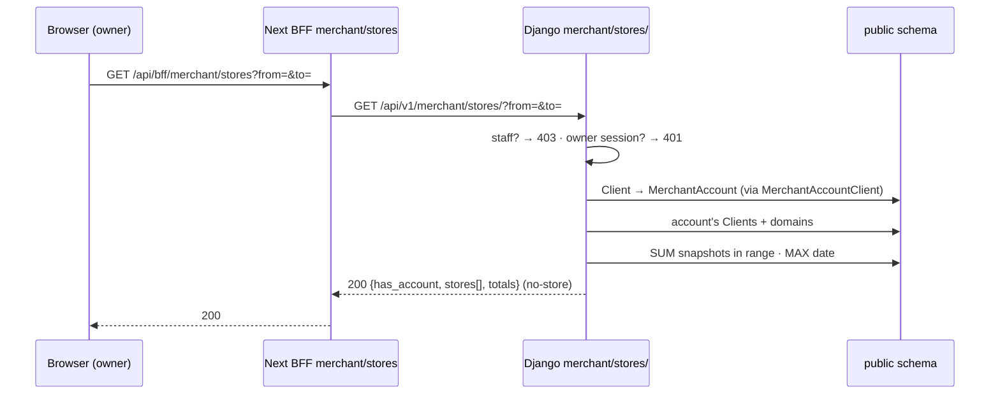

# Multi-store rollup API — M43 (لوحة مالك المتاجر المتعددة)

> **Source**: DOC-059 · INT-049 (M43) · inventory Domain 2
> **Live key**: `rollup` (`SHARWA_LIVE_MODULES`) — one BFF row, `liveOrMock(…, "rollup", "/api/v1/merchant/stores/", …)` ([`bff.md#live-keys`](../../overview/bff.md#live-keys))
> **Django provider**: `sharwa_saas/api/views_rollup.py` (`MerchantStoresView`) · `sharwa_saas/tenants/merchant_rollup.py` (`rollup`, `date_range`, `_account_for`) · models `tenants/models.py` (`Client`, `Domain`, `MerchantAccount`, `MerchantAccountClient`, `TenantStatsSnapshot`) · wired in `api/urls.py` (`merchant/stores/`, name `merchant-stores`)
> **Frontend contract**: `sharwa-frontend/src/features/stores-rollup/schemas.ts` (`rollupSchema`, `rollupStoreSchema`, `NO_DOMAIN`) · hooks `features/stores-rollup/api.ts` (`useRollup`, `useLinkedStores`) · screen `features/stores-rollup/components/stores-screen.tsx` (`/dashboard/stores`) · fixture `src/mocks/rollup/state.ts` · BFF `src/app/api/bff/merchant/stores/route.ts`
> **Tests**: `sharwa_saas/api/test_rollup_api.py` — `RollupTests` (4 tests) · mock E2E `scripts/rollup-check.ts`
> **Last verified against code**: 2026-10-27 (step 07)

## 1. Overview

A merchant who owns several Sharwa stores has one **`MerchantAccount`** (outside any store schema) linked to those stores. This route answers, from the dashboard of **any** of them, the question «how are all my stores doing?»: one row per linked store with orders, completed, refunded and revenue for a date range, plus totals.

The same payload feeds two places in the UI: the **«كل متاجري»** screen at `/dashboard/stores` (the rollup table with a date range) and the **topbar store switcher** (`useLinkedStores`, no date range, cached 5 minutes). It replaces the superseded `account/stores` BFF route ([`m03-overview.md#deprecated`](m03-overview.md#deprecated)).

Three design points:

- **Numbers come from daily snapshots, not from live queries.** Each store's totals are summed from `TenantStatsSnapshot` rows in the `public` schema. No query crosses into another store's schema, so the cost does not grow with the data of the stores (§4.4).
- **The server formats and totals everything** (FR-43.03). `display_revenue_sar` is a string in SAR; the browser never sums or formats money ([`../../overview/money.md`](../../overview/money.md)).
- **Owner only.** Staff cannot use it, whatever their permissions.

The route is on the **store host**. The legacy HTML page `merchant/master-dashboard/` (`tenants.views.merchant_master_dashboard`) is untouched and keeps its own behaviour.

## 2. Access — gate chain

Evaluated in this order; the first failing gate answers.

| # | Gate | Requirement | Failure |
|---|---|---|---|
| 1 | Tenant | `HasTenantContext` — the request resolves to a store schema (the tenant guard answers first for an unknown host, [`../01-public-onboarding/m47-tenant-guard.md`](../01-public-onboarding/m47-tenant-guard.md)) | `403` `{"detail": "لم يتم تحديد المتجر المطلوب. استخدم النطاق الفرعي للمتجر أو أرسل ترويسة X-Store-Domain."}` · with **no session cookie** on the public host the answer is `403` «لم يتم تزويد بيانات الدخول.» instead ([rule](../../overview/auth.md#no-store-no-session)) |
| 2 | Staff | `resolve_request_staff(request)` must be `None` — a staff member is refused **before** the owner check | `403` `{"detail": "هذه الصفحة لمالك المتجر فقط."}` |
| 3 | Owner session | `is_merchant_authenticated` is true **and** the session's `auth_tenant_schema` is empty or equals this store's schema | `401` `{"detail": "انتهت جلستك، سجّل الدخول مجدداً."}` |
| 4 | CSRF | `GET` is not affected ([`../../overview/csrf.md`](../../overview/csrf.md)) | — |
| 5 | Plan feature / permission key | none — the route has no plan-feature gate and no permission key | — |

An owner session pinned to **another** store (`auth_tenant_schema` of a different schema) fails gate 3 with `401`, so the frontend sends the user back to the login screen. A session with no `auth_tenant_schema` at all is accepted as this store's owner. The 401 body is the same sentence the other dashboard routes use ([`../../overview/auth.md`](../../overview/auth.md)).

> The screen repeats gate 2 in the browser: `StoresScreen` shows «هذه الصفحة لمالك المتجر فقط» to a non-owner and never calls the route.

## 3. Endpoint summary

| Method | Django path (`/api/v1/…`) | BFF path (`/api/bff/…`) | Purpose | Gate |
|---|---|---|---|---|
| `GET` | `merchant/stores/` | `merchant/stores` | the owner's linked stores with in-range totals | owner session only |

## 4. Rollup

### `GET /api/v1/merchant/stores/`

**Query parameters**

| Name | Type | Default | Notes |
|---|---|---|---|
| `from` | `YYYY-MM-DD` | `to` minus 29 days | first day of the range, inclusive |
| `to` | `YYYY-MM-DD` | today | last day, inclusive. "Today" is `timezone.localdate()` |

Rules for the range (`date_range`):

| Input | Applied range |
|---|---|
| neither parameter | the last 30 days ending today (`today − 29 … today`) |
| a valid `to` only | `to − 29 … to` |
| a valid `from` only | `from … today` |
| `from` later than `to` | the two are **swapped** (the response echoes the swapped range) |
| a value that is not an ISO date (`yesterday`, `2026-13-40`) | that parameter is treated as **absent**; if both are bad, the default range applies |

The range actually applied is **echoed** in `from` and `to`, so the screen can show «النطاق المطبَّق» without recomputing.

> ⚠️ Discrepancy — roadmap says "invalid ⇒ last 30 days ending today in store timezone". Code parses `from` and `to` **independently** (`merchant_rollup.date_range`, lines 43–47): only when *both* are invalid is the result the last 30 days ending today; one valid parameter keeps its value. "Today" is `django.utils.timezone.localdate()` — Django's active time zone; the provider files read for this page contain no per-store time-zone activation. Reported in step 07.

**Request body**: none.

**Response `200`** — linked store (`Cache-Control: no-store`). The figures follow `test_rollup_contract_default_range` (current store with 5 orders, 4 completed, 1 refunded, 100.50 revenue; a second store with 2/2/0 and 300; a store still being provisioned):

```json
{
  "has_account": true,
  "current_schema": "noor",
  "from": "2026-09-28",
  "to": "2026-10-27",
  "stores": [
    {
      "name": "المتجر الثاني",
      "schema": "shop2",
      "domain": "shop2.example.test",
      "orders": 2,
      "completed": 2,
      "refunded": 0,
      "display_revenue_sar": "300 ر.س",
      "last_snapshot_date": "2026-10-24",
      "is_available": true
    },
    {
      "name": "نور",
      "schema": "noor",
      "domain": "noor.example.test",
      "orders": 5,
      "completed": 4,
      "refunded": 1,
      "display_revenue_sar": "100.50 ر.س",
      "last_snapshot_date": "2026-10-27",
      "is_available": true
    },
    {
      "name": "قيد التجهيز",
      "schema": "pending1",
      "domain": "#",
      "orders": 0,
      "completed": 0,
      "refunded": 0,
      "display_revenue_sar": "0 ر.س",
      "last_snapshot_date": null,
      "is_available": false
    }
  ],
  "totals": {
    "orders": 7,
    "completed": 6,
    "refunded": 1,
    "display_revenue_sar": "400.50 ر.س"
  }
}
```

| Field | Type | Meaning (source) |
|---|---|---|
| `has_account` | boolean | the current store is linked to a `MerchantAccount` (§4.1) |
| `current_schema` | string | schema name of the store that answered; the UI marks it «المتجر الحالي» |
| `from`, `to` | string | the range applied (ISO dates) |
| `stores[].name` | string | `Client.name` |
| `stores[].schema` | string | `Client.schema_name` |
| `stores[].domain` | string | the **primary** `Domain` (`is_primary`); if none is primary, the first domain returned; `"#"` when the store has no domain (the UI shows «بلا نطاق» and does not link) |
| `stores[].orders`, `completed`, `refunded` | number | `Sum` of `orders_count`, `completed_orders_count`, `refunded_orders_count` over the snapshots **inside the range** (0 when none) |
| `stores[].display_revenue_sar` | string | `format_money(Sum(revenue_sar), "SAR")` over the snapshots in range — always SAR |
| `stores[].last_snapshot_date` | string \| null | the latest snapshot date **overall** (not limited by the range); `null` when the store has no snapshot (the UI shows «لا بيانات مجمَّعة بعد») |
| `stores[].is_available` | boolean | `Client.is_active` **and** `provisioning_status == "ready"`. An unavailable store keeps its numbers visible; the UI marks it «غير متاح» and does not link to it |
| `totals.*` | number / string | sums of the rows above, computed on the server |

Rows are sorted by revenue **descending**, then by `name`.

**Response `200`** — store **not linked** to any account (mock rule US-43.3 holds in Django too). `stores` is empty and the totals are zero, so the UI shows its empty state «هذه الصفحة لمالكي أكثر من متجر» and no switcher:

```json
{
  "has_account": false,
  "current_schema": "noor",
  "from": "2026-09-28",
  "to": "2026-10-27",
  "stores": [],
  "totals": { "orders": 0, "completed": 0, "refunded": 0, "display_revenue_sar": "0 ر.س" }
}
```

**Errors**

| Status | Body | When |
|---|---|---|
| `401` | `{"detail": "انتهت جلستك، سجّل الدخول مجدداً."}` | no owner session, or a session pinned to another store |
| `403` | `{"detail": "هذه الصفحة لمالك المتجر فقط."}` | a staff member (any permission set) |
| `403` | `{"detail": "لم يتم تحديد المتجر المطلوب. استخدم النطاق الفرعي للمتجر أو أرسل ترويسة X-Store-Domain."}` | no store resolved |

A bad range never fails; it falls back (table above).

### 4.1 Which account, which stores

1. The current store is looked up in the `public` schema by `schema_name`.
2. The account is the `MerchantAccount` linked to **this** store through `MerchantAccountClient`. If the store is linked to more than one account, the one whose `owner_phone` equals the store's `merchant_phone` — raw **or** cleaned by `clean_phone_number` — is preferred; otherwise the lowest `id`.
3. The stores listed are all clients linked to that account.
4. A store that is **not linked to any account** answers `has_account: false`, even if its `merchant_phone` equals some account's `owner_phone` (`test_unavailable_and_no_account` removes the link and checks this). A store of another account never appears (`stranger` in the test).

> The previous HTML master dashboard matched an account by the phone alone. That could list the stores of an account the current store has no link to; the API requires the link, so that leak does not exist here.

### 4.2 Per-store figures

- In-range sums come from **one** grouped query over `TenantStatsSnapshot` (`values("client").annotate(Sum…)`), `last_snapshot_date` from a second grouped query (`Max("date")`). Both cover all the account's stores at once.
- A day with no snapshot adds nothing and is **not interpolated**.
- Snapshots are unique per `(client, date)` (`unique_tenant_stats_day`).
- The in-range window is inclusive on both ends: with the test data, a 40-day-old snapshot (10 orders, 999 revenue) is outside the default range but inside a 60-day range, where the current store shows `orders: 15` and `"1,099.50 ر.س"` and the totals show `orders: 17` (`test_range_reversed_and_invalid`).

### 4.3 Staff response

A staff member gets only the `403` of the error table, with no body other than `detail`. The owner-only message is the same sentence the glossary lists for owner-only areas ([`../../overview/permissions.md`](../../overview/permissions.md), "owner-only areas").

### 4.4 Performance and migrations

- **Fixed query count**: the current client, its account, the account's clients (with their domains prefetched), one grouped sum, one grouped max. It does not grow with the number of stores, and nothing runs in another store's schema.
- **No live cross-schema query**; the figures are as fresh as the last snapshot, which is why `last_snapshot_date` is part of the contract.
- **No migration**: the route reads existing public-schema tables.

### 4.5 BFF behaviour and the browser

`GET /api/bff/merchant/stores` is `liveOrMock(request, "rollup", "/api/v1/merchant/stores/", mock)`:

| Mode | What happens |
|---|---|
| `rollup` live (`SHARWA_MOCKS=off`, or `rollup` / `*` in `SHARWA_LIVE_MODULES`) | passthrough to Django with the query string and cookies; Django answers `401` / `403` itself |
| mocks on, `rollup` not live | `mockRoute` session gate first (`401` «انتهت جلستك، سجّل الدخول مجدداً.»), then `isStoreOwner(session)`; a staff session gets `403` «هذه الصفحة لمالك المتجر فقط.», the owner gets `rollupMock(store, TENANT_BASE_DOMAIN, params)` |

The fixture models one account that owns `noor`, `shop` and `pending1` (`pending1` is provisioning and has no snapshots; 90 daily snapshots for the other two with two missing days). Any other store answers `has_account: false`. Its range rules match Django's (invalid → default, reversed → swapped).

The hooks:

| Hook | Use | Query |
|---|---|---|
| `useRollup({from, to})` | the `/dashboard/stores` table; the range lives in the URL (`?from=&to=`), so the same link shows the same numbers; the previous data stays while a new range loads | `?from=&to=` |
| `useLinkedStores()` | the topbar switcher; enabled only for a merchant (owner) session; `staleTime` 5 minutes; no retry | none (default range) |

Query keys are prefixed with the current store (`storeKey(store, "merchant", "stores", …)`), so each store's dashboard keeps its own copy. A store name in the table links to `<protocol>//<domain>[:port]/dashboard` — another store is another origin, so switching is a full navigation, never a query parameter (FR-43.06). The current store, an unavailable store and a store with domain `"#"` are not linked.

> ⚠️ Discrepancy — roadmap and glossary call the screen «متاجري»; the page header in `stores-screen.tsx` (line 41) reads «كل متاجري». The glossary row "Multi-store owner" uses «متاجري» too. The page follows the code: «كل متاجري». Reported in step 07.

**Side effects** — none; read-only. **Idempotency / concurrency** — none needed.



## 5. Tests

`RollupTests` (`api/test_rollup_api.py`, 4 tests, `python manage.py test api.test_rollup_api`). The setup creates the current store (phone and name set), `shop2`, a provisioning store `pending1`, a `stranger` store of no account, one `MerchantAccount` linking the first three, and snapshots for the first, second and stranger stores.

| Test | Pins |
|---|---|
| `test_owner_only` | no session → `401`; staff → `403` `{"detail": "هذه الصفحة لمالك المتجر فقط."}`; an owner session of another schema → `401`/`403` |
| `test_rollup_contract_default_range` | top-level and per-store key sets; `Cache-Control: no-store`; default range (29 days back → today); revenue-descending order; the stranger store is absent; per-store figures, `"#"` domain, `is_available: false` for the provisioning store; totals `7 / 6 / 1 / "400.50 ر.س"` |
| `test_range_reversed_and_invalid` | a reversed range is swapped and echoed; a 60-day range includes the old snapshot (`15`, `"1,099.50 ر.س"`, total `17`); invalid dates fall back to the default |
| `test_unavailable_and_no_account` | `is_active = false` → `is_available: false` with the numbers still shown; removing the link → `has_account: false`, empty list, zero totals — even though the phone still matches |

The mock check `scripts/rollup-check.ts` (Playwright, mock mode) covers the table, the server totals, the URL-held range, the switcher, the single-store empty state and the staff `403`.

## 6. Gaps closed, bugs fixed and migrations

- **No migration.**
- INT-049 (2026-10-26): the route, the account rule above (link required, phone only as a tie-break), the range handling, the `is_available` flag and the 4 tests. `is_available` was added to the Zod schema so the UI never infers it.
- Fixed against the legacy page: the phone-only account match (leak risk).

## 7. Open items and legacy-only behaviour

- Revenue is **SAR only** (`revenue_sar`); a store selling in another currency is represented through its SAR snapshot value.
- The data is only as complete as the daily snapshot job that fills `TenantStatsSnapshot`; days with no snapshot show as missing, not zero-filled.
- Linking stores to one account has no self-service screen: the empty state tells the owner «تواصل مع الدعم لربط متاجرك بحساب واحد، ثم تظهر هنا جنباً إلى جنب.»
- The HTML `merchant/master-dashboard/` remains as it was.
- The superseded `account/stores` route was removed in Step 52, 2026-10-30 ([`m03-overview.md#deprecated`](m03-overview.md#deprecated)).

## 8. Related pages

- [`m03-overview.md`](m03-overview.md) — the dashboard shell and the superseded `account/stores`
- [`m03-auth.md`](m03-auth.md) — owner login and session pinning
- [`../../overview/auth.md`](../../overview/auth.md) — owner and staff identity
- [`../../overview/money.md`](../../overview/money.md) — server-formatted money
- [`../../overview/bff.md#live-keys`](../../overview/bff.md#live-keys) — live keys
