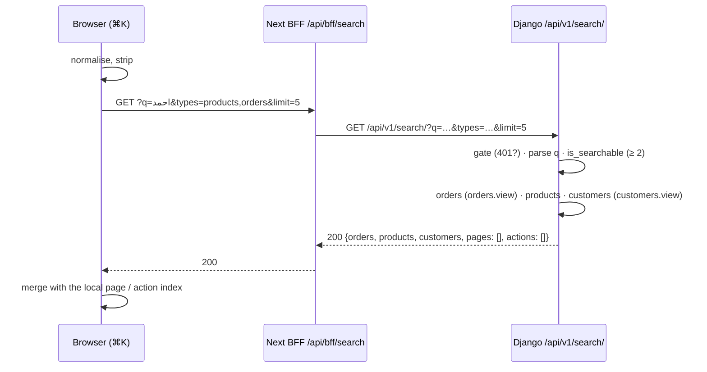

# Command-palette search API — M48 (لوحة الأوامر والبحث الشامل)

> **Source**: DOC-056 · INT-008 (M48) · inventory Domain 2
> **Live key**: `search` (`SHARWA_LIVE_MODULES`) — the BFF row is a `liveOrMock` row ([`bff.md#liveormock`](../../overview/bff.md#liveormock), [`bff.md#live-keys`](../../overview/bff.md#live-keys))
> **Django provider**: `sharwa_saas/api/views_search.py` (`PaletteSearchView`) · `sharwa_saas/products/services/search_service.py` · `ProductsAPIMixin` in `api/views_products.py` (gate) · `product_list_item` in `api/serializers_products.py` (product rows) · wired in `api/urls.py` (`search/`, name `palette-search`)
> **Frontend contract**: `sharwa-frontend/src/features/command-palette/schemas.ts` (`searchResultSchema`) · hook `features/command-palette/use-palette-search.ts` · page/action index `features/command-palette/palette-index.ts` (built from `features/dashboard-shell/navigation.ts`) · BFF `src/app/api/bff/search/route.ts` · fixtures `src/mocks/orders/state.ts` (`searchOrders`, `searchCustomers`), `src/mocks/catalog/`
> **Tests**: `sharwa_saas/api/test_search_api.py` — `PaletteSearchTests` (7 tests)
> **Last verified against code**: 2026-10-27 (step 07)

## 1. Overview

The ⌘K palette of the dashboard searches three kinds of records from one box: **orders**, **products** and **customers**. The browser sends one request, `GET /api/v1/search/?q=…`, and gets back three groups plus two reserved groups, `pages` and `actions`. Django trims each group by the caller's permissions, so a staff member who may not read orders never receives an order, whatever the browser asks for.

Three facts shape the whole contract:

- **`pages` and `actions` are always empty.** Destinations and commands come from the palette's own index in the browser (`palette-index.ts`, derived from the same `navigation.ts` the sidebar uses, filtered by feature and permission before display). Django returns the two keys only because `searchResultSchema` declares them.
- **There is no customer table in a store schema.** A «customer» in the search is a phone number found in the store's orders. The name shown is the one on the customer's latest order.
- **Arabic is normalised on both sides** (§4.2), so «احمد» finds «أحمد» and «الكترونيات» finds «إلكترونيات».

The route is on the **store host**, called by an owner or a staff session (see [`../../overview/auth.md`](../../overview/auth.md)). It has no write path, no cache and no side effect — the search text is **not logged** (FR-48.12).

## 2. Access — gate chain

| # | Gate | Requirement | Failure |
|---|---|---|---|
| 1 | Tenant | `HasTenantContext` — the request resolves to a store schema (the tenant guard answers first for an unknown host, see [`../01-public-onboarding/m47-tenant-guard.md`](../01-public-onboarding/m47-tenant-guard.md)) | `403` `{"detail": "لم يتم تحديد المتجر المطلوب. استخدم النطاق الفرعي للمتجر أو أرسل ترويسة X-Store-Domain."}` · with **no session cookie** on the public host the answer is `403` «لم يتم تزويد بيانات الدخول.» instead ([rule](../../overview/auth.md#no-store-no-session)) |
| 2 | Session | `MerchantSessionAuthentication`, then `ProductsAPIMixin.gate(request)` with **no permission key**: an owner session (`is_merchant_authenticated`) **or** a staff member (`resolve_request_staff`) | `401` `{"detail": "انتهت جلستك، سجّل الدخول مجدداً."}` |
| 3 | CSRF | `GET` is not affected ([`../../overview/csrf.md`](../../overview/csrf.md)) | — |
| 4 | Plan feature | none — search is not plan-gated | — |
| 5 | Permission | **per group, not per request**: `orders.view` for `orders`, `customers.view` for `customers`; `products` needs no key | the group is returned as `[]`, **never `403`** |

The owner holds every permission (`can()` returns `true` when there is no staff member). A staff member's permission is checked with `staff_has_permission`; see [`../../overview/permissions.md`](../../overview/permissions.md) for the keys.

## 3. Endpoint summary

| Method | Django path (`/api/v1/…`) | BFF path (`/api/bff/…`) | Purpose | Gate |
|---|---|---|---|---|
| `GET` | `search/` | `search` | unified search over orders, products and customers | session; groups trimmed by `orders.view` / `customers.view` |

## 4. Search

### `GET /api/v1/search/`

**Query parameters**

| Name | Type | Default | Notes |
|---|---|---|---|
| `q` | string | `""` | The text. Normalised (§4.2), a leading `#` is dropped. Searching starts at **2 characters** after removing `#` and spaces; shorter text returns the five empty groups with `200`. |
| `types` | comma list | all three | Any of `orders`, `products`, `customers`. Unknown names are ignored; a list with no valid name searches nothing (empty groups). |
| `limit` | integer | `5` | **Per group.** Clamped to `1…10`; a non-numeric value falls back to `5`. |

**Request body**: none.

**Response `200`** — keys exactly as `searchResultSchema`:

```json
{
  "orders": [
    {
      "id": 41,
      "customer_name": "أحمد علي",
      "customer_phone": "967700000001",
      "display_total": "100 ر.س",
      "status": "new",
      "fulfillment_status": { "name": "قيد التجهيز", "color": "#F59E0B" },
      "created_at": "2026-10-27T08:50:00+03:00"
    }
  ],
  "products": [
    {
      "id": 17,
      "name": "إلكترونيات منزلية",
      "name_en": "Home Electronics",
      "sku": "EL-1",
      "image": null,
      "display_price": "50 ر.س",
      "stock": "3.000"
    }
  ],
  "customers": [
    { "phone": "967700000001", "name": "أحمد علي", "orders_count": 2 }
  ],
  "pages": [],
  "actions": []
}
```

The names and SKU follow `test_search_api.py` (`أحمد علي`, `إلكترونيات منزلية`, `EL-1`); the phone is the fixture number `967700000001` (the test uses another fake value); the `fulfillment_status` colour is the merchant's hex, shown as a dot only.

| Group | Field | Type | Source |
|---|---|---|---|
| `orders[]` | `id` | number | `Order.pk` |
| `orders[]` | `customer_name`, `customer_phone` | string | `Order.customer_name`, `Order.customer_phone` |
| `orders[]` | `display_total` | string | `format_money(order.total_price, order.currency)` — a server string, never recomputed in the browser ([`../../overview/money.md`](../../overview/money.md)) |
| `orders[]` | `status` | string | `Order.status` |
| `orders[]` | `fulfillment_status` | object \| null | `{name, color}` of the order's `OrderStatus`; `null` when none |
| `orders[]` | `created_at` | string | ISO-8601 |
| `products[]` | `id`, `name`, `sku` | — | `product_list_item` (the same row builder as the products table) |
| `products[]` | `name_en` | string | `Product.name_en`, `""` when empty |
| `products[]` | `image` | string \| null | absolute URL of the first gallery image, else the legacy main image, else `null` |
| `products[]` | `display_price` | string | `format_money(effective_price, currency)` |
| `products[]` | `stock` | string | the quantity with three decimals (`"3.000"`); a negative backorder balance is shown as `"0.000"` |
| `customers[]` | `phone` | string | the order phone the group was built on |
| `customers[]` | `name` | string | `customer_name` of the **latest** order of that phone (`created_at` then `id` descending) |
| `customers[]` | `orders_count` | number | `Count(id)` of the phone's orders |
| `pages[]`, `actions[]` | — | — | always `[]` (§1) |

**Errors**

| Status | Body | When |
|---|---|---|
| `401` | `{"detail": "انتهت جلستك، سجّل الدخول مجدداً."}` | no staff session and no owner session |
| `403` | `{"detail": "لم يتم تحديد المتجر المطلوب. استخدم النطاق الفرعي للمتجر أو أرسل ترويسة X-Store-Domain."}` | no store resolved (`HasTenantContext`) |

There is no `400` and no `404`: a bad `limit`, an unknown `types` value or a short `q` never fails.

### 4.1 Matching rules per group

`n(col)` below means `lower(translate(col, …))`, the database-side normalisation of §4.2. `q` is the normalised text without a leading `#`; `digits` is `q` with every non-digit removed.

| Group | Matches when | Order | Notes |
|---|---|---|---|
| `orders` | `n(customer_name)` contains `q` **or** (`q` is all digits and `id = int(q)`) **or** (`digits` has ≥ 4 digits and `customer_phone` contains `digits` without its leading zeros) | `created_at` desc, `id` desc | `#700000001` and `0700000001` both find `967700000001`; `#41` finds order 41 (and any name containing «41») |
| `products` | `n(name)` contains `q` **or** `n(name_en)` contains `q` **or** `sku` contains `q` (case-insensitive) **or** `barcode` contains `q` (case-insensitive) | not archived first (`archived_at` ascending, nulls first), then `updated_at` desc, `id` desc | **Archived and draft products are included.** Archived ones sort last but stay reachable from the palette |
| `customers` | if `digits` without leading zeros has ≥ 3 digits: `customer_phone` contains it; otherwise `n(customer_name)` contains `q` | latest order of the phone first | grouped by `customer_phone`; so a two-digit query such as `41` finds order 41 but **no** customer |

### 4.2 Arabic normalisation (FR-48.05)

The rules are those of `src/lib/i18n/normalize.ts` in the frontend, applied to the typed text in Python (`normalize_arabic`) and to the database columns in PostgreSQL (`translate()` + `lower()`). A test (`test_normalizer_matches_frontend_rules`) pins the Python half: `إلكترونيّات` → `الكترونيات`, `مكتبةٌ  ى` → `مكتبه ي`, `٠٧٧١` → `0771`.

| Input | Becomes | Python (query) | PostgreSQL (columns) |
|---|---|---|---|
| `أ` `إ` `آ` `ٱ` | `ا` | yes | yes |
| `ة` | `ه` | yes | yes |
| `ى` | `ي` | yes | yes |
| `ؤ` | `و` | yes | yes |
| `ئ` | `ي` | yes | yes |
| tashkeel (U+0610–U+061A, U+064B–U+065F, U+0670, U+06D6–U+06ED) and tatweel (U+0640) | removed | yes | yes |
| Arabic-Indic (U+0660–U+0669) and Persian (U+06F0–U+06F9) digits | `0`–`9` | yes | **no** |
| upper-case Latin | lower-case | yes | yes |
| runs of white space | one space, trimmed | yes | **no** |

Two consequences: a stored name that itself contains an Arabic-Indic digit is not matched by the Latin digit, and `sku` / `barcode` are compared with `icontains` on the **raw** column (no Arabic mapping — SKUs are Latin in practice).

There is **no index and no migration**. The cost is bounded by `limit` (at most 10 rows per group) and by the 2-character minimum, not by an index: the name filters run `translate()` over the column, so they scan the table.

### 4.3 Permission-trimmed examples

The same request, `GET /api/v1/search/?q=احم`, from three callers on a store that has one order from «أحمد علي» and one product «أحمر». The values come from `test_groups_are_trimmed_by_permission` (a staff member with no permission, then with `orders.view` and `customers.view`).

**Owner** (every permission) — all three groups answer:

```json
{
  "orders": [{ "id": 41, "customer_name": "أحمد علي", "customer_phone": "967700000001", "display_total": "100 ر.س", "status": "new", "fulfillment_status": null, "created_at": "2026-10-27T08:50:00+03:00" }],
  "products": [{ "id": 18, "name": "أحمر", "name_en": "", "sku": "", "image": null, "display_price": "5 ر.س", "stock": "1.000" }],
  "customers": [{ "phone": "967700000001", "name": "أحمد علي", "orders_count": 1 }],
  "pages": [],
  "actions": []
}
```

**Staff with neither `orders.view` nor `customers.view`** — only the products group is filled; the other two are `[]`, with the same status `200`:

```json
{
  "orders": [],
  "products": [{ "id": 18, "name": "أحمر", "name_en": "", "sku": "", "image": null, "display_price": "5 ر.س", "stock": "1.000" }],
  "customers": [],
  "pages": [],
  "actions": []
}
```

**Staff with `orders.view` only** — `orders` and `products` are filled, `customers` stays `[]`. Once `customers.view` is also held, the same request returns all three groups.

**Caller of any kind with `q=%23a`** (one character after `#`) — the five empty groups, `200`:

```json
{ "orders": [], "products": [], "customers": [], "pages": [], "actions": [] }
```

> The browser mirrors the trimming: `use-palette-search.ts` asks only for `products` plus the groups the member may see (`types=products,orders,customers`), so the server rule is a second line of defence, not the normal path.

### 4.4 BFF behaviour and the browser hook

`GET /api/bff/search` is `liveOrMock(request, "search", "/api/v1/search/", mock)`:

| Mode | What happens |
|---|---|
| `search` is live (`SHARWA_MOCKS=off`, or `search` / `*` in `SHARWA_LIVE_MODULES`) | transparent passthrough to `/api/v1/search/` with the query string, cookies and store headers; **no Next-side session gate** — Django answers `401` itself |
| mocks on, `search` not live | `mockRoute` runs the session gate first (`401` «انتهت جلستك، سجّل الدخول مجدداً.»), then answers from the fixtures with `x-sharwa-mock: 1`. The fixture trims groups by `hasPermission(...)` exactly like Django (`orders.view`, `customers.view`) and caps `limit` at 10 |

The hook `usePaletteSearch(query, enabled)`:

- normalises the typed text, strips `#`, and **does not call the server** for fewer than 2 characters or when the text starts with `>` (action mode);
- waits 150 ms (debounce), cancels an abandoned request, sends `limit=5`, keeps the previous result while the next loads, and treats a result as fresh for 30 seconds;
- never retries (`retry: false`).

> The fixture is slightly looser than Django on `limit`: `limit=0` becomes `5` in the fixture but `1` in Django, and a negative value is clamped to `1` by Django only. The browser always sends `5`, so no screen is affected.

**Side effects** — none. **Idempotency / concurrency** — read-only; no row locks.



## 5. Tests

`PaletteSearchTests` (`api/test_search_api.py`, 7 tests, run with `python manage.py test api.test_search_api`):

| Test | Pins |
|---|---|
| `test_normalizer_matches_frontend_rules` | the three Python normalisation examples of §4.2 |
| `test_anonymous_gets_401` | gate 2 |
| `test_short_query_returns_empty_groups` | the five empty groups for `#a` |
| `test_groups_shape_and_arabic_normalization` | the key sets of the three groups; «احمد» → 2 orders and one customer with `orders_count: 2`; «الكترونيات» → the product; `el-1` → SKU match; a `#`-prefixed phone fragment → order by phone |
| `test_phone_search_and_limit` | `limit=3` → 3 orders and 3 customers; `limit=50` → capped at 10 (7 rows exist) |
| `test_types_param_limits_groups` | `types=products` empties `orders` and `customers` |
| `test_groups_are_trimmed_by_permission` | §4.3 — no key → products only; both keys → all three |

## 6. Gaps closed, bugs fixed and migrations

- **No migration.** Search reads `Order` and `Product` as they are; there is no search index, view or extra column.
- Added in INT-008 (2026-10-24): the route, `search_service.py`, the permission trimming in the view, and the 7 tests. The frontend schema and the BFF row were not changed.

## 7. Open items and legacy-only behaviour

- `pages` and `actions` are reserved and always empty; moving them server-side is not planned (the browser index is the source of truth).
- No full-text engine: matching is substring (`contains`), ranking is recency, not relevance.
- The customer group depends on orders: a customer who never ordered is not found (the store has no customer table).
- The legacy HTML dashboard has no ⌘K palette; there is nothing to keep in parity.

## 8. Related pages

- [`m03-overview.md`](m03-overview.md) — the dashboard shell the palette lives in
- [`m49-notifications.md`](m49-notifications.md) — the other cross-cutting topbar feature
- [`../../overview/auth.md`](../../overview/auth.md) — owner and staff identity
- [`../../overview/permissions.md`](../../overview/permissions.md) — `orders.view`, `customers.view`
- [`../../overview/bff.md#liveormock`](../../overview/bff.md#liveormock) — the live/mock switch
- Guide: [`../../../guides/merchant/README.md`](../../../guides/merchant/README.md) — the palette is described in the getting-started guides (roadmap DOC-290 → 299)
