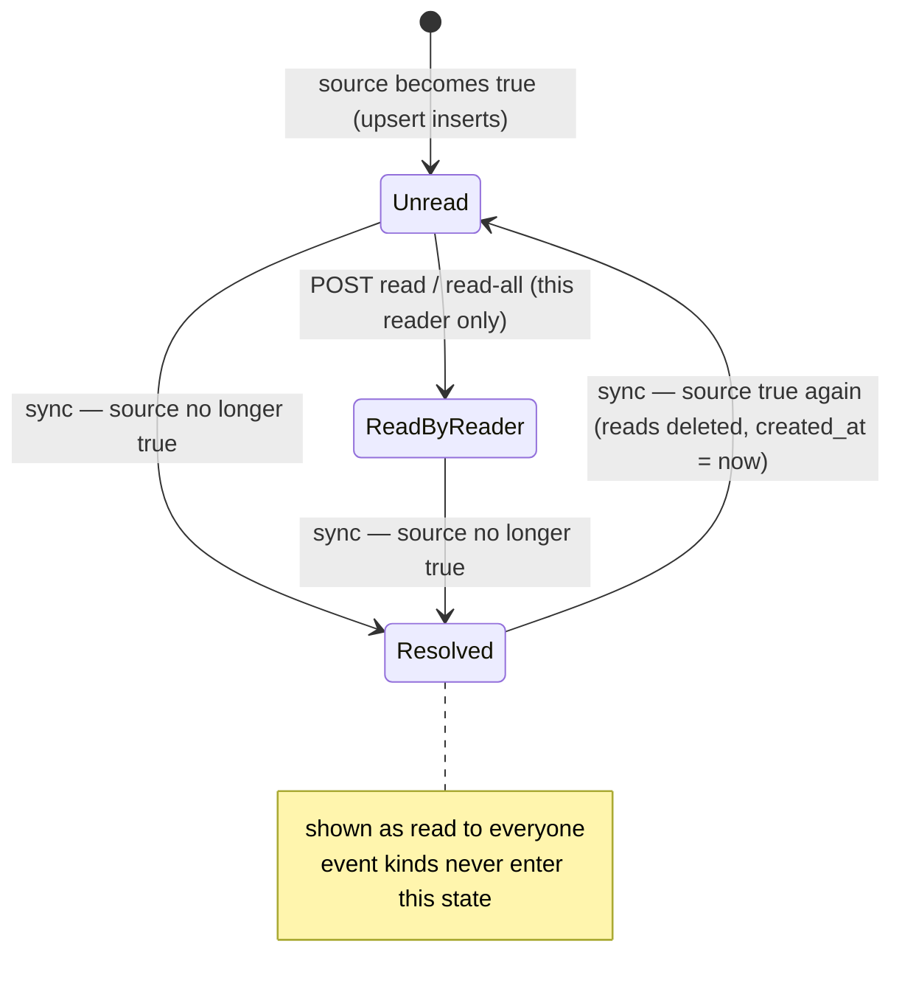
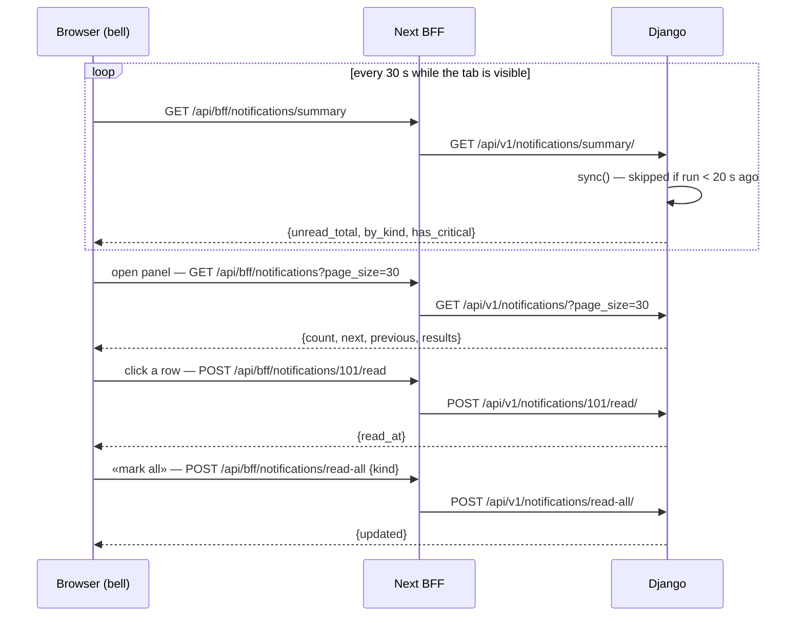

# Notifications API — M49 (مركز الإشعارات)

> **Source**: DOC-057, DOC-058 · INT-009 (M49) · A.9 (`0216_notifications`) · inventory Domain 2
> **Live key**: `notifications` (`SHARWA_LIVE_MODULES`) — four BFF rows, all `liveOrMock(…, "notifications", …)` ([`bff.md#live-keys`](../../overview/bff.md#live-keys))
> **Django provider**: `sharwa_saas/api/views_notifications.py` (`NotificationSummaryView`, `NotificationListView`, `NotificationReadView`, `NotificationReadAllView`) · `sharwa_saas/products/services/notification_service.py` · models `products/models/notifications.py` (`Notification`, `NotificationRead`) · migration `products/migrations/0216_notifications.py` · `Viewer` in `products/services/dashboard_service.py` · wired in `api/urls.py`
> **Frontend contract**: `sharwa-frontend/src/features/notifications/schemas.ts` (`notificationSchema`, `notificationListSchema`, `notificationSummarySchema`, `readResponseSchema`, `readAllResponseSchema`, `NOTIFICATION_KINDS`) · hooks `features/notifications/api.ts` · bell `features/notifications/components/notification-bell.tsx` · fixture `src/mocks/notifications/state.ts` · BFF `src/app/api/bff/notifications/{route.ts,summary/route.ts,read-all/route.ts,[id]/read/route.ts}`
> **Tests**: `sharwa_saas/api/test_notifications_api.py` — `NotificationApiTests` (7 tests)
> **Last verified against code**: 2026-10-27 (step 07)

## 1. Overview

The bell in the dashboard topbar shows what needs attention: new orders, payments to review, approvals, stock, failed syncs, exports and system notices. Django does **not** keep an event bus for this. Each notification is a row **derived from an existing source** (an order, an approval request, a product, a sync job…) by a throttled, idempotent synchronisation that runs when the bell is read. No legacy write path was touched to feed it.

Three ideas run through the page:

- **A notification is stateful or event-like.** A *stateful* kind mirrors a condition («this order is still new»). When the condition ends, the row is marked `resolved_at` and is shown as **read to everyone**, so the bell and the sidebar badges never disagree (FR-49.11). If the condition comes back, the row reopens as unread. An *event* kind (a failed sync, an export, the «store ready» notice) stays until a reader reads it.
- **Reading is per reader.** The owner and every staff member read independently (`NotificationRead`, reader `owner` or `staff:<id>`).
- **Visibility is decided on the server** (FR-49.02): by permission key, by «owner only», by approver role, and for exports by requester. A notification the caller cannot see answers `404` when marked read.

All four routes are on the **store host** and serve an owner or a staff session ([`../../overview/auth.md`](../../overview/auth.md)).

## 2. Access — gate chain

| # | Gate | Requirement | Failure |
|---|---|---|---|
| 1 | Tenant | `HasTenantContext` — the request resolves to a store schema | `403` `{"detail": "لم يتم تحديد المتجر المطلوب. استخدم النطاق الفرعي للمتجر أو أرسل ترويسة X-Store-Domain."}` (the tenant guard answers first for an unknown host, [`../01-public-onboarding/m47-tenant-guard.md`](../01-public-onboarding/m47-tenant-guard.md)) · with **no session cookie** on the public host the answer is `403` «لم يتم تزويد بيانات الدخول.» instead ([rule](../../overview/auth.md#no-store-no-session)) |
| 2 | Session | `MerchantSessionAuthentication`, then `gate(request)` with **no permission key**: an owner session **or** a staff member | `401` `{"detail": "انتهت جلستك، سجّل الدخول مجدداً."}` |
| 3 | CSRF | the two `POST` routes need a valid CSRF token when a session is present; the `GET`s are not affected ([`../../overview/csrf.md`](../../overview/csrf.md)) | `403` (CSRF failure) |
| 4 | Plan feature | none | — |
| 5 | Visibility | the row must be visible to the caller (§4.4) | list/summary: the row is simply absent; `POST <id>/read/`: `404` «الإشعار غير موجود.» |

There is no permission key for the bell itself. What the caller sees is what the keys of each notification allow (§4.2).

## 3. Endpoint summary

| Method | Django path (`/api/v1/…`) | BFF path (`/api/bff/…`) | Purpose | Gate |
|---|---|---|---|---|
| `GET` | `notifications/summary/` | `notifications/summary` | bell counters: unread by kind, any critical | session |
| `GET` | `notifications/` | `notifications` | the panel list (and the full history) | session |
| `POST` | `notifications/<id>/read/` | `notifications/[id]/read` | mark one notification read | session + CSRF |
| `POST` | `notifications/read-all/` | `notifications/read-all` | mark every visible unread notification read, optionally by kind | session + CSRF |

<a id="model"></a>

## 4. Model and generation rules (DOC-057)

### 4.1 The two tables

Migration `0216_notifications` (depends on `0215_product_main_image_to_gallery`, additive, tenant schema) creates:

**`Notification`**

| Column | Type | Meaning |
|---|---|---|
| `kind` | char(40), indexed | one of the 11 kinds of §4.3 (open string on the wire) |
| `severity` | `info` \| `warning` \| `critical` | default `info` |
| `title`, `body` | char(200), char(500) | Arabic text generated by the server (cut to the column size) |
| `link` | char(300) | a `/dashboard/…` path; the browser follows only paths that match `^/dashboard(/|$|\?)` (`safeDashboardLink`, FR-49.04) |
| `group_key` | char(120), indexed | grouping key for the UI |
| `count` | positive int, default 1 | what the unread counters sum; Django always writes `1` |
| `source_type`, `source_id` | char(40), char(64) | the source row, returned as `source_ref: {type, id}` (`id` is a number when numeric) |
| `dedupe_key` | char(160), **unique** | makes the synchronisation idempotent |
| `permission` | char(80) | the key a **staff** member needs; empty = any member |
| `merchant_only` | bool | owner only |
| `audience_role` | FK `Role`, null | only holders of this role (approvals) |
| `audience_staff` | FK `StaffMember`, null | only this staff member (exports) |
| `created_at` | datetime, indexed | the time of the **event**, not of the insert (default `now`) |
| `resolved_at` | datetime, indexed, null | set when the source stopped being true; the row is then read for everybody |

Index `notif_resolved_created_idx (resolved_at, created_at)`; default ordering `-created_at, -id`.

**`NotificationRead`** — `notification` (FK, `related_name="reads"`), `reader` (`owner` or `staff:<id>`), `read_at`. Constraint `notification_read_once_per_reader (notification, reader)`: a reader can read a notification once; marking again is a no-op that returns the first `read_at`.

A notification is **unread for a reader** when it has no `NotificationRead` for that reader **and** `resolved_at` is null. The effective read time is `COALESCE(own read_at, resolved_at)`.

### 4.2 Synchronisation

`notification_service.sync()` derives the rows. It is called at the start of `GET notifications/` and `GET notifications/summary/` (never by the two `POST`s).

| Rule | Behaviour |
|---|---|
| Throttle | once per **20 seconds per store**: `cache.add("notifications:sync:<schema>", 1, 20)`; callers inside the window skip the work and read the rows as they are |
| Idempotency | each source calls `upsert(dedupe_key, …)`: insert if the key is new, otherwise update the changed columns in place. Running `sync()` twice never duplicates (`test_sources_summary_and_list_shape`) |
| Failure isolation | each of the 10 source functions runs in its own `try/except`; an exception is logged and the other sources still run (FR-49.09) |
| Volume caps | 200 rows per stateful source, 50 per job/export source, all newest first |
| Stateful sources | after the upserts, `resolve_missing(kind)` sets `resolved_at = now` on every unresolved row of that kind whose `dedupe_key` was not seen active in this run |
| Reopen | a stateful row whose source is active again (`resolved_at` set) is reset: `resolved_at = null`, `created_at = now`, **all its `NotificationRead` rows deleted** — unread for everybody, at the top. `inbox_unread` also reopens when a message newer than the row arrives (`reopen_if_newer`), keeping the message time as `created_at` |
| Event sources | `sync_failed`, `export_ready`, `provisioning_notice` are inserted `stateful=False`: they are never resolved by the sync and stay until read |
| Time zone | `order_new` groups by the **local date** (`timezone.localtime`) of the order |



### 4.3 The eleven kinds

`NOTIFICATION_KINDS` in `schemas.ts` lists the same 11 codes. `kind` stays an open string on the wire: a kind Django adds later renders with the generic label «إشعار».

| Kind | Source and filter | Severity | Who sees it | Stateful? / resolve rule |
|---|---|---|---|---|
| `order_new` | `Order` with `status = "new"` created in the last **72 hours** (`ORDER_NEW_WINDOW`) | `info` | key `orders.view`; owner | **yes** — resolves when the order is no longer `new` or is older than 72 h |
| `payment_review` | `Order` with `status` in `awaiting_payment`, `payment_review` (no time window) | `warning` | key `orders.view`; owner | **yes** — the status is part of the `dedupe_key`, so a status change resolves the old row and opens a new one; resolves when the order leaves both statuses |
| `approval_pending` | `ApprovalRequest` with `status = "pending"` | `warning` | **approver role only**: staff holding `audience_role` as an active `StaffLocationRole`; the owner sees all (§4.4) | **yes** — resolves when the request is decided |
| `behavior_alert` | `BehaviorAlert` with `is_read = false`, level `warning` or `critical`, created in the last 30 days (`EVENT_WINDOW`) | the alert's own level | key `staff.view`; owner | **yes** — resolves when the alert is read or leaves the 30-day window |
| `inbox_unread` | `Conversation` with `unread_count > 0`, by `last_message_at` | `info` | key `channels.inbox.access`; owner | **yes** — resolves when `unread_count` returns to 0; **reopens on new messages** even if read |
| `low_stock` | non-archived `Product` with `0 < stock <= low_stock_threshold` (the same rule as `product_service.low_stock_count()`), lowest stock first | `warning` | key `inventory.view`; owner | **yes** — resolves when the product is no longer low or is archived; reopens if it falls low again |
| `sync_failed` | `MarketplaceSyncJob` and `SupplierSyncJob` with `status` in `failed`, `completed_with_errors`, created in the last 30 days | `warning` | key `channels.marketplaces.manage` (marketplace) / `channels.dropshipping.manage` (supplier); owner | **no** — event, stays until read |
| `awb_failed` | `PendingAWBQueue` with `status = "failed"` | `warning` | key `orders.view`; owner | **yes** — resolves when the queue row is no longer failed |
| `export_ready` | `ReportExportJob` with `status` in `ready`, `failed`, created in the last 30 days | `info` (ready) / `warning` (failed) | **requester only** (below) and key `reports.export` | **no** — event, stays until read |
| `billing_notice` | `StoreAppInstallation`: suspended by the platform, or active with `subscription_expires_at` within the next **7 days** (`EXPIRY_WARNING`) | `critical` (suspended) / `warning` (expiring) | owner only (`merchant_only`) | **yes** — resolves when the app is reactivated or renewed; pinned while unread |
| `provisioning_notice` | the store is `ready`, has **no product at all**, and no `provisioning:ready` row ever existed | `info` | owner only (`merchant_only`) | **no** — event, stays until read; pinned while unread |

**Row content per kind** (the `dedupe_key`, texts and link are copied from `notification_service.py`; `<…>` is filled by the server):

| Kind | `dedupe_key` | `title` | `body` | `link` | `group_key` | `source_ref.type` |
|---|---|---|---|---|---|---|
| `order_new` | `order_new:<order id>` | «طلب جديد #<id>» | «<customer name> · <display total>» | `/dashboard/orders/<id>` | `order_new:<local date>` | `order` |
| `payment_review` | `payment_review:<id>:<status>` | `payment_review`: «دفع يحتاج مراجعة للطلب #<id>» · `awaiting_payment`: «إيصال تحويل للطلب #<id>» | «نتيجة بوابة الدفع غير محسومة؛ اقبل الدفع أو ارفضه.» · «العميل رفع إيصال التحويل؛ راجع المبلغ ثم أكّد الاستلام.» | `/dashboard/orders/<id>` | `payment_review:<id>` | `order` |
| `approval_pending` | `approval:<id>` | «طلب موافقة: <request type label>» | «المرجع <target_ref>» (+ « · المبلغ <amount>» when there is an amount) | `/dashboard/staff/approvals` | `approval_pending` | `approval_request` |
| `behavior_alert` | `behavior:<id>` | «تنبيه سلوكي: <staff name or «موظف»>» | the alert detail | `/dashboard/staff/alerts` | `behavior_alert:<alert type>` | `behavior_alert` |
| `inbox_unread` | `inbox:<id>` | «رسائل جديدة من <customer name, else phone, else «عميل»>» | «<n> رسالة غير مقروءة» | `/dashboard/inbox?c=<id>` | `inbox_unread` | `conversation` |
| `low_stock` | `low_stock:<product id>` | «مخزون منخفض: <name>» | «المتبقي <n> فقط.» | `/dashboard/inventory?status=low&q=<sku, else name, URL-encoded>` | `low_stock:<product id>` | `product` |
| `sync_failed` | `sync_failed:marketplace:<job id>` · `sync_failed:supplier:<job id>` | «فشل مزامنة <marketplace name>» · «فشل مزامنة المورد <supplier name>» | «<job type> — <status> (<failed items> فشلت)» | `/dashboard/channels/marketplaces/jobs` · `/dashboard/channels/dropshipping/jobs` | `sync_failed:<code>` | `marketplace_sync_job` · `supplier_sync_job` |
| `awb_failed` | `awb_failed:<queue id>` | «فشل إصدار بوليصة للطلب #<order id>» | the error detail (first 200 characters), else «استنفدت المحاولات لدى الناقل.» | `/dashboard/shipping/sharwa-ship/queue` | `awb_failed` | `pending_awb` |
| `export_ready` | `export:<job id>:<status>` | ready: «التصدير جاهز للتحميل» · failed: «فشل التصدير» | «<report code> · <format>» (+ « — <error, first 120 characters>» when failed) | `/dashboard/reports/exports` | `export_ready:<job id>` | `report_export_job` |
| `billing_notice` | `billing:suspended:<app code>` · `billing:expiring:<app code>:<expiry date>` | «علّقت المنصة تطبيق «<app code>»» · «ينتهي اشتراك تطبيق «<app code>» خلال <n> أيام» | «تواصل مع دعم شروة لإعادة تفعيله.» · «جدّد الاشتراك لتجنب تعليق التطبيق.» | `/dashboard/apps` | `billing_notice:<app code>` | `app_installation` |
| `provisioning_notice` | `provisioning:ready` | «متجرك جاهز» | «اكتمل تجهيز المتجر. أضف أول منتج وشارك رابط متجرك.» | `/dashboard/products` | `provisioning` | *(null)* |

Notes on the table:

- «<n> أيام» in `billing_notice` is `max(1, whole days left)`.
- `export_ready` audience: the row carries `audience_staff = job.requested_by`. When the owner requested the export (`requested_by` empty) it is `merchant_only` instead. So a staff export is visible to **that staff member only** (and not to the owner), and an owner export to the owner only.
- `provisioning_notice` takes its `created_at` from the tenant's `created_on`. It is created at most once; creating the first product afterwards does not remove it — it stays until read (`test_provisioning_notice_for_an_empty_store`).
- `sync_failed` and `export_ready` rows are only *re-upserted* while their job is inside the 30-day window; rows already created are not deleted when the job ages out.

> ⚠️ Discrepancy — roadmap says `approval_pending` is for the «approver role only». Code (`visible()` in `notification_service.py:289`) does that for **staff**, but the **owner** sees every approval notification, the request's location is ignored, and `staff.manage` holders who may decide never get the notification (`notification_service.py:121-133`, `:289-302`). Reported in step 07; corrected in official Step 08: the earlier wording said a request with an empty `approver_role` reaches every staff member, which cannot happen because `approver_role` is a required field (`staff_approvals.py:54`). See [`../../../architecture/45-approvals.md`](../../../architecture/45-approvals.md).

> Mock versus Django. The fixture (`src/mocks/notifications/state.ts`) differs from Django in three visible ways: one aggregated «3 طلبات موافقة معلّقة» row (`count: 3`, owner only) where Django writes one `count: 1` row per request; `billing_notice` has severity `info` where Django writes `warning`/`critical`; and low stock is hard-coded to stock 1–3 where Django uses each product's own `low_stock_threshold`. Screens built on the mock should not rely on those details.

### 4.4 Who sees a row

`visible(viewer)` builds the queryset; `Viewer` comes from `dashboard_service` (owner = no staff member, all permissions).

| Caller | Rows returned |
|---|---|
| **Owner** | every row with `audience_staff` empty — i.e. everything except exports requested by a staff member |
| **Staff member** | rows with `merchant_only = false`, **and** (`audience_staff` empty **or** is this member), **and** (`permission` empty **or** in the member's effective permissions), **and** (`audience_role` empty **or** one of the member's active `StaffLocationRole` roles) |

Example from `test_staff_trimming_and_independent_reads`: with one new order, one critical behaviour alert and one app suspended by the platform, the owner's summary is `{"order_new": 1, "behavior_alert": 1, "billing_notice": 1}` with `has_critical: true`; a staff member holding only `orders.view` gets `{"order_new": 1}` and `has_critical: false`, `POST <alert id>/read/` answers `404`, and `read-all` updates 1 row. The staff member's reads do not affect the owner's counters.

<a id="routes"></a>

## 5. Routes (DOC-058)

### `GET /api/v1/notifications/summary/`

**Query parameters**: none. Runs `sync()` first (throttled).

**Response `200`**

```json
{
  "unread_total": 3,
  "by_kind": { "order_new": 1, "payment_review": 1, "low_stock": 1 },
  "has_critical": false
}
```

| Field | Type | Meaning |
|---|---|---|
| `unread_total` | number | sum of `by_kind` |
| `by_kind` | object | for each kind with unread rows visible to the caller: the **sum of `count`** of its unread rows (kinds with 0 are absent) |
| `has_critical` | boolean | at least one unread visible row has `severity = "critical"` |

The example is `test_sources_summary_and_list_shape`. A caller with nothing unread gets `{"unread_total": 0, "by_kind": {}, "has_critical": false}`.

**Errors**: `401`, `403` (no store) as in §2.

**Browser use**: `useNotificationSummary` polls every **30 seconds**, only while the tab is visible, and on window focus; it never retries.

### `GET /api/v1/notifications/`

**Query parameters**

| Name | Type | Default | Notes |
|---|---|---|---|
| `unread` | `1` \| `true` | off | only rows unread **for this reader** (resolved rows count as read) |
| `kind` | comma list | all | e.g. `kind=order_new,low_stock` |
| `history` | `1` \| `true` | off | off = the **30-day panel window** (`created_at >= now − 30 days`); on = the whole history |
| `page` | integer | `1` | invalid or `< 1` → `1` |
| `page_size` | integer | `30` | clamped to `1…50`; invalid → `30` |

Order: **unread system notices first** (`billing_notice` and `provisioning_notice` that are unread for this reader), then `created_at` descending, then `id` descending.

**Response `200`** — `paginated(notificationSchema)`:

```json
{
  "count": 3,
  "next": null,
  "previous": null,
  "results": [
    {
      "id": 103,
      "kind": "low_stock",
      "severity": "warning",
      "title": "مخزون منخفض: قميص",
      "body": "المتبقي 2 فقط.",
      "link": "/dashboard/inventory?status=low&q=SH-1",
      "group_key": "low_stock:12",
      "count": 1,
      "created_at": "2026-10-27T09:10:00+03:00",
      "read_at": null,
      "source_ref": { "type": "product", "id": 12 }
    },
    {
      "id": 102,
      "kind": "payment_review",
      "severity": "warning",
      "title": "دفع يحتاج مراجعة للطلب #42",
      "body": "نتيجة بوابة الدفع غير محسومة؛ اقبل الدفع أو ارفضه.",
      "link": "/dashboard/orders/42",
      "group_key": "payment_review:42",
      "count": 1,
      "created_at": "2026-10-27T08:55:00+03:00",
      "read_at": null,
      "source_ref": { "type": "order", "id": 42 }
    },
    {
      "id": 101,
      "kind": "order_new",
      "severity": "info",
      "title": "طلب جديد #41",
      "body": "منى · 100 ر.س",
      "link": "/dashboard/orders/41",
      "group_key": "order_new:2026-10-27",
      "count": 1,
      "created_at": "2026-10-27T08:50:00+03:00",
      "read_at": null,
      "source_ref": { "type": "order", "id": 41 }
    }
  ]
}
```

The texts and links are those asserted in `test_sources_summary_and_list_shape`; ids and times are illustrative. Every item has exactly the 11 keys of `notificationSchema`.

| Field | Meaning |
|---|---|
| `read_at` | the caller's own read time, **or** `resolved_at` when the source ended; `null` = unread. A resolved row is therefore shown as read (`test_resolution_and_reopen`) |
| `source_ref` | `{type, id}` of the source row, or `null` (system notices) |
| `next`, `previous` | **bare query strings** (`?page=2`), not full URLs; `null` at the ends |
| `count` | total rows after the filters, not the page size |

**Errors**: `401`, `403` (no store).

**Rules**

- A request with no `history` hides rows older than 30 days **by `created_at`** — including a pinned system notice, so an old `provisioning_notice` (its `created_at` is the store's creation time) leaves the panel after 30 days unless `history=1`.
- `useNotifications` sends `kind`, `unread=1` and `page_size=30` only; it sends neither `page` nor `history`. The deeper pages are available to other clients.
- The panel's filter chips map to kinds: «طلبات» → `order_new`; «دفع» → `payment_review`; «موافقات» → `approval_pending`; «مخزون» → `low_stock`; «محادثات» → `inbox_unread`; «مزامنة» → `sync_failed`; «نظام» → `billing_notice, provisioning_notice, export_ready, awb_failed, behavior_alert`.

### `POST /api/v1/notifications/<id>/read/`

**Request body**: none.

**Response `200`** — the reader's read time (the first one, if already read):

```json
{ "read_at": "2026-10-27T09:20:11.002+03:00" }
```

**Errors**

| Status | Body | When |
|---|---|---|
| `401` | `{"detail": "انتهت جلستك، سجّل الدخول مجدداً."}` | no session |
| `403` | CSRF failure | missing or invalid CSRF token |
| `404` | `{"detail": "الإشعار غير موجود."}` | the id does not exist **or is not visible to this caller** (a staff member cannot probe other audiences) |

**Rules** — idempotent: `get_or_create(notification, reader)`; only the caller's reader key is written. Marking a *resolved* row read creates a read row too (harmless). **Side effects**: one `NotificationRead` row. **Concurrency**: the unique constraint `(notification, reader)` makes two parallel calls safe.

### `POST /api/v1/notifications/read-all/`

**Request body** (`application/json`)

| Field | Type | Required | Rules / limits |
|---|---|---|---|
| `kind` | string | no | comma-separated kinds (`"payment_review"` or `"order_new,low_stock"`). Absent or empty = every kind. A non-object body is treated as `{}` |

**Response `200`**

```json
{ "updated": 1 }
```

`updated` is the number of rows that were unread **for this reader and visible to them** and now have a `NotificationRead` (`bulk_create(..., ignore_conflicts=True)`). Rows already read, resolved rows and rows the caller cannot see are not counted (`test_read_and_read_all`: `{"kind": "payment_review"}` → `{"updated": 1}`, then an empty body → `{"updated": 1}`, then the summary is `{"unread_total": 0, "by_kind": {}, "has_critical": false}`).

**Errors**: `401`, `403` (CSRF or no store). There is no `404` and no `400`: an unknown kind updates `0`.

**Browser use** — `useMarkRead` updates the cached list and summary optimistically, calls the BFF, rolls both back on error, then invalidates the summary (single read) or all notification queries (read-all).

### BFF rows

| BFF route | Method | Django | Mock (when `notifications` is not live) |
|---|---|---|---|
| `notifications/summary` | `GET` | `notifications/summary/` | `notificationSummary(store, session)` |
| `notifications` | `GET` | `notifications/` | `listNotifications(store, session, params)` — same trimming, 30-day window, pinned system notices, `page_size ≤ 50` |
| `notifications/read-all` | `POST` | `notifications/read-all/` | `markAllRead` with the kinds split from `kind` |
| `notifications/[id]/read` | `POST` | `notifications/<id>/read/` | `markRead`; `404` «الإشعار غير موجود.» when not visible |

All four are `liveOrMock(request, "notifications", "/api/v1/notifications/…", mock)`. In live mode they are a passthrough (query string, body, cookies and CSRF header forwarded; Django answers `401`/`403` itself). In mock mode `mockRoute` runs the session gate first. The fixture's links were corrected to real routes: `/dashboard/staff/alerts`, `/dashboard/channels/marketplaces/jobs`, `/dashboard/reports/exports`.



## 6. Tests

`NotificationApiTests` (`api/test_notifications_api.py`, 7 tests, `python manage.py test api.test_notifications_api`; each request clears the cache so the 20-second throttle does not hide the sync):

| Test | Pins |
|---|---|
| `test_anonymous_gets_401` | gate 2 on summary and list |
| `test_sources_summary_and_list_shape` | sources → summary `{"order_new": 1, "payment_review": 1, "low_stock": 1}`; the 11 item keys; links, severities and `source_ref`; `kind=a,b` filter; a second sync adds no row |
| `test_read_and_read_all` | read one → summary drops; unknown id → `404`; `unread=1`; `read-all` with and without `kind` |
| `test_resolution_and_reopen` | a source ending zeroes the counters and shows the rows read; the source returning reopens it |
| `test_old_orders_and_panel_window` | an order older than 72 h creates no `order_new` |
| `test_staff_trimming_and_independent_reads` | owner vs staff summary, `has_critical`, `404` on a hidden row, `read-all` scope, owner counters unaffected |
| `test_provisioning_notice_for_an_empty_store` | an empty ready store gets «متجرك جاهز» linking to `/dashboard/products`; it stays after the first product |

## 7. Gaps closed, bugs fixed and migrations

- **Migration `products/0216_notifications`** (2026-10-24): creates `Notification` and `NotificationRead` with the index and constraint of §4.1. Nothing else in the tenant schema changes; no data migration.
- Phase 002 added the four routes, the service and the 7 tests; the frontend schemas and hooks were not changed, and the mock links were corrected to real dashboard routes.

## 8. Open items and legacy-only behaviour

- `useNotifications` never sends `history` or `page`; the full-history view (`history=1`) and further pages have no caller in the current UI.
- The 20-second throttle uses Django's cache; whether that cache is shared between workers depends on the deployment setting, which this page did not verify (see [`../../../ops/README.md`](../../../ops/README.md) for the deployment pages).
- No push or e-mail channel: M49 is the in-dashboard bell only (the PWA push of the buyer storefront is a separate module).
- Kinds are fixed in code; a merchant cannot mute a kind.

## 9. Related pages

- [`m03-overview.md`](m03-overview.md) — the sidebar counters the bell must agree with
- [`m48-search.md`](m48-search.md) — the other topbar feature
- [`../../overview/auth.md`](../../overview/auth.md) — owner and staff identity
- [`../../overview/permissions.md`](../../overview/permissions.md) — the keys used by the kinds
- [`../../overview/pagination.md`](../../overview/pagination.md) — pagination conventions
- [`../../overview/bff.md#live-keys`](../../overview/bff.md#live-keys) — live keys
