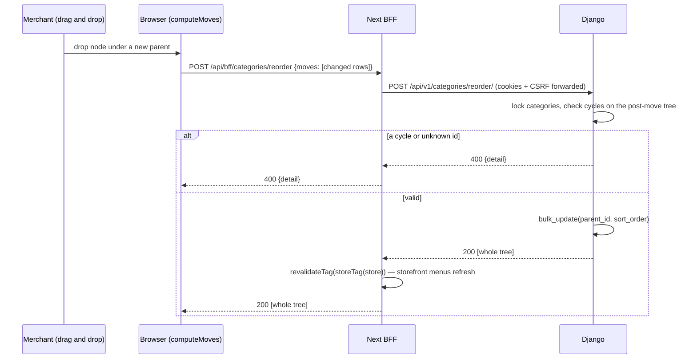
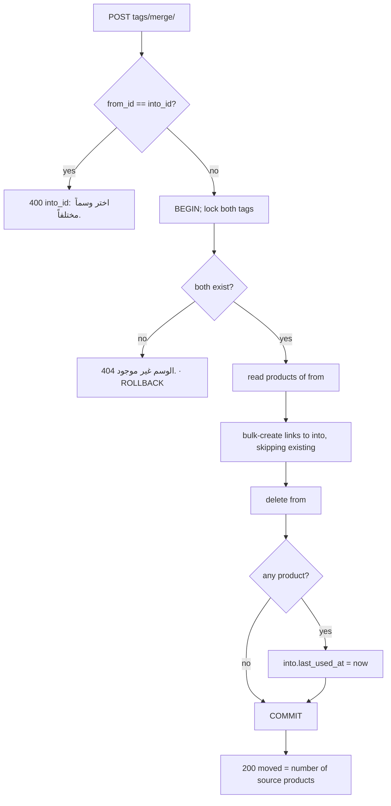

# Organization API — M05 (التصنيفات والماركات والوسوم والمجموعات والشارات)

> **Source**: DOC-065 (step 07), DOC-066 and DOC-067 (step 08) · INT-006 (M05) · inventory Domain 3
> **Live key**: `catalog` (`SHARWA_LIVE_MODULES`) — one switch for the whole Organization module: categories, brands, tags, collections and badges were integrated together (live-tested 2026-10-22). It is separate from the `products` key (M04).
> **Django provider**: `sharwa_saas/api/views_catalog.py` (gate + routing only) · `sharwa_saas/products/services/catalog_org_service.py` (multi-step, atomic operations) · serializers `sharwa_saas/api/serializers_catalog.py` · models `sharwa_saas/products/models/catalog.py` (`Category`, `CategoryQuerySet.tree_ordered`) · wired in `sharwa_saas/api/urls.py`
> **Frontend contract**: `sharwa-frontend/src/features/organization/schemas.ts` (`categorySchema`, `categoryInputSchema`, `reorderMovesSchema`, …) · hooks `src/features/organization/api.ts` · tree maths `src/features/organization/components/tree-utils.ts` (`computeMoves`) · fixture `src/mocks/catalog/organization.ts` · BFF `src/app/api/bff/{categories,brands,tags,collections,badges}/**/route.ts`
> **Tests**: `sharwa_saas/api/test_catalog_api.py` (16 tests: 8 categories, 3 brands/tags/badges, 1 collections, 4 shared auth) · `sharwa_saas/api/test_catalog_serializers.py` (21 tests: 10 categories, 5 brands, 3 tags, 2 collections, 1 badges) · mock E2E `sharwa-frontend/scripts/catalog-orders-check.ts` (category tree: pointer nesting, keyboard reorder, staff read-only)
> **Last verified against code**: 2026-10-27 (step 08)
>
> **Page status**: complete. §1–§3 and §4.1 (categories) were written in step 07; §4.2 (brands and tags) and §4.3 (collections and badges, with the 15-row BFF table) in step 08.

## 1. Overview

M05 is the merchant's "organization" layer for the catalogue. It gives the product editor (M04) and the Organization screen five kinds of object, all served by **one Django provider** and **one live key**:

| Object | Arabic UI term (glossary) | Section |
|---|---|---|
| Category (tree, drag-and-drop order) | التصنيف | [§4.1](#categories) — DOC-065 |
| Brand | الماركة | [§4.2](#brands-tags) — DOC-066 |
| Tag (with merge) | الوسم | [§4.2](#brands-tags) — DOC-066 |
| Collection (manual, ordered products) | المجموعة | [§4.3](#collections-badges) — DOC-067 |
| Badge (manual) | الشارة | [§4.3](#collections-badges) — DOC-067 |

All routes live on the **store host**. The caller is the merchant dashboard (owner or staff session). The same lists feed the pickers in the product editor, so the dashboard keeps **one cache** for them (`orgKeys(store)` in `features/organization/api.ts`): an object created here is selectable in the product editor without a reload.

Three properties are shared by every route of the module:

1. **Plain arrays, no pagination.** The contract expects whole arrays (`z.array`), while the project default is `PageNumberPagination`. These views use no paginator, so a list answers `[...]`, never `{count, results}` (see [`pagination.md`](../../overview/pagination.md)).
2. **Read for any valid session, write for `catalog.manage`.** See §2.
3. **Django is the authority in live mode.** The BFF is a transparent passthrough (§4.1 *Mapping*); the Next-side permission check exists only in the mock path.

Storefront side: the order the merchant sets here is the order shoppers see (§4.1 *Rules*, "Global order"), and `GET /api/v1/catalog/categories/` (M09) is a different, public route — see [`../05-storefront/m09-storefront-home-catalog.md#categories`](../05-storefront/m09-storefront-home-catalog.md#categories).

## 2. Access — gate chain

DRF runs the authentication class (which includes the CSRF check) **before** the permission classes, so the table follows that order. The first failing gate answers.

| # | Gate | Requirement | Failure |
|---|---|---|---|
| 1 | CSRF | `MerchantSessionAuthentication` enforces CSRF on every unsafe request (`POST`/`PATCH`/`DELETE`) that carries an owner or staff session ([`csrf.md`](../../overview/csrf.md)). `GET` is not affected. A request with no session passes this gate and is refused at gate 3 | `403` (CSRF failure) |
| 2 | Tenant | `HasTenantContext` — the request resolves to a store schema, not `public` | `403` `{"detail": "لم يتم تحديد المتجر المطلوب. استخدم النطاق الفرعي للمتجر أو أرسل ترويسة X-Store-Domain."}` · with **no session cookie** on the public host the answer is `403` «لم يتم تزويد بيانات الدخول.» instead ([rule](../../overview/auth.md#no-store-no-session)) |
| 3 | Session | an owner session (`is_merchant_authenticated`) **or** a staff member (`resolve_request_staff`) | `401` `{"detail": "انتهت جلستك، سجّل الدخول مجدداً."}` |
| 4 | Permission — **writes only** | a staff member must hold `catalog.manage`; the owner holds every permission and is not checked | `403` `{"detail": "ليست لديك صلاحية لهذا الإجراء."}` |
| 5 | Resource | the row exists | `404` `{"detail": "…"}` (the sentence names the object; for a category: «التصنيف غير موجود.») |

Notes:

- **Reads need no catalog permission.** Any valid session may `GET` the five lists (the product-editor pickers read them), so a cashier sees the category tree read-only. The mock E2E script checks exactly this: staff without `catalog.manage` see the tree without drag handles and without the "new category" button.
- **No role names in code.** `catalog.manage` is a permission key. Migration `0210_seed_catalog_manage_permission` creates it (name «إدارة الكتالوج (التصنيفات والعلامات والوسوم والتشكيلات والشارات)», group «المنتجات والكتالوج») and, **once at migration time**, links it to the system roles named «مدير المتجر» and «مدير الفرع». At run time only the key is checked, so the merchant can grant or withdraw it for any role from «الأدوار والصلاحيات» ([`permissions.md`](../../overview/permissions.md)).
- **No plan-feature gate.** Neither the views nor the service check a plan feature for this module.
- When a request carries both an owner flag and a staff identity, the staff identity decides the write check (`staff is not None` ⇒ `staff_has_permission`).

## 3. Endpoint summary

All 15 routes of the module (`api/urls.py`, comment «التنظيم (M05)»). The static paths `reorder/` and `merge/` are declared before `<int:pk>/`, so they are never read as an id.

| # | Method | Django path (`/api/v1/…`) | BFF path (`/api/bff/…`) | Purpose | Gate | Documented in |
|---|---|---|---|---|---|---|
| 1 | `GET` | `categories/` | `categories` | whole category tree, flat, in tree order | any session | [§4.1](#categories) |
| 2 | `POST` | `categories/` | `categories` | create a category | `catalog.manage` | [§4.1](#categories) |
| 3 | `PATCH` | `categories/<id>/` | `categories/[id]` | partial edit, move to another parent | `catalog.manage` | [§4.1](#categories) |
| 4 | `DELETE` | `categories/<id>/?reassign_to&children` | `categories/[id]` | delete, moving products and lifting children | `catalog.manage` | [§4.1](#categories) |
| 5 | `POST` | `categories/reorder/` | `categories/reorder` | apply drag-and-drop moves, reject cycles | `catalog.manage` | [§4.1](#categories) |
| 6 | `GET` / `POST` | `brands/` | `brands` | list / create brands | any / `catalog.manage` | [§4.2](#brands-tags) |
| 7 | `PATCH` / `DELETE` | `brands/<id>/` | `brands/[id]` | edit / delete a brand | `catalog.manage` | [§4.2](#brands-tags) |
| 8 | `GET` / `POST` | `tags/` | `tags` | list / create tags | any / `catalog.manage` | [§4.2](#brands-tags) |
| 9 | `POST` | `tags/merge/` | `tags/merge` | merge two tags | `catalog.manage` | [§4.2](#brands-tags) |
| 10 | `PATCH` / `DELETE` | `tags/<id>/` | `tags/[id]` | rename / delete a tag | `catalog.manage` | [§4.2](#brands-tags) |
| 11 | `GET` / `POST` | `collections/` | `collections` | list / create collections | any / `catalog.manage` | [§4.3](#collections-badges) |
| 12 | `GET` / `PATCH` / `DELETE` | `collections/<id>/` | `collections/[id]` | detail with ordered products / edit / delete | any / `catalog.manage` | [§4.3](#collections-badges) |
| 13 | `POST` | `collections/<id>/products/` | `collections/[id]/products` | add products at the end | `catalog.manage` | [§4.3](#collections-badges) |
| 14 | `POST` | `collections/<id>/products/reorder/` | `collections/[id]/products/reorder` | set the manual product order | `catalog.manage` | [§4.3](#collections-badges) |
| 15 | `DELETE` | `collections/<id>/products/<product_id>/` | `collections/[id]/products/[pid]` | remove one product | `catalog.manage` | [§4.3](#collections-badges) |
| 16 | `GET` / `POST` | `badges/` | `badges` | list / create manual badges | any / `catalog.manage` | [§4.3](#collections-badges) |
| 17 | `PATCH` / `DELETE` | `badges/<id>/` | `badges/[id]` | edit / delete a badge | `catalog.manage` | [§4.3](#collections-badges) |

The table has 17 rows because rows 6–8, 10–12 and 16–17 each hold two or three HTTP methods on one URL pattern. Counted by `path(...)` entries in `urls.py` the module has **15 URL patterns** (categories 3, brands 2, tags 3, collections 5, badges 2), which matches the 15 route files under `src/app/api/bff/` and the "13 + 2 deep = 15" count in the `catalog` row of the live-key map in [`bff.md`](../../overview/bff.md) (§8).

<a id="categories"></a>

## 4.1 Categories — DOC-065

Categories form a tree (`Category.parent`, self-reference). The API exposes it **flat**: every category carries `parent_id` and `sort_order`, and the list is returned in depth-first tree order so the client can render it without sorting.

### Contract and mapping

The shape is the Zod `categorySchema` (`schemas.ts`). Field names are translated in `CategorySerializer`; nothing changes in the frontend.

| Contract field | Type | Django source | Notes |
|---|---|---|---|
| `id` | number | `Category.id` | |
| `name` | string | `Category.name` (max 100) | trimmed |
| `parent_id` | number \| null | `Category.parent` (FK to itself, `on_delete=RESTRICT`) | `null` = root |
| `sort_order` | number | `Category.sort_order` (`PositiveIntegerField`) | **read-only** on `POST`/`PATCH`; set by creation order, by a parent change, or by `reorder` |
| `image` | string \| null | `Category.image` (`ImageField`, `TenantUploadTo('categories')`) | absolute URL on output; accepted forms on input are in *Image field* below |
| `products_count` | number | `Count('product', distinct=True)` annotation | **direct** products only — products of sub-categories are not added to the parent |
| `meta_title` (≤ 70), `meta_description` (≤ 160), `meta_keywords` (≤ 255) | string | `SEOFieldsMixin` | always a string: `null` is stored and returned as `""` |
| `og_image` | string \| null | `SEOFieldsMixin.og_image` | same rules as `image` |

The write payload is `categoryInputSchema`: `name`, `parent_id`, `image`, the three SEO strings and `og_image`. On `PATCH` every field is optional.

### Endpoint group

| Method | Django path | Status | Response |
|---|---|---|---|
| `GET` | `/api/v1/categories/` | `200` | array of categories, tree order |
| `POST` | `/api/v1/categories/` | `201` | the created category |
| `PATCH` | `/api/v1/categories/<id>/` | `200` | the updated category |
| `DELETE` | `/api/v1/categories/<id>/` | `200` | `{"moved_products": n}` |
| `POST` | `/api/v1/categories/reorder/` | `200` | the whole tree (same array as `GET`) |

There is no `GET categories/<id>/` and no `PUT`: the client always works from the list.

### `GET /api/v1/categories/`

**Query parameters**: none.

**Response `200`** — example built from the fixture data of `CategoryApiTests.test_list_is_a_plain_array_in_tree_order` (names are fixture names; ids are illustrative):

```json
[
  {
    "id": 1, "name": "إلكترونيات", "parent_id": null, "sort_order": 0,
    "image": null, "products_count": 0,
    "meta_title": "", "meta_description": "", "meta_keywords": "", "og_image": null
  },
  {
    "id": 2, "name": "هواتف", "parent_id": 1, "sort_order": 0,
    "image": null, "products_count": 3,
    "meta_title": "", "meta_description": "", "meta_keywords": "", "og_image": null
  },
  {
    "id": 3, "name": "ملابس", "parent_id": null, "sort_order": 1,
    "image": "http://noor.localhost/media/noor/categories/9c1d5e0a.png", "products_count": 1,
    "meta_title": "", "meta_description": "", "meta_keywords": "", "og_image": null
  }
]
```

**Errors**: `401`, `403` (tenant) — §2.

**Rules**

- **Tree order.** `CategoryQuerySet.tree_ordered()` walks the tree depth-first in Python (siblings by `sort_order`, then `name`, then `id`) and turns the result into an ordinary queryset with `CASE … WHEN`. A parent is immediately followed by its subtree. A category whose parent no longer exists is treated as a root, and a broken parent loop is appended at the end, so no row is ever hidden.
- No pagination, no filters. The test asserts the answer is a plain array.

**Mapping** — BFF `GET /api/bff/categories` → `liveOrMock(request, "catalog", "/api/v1/categories/", mock)`.

### `POST /api/v1/categories/`

**Request body** (`application/json`)

| Field | Type | Required | Rules / limits |
|---|---|---|---|
| `name` | string | yes | trimmed; blank → «أدخل اسم التصنيف.»; more than 100 characters → «الاسم 100 حرفاً على الأكثر.»; **unique among the siblings of the same parent** |
| `parent_id` | number \| null | no (`null` = root) | must exist |
| `image` | string \| null | no | see *Image field* |
| `meta_title` / `meta_description` / `meta_keywords` | string \| null | no | max 70 / 160 / 255; `null` is stored as `""` |
| `og_image` | string \| null | no | see *Image field* |

`sort_order` is not accepted. A new category goes **last among its siblings** (`Category.save()`: highest sibling `sort_order` + 1, or `0` for the first). This is the same rule as the mock (`sort_order = number of siblings`).

```json
{
  "name": "إلكترونيات",
  "parent_id": null,
  "image": "data:image/png;base64,iVBORw0KGgo…",
  "meta_title": "", "meta_description": "", "meta_keywords": "",
  "og_image": null
}
```

**Response `201`** — the full category as in the list, with `sort_order: 0`, `products_count: 0` and `image` as an absolute URL (asserted by `test_create_patch_and_validation`).

**Errors**

| Status | Body | When |
|---|---|---|
| `400` | `{"name": ["أدخل اسم التصنيف."]}` | `name` missing, blank, `null` or not a string |
| `400` | `{"name": ["الاسم 100 حرفاً على الأكثر."]}` | `name` longer than 100 |
| `400` | `{"name": ["تصنيف بهذا الاسم موجود في نفس المستوى."]}` | a sibling with the same name exists (the same name under another parent is allowed) |
| `400` | `{"parent_id": ["التصنيف الأب غير موجود."]}` | unknown parent id |
| `400` | `{"meta_title": ["العنوان 70 حرفاً على الأكثر."]}` · `{"meta_description": ["الوصف 160 حرفاً على الأكثر."]}` · `{"meta_keywords": ["الكلمات 255 حرفاً على الأكثر."]}` | SEO limits |
| `400` | `{"image": ["الصيغ المسموحة: jpg, jpeg, png, webp, gif"]}` · `{"image": ["حجم الصورة 5MB على الأكثر."]}` · `{"image": ["أبعاد الصورة كبيرة جداً."]}` | image rules (same for `og_image`) |
| `400` | `{"name": ["هذا الاسم مستخدم بالفعل."]}` | rare race: two identical requests passing validation together and the database constraint answering (`save()` turns `IntegrityError` into `400` instead of `500`) |
| `401` · `403` | §2 | |

**Image field** (`Base64ImageField`, shared by `image` and `og_image`). The frontend sends images inside the JSON as data URLs and re-sends the current URL untouched when it saves other fields:

| Value sent | Effect |
|---|---|
| `"data:image/<type>;base64,…"` | new image: decoded, checked and stored under `<schema>/categories/<random>.<ext>` |
| `null` or `""` | remove the image |
| any `http://`, `https://` or `/…` string | **unchanged** — the field is ignored, so the URL the API returned can be echoed back safely. An external URL is never fetched or stored as an image |
| anything else | `400` «الصيغ المسموحة: jpg, jpeg, png, webp, gif» |

The extension comes from the **decoded content** (Pillow), not from the declared MIME type: a JPEG declared as `image/png` is stored as `.jpg`; SVG and non-images are refused. Limits: 5 MB decoded, 40,000,000 pixels. The whole request must also fit the 8 MB body cap (`DATA_UPLOAD_MAX_MEMORY_SIZE`, asserted ≥ 8 MB by `test_body_limit_fits_a_5mb_base64_image`; production Nginx `client_max_body_size 8M`) — see [`conventions.md#uploads`](../../overview/conventions.md#uploads).

### `PATCH /api/v1/categories/<id>/`

Partial update (`partial=True`): send only what changes. Validation is the same as `POST`, plus the rules below. Response `200` — the full category.

```json
{ "name": "أجهزة إلكترونية", "image": "http://noor.localhost/media/noor/categories/9c1d5e0a.png" }
```

The second field is the URL the API returned earlier; it is "unchanged" (see *Image field*).

**Errors** (in addition to `POST`)

| Status | Body | When |
|---|---|---|
| `404` | `{"detail": "التصنيف غير موجود."}` | unknown id |
| `400` | `{"parent_id": ["لا يمكن نقل التصنيف داخل أحد فروعه."]}` | new parent is the category itself or one of its descendants (checked up the parent chain) |
| `400` | `{"name": ["تصنيف بهذا الاسم موجود في نفس المستوى."]}` | `name` or `parent_id` is in the body and the result clashes with a sibling |

**Rules**

- **Moving to another parent** (`parent_id` in the body and different from the current one) puts the category **last among the new siblings** (`sort_order = highest + 1`, or `0`). Test: moving `أ1` under a parent that already has one child gives `sort_order: 1`. Old siblings are not renumbered; gaps are harmless because the order is `sort_order, name, id`.
- Sending the same `parent_id` again changes nothing.
- The duplicate-name check runs only when `name` or `parent_id` is in the body, so a PATCH of an image or SEO field never fails because of a legacy duplicate.

### `DELETE /api/v1/categories/<id>/`

**Query parameters**

| Name | Values | Default | Notes |
|---|---|---|---|
| `reassign_to` | a category id · `none` · absent | absent | absent: allowed only if the category has no products. `none`: products stay without a category. An id: products move there |
| `children` | `grandparent` · `root` | `grandparent` | where the sub-categories go |

`children=grandparent`: the children take the deleted category's **place** among its siblings (a deleted root's children become roots, in its position). `children=root`: the children become roots, **after the existing roots**. If the deleted category is itself a root, both modes put the children in its position. Sibling `sort_order` values are renumbered `0…n-1` for the affected group. Test `test_delete_moves_products_and_children_take_the_parents_place`: children `2أ`, `2ب` of the deleted `2` end up between `1` and `3` with orders `[0, 1, 2, 3]`.

**Response `200`**

```json
{ "moved_products": 3 }
```

`moved_products` is the number of products that were attached to the category (also when `reassign_to=none`, where they become uncategorised). The route answers `200` with a body, not `204`.

**Errors**

| Status | Body | When |
|---|---|---|
| `404` | `{"detail": "التصنيف غير موجود."}` | unknown id |
| `409` | `{"detail": "للتصنيف منتجات؛ اختر نقلها أو إبقاءها بلا تصنيف.", "products_count": 1}` | the category has products and `reassign_to` is absent. Nothing is deleted. The client reads `products_count` to ask the merchant where the products should go |
| `400` | `{"reassign_to": ["اختر تصنيفاً آخر."]}` | `reassign_to` equals the id being deleted |
| `400` | `{"reassign_to": ["التصنيف المختار غير موجود."]}` | `reassign_to` is a number that is not a category |
| `400` | `{"reassign_to": ["اختر تصنيفاً صالحاً."]}` | `reassign_to` is neither a number nor `none` |
| `400` | `{"children": ["…"]}` | `children` is neither `grandparent` nor `root` (DRF's standard "not a valid choice" message, not an Arabic sentence of this module) |

Examples:

```
DELETE /api/v1/categories/2/                                          → 409 (category has 3 products)
DELETE /api/v1/categories/2/?reassign_to=1&children=grandparent      → 200 {"moved_products": 3}
DELETE /api/v1/categories/2/?reassign_to=none&children=root          → 200 {"moved_products": 3}
```

**Rules**

- This is the **only** way to delete a category. `Category.parent` became `RESTRICT` (migration `0208`), so a parent that still has children cannot be deleted directly; the service first moves the products, then lifts the children, then deletes — all in one transaction (`transaction.atomic`, with `select_for_update` on the category and its children), all or nothing.
- The delete is permanent (no soft delete) and the server has no undo. The dashboard's «تراجع» (undo) is purely client-side: for a category **with no products** it hides the row, shows a 5-second toast and sends the `DELETE` only when the window closes without an undo (`deleteWithUndo` in `undo-delete.ts`, FR-05.09); a failed request puts the row back. A category with products opens a dialog first, which is what produces `reassign_to`.

> ⚠️ Discrepancy — mock comment says `children=lift|grandparent` / code does `grandparent|root`. The docstring above `deleteCategory` in `src/mocks/catalog/organization.ts:111` is stale: the mock body at line 129 and Django both use `grandparent` (default) and `root`. Django answers `400` for any other value (`CategoryDeleteParamsSerializer`, `test_delete_params` rejects `lift`); the mock ignores unknown values. Reported in step 07.

### `POST /api/v1/categories/reorder/`

Applies the result of a drag-and-drop (reordering and re-nesting) in **one request**.

**Request body**

| Field | Type | Required | Rules |
|---|---|---|---|
| `moves` | array | yes (may be empty) | `[{id, parent_id, sort_order}]`; no repeated `id` |
| `moves[].id` | number | yes | an existing category |
| `moves[].parent_id` | number \| null | **no — defaults to `null`** | an existing category or `null` (root) |
| `moves[].sort_order` | number | yes | integer ≥ 0 |

> **Caution** — `parent_id` is optional with default `null` (`CategoryMoveSerializer`). A move that omits it moves the category to the **root level**. The frontend always sends it (`reorderMovesSchema`).

The frontend builds `moves` with `computeMoves` (`tree-utils.ts`): it sends only the rows whose `parent_id` or `sort_order` changed, with a full `0…n-1` renumbering of the affected sibling groups (the old group of the dragged node and its new group). The server applies the values **as sent**; it does not renumber.

```json
{
  "moves": [
    { "id": 3, "parent_id": null, "sort_order": 0 },
    { "id": 1, "parent_id": null, "sort_order": 1 }
  ]
}
```

**Response `200`** — the whole tree, exactly like `GET /api/v1/categories/` (here `3`, then `1`, then `2` which is `1`'s child). The client replaces its cache with it.

**Errors**

| Status | Body | When |
|---|---|---|
| `400` | `{"moves": ["تصنيف مكرر في الترتيب."]}` | the same `id` appears twice |
| `400` | `{"detail": "تصنيف غير موجود في الترتيب."}` | a `moves[].id` is not a category |
| `400` | `{"detail": "التصنيف الأب غير موجود."}` | a `moves[].parent_id` is not a category |
| `400` | `{"detail": "الترتيب يُنشئ دورة: لا يمكن وضع تصنيف داخل أحد فروعه."}` | after the moves some category would be its own ancestor (including `parent_id` = its own `id`) |
| `400` | `{"moves": [{"sort_order": ["…"]}]}` | a field is missing, not an integer, or negative (DRF's standard message) |
| `401` · `403` | §2 | |

**Rules**

- **All or nothing.** The cycle check runs on the tree *as it will be after* all the moves, over every category, before anything is written. On any error nothing is applied (test: after a rejected cycle `parent_id` of the root is still `null`). The write is a single `bulk_update` inside `transaction.atomic`, with a row lock on all categories.
- An empty `moves` is valid and returns the current tree.
- **Global order.** `sort_order` is the single source of category order everywhere: `Category.Meta.ordering = ['sort_order', 'name', 'id']` is the default for every query, and the model documents it as the order of "the storefront, the Django pages and the drop-down lists". Concretely, the public storefront list `GET /api/v1/catalog/categories/` (root categories with `prefetch_related('subcategories')`) uses that default ordering, so reordering here reorders the storefront menus. Migration `0209` seeded the existing order as the alphabetical order inside each sibling group, so nothing visible changed before the first drag.
- `reorder` does not check name uniqueness at the new level. Moving a category under a parent that already has a sibling with the same name is accepted here, while `PATCH` with the same `parent_id` would answer `400` «تصنيف بهذا الاسم موجود في نفس المستوى.».



### Frontend and BFF behaviour (all five category handlers)

| BFF handler | Upstream | Mock fallback |
|---|---|---|
| `GET /api/bff/categories` | `/api/v1/categories/` | `listCategories(store)` |
| `POST /api/bff/categories` | `/api/v1/categories/` | `createCategory` after `canManageCatalog(session)` |
| `PATCH /api/bff/categories/[id]` | `/api/v1/categories/<id>/` | `updateCategory` after `canManageCatalog` |
| `DELETE /api/bff/categories/[id]` | `/api/v1/categories/<id>/` (query string forwarded) | `deleteCategory(store, id, searchParams)` after `canManageCatalog` |
| `POST /api/bff/categories/reorder` | `/api/v1/categories/reorder/` | `reorderCategories` after `canManageCatalog` |

- Each handler is `liveOrMock(request, "catalog", <upstream path>, <mock>)`. With `SHARWA_MOCKS=off`, or `catalog` in `SHARWA_LIVE_MODULES`, the request is forwarded as is: query string, cookies, CSRF header, status and body ([`bff.md`](../../overview/bff.md)). Otherwise the fixture answers with `x-sharwa-mock: 1`.
- **Live mode has no Next-side gate.** Django answers `401`/`403`/`400`/`409` itself and the body reaches the browser untouched.
- **A successful live write drops the store's cached storefront reads** (`revalidateTag(storeTag(store), { expire: 0 })` in `forwardLive`), so a renamed or reordered category is not stale on the storefront until the cache expires.
- **Mock mode** applies the same permission key through `canManageCatalog(session)` (owner, or staff holding `catalog.manage`) and answers `403` otherwise; the mock `GET` is open to any session, like Django.

> ⚠️ Discrepancy — `serializers_catalog.py` (module docstring) says the validation rules and messages are those of `src/mocks/catalog/organization.ts` / the SEO-limit messages are not: the mock answers `"70 حرفاً على الأكثر."` (`src/mocks/catalog/organization.ts:43`, built as `${max} حرفاً على الأكثر.`) while Django answers `العنوان 70 حرفاً على الأكثر.`, `الوصف 160 حرفاً على الأكثر.` and `الكلمات 255 حرفاً على الأكثر.` (`serializers_catalog.py:209-214`, asserted for `meta_title` by `test_name_and_seo_limits`). The product form's own Zod messages (`categoryInputSchema`) match Django, so the user normally sees the Django wording before the request is sent. Reported in step 07.

> ⚠️ Discrepancy — the same docstring says the mock is the reference for the rules / the mock is narrower than Django on category writes: (a) `updateCategory` has no duplicate-name check (Django: `400` «تصنيف بهذا الاسم موجود في نفس المستوى.»); (b) `updateCategory` does not check that `parent_id` exists and does not move the category to the end of its new siblings (Django does both); (c) `deleteCategory` does not validate that the `reassign_to` target exists (Django: `400` «التصنيف المختار غير موجود.») and treats a non-numeric value as a number; (d) `reorderCategories` does not check that each `parent_id` exists (Django: «التصنيف الأب غير موجود.»). Screens built against the mock can therefore pass states that Django refuses in live mode. Reported in step 07.

### Tests

| File | Category tests |
|---|---|
| `api/test_catalog_api.py` — `AuthTests` | `test_anonymous_gets_401_everywhere` (includes `categories/`), `test_staff_without_catalog_manage_can_read_but_not_write`, `test_staff_with_catalog_manage_can_write` (asserts the key `catalog.manage`), `test_body_limit_fits_a_5mb_base64_image` |
| `api/test_catalog_api.py` — `CategoryApiTests` (8) | plain array in tree order · create/patch/validation · delete needs a decision (`409`) · delete moves products and children take the parent's place · children to root and products uncategorised · refuse reassign-to-self · reorder applies moves and returns the tree · reorder rejects cycles and unknown ids |
| `api/test_catalog_serializers.py` — `CategorySerializerTests` (8) | output matches the contract · same-level duplicates · name and SEO limits · parent must exist and not be a descendant · moving appends to the new siblings · image upload/echo/clear · non-image and lying MIME refused · 5 MB cap |
| `api/test_catalog_serializers.py` — `CategoryRequestSerializersTests` (2) | duplicate ids in `reorder` · delete query parameters |

Run: `python manage.py test api.test_catalog_api api.test_catalog_serializers`. The mock end-to-end (`catalog-orders-check.ts`) drives the same tree on the fixtures with `SHARWA_LIVE_MODULES` unset.

**Side effects** — none beyond the rows written: no audit-log entry, webhook or notification is produced by the category routes. Image files are written under the store's media folder. **Idempotency / concurrency** — no idempotency key and no `version`; the last write wins. Repeating a `POST` answers `400` (duplicate name), repeating a `DELETE` answers `404`; `PATCH` and `reorder` are naturally repeatable. Row locks protect `delete` and `reorder` only (see [`conflicts.md`](../../overview/conflicts.md)).

<a id="brands-tags"></a>

## 4.2 Brands and tags — DOC-066

Brands and tags are flat labels a product carries: `Product.brand` (foreign key, `on_delete=SET_NULL`, `related_name='products'`) and `Product.tags` (many-to-many, `related_name='products'`). The product editor assigns them (M04, [`m04-products.md#editor`](m04-products.md#editor): `brand_id`, `tag_ids`); this section is about managing the labels themselves. Both follow the gates of §2: any valid session reads, `catalog.manage` writes.

### Contract and mapping

**Brand** — Zod `brandSchema`; serializer `BrandSerializer`.

| Contract field | Type | Django source | Notes |
|---|---|---|---|
| `id` | number | `Brand.id` | |
| `name` | string | `Brand.name` (max 100, `unique=True`) | trimmed; compared as an exact string (a different letter case is a different brand) |
| `slug` | string | `Brand.slug` (max 120) | derived when not sent — see *Slug rules* |
| `logo` | string \| null | `Brand.logo` (`ImageField`, `TenantUploadTo('brands', …)`) | absolute URL on output; same input forms as the category image (`Base64ImageField`, see [§4.1 *Image field*](#categories)) |
| `products_count` | number | `Count('products', distinct=True)` annotation | products that currently carry the brand |

**Tag** — Zod `tagSchema`; serializer `TagSerializer`.

| Contract field | Type | Django source | Notes |
|---|---|---|---|
| `id` | number | `Tag.id` | |
| `name` | string | `Tag.name` (max 60, `unique=True`) | trimmed; exact-string uniqueness |
| `slug` | string | `Tag.slug` (max 80) | derived when not sent — see *Slug rules* |
| `products_count` | number | `Count('products', distinct=True)` annotation | |
| `last_used_at` | string \| null | `Tag.last_used_at` (`DateTimeField`, null) | **read-only**; ISO 8601; maintained by signals — see *`last_used_at`* below |

There is no Zod *input* schema for brands and tags: the forms send plain objects (`orgApi.saveBrand`, `orgApi.saveTag` in `features/organization/api.ts`). The accepted write fields are `{name, slug?, logo?}` for a brand and `{name, slug?}` for a tag; any other key is ignored.

**Slug rules** (`BrandSerializer.validate`, `TagSerializer.validate`; the collection rules in §4.3 are the same pattern):

| Situation | Brand | Tag |
|---|---|---|
| `slug` sent and non-empty | normalised with Django `slugify(allow_unicode=True)`, cut to the field maximum, edge dashes removed | same normalisation |
| …and it normalises to nothing | `400` `{"slug": ["الرابط المختصر غير صالح."]}` | ignored — treated as "not sent" |
| …and another row already uses it | `400` `{"slug": ["هذا الـ slug مستخدم؛ جرّب لاحقة مختلفة."]}` | **no error**: a numeric suffix is appended (`my-tag-2`, `my-tag-3`, …) |
| `slug` not sent, row has no slug yet | derived from `name` (unicode-aware, e.g. «دار العود» → `دار-العود`); `-2`, `-3`… on a clash; `brand-<6 hex>` if the name has no slug-able character | same, with prefix `tag-` |
| rename (`PATCH` with a new `name`) | the stored slug is kept | the stored slug is kept |

Asserted by `BrandSerializerTests.test_output_and_arabic_slug_fallback` (`دار-العود`), `test_auto_slug_never_collides` (`Noor` → `noor-2`), `test_explicit_slug_is_normalized_and_must_be_unique` (`My Brand` → `my-brand`, then the clash message) and `test_rename_keeps_slug_and_logo`.

### Endpoint group

| Method | Django path | Status | Response |
|---|---|---|---|
| `GET` | `/api/v1/brands/` | `200` | array of brands, ordered by `name` |
| `POST` | `/api/v1/brands/` | `201` | the created brand |
| `PATCH` | `/api/v1/brands/<id>/` | `200` | the updated brand |
| `DELETE` | `/api/v1/brands/<id>/` | `200` | `{"cleared": n}` |
| `GET` | `/api/v1/tags/` | `200` | array of tags, ordered by `name` |
| `POST` | `/api/v1/tags/` | `201` | the created tag |
| `PATCH` | `/api/v1/tags/<id>/` | `200` | the updated tag |
| `DELETE` | `/api/v1/tags/<id>/` | `200` | `{"cleared": n}` |
| `POST` | `/api/v1/tags/merge/` | `200` | `{"moved": n}` |

There is no `GET <id>/` and no `PUT`. Lists are plain arrays with no pagination (§1). The `POST`/`PATCH` answer is re-read through the same annotated queryset as the list, so `products_count` is always present and current.

### `GET /api/v1/brands/`

**Query parameters**: none.

**Response `200`** — example from `BrandSerializerTests.test_output_and_arabic_slug_fallback` (ids illustrative):

```json
[
  { "id": 4, "name": "دار العود", "slug": "دار-العود", "logo": null, "products_count": 1 }
]
```

**Errors**: `401` — §2. **Mapping** — BFF `GET /api/bff/brands` → `liveOrMock(request, "catalog", "/api/v1/brands/", mock)`.

### `POST /api/v1/brands/`

**Request body** (`application/json`)

| Field | Type | Required | Rules / limits |
|---|---|---|---|
| `name` | string | yes | trimmed; blank, `null` or missing → «أدخل اسم الماركة.»; more than 100 characters → «الاسم 100 حرفاً على الأكثر.»; must be unique → «ماركة بهذا الاسم موجودة.» |
| `slug` | string \| null | no | *Slug rules* above |
| `logo` | string \| null | no | data URL (new image), `null`/`""` (none), or an `http(s)://`/`/` URL (ignored); 5 MB decoded, formats jpg/jpeg/png/webp/gif |

```json
{ "name": "دار العود", "logo": "data:image/png;base64,iVBORw0KGgo…" }
```

**Response `201`** — the brand with `slug` derived and `logo` as an absolute URL (the test `BrandTagBadgeApiTests.test_brand_crud` asserts exactly the keys `id, name, slug, logo, products_count`):

```json
{
  "id": 4, "name": "دار العود", "slug": "دار-العود",
  "logo": "http://noor.localhost/media/noor/brands/4f2a91c7.png",
  "products_count": 0
}
```

**Errors**

| Status | Body | When |
|---|---|---|
| `400` | `{"name": ["أدخل اسم الماركة."]}` | `name` missing, blank, `null` or not a string |
| `400` | `{"name": ["الاسم 100 حرفاً على الأكثر."]}` | longer than 100 characters |
| `400` | `{"name": ["ماركة بهذا الاسم موجودة."]}` | another brand has exactly this name |
| `400` | `{"slug": ["الرابط المختصر غير صالح."]}` · `{"slug": ["هذا الـ slug مستخدم؛ جرّب لاحقة مختلفة."]}` | *Slug rules* |
| `400` | `{"logo": ["الصيغ المسموحة: jpg, jpeg, png, webp, gif"]}` · `{"logo": ["حجم الصورة 5MB على الأكثر."]}` · `{"logo": ["أبعاد الصورة كبيرة جداً."]}` | image rules, as for the category image |
| `400` | `{"name": ["هذا الاسم مستخدم بالفعل."]}` | rare race: two identical requests pass validation together and the database constraint answers (`save()` turns `IntegrityError` into `400`) |
| `401` · `403` | §2 | |

### `PATCH /api/v1/brands/<id>/`

Partial update: send only the fields that change. Same rules and messages as `POST`.

- Re-sending the `logo` URL the API returned leaves the file unchanged; `null` removes the logo (`BrandSerializerTests.test_rename_keeps_slug_and_logo`).
- A rename keeps the slug; send a new `slug` to change it.
- Unknown id → `404` `{"detail": "الماركة غير موجودة."}`.

### `DELETE /api/v1/brands/<id>/`

No query parameters and no confirmation parameter — unlike a category, a brand never needs a "what to do with its products" decision.

**Response `200`**: `{"cleared": 1}` — the number of products that carried the brand. Asserted by `test_brand_crud` (one product), which then deletes again and gets `404`.

**Rules** (`catalog_org_service.delete_brand`, one transaction, row locked with `select_for_update`)

- `cleared` is `brand.products.count()` taken *before* the delete.
- The delete sets `Product.brand` to `NULL` on those products (`SET_NULL`); the products themselves, their prices and stock are untouched.
- **Errors**: `404` `{"detail": "الماركة غير موجودة."}` when the id is unknown or already deleted (a repeated `DELETE` therefore answers `404`).

**Side effects** — none beyond the rows: no audit-log entry, no `ProductChangeLog` row on the affected products, no webhook, no notification. A successful live write drops the store's cached storefront reads in the BFF (§4.1 *Frontend and BFF behaviour*).

### `GET /api/v1/tags/`

**Response `200`** — fixture-based example (`TagSerializerTests.test_output_contract`: a new tag has `last_used_at: null` until a product carries it; timestamps illustrative):

```json
[
  { "id": 5, "name": "عرض", "slug": "عرض", "products_count": 2, "last_used_at": "2026-10-27T09:14:02.511234+03:00" },
  { "id": 9, "name": "جديد", "slug": "جديد", "products_count": 0, "last_used_at": null }
]
```

The second row is what the UI shows as «غير مستخدم» (unused) once `products_count` is `0` and 30 days have passed since `last_used_at`; the 30-day rule lives in the frontend, the server only supplies the timestamp.

### `POST /api/v1/tags/`

**Request body**: `{"name": "جديد"}` (optional `slug`).

| Field | Type | Required | Rules / limits |
|---|---|---|---|
| `name` | string | yes | trimmed; blank/missing → «أدخل اسم الوسم.»; more than 60 characters → «الاسم 60 حرفاً على الأكثر.»; unique → «وسم بهذا الاسم موجود.» |
| `slug` | string \| null | no | *Slug rules*: a clashing explicit slug is **suffixed, not refused** |

**Response `201`** — `{"id": 9, "name": "جديد", "slug": "جديد", "products_count": 0, "last_used_at": null}`.

**Errors**: `400` `{"name": [...]}` with the three messages above; the same race message as for brands; `401`, `403` — §2.

### `PATCH /api/v1/tags/<id>/`

Rename (or change the slug). Same rules as `POST`. `last_used_at` cannot be written. Unknown id → `404` `{"detail": "الوسم غير موجود."}`. Example from `test_tag_rename_delete_and_merge`: `{"name": "عروض"}` → `200`, `name` is `عروض`.

### `DELETE /api/v1/tags/<id>/`

**Response `200`**: `{"cleared": 2}` — the number of products that carried the tag (`delete_tag`, one transaction, row locked). The tag row and its links to products are deleted; the products stay. Unknown id → `404` `{"detail": "الوسم غير موجود."}`. No `ProductChangeLog` row is written.

### `POST /api/v1/tags/merge/`

Moves every product of one tag onto another and deletes the first tag.

**Request body** (`TagMergeSerializer`)

| Field | Type | Required | Rules |
|---|---|---|---|
| `from_id` | integer | yes | the tag that disappears |
| `into_id` | integer | yes | the tag that survives; must differ from `from_id` |

```json
{ "from_id": 12, "into_id": 11 }
```

**Response `200`**: `{"moved": 2}`.

**Errors**

| Status | Body | When |
|---|---|---|
| `400` | `{"into_id": ["اختر وسماً مختلفاً."]}` | `from_id == into_id` (checked first, no database access) |
| `400` | `{"from_id": [...]}` / `{"into_id": [...]}` | missing or non-integer id — DRF standard field messages |
| `404` | `{"detail": "الوسم غير موجود."}` | either tag does not exist (the message does not say which); asserted with `into_id: 99999` |
| `401` · `403` | §2 | |

**Merge semantics** (`catalog_org_service.merge_tags`)

1. **Which tag survives.** `into_id` survives with its own `name`, `slug` and id. `from_id` is deleted and its slug becomes free.
2. **How products link.** The set of products carrying `from` is read from the link table. Each of them gets a link to `into` unless it already has one; links are created in bulk with `ignore_conflicts=True`, so a product that carried both tags ends with exactly one link to `into` and never a duplicate. Then `from` is deleted (its own links go with it).
3. **What `moved` counts.** `len(source products)` — every product that carried `from`, **including** those that already carried `into`. In the test product 1 has both tags and product 2 only the source: `moved` is `2`, and `into` ends with 2 products, not 3.
4. **`last_used_at`.** When at least one product was involved, `into.last_used_at` is set to the current time by hand (`UPDATE`). It must be done here because the bulk write to the link table does not fire `m2m_changed` (see *`last_used_at`* below). Merging a tag with no products changes nothing on `into` (`moved: 0`).
5. **Atomicity.** The whole operation is one transaction and locks both tag rows (`select_for_update`): either every link is moved and `from` is gone, or nothing changed.
6. **Not recorded.** No `ProductChangeLog` row and no `Product.updated_at` change on the affected products; no audit-log entry, webhook or notification.
7. **Repeating it.** The second identical request answers `404` («الوسم غير موجود.») because `from` no longer exists.

Before / after (fixture data of `test_tag_rename_delete_and_merge`; ids illustrative):

| | «تخفيض» (id 12) | «عرض» (id 11) |
|---|---|---|
| Before — products | p1, p2 | p1 |
| Request | `POST /api/v1/tags/merge/` `{"from_id": 12, "into_id": 11}` → `200` `{"moved": 2}` | |
| After — products | *deleted* (`PATCH`/`DELETE` → `404`) | p1, p2 (`products_count: 2`) |



### `last_used_at` — how it is maintained

`Tag.last_used_at` means "the last moment a product carried this tag". It is set by the signal handlers in `products/signals_catalog.py` (not by the view):

| Event | Effect |
|---|---|
| a tag is added to or removed from a product (`m2m_changed` `post_add`/`post_remove`, from either side: `product.tags` or `tag.products`) | `last_used_at = now` for the tags involved |
| a product's tags are cleared (`pre_clear`/`post_clear`) | `now` for the tags that were on it |
| a product is deleted (`pre_delete`) | `now` for its tags |
| bulk writes straight on the link table (`bulk_create`, `QuerySet.delete` on `Product.tags.through`) | **no signal**; the caller must update the timestamp itself — `merge_tags` does |

Initial values: migration `0209` set `last_used_at` to the migration time for every tag that carried at least one product; tags without products stay `null` ("last use unknown", shown as unused).

### Tests and BFF

| File | Brand / tag tests |
|---|---|
| `api/test_catalog_api.py` — `BrandTagBadgeApiTests` | `test_brand_crud` (create with logo, `products_count`, delete → `{"cleared": 1}`, second delete `404`) · `test_tag_rename_delete_and_merge` (merge → `{"moved": 2}`, no duplicate link, `404` for an unknown target, rename, delete → `{"cleared": 2}`) |
| `api/test_catalog_serializers.py` — `BrandSerializerTests` (5) | output and Arabic slug fallback · auto-slug never collides · explicit slug normalised and unique · name rules (duplicate, blank) · rename keeps slug and logo |
| `api/test_catalog_serializers.py` — `TagSerializerTests` (3) | output contract incl. `last_used_at` · name rules (60 chars, duplicate) · merge payload (same id) |

BFF rows for brands and tags are rows 4–8 of the table in §4.3. The brand and tag handlers use `liveOrMock(request, "catalog", <upstream>, <mock>)` exactly like the category handlers; in mock mode the write handlers apply `canManageCatalog(session)` and answer `403` otherwise.

> ⚠️ Discrepancy — `serializers_catalog.py` (module docstring) says the validation rules and messages come from `src/mocks/catalog/organization.ts` / the mock is narrower or different than Django for brands and tags: (a) `deleteBrand`/`deleteTag` on an unknown id answer `200` `{"cleared": 0}` (`organization.ts:193-204`, `234-245`), Django answers `404` «الماركة غير موجودة.» / «الوسم غير موجود.»; (b) `saveBrand` has no length limit, Django refuses a name over 100 characters (`serializers_catalog.py:35`); (c) `saveTag` does not check slug clashes at all, Django suffixes them (`serializers_catalog.py:406-416`); (d) `mergeTags` does not update `last_used_at`, and the mock derives `last_used_at` from the newest `updated_at` of the tag's products (`organization.ts:207-214`) while Django stores a timestamp maintained by signals. Reported in step 08.

<a id="collections-badges"></a>

## 4.3 Collections and badges — DOC-067

A **collection** («المجموعة») is a hand-curated, ordered set of products. Membership is the many-to-many `Collection.products` (`related_name='collections'` on the product side). The merchant's manual order is kept separately in `Collection.product_order`, a JSON list of product ids. The model comment records the decision: a JSON list rather than a through-model, because changing an existing link table in every store schema is far riskier than adding a column. Membership is therefore always read from `products`; `product_order` only orders it.

A **badge** («الشارة») is a manual label (`ProductBadge`, `Product.badges`, `related_name='products'`) shown on product cards. The three dynamic badges — «نفدت الكمية», «تخفيض», «وصل حديثاً» — are computed from the product's state; they are not rows, have no routes and are fixed in the UI (`DYNAMIC_BADGES` in `schemas.ts`).

### Contract and mapping

**Collection** — Zod `collectionSchema` (list, create, edit) and `collectionDetailSchema` (detail and the three product routes).

| Contract field | Type | Django source | Notes |
|---|---|---|---|
| `id` | number | `Collection.id` | |
| `name` | string | `Collection.name` (max 100, `unique=True`) | trimmed |
| `slug` | string | `Collection.slug` (max 120) | same pattern as the brand slug, see below |
| `description` | string | `Collection.description` (`TextField`, null) | always a string on output (`null` → `""`); `null` on input is stored as `""`; not trimmed |
| `products_count` | number | `Count('products', distinct=True)` | all members, archived ones included |
| `products[]` *(detail only)* | array | `Collection.ordered_products()` | one `collectionProductSchema` per member, in the merchant's order |

`collectionProductSchema` (`CollectionProductSerializer`):

| Field | Type | Django source |
|---|---|---|
| `id` | number | `Product.id` |
| `name` | string | `Product.name` |
| `sku` | string | `Product.sku`, `""` when empty |
| `image` | string \| null | `Product.image_url` if set, otherwise the absolute URL of `Product.image`, otherwise `null` |
| `display_price` | string | `format_money(Product.price, Product.currency)` — a server string, never recomputed by the browser |
| `is_archived` | boolean | `Product.archived_at is not None` |

**Slug rules** — the brand pattern with the collection messages: explicit slug normalised; empty after normalising → `400` `{"slug": ["الرابط المختصر غير صالح."]}`; clash → `400` `{"slug": ["هذا الـ slug مستخدم."]}`; not sent → derived from the name (`collection-<6 hex>` fallback), `-2`, `-3`… on a clash (`CollectionSerializerTests.test_slug_rules`: `Eid` → `eid-2`).

**Ordering rule** (`Collection.ordered_products`): members are sorted by their position in `product_order`; a member that is not in the list comes after all listed ones, by id; an id in the list that is no longer a member is ignored. `product_order` starts as `[]` and is `[]` for every collection that existed before migration `0208`, so those lists show members by ascending id until the merchant drags.

**Badge** — Zod `badgeSchema`; serializer `BadgeSerializer`.

| Contract field | Type | Django source | Notes |
|---|---|---|---|
| `id` | number | `ProductBadge.id` | |
| `name` | string | `ProductBadge.name` (max 50, `unique=True`) | trimmed |
| `color` | string | `ProductBadge.color` (`CharField(max_length=7)`, default `#64748b`) | `#RRGGBB`, stored as sent (letter case kept); shown as data (a dot), never as a CSS class |
| `products_count` | number | `Count('products', distinct=True)` | |

### Endpoint group

| Method | Django path | Status | Response |
|---|---|---|---|
| `GET` | `/api/v1/collections/` | `200` | array of collections (no `products`), ordered by `name` |
| `POST` | `/api/v1/collections/` | `201` | the created collection (no `products`) |
| `GET` | `/api/v1/collections/<id>/` | `200` | collection detail with `products[]` |
| `PATCH` | `/api/v1/collections/<id>/` | `200` | the updated collection (no `products`) |
| `DELETE` | `/api/v1/collections/<id>/` | `204` | empty body |
| `POST` | `/api/v1/collections/<id>/products/` | `200` | collection detail |
| `POST` | `/api/v1/collections/<id>/products/reorder/` | `200` | collection detail |
| `DELETE` | `/api/v1/collections/<id>/products/<product_id>/` | `200` | collection detail |
| `GET` | `/api/v1/badges/` | `200` | array of badges, ordered by `name` |
| `POST` | `/api/v1/badges/` | `201` | the created badge |
| `PATCH` | `/api/v1/badges/<id>/` | `200` | the updated badge |
| `DELETE` | `/api/v1/badges/<id>/` | `200` | `{"cleared": n}` |

Collection reads (`GET`) need any valid session; every write needs `catalog.manage` (§2). The three product routes answer `200` with the full detail (not `201`/`204`), so the screen can redraw from the response alone.

### `GET /api/v1/collections/` and `POST /api/v1/collections/`

`GET` has no parameters. `POST` body:

| Field | Type | Required | Rules / limits |
|---|---|---|---|
| `name` | string | yes | blank/missing → «أدخل اسم المجموعة.»; more than 100 characters → «الاسم 100 حرفاً على الأكثر.»; unique → «مجموعة بهذا الاسم موجودة.» |
| `slug` | string \| null | no | rules above |
| `description` | string \| null | no | free text |

```json
{ "name": "تشكيلة العيد", "description": "هدايا" }
```

**Response `201`** (list shape — the new collection is empty; id illustrative):

```json
{ "id": 2, "name": "تشكيلة العيد", "slug": "تشكيلة-العيد", "description": "هدايا", "products_count": 0 }
```

**Errors**: `400` `{"name": [...]}` / `{"slug": [...]}` with the messages above, or the generic race answer `{"name": ["هذا الاسم مستخدم بالفعل."]}`; `401`, `403` — §2.

### `GET /api/v1/collections/<id>/`

**Response `200`** — fixture-based example (`CollectionSerializerTests.test_list_and_detail_contract`: two products, the second archived; the merchant order puts it first; SKUs and prices illustrative):

```json
{
  "id": 2, "name": "تشكيلة العيد", "slug": "تشكيلة-العيد", "description": "هدايا", "products_count": 2,
  "products": [
    { "id": 32, "name": "ب", "sku": "B-2", "image": null, "display_price": "100 ر.س", "is_archived": true },
    { "id": 31, "name": "أ", "sku": "A-1", "image": null, "display_price": "100 ر.س", "is_archived": false }
  ]
}
```

**Errors**: `404` `{"detail": "المجموعة غير موجودة."}`; `401` — §2.

### `PATCH /api/v1/collections/<id>/`

Partial update of `name`, `slug`, `description`; same rules as `POST`. Returns the **list shape** (no `products`). Unknown id → `404` «المجموعة غير موجودة.». Example (`test_full_lifecycle`): `{"name": "العيد"}` → `200`, `name` is `العيد`.

### `DELETE /api/v1/collections/<id>/`

`204` with no body. Only the collection and its membership rows are deleted — the products are untouched. Unknown or already deleted id → `404` `{"detail": "المجموعة غير موجودة."}` (the test follows a delete with `GET` → `404`). One transaction, row locked.

### `POST /api/v1/collections/<id>/products/` — add products

**Request body** (`CollectionAddProductsSerializer`): `{"product_ids": [31, 32, 99999]}` — a list of integers, **at most 500**, may be empty.

**Response `200`** — the detail of §`GET <id>`.

**Rules** (`add_to_collection`)

- Ids that are not products are **ignored silently** (`99999` above); repeated ids in the request count once; products that are already members are skipped. The mock behaves the same.
- New members go **at the end**, in the order of the request. `product_order` is rewritten as *(current members in their displayed order) + (new ids)*, which also drops stale ids.
- There is no visibility filter: an archived or unpublished product can be added (it appears with `is_archived: true` when archived).
- Adding nothing (empty list, or only unknown/duplicate ids) is a valid `200`.

Example (`test_full_lifecycle`): empty collection, add `[p1, p2, 99999]` → members `[p1, p2]`; add `[p3, p1]` → `[p1, p2, p3]`.

**Errors**: `400` `{"product_ids": …}` for a missing field, a non-list, a non-integer element (the error is keyed by element index) or more than 500 ids — DRF standard messages; `404` «المجموعة غير موجودة.»; `401`, `403`.

### `POST /api/v1/collections/<id>/products/reorder/` — manual order

**Request body** (`CollectionReorderSerializer`): `{"ordered_ids": [33, 31]}` — integers, **at most 2000**, may be empty.

**Rules** (`reorder_collection`)

- Only members are kept, and an id repeated in the request counts at its first position.
- Members that the request does not mention follow, in their current order. So the request may list a subset: `[p3, p1]` on `[p1, p2, p3]` gives `[p3, p1, p2]` (asserted).
- Foreign ids are ignored; nothing is added or removed — membership never changes here.

**Response `200`**: the detail with the new order. **Errors**: `400` for a malformed list; `404` «المجموعة غير موجودة.»; `401`, `403`.

### `DELETE /api/v1/collections/<id>/products/<product_id>/` — remove one product

Removes the product from the collection and cleans `product_order` of ids that are no longer members. The product itself is not deleted.

**Response `200`**: the detail, e.g. after removing `p1` from `[p3, p1, p2]` → `[p3, p2]` and `products_count: 2` (asserted by `test_full_lifecycle`). Removing a product that is not a member is not an error (`200`, unchanged detail). Errors: `404` «المجموعة غير موجودة.» for an unknown collection; `401`, `403`.

**Side effects, idempotency** — the four write routes of a collection run in one locked transaction (`select_for_update` on the collection row); concurrent edits of the same collection are serialised, different collections do not block each other. No `ProductChangeLog` row, audit entry, webhook or notification is written; the product's `updated_at` is not touched. `reorder` and `remove` are repeatable; `add` of the same ids is a no-op the second time. No `version`/`If-Match` (last write wins; see [`conflicts.md`](../../overview/conflicts.md)).

### Badges

#### `GET /api/v1/badges/`

```json
[
  { "id": 1, "name": "حصري", "color": "#0066ff", "products_count": 1 },
  { "id": 2, "name": "الأكثر مبيعاً", "color": "#64748b", "products_count": 0 }
]
```

(fixture names from `BadgeSerializerTests` and `test_badge_crud`; ids illustrative). Only the manual badges are listed.

#### `POST /api/v1/badges/`

| Field | Type | Required | Rules / limits |
|---|---|---|---|
| `name` | string | yes | blank/missing → «أدخل اسم الشارة.»; more than 50 characters → «الاسم 50 حرفاً على الأكثر.»; unique → «شارة بهذا الاسم موجودة.» |
| `color` | string \| null | no | `#` + 6 hex digits, otherwise «لون بصيغة #RRGGBB.»; missing, `null` or blank → the default `#64748b` |

```json
{ "name": "حصري", "color": "#0066ff" }
```

**Response `201`**: `{"id": 1, "name": "حصري", "color": "#0066ff", "products_count": 0}`. **Errors**: `400` `{"name": [...]}` / `{"color": ["لون بصيغة #RRGGBB."]}`; the race answer `{"name": ["هذا الاسم مستخدم بالفعل."]}`; `401`, `403`.

#### `PATCH /api/v1/badges/<id>/`

Partial. `{"color": "blue"}` → `400` «لون بصيغة #RRGGBB.» (asserted). Careful: sending `"color": ""` or `null` **resets the colour to the default** `#64748b` (the validator runs whenever the key is present); omit the key to keep the current colour. Unknown id → `404` `{"detail": "الشارة غير موجودة."}`.

#### `DELETE /api/v1/badges/<id>/`

`200` `{"cleared": 1}` — the number of products that carried the badge; the badge and its product links are deleted, the products stay (`delete_badge`, one transaction, row locked). Unknown id → `404` «الشارة غير موجودة.». The badge disappears from every card on the next uncached read; a successful live write drops the store's cached storefront reads in the BFF.

#### Where badges appear

| Surface | Field | Content |
|---|---|---|
| Storefront card, `GET /api/v1/catalog/products/` and the product detail | `badges: [{name, color}]` (`ProductListSerializer.get_badges`, `api/serializers.py:195-196`) | **manual badges only**, ordered by name. The dynamic badges are not on the storefront card. See the card fields in [`../05-storefront/m09-storefront-home-catalog.md#products`](../05-storefront/m09-storefront-home-catalog.md#products) |
| Dashboard product detail (M04) | `active_badges: [{name, color, reason}]` (`serializers_products.py:148-154`) | manual badges (reason «شارة يدوية») **plus** the three dynamic ones: «نفدت الكمية» `#dc2626` (stock ≤ 0), «تخفيض» `#16a34a` (sale window active), «وصل حديثاً» `#0ea5e9` (created fewer than 7 days ago). See [`m04-products.md#detail`](m04-products.md#detail) |

The product editor attaches badges through `badge_ids` (M04); here only the badge itself is managed.

### BFF routes — the 15 route files

All 15 files under `src/app/api/bff/{categories,brands,tags,collections,badges}/` (counted from the file tree) map one-to-one to the 15 `path(...)` entries of `api/urls.py` (names `org-category-list` … `org-badge-detail`). Every handler is `liveOrMock(request, "catalog", <upstream>, <mock>)`; with the `catalog` key live (or mocks off) the request is forwarded unchanged and Django answers; otherwise the fixture answers with `x-sharwa-mock: 1`, and every write first checks `canManageCatalog(session)` (owner, or staff holding `catalog.manage`) and answers `403` otherwise. The mock `GET` handlers are open to any session. **Status for all 15: «Already Integrated»** — live-tested on 2026-10-22 (roadmap DOC-067).

| # | BFF path (`/api/bff/…`) | Methods | Django upstream (`/api/v1/…`) | Mock function (`src/mocks/catalog/organization.ts`) | Section |
|---|---|---|---|---|---|
| 1 | `categories` | `GET`, `POST` | `categories/` | `listCategories`, `createCategory` | [§4.1](#categories) |
| 2 | `categories/[id]` | `PATCH`, `DELETE` | `categories/<id>/` (query string forwarded) | `updateCategory`, `deleteCategory` | [§4.1](#categories) |
| 3 | `categories/reorder` | `POST` | `categories/reorder/` | `reorderCategories` | [§4.1](#categories) |
| 4 | `brands` | `GET`, `POST` | `brands/` | `listBrands`, `saveBrand(null)` | [§4.2](#brands-tags) |
| 5 | `brands/[id]` | `PATCH`, `DELETE` | `brands/<id>/` | `saveBrand(id)`, `deleteBrand` | [§4.2](#brands-tags) |
| 6 | `tags` | `GET`, `POST` | `tags/` | `listTags`, `saveTag(null)` | [§4.2](#brands-tags) |
| 7 | `tags/[id]` | `PATCH`, `DELETE` | `tags/<id>/` | `saveTag(id)`, `deleteTag` | [§4.2](#brands-tags) |
| 8 | `tags/merge` | `POST` | `tags/merge/` | `mergeTags` | [§4.2](#brands-tags) |
| 9 | `collections` | `GET`, `POST` | `collections/` | `listCollections`, `saveCollection(null)` | §4.3 |
| 10 | `collections/[id]` | `GET`, `PATCH`, `DELETE` | `collections/<id>/` | `collectionDetail`, `saveCollection(id)`, `deleteCollection` | §4.3 |
| 11 | `collections/[id]/products` | `POST` | `collections/<id>/products/` | `collectionAdd` | §4.3 |
| 12 | `collections/[id]/products/[pid]` | `DELETE` | `collections/<id>/products/<pid>/` | `collectionRemove` | §4.3 |
| 13 | `collections/[id]/products/reorder` | `POST` | `collections/<id>/products/reorder/` | `collectionReorder` | §4.3 |
| 14 | `badges` | `GET`, `POST` | `badges/` | `listBadges`, `saveBadge(null)` | §4.3 |
| 15 | `badges/[id]` | `PATCH`, `DELETE` | `badges/<id>/` | `saveBadge(id)`, `deleteBadge` | §4.3 |

> Rows 12 and 13 sit eight folders below the project root and could not be opened in this step. Their methods and upstream are taken from the typed client (`orgApi.removeFromCollection`, `orgApi.reorderCollection` in `features/organization/api.ts`), the matching mock exports and the sibling file of row 11; the route files themselves were not read.

The dashboard calls these routes through `orgApi` and keeps **one cache** for all five lists (`orgKeys(store)`); every mutation invalidates the organization keys *and* the products keys (`useInvalidateOrganization`), because counts and pickers move together.

### Tests

| File | Collection / badge tests |
|---|---|
| `api/test_catalog_api.py` — `CollectionApiTests` (1) | `test_full_lifecycle`: create → add (unknown id ignored, duplicate skipped) → reorder a subset → remove → detail → list count → rename → delete `204` → `404` |
| `api/test_catalog_api.py` — `BrandTagBadgeApiTests` | `test_badge_crud`: create with colour, `PATCH` colour `blue` → `400`, delete → `{"cleared": 1}` |
| `api/test_catalog_serializers.py` — `CollectionSerializerTests` (2) | list and detail contract (order, archived flag, `description` `null` → `""`) · slug rules |
| `api/test_catalog_serializers.py` — `BadgeSerializerTests` (1) | default colour, hex rule, name limit, duplicate |
| `api/test_catalog_api.py` — `AuthTests` (4, shared) | anonymous `401` on all five lists · staff without `catalog.manage` reads but cannot write · staff with it can write (key asserted) · 8 MB body cap |

All of `test_catalog_api.py` (16 tests) and `test_catalog_serializers.py` (21 tests) run with `python manage.py test api.test_catalog_api api.test_catalog_serializers`. Not covered by a test: `403` on the tag-merge, collection-write and badge-write routes (only `brands/` is exercised in `AuthTests`), the 500/2000 list limits, and the `404` of the three collection product routes.

> ⚠️ Discrepancy — `serializers_catalog.py` (module docstring) says the validation rules and messages are those of `src/mocks/catalog/organization.ts` / the mock differs from Django for collections and badges: (a) `deleteCollection` always answers `204`, even for an unknown id, and `deleteBadge` answers `200` `{"cleared": 0}` (`organization.ts:311-315`, `368-379`), while Django answers `404` «المجموعة غير موجودة.» / «الشارة غير موجودة.»; (b) `saveCollection` has no name-length or duplicate-name check (Django: «الاسم 100 حرفاً على الأكثر.», «مجموعة بهذا الاسم موجودة.»; `organization.ts:293-309`); (c) `saveBadge` answers `400` «لون بصيغة #RRGGBB.» for an empty colour, Django turns an empty colour into the default `#64748b` (`organization.ts:353-357` vs `serializers_catalog.py:551-557`); (d) the mock has no 500/2000 limit on the product lists. Reported in step 08.

> ⚠️ Discrepancy — the docstring of `CollectionProductSerializer.get_display_price` says the price is "the same as the mock: `displayMoney(effectivePrice, currency)`", but the code formats the raw `Product.price` (`serializers_catalog.py:452-454`), whereas the mock uses `effectivePrice` (`organization.ts:287`, `products.ts:92`) and the product list uses `product_service.effective_price()` (formula-priced products return the formula unit price). For a formula-priced product the collection detail can therefore show a different price from the product list. Reported in step 08.

## 5. Gaps closed, bugs fixed and migrations

Phase 002 (INT-006) changed Django for the **category** contract as follows. All three migrations are in `sharwa_saas/products/migrations/` (2026-10-21).

| Migration | Change | Why |
|---|---|---|
| `0208_catalog_org_contract` | `Category.sort_order` (`PositiveIntegerField`, default 0), index `products_cat_parent_sort_idx` on `(parent, sort_order)`, `Category.Meta.ordering = ['sort_order', 'name', 'id']`; `Category.parent` `on_delete` `CASCADE` → `RESTRICT` (Django-level only, no database constraint change) | the merchant's drag-and-drop order; stop a parent delete from silently wiping its sub-tree |
| `0209_backfill_catalog_org` | data: `sort_order` = alphabetical position (`name`, then `id`) inside each sibling group | the order shoppers already saw stays the same until the first drag |
| `0210_seed_catalog_manage_permission` | data: permission `catalog.manage`, linked once to the system roles «مدير المتجر» and «مدير الفرع» | write gate of the whole module |

Phase 002 also changed the **tag** and **collection** contracts in the same migrations. The three models themselves were created long before (`0111_brand_tag_collection`: `Brand`, `Tag` and `Collection` with unique names, `Product.brand` as `SET_NULL`, `Product.tags`); `ProductBadge` predates Phase 002 too and is not touched by `0208`–`0210`.

| Migration | Change | Why |
|---|---|---|
| `0208_catalog_org_contract` | `Tag.last_used_at` — `DateTimeField(null=True, blank=True)`, no default, no index · `Collection.product_order` — `JSONField(default=list, blank=True)` | the «غير مستخدم» (unused tag) flag; the merchant's manual product order, kept beside the unchanged `products` link table |
| `0209_backfill_catalog_org` | data: `last_used_at = now()` for every tag that carries at least one product at migration time (tags without products stay `null`); `product_order` stays `[]` | tags in use today are not flagged as unused; collections list members by id until the first drag |
| *(no migration)* `products/signals_catalog.py` | receivers on `Product.tags` `m2m_changed` and on product `pre_delete` keep `last_used_at` current | see §4.2 *`last_used_at`* |

`0208`/`0209`/`0210` appear in the migrations ledger (inventory A.9) with the other Phase 002 migrations; this page does not duplicate the ledger.

Behaviour that callers can observe and that was added in Phase 002: the delete service with `reassign_to`/`children` (a plain delete used to cascade), cycle rejection on `PATCH` and `reorder`, per-level duplicate-name rejection, the base64 image field (5 MB, content-sniffed, SVG refused) for category images and brand logos, and the 8 MB request cap that makes a 5 MB base64 image fit. For the other four objects: delete services that report `cleared` and answer `404` for an unknown id, the tag-merge service, the collection add / reorder / remove services with their manual `product_order`, and Arabic uniqueness and colour messages produced before the database constraint is reached.

## 6. Open items and legacy-only behaviour

Categories:

- **Stale code comments.** The header of `schemas.ts` still says every M05 write is `[NEEDS BACKEND]` and "served today by `/api/bff/*` from `src/mocks`", and the `sort_order` field is described as "proposed — the model has no explicit order today". Both are out of date: the routes are live and `Category.sort_order` exists since `0208`. Likewise `readAsDataUrl` in `undo-delete.ts` says "mock upload; the real adapter sends multipart" while the live adapter sends the base64 data URL inside JSON (§4.1 *Image field*). Comment-only; no behaviour depends on any of them. A code change belongs to a later cleanup, not to this documentation step.
- **Gate does not compare the store pin.** `CatalogAPIMixin.gate()` accepts any session with `is_merchant_authenticated`. Unlike the dashboard routes (`DashboardAPIMixin.viewer()` in [`m03-overview.md`](../02-dashboard-shell/m03-overview.md)), it does not compare `auth_tenant_schema` with the current store. The cross-store protection that is in force is the middleware rule that a pinned session cannot switch store through `X-Store-Domain` (`api/middleware.py`). Whether a pinned owner session of store A can call these routes on store B's own host depends on session-cookie scoping, which this page did not verify — **pending decision, see the step report**.
- **"Django pages" ordering is documented, not walked.** The model docstring says `sort_order` also orders the legacy Django (HTML) pages and drop-downs; this step verified the storefront API (`CategoryListView`) and the model ordering, not each legacy template.
- **Reorder allows a same-name sibling** (§4.1 *Rules*). Not a defect against the roadmap; recorded so the guide (DOC-302) describes the same behaviour.
- **Terms.** The view docstring says «التشكيلات» for collections, the UI and error messages say «المجموعة»; this documentation follows the glossary («المجموعة»).

Brands, tags, collections and badges:

- **Deletes are final and unconfirmed by the server.** `DELETE` on a brand, tag, badge or collection answers at once with the number of cleared products (`cleared`) — there is no `409`/"decide first" step as for categories. The confirmation is the UI's job (it shows `products_count` first, FR-05.09).
- **No product trace.** Deleting a brand, tag or badge, or merging two tags, changes the products' links without writing a `ProductChangeLog` row or touching `Product.updated_at`; the product history does not show the removal.
- **Slug clashes are handled differently.** A brand or collection with a taken slug is refused (`400`); a tag with a taken slug is silently suffixed (`-2`). Recorded, not changed.
- **Names are unique by exact string.** «Nike» and «nike», or two spellings that differ by an Arabic letter variant (for example أ / ا), are different brands, tags, collections or badges; only leading/trailing whitespace is removed. No normalisation like the search service's.
- **The unused-tag rule is client-side.** The 30-day «غير مستخدم» rule uses `last_used_at` and `products_count` in the UI; the server neither flags nor deletes unused tags.
- **Seven-day boundary of «وصل حديثاً».** The API uses `(now - created_at).days < 7` (`serializers_products.py:153`); the legacy model property `Product.active_badges` uses `.days <= 7` (`models/catalog.py:735`) and exposes `label` instead of `name`. The UI text says "within 7 days". The property is outside the contract.
- **Collection `display_price`** is the raw `Product.price`, not the effective (formula) price — see the call-out in §4.3.
- **Not verified in this step**: (a) whether the stored brand logo (and a replaced category image) is removed from media storage when the row is deleted or replaced — Django does not do it by default and no cleanup was found in the files read; (b) the language of DRF's default messages for the list-field errors of `product_ids`/`ordered_ids` and the merge ids; (c) BFF route files 12 and 13 (too deeply nested to open) — see the note under the 15-row table; (d) the `ProductBadge` creation migration.

## 7. Related pages

- Guide: [`../../../guides/merchant/03-catalog/organization.md`](../../../guides/merchant/03-catalog/organization.md) (DOC-302)
- Products API (editor pickers consume these lists; `brand_id`, `tag_ids`, `badge_ids`, `collection_ids`; `active_badges`): [`m04-products.md`](m04-products.md) · [`#editor`](m04-products.md#editor) · [`#detail`](m04-products.md#detail)
- Storefront product cards (`badges[{name,color}]`): [`../05-storefront/m09-storefront-home-catalog.md#products`](../05-storefront/m09-storefront-home-catalog.md#products)
- Storefront category list: [`../05-storefront/m09-storefront-home-catalog.md#categories`](../05-storefront/m09-storefront-home-catalog.md#categories)
- Conventions: [`conventions.md`](../../overview/conventions.md) · [`errors.md`](../../overview/errors.md) · [`permissions.md`](../../overview/permissions.md) · [`csrf.md`](../../overview/csrf.md) · [`pagination.md`](../../overview/pagination.md) · [`conflicts.md`](../../overview/conflicts.md) · [`bff.md`](../../overview/bff.md)
- Architecture: [`../../../architecture/20-bff.md`](../../../architecture/20-bff.md)
