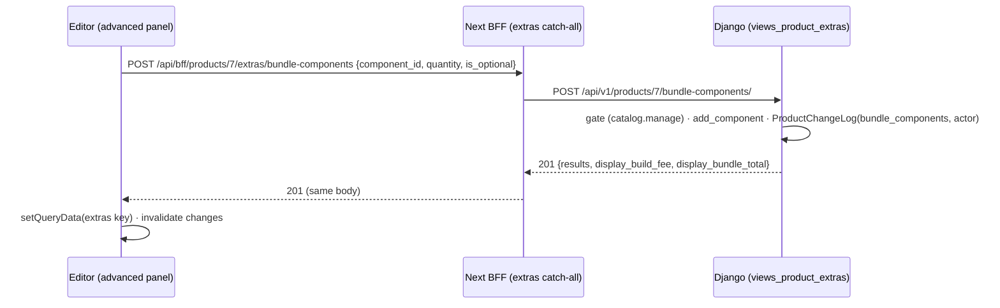
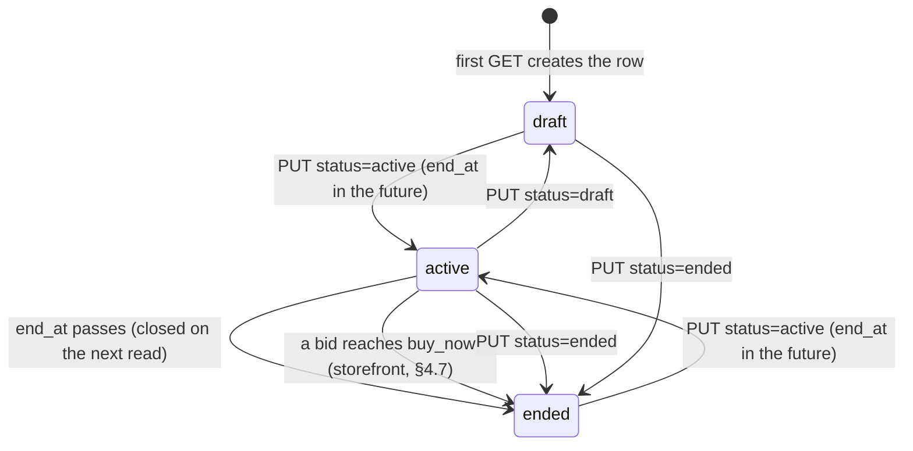
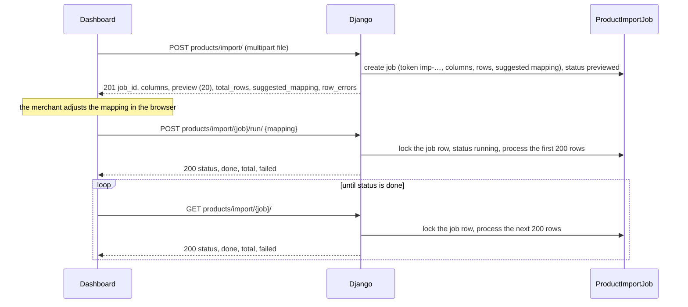
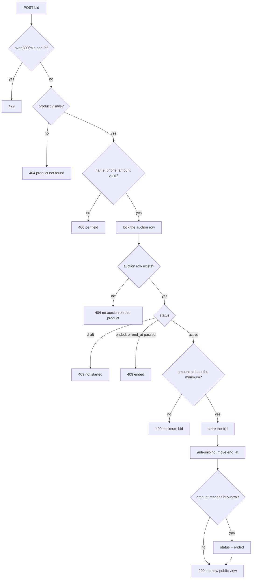

# Advanced products API — M37 (المنتجات المتقدمة: الحزم والتوافق والتخصيص والمزاد والأرقام التسلسلية والاستيراد)

> **Source**: DOC-068 (Step 17) · DOC-069 → DOC-076 (Step 18) · INT-045 (M37) · A.8 · A.9 · A.13 · inventory Domain 3
> **Live key**: `advanced_products` (`SHARWA_LIVE_MODULES`) — one switch for every M37 route of the product editor **and** the CSV import/export (`ADVANCED_LIVE_RULES`, 14 rules in `src/lib/bff/live-products.ts`). It is independent of `products` (M04, Phase A) and of `b2b` (M36 quantity prices, `B2B_LIVE_RULES`); `dispatchLiveProducts` tries `b2b` and `advanced_products` first, then `products` ([`bff.md#products-rules`](../../overview/bff.md#products-rules))
> **Django provider**: `sharwa_saas/api/views_product_extras.py` (`ExtrasAPIMixin`, gate + routing only) · `sharwa_saas/products/services/product_extras_service.py` (`bundle_view`, `add_component`, `patch_component`, `delete_component`, …) · `products/services/product_api_errors.py` (`ProductApiError`) · `products/services/change_actor.py` (`actor_label`) · `products/services/product_import_service.py` (CSV import/export) · `products/services/storefront_auction_service.py` (public auction + bids) · `products/services/tier_pricing.py` (`personalization_extra`) · models `sharwa_saas/products/models/catalog.py` (`BundleComponent`, `CompatibilityRule`, `PersonalizationField`, `Auction`, `AuctionBid`, `Product.is_bundle`, `Product.bundle_build_fee`, `ProductChangeLog`), `products/models/stock.py` (`InventoryItem`), `products/models/imports.py` (`ProductImportJob`), `products/models/orders.py` (`OrderItem.personalization`) · wired in `sharwa_saas/api/urls.py`
> **Frontend contract**: `sharwa-frontend/src/features/products/schemas/extras.ts` (`bundleComponentSchema`, `bundleViewSchema`) · hooks `src/features/products/api/extras.ts` (`useExtra`, `useExtraWrite`) · editor panels `src/features/products/components/editor/advanced-panels.tsx` · import/export schemas `src/features/products/schemas/product.ts` (`importUploadSchema`, `importStatusSchema`, `IMPORT_TARGET_FIELDS`) · storefront schema `src/features/storefront/schemas/catalog.ts` (`AuctionSchema`) · fixtures `src/mocks/product-extras/{state,router}.ts`, `src/mocks/catalog/{import,products}.ts`, `src/mocks/storefront/catalog.ts` · BFF `src/app/api/bff/products/[id]/extras/[...path]/route.ts` (catch-all) and `src/app/api/bff/catalog/products/[id]/auction/{route.ts,bids/route.ts}` (storefront)
> **Tests**: `sharwa_saas/api/test_product_extras_api.py` (10 tests in all: `BundleRulesFieldsTests` 4 — bundles, compatibility rules, personalization fields, permissions; `AuctionTests` 3 — merchant settings, storefront view and bids, draft refuses bids; `SerialsImportCartTests` 3 — serials, three-stage import + export, cart personalization surcharge) · legacy model tests `products/test_product_auction.py`, `products/test_product_personalization.py` (not read) · mock E2E `sharwa-frontend/scripts/bundles-check.ts`
> **Last verified against code**: 2026-10-27 (step 18)
>
> **Page status**: complete — §1–§3 and §4.1 (bundles) written in Step 08 (Step 17); §4.2 → §4.8 and the §3/§5/§6 updates written in Step 18 (DOC-069 → DOC-076). The Arabic messages are copied from the Django source. The BFF route files themselves (the `extras` catch-all and the two storefront auction routes) are too deeply nested to be read in this environment; their mapping is taken from `live-products.ts`, `bundles-check.ts` and `.env.example` (see [§6](#6-open-items-and-legacy-only-behaviour)).

## 1. Overview

M37 adds the "advanced product" behaviours that sit on top of the Phase A product model ([`m04-products.md`](m04-products.md)): a product can be a **bundle** built from other products, carry **compatibility rules** between variant attributes, collect **personalization** input from the buyer, be sold by **auction**, or be tracked by **serial numbers**. The merchant manages them from the editor's "advanced" panels, and the same module serves the **CSV product import and export**.

Three independent switches share one product model ([roadmap §1.7](../../../../specs/003-documentation/documentation-roadmap.md)):

| Key | Scope | Page |
|---|---|---|
| `products` | Phase A: list, editor, variants, templates, images, stock | [`m04-products.md`](m04-products.md) |
| `b2b` | `products/<id>/tier-prices/**` (M36 quantity prices) | [`../09-b2b/m36-b2b-wholesale.md`](../09-b2b/m36-b2b-wholesale.md) |
| `advanced_products` | everything on this page | this page |

All merchant routes live on the **store host** under `/api/v1/products/…`; the caller is the dashboard (owner or staff session). The provider obeys one design rule, stated in the module docstring of `product_extras_service.py`: **every write answers the full state of the resource**, so the editor replaces its cached copy with the answer (`useExtraWrite` → `qc.setQueryData`), and every derived amount is a server-formatted `display_*` string — the browser never sums or converts money (FR-37.02, [`money.md`](../../overview/money.md)).

The storefront side of M37 (the public auction view and bidding, the bundle builder on the product page) is a different set of routes and is documented with DOC-075 (§4.7).

## 2. Access — gate chain

DRF runs the authentication class (CSRF included) before the permission classes, so the table follows that order. The first failing gate answers. All M37 merchant views share `ExtrasAPIMixin`, which inherits `ProductsAPIMixin` (the same gate as Phase A, see [`m04-products.md#2-access--gate-chain`](m04-products.md)).

| # | Gate | Requirement | Failure |
|---|---|---|---|
| 1 | CSRF | `MerchantSessionAuthentication` enforces CSRF on every unsafe request that carries an owner or staff session ([`csrf.md`](../../overview/csrf.md)) | `403` (CSRF failure) |
| 2 | Tenant | `HasTenantContext` — the request resolves to a store schema | tenant-guard answer ([`m47-tenant-guard.md`](../01-public-onboarding/m47-tenant-guard.md)) |
| 3 | Session | an owner session (`is_merchant_authenticated`) **or** a staff member (`resolve_request_staff`) | `401` `{"detail": "انتهت جلستك، سجّل الدخول مجدداً."}` |
| 4 | Permission key (staff only; the owner holds every key) | reads `inventory.view` · writes `catalog.manage` | `403` `{"detail": "ليست لديك صلاحية لهذا الإجراء."}` |
| 5 | Resource state | the product exists; per-route rules (§4.1 for bundles) | `404` / `400` |

Notes:

- `ExtrasAPIMixin.run()` picks the key from the `write` flag: `CATALOG_MANAGE` for `POST`/`PATCH`/`PUT`/`DELETE`, `INVENTORY_VIEW` for `GET`. A staff member with only `inventory.view` can read a bundle but not change it; by the same rule one with only `catalog.manage` is refused the `GET`. The test asserts `inventory.view` → `GET` `200` / `POST` `403`, and `catalog.manage` → `POST` `201`.
- **No plan-feature gate.** Neither `views_product_extras.py` nor the service checks a plan feature, so M37 is available on every plan ([`plan-features.md`](../../overview/plan-features.md)).
- **No role names in code.** Both keys are permission keys; the merchant can grant them to any role ([`permissions.md`](../../overview/permissions.md)).
- The public storefront routes of M37 use `HasTenantContext` and no authentication (DOC-075).

## 3. Endpoint summary

Counted by `path(...)` entries in `api/urls.py`, the merchant side of M37 has **14 URL patterns**, matching the 14 rules of `ADVANCED_LIVE_RULES` (10 `extras/**` rules + `import`, `import/<job>`, `import/<job>/run`, `export.csv`). Three more patterns serve the public storefront auction.

| # | Method | Django path (`/api/v1/…`) | BFF path (`/api/bff/products/…`) | Purpose | Gate | Documented in |
|---|---|---|---|---|---|---|
| 1 | `GET` | `products/<id>/bundle-components/` | `<id>/extras/bundle-components` | components + totals | `inventory.view` | [§4.1](#bundles) — DOC-068 |
| 2 | `POST` | `products/<id>/bundle-components/` | `<id>/extras/bundle-components` | add a component | `catalog.manage` | [§4.1](#bundles) — DOC-068 |
| 3 | `PATCH` | `products/<id>/bundle-components/<row>/` | `<id>/extras/bundle-components/<row>` | change quantity / optional flag | `catalog.manage` | [§4.1](#bundles) — DOC-068 |
| 4 | `DELETE` | `products/<id>/bundle-components/<row>/` | `<id>/extras/bundle-components/<row>` | remove a component | `catalog.manage` | [§4.1](#bundles) — DOC-068 |
| 5 | `GET` / `POST` | `products/<id>/compatibility-rules/` | `<id>/extras/compatibility-rules` | list / add rule | `inventory.view` / `catalog.manage` | [§4.2](#compatibility) — DOC-069 |
| 6 | `DELETE` | `products/<id>/compatibility-rules/<row>/` | `<id>/extras/compatibility-rules/<row>` | delete rule | `catalog.manage` | [§4.2](#compatibility) — DOC-069 |
| 7 | `GET` / `POST` | `products/<id>/personalization-fields/` | `<id>/extras/personalization-fields` | list / add field | `inventory.view` / `catalog.manage` | [§4.3](#personalization) — DOC-070 |
| 8 | `POST` | `products/<id>/personalization-fields/reorder/` | `<id>/extras/personalization-fields/reorder` | set field order | `catalog.manage` | [§4.3](#personalization) — DOC-070 |
| 9 | `PATCH` / `DELETE` | `products/<id>/personalization-fields/<row>/` | `<id>/extras/personalization-fields/<row>` | edit / delete field | `catalog.manage` | [§4.3](#personalization) — DOC-070 |
| 10 | `GET` / `PUT` | `products/<id>/auction/` | `<id>/extras/auction` | merchant auction settings (with `reserve`) | `inventory.view` / `catalog.manage` | [§4.4](#auction) — DOC-071 |
| 11 | `GET` | `products/<id>/auction/bids/` | `<id>/extras/auction/bids` | bids, newest first | `inventory.view` | [§4.4](#auction) — DOC-071 |
| 12 | `GET` / `POST` | `products/<id>/serials/` | `<id>/extras/serials` | serial codes with counters / add codes | `inventory.view` / `catalog.manage` | [§4.5](#serials) — DOC-072 |
| 13 | `POST` | `products/import/` | `import` | import stage 1: upload + preview | `catalog.manage` | [§4.6](#import) — DOC-073 |
| 14 | `GET` | `products/import/<job>/` | `import/<job>` | import progress (processes a batch per poll) | `catalog.manage` | [§4.6](#import) — DOC-073 |
| 15 | `POST` | `products/import/<job>/run/` | `import/<job>/run` | import stage 3: run with a mapping | `catalog.manage` | [§4.6](#import) — DOC-073 |
| 16 | `GET` | `products/export/` | `export.csv` | CSV export with the list filters | `inventory.view` | [§4.6](#export) — DOC-074 |
| 17 | `GET` | `catalog/products/<id>/auction/` | `catalog/products/<id>/auction` *(storefront BFF, not under `products/`)* | public auction view (no reserve) | public | [§4.7](#storefront-auction) — DOC-075 |
| 18 | `POST` | `catalog/products/<id>/auction/bids/` and `catalog/products/<id>/bids/` | `catalog/products/<id>/auction/bids` *(storefront BFF; the short `…/bids/` URL is Django-only)* | place a bid | public | [§4.7](#storefront-auction) — DOC-075 |

Rows 1–4 are the two URL patterns of this step; the table has more rows than patterns because rows 5, 7, 9, 10, 12 hold two methods on one pattern and rows 17–18 are the three storefront patterns. The static path `personalization-fields/reorder/` is declared before `personalization-fields/<int:row_id>/`, and `products/import/` and `products/export/` are declared after the `<int:pk>/…` patterns but cannot clash with them because `<int:pk>` only matches digits.

> The URL kwarg of the bundle row routes is `row_id` and is the **`BundleComponent` id** (the `id` field of each `results[]` entry), not the component product's id (`component_id`). The module docstring of `views_product_extras.py` and the roadmap call it `<cid>`; this page writes `<row>` to avoid the confusion.

<a id="bundles"></a>

## 4.1 Bundles — DOC-068

A **bundle** (الحزمة) is a product with `is_bundle = true` that is made of other products, its **components**. The bundle has its own price (`Product.price`) and an optional **build fee** (`Product.bundle_build_fee`, رسوم التجميع/التركيب). Each component row says which product, how many units (fractional allowed) and whether it is **optional**. The editor panel "المكوّنات" shows the rows, the stock warning «نفد — الحزمة غير متاحة» for a mandatory component with no stock, and the line «سعر الحزمة (المكوّنات الأساسية)» with the server's `display_bundle_total`.

`is_bundle` and `bundle_build_fee` are fields of the product itself: they are written by `PATCH /api/v1/products/<id>/` ([`m04-products.md#editor`](m04-products.md#editor)), not by these routes. These routes only manage the component rows.

### Contract and mapping

Response shape (`bundleViewSchema`), the same for `GET`, and for every successful `POST`, `PATCH` and `DELETE`:

| Field | Type | Django source |
|---|---|---|
| `results[]` | array | `product.bundle_components`, ordered by `sort_order`, then `id` |
| `results[].id` | number | `BundleComponent.id` — the `<row>` of the item routes |
| `results[].component_id` | number | `BundleComponent.component_id` (the component product) |
| `results[].name` | string | component `Product.name` |
| `results[].sku` | string | component `Product.sku`, `""` when empty |
| `results[].quantity` | string | `BundleComponent.quantity` formatted by `_qty` with **exactly 3 decimals** (`"6.000"`) |
| `results[].is_optional` | boolean | `BundleComponent.is_optional` |
| `results[].stock` | string | component `Product.stock` (`or 0`), 3 decimals (`"8.000"`) |
| `results[].display_price` | string | `format_money(price, component.currency)` where `price = component.calculate_formula_unit_price() or component.price` — in the **component's own currency**, never the bundle's |
| `display_build_fee` | string \| null | `format_money(bundle_build_fee, bundle.currency)` when the fee is greater than 0, else `null` |
| `display_bundle_total` | string | see [Total computation](#bundle-total) |

> Quantities here are **strings with three decimals** (`"1.000"`, `"6.000"`) because the Zod schema declares `quantity: z.string()`. This differs from the Phase A product payload, where fractional quantities are returned without trailing zeros ([`m04-products.md`](m04-products.md)).

The editor mounts the bundle panel (and so calls `GET …/bundle-components/`) only when the product has `is_bundle`. A `GET` on a product that is not a bundle is not refused: it answers an empty `results`, `display_build_fee: null` and `display_bundle_total` equal to the formatted zero (`"0 ر.س"`).

### Endpoint group

| Method | Django path | Status | Response |
|---|---|---|---|
| `GET` | `/api/v1/products/<id>/bundle-components/` | `200` | the bundle view |
| `POST` | `/api/v1/products/<id>/bundle-components/` | `201` | the bundle view (new state) |
| `PATCH` | `/api/v1/products/<id>/bundle-components/<row>/` | `200` | the bundle view |
| `DELETE` | `/api/v1/products/<id>/bundle-components/<row>/` | `200` | the bundle view — **not** `204` and not an empty body |

There is no `PUT`, no "reorder" route and no `GET …/<row>/`: the client always works from the list. `sort_order` is assigned once, as the number of existing rows at insertion time, so a new component always lands last (after deletions two rows can share a `sort_order`; the tie is broken by `id`).

### `GET /api/v1/products/<id>/bundle-components/`

**Query parameters**: none.

**Response `200`** — fixture from `test_bundle_components` (bundle price 300 ر.س, build fee 15; the SKUs are illustrative, the test does not set them):

```json
{
  "results": [
    {
      "id": 1,
      "component_id": 12,
      "name": "دلة نحاس",
      "sku": "POT-01",
      "quantity": "1.000",
      "is_optional": false,
      "stock": "8.000",
      "display_price": "120 ر.س"
    },
    {
      "id": 2,
      "component_id": 13,
      "name": "فناجين",
      "sku": "CUP-01",
      "quantity": "6.000",
      "is_optional": false,
      "stock": "50.000",
      "display_price": "10 ر.س"
    }
  ],
  "display_build_fee": "15 ر.س",
  "display_bundle_total": "195 ر.س"
}
```

`195 ر.س` and `15 ر.س` are asserted by the test (`120 + 6×10 + 15 رسوم`). Component names, `stock` values and the row ids are the fixture's.

**Errors**

| Status | Body | When |
|---|---|---|
| `401` / `403` | gate bodies of §2 | no session / staff without `inventory.view` |
| `404` | `{"detail": "المنتج غير موجود."}` | no product with this id (`_product(pk)`) |

### `POST /api/v1/products/<id>/bundle-components/`

**Request body** (`application/json`)

| Field | Type | Required | Rules / limits |
|---|---|---|---|
| `component_id` | number | yes | an existing product with `archived_at` empty; not the bundle itself; not itself a bundle; not already a component of this bundle |
| `quantity` | string \| number | no (default `"1"`) | greater than 0, below 1,000,000,000, **at most 3 decimals** (`^\d+(\.\d{1,3})?$` after trimming). Stored in `DecimalField(12, 3)` |
| `is_optional` | boolean | no (default `false`) | only the JSON value `true` makes the component optional; `"true"`, `1` or any other value is read as `false` |

```json
{ "component_id": 13, "quantity": "6", "is_optional": false }
```

**Response `201`** — the bundle view, as above, with the new row last.

**Validation order** (`add_component`): (1) the product must exist (`404`); (2) the product must be a bundle (`400` with `detail`, not a field error); (3) `component_id` and `quantity` are validated together, so one body can carry both field errors; (4) the duplicate check runs only when `component_id` itself is valid; (5) the row is inserted inside `transaction.atomic()`, and a database `IntegrityError` on the unique constraint is answered with the same duplicate message as step 4.

**Errors**

| Status | Body | When |
|---|---|---|
| `400` | `{"detail": "فعّل «حزمة» على المنتج أولاً."}` | the product has `is_bundle = false` |
| `400` | `{"component_id": ["لا يمكن إضافة الحزمة إلى نفسها."]}` | `component_id` equals the bundle's id |
| `400` | `{"component_id": ["اختر منتجاً صالحاً."]}` | missing, not a number, unknown, or archived product |
| `400` | `{"component_id": ["لا يمكن وضع حزمة داخل حزمة."]}` | the component has `is_bundle = true` |
| `400` | `{"component_id": ["هذا المنتج مكوّن في الحزمة مسبقاً."]}` | already a component (pre-check or `unique_bundle_component`) |
| `400` | `{"quantity": ["أدخل كمية أكبر من صفر (حتى 3 منازل عشرية)."]}` | not a number, zero or negative, more than 3 decimals, or ≥ 1,000,000,000 |
| `404` | `{"detail": "المنتج غير موجود."}` | no product with this id |

> Behaviour to be aware of — `quantity` is read as `data.get('quantity') or '1'`, so a JSON **number** `0` (or `0.0`) is falsy and is silently replaced by `1`, while the string `"0"` is refused with the quantity message above. The editor always sends a string, so the quirk is not reachable from the UI.

**Side effects** — one `ProductChangeLog` row (see [Change log](#bundle-changelog)). No audit-log row, webhook or notification. The component's stock is **not** reserved or changed by these routes.

### `PATCH /api/v1/products/<id>/bundle-components/<row>/`

**Request body**: any of `quantity` (same rule as `POST`, but here a missing or empty value is an error, not a default) and `is_optional` (boolean; same `true`-only rule). Keys that are absent are left untouched; unknown keys are ignored. An empty body is accepted and answers the current view. The row is saved with `update_fields` limited to what was sent.

```json
{ "is_optional": true }
```

**Response `200`** — the bundle view. With the fixture above, marking the cups optional drops the total from `195 ر.س` to `135 ر.س` (`120 + 15`; the optional row is outside the sum).

**Errors**

| Status | Body | When |
|---|---|---|
| `400` | `{"quantity": ["أدخل كمية أكبر من صفر (حتى 3 منازل عشرية)."]}` | invalid `quantity` (the test sends `"0"`) |
| `404` | `{"detail": "المنتج غير موجود."}` | no product with this id |
| `404` | `{"detail": "المكوّن غير موجود."}` | no row with this id **inside this bundle** |

The PATCH cannot change `component_id`: to swap a component, delete the row and add another.

### `DELETE /api/v1/products/<id>/bundle-components/<row>/`

No body. Answers `200` with the bundle view without the row (the test deletes the cups row and gets one result left). Errors: `404` «المنتج غير موجود.» or `404` «المكوّن غير موجود.». The component product itself is never touched; only the link row is deleted. Repeating a `DELETE` answers `404`.

<a id="bundle-total"></a>

### Total computation — `display_bundle_total`

`bundle_view()` computes the total in this order, in `Decimal`:

1. **Start from the build fee**: `total = product.bundle_build_fee or 0`. The fee is added **as it is**: it is a number in the *bundle's* currency and is never converted.
2. **Walk the rows** in `sort_order, id` order. For each row:
   1. `price` = `component.calculate_formula_unit_price()` if it returns a value that is not zero, else `component.price`. Formula pricing is `(formula_unit_price × coefficient) + formula_fixed_extra`, with coefficient defaulting to 1 and the extra to 0, rounded half-up to 2 decimals. A product that is not formula-priced, or whose formula result is exactly zero, falls back to its fixed `price`. The price is in the **component's currency** (`component.currency`).
   2. **Optional rows are skipped** (`is_optional = true`): they appear in `results` but add nothing to the total.
   3. For a mandatory row, `unit = component._convert_value_to_target(price, bundle.currency, store_settings)`, then `total += unit × quantity`.
3. **Format**: `format_money(total, bundle.currency)`.

How `_convert_value_to_target` converts (the method is called on the **component**, so the *component's* `currency` and `custom_sar_rate` decide the source side):

| Step | Rule |
|---|---|
| Zero | a falsy `value` returns `0.00` |
| Rates | taken from `StoreSetting` (loaded once per call to `bundle_view`): `sar_to_yer_old` (YER_OLD per 1 SAR, default 140), `sar_to_yer_new` (YER_NEW per 1 SAR, default 520), `usd_to_sar` (SAR per 1 USD, default 3.75). A rate that is zero or negative falls back to the default shown. Rates carry 4 decimals since migration `0217` (INT-010) |
| Component override | if the component has `custom_sar_rate > 0`, that number **replaces the store rate for the component's own currency** (the old rate when the component is `YER_OLD`, the new rate for `YER_NEW`, the USD rate for `USD`); it has no effect on a SAR component |
| To SAR | `SAR` → unchanged · `YER_OLD` → value ÷ old rate · `YER_NEW` → value ÷ new rate · `USD` → value × USD rate |
| To target | `SAR` → quantized to 0.01 · `YER_OLD`, `YER_NEW` → value × rate quantized to a **whole number** · `USD` → ÷ USD rate quantized to 0.01 — all `ROUND_HALF_UP` |
| Rounding point | the rounding happens on the **unit price, before** it is multiplied by the quantity |

`format_money` then prints: SAR as `"120 ر.س"` (whole numbers without decimals) or `"187.50 ر.س"`; USD as `"$4"`; both Yemeni rials as `"2,600 ر.ي"` (no decimals, thousands separator).

**Worked example 1 — from the test** (`test_bundle_components`; bundle in SAR, fee 15; all components SAR):

| Row | Component | Mandatory | Unit | Quantity | Line |
|---|---|---|---|---|---|
| 1 | دلة نحاس | yes | 120.00 | 1 | 120.00 |
| 2 | فناجين | yes | 10.00 | 6 | 60.00 |
| — | build fee | — | — | — | 15.00 |
| | **Total** | | | | **195.00 → `195 ر.س`** |

After `PATCH {"is_optional": true}` on row 2: `120.00 + 15.00 = 135.00 → "135 ر.س"`, as the test asserts.

**Worked example 2 — constructed** for this page (not a test): it shows currency conversion, a formula-priced component, an optional row and the rounding point. Assumptions: store rates are the defaults (`usd_to_sar = 3.75`, `sar_to_yer_new = 520`, `sar_to_yer_old = 140`); the bundle is in SAR with fee 15.00; no component has a `custom_sar_rate`. The figures were computed by hand from `bundle_view` and `_convert_value_to_target` as read above; they have not been run against a database.

| Row | Component (currency) | Mandatory | `display_price` | Unit price in SAR | Quantity | Line |
|---|---|---|---|---|---|---|
| 1 | Pot — SAR 120 | yes | `"120 ر.س"` | 120.00 | 1 | 120.00 |
| 2 | Beans — USD 4.00 | yes | `"$4"` | 4 × 3.75 = 15.00 | 2.500 | 37.50 |
| 3 | Tin — YER_NEW 2,600 | yes | `"2,600 ر.ي"` | 2,600 ÷ 520 = 5.00 | 3 | 15.00 |
| 4 | Engraving — SAR, formula: 80 × 1.25 + 5 = 105.00 | **no** | `"105 ر.س"` | 105.00 | 1 | skipped |
| 5 | Sachets — YER_OLD 1,000 | yes | `"1,000 ر.ي"` | 1,000 ÷ 140 = 7.142857… → **7.14** | 3 | 21.42 |
| — | build fee | — | — | — | — | 15.00 |
| | **Total** | | | | | 15.00 + 120.00 + 37.50 + 15.00 + 21.42 = **208.92 → `208.92 ر.س`** |

Row 5 shows the rounding point: the unit is rounded to 7.14 first, so the line is 21.42, not the 21.43 that `3 000 ÷ 140` would give. The total is not whole, so `format_money` prints two decimals. If the bundle itself were priced in `YER_NEW`, each unit would be converted to a whole number of rials and the (unconverted) fee added to it.

> ⚠️ Discrepancy — roadmap says `display_bundle_total` = mandatory components converted to the bundle's currency + build fee / code does exactly that in `bundle_view`, but the mock server does not: `componentPrice()` in `src/mocks/product-extras/state.ts:216` returns the raw `c.price`, with no currency conversion and no formula price, and its `money(p, total)` prints the sum in the bundle's currency. A fixture bundle that mixes currencies or formula-priced components therefore shows a different total in mock mode than in live mode. Reported in step 08.

> ⚠️ Discrepancy — the model also defines `Product.bundle_components_total()` / `Product.bundle_total_price()` (`products/models/catalog.py:618-632`, with `BundleComponent.line_price` at `:1456`). They sum the **raw** `component.price × quantity` for mandatory rows, with no currency conversion and no formula price, and they do not match the API total for a multi-currency or formula-priced bundle. The API does not call them. No caller was found in the files read for this step; a project-wide search was not possible (shell unavailable). Reported in step 08.

<a id="bundle-changelog"></a>

### Change log (`ProductChangeLog`)

Roadmap: "every write … logs the change-log field under the actor". The code does so for **two of the three writes**:

| Write | Row written | `field_name` | `old_value` | `new_value` | `actor` |
|---|---|---|---|---|---|
| `POST` (add) | yes | `bundle_components` | `null` | the component's **name** | actor label |
| `DELETE` (remove) | yes | `bundle_components` | the component's **name** | `null` | actor label |
| `PATCH` (quantity / optional) | **no** | — | — | — | — |

The `actor` is `actor_label(resolve_request_staff(request))`: `«مالك المتجر»` for the owner, otherwise the staff member's `full_name` (then `name`, `display_name`, and the fallback `«موظف»`), cut to 150 characters. The test checks that a staff member named «سارة» produces `actor == 'سارة'`. The rows are read by `GET /api/v1/products/<id>/changes/` ([`m04-products.md`](m04-products.md)); the editor invalidates its change-log query after every extras write (`useExtraWrite`).

> ⚠️ Discrepancy — roadmap says every write logs the change-log field under the actor / code does so for `POST` and `DELETE` only: `patch_component` takes no `actor` argument (`views_product_extras.py:76`, `product_extras_service.py:130-148`) and writes no `ProductChangeLog` row, so a quantity or optional-flag change leaves no trace. The mock server behaves the same way (`patchComponent` in `src/mocks/product-extras/state.ts` has no `logChange`). Reported in step 08.

### BFF and frontend behaviour

| Item | Behaviour |
|---|---|
| BFF route | one catch-all, `src/app/api/bff/products/[id]/extras/[...path]/route.ts`; the first segment after `extras/` is the upstream sub-resource verbatim (`bundle-components`, `compatibility-rules`, …) |
| Live rules | `ADVANCED_LIVE_RULES` rows 1–2: `/api/bff/products/<id>/extras/bundle-components[/<row>]` → `/api/v1/products/<id>/bundle-components/[<row>/]`. Matched inside `mockRoute()` → `dispatchLiveProducts()`, before the `products` table, when `advanced_products` is live; the request is forwarded with cookies and CSRF header ([`bff.md#products-rules`](../../overview/bff.md#products-rules)) |
| Live mode | no Next-side gate: Django answers `401`/`403`/`400`/`404` and the body reaches the browser untouched |
| Mock mode | `productExtrasMock` in `src/mocks/product-extras/router.ts`: a write needs `canManageCatalog(session)` (else `403`); an unknown product answers `404` «المنتج غير موجود.»; `addComponent` / `patchComponent` / `deleteComponent` / `bundleView` in `state.ts` apply the same validation and messages as Django (see the totals discrepancy above) |
| Hooks | `useExtra(id, "bundle-components")` → key `[tenant, "products", "extras", id, "bundle-components"]`, parsed with `bundleViewSchema`; `useExtraWrite` replaces that cache entry with the server's answer and drops the change-log query |
| Editor | `BundleComponents`: product search (≥ 2 characters, 8 results), a quantity box (local check with the same regex and message), an "optional" checkbox that `PATCH`es immediately, quantity `PATCH`ed on blur, delete button; read-only for staff without `catalog.manage` |



### Tests

`sharwa_saas/api/test_product_extras_api.py` holds **10 tests** in three classes (`BundleRulesFieldsTests` 4, `AuctionTests` 3, `SerialsImportCartTests` 3). Two cover bundles:

| Test | What it asserts |
|---|---|
| `BundleRulesFieldsTests.test_bundle_components` | non-bundle product → «فعّل «حزمة» على المنتج أولاً.»; self-add → «لا يمكن إضافة الحزمة إلى نفسها.»; duplicate → «هذا المنتج مكوّن في الحزمة مسبقاً.»; row order and `quantity == "6.000"`; total `195 ر.س`, fee `15 ر.س`; optional row leaves the total at `135 ر.س`; quantity `"0"` → the quantity message; delete leaves one row; a `bundle_components` change-log row exists |
| `BundleRulesFieldsTests.test_permissions` | staff with only `inventory.view`: `GET` `200`, `POST` `403`; staff with only `catalog.manage`: `POST` `201`; the log row's `actor` is «سارة» |

Not covered by a test: `component_id` pointing at a bundle («لا يمكن وضع حزمة داخل حزمة.») or an archived product, multi-currency and formula-priced totals, `PATCH` of an unknown row, and a `quantity` with more than 3 decimals. The mock end-to-end `scripts/bundles-check.ts` checks the editor panel on the fixtures (a bundle cannot contain itself) and the product-page bundle builder.

Run: `python manage.py test api.test_product_extras_api`.

**Idempotency / concurrency** — no idempotency key and no `version`. Repeating a `POST` answers `400` (duplicate), repeating a `DELETE` answers `404`, and a repeated `PATCH` is harmless. The unique constraint `unique_bundle_component (bundle, component)` is the only lock: two concurrent adds of the same component end with one row and one `400` ([`conflicts.md`](../../overview/conflicts.md)).

<a id="compatibility"></a>

## 4.2 Compatibility rules — DOC-069

A **compatibility rule** (قاعدة التوافق) is a constraint between variant attributes (`VariantAttribute`, the store-wide dictionary of [`m04-products.md#variants`](m04-products.md#variants)) that belongs to a **bundle** product (`CompatibilityRule.bundle`). The model docstring gives the intent: "battery voltage" `not_equals` "inverter voltage", or "socket" `equals` the fixed value `LGA1700`, so that a configurator can refuse an impossible combination. These routes **only store the definition**; nothing in them evaluates it (see the discrepancy below). Routes: rows 5–6 of §3; gates in §2 (reads `inventory.view`, writes `catalog.manage`).

Provider: `CompatibilityRulesView` and `CompatibilityRuleDetailView` in `views_product_extras.py`; `rules_view`, `add_rule`, `delete_rule` in `product_extras_service.py`; model `CompatibilityRule` (`products/models/catalog.py:1461`, created by migration `0132_…`, see §5).

### Endpoint group

| Method | Django path | Status | Response |
|---|---|---|---|
| `GET` | `/api/v1/products/<id>/compatibility-rules/` | `200` | a bare **array** of rules, ordered by `id` (not wrapped in `results`) |
| `POST` | `/api/v1/products/<id>/compatibility-rules/` | `201` | the array with the new rule last |
| `DELETE` | `/api/v1/products/<id>/compatibility-rules/<row>/` | `200` | the array without the rule — not `204` |

There is no `PATCH` and no reorder route: to change a rule, delete it and add another. `<row>` is the `CompatibilityRule.id` (URL kwarg `row_id`; the module docstring calls it `<rid>`). A `GET` does not require the product to be a bundle.

### Rule shape

| Field | Type | Meaning |
|---|---|---|
| `id` | number | `CompatibilityRule.id` |
| `attribute_a_id` | number | the first attribute (`VariantAttribute.id`) |
| `attribute_a_name` | string \| null | its name, e.g. «اللون» |
| `operator` | `"equals"` \| `"not_equals"` \| `"in"` | `equals` = «يساوي» · `not_equals` = «لا يساوي» · `in` = «ضمن القيم» (the model's `OPERATOR_CHOICES` labels) |
| `attribute_b_id` | number \| null | the second attribute, when the rule compares two attributes |
| `attribute_b_name` | string \| null | its name |
| `value` | string \| null | the fixed value or value list, `null` when empty |

### `POST /api/v1/products/<id>/compatibility-rules/`

**Request body** (`application/json`)

| Field | Type | Required | Rules / limits |
|---|---|---|---|
| `attribute_a_id` | number | yes | an existing `VariantAttribute` id |
| `operator` | string | yes | one of `equals`, `not_equals`, `in` |
| `attribute_b_id` | number \| null | one of `attribute_b_id` / `value` | an existing `VariantAttribute` id; `null`, `""` or absent means "no second attribute" |
| `value` | string | one of `attribute_b_id` / `value` | at most 255 characters as sent. It is **normalised before saving**: split on the ASCII comma, each part trimmed, empty parts dropped, joined with `,` — `" أسود , أبيض ,"` is stored as `أسود,أبيض`. A single value is stored as it is |

**The three operators** — what the rule says about the options the buyer picks for the attributes, and the body that creates it (ids are illustrative; the names and values come from `test_compatibility_rules`, the `not_equals` row is constructed from the validation code and is not asserted by a test):

| Operator | Reads as | Body | Resulting row |
|---|---|---|---|
| `equals` with a second attribute | the option chosen for A must equal the one chosen for B | `{"attribute_a_id": 3, "operator": "equals", "attribute_b_id": 4}` | `attribute_a_name` «اللون», `attribute_b_name` «المقاس», `value` `null` (asserted by the test) |
| `not_equals` with a fixed value | the option chosen for A must not be this value | `{"attribute_a_id": 3, "operator": "not_equals", "value": "أحمر"}` | `attribute_b_id` `null`, `value` `"أحمر"` |
| `in` with a value list | the option chosen for A must be one of these values | `{"attribute_a_id": 3, "operator": "in", "value": " أسود , أبيض ,"}` | `value` `"أسود,أبيض"` (asserted by the test) |

Valid shapes: `equals` and `not_equals` take **either** a second attribute **or** a fixed value; `in` takes a value list only (a second attribute is refused). Exactly one of `attribute_b_id` / `value` must be present.

**Response `201`** — the array after the `in` rule and then the `equals` rule were added (the test reads `rows[0]` and `rows[1]` of the second answer):

```json
[
  {
    "id": 11,
    "attribute_a_id": 3,
    "attribute_a_name": "اللون",
    "operator": "in",
    "attribute_b_id": null,
    "attribute_b_name": null,
    "value": "أسود,أبيض"
  },
  {
    "id": 12,
    "attribute_a_id": 3,
    "attribute_a_name": "اللون",
    "operator": "equals",
    "attribute_b_id": 4,
    "attribute_b_name": "المقاس",
    "value": null
  }
]
```

**Errors** — all checks run together, so one body can carry several field errors:

| Status | Body | When |
|---|---|---|
| `400` | `{"attribute_a_id": ["اختر خاصية."]}` | missing, not a number or unknown |
| `400` | `{"operator": ["اختر نوع القاعدة."]}` | not one of the three operators |
| `400` | `{"attribute_b_id": ["اختر خاصية صالحة."]}` | given but unknown or not a number |
| `400` | `{"value": ["حدّد خاصية ثانية أو قيمة."]}` | neither a second attribute nor a value (test) |
| `400` | `{"value": ["حدّد خاصية ثانية أو قيمة، لا الاثنين."]}` | both a second attribute and a value |
| `400` | `{"attribute_b_id": ["قاعدة «ضمن القيم» تقارن بقائمة قيم."]}` | `operator` is `in` and a second attribute is given (test) |
| `400` | `{"value": ["القيمة 255 حرفاً على الأكثر."]}` | the value is longer than 255 characters |
| `404` | `{"detail": "المنتج غير موجود."}` | no product with this id |

### `DELETE /api/v1/products/<id>/compatibility-rules/<row>/`

No body. `200` with the remaining rules. `404` `{"detail": "القاعدة غير موجودة."}` when the rule does not exist **or belongs to another product** (the lookup is `product.compatibility_rules.filter(pk=row)`); repeating the call answers `404` (asserted by the test).

### Rules, side effects and what is not checked

- **Change log**: `POST` writes one `ProductChangeLog` row (`field_name` `compatibility_rules`, `old_value` `null`, `new_value` = the **operator** only, not the whole rule). `DELETE` writes none.
- **Not checked by the routes**: the product is **not** required to be a bundle (unlike `bundle-components`, there is no «فعّل «حزمة» على المنتج أولاً.» check); an identical rule can be added twice; `attribute_a_id` may equal `attribute_b_id`; the attributes need not be used by any component. The mock server behaves the same way.
- **Not evaluated by the API**: no route validates a bundle against its rules. The only consumer found is the storefront product page, which receives the rules inside `bundle.rules` (`storefront_product_service.py:152-162`: `id`, `attribute_a_id`, `attribute_a_name`, `operator`, `attribute_b_id`, `value`; no `attribute_b_name`) and, in mock mode, disables the options that break a rule (`scripts/bundles-check.ts`: "an option outside «in» is disabled").
- **Idempotency / concurrency** — no key, no version; no unique constraint, so a repeated `POST` creates a second identical rule.

> ⚠️ Discrepancy — model docstring (`products/models/catalog.py:1467-1468`) says the rejection of a conflicting bundle "is applied programmatically in the validation engine when the bundle is built" / code: no evaluation of `CompatibilityRule` was found in the files read for this step — the add-to-cart service (`storefront_cart_service.py`), the checkout (`checkout_service.py`), the storefront product service (which only passes the rules to the browser) and `product_extras_service.py` (which stores them). A project-wide search was not possible (shell unavailable). The rules are therefore a definition that the product page may enforce in the browser; the server does not refuse an order that breaks one. Reported in step 18.

> ⚠️ Discrepancy — mock server serves per-component choices, Django does not: in `bundle_block` every component is built with `'choice': None` (`storefront_product_service.py:150`), while the mock `pdpBundle` fills `choice` from the fixture table `COMPONENT_CHOICES` (`src/mocks/product-extras/state.ts`). A rule needs those choices to act on, so whether the live product page applies any rule could not be confirmed (the product-page component was not read). Reported in step 18.

Tests: `BundleRulesFieldsTests.test_compatibility_rules` (empty `equals`; `in` with a second attribute; `in` with a list normalised to `أسود,أبيض`; `equals` with a second attribute; delete and a repeated delete → `404`). Not covered: the 255-character limit, the "both" message, an unknown attribute, a rule on a non-bundle product.

<a id="personalization"></a>

## 4.3 Personalization fields — DOC-070

A **personalization field** (حقل التخصيص) is an input the buyer fills on the product page — an engraving name, a gift note, a design file — that is attached to the order **without touching stock** (`PersonalizationField`, "P8"). A field may carry an optional **surcharge per unit** (`price_add`). The merchant defines the fields in the editor's advanced tab; the buyer's answers travel with the cart line to the order line (`OrderItem.personalization`). Routes: rows 7–9 of §3; gates in §2 (reads `inventory.view`, writes `catalog.manage`).

Provider: `PersonalizationFieldsView`, `PersonalizationReorderView`, `PersonalizationFieldDetailView`; `fields_view`, `_clean_field`, `add_field`, `patch_field`, `delete_field`, `reorder_fields` in `product_extras_service.py`; model `PersonalizationField` (`products/models/catalog.py:1569`).

### Endpoint group

| Method | Django path | Status | Response |
|---|---|---|---|
| `GET` | `/api/v1/products/<id>/personalization-fields/` | `200` | a bare **array** of fields ordered by `sort_order`, then `id` |
| `POST` | `/api/v1/products/<id>/personalization-fields/` | `201` | the array with the new field last |
| `POST` | `/api/v1/products/<id>/personalization-fields/reorder/` | `200` | the array in the new order |
| `PATCH` | `/api/v1/products/<id>/personalization-fields/<row>/` | `200` | the array |
| `DELETE` | `/api/v1/products/<id>/personalization-fields/<row>/` | `200` | the array without the field, renumbered |

`<row>` is the `PersonalizationField.id`. The static `reorder/` path is declared before `<row>/` in `api/urls.py`. Like every M37 write, each call answers the **whole list**.

### Field shape and the nine types

| Field | Type | Meaning |
|---|---|---|
| `id` | number | `PersonalizationField.id` |
| `label` | string | `PersonalizationField.name` — the title shown to the buyer, ≤ 100 characters |
| `field_type` | string | one of the nine types below |
| `price_add` | string \| null | surcharge per unit as a 2-decimal string (`"5.00"`); `null` when zero or empty |
| `display_price_add` | string \| null | the same amount formatted by the server in the **product's** currency (`"5 ر.س"`), `null` when no surcharge |
| `is_required` | boolean | marked required in the form (see "not enforced" below) |
| `options_csv` | string | the options of a list type, comma-separated; `""` when none |
| `sort_order` | number | position, 0-based |

| `field_type` | Model label (`FIELD_TYPE_CHOICES`) | Needs `options_csv` |
|---|---|---|
| `text` | نص قصير (سطر واحد) | no |
| `textarea` | نص طويل (متعدد الأسطر) | no |
| `number` | رقم | no |
| `select` | قائمة منسدلة | **yes** |
| `multi_select` | اختيار متعدد | **yes** |
| `date` | تاريخ | no |
| `checkbox` | خيار نعم/لا | no |
| `file` | ملف مرفق | no |
| `image` | صورة | no |

The dashboard shows shorter labels (`PERSONALIZATION_TYPE_LABELS` in `schemas/extras.ts`, e.g. «نص قصير»); the API only ever carries the codes. For `file` and `image` the routes store the **definition** only — no upload route belongs to M37.

### `POST …/personalization-fields/` and `PATCH …/<row>/`

| Field | Type | `POST` | `PATCH` | Rules / limits |
|---|---|---|---|---|
| `label` | string | required | optional | trimmed, 1–100 characters |
| `field_type` | string | required | optional | one of the nine codes |
| `price_add` | string \| number | optional | optional | `^\d+(\.\d{1,2})?$`, below 100,000,000; empty or `0` stores `0.00` (and reads back as `null`). On `PATCH`, sending an empty value **clears** the surcharge |
| `is_required` | boolean | optional | optional | only the JSON value `true` sets it |
| `options_csv` | string | optional | optional | split on the **ASCII comma** `,`, each option trimmed, empty ones dropped, rejoined with `,` (`" هدية , عادي"` → `هدية,عادي`); at most 500 characters after normalising. The Arabic comma «،» is **not** a separator here |

`PATCH` is a partial update: only the keys present are validated and written. The select/multi_select rule uses the type **after** the change and the options sent or, if none were sent, the options already stored.

**Example** — the answer of the second `POST` of `test_personalization_fields` (field ids are illustrative):

```json
[
  { "id": 21, "label": "الاسم للنقش", "field_type": "text", "price_add": "5.00", "display_price_add": "5 ر.س", "is_required": true, "options_csv": "", "sort_order": 0 },
  { "id": 22, "label": "التغليف", "field_type": "select", "price_add": null, "display_price_add": null, "is_required": false, "options_csv": "هدية,عادي", "sort_order": 1 }
]
```

**Errors**

| Status | Body | When |
|---|---|---|
| `400` | `{"label": ["أدخل عنوان الحقل."]}` | empty label (also on `PATCH {"label": ""}`, test) |
| `400` | `{"label": ["العنوان 100 حرف على الأكثر."]}` | longer than 100 |
| `400` | `{"field_type": ["اختر نوع الحقل."]}` | not one of the nine codes |
| `400` | `{"price_add": ["أدخل مبلغاً صحيحاً."]}` | not a 2-decimal non-negative amount, or ≥ 100,000,000 |
| `400` | `{"options_csv": ["أدخل خيارات القائمة مفصولة بفاصلة."]}` | `select` / `multi_select` without options (test) |
| `400` | `{"options_csv": ["الخيارات 500 حرف على الأكثر."]}` | options longer than 500 |
| `404` | `{"detail": "الحقل غير موجود."}` | no field with this id in this product (`PATCH`, `DELETE`) |
| `404` | `{"detail": "المنتج غير موجود."}` | no product with this id |

### `POST …/personalization-fields/reorder/`

Body `{"ordered_ids": [22, 21]}` — **every** field of the product, in the new order, each exactly once. Non-integers, a missing id, an extra id or a non-list answer `400` `{"ordered_ids": ["أرسل كل الحقول بترتيبها الجديد."]}` (test). On success `sort_order` becomes the index in the list (all in one transaction). No change-log row.

### `DELETE …/<row>/` — delete renumbers

After the row is deleted, the remaining fields are renumbered `0, 1, 2…` in their current order, in the same transaction, so `sort_order` never has gaps (the test deletes the second of two fields and reads back one field with `sort_order` 0). One change-log row: `field_name` `personalization_fields`, `old_value` = the label, `new_value` `null`.

### Side effects

- **Change log**: `POST` → `personalization_fields`, `new_value` = the label; `DELETE` → `old_value` = the label. `PATCH` and `reorder` write **no** row (the mock server behaves the same way).
- **Columns the API does not read or write**: `placeholder`, `help_text`, `max_length`, `applies_to_order` exist on `PersonalizationField` but are not part of this contract.

### The surcharge rule — cart to order (gap closed by INT-045)

1. **Buyer input**: the storefront add-to-cart action may carry `personalization` — an object `{ "<field id>": value }`. `storefront_cart_service.py:191-194` stores it on the cart line with the keys cast to strings.
2. **Pricing** (`products/cart.py:145-149`, helper `personalization_extra` in `products/services/tier_pricing.py:47-58`): after the unit price is chosen (variant price, quantity-tier price or formula price), the cart adds, **per unit**, the sum of `price_add` of every field whose id is present in the line's `personalization` **and has a filled value**. "Filled" means not `None`, not `""`, not `false` and not an empty list/object. The amount is in the product's currency and is converted to the cart currency with `_convert_value_to_target`, then added to the unit price; `subtotal = price × quantity`. A field with `price_add = 0` never adds anything.
3. **Checkout** (`checkout_service.py:739`): each `OrderItem` is created with `price = item['price']` (surcharge already inside) and `personalization = item.get('personalization')` when it is an object, otherwise `{}`. The column is new: migration `0236_advanced_products_api` (depends on `0235_seed_expenses_permission`) adds `OrderItem.personalization`, `JSONField(blank=True, default=dict)`, label «بيانات التخصيص» — before it, the values were kept in the cart and **lost at checkout**. The same migration creates `ProductImportJob` (§4.6).

Worked example (`test_cart_charges_filled_personalization`): a mug priced 20 with two fields — «الاسم» (`price_add` 5) and «ملاحظة» (`price_add` 3). The cart line has quantity 2 and `personalization = {"<id of الاسم>": "فارس"}`; the second field is left empty. Result: unit `price` = 20 + 5 = **25.00**, `subtotal` = **50.00**; the second field's 3 is not charged; the line's `personalization` is what is copied to the order line.

> **Scope note.** The roadmap's "checkout copies values to new `OrderItem.personalization`" is what `checkout_service.py:739` does, and it is the checkout used by the cart flow traced for this page. `storefront_checkout_service.py` has no reference to personalization, and other order-creation paths (POS, B2B drafts, the Sharwa AI cart publisher) were not traced, so whether they carry the values was not verified.

> ⚠️ Discrepancy — module docstring of `storefront_cart_service.py:14-15` says the personalization fields "are saved with the line and **not priced here** — the current checkout does not compute them yet" / `Cart.__iter__` (`products/cart.py:145-149`) now prices them. The docstring is stale; the code charges the surcharge. Code-vs-code, reported in step 18.

**Not enforced by the server** (files read: the cart service, `cart.py`, `checkout_service.py`): the values are never checked against the product's field definitions — `is_required`, the option list, `max_length` and the field type are applied by the form only; keys that are not field ids are stored as they are; a field's surcharge is charged whenever its id is present and filled, even if the product's `is_personalizable` flag is off (the storefront product page lists the fields only when the flag is on — `personalization_block`, `storefront_product_service.py:172-185`).

**Not wired** (roadmap): the merchant order detail does not show a line's personalization — `order_api_service.py` has no `personalization` reference, so the M06 order payload has no such field. The data is saved on `OrderItem.personalization` and is not shown to the merchant in the Next.js dashboard.

Tests: `BundleRulesFieldsTests.test_personalization_fields` (select without options; surcharge `5 ر.س` / `5.00`; options normalised; `price_add` null when empty; reorder; incomplete reorder; empty label on `PATCH`; delete renumbers) and `SerialsImportCartTests.test_cart_charges_filled_personalization`. Not covered: the 100/500-character limits, a `PATCH` that changes the type, `multi_select`, variants with a surcharge.

<a id="auction"></a>

## 4.4 Merchant auction and bids — DOC-071

A product marked **auction** (`Product.is_auction`, a one-of-a-kind piece sold by bidding instead of a fixed price) has one **auction row** (`Auction`, one-to-one with the product) and any number of **bids** (`AuctionBid`). This section is the **merchant** side: settings including the hidden `reserve`, and the bid log with the bidders' phone numbers. What the buyer sees and does is §4.7. Routes: rows 10–11 of §3; gates in §2 (reads `inventory.view`, writes `catalog.manage`).

Provider: `ProductAuctionView`, `ProductAuctionBidsView`; `merchant_auction`, `put_auction`, `merchant_bids`, `auction_row`, `highest_bid`, `_merchant_view` in `product_extras_service.py`; models `Auction` and `AuctionBid` (`products/models/catalog.py:1503` and `:1546`).

### Lifecycle



| Status | Label (`STATUS_CHOICES`) | Buyer can bid | How it is reached |
|---|---|---|---|
| `draft` | مسودة | no — `409` «المزاد لم يبدأ بعد.» | the row created on the first read, or `PUT status=draft` |
| `active` | نشط | yes | `PUT status=active` |
| `ended` | منتهي | no — `409` «انتهى المزاد.» | `end_at` passed while `active`; a buy-now bid; or `PUT status=ended` |

The code has **no transition table**: `put_auction` accepts any of the three statuses from any status, so a merchant can reopen an ended auction (with a future `end_at`) and the existing bids are kept. The only automatic transitions are the two into `ended`.

**Closing on read.** There is no scheduler. `auction_row` flips an `active` row whose `end_at` is not in the future to `ended` and saves it **the first time anything reads the row** — the merchant `GET`, the bid list, the storefront view or a bid. Until then the stored status is still `active`.

### `GET /api/v1/products/<id>/auction/`

`200` with the settings and the live figures. A product that is **not** an auction answers `400` (below). The first read of an auction product **creates the row** as a draft (the mock behaves the same way) — a `GET` therefore writes: `status` `draft`, `start_bid` = the product price (or `0`), `bid_step` `10.00`, `anti_sniping_seconds` `120`, no reserve, no buy-now, no end.

| Field | Type | Meaning |
|---|---|---|
| `status` | string | `draft` · `active` · `ended` |
| `start_bid` | string | opening price, 2 decimals, in the **product's** currency |
| `bid_step` | string | minimum raise over the highest bid, 2 decimals |
| `reserve` | string \| null | the hidden minimum price. **This is the only response in the API that carries it** (FR-37.06) |
| `buy_now` | string \| null | optional instant-buy price; a bid at or above it ends the auction |
| `end_at` | string \| null | ISO 8601 with offset; `null` = open until further notice |
| `anti_sniping_seconds` | number | the extension window, 0–3600 |
| `bids_count` | number | all bids on the row |
| `display_highest_bid` | string \| null | highest amount formatted by the server in the product's currency (`"1,050 ر.س"`); `null` with no bids |
| `reserve_met` | boolean \| null | `true`/`false` once there is a reserve **and** at least one bid (`highest >= reserve`); `null` otherwise. Unlike the buyer view, it is shown **at any status** |

```json
{
  "status": "active",
  "start_bid": "1000.00",
  "bid_step": "50.00",
  "reserve": "1300.00",
  "buy_now": "2000.00",
  "end_at": "2026-10-28T09:00:00+00:00",
  "anti_sniping_seconds": 120,
  "bids_count": 2,
  "display_highest_bid": "1,050 ر.س",
  "reserve_met": false
}
```

(Values follow `AuctionTests`: start 1000, step 50, reserve 1300, buy-now 2000, two bids of 1,000 and 1,050 — fixture data, the end time is illustrative.)

### `PUT /api/v1/products/<id>/auction/`

A **full replace**, not a patch: `status`, `start_bid` and `bid_step` are required, and an omitted `reserve`, `buy_now` or `end_at` is stored as `null` and an omitted `anti_sniping_seconds` as `0`. The answer is the same object as the `GET`.

| Field | Type | Required | Rules |
|---|---|---|---|
| `status` | string | yes | `draft`, `active` or `ended` |
| `start_bid` | string \| number | yes | `^\d+(\.\d{1,2})?$`, **greater than 0**, below 100,000,000 |
| `bid_step` | string \| number | yes | same rule |
| `reserve` | string \| number \| null | no | same rule when present (`0` is refused, not treated as "none") |
| `buy_now` | string \| number \| null | no | same rule when present |
| `end_at` | string \| null | no | an ISO 8601 date-time Django's `parse_datetime` reads; a value without an offset is read in the active time zone |
| `anti_sniping_seconds` | integer | no | `0`–`3600`; a fractional or non-numeric value is refused |

Cross-field rules, checked together with the field rules so one `400` lists every failure:

1. `end_at` must be in the future — **only when `status` is `active`** (`draft` and `ended` accept a past date).
2. `buy_now` must be greater than `start_bid`.
3. `reserve` must not be below `start_bid`.
4. `start_bid` cannot change once the auction has a bid (it can be re-sent unchanged).

**Errors**

| Status | Body | When |
|---|---|---|
| `400` | `{"status": ["اختر حالة المزاد."]}` | not one of the three statuses |
| `400` | `{"start_bid": ["هذا الحقل مطلوب."]}` (same for `bid_step`) | missing or empty |
| `400` | `{"start_bid": ["أدخل مبلغاً صحيحاً."]}` (same for `bid_step`, `reserve`, `buy_now`) | not a positive 2-decimal amount below 100,000,000 |
| `400` | `{"end_at": ["تاريخ غير صالح."]}` | not parseable as a date-time |
| `400` | `{"end_at": ["يجب أن ينتهي المزاد في المستقبل."]}` | `active` with a past `end_at` |
| `400` | `{"anti_sniping_seconds": ["أدخل ثوانيَ بين 0 و3600."]}` | outside 0–3600 or not an integer |
| `400` | `{"buy_now": ["سعر الشراء الفوري يجب أن يتجاوز سعر البداية."]}` | `buy_now <= start_bid` |
| `400` | `{"reserve": ["السعر الاحتياطي لا يقل عن سعر البداية."]}` | `reserve < start_bid` |
| `400` | `{"start_bid": ["لا يتغيّر سعر البداية بعد أول مزايدة."]}` | the auction has bids and `start_bid` differs |
| `400` | `{"detail": "فعّل «مزاد» على المنتج أولاً."}` | the product is not an auction (`GET` bids and `PUT` too) |
| `404` | `{"detail": "المنتج غير موجود."}` | no product with this id |

**Example** — the invalid request of `test_merchant_settings_and_validation` (start 1000, `buy_now` 900, `reserve` 500, `anti_sniping_seconds` 7200, `active`, an end one hour in the past) answers one `400` with four keys:

```json
{
  "end_at": ["يجب أن ينتهي المزاد في المستقبل."],
  "anti_sniping_seconds": ["أدخل ثوانيَ بين 0 و3600."],
  "buy_now": ["سعر الشراء الفوري يجب أن يتجاوز سعر البداية."],
  "reserve": ["السعر الاحتياطي لا يقل عن سعر البداية."]
}
```

### Side effects of a successful `PUT`

- **Stock forced to 1.** After the row is saved, `put_auction` calls `product.save()`; `Product.save` (`catalog.py:517-519`) sets `stock = 1` and `allow_backorder = False` for any auction product — one unique piece, no pre-order (FR-37.07). The mock does the same (`p.stock = "1.000"`).
- **Change log**: one `ProductChangeLog` row with `field_name` `auction_status`, `old_value` and `new_value` the status codes, **only when the status changed**. Other field changes are not logged.
- No bid is created, edited or removed.

### `GET /api/v1/products/<id>/auction/bids/`

A bare **array**, newest first (`created_at` then `id`, both descending), with no paging. Phone numbers are shown in full, so this list is the reason the route needs `inventory.view`.

| Field | Type | Meaning |
|---|---|---|
| `bidder_name` | string | name typed by the bidder, ≤ 100 characters |
| `bidder_phone` | string | digits only, 9–15 (§4.7) |
| `display_amount` | string | the stored amount formatted in the product's currency (`"2,000 ر.س"`) |
| `created_at` | string | ISO 8601 |

```json
[
  { "bidder_name": "سالم", "bidder_phone": "967771234567", "display_amount": "2,000 ر.س", "created_at": "2026-10-27T10:15:00+00:00" },
  { "bidder_name": "سالم", "bidder_phone": "967771234567", "display_amount": "1,100 ر.س", "created_at": "2026-10-27T10:14:00+00:00" }
]
```

(Illustrative timestamps; the amounts follow `test_storefront_view_and_bids`, whose four bids are 1,000 · 1,050 · 1,100 · 2,000.)

"Highest" means the largest `amount` (ties go to the later row) — `highest_bid` orders by `-amount, -created_at`.

> ⚠️ Discrepancy — roadmap says "auction row locked on writes" / code locks the row only in the **storefront bid** (`place_bid`, `auction_row(product, lock=True)`, `storefront_auction_service.py:81`). `put_auction` reads it through `_require_auction` → `auction_row(product)` with `lock=False`, so a merchant `PUT` is not serialised against a bid that arrives at the same moment: the `start_bid`-after-bids check and the `row.save()` (which rewrites `status` and `end_at` from the request) work on the row as it was read. The locking the roadmap describes is real for bids only. Reported in step 18.

> ⚠️ Discrepancy — roadmap says "all mock rules" / the code adds one the mock lacks: amounts must be **below 100,000,000** (`MAX_MONEY`, the `DecimalField(10, 2)` limit). The mock's `putAuction` only checks the format and `> 0`; a value such as `"100000000"` passes the mock and answers `400` `أدخل مبلغاً صحيحاً.` from Django. Every other rule and message matches (`state.ts:495-536`).

**Mock parity notes** (files read: `mocks/product-extras/state.ts`): the mock stores bids oldest-first and reads the highest as the last one, Django uses the largest amount — the same result because every accepted bid must beat the previous highest by the step.

Tests: `AuctionTests.test_merchant_settings_and_validation` (draft row created, the four-key `400`, a successful `PUT`, the `auction_status` log row, the non-auction `400`), `test_storefront_view_and_bids` (the bid list order, the amount and phone). Not covered: lazy closing at `end_at`, reopening an ended auction, the `start_bid` lock after a bid, `reserve_met` in the merchant view, the 100,000,000 limit.

<a id="serials"></a>

## 4.5 Serial numbers — DOC-072

A product marked **serialized** (`Product.is_serialized`: licence keys, IMEIs, tickets, gift codes) is stocked one unit per code. Each code is an `InventoryItem` row with its own status (`available` · `reserved` · `sold`, labels متاح · محجوز · مُباع), and the product's `stock` is the number of **available** codes. The merchant pastes new codes; the API answers the counters and the full code list. Route: row 12 of §3; gates in §2 (read `inventory.view`, write `catalog.manage`).

Provider: `ProductSerialsView`; `list_serials`, `add_serials`, `serials_view` in `product_extras_service.py`; model `InventoryItem` (`products/models/stock.py:65`), unique per product by the constraint `unique_inventory_item_code_per_product`; stock movement through `record_stock_movement` (`products/services/stock_movement.py`).

### `GET /api/v1/products/<id>/serials/`

`200`, an object — **not** an array:

| Field | Type | Meaning |
|---|---|---|
| `counts` | object | `{available, reserved, sold}`, three integers (the three keys are always present) |
| `results` | array | every code of the product, oldest first (`id`), as `{code, status}` — no paging, and no variant, order or location |
| `stock` | string | the product's stock with 3 decimals (`"2.000"`) |

The `GET` does **not** check `is_serialized`: a product that is not serialized answers `200` with zero counters. Only the `POST` refuses it.

### `POST /api/v1/products/<id>/serials/`

Body `{"codes": ["SN-2", "SN-3"]}`. Success is `201` with the same object as the `GET`, after the insert.

| Rule | Detail |
|---|---|
| `codes` | a JSON array. Anything else is treated as an empty list. Each item is converted to text and trimmed; empty items are dropped |
| At least one code | else `400` `{"codes": ["ألصق كوداً واحداً على الأقل."]}` |
| Length | 255 characters at most per code: `{"codes": ["الكود 255 حرفاً على الأكثر."]}` |
| Uniqueness | **all or nothing** — one repeated code anywhere refuses the whole paste and nothing is stored |
| Match | exact string, after trimming; the existing codes checked include `sold` and `reserved` ones |

**Duplicates** are reported twice in the `400` body so the form can both show a sentence and highlight the codes: the `codes` list holds one Arabic sentence joined with the Arabic comma «،», and `duplicates` holds the codes. The list is ordered **repeats inside the paste first**, then codes that already exist, each code once.

Example (`test_serials`): the product already has `SN-1` (sold). Pasting `["SN-2", "SN-2", "SN-1"]`:

```json
{
  "codes": ["أكواد مكررة: SN-2، SN-1"],
  "duplicates": ["SN-2", "SN-1"]
}
```

`SN-2` is a repeat inside the paste, `SN-1` already exists. Nothing is written. Pasting `["SN-2", "SN-3"]` then answers `201`:

```json
{
  "counts": { "available": 2, "reserved": 0, "sold": 1 },
  "results": [
    { "code": "SN-1", "status": "sold" },
    { "code": "SN-2", "status": "available" },
    { "code": "SN-3", "status": "available" }
  ],
  "stock": "2.000"
}
```

**Other errors**

| Status | Body | When |
|---|---|---|
| `400` | `{"detail": "فعّل «أرقام تسلسلية» على المنتج أولاً."}` | the product is not serialized (`POST` only) |
| `400` | `{"codes": ["أكواد مكررة."], "duplicates": []}` | a concurrent request inserted the same code between the check and the insert (the unique constraint raised `IntegrityError`); the transaction is rolled back |
| `404` | `{"detail": "المنتج غير موجود."}` | no product with this id |

### Stock rule

Inside one transaction the new rows are created with status `available`, then **the product's stock is set to the count of available codes** (it is replaced, not incremented). If that differs from the previous stock, a stock movement is written: reason `manual_adjust`, quantity change = new − old, note «أرقام تسلسلية مضافة». In the example above the stock goes from `0` to `2` and the movement is `+2`.

Because the stock is replaced, a serialized product that held a hand-entered stock different from its available-code count loses that figure on the first paste (stock 5 with no codes, then two codes → stock 2 and a movement of −3). This follows the in-code comment «مخزون هذا المنتج يُدار بالأرقام التسلسلية» and is not an error.

### Side effects

- **Change log**: one `ProductChangeLog` row, `field_name` `serial_codes`, `old_value` `null`, `new_value` `+<number of codes>` (e.g. `+2`), after the transaction.
- No route deletes a code or changes a code's status. `reserved` and `sold` are set by order flows outside M37, which were not traced for this page (the test inserts a `sold` row directly).
- The `variant`, `meta`, `location` and `order` columns of `InventoryItem` are not read or written by these routes; codes are created for the product only.

> ⚠️ Discrepancy — the mock server (`addSerials`, `mocks/product-extras/state.ts:559-575`) differs from Django in two points: it has **no 255-character limit**, and it does **not** set `stock` to the available count — it updates `p.serial_available` and returns `p.stock` unchanged, whereas Django returns `stock` equal to the available count and records a stock movement. Duplicate detection, the `400` body, the `201` status and the change-log row match. Reported in step 18 (code vs mock).

Tests: `SerialsImportCartTests.test_serials` (duplicate paste with a sold code, the `201` body and counters, stock equal to the available count, the non-serialized `400`). Not covered: the 255 limit, the `IntegrityError` race, the stock-movement row, a non-list `codes`, the `GET` of a non-serialized product.

<a id="import"></a>

## 4.6 CSV product import and export — DOC-073, DOC-074

The merchant adds many products at once from a spreadsheet, and downloads the product list as a CSV. The import is a **three-stage job** — upload and preview, map the columns, run — whose progress is polled. Nothing is written to the catalogue before the run stage (SC-04.5). Routes: rows 13–16 of §3. Gates: `catalog.manage` for all three import routes (**including the progress poll**, which does work) and `inventory.view` for the export.

Provider: `ProductImportUploadView`, `ProductImportStatusView`, `ProductImportRunView`, `ProductExportView` in `views_product_extras.py`; `upload`, `run`, `status`, `export_csv` in `products/services/product_import_service.py`; file reading by `FeedReader` / `sniff_upload` of `products/services/suppliers/feed_reader.py` (the reader the dropshipping feeds use — standard library plus `defusedxml`, no new dependency); model `ProductImportJob` (`products/models/imports.py`, created by migration `0236_advanced_products_api`). **No Celery**: the work is done inside the poll and run requests (A.8).

### Flow



| Status | Label (`STATUS_CHOICES`) | Meaning |
|---|---|---|
| `previewed` | بانتظار المطابقة | uploaded and validated, waiting for the mapping |
| `running` | قيد التنفيذ | `run` accepted; each poll processes 200 more rows |
| `done` | اكتمل | every row processed (`done == total`) |
| `failed` | فشل | in the model's choices, but **no code sets it** (see the discrepancy below) |

### Stage 1 — `POST /api/v1/products/import/`

`multipart/form-data` with one part named `file`. The BFF path is `/api/bff/products/import`. Success is `201`.

**File rules**

| Rule | Value |
|---|---|
| Extension | `csv`, `tsv`, `txt` or `xlsx` (case-insensitive); anything else, or no extension, is refused |
| Size | not empty, at most **50 MB** (`MAX_FILE_BYTES`) |
| Content check | the first 8 KB decide the format, not the extension: a `PK` zip header is `xlsx`, an old `.xls` header and a file with NUL bytes are refused, and an `.xlsx` name whose content is not Excel is refused |
| Encoding (CSV) | a UTF-8 BOM, else UTF-8 when the first 64 KB decode, else **Windows-1256**. Other encodings are not detected |
| Delimiter (CSV) | counted on the first line among `,` `;` tab `|` (the most frequent wins, `,` if none) |
| Header row | always the first row. Empty header cells become «عمود N» (N = position), repeated names become «name (2)» |
| Rows | blank rows are skipped; **at most 20,000 data rows** (`MAX_ROWS` of the import service; the reader's own ceiling is 200,000) |
| Reader limits | 200 columns, 10,000 characters per cell (longer cells are cut), 300 MB uncompressed sheet and 500,000 shared strings in `xlsx` (zip-bomb guards) |

**Response**

| Field | Type | Meaning |
|---|---|---|
| `job_id` | string | `imp-` + 16 hex characters; the key of the next two calls |
| `columns` | string[] | the header names after normalising |
| `preview` | object[] | the first 20 data rows, each `{column: text}` (every value is a string) |
| `total_rows` | number | all data rows kept |
| `suggested_mapping` | object | `{column: target}` — see the table below |
| `row_errors` | `{row, msg}[]` | one entry per row that would fail with the suggested mapping, **for all rows**, not just the preview. `row` is the spreadsheet row number (the header is row 1, so the first data row is 2) |

**Targets** (`TARGET_FIELDS`, the same nine as `IMPORT_TARGET_FIELDS` in `schemas/product.ts`): `name`, `name_en`, `sku`, `barcode`, `price`, `old_price`, `stock`, `category`, `description`.

**Suggested mapping** (`KNOWN`): the header is matched exactly, or lower-cased, against these names; the first column to claim a target keeps it.

| Header | Target |
|---|---|
| `name`, «الاسم», «اسم المنتج» | `name` |
| `name_en` | `name_en` |
| `sku` | `sku` |
| `barcode`, «الباركود» | `barcode` |
| `price`, «السعر» | `price` |
| `old_price` | `old_price` |
| `stock`, «المخزون» | `stock` |
| `category`, «التصنيف» | `category` |
| `description`, «الوصف» | `description` |

**Row validation** (`row_error`; the first failing rule is reported, one message per row):

| Order | Rule | Message |
|---|---|---|
| 1 | name present | «الاسم فارغ» |
| 2 | price present | «السعر فارغ» |
| 3 | price matches `^\d+(\.\d{1,2})?$` | «سعر غير صالح «abc»» — the value is quoted inside «…» |
| 4 | `old_price`, when present, matches the same pattern | «سعر قديم غير صالح «x»» |
| 5 | `stock`, when present, matches `^\d+(\.\d{1,3})?$` | «مخزون غير صالح «x»» |

**Errors** (all `400`, key `file`)

| Body | When |
|---|---|
| `{"file": ["اختر ملفاً."]}` | no `file` part |
| `{"file": ["الصيغ المسموحة: csv, tsv, txt, xlsx"]}` | extension not allowed (the test uploads `p.pdf`) |
| `{"file": ["الملف لا يحوي صفوف بيانات."]}` | header only, or only blank rows |
| `{"file": ["الملف أكبر من 20,000 صف — قسّمه إلى ملفات أصغر."]}` | more than 20,000 data rows |
| `{"file": ["الملف ليس بترميز UTF-8؛ احفظه بترميز UTF-8 ثم أعد الرفع."]}` | undecodable text |
| `{"file": ["الملف فارغ."]}` · `{"file": ["حجم الملف أكبر من 50MB."]}` | empty or over 50 MB |
| `{"file": ["صيغة Excel القديمة (.xls) غير مدعومة — احفظ الملف بصيغة .xlsx أو CSV."]}` | an old Excel file |
| `{"file": ["الملف ليس نصاً (CSV) ولا Excel (xlsx)."]}` | binary content |
| `{"file": ["الامتداد xlsx لكن المحتوى ليس ملف Excel."]}` | wrong content for `xlsx` |
| `{"file": ["الملف يحوي 201 عموداً — الحد 200."]}` | too many columns (the number is the actual count) |

Other reader messages (damaged `xlsx`, no worksheet, oversized sheet or shared-string table, a malformed CSV near a row) come from `feed_reader.py` as `{"file": ["…"]}` too; they are defined at the source and not repeated here.

**Example** — the upload of `test_import_three_stages_and_export`. File (UTF-8, comma-separated):

```csv
الاسم,السعر,المخزون,التصنيف,sku
كوب,12.5,10,أدوات,IMP-1
,5,1,,
صحن,abc,1,,
ملعقة,3,,غير موجود,IMP-2
```

Answer `201` (the token is illustrative):

```json
{
  "job_id": "imp-3fa91c0b7d2e4a18",
  "columns": ["الاسم", "السعر", "المخزون", "التصنيف", "sku"],
  "preview": [
    { "الاسم": "كوب", "السعر": "12.5", "المخزون": "10", "التصنيف": "أدوات", "sku": "IMP-1" }
  ],
  "total_rows": 4,
  "suggested_mapping": { "الاسم": "name", "السعر": "price", "المخزون": "stock", "التصنيف": "category", "sku": "sku" },
  "row_errors": [
    { "row": 3, "msg": "الاسم فارغ" },
    { "row": 4, "msg": "سعر غير صالح «abc»" }
  ]
}
```

(`preview` is cut to its first row here; the real answer lists all four rows, being under 20.) Nothing exists in the catalogue yet: the test asserts that «كوب» is not a product after the upload.

### Stage 2 — the mapping

There is no route for stage 2. The dashboard shows `columns`, `preview`, `suggested_mapping` and `row_errors`, the merchant changes the mapping in the browser, and the result is sent with stage 3. Note that `row_errors` was computed with the **suggested** mapping only; the run re-validates every row with the final one.

### Stage 3 — `POST /api/v1/products/import/<job>/run/`

Body `{"mapping": {"<column>": "<target>", …}}`. In one transaction the server **locks the job row**, checks it, stores the cleaned mapping, sets `running` and processes the first 200 rows; the answer is the progress object below.

| Rule | Detail |
|---|---|
| Cleaning | an entry is kept only when the column exists in the job and the target is one of the nine; **a target can be used once** — a second column for the same target is dropped silently. A mapping that is not an object is treated as empty |
| Required | both `name` and `price` must be mapped, else `400` `{"mapping": ["طابِق عمودَي الاسم والسعر على الأقل."]}`; the job stays `previewed` and can be run again |
| Once only | a job that is `running` or `done` answers `409` `{"detail": "نُفِّذت هذه المهمة مسبقاً."}` |
| Unknown job | `404` `{"detail": "مهمة الاستيراد غير موجودة."}` |

### Progress — `GET /api/v1/products/import/<job>/`

Locks the job row, **processes the next 200 rows if the job is `running`**, and answers. A `previewed` or `done` job just reports. Each response carries real progress, and each request stays short.

| Field | Type | Meaning |
|---|---|---|
| `status` | string | see the table above |
| `done` | number | rows processed so far — failed rows count as processed |
| `total` | number | all data rows of the job |
| `failed` | `{row, msg}[]` | rows that did not become products, in processing order |

Example — the run of the same job with the suggested mapping (`test_import_three_stages_and_export`): the four rows fit one batch, so the run answers `done` at once.

```json
{
  "status": "done",
  "done": 4,
  "total": 4,
  "failed": [
    { "row": 3, "msg": "الاسم فارغ" },
    { "row": 4, "msg": "سعر غير صالح «abc»" }
  ]
}
```

A file of 450 rows would answer `done: 200` from `run`, `done: 400` from the first poll and `status: "done"`, `done: 450` from the second.

**What a processed row does**

- Rows are re-validated with the final mapping (the same five rules). A failing row is added to `failed` and skipped.
- A valid row creates one `Product` inside its own savepoint, so a database error fails only that row. The product is **a draft**: `is_available = False`. `stock` is the cell, or `0` when empty. `category` is looked up by **exact name**; an unknown (or empty) name gives a product without a category and is **not** an error (the test imports «ملعقة» with the category «غير موجود»). The product is saved with the uploader's name as the actor, so the change log shows who imported it.
- Cut to the column sizes: `name` 200, `name_en` 200, `sku` 100, `barcode` 64 characters. Empty `name_en`, `sku`, `barcode` and `description` are stored as `null`.
- A database `IntegrityError` becomes «SKU مستخدم مسبقاً «IMP-1»» when the row has a SKU, otherwise «تعذّر حفظ المنتج (قيمة مكررة).». Any other exception becomes «تعذّر حفظ المنتج: » followed by the exception text, cut to 300 characters.

### Test and mock behaviour

`SerialsImportCartTests.test_import_three_stages_and_export` covers: the `201` body and the suggested mapping; the two row errors; no write before the run; the missing-price mapping `400`; the run result; the stored product (price `12.50`, stock `10`, category «أدوات», `is_available` false); the product without a category; the `409` on a second run; the `GET` of a finished job; the unknown job `404`; the `.pdf` refusal. **Not covered**: batching (more than 200 rows), `xlsx`, Windows-1256, the 20,000-row and 50 MB limits, the `IntegrityError` path, a column mapped twice.

The fixture server (`src/mocks/catalog/import.ts`) implements the same three routes with the same messages; it differs in the points listed below.

> **Note — the progress poll writes.** The roadmap's "200-row chunks under the job's row lock on run and every poll" is what the code does (`_locked` uses `select_for_update` inside `transaction.atomic()` in both `run` and `status`). Because a `GET` therefore changes data, `ProductImportStatusView.get` passes `write=True` to the gate: a staff member with only `inventory.view` cannot poll a job; the owner and staff with `catalog.manage` can. This is the `catalog.manage` gate shown in §3, and the one `GET` in M37 that needs the write key.

> ⚠️ Discrepancy — frontend schema vs code: `importStatusSchema` (`schemas/product.ts:416`) accepts the statuses `uploaded`, `previewed`, `running`, `done`, `failed`. Django never returns `uploaded`, and although `failed` is in `ProductImportJob.STATUS_CHOICES`, **no code path sets it**: a row-level problem goes to `failed[]` and the job still ends `done`. Files read: `product_import_service.py`, `imports.py`. Reported in step 18 (code vs frontend schema).

> ⚠️ Discrepancy — code vs mock: (1) Django also validates `old_price` («سعر قديم غير صالح «x»»); the mock's `rowError` (`mocks/catalog/import.ts:31-43`) does not. (2) The mock refuses `xlsx` with «ملفات xlsx يقرؤها الخادم الحقيقي فقط؛ صدّرها CSV للتجربة المحلية.»; Django reads it. (3) The mock advances by elapsed time (about 40 rows per 300 ms) and Django by one 200-row batch per call, so the same file passes through different intermediate `done` values. (4) The mock has no 20,000-row or 50 MB limit and no Windows-1256 fallback (it treats the replacement character as a UTF-8 error). The upload and run messages otherwise match.

**Observations** (files read: `product_import_service.py`, `imports.py`; kept for the open-items register, §4.8):

- **Row numbers drift after blank rows.** `_read` drops blank rows before the numbering, and `failed[].row` / `row_errors[].row` are `index + 2` over the kept rows. Every row after a blank row is reported one number lower than its position in the file (two blank rows, two lower).
- **Rows live in the job.** The parsed rows are stored in the `rows` JSON column and nothing in the files read deletes finished or abandoned jobs, so up to 20,000 rows per upload accumulate.
- **Token is not tied to the uploader.** Any session with `catalog.manage` can poll or run any job whose token it holds.
- **Raw exception text** reaches the merchant in «تعذّر حفظ المنتج: …» (may be in English).

<a id="export"></a>

### Export — `GET /api/v1/products/export/` (DOC-074)

BFF path `/api/bff/products/export.csv`. Gate `inventory.view`. It answers a file, not JSON.

| Part | Value |
|---|---|
| Status | `200` |
| `Content-Type` | `text/csv; charset=utf-8` |
| `Content-Disposition` | `attachment; filename="products.csv"` |
| `Cache-Control` | `no-store` |
| Body | a UTF-8 **BOM** (U+FEFF) so Excel opens the Arabic text correctly, then the header row and one row per product |

**Filters and ordering** are the query string of the product list (`GET /api/v1/products/`, [`m04-products.md`](m04-products.md)) — the export calls the same `filter_products` — with **no paging**: every matching product is exported.

| Query key | Effect |
|---|---|
| `q` | text search in name, English name, SKU and barcode |
| `status` | `published` · `draft` · `scheduled` · `archived` |
| `stock` | `in_stock` · `low` · `out` |
| `category` | a category id **and its descendants** |
| `brand`, `tag`, `collection` | an id each |
| `product_type` | one of the product-type codes |
| `flags` | comma list of `variants` · `bundle` · `auction` · `bookable` |
| `ordering` | `name` · `price` · `stock` · `updated_at` · `sku`, with `-` for descending; empty values last; ties by `-id`. Default and any unknown value: `-updated_at`, then `-id` |

Unknown values of `status`, `stock` and `product_type` are ignored (no filter), not refused. `page` and `page_size` are ignored.

**Columns** (nine, in this order):

| # | Column | Source | Format |
|---|---|---|---|
| 1 | `id` | product id | integer |
| 2 | `name` | product name | text |
| 3 | `sku` | product SKU | empty when none |
| 4 | `price` | the **effective** price (the formula price when the product has one, else the price) | the server's `display` string in the product currency, e.g. `12.50 ر.س` — not a bare number |
| 5 | `stock` | product stock | 3 decimals, e.g. `10.000` |
| 6 | `unit` | product unit | text |
| 7 | `category` | category name | empty when none |
| 8 | `status` | `published` · `draft` · `scheduled` · `archived` | code, not Arabic |
| 9 | `updated_at` | last update | ISO 8601, empty if missing |

**Example** (`test_import_three_stages_and_export`, filter `?status=draft`, so it lists the imported draft «كوب»; the values are the test's):

```csv
id,name,sku,price,stock,unit,category,status,updated_at
17,كوب,IMP-1,12.50 ر.س,10.000,<unit>,أدوات,draft,2026-10-27T10:00:00+00:00
```

(The id, unit and timestamp are illustrative; the test asserts only that the text starts with the BOM and the header, and contains the fragment `كوب,IMP-1,12.50 ر.س,10.000`.) A price of a thousand or more is formatted with a thousands separator (`1,000 ر.س`) and is therefore quoted by the CSV writer.

> ⚠️ Discrepancy — code vs mock: the column list and the BOM are the same; the lines differ. Python's `csv.writer` ends rows with `\r\n`, the mock (`exportCsv`, `mocks/catalog/products.ts:872`) with `\n` and a trailing newline. Spreadsheet software reads both.

**Observation** (for the register): cell values are written as they are — a product name or SKU that starts with `=`, `+`, `-` or `@` is not neutralised, and a name can be imported through stage 3. The files read contain no formula-injection guard for this export.

Tests: only the status, the BOM and header, and one row fragment (above). Not covered: any filter other than `status`, `ordering`, a formula-priced product, a product with a category descendant filter.

<a id="storefront-auction"></a>

## 4.7 Storefront auction and bidding — DOC-075

The buyer-facing half of the auction: the product page reads the **public view** of the auction and sends **bids**. These routes are public — no session, no login, no OTP: a bidder gives a name and a phone number only (phase-7 decision 4). Money is shown and compared in the **buyer's currency**; the hidden `reserve` never leaves the server. Routes: rows 17–18 of §3.

Provider: `StorefrontAuctionView` and `StorefrontBidView` in `views_product_extras.py`; `buyer_view` and `place_bid` in `products/services/storefront_auction_service.py`; the row helpers `auction_row` and `highest_bid` are shared with §4.4. **Django-first**: `.env.example` states that the storefront auction and bids go through the storefront adapter and need no switch, so `advanced_products` does not affect them (§4.8).

### Gates

| # | Gate | Detail |
|---|---|---|
| 1 | Tenant | `HasTenantContext` — the request resolves to a store schema |
| 2 | Authentication | none (`authentication_classes = []`); because no session authentication runs, **CSRF is not enforced** on the bid `POST` |
| 3 | Rate limit | bids only: **300 per minute per IP** (`group` `auction_bid`) → `429` `{"detail": "طلبات كثيرة جداً، حاول لاحقاً."}`. The cap is deliberately loose because many buyers share one IP behind carrier NAT (decision 2026-10-21); the protection that matters is the row lock below. See [`34-rate-limits.md`](../../../architecture/34-rate-limits.md) |
| 4 | Visibility | the product must be visible to the public (`Product.objects.visible()`) |

### `GET /api/v1/catalog/products/<id>/auction/?currency=SAR`

BFF path `/api/bff/catalog/products/<id>/auction?currency=SAR`. `currency` is a currency code the store supports; a missing value falls back to the store currency and an unknown code to `SAR`.

| Field | Type | Meaning |
|---|---|---|
| `status` | string | `draft` · `active` · `ended` (§4.4). A draft is returned, not hidden |
| `display_current_bid` | string | the highest bid, or the start price when there are no bids, formatted in the buyer's currency |
| `display_bid_step` | string | the minimum raise |
| `display_buy_now` | string \| null | the instant-buy price, `null` when there is none |
| `next_bid_amount` | string | the lowest amount the server will accept, **2-decimal number in the buyer's currency** (`"1050.00"`) — the browser puts it in the field and does no arithmetic |
| `display_next_bid` | string | the same amount formatted (`"1,050 ر.س"`) |
| `end_at` | string \| null | ISO 8601; `null` = open until further notice |
| `anti_sniping_seconds` | number | the extension window |
| `bids_count` | number | all bids |
| `reserve_met` | boolean \| null | **only when `status` is `ended` and a reserve is set**: `true` if there is at least one bid and the highest reached the reserve, `false` otherwise (including no bids). `null` in every other case. The amount is never sent |

`next_bid_amount` is the start price while there are no bids, then `highest + bid_step`. The first bid may equal the start price.

Errors: `404` `{"detail": "لا يوجد مزاد على هذا المنتج."}` when the product is not visible or is not an auction. Like the merchant `GET`, this call **creates the draft row** if the product is an auction without one (§4.4).

The frontend schema (`AuctionSchema`, `src/features/storefront/schemas/catalog.ts:289`) carries the guard `reserve: z.never().optional()`: a public response that contains a `reserve` key **fails validation and is rejected**, not silently dropped (FR-37.06). The Django view builds the object field by field and has no such key; the mock projection behaves the same way, and `scripts/bundles-check.ts` asserts that neither the response nor the DOM contains the reserve (SC-37.2).

Example — `AuctionTests.test_storefront_view_and_bids` after the merchant saves the settings of §4.4 (start 1000, step 50, buy-now 2000, reserve 1300; no bids). The test asserts `next_bid_amount`, `display_next_bid`, `bids_count` and the absence of `reserve`; the other values are what the code produces for those settings, shown for completeness:

```json
{
  "status": "active",
  "display_current_bid": "1,000 ر.س",
  "display_bid_step": "50 ر.س",
  "display_buy_now": "2,000 ر.س",
  "next_bid_amount": "1000.00",
  "display_next_bid": "1,000 ر.س",
  "end_at": "2026-10-28T09:00:00+00:00",
  "anti_sniping_seconds": 120,
  "bids_count": 0,
  "reserve_met": null
}
```

### `POST /api/v1/catalog/products/<id>/auction/bids/` and `…/bids/`

Two URLs, one view (`StorefrontBidView`): the long path (`name` `product-auction-bids`) and the short path `catalog/products/<id>/bids/` (`product-bids`), kept for the name used in M37 §7. They behave identically. The storefront BFF exposes only the long one (`/api/bff/catalog/products/<id>/auction/bids`). JSON body only (`JSONParser`).

| Field | Type | Required | Rules |
|---|---|---|---|
| `bidder_name` | string | yes | trimmed, 1–100 characters; a non-string counts as empty |
| `bidder_phone` | string \| number | yes | every non-digit is removed, then **9–15 digits** must remain |
| `amount` | string \| number | yes | a finite number greater than 0, **in the buyer's currency** |
| `currency` | string | no | as for the `GET`; also read from `?currency=`, the body wins |

#### How a bid is decided



The field validation (`400`) runs **before** the lock, so a malformed bid on a draft or ended auction answers `400`, not `409`.

1. **Validation** — see the table above. All failing fields are returned together.
2. **Lock** — the auction row is read with `select_for_update` inside a transaction. Two simultaneous bids cannot both pass the minimum check: the second one waits, sees the first bid, and is judged against `highest + bid_step`. (`auction_row` closes an active auction whose `end_at` has passed; when the bid is then refused with `409`, that write is rolled back with it and the next read closes the row again.)
3. **Minimum** — `minimum` is the start price with no bids, else `highest + bid_step`, both stored in the product's currency. It is converted to the buyer's currency **with the product's own rate** (`Product._convert_value_to_target`, which honours the product's `custom_sar_rate`) — the same conversion `next_bid_amount` shows — and the bid passes when `amount + 0.005 >= minimum`. The half-cent tolerance means the amount the page displayed is always accepted. Equal to the minimum is accepted.
4. **Storage** — the amount is divided back to the product's currency by the same factor and stored with 2 decimals (`AuctionBid.amount`). The bidder's name and digits-only phone are stored with it.
5. **Anti-sniping** — if the auction has an `end_at` and a window `anti_sniping_seconds > 0`, and fewer than that many seconds remain, `end_at` becomes **now + window**.
6. **Buy-now** — if a buy-now price is set and `amount + 0.005 >=` its conversion to the buyer's currency, the status becomes `ended`. The bid stays recorded, and the answer already shows `ended`.
7. The answer is the **new public view** (`200`, not `201`).

> ⚠️ Discrepancy — module docstring (`storefront_auction_service.py:12-14`) says a bid in the last `anti_sniping_seconds` "extends the end **by the same duration**" / code sets `end_at = now + anti_sniping_seconds` (`:101-103`), which moves the end to one window after the bid, not one window after the old end. With 30 seconds left and a 120-second window the auction ends 120 seconds after the bid (an extension of 90), not 150 seconds after. The mock does the same as the code (`placeBid`, `mocks/storefront/catalog.ts:481`); the test asserts only that the new end is more than 100 seconds away. The behaviour documented above is the code's. Code-vs-code, reported in step 18.

#### Outcomes (from `test_storefront_view_and_bids` and `test_draft_auction_refuses_bids`)

Active auction: start 1000, step 50, reserve 1300, buy-now 2000, window 120 seconds. Bidder: name «سالم», phone `967771234567`, currency `SAR`. Request body of the first bid:

```json
{ "bidder_name": "سالم", "bidder_phone": "967771234567", "amount": "1000", "currency": "SAR" }
```

| # | Situation | Status | Body (essentials) |
|---|---|---|---|
| 1 | first bid `1000` (equals the start price) | `200` | the public view; `bids_count` 1; the next minimum becomes `1,050 ر.س` |
| 2 | bid `1020` while the highest is `1000` | `409` | `{"detail": "الحد الأدنى للعطاء 1,050 ر.س.", "auction": { …view…, "next_bid_amount": "1050.00" }}` |
| 3 | bid `1050`, sent to the **short** URL `…/bids/` | `200` | the public view; `bids_count` 2 |
| 4 | body `{"amount": "2000"}` only | `400` | an object whose keys are exactly `bidder_name` and `bidder_phone` |
| 5 | bid `1100` with 30 seconds left | `200` | `end_at` is now more than 100 seconds away (anti-sniping) |
| 6 | bid `2000` (the buy-now price) | `200` | `status` `ended`, `reserve_met` `true` (the highest, 2,000, reached the reserve, 1,300) |
| 7 | bid `2100` after the auction ended | `409` | `{"detail": "انتهى المزاد.", "auction": { … }}` |
| 8 | any valid bid on a **draft** auction | `409` | `{"detail": "المزاد لم يبدأ بعد.", "auction": { … }}` |

The `409` body always carries `auction` — the current public view — so the page can refresh its figures without a second call. After row 6 the merchant bid list holds four bids: 1,000 · 1,050 · 1,100 · 2,000 (§4.4).

**Field errors** (`400`)

| Key | Message | When |
|---|---|---|
| `bidder_name` | `["أدخل اسمك."]` | empty, or not a string |
| `bidder_name` | `["الاسم 100 حرف على الأكثر."]` | longer than 100 |
| `bidder_phone` | `["أدخل رقم هاتف صحيحاً."]` | fewer than 9 or more than 15 digits after cleaning |
| `amount` | `["أدخل مبلغ العطاء."]` | missing, not a number, not finite, or ≤ 0 |

Other errors: `404` `{"detail": "المنتج غير موجود."}` (product not visible), `404` `{"detail": "لا يوجد مزاد على هذا المنتج."}` (not an auction), `429` as above. A non-object JSON body is treated as empty, so it answers the three field errors.

**What a winning bid does not do.** The code read creates no order and sends no notification: `place_bid` records the bid and, at buy-now, ends the auction. How an ended auction turns into a sale was not traced for this page (listed in §4.8). The buyer guide reports that the panel's «اشترِ الآن بـ» button does not place a bid at all but opens an ordinary buy-now checkout and leaves the auction open ([`auction-bidding.md`](../../../guides/buyer/05-storefront/auction-bidding.md), step 16); this page documents the API only, where a bid at the buy-now price is what ends the auction.

**Mock parity** (files read: `mocks/storefront/catalog.ts:432-485`): `placeBid` there has the same states, messages, `409` body, anti-sniping and buy-now rules. It differs in three points: it validates **no** name, phone or amount fields (a missing name is stored as «مشترٍ»; the mock route that calls it was not read), it compares the bid in the product's currency using the store rates rather than in the buyer's currency with the product's own rate, and it has no rate limit.

Tests: `AuctionTests.test_storefront_view_and_bids` (outcomes 1–7 and the absence of `reserve`) and `test_draft_auction_refuses_bids` (outcome 8). Not covered: the `429`, the `400` messages other than the key set, non-`SAR` currencies and the product's own rate, the lazy close at `end_at`, a bid on a product that is not an auction, `reserve_met` `false`.

**Observations** (for §4.8): (a) `place_bid` does not cap the amount; the column is `DecimalField(10, 2)`, so a bid at or above 100,000,000 relies on the database to refuse it, and the error path was not exercised or read. (b) Python's `\d` also matches Arabic-Indic digits, so a phone typed in them passes the 9–15 check and is stored as typed (not covered by a test).

<a id="notes"></a>
<a id="contract-notes"></a>

## 4.8 M37 frontend contract notes and open items — DOC-076

What a frontend or documentation reader needs to know about how M37 is wired, and the open items found while documenting it (§4.1–§4.7).

### Live switch and contract

- **One switch for the merchant routes.** `ADVANCED_LIVE_RULES` (14 rules, `src/lib/bff/live-products.ts`) is tied to the module key `advanced_products`. It is **independent** of `products` (Phase A: `PRODUCTS_LIVE_RULES`) and of `b2b` (`B2B_LIVE_RULES`): `dispatchLiveProducts` tries `b2b`, then `advanced_products`, then `products`, and returns `null` (the fixture answers) when a module is off. Turning `advanced_products` on without `products` therefore works for the M37 routes and the CSV import/export, while the rest of the product editor keeps using the fixtures. See [`22-live-module-keys.md`](../../../architecture/22-live-module-keys.md) and [`20-bff.md`](../../../architecture/20-bff.md).
- **`.env.example` lists the key.** The comment block at lines 66–68 describes `advanced_products` (bundle components, compatibility rules, personalization fields, auction and bids, serials, CSV import and export, `api/views_product_extras.py`), and the sample `SHARWA_LIVE_MODULES` line (79) includes `advanced_products` after `b2b`.
- **The storefront half has no switch.** The public auction and bids are Django-first through the storefront adapter (§4.7). They are not in `ADVANCED_LIVE_RULES`.
- **The front end is the source of truth for the contract.** Shapes come from `src/features/products/schemas/extras.ts` and `schemas/product.ts` (import), the messages from the fixture server `src/mocks/product-extras/state.ts`, and the Django provider copies both ("the front end is the source of truth", §5). Every derived amount reaches the browser as a `display_*` string.
- **One BFF catch-all.** All ten `extras` rules map to `/api/v1/products/<id>/<resource>/…` one to one; the segment after `extras/` is the upstream resource name. The file `src/app/api/bff/products/[id]/extras/[...path]/route.ts` and the storefront auction routes are too deeply nested to be read in this environment, so this mapping comes from `live-products.ts`, `scripts/bundles-check.ts` and `.env.example`.
- **`scripts/bundles-check.ts` and `caret: "initial"`.** The visual check takes every screenshot with `caret: "initial"`. Playwright's default (`"hide"`) writes `caret-color: transparent` **inline** on the page's inputs while it captures; on a product page whose lazy sections have not hydrated yet, React then reports a hydration mismatch on that style. The caret does not matter for these images, so the DOM is left untouched (the comment at the top of the script says so). Anyone adding a screenshot to this script should keep the option.

### Not wired

1. **`bundle_selection` in the cart action.** The product page does not send the buyer's choice of optional components, and the cart action does not read such a field: `storefront_cart_service.py` has no reference to it (files read: that service and the storefront product service). The routes of §4.1 define the components and mark them optional; nothing carries the buyer's pick from the page to the cart. The cart action itself is documented in [`m11-cart.md`](../05-storefront/m11-cart.md#cart-actions). INT-045 open item.
2. **Personalization in the merchant order detail.** `OrderItem.personalization` is saved at checkout (§4.3), but `order_api_service.py` has no `personalization` reference, so the M06 order payload and the Next.js order screen do not show it. No M06 field exists.

### Open items (register-ready)

The register page (`docs/architecture/90-open-items.md`, DOC-526) does not exist yet; this table is written so that it can be copied into it. Owners are assigned there. "Wording" is what documentation may say to a reader.

| # | Item | Status | Wording for guides and API pages | Where |
|---|---|---|---|---|
| 1 | `bundle_selection` is not sent or read | not built (INT-045) | "The buyer's choice of optional bundle components is not sent to the cart yet." | §4.8, §6 |
| 2 | Merchant order detail shows no personalization | not built (no M06 field) | "Personalization the buyer entered is saved with the order line but is not shown in the order screen yet." | §4.3, §4.8 |
| 3 | Compatibility rules are not enforced by the server | Django rule not found | "Rules are shown to the buyer on the product page; the server does not refuse an order that breaks one." | §4.2 |
| 4 | Personalization values are not validated against the field definitions (required, options, length, type); the surcharge is charged even when the product's personalization flag is off | Django rule not found | "The form checks required fields and options; the server does not." | §4.3 |
| 5 | Live bundle components carry `choice: null`; the mock fills choices from fixtures | open | "Rule behaviour on the live product page is unconfirmed." | §4.2 |
| 6 | Two bundle price computations (`bundle_view` vs `Product.bundle_total_price()`) | open | "The bundle total shown in the dashboard is computed by the API." | §4.1, §6 |
| 7 | Bundle `PATCH` is not in the change log; no component reorder route; stock of components not deducted by these routes (not verified) | open | — | §4.1, §6 |
| 8 | Merchant auction `PUT` is not row-locked; the roadmap says "locked on writes" | open | "Bids are serialised; settings saves are not." | §4.4 |
| 9 | An ended auction creates no order and no notification in the code read; how a win becomes a sale was not traced | not traced | "Ending an auction does not by itself create an order." | §4.7 |
| 10 | Bid amount has no upper cap; phone accepts Arabic-Indic digits; the bid form accepts only Yemeni and Saudi mobile numbers while Django accepts any 9–15 digits (reported in step 16) | open | "A phone number of 9 to 15 digits is accepted by the server." | §4.7 |
| 11 | Import: `failed` status is never set; the `uploaded` status of the schema is never returned | open | "A job ends `done`; read `failed[]` for rows that did not import." | §4.6 |
| 12 | Import: row numbers drift after blank rows; finished jobs and their rows are never deleted; raw exception text is shown in a row message | open | — | §4.6 |
| 13 | Export does not neutralise cells starting with `=`, `+`, `-`, `@` | open (security) | — | §4.6 |
| 14 | Serial codes: no delete or edit route; stock is replaced by the available count on each paste | by design / open | "Pasting codes sets the stock to the number of available codes." | §4.5 |
| 15 | Stale docstrings: `storefront_cart_service.py` (personalization "not priced", now priced); `storefront_auction_service.py` (anti-sniping "same duration", code is now + window) | cosmetic | — | §4.3, §4.7 |
| 16 | Fixture server differs from Django: bundle total, serial stock and 255 limit, import `old_price` / `xlsx` / pacing, bid field validation and currency basis, CSV line ending | by design | "Mock mode is for screens; amounts and limits come from Django." | §4.1, §4.5, §4.6, §4.7 |
| 17 | BFF route files for `extras` and the storefront auction could not be read (path depth) | documentation limit | — | §6 |

Item 8 and the stale-docstring parts of item 15 are code-vs-code findings; items 11 and 16 are code-vs-frontend findings. None of them was fixed: this step changes documentation only.

### Related

Cart action and the cart line key: [`m11-cart.md`](../05-storefront/m11-cart.md). The storefront product page: [`m10-product-detail.md`](../05-storefront/m10-product-detail.md). Row locking pattern: [`42-concurrency.md`](../../../architecture/42-concurrency.md).

## 5. Gaps closed, bugs fixed and migrations

**Bundles.** The data model is older than Phase 002: `BundleComponent`, `Product.is_bundle` and `Product.bundle_build_fee` come from migration `0132_product_is_bundle_bundlecomponent_compatibilityrule` (the unique constraint `unique_bundle_component` on `(bundle, component)`, `quantity` as `DecimalField(12, 3)`, `ordering = ['sort_order', 'id']`). INT-045 (2026-10-26) added **no migration for bundles**. What it added is the API itself:

- `views_product_extras.py` + `product_extras_service.py`, answering the contract of `schemas/extras.ts` and the messages of `src/mocks/product-extras/state.ts` verbatim ("the front end is the source of truth");
- the server-formatted `display_*` strings and the 3-decimal quantity strings;
- the change-log rows under the actor, which depend on migration `0212_productchangelog_actor` (M04, [`m04-products.md`](m04-products.md));
- the unit-price conversion uses the store rates, which migration `0217_storesetting_fx_rate_precision` (INT-010, 2026-10-24) widened from two to four decimals.

Migration `0236_advanced_products_api` (the only INT-045 migration) belongs to the other M37 sections: it adds `OrderItem.personalization` (JSON, personalization data that used to be lost at checkout) and the `ProductImportJob` model (CSV import). It is documented in [§4.3](#personalization) (the column) and [§4.6](#import) (the job model), and it is listed in the migrations ledger (inventory A.9) with the other Phase 002 migrations; this page does not duplicate the ledger.

**Personalization.** Before INT-045 the values a buyer typed were kept on the cart line and **lost at checkout**, and the surcharge was not priced (the stale module docstring of `storefront_cart_service.py` still says so, §4.3). Now `Cart.__iter__` adds the filled fields' `price_add` per unit and checkout writes `OrderItem.personalization` (migration `0236`).

**Auction.** The merchant API (§4.4) and the public view and bids (§4.7) are new; the models `Auction` and `AuctionBid` (P7) existed. Bids take a row lock, the hidden `reserve` is returned by the merchant routes only, and `Product.save` keeps an auction product at stock 1 without pre-order.

**Serials.** Pasting codes sets the product stock to the available count and writes a stock movement (§4.5).

**CSV import and export.** New in INT-045 (§4.6): the three-stage import with the `ProductImportJob` table (migration `0236`), processed in 200-row batches without Celery, and the CSV export that shares the list's filters.

## 6. Open items and legacy-only behaviour

Bundles:

- **Two price computations.** `bundle_view` (API) converts currencies and uses formula prices; `Product.bundle_total_price()` (model) does neither (§4.1 discrepancy). Which one the storefront bundle price and the checkout use was not verified in this step.
- **Mock totals ignore currency and formula pricing** (§4.1 discrepancy), so screens built on the fixtures can show a different total from live mode.
- **`PATCH` is not logged** (§4.1 discrepancy); a quantity change cannot be audited from the change log.
- **No component reorder route.** `sort_order` is fixed at insertion.
- **Bundle price versus bundle product price.** `display_bundle_total` is the computed total of the mandatory components plus the fee; the bundle's own `Product.price` is a separate field edited in the product editor, and nothing in these routes keeps the two equal.
- **Buyer selection not wired.** The product page does not send `bundle_selection` to the cart (INT-045 open item, [§4.8](#notes)).
- **Stock.** The model docstring says stock is deducted from each component separately; the bundle routes neither reserve nor change stock, and the deduction at order time was not verified here. See [`../10-inventory-locations-procurement/m21-inventory.md`](../10-inventory-locations-procurement/m21-inventory.md).
- **BFF route files not read.** The file `src/app/api/bff/products/[id]/extras/[...path]/route.ts` and the two storefront auction routes (`src/app/api/bff/catalog/products/[id]/auction/{route.ts,bids/route.ts}`) are too deeply nested to be staged in this environment; their behaviour is taken from `router.ts`, `live-products.ts`, `scripts/bundles-check.ts`, `.env.example` and [`bff.md`](../../overview/bff.md).

Compatibility rules, personalization, auction, serials, import/export and the storefront auction: the open items found in step 18 are collected, with the wording documentation may use, in the register-ready table of [§4.8](#notes). They are mirrored into the open-items register when that page is written (DOC-526).

## 7. Related pages

- Guide: [`../../../guides/merchant/03-catalog/bundles-and-compatibility.md`](../../../guides/merchant/03-catalog/bundles-and-compatibility.md) (DOC-303)
- Phase A products (the `is_bundle` / `bundle_build_fee` fields, the change-log route, the `409` that a bundle component can cause): [`m04-products.md`](m04-products.md) · [`#editor`](m04-products.md#editor) · [`#variants`](m04-products.md#variants) · [`#images-stock`](m04-products.md#images-stock)
- Storefront pages that use these routes: [`../05-storefront/m10-product-detail.md`](../05-storefront/m10-product-detail.md) · [`../05-storefront/m11-cart.md`](../05-storefront/m11-cart.md#cart-actions) (the cart line, `personalization`, `bundle_selection`)
- Buyer guide to bidding: [`../../../guides/buyer/05-storefront/auction-bidding.md`](../../../guides/buyer/05-storefront/auction-bidding.md)
- Quantity prices (the other editor sub-resource): [`../09-b2b/m36-b2b-wholesale.md`](../09-b2b/m36-b2b-wholesale.md)
- Inventory (stock of the components): [`../10-inventory-locations-procurement/m21-inventory.md`](../10-inventory-locations-procurement/m21-inventory.md)
- Conventions: [`conventions.md`](../../overview/conventions.md) · [`errors.md`](../../overview/errors.md) · [`money.md`](../../overview/money.md) · [`permissions.md`](../../overview/permissions.md) · [`csrf.md`](../../overview/csrf.md) · [`conflicts.md`](../../overview/conflicts.md) · [`bff.md`](../../overview/bff.md)
