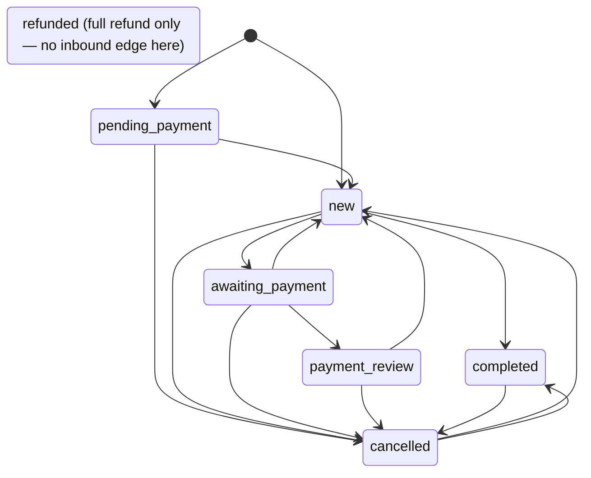

# Orders API — M06 (إدارة الطلبات)

> **Source**: DOC-077 → DOC-084 (Step 19) · INT-007 (M06) · inventory Domain 4
> **Live key**: `orders` (`SHARWA_LIVE_MODULES`) — all 11 BFF rows call `liveOrMock(request, "orders", "/api/v1/…", mockFn)`; see [`architecture/22-live-module-keys.md`](../../../architecture/22-live-module-keys.md) (row 4)
> **Django provider**: `sharwa_saas/api/views_orders.py` (`OrdersAPIMixin`, gate + routing + the atomic `write()` wrapper) · `sharwa_saas/products/services/order_api_service.py` (filters, transitions, payment, refund, create, order-status CRUD) · `sharwa_saas/api/serializers_orders.py` (`order_list_item`, `order_detail`, `status_def`) · models `sharwa_saas/products/models/orders.py` (`Order`, `OrderStatus`, `OrderRefund`, `PaymentIntent`) · wired in `sharwa_saas/api/urls.py`
> **Frontend contract**: `sharwa-frontend/src/features/orders/schemas/order.ts` (`orderListItemSchema`, `orderDetailSchema`, `orderStatusDefSchema`, `orderCountersSchema`, `orderFormOptionsSchema`, `createOrderResponseSchema`, `refundInputSchema`) · enums `src/features/orders/schemas/enums.ts` · helper `src/features/orders/api.ts` (`ordersApi`) · write hook `use-order-write.ts` · fixture `src/mocks/orders/state.ts` · BFF `src/app/api/bff/orders/**` and `src/app/api/bff/order-statuses/**`
> **Tests**: `sharwa_saas/api/test_orders_api.py` (18 tests: `OrderReadTests` 5, `OrderWriteTests` 8, `OrderCreateTests` 4, `OrderStatusDefTests` 1) · mock E2E `sharwa-frontend/scripts/catalog-orders-check.ts` (shared with M04/M05/M48/M49)
> **Last verified against code**: 2026-10-27 (step 19)

> **Scope note** — This page covers the 11 `orders` rows. The returns, RMA and refund-log routes belong to M24 ([`m24-returns.md`](m24-returns.md)); the other order rows that live in `api/urls.py` are listed in [§4.7](#related) with their homes. Example values come from `api/test_orders_api.py` or are derived from the Django text templates; ids and timestamps in the JSON blocks are **illustrative**.

<a id="overview"></a>

## 1. Overview

M06 is the merchant's order desk: a filtered, paged list with a counters strip, a detail view with an invoice, a timeline and a payment receipt, status changes along two independent axes, payment adjudication, refunds, manual (phone) orders and B2B drafts, and the editor of the merchant's own fulfilment statuses.

Before INT-007 the screens were mock-only. The provider is a thin layer over existing, battle-tested domain code — nothing was re-implemented, and **no migration** was added:

| Concern | Reused code | Called from |
|---|---|---|
| Fulfilment status | `Order.set_fulfillment_status`, `OrderStatus.get_default` | `set_fulfillment`, `payment_action`, `change_status` |
| Cancel / restock | `Order.cancel_order` (restores stock, reverses a merchant-wallet credit, releases supplier holds), `Order.release_reserved_stock` (stock only) | `change_status`, `payment_action` (reject) |
| Money | `process_order_refund` (`products/services/refund_service.py`), `process_order_merchant_credit` (`merchant_credit_service.py`) | `refund`, `payment_action`, `change_status` |
| Marketplace guard | `marketplaces/order_guard.status_change_block_reason` | `change_status`, `payment_action`, `marketplace_lock_reason` |
| B2B drafts | `order_approval_service.create_b2b_draft_order` | `create_order` |
| Pickup conversion | `shipment_operations_service.convert_order_to_pickup` | `patch_order` |
| Webhooks, push, WhatsApp | `order_events.notify_sharwaconnect_of_order_event`, `webhook_service.emit_order` | `_notify`, `Order.set_fulfillment_status`, `process_order_refund` |

The transition table and the three payment adjudications are **copied** from the legacy functions (`update_order_status`, `confirm_payment_received`, `adjudicate_payment_approve` / `adjudicate_payment_reject` — the comments in `order_api_service.py` name them), so the legacy screens keep working untouched. The views delegate everything to `order_api_service`; `views_orders.py` only gates, parses and wraps writes.

Every caller is the dashboard (owner or staff session) on the **store host**. The contract is the Zod schema in `order.ts`: the serializer reproduces its keys literally, and every key set is asserted by the tests (`LIST_KEYS`, `DETAIL_KEYS`, `INVOICE_KEYS`, `ITEM_KEYS`, `STATUS_KEYS`).

Three design rules run through the whole module:

1. **Optimistic lock on every order write.** One `transaction.atomic()` wraps *lock row → compare `version` → operation → bump `version`* (`OrdersAPIMixin.write`). Every successful write answers the **full detail row**, so the UI replaces its cache with the answer ([§4.2](#detail)).
2. **Money is a server string.** Totals are `display_*` strings formatted in the order's own currency; the only raw number is `refundable_amount`, the ceiling of the refund form ([`money.md`](../../overview/money.md)).
3. **The timeline is derived, not stored.** There is no timeline table — it is assembled from the order, `AuditLog`, shipment events and refunds on every read ([§4.2](#timeline)).

## 2. Access — gate chain

DRF runs the authentication class (CSRF included) before the permission classes, so the table follows that order. The first failing gate answers. All views share `OrdersAPIMixin`, which inherits `ProductsAPIMixin` ([`m04-products.md`](../03-catalog/m04-products.md)).

| # | Gate | Requirement | Failure |
|---|---|---|---|
| 1 | CSRF | `MerchantSessionAuthentication` enforces CSRF on every unsafe request ([`csrf.md`](../../overview/csrf.md)) | `403` (CSRF failure) |
| 2 | Tenant | `HasTenantContext` — the request resolves to a store schema | tenant-guard answer ([`m47-tenant-guard.md`](../01-public-onboarding/m47-tenant-guard.md)) |
| 3 | Session | an owner session (`is_merchant_authenticated`) **or** a staff member | `401` `{"detail": "انتهت جلستك، سجّل الدخول مجدداً."}` |
| 4 | Permission key (staff only — the owner holds every key) | see the table below | `403` `{"detail": "ليست لديك صلاحية لهذا الإجراء."}` |
| 5 | Extra key for drafts | `orders.create_b2b` when `sales_channel` is `b2b_draft`; and a staff session | `403` «ليست لديك صلاحية إنشاء مسودات الجملة.» / «يتطلب إنشاء مسودة الجملة تسجيل دخول موظف.» |
| 6 | Resource state | the order exists; `version` matches; not a locked marketplace order | `404` «الطلب غير موجود.» · `409` · `400` `{detail: reason}` |

| Key | Routes |
|---|---|
| `orders.view` | every `GET` (list, counters, form-options, detail, order-statuses) |
| `orders.update_status` | every write on an order (`PATCH`, `fulfillment-status`, `status`, `payment/<action>`), the manual `POST orders/`, and every `order-statuses` write including `reorder` |
| `orders.refund` | `POST orders/<id>/refunds/` only |
| `orders.create_b2b` | extra, for `sales_channel = b2b_draft` only |

Notes:

- **No plan-feature gate.** Neither `views_orders.py` nor `order_api_service.py` checks a plan feature, so M06 is available on every plan ([`plan-features.md`](../../overview/plan-features.md)). M24 is different ([`m24-returns.md`](m24-returns.md)).
- **No role names in code.** Every gate is a permission key the merchant can grant to any role ([`permissions.md`](../../overview/permissions.md)). The only role name in the module is `B2B_DEFAULT_APPROVER_ROLE = 'مدير المتجر'`, used to pick the approver of a B2B draft ([§4.7](#related)).
- **BFF mock gate.** In mock mode `mockRoute(…, {permission})` applies the same keys. In live mode the BFF does not re-check: Django answers `401`/`403` itself and the BFF passes the answer through.
- **Test coverage.** `test_staff_permissions` asserts: no key → `GET orders/` `403`; `orders.view` → `200`; `order-statuses/reorder/` and `orders/1/refunds/` `403` without their keys; `orders.update_status` → reorder `200`. `test_anonymous_gets_401` covers `orders/`, `orders/counters/`, `orders/form-options/` and `order-statuses/`.

> ⚠️ Discrepancy — code vs fixture: the BFF mock gates `POST /api/bff/orders` with `orders.view`, while Django requires `orders.update_status` for every `POST orders/` and adds `orders.create_b2b` for drafts. In live mode Django's gate wins; in mock mode a view-only staff member can still create an order. Reported in step 19 (see [§6](#code-vs-mock)).

## 3. Endpoint summary

The module has **11 URL patterns** in `api/urls.py` (lines 164–174), mapped one-to-one to the 11 BFF rows of the `orders` live key. The print view (`order-print.tsx`) has no route of its own: it reuses `useOrder`, i.e. the detail row.

| # | Method | Django path (`/api/v1/…`) | BFF path (`/api/bff/…`) | Purpose | Gate | Section |
|---|---|---|---|---|---|---|
| 1 | `GET` | `orders/` | `orders` | filtered, paged list | `orders.view` | [§4.1](#list) |
| 1 | `POST` | `orders/` | `orders` | manual phone order / B2B draft | `orders.update_status` (+ `orders.create_b2b` for drafts) | [§4.7](#related) |
| 2 | `GET` | `orders/counters/` | `orders/counters` | counters strip | `orders.view` | [§4.1](#list) |
| 3 | `GET` | `orders/form-options/` | `orders/form-options` | manual-order form options | `orders.view` | [§4.1](#list) |
| 4 | `GET` | `orders/<id>/` | `orders/[id]` | full detail row | `orders.view` | [§4.2](#detail) |
| 4 | `PATCH` | `orders/<id>/` | `orders/[id]` | convert to pickup / gift message | `orders.update_status` | [§4.2](#detail) |
| 5 | `POST` | `orders/<id>/fulfillment-status/` | `orders/[id]/fulfillment-status` | set the merchant's fulfilment status | `orders.update_status` | [§4.3](#transitions) |
| 6 | `POST` | `orders/<id>/status/` | `orders/[id]/status` | change the financial status | `orders.update_status` | [§4.3](#transitions) |
| 7 | `POST` | `orders/<id>/payment/<action>/` | `orders/[id]/payment/[action]` | `confirm` · `approve` · `reject` | `orders.update_status` | [§4.4](#payment) |
| 8 | `POST` | `orders/<id>/refunds/` | `orders/[id]/refunds` | refund an amount | `orders.refund` | [§4.5](#refunds) |
| 9 | `GET` | `order-statuses/` | `order-statuses` | list fulfilment statuses | `orders.view` | [§4.6](#order-statuses) |
| 9 | `POST` | `order-statuses/` | `order-statuses` | create a status | `orders.update_status` | [§4.6](#order-statuses) |
| 10 | `PATCH` | `order-statuses/<id>/` | `order-statuses/[id]` | edit a status | `orders.update_status` | [§4.6](#order-statuses) |
| 10 | `DELETE` | `order-statuses/<id>/` | `order-statuses/[id]` | delete a status (orders move to the default) | `orders.update_status` | [§4.6](#order-statuses) |
| 11 | `POST` | `order-statuses/reorder/` | `order-statuses/reorder` | set the order of the statuses | `orders.update_status` | [§4.6](#order-statuses) |

`order-statuses/reorder/` is declared before `order-statuses/<int:pk>/` in `urls.py`, so the literal path wins.

> **Verification note** — Ten of the eleven BFF files were read in full (`orders/route.ts`, `[id]/route.ts`, `counters`, `form-options`, `[id]/fulfillment-status`, `[id]/status`, `[id]/refunds`, `order-statuses/route.ts`, `[id]`, `reorder`) and all use `liveOrMock(request, "orders", …)`. `orders/[id]/payment/[action]/route.ts` sits eight folders deep and could not be staged in this step; its row is documented from `ordersApi.payment`, `urls.py` and `architecture/22-live-module-keys.md`, which all agree.

## 4. Endpoint groups

<a id="list"></a>

### 4.1 List, counters and form options (DOC-078)

#### `GET /api/v1/orders/`

Gate `orders.view`. Answers `{count, next, previous, results}`; each result is `order_list_item`.

**Query parameters**

| Name | Type | Default | Notes |
|---|---|---|---|
| `status` | enum | — | one of `pending_payment`, `new`, `awaiting_payment`, `payment_review`, `completed`, `cancelled`, `refunded`; any other value is **ignored** (no error) |
| `payment_status` | enum | — | one of `unpaid`, `pending`, `partial`, `paid`, `failed`, `indeterminate`; other values ignored |
| `fulfillment_status` | `none` \| id | — | `none` = orders with no fulfilment status; a numeric id filters on it; a non-numeric value returns **no rows** |
| `channel` | enum | — | `online`, `pos`, `b2b_draft`, `phone`; other values ignored |
| `traffic_source` | enum | — | `tiktok`, `whatsapp`, `instagram`, `snapchat`, `facebook`, `telegram`, `amazon`, `noon`, `direct`; `telegram` matches every value that **starts with** `telegram` (the legacy `telegram_bot` included) |
| `location` | id | — | matches the order's `source_location` **or** any line's `source_location` **or** any `Fulfillment.location` |
| `from`, `to` | `YYYY-MM-DD` | — | inclusive, on the date of `created_at`; an unparsable date is ignored |
| `q` | string | — | a leading `#` is stripped. Matches `customer_name` (contains) **or**, if all digits, the order `id` (equals) **or**, if it holds ≥ 4 digits, `customer_phone` (contains, leading zeros stripped) |
| `ordering` | string | `-created_at` | `created_at`, `total`, `id`, with an optional leading `-`; always followed by an `id` tie-break in the same direction; an unknown key falls back to `-created_at, -id` |
| `page` | int | `1` | an invalid value is `1`; a page past the end answers an empty `results` (never `404`) |
| `page_size` | int | `50` | clamped to 1–100 |

**Response `200`** (rows from `test_list_shape_filters_and_pagination`; ids and timestamps illustrative)

```json
{
  "count": 2,
  "next": null,
  "previous": "?page=1",
  "results": [
    {
      "id": 102,
      "customer_name": "أحمد",
      "customer_phone": "967771234567",
      "display_total": "200 ر.س",
      "status": "new",
      "payment_status": "unpaid",
      "fulfillment_status": { "id": 1, "name": "قيد الانتظار", "color": "#f59e0b" },
      "sales_channel": "online",
      "created_at": "2026-10-27T09:30:00+00:00",
      "version": 1,
      "traffic_source": "direct",
      "source_location": null,
      "items_count": 1,
      "locked_reason": null
    }
  ]
}
```

| Field | Type | Meaning (Django source) |
|---|---|---|
| `display_total` | string | `format_money(total_price, currency)` — the order's own currency |
| `fulfillment_status` | `{id, name, color}` \| null | the merchant's `OrderStatus` (not the financial `status`) |
| `traffic_source` | enum | `normalize_traffic_source` — unknown values become `direct`, `telegram…` becomes `telegram` |
| `source_location` | `{id, name}` \| null | `Order.source_location` (the branch for POS/draft orders) |
| `items_count` | int | `Count('items')` annotation |
| `version` | int | the optimistic-lock counter the next write must send |
| `locked_reason` | string \| null | non-null for marketplace orders: the `order_guard` reason, else «طلب {name}: تُحدَّث حالته من السوق نفسه ولا تُغيَّر من هنا.» |

**Paging contract.** `next` / `previous` are **relative** query strings (`?page=2`), not URLs. The test pins `previous == "?page=1"` and `next is None` on the last page. M24's `returns/` uses full DRF-style links instead — see [`m24-returns.md`](m24-returns.md) and [`pagination.md`](../../overview/pagination.md).

**Errors** — `401` / `403` from the gate chain only; bad filter values never fail.

#### `GET /api/v1/orders/counters/`

Gate `orders.view`. Four counters over **all** orders plus one count per fulfilment status over the **open** ones.

```json
{
  "new": 1,
  "pending_payment": 0,
  "awaiting_payment": 0,
  "payment_review": 1,
  "by_fulfillment": [
    { "id": 1, "name": "قيد الانتظار", "color": "#f59e0b", "count": 2 }
  ]
}
```

`by_fulfillment` lists every status in `sort_order`, five rows on a fresh store (`OrderStatus.get_or_seed_defaults()` runs first); the block above shows one row. "Open" means the financial status is not in `CLOSED_STATUSES = (completed, cancelled, refunded)`: in the test three orders carry the default status, one is `completed`, and the default row counts **2**.

> ⚠️ Discrepancy — roadmap says nothing about the closed set / code does count `completed`, `cancelled` **and** `refunded` as closed (`CLOSED_STATUSES` in `order_api_service.py`), whereas the frontend constant `CLOSED_STATUSES` in `src/features/orders/schemas/enums.ts` contains `refunded` only. The strip is server-computed, so the UI is unaffected; only code that re-uses the frontend constant would disagree. Reported in step 19.

#### `GET /api/v1/orders/form-options/`

Gate `orders.view`. Feeds the manual-order form (see [§4.7](#related)).

```json
{
  "delivery_methods": [
    { "id": 1, "name": "توصيل", "display_price": "1 ر.س", "estimated_time": "يومان" }
  ],
  "pickup_locations": [
    { "id": 1, "name": "الفرع", "address": "شارع" }
  ]
}
```

The response also carries `locations`: `[{id, name}]` of the active locations ordered by name (omitted above; the test asserts the key set `{delivery_methods, pickup_locations, locations}`).

**Mapping.** `DeliveryMethod.price` is stored in **YER_NEW**; `display_price` converts it to the store currency with `convert_amount(price, 'YER_NEW', store_currency, store_setting)` and formats it. The test pins `520 YER_NEW → "1 ر.س"`. Only active delivery methods and pickup points are listed, ordered by `sort_order, id`.

<a id="detail"></a>

### 4.2 Detail, PATCH and timeline (DOC-079)

#### `GET /api/v1/orders/<id>/`

Gate `orders.view`. Answers `order_detail` — the list item plus the fields below. An unknown id is `404` `{"detail": "الطلب غير موجود."}`.

**Response `200`** (abridged — built from `test_detail_matches_contract`; the keys not shown are in the table)

```json
{
  "id": 101,
  "customer_name": "أحمد",
  "customer_phone": "967771234567",
  "display_total": "200 ر.س",
  "status": "new",
  "payment_status": "unpaid",
  "fulfillment_status": { "id": 1, "name": "قيد الانتظار", "color": "#f59e0b" },
  "sales_channel": "online",
  "version": 1,
  "items_count": 1,
  "locked_reason": null,
  "address": "صنعاء",
  "items": [
    {
      "id": 7,
      "product_name": "عباية",
      "quantity": "2",
      "display_price": "100 ر.س",
      "display_line_total": "200 ر.س",
      "product_deleted": false
    }
  ],
  "refundable_amount": "0.00",
  "timeline": [
    {
      "id": 0,
      "at": "2026-10-27T09:30:00+00:00",
      "kind": "created",
      "source": "system",
      "text": "أُنشئ الطلب من المتجر الإلكتروني.",
      "actor": null
    }
  ],
  "tracking_url": "/track/7c1e2d1a-0000-0000-0000-000000000000"
}
```

| Field | Type | Meaning |
|---|---|---|
| `public_uuid` | string | the buyer-facing id; `tracking_url` is `/track/<public_uuid>` ([`m41-order-tracking.md`](../05-storefront/m41-order-tracking.md)) |
| `customer_email`, `recipient_name`, `recipient_phone`, `gift_message`, `delivery_method_name`, `tracking_number` | string \| null | empty strings are sent as `null` |
| `is_gift` | bool | |
| `currency` | enum | `SAR`, `USD`, `YER_OLD`, `YER_NEW`; anything else is shown as `SAR` |
| `exchange_rate_locked` | string \| null | the rate locked at checkout |
| `invoice` | object | 11 keys, all server strings: `display_subtotal`, `display_discount`, `display_promotion_discount`, `coupon_code`, `display_delivery_fee`, `display_total`, `display_deposit`, `display_upfront_paid`, `display_amount_on_delivery`, `display_wallet_used`, `display_refunded`. Optional amounts are `null` when zero (`_money_or_none`) — e.g. `display_refunded` is `null` before any refund and `"50 ر.س"` after a 50 refund; `display_discount` is `"5 ر.س"` for a 5 discount |
| `refundable_amount` | string | **raw** 2-decimal string: `max(total − refunded, 0)` when `payment_status = paid`, else `"0.00"`. The only non-`display_*` money field |
| `pickup_location` | `{id, name}` \| null | |
| `items[]` | object | `id`, `product_id`, `product_name`, `variant_label`, `sku_snapshot`, `product_image_snapshot`, `quantity` (**string**), `display_price`, `display_line_total`, `display_tax_amount`, `source_location`, `product_deleted` |
| `fulfillments[]` | object | `id`, `location`, `status`, `item_ids`, `tracking_number`, `shipping_provider` (name) |
| `payments[]` | object | `id`, `method` (`wallet`, `gateway`, `cod`, `gift_card`), `status` (`pending`, `completed`, `failed`, `refunded`), `display_amount`, `gateway_transaction_id`, `created_at` |
| `refunds[]` | object | `id`, `method`, `display_amount`, `reason`, `created_at`, `actor` (the audit actor, `"—"` when none; `"مالك المتجر"` for the owner) |
| `timeline[]` | object | see [Timeline](#timeline) |
| `payment_receipt` | object \| null | the manual-transfer receipt, shown **only while payment is not `paid`** and a receipt image or reported amount exists: `image`, `display_reported_amount`, `display_required_amount`, `display_difference`, `difference_sign` (`under` \| `exact` \| `over`), `uploaded_at`. The required amount is `upfront_required` when positive, else the total |
| `trust` | object \| null | cash-on-delivery reliability (`successful_cod_orders`, `failed_cod_orders`, `risk_percentage`), only for `payment_method = manual` with a positive `amount_on_delivery`; zeros when the customer is unknown |
| `fraud_score` | int \| null | |
| `is_backordered` | bool | |
| `pending_approval` | `{id, status}` \| null | the B2B-draft approval ([§4.7](#related)) |

A product deleted after the order was placed renders from the line snapshot: `product_id` is `null` and `product_deleted` is `true` (`test_deleted_product_renders_from_snapshot`).

#### `PATCH /api/v1/orders/<id>/`

Gate `orders.update_status`. Two independent fields; at least one must be present.

**Request body**

| Field | Type | Required | Rules |
|---|---|---|---|
| `version` | int | **yes** | must equal the current `Order.version` (see [Optimistic lock](#optimistic-lock)) |
| `pickup_location_id` | int | no | an **active** `PickupLocation`, else `400` `{"pickup_location_id": ["اختر نقطة الاستلام."]}` |
| `gift_message` | string | no | trimmed, ≤ **300** characters (the model's `max_length`), else `400` `{"gift_message": ["300 حرف على الأكثر."]}`; a non-empty message also sets `is_gift = true` |

**Errors** (besides the lock errors)

| Status | Body | When |
|---|---|---|
| `400` | `{"pickup_location_id": ["اختر نقطة الاستلام."]}` | unknown / inactive pickup point |
| `400` | `{"detail": "لا يمكن التحويل إلى استلام بعد أن استلم المندوب الشحنة."}` | a Sharwa shipment is `picked_up`, `in_transit` or `delivered` |
| `400` | `{"gift_message": ["300 حرف على الأكثر."]}` | message too long (the test sends 301 characters) |
| `400` | `{"detail": "لا يوجد حقل قابل للتعديل."}` | neither field in the body |

**Side effects.**

- *Pickup:* `convert_order_to_pickup` cancels only the Sharwa shipments still in `label_pending` or `pending_pickup` and sets their `billing_status` to `waived`; the order's `pickup_location` is set and `delivery_method_name` is cleared. Timeline event (kind `note`): «حُوِّل الطلب إلى استلام من «{name}»{ (أُلغيت N بوليصة)}.». The test asserts `pickup_location == {"id": …, "name": "فرع حدة"}` and `delivery_method_name == null`.
- *Gift message:* timeline event (kind `note`) «عُدِّلت رسالة الهدية.». The test sends «كل عام وأنت بخير» and reads it back with `is_gift == true`.

`delivery_fee` is **not** changed by the conversion.

> ⚠️ Discrepancy — code vs fixture: the mock pickup conversion in `src/mocks/orders/state.ts` zeroes `delivery_fee`; Django leaves it untouched, and the gift-message limit differs (mock «500 حرف على الأكثر.», Django/model 300). Reported in step 19 (see [§6](#code-vs-mock)).

<a id="optimistic-lock"></a>

#### Optimistic lock — 409 `{detail, current_version, order}`

Every write on an order (`PATCH`, `fulfillment-status`, `status`, `payment/<action>`, `refunds`) goes through `OrdersAPIMixin.write()`:

1. permission gate;
2. `transaction.atomic()` opens;
3. `lock_order` — `Order.objects.select_for_update()`, `404` «الطلب غير موجود.» if missing, then the **version check**, then the marketplace check;
4. the operation runs;
5. `bump_version` — `UPDATE … SET version = version + 1` (`F()` expression);
6. the answer is the full detail row.

The version check treats a **missing or non-integer `version` as a conflict**, exactly like a stale one — except for refunds, where `version` is optional (`version_required=False`): refunds also skip the marketplace check (`check_marketplace=False`) because a refund is a local financial act, but a `version` that *is* sent must still match.

A conflict does not raise a 400; it answers the current state so the client can recover without a second request:

```json
{
  "detail": "حُدِّث الطلب من مستخدم آخر.",
  "current_version": 1,
  "order": { "id": 101, "version": 1, "status": "new", "…": "the full detail row" }
}
```

**Retry example** (from `test_stale_version_returns_409_with_current_order` and `test_fulfillment_status_bumps_version_and_records_timeline`; the order starts at `version = 1`)

```http
POST /api/v1/orders/101/fulfillment-status/
{ "status_id": 2, "version": 7 }
→ 409 { "detail": "حُدِّث الطلب من مستخدم آخر.", "current_version": 1, "order": { "id": 101, … } }

POST /api/v1/orders/101/fulfillment-status/
{ "status_id": 2, "version": 1 }
→ 200 { "id": 101, "version": 2, "fulfillment_status": { "id": 2, "name": "قيد التجهيز", … }, "timeline": [ { "kind": "fulfillment", "actor": "مالك المتجر", … }, … ] }
```

The frontend does exactly this: `use-order-write.ts` does **not** retry silently on a 409 — it shows the conflict panel, refetches the detail, and re-sends the same write with the fresh `version` when the user confirms. `409` is also reserved for conflicts only; domain refusals are `400`.

<a id="timeline"></a>

#### Timeline

`order_detail.timeline` is built on every read by `order_api_service.timeline()` — **no model, no migration**. Four sources are merged, then sorted by `(at, id)` **descending**:

| Source | Event `id` | `kind` | `source` | `text` |
|---|---|---|---|---|
| The order itself | `0` | `created` | `system` for online orders, otherwise `merchant_manual` | `CHANNEL_CREATED_TEXT[sales_channel]` — online «أُنشئ الطلب من المتجر الإلكتروني.», pos «أُنشئ الطلب من نقطة البيع.», b2b_draft «أُنشئت مسودة جملة بانتظار الموافقة.», phone «أُنشئ طلب هاتفي يدوياً.» |
| `AuditLog` rows with `action_code` starting `order.` (append-only, written by `record_event`) | `pk × 10 + 1` | the row's `after_snapshot.kind` — one of `created`, `status`, `fulfillment`, `payment`, `shipment`, `approval`, `refund`, `note` (anything else becomes `note`) | `after_snapshot.source`, one of `webhook`, `agent_app`, `merchant_manual`, `system` (default `merchant_manual`) | `after_snapshot.text` |
| `ShipmentEvent` of every Sharwa shipment | `pk × 10 + 2` | `shipment` | the event's source (or `system`) | «البوليصة {waybill}: {from} ← {to}» |
| `OrderRefund` rows **without** an audit row | `pk × 10 + 3` | `refund` | `merchant_manual` | «استرجاع {money}» + « — {reason}» |

Notes:

- A stored `created` audit event is **skipped**: the created event is always rebuilt from the order, so old orders without audit rows still show their creation.
- A refund whose audit row carries `refund_id` is shown once, from the audit row; only legacy refunds (made on the old screen) fall back to the `OrderRefund` row.
- `actor` is `after_snapshot.actor`, else the audit row's actor, else `null`. The owner appears as «مالك المتجر».
- Event ids are **derived** (`pk × 10 + n`), unique within one order; they are not row ids to call back.

**Print view.** `order-print.tsx` renders `useOrder` — the detail row — so there is no separate print endpoint.

<a id="transitions"></a>

### 4.3 Fulfilment-status and status transitions (DOC-080)

An order has **two independent status axes**:

| Axis | Field | Values | Changed by |
|---|---|---|---|
| Financial / lifecycle | `status` | `pending_payment`, `new`, `awaiting_payment`, `payment_review`, `completed`, `cancelled`, `refunded` | `POST …/status/`, payment actions, refunds |
| Merchant workflow | `fulfillment_status` | the merchant's own `OrderStatus` rows ([§4.6](#order-statuses)) | `POST …/fulfillment-status/` |

Both routes need `orders.update_status`, a matching `version`, and answer the full detail row (`200`) with `version + 1`.

#### `POST /api/v1/orders/<id>/fulfillment-status/`

**Request body** `{status_id, version}`.

Checks, in order:

| # | Check | Failure |
|---|---|---|
| 1 | `status_id` is the id of an existing `OrderStatus` | `400` `{"status_id": ["الحالة غير موجودة."]}` |
| 2 | the order is not `refunded` | `400` `{"detail": "طلب مسترد: لا تتغيّر حالته."}` |
| 3 | not (`status = completed` **and** the target `releases_stock`) | `400` `{"detail": "لا يمكن إلغاء طلب مكتمل؛ استخدم مسار الاسترجاع."}` |
| 4 | the order is not already on that status | `400` `{"detail": "الطلب بهذه الحالة بالفعل."}` |

Then `Order.set_fulfillment_status(target)` runs (the only sanctioned way to change the field):

| Flag on the **new** status | Effect |
|---|---|
| `releases_stock` | `release_reserved_stock()` — the lines' stock is returned. **Skipped** when the *old* status was already a `releases_stock` one (moving between two "rejection" statuses never restocks twice). The financial `status` is **not** changed to `cancelled`, the merchant wallet is not touched, and the order stays in the merchant's own workflow |
| `marks_completed` | `status` becomes `completed` unless it is already `completed`, `cancelled` or `refunded`; then `process_order_merchant_credit` runs (see [§4.4](#payment) for when it actually credits) |
| *(any)* | `emit_order('order.fulfillment_changed')` |

Timeline event (kind `fulfillment`): «تغيّرت حالة التنفيذ من «{before}» إلى «{target.name}».» (`before` is `—` when the order had none).

`test_releases_stock_and_marks_completed_statuses` pins: a qty-3 order moved to the seeded «ملغي» takes the product stock from 10 to **13**; when «مكتمل» is edited to `marks_completed = true`, moving an order onto it answers `status == "completed"`; and moving that completed order onto «ملغي» is `400`.

> ⚠️ Discrepancy — code vs fixture: the mock `setFulfillmentStatus` forces `order.status = cancelled` when the status `releases_stock`, restocks, and answers «الطلب مكتمل بالفعل بهذه الحالة.» for a repeated status. Django restocks **without** touching `status` (the roadmap's "server-side difference") and answers «الطلب بهذه الحالة بالفعل.». Reported in step 19 (see [§6](#code-vs-mock)).

#### `POST /api/v1/orders/<id>/status/`

**Request body** `{status, version}` — `status` is a financial status.

**Transition table** (`FINANCIAL_TRANSITIONS`, identical to the frontend's `enums.ts`):

| From | Allowed targets |
|---|---|
| `pending_payment` | `new`, `cancelled` |
| `new` | `completed`, `cancelled`, `awaiting_payment` |
| `awaiting_payment` | `new`, `payment_review`, `cancelled` |
| `payment_review` | `new`, `cancelled` |
| `completed` | `cancelled` |
| `cancelled` | `new`, `completed` |
| `refunded` | *(none — final)* |



`refunded` is never a valid target of this route; it is reached only by a full refund ([§4.5](#refunds)).

**Errors**

| Status | Body | When |
|---|---|---|
| `400` | `{"status": ["استخدم مسار الاسترجاع."]}` | `status = refunded` |
| `400` | `{"status": ["حالة غير معروفة."]}` | not one of the seven codes |
| `400` | `{"status": ["لا يمكن الانتقال من «X» إلى «Y»."]}` | not in the table; X and Y are the labels below |
| `400` | `{"detail": "<reason>"}` | marketplace guard (`status_change_block_reason(order, to_status=…)`), e.g. «يُلغى طلب {name} من لوحة البائع لدى السوق — يصل الإلغاء هنا تلقائياً ويُستعاد المخزون.» |

**Labels used in the messages and the timeline** (Django `Order.STATUS_CHOICES`, emojis included):

| Code | Label |
|---|---|
| `pending_payment` | «قيد تنفيذ الدفع ⏱️» |
| `new` | «جديد 🟡» |
| `awaiting_payment` | «بانتظار تأكيد الدفع ⏳» |
| `payment_review` | «يتطلب مراجعة دفع ⚠️» |
| `completed` | «مكتمل 🟢» |
| `cancelled` | «ملغي 🔴» |
| `refunded` | «مسترد 💰» |

**Effects by target**

| Transition | Stock | Merchant wallet | Other |
|---|---|---|---|
| any → `cancelled` | `Order.cancel_order()` returns every line to stock and releases supplier holds (test: qty 4, stock 10 → **14**) | an earlier merchant credit is **reversed** (`MerchantWallet.debit`, kind `adjustment`; an insufficient balance is swallowed and never blocks the cancel) | forwarded supplier orders get a cancellation request; push + webhook (below) |
| `cancelled` → `new` or `completed` | stock is **deducted again** (test: 14 → **10**) | `process_order_merchant_credit` runs, but only credits when `payment_method = sharwa_pay` and `payment_status = paid` | — |
| → `new` | — | — | if the order has no fulfilment status, the default `OrderStatus` is assigned |
| `new` → `completed` | — | **none** — this route never calls the credit function | — |
| `new` → `awaiting_payment`, `awaiting_payment` → `payment_review`, `payment_review` → `new`, … | — | — | timeline only |

Every successful change records the timeline event (kind `status`) «تغيّرت الحالة من «{previous label}» إلى «{target label}».».

> ⚠️ Discrepancy — code vs fixture: the mock writes the **raw codes** into the error and the timeline («تغيّرت الحالة المالية إلى «{raw}».»); Django uses the emoji labels above and the «من … إلى …» form. Reported in step 19 (see [§6](#code-vs-mock)).

#### Side effects: webhook, push and WhatsApp

`_notify(order, event_type, **extra)` calls `order_events.notify_sharwaconnect_of_order_event`, which does three things (all after commit):

1. **Browser push (INT-016)** — `push_for_order_event`, for `ORDER_SHIPPED`, `ORDER_DELIVERED`, `ORDER_CANCELLED`, `PAYMENT_RECEIVED`; deduplicated per order and event for 6 hours. The title is prefixed «{store_name} — » and the link is `/track/<public_uuid>`.
2. **Outbound webhook (INT-023)** — `emit_order('order.status_changed', order, source_event=<event_type>)` (`order.created` when the event is `ORDER_CREATED`).
3. **WhatsApp (SharwaConnect)** — a Celery `dispatch_order_event` task.

| Where it fires in M06 | Event type | Extra |
|---|---|---|
| `status` → `completed` | `ORDER_DELIVERED` | — |
| `status` → `cancelled` | `ORDER_CANCELLED` | `cancellation_reason` «تم إلغاء الطلب من قبل التاجر (كان بحالة: {previous}).» |
| `payment/confirm`, `payment/approve` | `PAYMENT_RECEIVED` | `amount_paid` = total |
| `payment/reject` on a `payment_review` order | `ORDER_CANCELLED` | `cancellation_reason` «تم رفض إثبات الدفع من قبل التاجر.» |

Push texts (`order_push_service.MESSAGES`; `{n}` is the order number):

| Event | Title | Body |
|---|---|---|
| `PAYMENT_RECEIVED` | «تم تأكيد الدفع» | «تم تأكيد دفع طلبك رقم {n}.» |
| `ORDER_DELIVERED` | «تم التسليم» | «تم تسليم طلبك رقم {n}. شكراً لتسوقك معنا.» |
| `ORDER_CANCELLED` | «أُلغي الطلب» | «أُلغي طلبك رقم {n}. تواصل مع المتجر لأي استفسار.» |

Independent of `_notify`, two other paths emit webhooks: `Order.set_fulfillment_status` emits **`order.fulfillment_changed`** on every fulfilment change, and `process_order_refund` emits **`order.refunded`** ([§4.5](#refunds)). The webhook catalogue is `order.created`, `order.status_changed`, `order.fulfillment_changed`, `order.refunded`, `shipment.event`, `product.updated`, `inventory.low_stock`; the envelope is `{id: "evt_…", event, created_at, store, data}` with `data` = `order_id`, `public_uuid`, `status`, `payment_status`, `fulfillment_status` (the name), `total_price`, `currency`, `customer_name`, `customer_phone`, `sales_channel`, `created_at` plus the extras. Delivery is signed (`X-Sharwa-Signature: t=…,v1=<HMAC-SHA256>`, with `X-Sharwa-Event` and `X-Sharwa-Delivery`), retried 3 times (after 1 and 5 minutes) and the endpoint is auto-disabled after 10 consecutive failures — the full contract belongs to INT-023 (Domain 12).

> ⚠️ Discrepancy — roadmap says both routes emit the `order.status_changed` / `order.fulfillment_changed` webhooks and the push as side effects / code does: in the files read, `POST …/status/` notifies **only** for `→ completed` (`ORDER_DELIVERED`) and `→ cancelled` (`ORDER_CANCELLED`); `new → awaiting_payment`, `awaiting_payment → payment_review`, `payment_review → new` and `cancelled → new` write a timeline event and emit **no** `order.status_changed` webhook and no push. `POST …/fulfillment-status/` emits `order.fulfillment_changed` (and `order.status_changed` is not sent when `marks_completed` flips `status` to `completed`, and no `ORDER_DELIVERED` push either). Reported in step 19.

> ⚠️ Discrepancy — roadmap says a "merchant credit on confirmation" follows the transitions / code does: `POST …/status/` to `completed` never calls `process_order_merchant_credit`; only `cancelled → new|completed` does, and only credits `sharwa_pay` orders that are `paid`. The `marks_completed` fulfilment path is what credits cash-on-delivery orders. Reported in step 19.

<a id="payment"></a>

### 4.4 Payment confirm / approve / reject (DOC-081)

#### `POST /api/v1/orders/<id>/payment/<action>/`

`<action>` is `confirm`, `approve` or `reject`; any other value is `404` `{"detail": "إجراء غير معروف."}` (before the gate and the lock). Body `{version}`. Gate `orders.update_status`. All three first run the marketplace guard: a guarded order answers `400` `{detail: reason}`, for example «بانتظار تأكيد الدفع من {name} — لا يمكن شحن الطلب أو تغيير حالته حتى يُعتمد الدفع.».

| Action | Allowed when | Order effect | Stock | Merchant wallet | Timeline (kind `payment`) | Notification |
|---|---|---|---|---|---|---|
| `confirm` | `status` in `awaiting_payment`, `pending_payment` | `payment_status = paid`, `amount_on_delivery = 0`, `status = new`; default fulfilment status assigned if none | unchanged (already reserved) | `process_order_merchant_credit` (conditional, below) | «تأكّد استلام الدفع.» | `PAYMENT_RECEIVED` |
| `approve` | `status = payment_review` | `payment_status = paid`, `status = new`; default fulfilment status if none | unchanged | `process_order_merchant_credit` (conditional) | «قُبلت مراجعة الدفع وتحوّل الطلب للتجهيز.» | `PAYMENT_RECEIVED` |
| `reject` on `payment_review` | `status = payment_review` | `status = cancelled`, `payment_status = failed` | **restocked** (`release_reserved_stock`) | none | «رُفض الدفع وأُلغي الطلب وأُعيد مخزونه.» | `ORDER_CANCELLED` |
| `reject` otherwise | `status` in `awaiting_payment`, `pending_payment` | `status = pending_payment`, `payment_status = failed` (the order waits for a new payment) | stays reserved | none | «رُفض إيصال التحويل؛ بانتظار دفع جديد من العميل.» | none |

**Errors**

| Status | Body | When |
|---|---|---|
| `400` | `{"detail": "لا يمكن قبول الدفع إلا لطلب بحالة «مراجعة دفع»."}` | `approve` on any other status |
| `400` | `{"detail": "لا يوجد دفع بانتظار التأكيد لهذا الطلب."}` | `confirm`, or `reject` on a non-review order, outside `awaiting_payment` / `pending_payment` |
| `404` | `{"detail": "إجراء غير معروف."}` | unknown action |

**Merchant credit — what "confirmation" actually does.** `process_order_merchant_credit` first records the platform commission (when enabled, for every payment method), then — under a row lock and guarded by `is_merchant_credited` against duplicates — credits `MerchantWallet` with the order total only in two cases:

1. `payment_method = sharwa_pay` and `payment_status = paid`;
2. `payment_method = manual`, `amount_on_delivery > 0`, an **official Sharwa delivery method** and `status = completed` (cash collected by the Sharwa courier).

Manual bank transfers and merchant-side gateways (Kuraimi, Jaib) are **never** credited locally. The tests assert the status and payment flags (`confirm` on a `awaiting_payment` order with a 150-of-200 reported transfer answers `("new", "paid")`, clears `payment_receipt` and `display_amount_on_delivery`; `reject` on `payment_review` answers `("cancelled", "failed")`; `reject` on `awaiting_payment` answers `("pending_payment", "failed")`; `approve` on a non-review order is `400`; `…/payment/explode/` is `404`); they do not assert wallet balances.

> ⚠️ Discrepancy — roadmap says "merchant credit on confirmation" / code does: `confirm` and `approve` *call* `process_order_merchant_credit`, which credits only in the two cases above. A confirmed manual-transfer order gets no wallet credit, and a confirmed cash order is not credited until it is `completed`. Reported in step 19.

> ⚠️ Discrepancy — code vs fixture: the mock lets `approve` run from `awaiting_payment` and always sends `reject` to `pending_payment`; Django restricts `approve` to `payment_review` and makes `reject` on a review order cancel and restock. Reported in step 19 (see [§6](#code-vs-mock)).

<a id="refunds"></a>

### 4.5 Order refunds (DOC-082)

#### `POST /api/v1/orders/<id>/refunds/`

Gate **`orders.refund`** (not `orders.update_status`). `version` is **optional** here, and the marketplace lock does not apply ([Optimistic lock](#optimistic-lock)).

**Request body**

| Field | Type | Required | Rules |
|---|---|---|---|
| `amount` | decimal string | yes | > 0, at most 2 decimals — else `{"amount": ["أدخل مبلغاً أكبر من صفر."]}` |
| `method` | enum | yes | `wallet`, `sharwa_pay`, `manual`, `wallet_credit` — else `{"method": ["اختر طريقة الاسترجاع."]}` |
| `reason` | string | yes | 3–255 characters — else `{"reason": ["اكتب سبب الاسترجاع."]}` or `{"reason": ["255 حرفاً على الأكثر."]}` |
| `version` | int | no | if sent, must match |

All three field errors are reported together (the test posts `{amount: 'x', method: 'cash', reason: ''}` and gets the key set `{amount, method, reason}`).

**Response `200`** — the full detail row. After a 50 refund on a paid 200 order (test): `refundable_amount == "150.00"`, `invoice.display_refunded == "50 ر.س"`, `refunds[0].actor == "مالك المتجر"`, and exactly one `refund` event on the timeline.

The work is `process_order_refund(order, amount, method=…, reason=…)` (`refund_service.py`), one `transaction.atomic()` with the order row `select_for_update`d:

| Rule | Behaviour |
|---|---|
| Paid only | the order must have `payment_status = paid`, else `RefundError` → `400` `{"amount": ["لا يمكن استرجاع مبلغ لم يُؤكَّد استلامه بعد. استخدم زر «تأكيد استلام المبلغ» أولاً إن كان المبلغ قد وصل فعلاً."]}` |
| Positive | `amount ≤ 0` → «قيمة الاسترجاع يجب أن تكون أكبر من صفر.» |
| Cap | `amount > total − already refunded` → «لا يمكن استرجاع أكثر من {max} — هذا هو المتبقي القابل للاسترجاع.» |
| Record | an `OrderRefund` row (`method`, `amount`, `reason`) |
| Full refund | when the cumulative refunds reach `total_price`, `status` becomes `refunded` (`payment_status` stays `paid`) — the test's final 150 answers `status == "refunded"` |
| Merchant wallet | if the order was credited (`is_merchant_credited`), the refunded amount is debited (`MerchantWallet.debit`, kind `refund`); an insufficient balance is swallowed; the credited flag is reset only on a **full** refund |
| Loyalty | on a **full** refund only, the points earned by the order are clawed back — at most the customer's current balance (`loyalty_points_clawed_back` on the `OrderRefund`) |
| Webhook | `emit_order('order.refunded', …)` with `refund_amount`, `refund_method`, `full_refund` |

**Refund methods**

| `method` | Customer side | Extra cap |
|---|---|---|
| `manual` | no wallet movement — the merchant pays outside the system | none beyond the total |
| `wallet` | credits the customer's store `Wallet` (reason `refund`); needs the customer phone; the entered number is credited as-is, **no currency conversion** | at most what the order paid from that wallet (`WalletTransaction` reason `order_payment`, debits) minus earlier `wallet` refunds |
| `sharwa_pay` | credits the Sharwa Pay wallet in the **original transaction's currency** | at most the original `SharwaPayWalletTransaction` (reason `purchase`) |
| `wallet_credit` | credits the customer wallet «استرجاع الطلب #{id} (رصيد محفظة بديل عن الاسترجاع النقدي)» — the method M24 uses | none beyond the total |

Timeline event (kind `refund`, with `refund_id`): «استرجاع {money} — {reason}», e.g. «استرجاع 50 ر.س — قطعة تالفة».

`test_refund_uses_refund_service` also pins: an **unpaid** order answers `400` with an `amount` key; `500` on a 200 order is `400`; refunding the remaining 150 flips the status to `refunded`.

> The read-only list `GET /api/v1/orders/refunds/` is **not** part of M06: it belongs to M24 (INT-026) — [`m24-returns.md#refunds-log`](m24-returns.md#refunds-log).

> ⚠️ Discrepancy — code vs fixture: the mock refund does not require the order to be paid and caps at `paid − refunded` with a different message; Django requires `payment_status = paid` and caps at `total − refunded`. Reported in step 19 (see [§6](#code-vs-mock)).

<a id="order-statuses"></a>

### 4.6 Custom order statuses CRUD (DOC-083)

The merchant's workflow statuses (`OrderStatus`) drive `fulfillment_status`. A fresh store is seeded with five (`OrderStatus.DEFAULT_STATUSES`; `statuses_queryset()` seeds on first read):

| Name | Color | Flags |
|---|---|---|
| «قيد الانتظار» | `#f59e0b` | `is_default` |
| «قيد التجهيز» | `#3b82f6` | — |
| «قيد التوصيل» | `#8b5cf6` | — |
| «مكتمل» | `#16a34a` | — |
| «ملغي» | `#dc2626` | `releases_stock` |

**Row shape** (`status_def`)

| Field | Type | Meaning |
|---|---|---|
| `id` | int | |
| `name` | string | unique, ≤ 60 characters |
| `color` | string | `#RRGGBB` |
| `sort_order` | int | position in the list |
| `is_default` | bool | exactly one default; new orders get it |
| `releases_stock` | bool | moving an order onto this status returns its stock (and is refused for a `completed` order) — see [§4.3](#transitions) |
| `marks_completed` | bool | moving an order onto this status sets `status = completed` — never combined with `releases_stock` |
| `orders_count` | int | how many orders hold the status |

`marks_completed` is **not** set on any seeded status.

> ⚠️ Discrepancy — roadmap/frontend say «مكتمل» completes the order / code does: the Django seed leaves `marks_completed = false` on all five statuses, while the frontend's `DEFAULT_FULFILLMENT_STATUSES` sets `marks_completed: true` on «مكتمل». Against a live store the merchant must edit the status first (the test does exactly that). Reported in step 19.

#### `GET /api/v1/order-statuses/` — gate `orders.view`

Answers the array of `status_def`, ordered by `sort_order, id` (five rows on a fresh store; the test asserts the key set `STATUS_KEYS`).

#### `POST /api/v1/order-statuses/` — gate `orders.update_status`

Request (the test's body) → `201`:

```json
{ "name": "بانتظار المورد", "color": "#123456", "is_default": false, "releases_stock": false, "marks_completed": false }
```

```json
{
  "id": 6,
  "name": "بانتظار المورد",
  "color": "#123456",
  "sort_order": 6,
  "is_default": false,
  "releases_stock": false,
  "marks_completed": false,
  "orders_count": 0
}
```

(`id` and `sort_order` illustrative — a new status gets `max(sort_order) + 1`.) Setting `is_default: true` clears the flag on every other status in the same transaction.

**Errors** (all `400`, keyed by field)

| Field | Message | When |
|---|---|---|
| `name` | «أدخل اسم الحالة.» | empty |
| `name` | «الاسم 60 حرفاً على الأكثر.» | > 60 characters |
| `name` | «حالة بهذا الاسم موجودة.» | duplicate name |
| `color` | «لون بصيغة #RRGGBB.» | not a 6-digit hex colour |
| `marks_completed` | «لا تجمع بين «تُحرّر المخزون» و«تُكمِل الطلب».» | both flags set |
| `is_default` | «عيّن حالة افتراضية أخرى أولاً.» | unsetting the flag on the current default |

#### `PATCH /api/v1/order-statuses/<id>/` — gate `orders.update_status`

Partial update: absent keys keep their value; the same validation as create. `404` «الحالة غير موجودة.» for an unknown id. The test makes the new status the default (`{"is_default": true}` → `is_default: true`, and exactly one default remains) and shows that unsetting the default is refused with an `is_default` error.

#### `DELETE /api/v1/order-statuses/<id>/` — gate `orders.update_status`

```json
{ "moved": 1 }
```

The orders that held the deleted status are **moved to the current default status** and each gets `version + 1` (the test: the old default is deleted while it is no longer the default, `moved == 1`, the order now holds the new default, `version == 2`). Errors: `404` «الحالة غير موجودة.»; `400` `{"detail": "لا يمكن حذف الحالة الافتراضية؛ عيّن حالة افتراضية أخرى أولاً."}` for the current default.

#### `POST /api/v1/order-statuses/reorder/` — gate `orders.update_status`

Body `{ "ordered_ids": [6, 5, 4, 3, 2, 1] }` → `200` with the array of **all** statuses in the new order. Duplicates are dropped, non-integers and unknown ids are ignored, and `sort_order` is set to each id's index in the list. The test reverses the ids and reads the same order back.

<a id="related"></a>

### 4.7 Manual orders, B2B drafts and out-of-scope rows (DOC-084)

#### `POST /api/v1/orders/` — manual phone order or B2B draft

Gate `orders.update_status`; a draft also needs `orders.create_b2b` **and a staff session** (`ApprovalRequest.requested_by` is a mandatory `StaffMember`; the owner session alone is refused with `403` «يتطلب إنشاء مسودة الجملة تسجيل دخول موظف.», as the test asserts for a plain owner session). Load `GET orders/form-options/` first for the delivery methods, pickup points and locations.

**Request body** (the test's body)

```json
{
  "customer_name": "منى",
  "customer_phone": "967771112223",
  "sales_channel": "phone",
  "delivery": "delivery",
  "address": "عدن",
  "items": [ { "product_id": 12, "quantity": "2" } ]
}
```

| Field | Rules | Error |
|---|---|---|
| `sales_channel` | `b2b_draft` or anything else (→ `phone`) | — |
| `customer_name` | required, ≤ 150 | «أدخل اسم العميل.» / «150 حرفاً على الأكثر.» |
| `customer_phone` | digits only, `967` or `966` + 9 digits | «رقم هاتف غير صحيح.» |
| `items[]` | at least one (error key `items`) | «أضف منتجاً واحداً على الأقل.» |
| `delivery` | `delivery` (default) or `pickup` | — |
| `address` | required when `delivery` | «أدخل عنوان التوصيل.» |
| `delivery_method_id` | an active method; omitted → the first active one | «طريقة التوصيل غير متاحة.» |
| `pickup_location_id` | required when `pickup`, an active point | «اختر نقطة الاستلام.» |

Line errors are keyed `items.<index>.<field>`:

| Key | Message |
|---|---|
| `items.N.product_id` | «المنتج غير موجود.» / «الخدمات القابلة للحجز تُطلب من صفحة الحجوزات.» |
| `items.N.quantity` | «كمية غير صحيحة.» / «اختر المتغير.» (a product with variants and no `variant_id`) / «المتوفر {n} فقط.» (phone orders without back-order; the test: stock 1, qty 2 → `["المتوفر 1 فقط."]`, stock untouched, no order created) |
| `items.N.variant_id` | «المتغيّر غير موجود.» |

**Response `201`** `{"id": 103, "pending_approval": null}` — for a draft, `pending_approval` is `{"id": <approval id>}`. Fetch the detail with `GET orders/<id>/`.

What is created:

| | Phone order (`sales_channel = phone`) | B2B draft (`b2b_draft`) |
|---|---|---|
| `status` / `payment_status` / `payment_method` | `new` / `unpaid` / `manual` | `new` / `unpaid` / `manual` |
| `amount_on_delivery` | the whole total (cash on delivery) | `0.00` |
| Fulfilment status | the default status | none |
| Stock | deducted, with a `sale` stock movement «طلب #{id}» (test: stock 5 → **3**) | **not** deducted — the draft waits for approval; stock is not checked either |
| Prices | read from the database, converted to the store currency; delivery fee from the method (test: 2 × 100 + a 520 YER_NEW delivery method → total **201.00**) | same |
| Extra | — | needs an active `Location` («لا يوجد فرع متاح — أنشئ فرعاً أولاً.») and the system role «مدير المتجر» («لا يوجد دور «مدير المتجر» لاعتماد المسودة.»); creates an `ApprovalRequest` of type `order_approval` through `create_b2b_draft_order` |
| Timeline | «أُنشئ طلب هاتفي يدوياً.» | «أُنشئت مسودة جملة بانتظار الموافقة.» |

The whole creation is one transaction (a failed line leaves nothing behind). Approving or rejecting the draft is **not** an M06 route: it lives in the B2B approval domain (`orders/b2b-draft/<pk>/resolve/` sets the order to `new` or `cancelled`) — see [`../09-b2b/README.md`](../09-b2b/README.md) and [`architecture/45-approvals.md`](../../../architecture/45-approvals.md).

> ⚠️ Discrepancy — roadmap says nothing about notifications for manual orders / code does: `create_order` does **not** call `_notify`, so a phone order or B2B draft sends no `order.created` webhook, no push and no WhatsApp message, even though the webhook catalogue describes `order.created` generally. Reported in step 19.

#### Order rows that are *not* M06

`api/urls.py` holds more order-related routes. They are mapped here so nothing is lost:

| Route | Owner | Home |
|---|---|---|
| `GET orders/refunds/` | INT-026 (M24) | read-only `OrderRefund` log — [`m24-returns.md#refunds-log`](m24-returns.md#refunds-log) |
| `POST orders/<id>/convert-to-pickup/` | INT-021 (Domain 11) | Sharwa shipping — [`../11-shipping/README.md`](../11-shipping/README.md) (planned page). The M06 `PATCH` reuses the same service function |
| `orders/public/…`, `orders/track/…` | INT-014 / INT-015 (Domain 5) | storefront checkout and tracking — [`../05-storefront/m12-checkout.md`](../05-storefront/m12-checkout.md), [`../05-storefront/m41-order-tracking.md`](../05-storefront/m41-order-tracking.md) |
| `orders/b2b-draft/`, `orders/b2b-drafts/`, `orders/b2b-draft/<pk>/resolve/`, `orders/b2b-options/` | INT-044 (Domain 9) | B2B drafts and approvals — [`../09-b2b/README.md`](../09-b2b/README.md) (planned page) |
| `returns/…`, `warehouse/returns/…` | INT-026 (M24) | [`m24-returns.md`](m24-returns.md) |

## 5. Gaps closed, bugs fixed and migrations

- **No migration.** Every field the contract needs already existed on `Order`, `OrderStatus`, `OrderRefund`, `PaymentIntent` and `AuditLog`.
- **Timeline without a table.** Created + `AuditLog(order.*)` + `ShipmentEvent` + `OrderRefund`, assembled per read ([§4.2](#timeline)); the timeline is append-only because `AuditLog` is.
- **Optimistic locking** rides on `Order.version` (default `1`) and the `select_for_update` write wrapper; the list and detail expose `version`, and the 409 carries the fresh row so the UI needs no second request.
- **Gift-message length** is the model's 300 (`GIFT_MESSAGE_MAX`), not the mock's 500.
- **Marketplace orders are read-only** here (`locked_reason`; `test_marketplace_orders_are_read_only` asserts `400` with `detail == locked_reason`).
- **Legacy screens untouched**: `update_order_status`, `confirm_payment_received` and the `adjudicate_*` helpers were copied, not changed.

## 6. Open items and legacy-only behaviour

- `orders/[id]/payment/[action]/route.ts` could not be staged in step 19 (path depth); re-verify it when the file is next touched.
- Webhook/push coverage of `POST …/status/` is partial ([§4.3](#transitions)).
- Manual and B2B orders emit no `order.created` ([§4.7](#related)).
- `.env.example` lists `SHARWA_LIVE_MODULES` without `returns` (M24); `orders` is covered — see [`architecture/22-live-module-keys.md`](../../../architecture/22-live-module-keys.md).

<a id="code-vs-mock"></a>

### Code vs mock (fixture) differences

The BFF fixtures in `src/mocks/orders/` were the contract's first draft; Django is the authority, and the mock mode still behaves as follows. Each row was found while reading `order_api_service.py` and the fixture state; none is changed in this step.

| # | Area | Mock | Django |
|---|---|---|---|
| 1 | `POST /api/bff/orders` gate | `orders.view` | `orders.update_status` (+ `orders.create_b2b`) |
| 2 | Gift-message limit | 500 («500 حرف على الأكثر.») | 300 («300 حرف على الأكثر.») |
| 3 | Fulfilment status with `releases_stock` | forces `status = cancelled` and restocks | restocks only |
| 4 | Repeated fulfilment status | «الطلب مكتمل بالفعل بهذه الحالة.» | «الطلب بهذه الحالة بالفعل.» |
| 5 | Transition errors and timeline text | raw codes, «تغيّرت الحالة المالية إلى «{raw}».» | emoji labels, «تغيّرت الحالة من «X» إلى «Y».» |
| 6 | Payment `approve` / `reject` | `approve` from awaiting; `reject` always → `pending_payment` | `approve` only from `payment_review`; `reject` on review cancels and restocks |
| 7 | Refund | no paid requirement; cap `paid − refunded` | requires `paid`; cap `total − refunded` |
| 8 | Pickup conversion | zeroes `delivery_fee` | leaves it |
| 9 | `location` filter, `q` id | lines only; id by substring | order/line/fulfilment location; id equals |
| 10 | Seeded «مكتمل» | `marks_completed: true` | `marks_completed: false` |

## 7. Related pages

- Returns, RMA and the refund log: [`m24-returns.md`](m24-returns.md)
- Catalogue (stock source for orders): [`../03-catalog/m04-products.md`](../03-catalog/m04-products.md)
- Storefront checkout and tracking: [`../05-storefront/m12-checkout.md`](../05-storefront/m12-checkout.md), [`../05-storefront/m41-order-tracking.md`](../05-storefront/m41-order-tracking.md)
- Overview: [`bff.md`](../../overview/bff.md), [`conventions.md`](../../overview/conventions.md), [`errors.md`](../../overview/errors.md), [`money.md`](../../overview/money.md), [`pagination.md`](../../overview/pagination.md), [`permissions.md`](../../overview/permissions.md)
- Architecture: [`22-live-module-keys.md`](../../../architecture/22-live-module-keys.md), [`37-audit.md`](../../../architecture/37-audit.md), [`45-approvals.md`](../../../architecture/45-approvals.md)
- Guide: [`../../../guides/merchant/04-orders-returns/README.md`](../../../guides/merchant/04-orders-returns/README.md)

Back to the [domain index](README.md).
