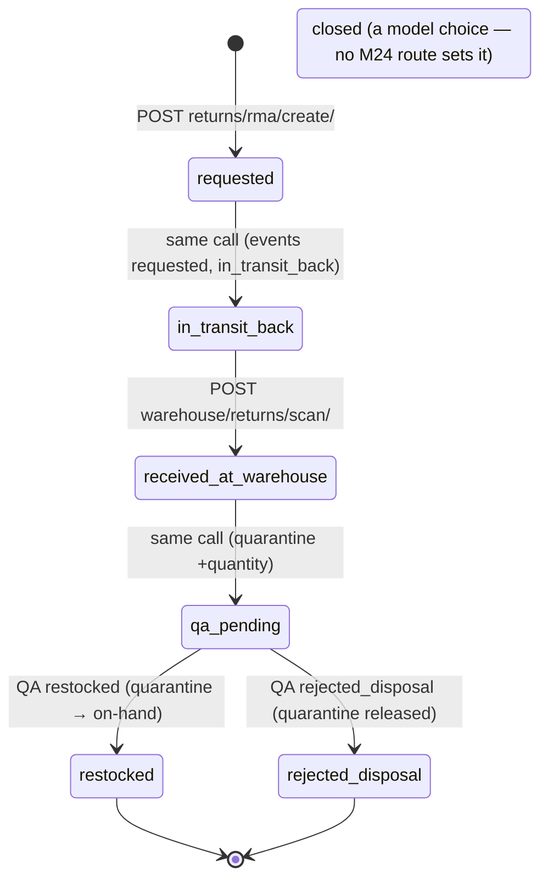

# Returns API — M24 (المرتجعات)

> **Source**: DOC-085 → DOC-088 (Step 19) · INT-026 (M24) · inventory Domain 4
> **Live key**: `returns` (`SHARWA_LIVE_MODULES`) — **4** BFF rows call `liveOrMock(request, "returns", …)`: `returns/options`, `returns/rma`, `returns/rma/[id]`, `orders/refunds`. The other 7 routes of the module are reached through the generic `/api/v1/[...path]` passthrough with fixtures in `src/mocks/returns/passthrough.ts`; a real Django answer always wins there. See [`architecture/22-live-module-keys.md`](../../../architecture/22-live-module-keys.md) (row 18)
> **Django provider**: `sharwa_saas/api/views_returns.py` (`ReturnsAPIMixin`, gate + routing) · `sharwa_saas/products/services/returns_api_service.py` (contract, messages, audit) · `products/services/return_service.py` (financial return per `FulfillmentItem`, cash-liquidity check, `restock_to_location`) · `products/services/reverse_logistics_service.py` (RMA: locked destination, quarantine, QA gate) · `products/services/refund_service.py` (`process_order_refund`) · models `products/models/returns.py` (`ReturnRequest`, `ReturnLineItem`), `products/models/reverse_logistics.py` (`ReturnAuthorization`), `products/models/orders.py` (`OrderRefund`) · wired in `sharwa_saas/api/urls.py`
> **Frontend contract**: `sharwa-frontend/src/features/returns/schemas.ts` (`returnListItemSchema`, `returnDetailSchema`, `rmaSchema`, `orderRefundSchema`, `returnOptionsSchema`) · hooks `src/features/returns/api.ts` · screen `src/features/returns/components/return-detail.tsx` · fixture `src/mocks/returns/{state,passthrough}.ts` · BFF `src/app/api/bff/returns/{options,rma,rma/[id]}/route.ts`, `src/app/api/bff/orders/refunds/route.ts`
> **Tests**: `sharwa_saas/api/test_returns_api.py` (8 tests) · mock E2E `sharwa-frontend/scripts/returns-check.ts`
> **Last verified against code**: 2026-10-27 (step 19)

> **Scope note** — Order refunds made from the order screen (`POST orders/<id>/refunds/`) are M06 ([`m06-orders.md#refunds`](m06-orders.md#refunds)); this page documents the **return** flow that ends in a refund, the RMA (reverse-logistics) flow, and the read-only refund log. Example values come from `api/test_returns_api.py` or are derived from the Django text templates; ids and timestamps are **illustrative**.

<a id="overview"></a>

## 1. Overview

M24 lets the merchant take back goods. Two independent flows share one module:

| Flow | Question it answers | Entity | Money? | Stock? |
|---|---|---|---|---|
| **Return request** | "The customer wants to return lines of an order — approve or reject, and how do we pay back?" | `ReturnRequest` + `ReturnLineItem` (one per `FulfillmentItem`) | yes (wallet credit; cash and original payment are paid out by hand) | restocked on approval, per line, to a chosen location |
| **RMA** (return authorization) | "A parcel is coming back — where must it be received, and is it fit to sell again?" | `ReturnAuthorization` | no | quarantine on scan, on-hand only after the QA decision |

A third read-only route, the **refund log**, lists every `OrderRefund` row of the store ([§4.3](#refunds-log)).

Every return line points at a `FulfillmentItem`, not at the `OrderItem`: one order can ship from several branches, so each returned piece "knows" which branch, stock and staff it came from, and a partial or merged return needs no special case.

### What INT-026 rewrote

Before INT-026 the return routes were «Ready» passthrough rows whose answers failed the Zod schemas (as the roadmap describes them — the old serializer is not part of the files read in step 19): the old `ReturnRequestSerializer` lacked `customer_name`, `lines_count`, `display_amount`, `location`, `timeline` and `decision_note`; quantities were decimal strings (`quantity`, `remaining`) where the contract wants numbers; the RMA routes answered `{rma_id, status}` and took QA decisions `approve|reject`; and there was no RMA permission. The module docstring of `returns_api_service.py` records the decision that the frontend schemas are the source of truth.

The rewrite kept **the same URLs and the same class names** — `ReturnRequestListCreateView`, `ReturnableItemsView`, `ReturnRequestDetailView`, `ReturnRequestApproveView`, `ReturnAuthorizationCreateView`, `ReturnReceiptScanView`, `ReturnQADecisionView` are re-exported from `api/views.py` — so the legacy test modules that import them (`api/tests.py`, `products/test_returns_b2b_api.py`) keep working. The logic moved to `products/services/returns_api_service.py` and `api/views_returns.py`; `return_service`, `reverse_logistics_service` and `refund_service` are reused unchanged.

### The 11 routes

| # | Method | Django path (`/api/v1/…`) | Reached through | Purpose | Gate (any of) | Section |
|---|---|---|---|---|---|---|
| 1 | `GET` | `returns/` | passthrough | return list (`?status&q&page`, 20 per page) | `orders.process_returns` | [§4.1](#returns) |
| 1 | `POST` | `returns/` | passthrough | create a return request | `orders.process_returns` | [§4.1](#returns) |
| 2 | `GET` | `returns/order/<order_id>/items/` | passthrough | returnable items with the remaining quantity | `orders.process_returns` | [§4.1](#returns) |
| 3 | `GET` | `returns/<pk>/` | passthrough | one return with lines and timeline | `orders.process_returns` | [§4.1](#returns) |
| 4 | `POST` | `returns/<pk>/approve/` | passthrough | approve **or** reject (`decision`) | `orders.process_returns` | [§4.1](#returns) |
| 5 | `GET` | `returns/options/` | BFF `returns/options` | active locations for pickers | session + plan feature only | [§2](#options) |
| 6 | `GET` | `returns/rma/` | BFF `returns/rma` | RMA list with per-status counts | `orders.process_returns` | [§4.2](#rma) |
| 7 | `GET` | `returns/rma/<pk>/` | BFF `returns/rma/[id]` | one RMA with its events | `orders.process_returns` | [§4.2](#rma) |
| 8 | `POST` | `returns/rma/create/` | passthrough | create an RMA | `orders.process_returns` | [§4.2](#rma) |
| 9 | `POST` | `warehouse/returns/scan/` | passthrough | scan a received parcel | `orders.process_returns` or `inventory.adjust` | [§4.2](#rma) |
| 10 | `POST` | `warehouse/returns/<rma_id>/qa-decision/` | passthrough | QA decision | `orders.process_returns` or `inventory.adjust` | [§4.2](#rma) |
| 11 | `GET` | `orders/refunds/` | BFF `orders/refunds` | read-only `OrderRefund` log | `orders.refund` | [§4.3](#refunds-log) |

The BFF rows 5, 6, 7 and 11 are the four `liveOrMock(…, "returns", …)` files (`/api/v1/returns/options/`, `/api/v1/returns/rma/`, `/api/v1/returns/rma/<id>/`, `/api/v1/orders/refunds/`). The mock handlers there gate with `orders.process_returns` (RMA) and `orders.refund` (log); in live mode Django answers its own `401`/`403`.

## 2. Access — gate chain

`ReturnsAPIMixin.check(request, permissions)` evaluates, in this order; the first failing gate answers.

| # | Gate | Requirement | Failure |
|---|---|---|---|
| 1 | CSRF | `MerchantSessionAuthentication` enforces CSRF on every unsafe request ([`csrf.md`](../../overview/csrf.md)) | `403` (CSRF failure) |
| 2 | Tenant | `HasTenantContext` | tenant-guard answer ([`m47-tenant-guard.md`](../01-public-onboarding/m47-tenant-guard.md)) |
| 3 | Session | owner (`is_merchant_authenticated`) or staff | `401` `{"detail": "انتهت جلستك، سجّل الدخول مجدداً."}` |
| 4 | Plan feature | `refunds` (`settings_feature_enabled`) — the same feature the legacy screens required | `403` `{"detail": "ميزة المرتجعات غير مفعّلة في خطتك."}` |
| 5 | Permission — **any one of** the listed keys (the owner holds all) | see the «Gate» column of the route table in §1 | `403` `{"detail": "ليست لديك صلاحية لتنفيذ هذا الإجراء."}` |
| 6 | Resource state | the order / return / RMA exists; per-route rules | `404` / `400` / `409` |

- **`returns/options/` passes no permission list**: it needs a session and the `refunds` feature only, so a pickers request works for any signed-in staff member, and it **works without `multi_location`** (it just lists the active locations).
- **Scan and QA accept two keys.** A warehouse keeper holding only `inventory.adjust` can scan and decide QA (the test builds such a staff member: `GET returns/` is `403` for them, while `POST warehouse/returns/scan/` passes the gate and answers `404` for an unknown RMA).
- **Different text from M06.** The M06 gate says «ليست لديك صلاحية لهذا الإجراء.»; the M24 gate says «ليست لديك صلاحية لتنفيذ هذا الإجراء.» (see the discrepancy below).
- `test_feature_and_permissions` asserts: anonymous `GET returns/` → `401`; feature off → `403` with «ميزة المرتجعات غير مفعّلة في خطتك.»; the `inventory.adjust`-only keeper as above.

> ⚠️ Discrepancy — code vs code: the 403 text for a missing permission differs between modules. M06 (`views_orders.py` through `ProductsAPIMixin.gate`) answers «ليست لديك صلاحية لهذا الإجراء.»; M24 (`ReturnsAPIMixin.check`) answers «ليست لديك صلاحية لتنفيذ هذا الإجراء.». Clients must not match on the text. Reported in step 19.

<a id="options"></a>

### `GET /api/v1/returns/options/`

Gate: session + feature `refunds`. Answers the active locations in `sort_order, id` order, for the location pickers of the return, destination and scan forms.

```json
{ "locations": [ { "id": 1, "name": "فرع صنعاء" }, { "id": 2, "name": "المستودع" } ] }
```

The test creates an inactive location «مغلق» and asserts that only the two active names come back.

### The BFF and the decision toasts

Four rows call `liveOrMock(request, "returns", …)`; the `returns` key is documented in [`architecture/22-live-module-keys.md`](../../../architecture/22-live-module-keys.md). The decision toast in `return-detail.tsx` is `res.status === "rejected" ? «رُفض الإرجاع #{id}» : «اعتُمد الإرجاع #{id}»`: **any result other than `rejected` is treated as approved** — so it shows «اعتُمد» for Django's `completed` and for the mock's `approved` alike. A `409` shows a warning bar «تحديث ثم إعادة المحاولة» (no automatic retry; the chosen location and note are kept), and a `CashLiquidityError` is shown verbatim from `{detail}` with the `CashLiquidityError:` prefix stripped.

## 3. Statuses and enums

| Entity | Field | Values |
|---|---|---|
| `ReturnRequest` | `status` | `requested` «مطلوب», `approved` «مقبول», `rejected` «مرفوض», `processing` «قيد المعالجة», `completed` «مكتمل» — the API produces only `requested`, `rejected` and `completed` |
| `ReturnRequest` | `refund_method` | `original_payment` «نفس وسيلة الدفع الأصلية», `cash` «نقدي من الفرع», `wallet` «محفظة العميل», `store_credit` «رصيد متجر» |
| `ReturnAuthorization` | `status` | `requested` «مطلوب», `in_transit_back` «في طريق العودة», `received_at_warehouse` «استُلم في المخزن», `qa_pending` «بانتظار الفحص», `restocked` «أُعيد للمخزون», `rejected_disposal` «رُفض — إتلاف/إرجاع للتاجر», `closed` «مغلق» |
| `ReturnAuthorization` | `reason` | `customer_rejected` «رفض العميل», `damaged` «تالف», `wrong_item` «منتج خاطئ», `bundle_partial_return` «رفض جزئي لعرض حزمة» |
| `ReturnAuthorization` | `fee_payer` | `customer`, `merchant`, `platform` — the API sets `merchant` for `damaged` / `wrong_item`, `customer` otherwise |
| `OrderRefund` | `method` | `wallet`, `sharwa_pay`, `manual`, `wallet_credit` |

<a id="returns"></a>

## 4. Endpoint groups

### 4.1 Return requests: create, list, decisions (DOC-086)

#### `GET /api/v1/returns/order/<order_id>/items/`

Every `FulfillmentItem` of the order with how much can still be returned. `404` `{"detail": "الطلب غير موجود."}` for an unknown order.

```json
[
  {
    "fulfillment_item_id": 11,
    "product_name": "قميص",
    "quantity": 3,
    "remaining": 3,
    "unit_refund_amount": "100.00",
    "location_name": "فرع صنعاء",
    "sku": "SH-1",
    "product_deleted": false,
    "display_unit_refund_amount": "100 ر.س"
  }
]
```

`quantity` and `remaining` are JSON **numbers** (the old provider sent strings); `remaining` ignores **rejected** returns (a rejected return does not hold the quantity — the test shows `remaining` going 3 → 1 after a 2-piece request and back to 3 after it is rejected) and is `0` for every item once the order's status is `refunded`. `unit_refund_amount` is `(price − discount_allocated ÷ quantity)` rounded to 2 decimals.

#### `POST /api/v1/returns/` — create

**Request body**

| Field | Type | Required | Rules |
|---|---|---|---|
| `order_id` | int | yes | an existing order, else `404` «الطلب غير موجود.» |
| `reason` | string | yes | 3–255 characters |
| `refund_method` | enum | yes | `original_payment`, `cash`, `wallet`, `store_credit` |
| `line_items[]` | array | yes | at least one |
| `line_items[].fulfillment_item_id` | int | yes | an item of this order |
| `line_items[].quantity_returned` | int | yes | ≥ 1, whole, ≤ remaining |
| `line_items[].restock` | bool | no | **defaults to `true`**; only an explicit `false` skips the restock |

**Response `201`** — the full return detail (the test's `qty = 2`, method `wallet`; ids and times illustrative):

```json
{
  "id": 5,
  "order_id": 101,
  "customer_name": "أحمد علي",
  "customer_phone": "777123456",
  "lines_count": 1,
  "display_amount": "200 ر.س",
  "reason": "المقاس غير مناسب",
  "refund_method": "wallet",
  "status": "requested",
  "location": { "id": 1, "name": "فرع صنعاء" },
  "version": 1,
  "created_at": "2026-10-27T09:30:00+00:00",
  "decision_note": null,
  "updated_at": "2026-10-27T09:30:00+00:00",
  "line_items": [
    {
      "id": 9,
      "fulfillment_item_id": 11,
      "product_id": 3,
      "product_name": "قميص",
      "sku": "SH-1",
      "quantity_returned": 2,
      "refund_amount_allocated": "200.00",
      "display_refund_amount": "200 ر.س",
      "restock": true,
      "product_deleted": false
    }
  ],
  "timeline": [
    { "id": 31, "at": "2026-10-27T09:30:00+00:00", "text": "أُنشئ طلب الإرجاع.", "actor": "مالك المتجر" }
  ]
}
```

| Field | Type | Meaning |
|---|---|---|
| `customer_name` | string | the order's customer, `—` when empty |
| `lines_count` | int | number of return lines |
| `display_amount` | string | sum of `refund_amount_allocated`, formatted in the order's currency |
| `location` | `{id, name}` \| null | `processed_at_location` once decided, else the location of the first fulfilment that has one |
| `version` | int | the optimistic-lock counter (`1` at creation, `+1` per decision) |
| `decision_note` | string \| null | the reject note (read from the `return.rejected` audit row) |
| `updated_at` | string | the latest of `created_at`, `resolved_at` and the newest audit row |
| `line_items[].refund_amount_allocated` | string | `(unit refund × quantity)` — raw 2-decimal string; `display_refund_amount` is its server string |
| `timeline[]` | object | newest first; ids are the `AuditLog` ids; see [§4.4](#storage) |

**Errors**

| Status | Body | When |
|---|---|---|
| `404` | `{"detail": "الطلب غير موجود."}` | unknown `order_id` |
| `400` | `{"reason": ["اكتب سبب الإرجاع."]}` / `["السبب أطول من 255 حرفاً."]` | reason < 3 or > 255 characters |
| `400` | `{"refund_method": ["اختر طريقة الاسترجاع."]}` | not one of the four methods |
| `400` | `{"line_items": ["حدد سطراً واحداً على الأقل."]}` | empty list |
| `400` | `{"detail": "استُرجع هذا الطلب بالكامل — لا عناصر قابلة للإرجاع."}` | the order's status is `refunded` |
| `400` | `{"line_items": [{}, {"quantity_returned": ["…"]}]}` | per-line errors, below |

All three top-level field errors are reported together (the test posts `reason 'x'`, `refund_method 'bank'`, `line_items []` and gets the key set `{reason, refund_method, line_items}`).

**Per-line errors.** `line_items` is an array **aligned to the request**: position *n* holds the errors of line *n* (an empty object for a valid line), so the form can attach each message to its row:

| Key in the line object | Message | When |
|---|---|---|
| `fulfillment_item_id` | «العنصر لا ينتمي لهذا الطلب.» | not an item of the order |
| `quantity_returned` | «أدخل كمية صحيحة (1 أو أكثر).» | missing, < 1 or fractional |
| `quantity_returned` | «الكمية تتجاوز المتبقي ({n}).» | more than remains (earlier non-rejected returns **and** other lines of the same request count) |
| `quantity_returned` | «أُرجع هذا العنصر بالكامل.» | nothing remains |

The test: three shirts, request 5 → `{"line_items": [{"quantity_returned": ["الكمية تتجاوز المتبقي (3)."]}]}`.

**Side effects** (one `transaction.atomic()`): the `ReturnRequest` (`status = requested`, `version = 1`) and its `ReturnLineItem` rows; an `AuditLog` row `return.created` with the text «أُنشئ طلب الإرجاع.»; and an **order timeline event** (M06, kind `refund`): «طلب إرجاع #{id} ({n} سطر) — {reason}» (the test checks that an `order.refund` audit row exists for the order). No stock or money moves at creation.

#### `GET /api/v1/returns/` — list

| Name | Type | Default | Notes |
|---|---|---|---|
| `status` | enum | — | `requested`, `approved`, `rejected`, `processing`, `completed`; other values ignored |
| `q` | string | — | digits only → the return `id`, the `order_id` (both only when ≤ 9 digits) **or** a phone fragment (a local `0777…` also matches the stored `777…` and `967…`/`966…` forms); anything else → a normalised-Arabic name match («احمد» finds «أحمد علي») |
| `page` | int | `1` | fixed page size **20** |

Answers `{count, next, previous, results}`, each result being the list-item part of the detail above (`id` … `created_at`), newest first. `next` and `previous` are **full links in DRF style**, built from the request's own parameters, e.g. `/api/v1/returns/?status=requested&page=2`. A page past the end is `404` `{"detail": "صفحة غير صالحة."}` (page 1 of an empty list is fine).

The test: `q = احمد` → `count 1`, `next` and `previous` `null`; `q = <order id>` → 1; `q = 0777123456` → 1; `status = completed` → 0.

#### `GET /api/v1/returns/<pk>/`

The detail row shown above; `404` `{"detail": "طلب الإرجاع غير موجود."}`. The test asserts it equals the `201` body of the create call.

#### `POST /api/v1/returns/<pk>/approve/` — approve **or** reject

**Request body** `{decision, version?, location_id?, note?}`

| Field | Type | Rules |
|---|---|---|
| `decision` | `approve` \| `reject` | defaults to `approve` when absent; anything else → `400` `{"decision": ["القرار يجب أن يكون approve أو reject."]}` |
| `version` | int | optional; when sent it must match the return's `version` |
| `location_id` | int | approve only — an **active** location where the stock returns; `400` `{"location_id": ["الموقع غير متاح."]}` otherwise |
| `note` | string | reject only — ≥ 3 characters, else `400` `{"note": ["اكتب سبب الرفض."]}`; stored as `decision_note` (255 characters kept) |

**Order of checks**: `404` «طلب الإرجاع غير موجود.» → invalid `decision` (`400`) → **already decided**: `status != requested` → `409` `{"detail": "حُسم هذا الإرجاع من قبل ({status}).", "current_version": n}` → **stale version** → `409` `{"detail": "حُدِّث طلب الإرجاع من مستخدم آخر.", "current_version": n}` → the decision-specific checks. A decided return can never be decided again (the test approves a rejected one and gets `409`). The answer on success is the full detail row with `version + 1`.

**Reject** — a conditional `UPDATE … WHERE version = … AND status = 'requested'` (`status = rejected`, `resolved_at` now, `version + 1`); if it hits nothing a concurrent writer won and the answer is the `409` above. Audit `return.rejected` with the text «رُفض الإرجاع: {note}» and the note; order event «إرجاع #{id}: رُفض». No stock or money moves.

```http
POST /api/v1/returns/5/approve/   { "decision": "reject", "version": 1, "note": "" }
→ 400 { "note": ["اكتب سبب الرفض."] }

POST /api/v1/returns/5/approve/   { "decision": "reject", "version": 7, "note": "خارج المدة" }
→ 409 { "detail": "حُدِّث طلب الإرجاع من مستخدم آخر.", "current_version": 1 }

POST /api/v1/returns/5/approve/   { "decision": "reject", "version": 1, "note": "خارج مدة الإرجاع" }
→ 200 { "id": 5, "status": "rejected", "version": 2, "decision_note": "خارج مدة الإرجاع",
        "timeline": [ { "text": "رُفض الإرجاع: خارج مدة الإرجاع", … }, { "text": "أُنشئ طلب الإرجاع.", … } ], … }

POST /api/v1/returns/5/approve/   { "decision": "approve", "version": 2 }
→ 409 { "detail": "حُسم هذا الإرجاع من قبل (rejected).", "current_version": 2 }
```

**Approve** — everything below runs in **one transaction**: any failure (money included) rolls the whole approval back and the return stays `requested`.

1. **Location.** If `location_id` is given it must be an active location. If some `restock` line's fulfilment has no location and none was chosen → `400` `{"location_id": ["حدد موقع إعادة المخزون."]}`.
2. **Cash check** (only `refund_method = cash`): `processed_at_location` must be known, else `CashLiquidityError` «الاسترجاع النقدي يتطلب تحديد الفرع.»; and the open cash shift of that location must have an expected closing balance ≥ the return total, else «لا يمكن إتمام الاسترجاع نقداً من هذا الفرع لعدم توفر سيولة كافية في الدرج الحالي.». Both answer `400` `{"detail": "CashLiquidityError: <message>"}`. `409` stays reserved for conflicts.
3. **Restock** — every line with `restock = true` goes back to the chosen `location_id`, else to the location of its own fulfilment, through `return_service.restock_to_location`: the `LocationInventory` row of that location is always increased; with multi-location **off** the product (or variant) stock is increased directly too (with multi-location on, the location signal rewrites the mirror); and a `refund_restock` stock movement is recorded with `reference = ('return', <return id>)` and the note «إرجاع #{id}» in the M21 stock ledger ([`architecture/44-stock-ledger.md`](../../../architecture/44-stock-ledger.md)).
4. **Status**: `completed`, `resolved_at` now, `processed_at_location` and `processed_by_staff` set, `version + 1`. The free-shipping eligibility of the order is recomputed afterwards.
5. **Money** (only when the return total is > 0), by `refund_method`:

| `refund_method` | Money call | Result |
|---|---|---|
| `wallet` | `process_order_refund(order, total, method='wallet_credit', reason='إرجاع #{id}')` | the customer wallet is credited; an `OrderRefund` row (method `wallet_credit`) |
| `store_credit` | same as `wallet` (`MONEY_BY_METHOD`) | same |
| `cash` | none — the cash is handed over at the branch (the drawer was checked in step 2) | no `OrderRefund` row |
| `original_payment` | none — refunded outside the system | no `OrderRefund` row |

   A refusal of the refund service (for example an unpaid order: «لا يمكن استرجاع مبلغ لم يُؤكَّد استلامه بعد. استخدم زر «تأكيد استلام المبلغ» أولاً إن كان المبلغ قد وصل فعلاً.», or a cap error) answers `400` `{"detail": "<text>"}` and rolls the restock back.
6. **Audit and order event**: `return.approved` with the text «اعتُمد الإرجاع.»; order event «إرجاع #{id}: اعتُمد — {money}», carrying `refund_id` when a refund row was created (so the refund appears once on the order timeline and the log shows its actor).

**Approve examples**

*Wallet, 2 of 3 shirts, restocked into the warehouse* (`test_approve_restocks_chosen_location_and_credits_wallet`)

```http
POST /api/v1/returns/5/approve/   { "decision": "approve", "version": 1, "location_id": 99999 }
→ 400 { "location_id": ["الموقع غير متاح."] }

POST /api/v1/returns/5/approve/   { "decision": "approve", "version": 1, "location_id": 2 }
→ 200 { "id": 5, "status": "completed", "version": 2, "location": { "id": 2, "name": "المستودع" }, … }
```

Afterwards (all asserted): the warehouse `LocationInventory.quantity_on_hand` is **2**; the product stock goes **10 → 12** (a store without multi-location); the single `refund_restock` movement has `reference_type = return`, `reference_id = <return id>`, `location = warehouse`, `quantity_change = 2`; the customer wallet balance is **200.00**; and the `OrderRefund` row is `(wallet_credit, 200.00, "إرجاع #5")`. The refund then appears in `GET orders/refunds/` with `actor = "مالك المتجر"` ([§4.3](#refunds-log)).

*Store credit* — identical to the wallet example: `store_credit` is mapped to the same `wallet_credit` call (derived from `MONEY_BY_METHOD`; the test covers the `wallet` method).

*Cash without drawer liquidity* (`test_approve_cash_without_drawer_is_liquidity_error`)

```http
POST /api/v1/returns/6/approve/   { "decision": "approve", "version": 1, "location_id": 1 }
→ 400 { "detail": "CashLiquidityError: لا يمكن إتمام الاسترجاع نقداً من هذا الفرع لعدم توفر سيولة كافية في الدرج الحالي." }
```

The return stays `requested` and no `refund_restock` movement exists. The message text is from `return_service.approve_return`; the test asserts the prefix, the status and the absence of the movement.

*Original payment* — approving restocks the lines and completes the return; no wallet is credited and no `OrderRefund` row is written, because the money goes back through the original payment channel by hand (derived from `MONEY_BY_METHOD`; not covered by a test).

> ⚠️ Discrepancy — roadmap says the `refund_restock` movement is "referenced `إرجاع #id`" / code does: the movement's **reference** is `('return', <return id>)` (`reference_type = return`, `reference_id = '<id>'`, as the test asserts); «إرجاع #{id}» is its **note**. Reported in step 19.

> ⚠️ Discrepancy — code vs fixture: the mock `approve` leaves the return in status `approved`; Django answers `completed`. The UI is unaffected because every non-`rejected` status counts as approved. Reported in step 19 (see [§6](#code-vs-mock)).

<a id="rma"></a>

### 4.2 RMA routes: list, detail, create, scan, QA (DOC-087)

An RMA tracks one parcel coming back, for **one `FulfillmentItem`** and a destination fixed at creation. Its states:



`create` writes the RMA directly in `in_transit_back` (with two audit events); `scan` passes through `received_at_warehouse` to `qa_pending` in one call; only the QA decision leaves `qa_pending`. A `requested` RMA can exist only from legacy rows.

**RMA row** (`rma_view`; the test's destination is the warehouse; illustrative ids)

```json
{
  "id": 4,
  "order_id": 101,
  "fulfillment_item": { "id": 11, "product_id": 3, "product_name": "قميص", "sku": "SH-1" },
  "reason": "damaged",
  "status": "restocked",
  "fee_payer": "merchant",
  "destination_location": { "id": 2, "name": "المستودع" },
  "quantity": 2,
  "customer_name": "أحمد علي",
  "created_at": "2026-10-27T10:00:00+00:00",
  "restock_movement_id": 17,
  "events": [
    { "to_status": "requested", "at": "2026-10-27T10:00:00+00:00", "actor": "مالك المتجر" },
    { "to_status": "in_transit_back", "at": "2026-10-27T10:00:00+00:00", "actor": "مالك المتجر" },
    { "to_status": "received_at_warehouse", "at": "2026-10-27T10:05:00+00:00", "actor": "مالك المتجر" },
    { "to_status": "qa_pending", "at": "2026-10-27T10:05:00+00:00", "actor": "مالك المتجر" },
    { "to_status": "restocked", "at": "2026-10-27T10:10:00+00:00", "actor": "مالك المتجر" }
  ]
}
```

| Field | Meaning |
|---|---|
| `quantity` | whole number |
| `events[]` | one per status change, from the `AuditLog` (`rma.status` rows, [§4.4](#storage)), oldest first. An RMA that predates INT-026 has no audit rows: the events are derived — `requested` at `created_at`, plus the current status at `updated_at` (the legacy test: a `qa_pending` row answers `["requested", "qa_pending"]`) |
| `restock_movement_id` | the id of the `refund_restock` stock movement whose `reference_id` is `RMA-<id>`, once restocked; else `null` |

#### `GET /api/v1/returns/rma/`

| Name | Type | Default | Notes |
|---|---|---|---|
| `status` | enum | — | one of the seven RMA statuses; other values ignored |
| `q` | string | — | same rules as the return list (`id` / `order_id` / phone fragment, or a normalised name) |
| `page` | int | `1` | |
| `page_size` | int | `20` | clamped to 1–100 |

Answers `{count, counts, results}` — **no** `next` / `previous`. `count` is the number of rows matching the filters; `counts` is the number of RMAs **per status over the whole table** (every one of the seven statuses is present, zero included), so the tabs keep their badges whatever the filter. The test, after one RMA reaches `restocked`: `?status=restocked` → `count 1`, `counts.restocked 1`, `counts.qa_pending 0`.

#### `GET /api/v1/returns/rma/<pk>/`

The RMA row; `404` `{"detail": "RMA غير موجود."}`. The test asserts it equals the first element of the list.

#### `POST /api/v1/returns/rma/create/` — `201` with the RMA row

| Field | Type | Required | Rules / error |
|---|---|---|---|
| `order_id` | int | yes | `{"order_id": ["الطلب غير موجود."]}` |
| `fulfillment_item_id` | int | yes | an item of that order — `{"fulfillment_item_id": ["اختر عنصر تنفيذ من الطلب."]}` |
| `destination_location_id` | int | yes | an **active** location — `{"destination_location_id": ["اختر موقع الوجهة."]}`; locked from now on |
| `reason` | enum | yes | `customer_rejected`, `damaged`, `wrong_item`, `bundle_partial_return` — `{"reason": ["اختر سبب الإرجاع."]}` |
| `quantity` | int | no (default 1) | 1 … the fulfilment quantity — `{"quantity": ["الكمية بين 1 و{n}."]}` |

Errors are field-keyed and reported together (the test: `fulfillment_item_id 0`, `destination_location_id 0`, `reason 'x'` → key set `{fulfillment_item_id, destination_location_id, reason}`). The test creates a `damaged` RMA of 2 for the warehouse and reads `status = in_transit_back`, `fee_payer = merchant`, `quantity = 2`, `events = [requested, in_transit_back]`.

#### `POST /api/v1/warehouse/returns/scan/` — receive a parcel

Body `{rma_id, location_id}`. `rma_id` accepts `12` **or** the barcode text `RMA-12` (prefix case-insensitive).

| Status | Body | When |
|---|---|---|
| `400` | `{"rma_id": ["رقم RMA غير صالح."]}` | not a positive number after removing `RMA-` |
| `400` | `{"location_id": ["الموقع غير موجود."]}` | unknown location |
| `404` | `{"detail": "لا يوجد RMA برقم {id}."}` | unknown RMA |
| `400` | `{"detail": "RMA-{id} لم يُشحن بعد من العميل."}` | RMA still `requested` |
| `409` | `{"detail": "RMA-{id} مُسح من قبل — حالته الآن «{status label}»."}` | already scanned (any status other than `in_transit_back`) — the label is the Arabic display name, e.g. «بانتظار الفحص» |
| `400` | `{"detail": "RMA-{id} وجهته «{name}» وليس هذا الموقع."}` | **locked destination**: scanned at another location |

On success (one transaction): the `LocationInventory` of the destination gets `quarantine_quantity += quantity` — the pieces are **not** sellable yet; the status becomes `qa_pending`; `hop_count` is incremented (above `MAX_HOPS = 2` it only logs a warning for human review); two audit events (`received_at_warehouse`, `qa_pending`) are written; the answer is the RMA row. The test scans `RMA-<id>` at the branch (`400`, message contains «المستودع»), then at the warehouse (`qa_pending`, events end with `[received_at_warehouse, qa_pending]`, quarantine **2**), and a second scan answers `409`.

#### `POST /api/v1/warehouse/returns/<rma_id>/qa-decision/`

Body `{decision}`: `restocked` or `rejected_disposal` (the legacy aliases `approve` / `reject` are accepted and mapped).

| Status | Body | When |
|---|---|---|
| `400` | `{"decision": ["القرار restocked أو rejected_disposal."]}` | any other value (the test sends `maybe`) |
| `404` | `{"detail": "RMA غير موجود."}` | unknown RMA |
| `409` | `{"detail": "لا قرار فحص إلا بعد الاستلام — الحالة «{status label}»."}` | status is not `qa_pending` (the test repeats the decision after `restocked` and gets `409`) |
| `409` | `{"detail": "<reverse-logistics message>"}` | the domain refuses (for example «كمية الحجر الصحي غير كافية.») |

- **`restocked`**: quarantine → on-hand at the destination (`quarantine_quantity −= q`, `quantity_on_hand += q`); with multi-location **off** the product (or variant) stock is increased directly as well; a `refund_restock` stock movement is recorded with `reference = ('return', 'RMA-<id>')`, the note «RMA-{id} — اجتاز الفحص» and the destination location. Its id is the RMA's `restock_movement_id`. The test: stock **10 → 12**, `quantity_on_hand 2`, `quarantine 0`, movement `reference_id = RMA-<id>`, `quantity_change = 2`.
- **`rejected_disposal`**: the quarantine is released (floored at 0) for disposal or return to the merchant; no stock is added and no movement is recorded.

Both write an audit event with the new status.

> ⚠️ Discrepancy — code vs fixture: the mock `createRma` answers status `requested` with a single event and requires a `completed` order; Django creates the RMA in `in_transit_back` with the two events `requested → in_transit_back` and accepts any order. The mock's scan and QA `409` texts print the raw status code; Django prints the Arabic label. Reported in step 19 (see [§6](#code-vs-mock)).

<a id="refunds-log"></a>

### 4.3 The refunds log (DOC-088)

#### `GET /api/v1/orders/refunds/`

Gate **`orders.refund`** (plus the `refunds` feature). A **read-only** list of every `OrderRefund` row — those made from the order screen (M06) and those made by an approved return.

| Name | Type | Default | Notes |
|---|---|---|---|
| `method` | enum | — | `wallet`, `sharwa_pay`, `manual`, `wallet_credit`; other values ignored |
| `from`, `to` | `YYYY-MM-DD` | — | inclusive, on the date of `created_at`; a value not matching the pattern is ignored |
| `q` | string | — | digits only → the **order id** (≤ 9 digits) or a phone fragment; anything else → a normalised-Arabic match on the customer name **or** the refund reason |
| `page` | int | `1` | |
| `page_size` | int | `20` | clamped to 1–100 |

Answers `{count, results}` only — no `next` / `previous` — newest first.

```json
{
  "count": 1,
  "results": [
    {
      "id": 8,
      "order_id": 101,
      "customer_name": "أحمد علي",
      "customer_phone": "777123456",
      "display_amount": "200 ر.س",
      "method": "wallet_credit",
      "reason": "إرجاع #5",
      "loyalty_points_clawed_back": 0,
      "actor": "مالك المتجر",
      "created_at": "2026-10-27T09:45:00+00:00"
    }
  ]
}
```

| Field | Meaning |
|---|---|
| `display_amount` | the refund amount in the order's currency |
| `method`, `reason` | straight from `OrderRefund` |
| `loyalty_points_clawed_back` | points withdrawn by a full refund ([`m06-orders.md#refunds`](m06-orders.md#refunds)) |
| `actor` | the staff label recorded by the **M06 order audit** (`refund_id` in the `order.*` event); `—` for a refund without an audit row (made on the legacy screen) |

The test asserts, after the wallet approval: `count 1`, `method wallet_credit`, `actor مالك المتجر`; and `?method=manual` → `count 0`.

<a id="storage"></a>

### 4.4 Storage: the append-only audit (DOC-088)

M24 added **no table and no migration**. Everything the screens show beyond the existing models lives in the append-only `AuditLog` (the same source as the M06 order timeline):

| `target_model` | `action_code` | `after_snapshot` | Feeds |
|---|---|---|---|
| `ReturnRequest` | `return.created` | `{text: «أُنشئ طلب الإرجاع.», actor}` | return `timeline[]` |
| `ReturnRequest` | `return.approved` | `{text: «اعتُمد الإرجاع.», actor}` | return `timeline[]` |
| `ReturnRequest` | `return.rejected` | `{text: «رُفض الإرجاع: {note}», actor, note}` | return `timeline[]` and `decision_note` |
| `ReturnAuthorization` | `rma.status` | `{to_status, actor}` | RMA `events[]` |

- **Legacy rows.** A return created before INT-026 has no audit rows: its timeline is derived from the row — «أُنشئ طلب الإرجاع.» at `created_at` (id `−1`) and, when `resolved_at` is set, «رُفض الإرجاع.» or «اعتُمد الإرجاع.» (id `−2`). A legacy RMA derives its events from `created_at` / `updated_at` (see above).
- **The order timeline.** Return **create**, **reject** and **approve** each also write an M06 order event (kind `refund`) — «طلب إرجاع #{id} ({n} سطر) — {reason}», «إرجاع #{id}: رُفض», «إرجاع #{id}: اعتُمد — {money}» — and the approve event carries `refund_id`, which is how the refund log finds its `actor`.
- **Tests.** `api/test_returns_api.py` has **8** tests: `test_feature_and_permissions`, `test_items_create_detail_and_list`, `test_reject_note_version_and_finality`, `test_approve_restocks_chosen_location_and_credits_wallet`, `test_approve_cash_without_drawer_is_liquidity_error`, `test_rma_lifecycle`, `test_legacy_rma_without_audit_has_events`, `test_options`. The legacy modules that import the re-exported classes were adjusted for the new gate: `api/tests.py` patches `api.views_returns.settings_feature_enabled` (the `refunds` feature) for its return tests. The roadmap also notes the cash case answering `400` and the wallet case needing a paid order in `products/test_returns_b2b_api.py`; that module was **not** available in this step and those two points were not re-verified.

> ⚠️ Discrepancy — roadmap says "every create/decision also lands on the order timeline" / code does: only the **return request** actions do (`create_return`, `decide_return` call the order-event helper). `create_rma`, `scan_rma` and `qa_decision` write `rma.status` audit rows on the RMA only — an RMA does not appear on the order timeline. Reported in step 19.

## 5. Gaps closed, bugs fixed and migrations

- **No migration.** Return timelines and RMA events reuse `AuditLog`; `ReturnRequest.version` (optimistic lock) and `ReturnRequest.resolved_at` already existed.
- **Contract shapes now match Zod**: `customer_name`, `lines_count`, `display_amount`, `location`, `timeline`, `decision_note` added to the return; quantities are numbers; the RMA answers the full row with events; QA decisions are `restocked` / `rejected_disposal`; RMA has its own permission.
- **Conflicts are `409`, domain refusals are `400`**: a decided or stale return answers `409` with `current_version`; `CashLiquidityError` is a `400`.
- **One transaction for approval**: restock, status, money, audit and order event commit or roll back together.
- **Locked RMA destination** enforced on scan (`400`), re-scan is `409`, and the quarantine keeps unchecked goods out of the sellable stock until the QA decision.

## 6. Open items and legacy-only behaviour

- `ReturnRequest.status` `approved` and `processing` are model choices that this API never produces (approval goes `requested → completed`); `ReturnAuthorization.status` `closed` is likewise unused by M24.
- `.env.example:79` omits the `returns` key from the sample `SHARWA_LIVE_MODULES` line — already reported in [`architecture/22-live-module-keys.md`](../../../architecture/22-live-module-keys.md) (Step 07) and scheduled for DOC-461; this step does not edit configuration. Fixed in official Step 52 (2026-10-30).
- A `wallet` / `store_credit` return credits the wallet through `wallet_credit` with **no currency conversion** (the entered number is credited as-is, see [`m06-orders.md#refunds`](m06-orders.md#refunds)).
- Pagination differs inside the module: `returns/` uses full DRF links, `returns/rma/` returns `{count, counts, results}` and `orders/refunds/` returns `{count, results}` ([`pagination.md`](../../overview/pagination.md)).

> ⚠️ Discrepancy — code vs code: the three list routes of M24 and the M06 list answer four different envelopes (M06 `{count, next: "?page=2", previous, results}`; returns `{count, next: "/api/v1/returns/?…&page=2", previous, results}`; RMA `{count, counts, results}`; refund log `{count, results}`). Reported in step 19.

<a id="code-vs-mock"></a>

### Code vs mock (fixture) differences

| # | Area | Mock (`src/mocks/returns/`) | Django |
|---|---|---|---|
| 1 | Approve result status | `approved` | `completed` |
| 2 | Create a return | requires the order to be `completed` («لا عناصر قابلة للإرجاع في هذا الطلب.») | rejects only a `refunded` order («استُرجع هذا الطلب بالكامل — لا عناصر قابلة للإرجاع.») |
| 3 | Unknown order on create | `400` with an `order_id` error | `404` «الطلب غير موجود.» |
| 4 | Wallet refund | needs an existing customer wallet | creates the wallet when missing |
| 5 | `restock` default | restocks only when `restock === true` | restocks unless `restock` is explicitly `false` |
| 6 | Create an RMA | status `requested`, one event, requires a `completed` order | `in_transit_back`, events `requested → in_transit_back`, any order |
| 7 | Scan / QA `409` text | prints the raw status code | prints the Arabic label «{status label}» |

## 7. Related pages

- Orders, refunds from the order screen, the order timeline: [`m06-orders.md`](m06-orders.md)
- Stock ledger and locations: [`architecture/44-stock-ledger.md`](../../../architecture/44-stock-ledger.md), [`../10-inventory-locations-procurement/README.md`](../10-inventory-locations-procurement/README.md)
- Wallets (customer wallet credit): [`../06-customers-wallets/README.md`](../06-customers-wallets/README.md)
- Overview: [`bff.md`](../../overview/bff.md), [`conflicts.md`](../../overview/conflicts.md), [`errors.md`](../../overview/errors.md), [`pagination.md`](../../overview/pagination.md), [`permissions.md`](../../overview/permissions.md), [`plan-features.md`](../../overview/plan-features.md)
- Architecture: [`22-live-module-keys.md`](../../../architecture/22-live-module-keys.md), [`37-audit.md`](../../../architecture/37-audit.md), [`43-ledgers.md`](../../../architecture/43-ledgers.md)
- Guide: [`../../../guides/merchant/04-orders-returns/README.md`](../../../guides/merchant/04-orders-returns/README.md)

Back to the [domain index](README.md).
