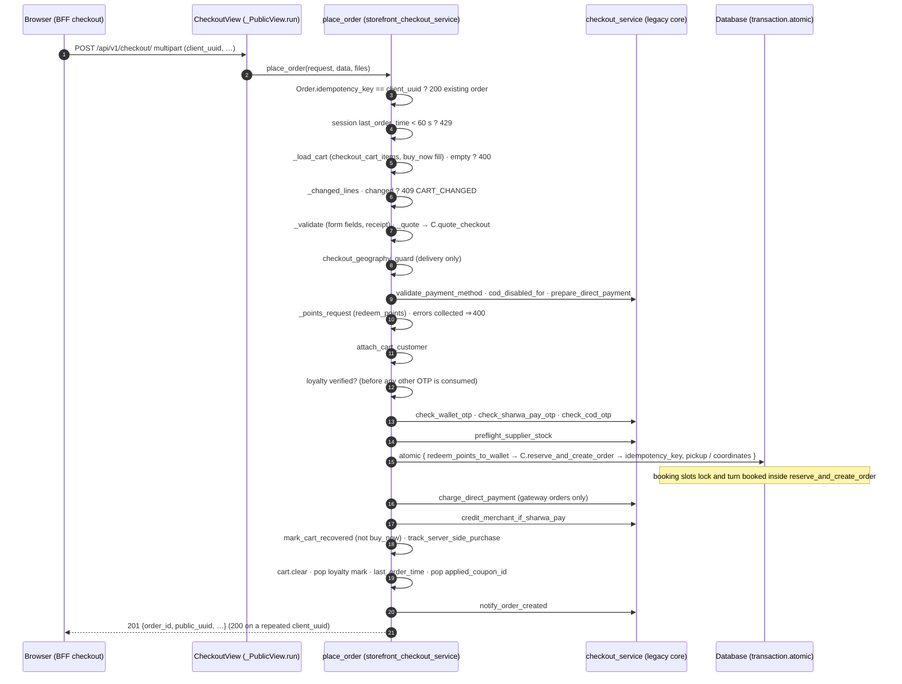

# Checkout API — M12 (الدفع)

> **Source**: DOC-103 → DOC-106 (step 12) and DOC-107 → DOC-111 (step 13) · INT-014 (M12), INT-017, INT-020, INT-028, INT-036, INT-045, INT-048 · inventory Domain 5
> **Live key**: *Django-first, no switch* — `storefrontAdapter` BFF rows `checkout`, `checkout/quote`, `checkout/delivery-options`, `checkout/payment-options`, `checkout/cod-otp/*`, `checkout/sharwa-pay/otp/send`, `orders/public/<uuid>` and its `receipt` ([`../../overview/bff.md#django-first`](../../overview/bff.md#django-first))
> **Django provider**: `sharwa_saas/products/services/storefront_checkout_service.py` (JSON layer) over the legacy core `products/services/checkout_service.py` and the pricing engine `products/pricing.py::build_order_invoice` · views `api/views_checkout.py` (`_PublicView.run`) · errors `products/services/product_api_errors.py` (`ProductApiError(status, body)`) · wired in `api/urls.py` (names `checkout`, `checkout-quote`, `checkout-delivery-options`, `checkout-payment-options`, `checkout-cod-otp-send`, `checkout-cod-otp-verify`, `checkout-sharwa-pay-otp-send`, `orders-public`, `orders-public-receipt`)
> **Frontend contract**: `sharwa-frontend/src/features/checkout/schemas.ts` (`DeliveryOptionsSchema`, `PaymentOptionsSchema`, `InvoiceSchema`, `CheckoutResultSchema`, `checkoutDraftSchema`) · hooks `src/features/checkout/api.ts` · BFF rows `src/app/api/bff/checkout/{route.ts,quote,delivery-options,payment-options}` · fixtures `src/mocks/storefront/checkout.ts`
> **Tests**: `sharwa_saas/api/test_storefront_checkout_api.py` (10 tests) — step 12 used `test_delivery_and_payment_options`, `test_quote_delivery_pickup_and_errors`; step 13 adds `test_cod_otp_and_place_order`, `test_cod_requires_verified_phone`, `test_cod_refused_when_upfront_required`, `test_transfer_needs_receipt_then_attach_later`, `test_receipt_refused_for_cod_and_paid_orders`, `test_changed_cart_conflict`, `test_buy_now_is_isolated`, `test_pickup_order_links_location`
> **Last verified against code**: 2026-10-27 (steps 12 and 13)

## 1. Overview

Checkout for the storefront is a **JSON layer over the HTML checkout core**. Before INT-014 the only checkout was the server-rendered screen `products/views/cart_checkout.py::checkout`, built on `products/services/checkout_service.py`. INT-014 added `products/services/storefront_checkout_service.py` and `api/views_checkout.py` for the Next.js storefront. **No second pricing engine and no second reservation logic exist**: the JSON layer calls the same `quote_checkout`, `validate_payment_method`, `prepare_direct_payment`, `check_*_otp`, `preflight_supplier_stock`, `reserve_and_create_order`, `charge_direct_payment`, `credit_merchant_if_sharwa_pay` and `notify_order_created` the legacy screen calls. The legacy screens are untouched.

All checkout routes are **public and session-bound**: `permission_classes = [HasTenantContext]`, `authentication_classes = []`. The buyer is the anonymous Django session on the store host (cart, applied coupon, OTP keys, booking holds, the isolated buy-now cart). Amounts are `display_*` strings only (see [`../../overview/money.md`](../../overview/money.md)).

| Method | Django path (`/api/v1/…`) | BFF path (`/api/bff/…`) | Section |
|---|---|---|---|
| `GET` | `checkout/delivery-options/` | `checkout/delivery-options` | [§3](#delivery-options) |
| `GET` | `checkout/payment-options/` | `checkout/payment-options` | [§4](#payment-options) |
| `POST` | `checkout/quote/` | `checkout/quote` | [§5](#quote) |
| `POST` | `checkout/` (multipart) | `checkout` | [§8](#place-order) |
| `POST` | `checkout/cod-otp/send/` · `…/verify/` | `checkout/cod-otp/send` · `…/verify` | [§6](#cod-otp) |
| `POST` | `checkout/sharwa-pay/otp/send/` | `checkout/sharwa-pay/otp/send` | [§7](#sharwa-pay-otp) |
| `GET` · `POST` | `orders/public/<uuid>/` · `orders/<uuid>/receipt/` | `orders/public/<uuid>` · `orders/public/<uuid>/receipt` | [§10](#success-and-late-receipt) |

All `ProductApiError` raised by the service become the response (`Response(exc.body, status=exc.status)`); error bodies are either `{"detail": "…"}` or a DRF-style `{"<field>": ["…"]}` map.

### 1.1 Which cart is checked out <a id="which-cart"></a>

Every checkout route reads the cart through `_load_cart` → `products/views/cart_checkout.py::checkout_cart_items`, which merges the product lines with the live booking holds (INT-036). The body field `checkout_mode` chooses the source:

- empty (default): the session cart `Cart(request)`;
- `buy_now`: the **isolated** `buy_now_cart`. For `quote` and `checkout` the service first rebuilds that cart from the body (`product_id`, `variant_id`, `quantity`, `size`, `color`, or `start_datetime` for a bookable service); the ordinary cart is not touched (`test_buy_now_is_isolated`: a 500 ر.س buy-now quote while the cart still holds 1 line). `delivery-options` and `payment-options` read the buy-now cart as it already is (`fill=False`); for payment options the mode comes from the **query** parameter `?checkout_mode=buy_now`.

Buy-now errors (`_fill_buy_now`): `400` `{"detail": "لا يمكن إتمام طلب بسلة فارغة."}` when `product_id` is not digits; `409` `{"detail": "تغيّرت سلتك أثناء الإكمال — راجع المنتجات قبل التأكيد.", "changed": ["منتج"]}` when the product is not visible; `400` `{"detail": "المتغيّر المحدد لا يخص هذا المنتج."}` / `{"detail": "اختر المقاس واللون أولاً."}` for variant problems; `400` `{"start_datetime": ["اختر موعداً للخدمة من صفحة المنتج."]}` for a bookable service without a slot or with bookings off.

## 2. Pipeline <a id="pipeline"></a>

This is the order in which `storefront_checkout_service.place_order` runs. `quote`, `delivery_options` and `payment_options` run only the first stages (load cart → `quote_checkout`).



| # | Step | Function (file) | Outcome on failure |
|---|---|---|---|
| 1 | Idempotency lookup | `Order.objects.filter(idempotency_key=client_uuid, sales_channel='online')` | `400` `{"detail": "طلب غير مكتمل، أعد تحميل الصفحة."}` for a missing / invalid `client_uuid`; an existing order is returned with **`200`** |
| 2 | Double-submit guard | `session['last_order_time']` less than 60 s ago | `429` `{"detail": "لقد أرسلت طلباً قبل قليل. يرجى الانتظار دقيقة قبل إرسال طلب جديد."}` |
| 3 | Load the cart | `_load_cart` | `400` `{"detail": "لا يمكن إتمام طلب بسلة فارغة."}` |
| 4 | Changed lines | `_changed_lines` | `409` `{"detail": "تغيّرت سلتك أثناء الإكمال — راجع المنتجات قبل التأكيد.", "changed": [names]}` — hidden product or stock below the quantity (backorder and bookable services skipped), before any reservation |
| 5 | Field validation | `_validate` | `400` field map (runs **before** any OTP so an incomplete order does not burn a code) |
| 6 | Quote | `_quote` → `checkout_service.quote_checkout` → `build_order_invoice` | `400` `delivery_method_id` / `pickup_location_id` |
| 7 | Geography guard | `zone_routing_service.checkout_geography_guard` | `400` `{"address": [message]}` (delivery only, not pickup) |
| 8 | Payment method | `validate_payment_method`, `cod_disabled_for`, `prepare_direct_payment` | `400` `{"payment_method": [message]}` |
| 9 | Loyalty points | `_points_request` | `400` `{"redeem_points": [message]}` (the [§5](#quote) messages) |
| 10 | Remember the buyer | `abandoned_carts.attach_cart_customer` | — |
| 11 | Loyalty ownership | `_loyalty_verified` | `400` `{"redeem_points": ["أكّد استبدال النقاط برمز واتساب أولاً."]}` — placed **before** the wallet / Sharwa Pay / COD OTP checks, so a failing points confirmation does not consume another code (INT-028) |
| 12 | OTP guards | `check_wallet_otp` (`use_wallet`), `check_sharwa_pay_otp` (`sharwa_pay`), `check_cod_otp` (`cod`) | `400` `{"wallet_otp" \| "sharwa_pay_otp" \| "otp": [message]}` |
| 13 | Supplier stock | `preflight_supplier_stock` | rejects before a transaction is opened |
| 14 | Reserve | `transaction.atomic`: `redeem_points_to_wallet` (if points), `reserve_and_create_order`, then `Order.idempotency_key`, `pickup_location` or coordinates are written | `IntegrityError` ⇒ `200` with the order that won the race (unique key); `CheckoutRejected` ⇒ `400` `{"payment_method": [message]}`; `ValueError` ⇒ `400` `{"detail": message}` |
| 15 | Charge | `charge_direct_payment` (gateway orders only) | a clean failure cancels the order, releases the stock **and frees the idempotency key** (set to a fresh UUID) ⇒ `400` `{"payment_method": [message]}`; an unresolved result keeps the order in `payment_review` and continues |
| 16 | Merchant credit | `credit_merchant_if_sharwa_pay` | — |
| 17 | Abandoned cart | `mark_cart_recovered` (skipped in buy-now mode) | — |
| 18 | Server tracking | `tracking.track_server_side_purchase` | — |
| 19 | Clean-up | `cart.clear()`, `loyalty_redeem_verified` popped, `last_order_time` set, `applied_coupon_id` popped | — |
| 20 | Notify | `notify_order_created` | — |

Booking holds (INT-036) turn from *held* to `booked` **inside** `reserve_and_create_order` (the slots are locked with `select_for_update` and set `booked` there), so the order and the booking succeed or fail together. The reservation also receives only the slots of the lines actually checked out (`booking_slot_ids` from the cart or buy-now items), never the whole session list.

`payment_method` values: the storefront sends `manual`, `cod`, `sharwa_pay` or a gateway code; `cod` and `manual` are both stored by Django as `manual` — the full mapping is in [§9](#payment-mapping).

> ⚠️ Discrepancy — roadmap says the order is `quote_checkout → validate_payment_method → prepare_direct_payment → wallet / Sharwa Pay / COD OTP guards → preflight_supplier_stock → reserve_and_create_order → charge_direct_payment → merchant credit → abandoned-cart recovery → server tracking → notify_order_created` / code does: the same relative order, with four additional steps the roadmap list leaves out — the idempotency lookup and the 60-second guard before the cart is loaded, `_changed_lines` (409), `_validate`, the geography guard and `_points_request` before the OTP guards, `attach_cart_customer` immediately before the loyalty ownership check, and `cart.clear()` plus the session clean-up between server tracking and `notify_order_created`. This page follows the code. Reported in step 12.

## 3. Delivery options <a id="delivery-options"></a>

### `GET /api/v1/checkout/delivery-options/`

No query parameters and no body. The cart (session cart, or the buy-now cart if present) is only used to decide the free-shipping flag.

**Response `200`**

```json
{
  "delivery_methods": [
    {
      "id": 3,
      "name": "مندوب المتجر",
      "display_price": "10 ر.س",
      "estimated_time": "1-2 أيام",
      "is_sharwa_official": false
    }
  ],
  "pickup_locations": [
    { "id": 2, "name": "الفرع الرئيسي", "address": "شارع حدة", "phone": null }
  ],
  "display_default_delivery_fee": "10 ر.س",
  "free_shipping_applies": false
}
```

The values are fixtures; the shape and the «10 ر.س» price follow `test_delivery_and_payment_options` (a method stored as `5200` YER_NEW, pickup address «شارع حدة»).

| Field | Type | Meaning |
|---|---|---|
| `delivery_methods[]` | array | active delivery methods ordered by `sort_order, id` |
| `delivery_methods[].id` | integer | the value the buyer sends back as `delivery_method_id` |
| `delivery_methods[].name` | string | |
| `delivery_methods[].display_price` | string | the method's `price` — stored in **YER_NEW** — converted into the cart currency with `convert_amount(…, 'YER_NEW', currency, store_setting)` and formatted |
| `delivery_methods[].estimated_time` | string \| null | empty text becomes `null` |
| `delivery_methods[].is_sharwa_official` | boolean | the Sharwa Ship carrier |
| `pickup_locations[]` | array | **active** pickup points ordered by `sort_order, id`: `{id, name, address, phone}`; `address` is `""` when empty, `phone` is `null` when empty |
| `display_default_delivery_fee` | string | `StoreSetting.default_delivery_fee` (YER_NEW) converted and formatted — the fee used when no method applies |
| `free_shipping_applies` | boolean | `true` only if the cart is not empty **and** `invoice.has_free_shipping` (free-shipping threshold reached, a product with free shipping, or a free-shipping offer) |

**Visibility rules** (`checkout_service.quote_checkout`)

- Only `DeliveryMethod.is_active = True` rows are returned.
- **Sharwa Ship is hidden** when the `sharwa_ship` plan feature exists and is not enabled for the tenant: the queryset excludes `is_sharwa_official = True` once, and the same filtered queryset feeds the list, the default selection and the POST validation, so a hidden carrier cannot be selected by sending its id by hand.
- If the `sharwa_ship` feature row does not exist, nothing is hidden.

The route is public; an empty cart still returns the lists (`free_shipping_applies` is then `false`).

## 4. Payment options <a id="payment-options"></a>

### `GET /api/v1/checkout/payment-options/`

**Query parameters**

| Name | Type | Default | Notes |
|---|---|---|---|
| `checkout_mode` | `buy_now` | empty | read the isolated buy-now cart instead of the session cart |

The options are the **store's caps** (`StoreSetting` switches plus the gateways the registry reports as complete) evaluated against the **current upfront rule** of the cart (`invoice.upfront_required`).

**Response `200`**

```json
{
  "methods": [
    { "code": "manual", "label": "تحويل بنكي / محفظة محلية", "enabled": true, "reason": null },
    { "code": "sharwa_pay", "label": "شروة باي", "enabled": true, "reason": null },
    {
      "code": "jeeb",
      "label": "جيب",
      "enabled": false,
      "reason": "هذا الطلب يُدفع عند الاستلام، ولا يتطلب دفعاً مسبقاً.",
      "fields": [
        { "name": "purchase_code", "label": "كود الشراء من تطبيق جيب", "secret": false }
      ]
    },
    { "code": "cod", "label": "الدفع عند الاستلام", "enabled": true, "reason": null }
  ],
  "payout_accounts": [
    {
      "account_type": "bank",
      "provider_name": "بنك الكريمي",
      "account_number": "0000000000",
      "account_name": "متجر تجريبي"
    }
  ]
}
```

(The gateway label is the registry `display_name`; «جيب» here is a fixture. `test_delivery_and_payment_options` pins the codes `['manual', 'cod']` for a store with only the manual switch, `payout_accounts[0].provider_name` «بنك الكريمي», and the `cod` row turning `enabled: false` with a reason containing «مقدماً».)

**Order and conditions** (`payment_options`)

| Order | `code` | Present when | `label` | `enabled` / `reason` | `fields` |
|---|---|---|---|---|---|
| 1 | `manual` | `StoreSetting.enable_manual_payment` | «تحويل بنكي / محفظة محلية» | always `true`, `reason: null` | not sent |
| 2 | `sharwa_pay` | `StoreSetting.enable_sharwa_pay` | «شروة باي» | always `true`, `reason: null` | not sent |
| 3… | each enabled **gateway** from the registry (`get_enabled_gateway_codes()`: gateways whose configuration is complete) | the gateway is enabled for the store | the gateway's `display_name` (the code if the class is missing) | `true` only when the order has an upfront amount (`upfront_required > 0`); otherwise `false` with `reason` «هذا الطلب يُدفع عند الاستلام، ولا يتطلب دفعاً مسبقاً.» | always sent: `[{name, label, secret}]` — one per `required_customer_fields` of the gateway |
| last | `cod` | `manual` is available (cash on delivery is the manual method without a receipt) | «الدفع عند الاستلام» | `true` only when `upfront_required` is zero; otherwise `false` with `reason` «هذا الطلب يتطلب دفع <amount> مقدماً.» (the amount is formatted in the cart currency) | not sent |

**Gateway `fields` descriptor** (`GATEWAY_FIELDS`): the frontend renders one input per entry and posts the value under the same `name` in the checkout body.

| `name` | `label` | `secret` |
|---|---|---|
| `purchase_code` | «كود الشراء من تطبيق جيب» | `false` |
| `pin` | «الرمز السري (PIN)» | `true` |

A field name the table does not know is returned with `label` equal to the name and `secret: false`. These inputs are used for the direct charge and are **not stored**.

**`payout_accounts[]`** — active payout accounts ordered by `sort_order, id`, returned **only if `manual` is available** (they are the transfer instructions); otherwise `[]`. Fields: `account_type` (`bank` or `wallet`; any other stored type is reported as `wallet`), `provider_name`, `account_number`, `account_name`.

> Observation — `PaymentOptionsSchema` (Zod) validates `code` against the closed list `manual`, `sharwa_pay`, `jeeb`, `kuraimi`, `cod`, while Django returns whatever code the gateway registry reports as enabled. A new registry gateway would fail parsing in the browser until the list is extended. Found by comparing `schemas.ts` with `payment_options`; see the open items.

Related: the Sharwa Pay merchant side is Domain 8 ([`../08-finance/m14-payments-wallet.md`](../08-finance/m14-payments-wallet.md), [`../08-finance/m40-sharwa-pay.md`](../08-finance/m40-sharwa-pay.md)); the registry and its credentials belong to the payments rows (INT-020).

## 5. Quote <a id="quote"></a>

### `POST /api/v1/checkout/quote/`

Previews the order invoice. It **does not reserve anything** (no stock, no slot, no wallet debit, no OTP consumed).

**Request body** (JSON; fields are optional unless stated)

| Field | Type | Notes |
|---|---|---|
| `checkout_mode` | `buy_now` | with `buy_now` the isolated cart is rebuilt first from `product_id`, `variant_id`, `quantity`, `size`, `color`, `start_datetime` ([§1.1](#which-cart)) |
| `delivery_method_id` | string / integer | a delivery method id from [§3](#delivery-options). Absent: the first active method |
| `pickup_location_id` | string / integer | an **active** pickup point. When present, `delivery_method_id` is ignored and the delivery fee is forced to zero |
| `phone` | string | the buyer's WhatsApp number (`clean_phone_number` → `967…`/`966…`); needed for `use_wallet` and `redeem_points` |
| `use_wallet` | boolean-like | preview the buyer's store wallet applied to the remainder |
| `redeem_points` | integer string | loyalty points to redeem (INT-028) |

The coupon is **not** in the body: the quote uses `session['applied_coupon_id']`, set by [`cart/coupon/`](m11-cart.md#coupon).

**Response `200`** (`InvoiceSchema`)

```json
{
  "display_subtotal": "100 ر.س",
  "display_discount": null,
  "display_promotion_discount": null,
  "applied_offers": [],
  "coupon_code": null,
  "display_delivery_fee": "10 ر.س",
  "free_shipping_applies": false,
  "display_wallet_amount_used": null,
  "display_loyalty_discount": null,
  "display_total": "110 ر.س",
  "display_deposit_amount": null,
  "display_upfront_required": null,
  "display_amount_on_delivery": null,
  "fully_paid_by_wallet": false,
  "currency": "SAR"
}
```

The numbers follow `test_quote_delivery_pickup_and_errors` (subtotal «100 ر.س», fee «10 ر.س», total «110 ر.س»; with a pickup point the fee is «0 ر.س» and the total «100 ر.س»), which also pins the key set.

| Field | Type | Meaning |
|---|---|---|
| `display_subtotal` | string | sum of the line subtotals |
| `display_discount` | string \| null | coupon discount; `null` when zero |
| `display_promotion_discount` | string \| null | automatic-offer discount; `null` when zero |
| `applied_offers[]` | array | `{name, offer_type, display_discount}`; `display_discount` is always `null` |
| `coupon_code` | string \| null | the applied coupon |
| `display_delivery_fee` | string | the selected method's fee (or the store default), `0` for pickup or free shipping |
| `free_shipping_applies` | boolean | `invoice.has_free_shipping` |
| `display_wallet_amount_used` | string \| null | wallet preview, `null` when zero |
| `display_loyalty_discount` | string \| null | the value of the redeemed points, `null` when zero |
| `display_total` | string | `max(0, invoice.total_price − wallet − loyalty)` — what is still to be paid |
| `display_deposit_amount` | string \| null | sum of the product deposits, `null` when zero |
| `display_upfront_required` | string \| null | amount due now **after** wallet and loyalty; only sent when the order has an upfront part (`invoice.upfront_required > 0`), else `null` |
| `display_amount_on_delivery` | string \| null | amount due at delivery after wallet and loyalty; sent only in the same split case |
| `fully_paid_by_wallet` | boolean | wallet + loyalty are positive and the remainder is zero |
| `currency` | enum | the cart currency |

### 5.1 How it is built

1. `_load_cart`; an empty cart ⇒ `400`.
2. `_pickup` (validates `pickup_location_id`).
3. `_quote`: `checkout_service.quote_checkout(…, coupon_id=session coupon, delivery_method_id=…)` → `build_order_invoice` (offers, coupon, free shipping, delivery fee, total, upfront split — the same engine as the cart). `quote_checkout` falls back **silently** to the first method when the sent id is unknown, so the JSON layer compares the selected method with the requested id and refuses the difference. With a pickup point, the invoice is rebuilt with `delivery_fee_override = 0`.
4. `_points_request` (when `redeem_points` is sent) and `_wallet_split` produce the previews.

**Preview split.** The wallet preview repeats the allocation of `reserve_and_create_order` without locking: **loyalty first** (it is wallet credit created at order time; it covers the upfront amount first, then the amount on delivery), then the optional **store wallet** on what remains (`min(wallet balance converted into the cart currency, remaining due)`, only when `use_wallet` is set, `phone` is known and the wallet is active). Wallet balances are stored in SAR and converted with the store rates.

### 5.2 Errors

| Status | Body | When |
|---|---|---|
| `400` | `{"detail": "لا يمكن إتمام طلب بسلة فارغة."}` | the cart is empty |
| `400` | `{"delivery_method_id": ["طريقة التوصيل لم تعد متاحة، اختر غيرها."]}` | the method id is inactive, hidden (Sharwa Ship without the feature) or unknown. Applies only without a pickup point |
| `400` | `{"pickup_location_id": ["نقطة الاستلام غير متاحة."]}` | the pickup point is inactive, unknown or not numeric |
| `400` | `{"redeem_points": ["عدد النقاط غير صحيح."]}` | `redeem_points` is not digits |
| `400` | `{"redeem_points": ["برنامج الولاء غير مفعّل في هذا المتجر."]}` | the loyalty program is off, or the redemption rate is zero |
| `400` | `{"redeem_points": ["أقل عدد نقاط للاستبدال <n>."]}` | below `min_points_to_redeem` |
| `400` | `{"redeem_points": ["أدخل رقم واتساب أولاً."]}` | no `phone` |
| `400` | `{"redeem_points": ["رصيد النقاط لا يكفي."]}` | no points record, or the balance is below the request |
| `400` | `{"redeem_points": ["محفظة هذا الرقم معطّلة — تواصل مع المتجر."]}` | the number has an inactive wallet |
| `400`/`409` | the buy-now errors of [§1.1](#which-cart) | `checkout_mode = buy_now` |

`redeem_points` of `""` or `"0"` is ignored. Before INT-028 Django answered any `redeem_points` with `400`; now the points are validated and shown as `display_loyalty_discount` (value = `points ÷ points_per_riyal_redemption` in SAR, converted, never above the amount still due). The actual conversion into wallet credit happens only when the order is placed ([§2](#pipeline) step 14), and requires the ownership confirmation of the loyalty rows (Domain 6, [`../06-customers-wallets/m35-wallets-loyalty.md`](../06-customers-wallets/m35-wallets-loyalty.md)).

> Observation — a non-numeric `delivery_method_id` (for example `"abc"`) is not guarded by an `isdigit()` check as `pickup_location_id` is: `quote_checkout` passes it to `delivery_methods_qs.filter(id=method_id)`, and Django raises `ValueError` for a non-integer value. By reading the code this should surface as a `500` rather than the `400` above; it was **not run** in this step. Listed under the open items.

## 6. WhatsApp code for cash on delivery <a id="cod-otp"></a>

Cash on delivery (UI `cod`, [§9](#payment-mapping)) needs the buyer's phone verified by a 6-digit WhatsApp code **before** the order is placed. Two public routes, both in `api/views_checkout.py` and implemented by `send_cod_otp` / `verify_cod_otp` in `storefront_checkout_service.py` — the JSON twins of the legacy HTML views `/checkout/cod-otp/send/` and `/checkout/cod-otp/verify/`, which stay in place and share the same session keys and the same guard (`checkout_service.check_cod_otp`).

| Method | Django path | BFF path |
|---|---|---|
| `POST` | `/api/v1/checkout/cod-otp/send/` | `/api/bff/checkout/cod-otp/send` |
| `POST` | `/api/v1/checkout/cod-otp/verify/` | `/api/bff/checkout/cod-otp/verify` |

### `POST /api/v1/checkout/cod-otp/send/`

**Request** (JSON or form)

| Field | Type | Notes |
|---|---|---|
| `phone` | string, required | normalised by `clean_phone_number`; must match `^(967\|966)\d{9}$` |
| `client_uuid` | UUID string, optional | the device id for the abuse tracker. **The storefront does not send it**: when it is missing or not a UUID the server derives one from the session key (`uuid5(NAMESPACE_URL, "sharwa-session:<session_key>")`, saving the session first if it has no key), so the device limit still holds |

**Response `200`**: `{"ok": true}`. The code is never returned.

**What happens, in order**

1. Phone invalid → `400` `{"phone": ["رقم واتساب غير صحيح."]}`.
2. **Device tracker** (`core.models.OTPRequestTracker`, stored in the **`public` schema**, one row per device id, fields `client_uuid`, `phone_number`, `request_count`, `last_request_time`, `is_blocked`): `get_or_create`; if the last request is older than 600 s the count restarts at 0; `is_blocked` → `429`; `request_count >= 3` → `429`; a new row is stamped with the phone and time, an existing row calls `register_attempt(phone)` (count + 1, time, phone).
3. **Session limit** `rate_limit_attempt(request, "cod_otp_send:<phone>")` (3 attempts per 600 s kept in the session) **or** **phone limit** `phone_cache_rate_limited(request, "cod_otp_send", phone)` (cache key `rl:<schema>:cod_otp_send:<phone>`, 3 per 600 s, deliberately **not** tied to the session so clearing cookies does not reset it) → `429`.
4. A code is drawn with `secrets.randbelow(900000) + 100000` and written to the session: `cod_otp`, `cod_otp_phone`, `cod_otp_created_at` (epoch seconds).
5. The WhatsApp message is sent through `WhatsAppService.send_message`; a falsy result → `502`.

The WhatsApp message (verbatim):

```text
🔐 *تأكيد الطلب (الدفع عند الاستلام)*

رمز التحقق الخاص بك:
*{code}*

لا تشارك هذا الرمز مع أحد. صالح لمدة 10 دقائق.
```

**Errors**

| Status | Body | When |
|---|---|---|
| `400` | `{"phone": ["رقم واتساب غير صحيح."]}` | missing or invalid phone |
| `429` | `{"detail": "تم حظر جهازك مؤقتاً بسبب طلبات متكررة. يرجى المحاولة لاحقاً."}` | tracker row has `is_blocked = true` |
| `429` | `{"detail": "تم تجاوز عدد محاولات إرسال الرمز (3 محاولات). يرجى المحاولة بعد قليل."}` | the device already made 3 requests in the last 600 s |
| `429` | `{"detail": "تم تجاوز عدد محاولات إرسال الرمز. يرجى المحاولة بعد قليل."}` | the session limit or the phone limit |
| `502` | `{"detail": "تعذّر إرسال رمز التحقق عبر واتساب. يرجى المحاولة مرة أخرى."}` | WhatsApp send failed |

A failed WhatsApp send still counts against the limits and leaves the code in the session (the limits are consumed before the send).

### `POST /api/v1/checkout/cod-otp/verify/`

**Request**: `{"phone": "967700000001", "otp": "123456"}`.

**Response `200`**

```json
{ "ok": true, "cod_allowed": true, "reason": null }
```

or, for a number the store has barred from cash on delivery:

```json
{ "ok": true, "cod_allowed": false, "reason": "التوصيل بالدفع عند الاستلام غير متاح لهذا الرقم — اختر طريقة أخرى." }
```

| Field | Meaning |
|---|---|
| `ok` | always `true` on a `200` |
| `cod_allowed` | `false` only when `customer_service.cod_disabled_for(phone)` is true — the store disabled COD for this phone, by hand in the customer file or automatically after repeated refusals (`CustomerReliabilityRecord.cod_disabled`, INT-017 / FR-07.10). Otherwise **always `true`**: the platform-wide `CentralCustomerTrust` is a merchant-side signal and is **not** consulted here (open item A.13) |
| `reason` | the sentence above when `cod_allowed` is `false`, else `null` |

**Check order**: phone format → rate limits (`rate_limit_attempt` on `cod_otp_verify:<phone>` and the phone cache limit `cod_otp_verify`, 3 per 600 s each — **every verify call consumes an attempt, even a call that fails the checks below**) → a code must exist for this phone → not older than `COD_OTP_TTL_SECONDS` (600 s) → equals the submitted `otp`.

| Status | Body | When |
|---|---|---|
| `400` | `{"phone": ["رقم واتساب غير صحيح."]}` | invalid phone |
| `429` | `{"detail": "تم تجاوز عدد محاولات التحقق. يرجى المحاولة بعد قليل."}` | session or phone limit |
| `400` | `{"detail": "يرجى إرسال رمز التحقق عبر واتساب أولاً."}` | no code in the session, or it was sent to another phone |
| `400` | `{"detail": "انتهت صلاحية رمز التحقق. يرجى إعادة إرساله."}` | older than 10 minutes (the code is cleared) |
| `400` | `{"detail": "رمز التحقق غير صحيح."}` | wrong code (the code stays valid until the limit is hit) |

**On success** the phone counter `cod_otp_verify` is reset, the code keys (`cod_otp`, `cod_otp_phone`, `cod_otp_created_at`) are removed, and — only when COD is allowed — `cod_otp_verified_phone = <phone>` is written to the session. That flag is **consumed once** by `check_cod_otp` inside [`POST checkout/`](#place-order) and must equal the order's phone.

### Limits at a glance

| Layer | Scope | Limit | Survives clearing cookies? |
|---|---|---|---|
| `OTPRequestTracker` (send only) | device id (`client_uuid`, or derived from the session) | 3 per 600 s; `is_blocked` | yes if the client reuses `client_uuid`; **no** when the id is derived from the session |
| `rate_limit_attempt` | session + phone (key inside the session bucket `otp_rate_limit`) | 3 per 600 s, send and verify separately | no |
| `phone_cache_rate_limited` | phone only, per tenant schema | 3 per 600 s, send and verify separately | yes |

**CGNAT stance**: there is **no per-IP limit** on these rows. Mobile carriers put many subscribers behind one address, so an IP limit would block honest buyers; abuse is bounded by device and by phone instead.

Frontend: `OtpVerifyDialog` (purpose `cod`) calls send when it opens, shows a 60-second resend countdown, and turns `429` into «حاول بعد قليل.»; on verify it reads `cod_allowed` and, when `false`, shows `reason`. The verified code is also posted as the field `otp` of the order ([§8](#place-order)), so the server can re-verify it if the session flag is missing.

> ⚠️ Discrepancy — comment in the BFF row `src/app/api/bff/checkout/cod-otp/verify/route.ts` says `cod_allowed` «is always true there: COD trust is a merchant-side signal» / code does: `verify_cod_otp` returns `cod_allowed: false` with the `reason` above for a store-disabled phone (INT-017). The roadmap (DOC-107) and the code agree; only the comment is stale. The mock path `codCheck(res.phone)` is the one the comment describes.

Tests: `test_cod_otp_and_place_order` (invalid phone, verify without a code → `400`, the `{ok, cod_allowed: true, reason: null}` answer), `test_cod_requires_verified_phone`.

## 7. Sharwa Pay code <a id="sharwa-pay-otp"></a>

### `POST /api/v1/checkout/sharwa-pay/otp/send/`

Sends the WhatsApp code that authorises paying the order from the buyer's **Sharwa Pay wallet** (`sharwapay.models.SharwaPayWallet`, one per `customer_phone`) and tells the screen the balance to show. BFF path `/api/bff/checkout/sharwa-pay/otp/send` (used by `OtpVerifyDialog`, purpose `sharwa_pay`; the BFF route file itself could not be read in this step — see [§11](#open-items)).

**Request**: `{"phone": "967700000001"}`

**Response `200`**

```json
{ "ok": true, "display_balance": "250 ر.س" }
```

`display_balance` is the wallet balance in the **session currency** (`session["user_currency"]`, default `SAR`), read from the wallet field `wallet_balance_field(currency)` and formatted by `format_money`.

**Order of checks**: phone format → an active wallet with a **positive** balance in that currency → rate limits → send.

| Status | Body | When |
|---|---|---|
| `400` | `{"phone": ["رقم واتساب غير صحيح."]}` | invalid phone |
| `400` | `{"detail": "لا يوجد رصيد شروة باي متاح لهذا الرقم."}` | no active wallet, or balance ≤ 0 in the session currency |
| `429` | `{"detail": "تم تجاوز عدد محاولات إرسال الرمز. يرجى المحاولة بعد قليل."}` | `rate_limit_attempt("sharwa_pay_otp_send:<phone>")` or `phone_cache_rate_limited("sharwa_pay_otp_send", phone)`, 3 per 600 s each |
| `502` | `{"detail": "تعذّر إرسال رمز التحقق. يرجى المحاولة مرة أخرى."}` | WhatsApp send failed |

The code is drawn like the COD one and kept in the session as `sharwa_pay_otp`, `sharwa_pay_otp_phone`, `sharwa_pay_otp_created_at`; it lives `SHARWA_PAY_OTP_TTL_SECONDS` (600 s). Message (verbatim):

```text
🔐 *الدفع بشروة باي*

رمز التحقق للدفع من رصيد محفظتك:
*{code}*

لا تشارك هذا الرمز مع أحد. صالح لمدة 10 دقائق.
```

Unlike COD there is **no verify route and no device tracker**: the buyer types the code into the checkout form and the server verifies it **inside** [`POST checkout/`](#place-order) (`checkout_service.check_sharwa_pay_otp`, field `sharwa_pay_otp`, only when `payment_method = sharwa_pay`). Messages returned there, under the key `sharwa_pay_otp`:

| Message | When |
|---|---|
| «يرجى إرسال رمز التحقق عبر واتساب أولاً للدفع بشروة باي.» | no code, or sent to another phone |
| «انتهت صلاحية رمز التحقق. يرجى إعادة إرساله.» | older than 600 s (keys cleared) |
| «تم تجاوز عدد محاولات التحقق من شروة باي. يرجى المحاولة بعد قليل.» | verify limit `sharwa_pay_otp_verify`, 3 per 600 s (session + phone) |
| «رمز التحقق من شروة باي غير صحيح.» | wrong code |

A correct code resets the verify counter and removes the three session keys, so it works once.

**Relation to INT-048.** This route belongs to the **buyer's checkout** (INT-014): the visitor is an anonymous session and the endpoint only authorises a debit that `reserve_and_create_order` performs in the order transaction (and `credit_merchant_if_sharwa_pay` credits the merchant afterwards). The platform-origin Sharwa Pay customer API (wallet top-up, balance, statements — INT-048) is a different surface with its own authentication and is documented in Domain 8 ([`../08-finance/m40-sharwa-pay.md`](../08-finance/m40-sharwa-pay.md)); neither covers the other.

Tests: no test in `test_storefront_checkout_api.py` calls this route (the file has 10 tests: delivery/payment options, quote, COD, transfer and receipt, cart-changed, buy-now, pickup). The behaviour above is read from the code only.

## 8. Place the order <a id="place-order"></a>

### `POST /api/v1/checkout/` (multipart)

Creates the order from the buyer's cart. BFF path `POST /api/bff/checkout` (`storefrontAdapter`, `invalidatesStore: true`). The stage-by-stage pipeline, the failure of each stage and the Mermaid diagram are in [§2](#pipeline); this section is the contract.

**Body** — `multipart/form-data` (the storefront builds a `FormData`; a receipt needs multipart). The `Idempotency-Key` request header the browser also sends (`idempotencyKey` option of `apiFetch`) carries the same value and is **not read by Django**; only the body field counts.

| Field | Type | Required | Notes |
|---|---|---|---|
| `client_uuid` | UUID | **yes** | one per cart, kept by the storefront in `sessionStorage` until the order succeeds. Missing or invalid → `400` «طلب غير مكتمل، أعد تحميل الصفحة.» |
| `checkout_mode` | `cart` \| `buy_now` | no | anything other than `buy_now` is the session cart ([§1.1](#which-cart)) |
| `product_id`, `variant_id`, `size`, `color`, `quantity`, `start_datetime` | strings | buy-now only | rebuild the isolated cart |
| `name` | string | yes | stored cut to 150 characters |
| `phone` | string | yes | `^(967\|966)\d{9}$` after `clean_phone_number` |
| `email` | string | no | `^\S+@\S+\.\S+$` when present |
| `address` | string | delivery | required unless a pickup point is sent |
| `latitude`, `longitude` | decimal strings | no | stored as `Order.delivery_latitude/longitude` (7 decimals) only for a valid pair (`|lat| ≤ 90`, `|lng| ≤ 180`) and only for **delivery** orders; also fed to the geography guard |
| `delivery_method_id` | integer | no | first active method when absent ([§5](#quote)) |
| `pickup_location_id` | integer | no | active pickup point; ignores `delivery_method_id`, zero delivery fee, address stored as «استلام من الفرع: <name>» and `Order.pickup_location` set |
| `payment_method` | string | **yes** | `manual`, `cod`, `sharwa_pay` or a registry gateway code; anything else → «اختر طريقة دفع.» ([§9](#payment-mapping)) |
| `receipt_image` | file | `manual` | JPEG/PNG ≤ 5 MB |
| `transfer_amount_reported` | decimal string | `manual` | `^\d+(\.\d{1,2})?$` |
| `otp` | string | `cod` | the COD code, if the session flag is missing ([§6](#cod-otp)) |
| `wallet_otp` | string | `use_wallet` | store wallet code (Domain 6) |
| `sharwa_pay_otp` | string | `sharwa_pay` | [§7](#sharwa-pay-otp) |
| `use_wallet` | boolean-like | no | `1`, `true`, `on`, `yes` |
| `redeem_points` | integer string | no | loyalty points ([§5.2](#quote)) |
| `is_gift`, `recipient_name`, `recipient_phone`, `gift_message` | | gift | needs the store's gift setting on; message ≤ 300 characters (the storefront stops at 200) |
| gateway fields (`purchase_code`, `pin`, …) | strings | direct gateways | the names announced by `payment-options.methods[].fields` ([§4](#payment-options)); used for the charge and **not stored** |

**Response `201`** (new order) or **`200`** (the same `client_uuid` already produced an order):

```json
{
  "order_id": 1042,
  "public_uuid": "3f0c9a52-6d5e-4b8e-9d51-0d2f4a7a1c10",
  "status": "new",
  "payment_status": "unpaid",
  "display_total": "200 ر.س",
  "next_action": { "type": "none" }
}
```

| Field | Meaning |
|---|---|
| `order_id` | database id (also the order number shown to the buyer) |
| `public_uuid` | public identifier used by the success page, tracking and the late receipt |
| `status`, `payment_status` | raw values (`new`, `awaiting_payment`, `payment_review`, `pending_payment` …); the Arabic labels come from [§10](#success-and-late-receipt) |
| `display_total` | the order total in the order currency |
| `next_action.type` | `show_transfer_instructions` when the order is a transfer (`public_method = manual`) **and** `status = awaiting_payment`, else `none` |

`placed_view` never returns `redirect_gateway`, although the frontend schema (`CheckoutResultSchema.next_action.type`) allows it with an optional `url`: gateways here are charged directly with the buyer's code ([§9](#payment-mapping)).

**Statuses**

| Status | Body | When |
|---|---|---|
| `201` | placed order | new order |
| `200` | placed order | the `client_uuid` already exists as an **online** order — the first order is returned, nothing is created again |
| `400` | `{"detail": "طلب غير مكتمل، أعد تحميل الصفحة."}` | missing / invalid `client_uuid` |
| `400` | `{"detail": "لا يمكن إتمام طلب بسلة فارغة."}` | empty cart (or bad buy-now product id) |
| `400` | `{"<field>": ["…"]}` | field errors (below), collected **together** in one map |
| `400` | `{"detail": "<message>"}` | a `ValueError` raised during reservation (for example a booking slot that is no longer available) |
| `409` | `{"detail": "تغيّرت سلتك أثناء الإكمال — راجع المنتجات قبل التأكيد.", "changed": ["<product>"]}` | a line is hidden or its stock fell below the quantity; in buy-now also a booking slot taken by someone else (`booking_service.hold` answering `409`, `changed` = the service name) |
| `429` | `{"detail": "لقد أرسلت طلباً قبل قليل. يرجى الانتظار دقيقة قبل إرسال طلب جديد."}` | `session["last_order_time"]` is less than 60 s old |

**Field errors** (`400`, map of arrays) — all produced **before any OTP is read or consumed**, so an incomplete form never burns a code:

| Key | Messages |
|---|---|
| `name` | «أدخل اسمك.» |
| `phone` | «رقم واتساب غير صحيح.» |
| `email` | «بريد إلكتروني غير صحيح.» |
| `address` | «أدخل عنوان التوصيل.» (gift orders: «أدخل عنوان المستلم.»), or the geography-guard message |
| `pickup_location_id` | «نقطة الاستلام غير متاحة.» |
| `delivery_method_id` | «طريقة التوصيل لم تعد متاحة، اختر غيرها.» |
| `payment_method` | «اختر طريقة دفع.», the COD refusal, the upfront-required message, the gateway-preparation message, or a `CheckoutRejected` message from the reservation |
| `receipt_image` | «أرفق صورة إشعار التحويل.» · «صيغة الملف غير مدعومة. يُسمح فقط بصور JPEG أو PNG.» · «حجم الملف كبير جداً. الحد الأقصى المسموح به 5MB.» |
| `transfer_amount_reported` | «أدخل المبلغ الذي حوّلته.» · «أدخل المبلغ المحوَّل بالأرقام (مثال: 250.00).» |
| `is_gift` | «خيار الهدية غير متاح في هذا المتجر.» |
| `recipient_name` | «أدخل اسم المستلم.» |
| `recipient_phone` | «رقم المستلم غير صحيح.» |
| `gift_message` | «رسالة الهدية 300 حرف كحد أقصى.» |
| `redeem_points` | the messages of [§5.2](#quote) |

**Errors found after the field stage**, each under its own key (one at a time, in this order):

| Key | Message | Where |
|---|---|---|
| `redeem_points` | «أكّد استبدال النقاط برمز واتساب أولاً.» | loyalty ownership not confirmed — checked **first**, before the wallet / Sharwa Pay / COD codes, so a failing points confirmation does not consume another code |
| `wallet_otp` | from `check_wallet_otp` (Domain 6) | `use_wallet` set |
| `sharwa_pay_otp` | the four messages of [§7](#sharwa-pay-otp) | `payment_method = sharwa_pay` |
| `otp` | «يرجى إدخال رمز التحقق المرسل عبر واتساب لتأكيد الطلب عند الاستلام.» (and the verify messages of [§6](#cod-otp), `429` stays `429`) | `payment_method = cod` and `cod_otp_verified_phone` ≠ the order phone |

COD refusals under `payment_method`: «التوصيل بالدفع عند الاستلام غير متاح لهذا الرقم — اختر طريقة أخرى.» (store-disabled phone, INT-017) and «هذا الطلب يتطلب دفع <amount> مقدماً — اختر التحويل أو الدفع الإلكتروني.» (`upfront_required > 0`, amount in the cart currency).

### 8.1 Idempotency <a id="idempotency"></a>

- The key is the body field `client_uuid`, written to `Order.idempotency_key` (a **unique** `UUIDField`, default `uuid4`) in the same `transaction.atomic()` block as `reserve_and_create_order`.
- Lookup first: an existing **online** order with that key is returned with `200` and nothing else runs (no cart load, no 60 s guard).
- Race: two concurrent submissions both pass the lookup; the second `UPDATE` violates the unique constraint → `IntegrityError` → the transaction rolls back (stock, wallet, coupon, booking all undone) and the order that won is returned with `200`.
- A **clean gateway failure** cancels the order, frees the stock and replaces the key with a fresh UUID, so the buyer can retry with the **same** `client_uuid`. An unresolved gateway result keeps the order in `payment_review` (money may have been taken) and the request continues with `201`.
- The 60-second guard only applies to a **different** `client_uuid`; `test_cod_otp_and_place_order` pins repeat → `200` with the same `order_id`, new id within a minute → `429`.

### 8.2 What the order transaction does

1. **Booking holds** (INT-036): only the slots of the lines being checked out (`booking_slot_ids`) are locked and turned `booked` inside `reserve_and_create_order`; buy-now uses the isolated list `buy_now_bookings`.
2. **Loyalty** (INT-028): `redeem_points_to_wallet(phone, points)` runs **inside** the order transaction and converts points into store-wallet credit, so a failed order restores the points. The wallet debit is then capped to that credit (`OrderDraft.wallet_cap_sar = redeemed_sar`) unless the buyer also chose «use wallet» (`wallet_cap_sar = None`): an existing balance is never spent without consent. The last unlinked `redeem` points transaction and its wallet transaction are linked to the order.
3. **Personalization** (INT-045): the values the buyer filled on a personalizable product (held in the cart line and priced by `personalization_extra`) are copied to `OrderItem.personalization` (JSON, migration `0236`) when the lines are created.
4. **Commissions**, in the same transaction: `create_influencer_sale(order)` (the influencer is identified through the applied coupon, stored in `Order.coupon_code`) and `create_affiliate_sale(order, aff_code)` where `aff_code` is the `sharwa_aff` **cookie** (INT-034). A failure of either aborts the whole order — no stock, wallet debit or commission is left behind.
5. **Points earned** by the order: `award_points_for_order(order)`.
6. **Attribution**: the draft carries `traffic_source`, `device_type` and the UTM fields from the session.
7. After the transaction: direct charge for gateway orders, merchant credit for Sharwa Pay, abandoned-cart recovery (skipped in buy-now), server-side purchase tracking, cart clear, `loyalty_redeem_verified` and `applied_coupon_id` removed, `last_order_time` set, an order-timeline event «أرفق العميل إيصال التحويل مع الطلب.» when a receipt came with the order, and `notify_order_created`.

Tests: `test_cod_otp_and_place_order` (201, stock `3`, cart emptied, repeat `200`, `429`), `test_cod_requires_verified_phone` (fields before OTP), `test_cod_refused_when_upfront_required`, `test_changed_cart_conflict` (`changed` = `{قلم, دفتر}`), `test_buy_now_is_isolated`, `test_pickup_order_links_location` (fee `0.00`, no delivery method).

> ⚠️ Discrepancy — roadmap says the idempotency key is stored «inside the reservation transaction» / code does: it is written by an `UPDATE` in the **same `transaction.atomic()` block, right after** `reserve_and_create_order` returns (the order is first created with the model default key). The effect described by the roadmap (concurrent double click returns the first order) is real, through the `IntegrityError` branch.

## 9. Payment-method mapping (UI ⇄ Django) <a id="payment-mapping"></a>

The buyer chooses among the options of [§4](#payment-options). The browser's value (`payment_method`) and the value stored by Django differ for two of them.

| UI `payment_method` | Sent to `quote_checkout` / `validate_payment_method` | Stored `Order.payment_method` | What it means | Extra requirements | Reported back as (`public_method`) |
|---|---|---|---|---|---|
| `cod` | `manual` | `manual` | cash on delivery — a manual order **without** receipt | allowed only when nothing is due upfront (`upfront_required = 0`) and the phone is not COD-disabled; **behind the WhatsApp code** ([§6](#cod-otp)) | `cod` while the order has no `receipt_image` and no `reported_transfer_amount` |
| `manual` | `manual` | `manual` | bank / wallet transfer **with proof** | `receipt_image` **and** `transfer_amount_reported`, both required; **no OTP** — the receipt takes the OTP's place | `manual` once a receipt or an amount exists |
| `sharwa_pay` | `sharwa_pay` | `sharwa_pay` | pay from the Sharwa Pay wallet | `sharwa_pay_otp` ([§7](#sharwa-pay-otp)) | `sharwa_pay` |
| gateway code (`jeeb`, `kuraimi`, …) | the code | the code | **direct charge** with the buyer's code — no redirect, `next_action` stays `none` | the gateway's `fields`, and an upfront amount (`enabled` only then) | the code |

Rules read from the code:

1. `core_method = 'manual' if method in ('manual', 'cod') else method`. Django never stores `cod`.
2. A transfer without proof is not a separate state: `_validate` refuses `manual` without receipt or amount, so a stored `manual` order that has neither is a COD order. `public_method` makes that reading explicit and is what the success page and `orders/public` show.
3. `placed_view` answers `show_transfer_instructions` only for `public_method = manual` **and** `status = awaiting_payment`.
4. Receipt files: `forms.validate_receipt_image` accepts the content types `image/jpeg` and `image/png` only, up to 5 MB. The storefront aligns with it: the file input uses `accept=".jpg,.jpeg,.png"` (`checkout-screen.tsx`, `order-success.tsx`), the BFF route `checkout` rejects (in mock mode) anything that is not `.jpg/.jpeg/.png` or larger than 5 MB with «الإيصال: صورة JPEG أو PNG حتى 5MB.», and Django answers the two messages of the field-error table.
5. The Zod enum `PAYMENT_METHODS` (`manual`, `sharwa_pay`, `jeeb`, `kuraimi`, `cod`) is the closed list of UI values; Django accepts any code of `GATEWAY_REGISTRY`.
6. The mock is aligned with Django: COD is disabled when the cart carries a deposit, and a transfer needs the receipt.

## 10. Success page and late receipt <a id="success-and-late-receipt"></a>

### `GET /api/v1/orders/public/<public_uuid>/`

Public, read-only, no cart involved. The UUID is the capability: anyone who holds it sees the order, which is why the phone comes back **masked**. BFF path `GET /api/bff/orders/public/<uuid>` (`storefrontAdapter`, fixture only on 404/405/501 or Django down). Only `sales_channel = 'online'` orders are found.

**Response `200`** (`PublicOrderSchema`; the key set is pinned by `PUBLIC_KEYS` in the test)

```json
{
  "order_number": "1042",
  "public_uuid": "3f0c9a52-6d5e-4b8e-9d51-0d2f4a7a1c10",
  "status": "awaiting_payment",
  "status_label": "بانتظار تأكيد الدفع",
  "payment_status": "unpaid",
  "payment_method": "manual",
  "payment_method_label": "تحويل بنكي / محفظة محلية",
  "display_total": "200 ر.س",
  "display_upfront_required": null,
  "display_amount_on_delivery": null,
  "created_at": "2026-10-27T09:30:00+00:00",
  "is_gift": false,
  "receipt_attached": true,
  "payout_accounts": [
    { "account_type": "bank", "provider_name": "بنك الكريمي", "account_number": "0000000000", "account_name": "متجر تجريبي" }
  ],
  "items": [
    { "product_name": "عطر", "variant_label": null, "quantity": 2, "display_price": "100 ر.س" }
  ],
  "customer_phone_masked": "967•••••567"
}
```

| Field | Notes |
|---|---|
| `order_number` | `str(order.pk)` |
| `status` / `status_label` | `STATUS_LABELS`: `pending_payment` «قيد تنفيذ الدفع», `new` «جديد», `awaiting_payment` «بانتظار تأكيد الدفع», `payment_review` «يتطلب مراجعة دفع», `completed` «مكتمل», `cancelled` «ملغي», `refunded` «مسترد»; any other raw status is returned as its own label |
| `payment_method` / `payment_method_label` | `public_method(order)` ([§9](#payment-mapping)) and `METHOD_LABELS` («تحويل بنكي / محفظة محلية», «شروة باي», «الدفع عند الاستلام») or the gateway's display name |
| `display_upfront_required`, `display_amount_on_delivery` | strings only when the order has an upfront part, else `null` |
| `receipt_attached` | `true` when `receipt_image` is set |
| `payout_accounts` | the transfer instructions ([§4](#payment-options)) — only for `payment_method = manual`, else `[]` |
| `items[]` | `{product_name, variant_label (null when empty), quantity, display_price}`; the price is **per unit** in the item currency |
| `customer_phone_masked` | first 3 digits, `•••••`, last 3 (`•••` when the number has ≤ 6 digits) |

Errors: unknown UUID or a non-online order → `404` `{"detail": "لم نجد هذا الطلب."}`. The route also serves the **gateway return**: after a redirect-less charge the order may still be `pending_payment`, and `OrderSuccess` polls this row every 2 s until the status changes (`refetchInterval` = 2000 ms), showing «قيد تنفيذ الدفع» / «نتحقق من الدفع…» meanwhile. The status always comes from the server, never from the URL.

### `POST /api/v1/orders/<public_uuid>/receipt/` (multipart) — late receipt

For a transfer order whose proof was not sent with the order, or needs replacing, before the store confirms the payment (FR-12.07). Django path is `orders/<uuid>/receipt/` (**not** `orders/public/<uuid>/receipt/`); the BFF path used by the page is `POST /api/bff/orders/public/<uuid>/receipt`.

**Request** (`multipart/form-data`): `receipt_image` (file, required), `transfer_amount_reported` (decimal string, optional).

**Response `200`**: the refreshed public order (same shape as above), so the page replaces its cached copy.

| Status | Body | When |
|---|---|---|
| `404` | `{"detail": "لم نجد هذا الطلب."}` | unknown UUID |
| `400` | `{"detail": "هذا الطلب لا يحتاج إيصال تحويل."}` | `public_method` is not `manual` (COD, Sharwa Pay, gateway) |
| `409` | `{"detail": "تم تأكيد دفع هذا الطلب، لا حاجة لإيصال."}` | status is not `awaiting_payment` or `payment_review` |
| `400` | `{"receipt_image": ["أرفق صورة الإيصال."]}` | no file |
| `400` | `{"receipt_image": ["صيغة الملف غير مدعومة. يُسمح فقط بصور JPEG أو PNG."]}` or the size message | `validate_receipt_image` |
| `400` | `{"transfer_amount_reported": ["أدخل المبلغ بالأرقام (مثال: 250.00)."]}` | amount present but not `^\d+(\.\d{1,2})?$` |

Effects (one `transaction.atomic()` with `select_for_update` on the order): `receipt_image` replaced, `reported_transfer_amount` set when an amount was sent, `bump_version(order)` (optimistic-concurrency version for the merchant screens) and a payment **timeline event** «أرفق العميل إيصال التحويل.» (source `system`, no actor). The merchant then confirms the payment from the order screens (Domain 4). Nothing else changes: the status stays `awaiting_payment` / `payment_review`.

`public_method` returns `manual` only when a receipt or an amount exists, so a COD order cannot be turned into a transfer order through this route (`test_receipt_refused_for_cod_and_paid_orders`).

Frontend: `ReceiptUpload` shows the payout accounts with a copy button, an optional amount field («المبلغ المحوَّل (اختياري)») and the image field («صورة الإيصال», `.jpg,.jpeg,.png`, ≤ 5 MB checked client-side with «الإيصال: صورة JPEG أو PNG حتى 5MB.»); on success it shows «وصلنا إيصال التحويل، وسيؤكد المتجر الدفع قريباً.». The success page also links to the tracking page (`/track/<public_uuid>`, [`m41-order-tracking.md`](m41-order-tracking.md)) and offers the push opt-in ([`m44-pwa.md`](m44-pwa.md)).

### Leftovers completed by other pages

| Subject | Where it is documented |
|---|---|
| Loyalty redemption, wallet preview and wallet OTP send (INT-028) | Domain 6 — [`../06-customers-wallets/m35-wallets-loyalty.md`](../06-customers-wallets/m35-wallets-loyalty.md); their effect on this page: [§5](#quote) preview, [§8](#place-order) order |
| Bookable lines in buy-now (INT-036) | [§1.1](#which-cart), [§8](#place-order) (`409` / `400 start_datetime`) |
| `shopper/phone` (INT-029) | [`m42-wishlist-reviews.md#shopper-phone`](m42-wishlist-reviews.md#shopper-phone) |

> ⚠️ Discrepancy — roadmap says the Google Ads purchase conversion is «fired once per order on `checkout/success/[public_uuid]` (INT-023)» / code does: **not verified in this step.** The page file `src/app/(storefront)/checkout/success/[public_uuid]/…` lies deeper than the file-transfer tool could read, and no occurrence of a conversion call was found in `order-success.tsx` or in the other checkout sources that were readable. The server-side counterpart that **is** verified is `tracking.track_server_side_purchase(TrackingSettings, order)` in [§2](#pipeline) step 18. To be confirmed when the file is reachable.

## 11. Open items <a id="open-items"></a>

- A non-numeric `delivery_method_id` probably gives `500`, not `400` ([§5.2](#quote)) — to confirm by running the endpoint.
- Zod `PAYMENT_METHODS` is a closed list while Django returns registry codes ([§4](#payment-options)).
- `applied_offers[].display_discount` is always `null` in both the cart and the quote; the amount is only in `display_promotion_discount` ([cart page](m11-cart.md#hidden)).
- `?currency=` is not sent by the checkout routes: they use the session currency set by the cart read.
- `OTPRequestTracker.is_blocked` is read by `send_cod_otp` (and by the legacy HTML view) but no code in the sources read for this step sets it to `true`; blocking is by hand only. The 3-per-600-s count is the effective limit.
- The device id is derived from the session when the client sends no `client_uuid` ([§6](#cod-otp)), so a buyer who clears cookies gets a fresh tracker row; the **phone** limit is what still stops them.
- `CheckoutResultSchema` allows `next_action.type = redirect_gateway` and `url`, which Django never sends ([§8](#place-order)).
- `Idempotency-Key` header: sent by the browser, ignored by Django ([§8](#place-order)).
- The Google Ads conversion ([§10](#success-and-late-receipt)) is unverified.
- Verification limits: four BFF route files (`checkout/sharwa-pay/otp/send`, `orders/public/[uuid]/receipt`, and the two catalog routes of the engagement page) and the success page file are nested deeper than the file-transfer tool reads. Their behaviour here is taken from the Django provider and from the components that call them, not from the route files.
- The tests for the Sharwa Pay code ([§7](#sharwa-pay-otp)) and for `redeem_points` at placement are not in `test_storefront_checkout_api.py`.

## 12. Related pages

- Domain overview: [`README.md`](README.md)
- Cart (coupon, contact, restore): [`m11-cart.md`](m11-cart.md)
- Order tracking (the page the success screen links to): [`m41-order-tracking.md`](m41-order-tracking.md)
- Push opt-in after a purchase: [`m44-pwa.md`](m44-pwa.md)
- Money formatting: [`../../overview/money.md`](../../overview/money.md)
