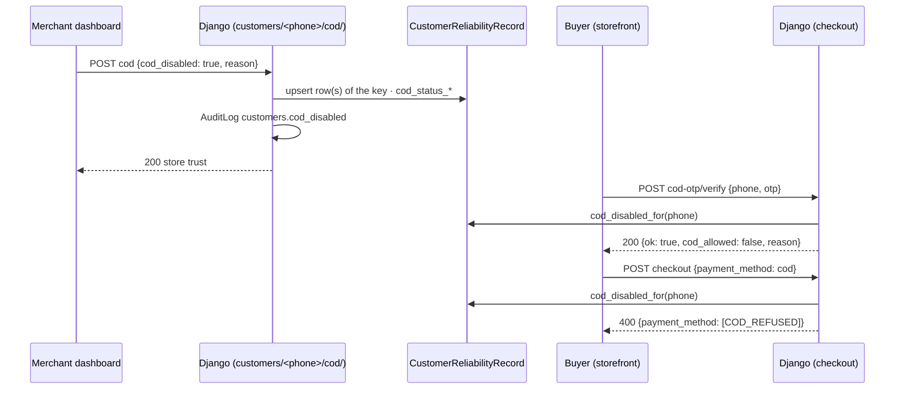

# Customers API — M07 (العملاء)

> **Source**: DOC-125 → DOC-131 (Step 20) · INT-017 (M07), INT-019, INT-014, INT-029 · inventory Domain 6 + A.9 + A.11
> **Live key**: `customers` (`SHARWA_LIVE_MODULES`) — all **13** BFF route files call `liveOrMock(request, "customers", …)`: `customers`, `customers/segments/count`, `customers/export.csv`, `customers/[phone]`, `customers/[phone]/{orders,points,wishlist,reviews,notes,cod,wallet/transactions}`, `customers/[phone]/notes/[id]`, `reviews/[id]`. See [`architecture/22-live-module-keys.md`](../../../architecture/22-live-module-keys.md) (row 9)
> **Django provider**: `sharwa_saas/api/views_customers.py` (`CustomersAPIMixin`, gates, export headers, audit) · `sharwa_saas/products/services/customer_service.py` (derivation, filters, trust, notes, COD, CSV) · `products/services/behavior_service.py` (staff usage tracking) · `products/campaigns.py` (`_resolve_raw_recipients`, shared with M13) · models `products/models/customer_interactions.py` (`CustomerNote`, `WishlistItem`, `BackInStockNotification`), `products/models/reverse_logistics.py` (`CustomerReliabilityRecord`) · wired in `sharwa_saas/api/urls.py`
> **Frontend contract**: `sharwa-frontend/src/features/customers/schemas.ts` (`customerListResponseSchema`, `customerDetailSchema`, `walletTabSchema`, `pointsTabSchema`, `wishlistTabSchema`, `reviewsTabSchema`, `notesSchema`, `segmentCountSchema`, `storeReliabilitySchema`) · hooks `src/features/customers/api.ts` · fixture `src/mocks/customers/{state,actor}.ts` · BFF `src/app/api/bff/customers/**/route.ts`, `src/app/api/bff/reviews/[id]/route.ts`
> **Tests**: `sharwa_saas/api/test_customers_api.py` (13 tests) · mock E2E `sharwa-frontend/scripts/customers-check.ts` (Playwright against the fixture; covers the typed re-enable confirmation, notes, `?simulate=critical`)
> **Last verified against code**: 2026-10-27 (step 20)

> **Scope note** — The customer *concept* (the key, the join rules, the two trust sources, the SAR wallet) is explained once in the [domain overview](README.md#derived-customer); this page assumes it. Wallet **administration** (create a wallet, top-up, the ledger screen) and the loyalty points list are M35: [`m35-wallets-loyalty.md`](m35-wallets-loyalty.md). Example values come from `api/test_customers_api.py` or are derived from its fixtures; ids and timestamps are **illustrative**.

<a id="overview"></a>

## 1. Overview

M07 is the merchant's customer book. Nothing is stored per customer: every list row and profile is **derived from the order history** and joined to the wallet, the points, the COD reliability record, the wishlist, the reviews and the notes by the normalized phone ([`README.md#derived-customer`](README.md#derived-customer)). The module answers four questions:

| Question | Routes |
|---|---|
| Who are my customers, and which of them should I contact? | list · segment count · CSV export ([§4.1](#list), [§4.2](#segments), [§4.3](#export)) |
| What do I know about this one? | profile + trust, and five tabs ([§4.4](#profile), [§4.5](#sub-resources)) |
| What did the team write about them? | notes ([§4.6](#notes)) |
| Should this person still be allowed to pay cash on delivery? | COD decision ([§4.7](#cod)) |

**Before INT-017** the only customer view was the legacy HTML `customer_report`; there was no JSON API and no `Customer` model. INT-017 added the 14 routes below, the `CustomerNote` model, the review-author phone and the manual COD fields (migration `0218_customer_crm`), and made the storefront checkout respect the store's COD decision.

The identity calling these routes is the signed-in dashboard identity (owner or staff, [`../../overview/auth.md`](../../overview/auth.md)) on the store host. The BFF forwards the browser session; with the key `customers` off, every row answers from the fixture in `src/mocks/customers/`.

<a id="access"></a>

## 2. Access — gate chain

`CustomersAPIMixin.run` → `ProductsAPIMixin.gate(request, permission)` evaluates, in this order; the first failing gate answers.

| # | Gate | Requirement | Failure |
|---|---|---|---|
| 1 | CSRF | `MerchantSessionAuthentication` enforces CSRF on every unsafe request ([`../../overview/csrf.md`](../../overview/csrf.md)) | `403` (CSRF failure) |
| 2 | Tenant | `HasTenantContext` | tenant-guard answer ([`../01-public-onboarding/m47-tenant-guard.md`](../01-public-onboarding/m47-tenant-guard.md)) |
| 3 | Session | owner (`is_merchant_authenticated`) or staff | `401` `{"detail": "انتهت جلستك، سجّل الدخول مجدداً."}` |
| 4 | Permission key | see the table below; the owner holds every key | `403` `{"detail": "ليست لديك صلاحية لهذا الإجراء."}` |
| 5 | Resource state | the customer exists (≥ 1 placed order), the note / review exists, the COD value changes | `404` / `409` «…» |
| 6 | Staff limits | export only: critical alert or hard limit today | `429` `{"detail": "تجاوزت حدّ التصدير اليومي، راجع مدير المتجر."}` |

**There is no plan-feature gate in M07** — unlike M35 ([`m35-wallets-loyalty.md`](m35-wallets-loyalty.md#wallets)), a store on any plan can use the customer book.

| Permission key | Routes |
|---|---|
| `customers.view` | list · segment count · profile · orders / wallet / points / wishlist / reviews tabs · **notes (read, create and delete)** |
| `customers.export` | `customers/export.csv` |
| `customers.edit_profile` | `customers/<phone>/cod/` · `PATCH reviews/<id>/` |

> ⚠️ Discrepancy — roadmap says the notes **write** gate is `customers.edit_profile` / code does: `CustomerNotesView.get`, `CustomerNotesView.post` and `CustomerNoteDetailView.delete` all call `self.run(request, VIEW, …)` with `VIEW = 'customers.view'`, and the BFF files `customers/[phone]/notes/route.ts` gate both `GET` and `POST` with `customers.view` in the mock as well. A staff member who can *view* customers can therefore write a note. The delete rule (author or owner) is separate and is checked in the service ([§4.6](#notes)). Reported in step 20.

<a id="summary"></a>

## 3. Endpoint summary

| # | Method | Django path (`/api/v1/…`) | BFF path (`/api/bff/…`) | Purpose | Gate | Section |
|---|---|---|---|---|---|---|
| 1 | `GET` | `customers/` | `customers` | derived list, search, filters, paging | `customers.view` | [§4.1](#list) |
| 2 | `GET` | `customers/segments/count/` | `customers/segments/count` | size of a campaign audience | `customers.view` | [§4.2](#segments) |
| 3 | `GET` | `customers/export.csv` (+ `customers/export.csv/`) | `customers/export.csv` | CSV with the list filters | `customers.export` | [§4.3](#export) |
| 4 | `GET` | `customers/<phone>/` | `customers/[phone]` | profile + both trust sources | `customers.view` | [§4.4](#profile) |
| 5 | `GET` | `customers/<phone>/orders/` | `customers/[phone]/orders` | orders tab | `customers.view` | [§4.5](#sub-resources) |
| 6 | `GET` | `customers/<phone>/wallet/transactions/` | `customers/[phone]/wallet/transactions` | wallet tab (last 10, SAR) | `customers.view` | [§4.5](#sub-resources) |
| 7 | `GET` | `customers/<phone>/points/` | `customers/[phone]/points` | points tab | `customers.view` | [§4.5](#sub-resources) |
| 8 | `GET` | `customers/<phone>/wishlist/` | `customers/[phone]/wishlist` | wishlist + back-in-stock tab | `customers.view` | [§4.5](#sub-resources) |
| 9 | `GET` | `customers/<phone>/reviews/` | `customers/[phone]/reviews` | reviews tab | `customers.view` | [§4.5](#sub-resources) |
| 10 | `PATCH` | `reviews/<id>/` | `reviews/[id]` | approve / hide and/or reply to a review | `customers.edit_profile` | [§4.5](#review-patch) |
| 11 | `GET` `POST` | `customers/<phone>/notes/` | `customers/[phone]/notes` | list / add internal notes | `customers.view` | [§4.6](#notes) |
| 12 | `DELETE` | `customers/<phone>/notes/<id>/` | `customers/[phone]/notes/[id]` | delete a note (author or owner) | `customers.view` + author/owner rule | [§4.6](#notes) |
| 13 | `POST` | `customers/<phone>/cod/` | `customers/[phone]/cod` | disable / re-enable cash on delivery | `customers.edit_profile` | [§4.7](#cod) |

`api/urls.py` holds **14** `path()` entries for M07: the 13 rows above count `export.csv` once; the 14th is the alias `customers/export.csv/` (name `customers-export-slash`), which answers with the same view so a client that appends a slash is not redirected.

## 4. Endpoint groups

### 4.1 Customer list (DOC-125) <a id="list"></a>

#### `GET /api/v1/customers/`

Gate: session → `customers.view`. No plan feature. BFF: `liveOrMock(request, "customers", "/api/v1/customers/", …)`; the query string is forwarded unchanged.

**Query parameters**

| Name | Type | Default | Notes |
|---|---|---|---|
| `q` | string | — | search; see *Search* below |
| `segment` | `all` \| `abandoned_carts` \| `dormant` \| `bought_product` | `all` | an unknown value is read as `all` |
| `product_id` | integer | — | used by `bought_product` only; non-digits are ignored; no product ⇒ the segment is empty |
| `last_order_from`, `last_order_to` | date `YYYY-MM-DD` | — | compared with the **local date** of the customer's latest order (any status) |
| `min_spent` | decimal ≥ 0 | — | compared with `display_total_spent` before formatting (store currency); an invalid or negative value is ignored |
| `trust` | `lt50` \| `50-80` \| `gt80` | — | platform trust bucket, see below; an unknown value is ignored |
| `has_wallet` | `true` | — | only customers with a wallet (any spelling of the phone) |
| `has_points` | `true` | — | only customers whose summed points balance is > 0 |
| `ordering` | `last_order_at` \| `total_spent` \| `orders_count` \| `name`, optionally prefixed `-` | `-last_order_at` | an unknown key falls back to `-last_order_at`; ties always break newest order first; `name` sorts by the normalized Arabic name |
| `page` | integer ≥ 1 | `1` | |
| `page_size` | integer | `50` | clamped to `1 … 100` |

`has_wallet` / `has_points` are strict: only the text `true` (any letter case) switches them on.

**Search (`q`).** Two matchers, either of which keeps the row:

1. **By phone** — the digits of `q` (Arabic digits accepted) must be at least three; a leading `00` and then **one** leading `0` are dropped (`0772222` searches `772222`); the remainder must be a substring of the customer key. It applies **only to customers with at least one non-marketplace order** (`phone_available=true`), so a marketplace buyer cannot be found by a phone fragment.
2. **By name** — `normalize_arabic(q)` must be a substring of the normalized name plus every `other_names` entry (so `ايمان` finds «إيمان»; test `test_search_filters_ordering_pagination`).

**Trust buckets.** `percent = 100 − platform risk_percentage`: `lt50` ⇒ `< 50`; `50-80` ⇒ `50 … 80`; `gt80` ⇒ `> 80`. Customers **without** a platform trust row are excluded from every bucket. The test sets `risk_percentage: 75.0` (25 % trust) and finds the customer under `lt50`.

**Segments.**

| `segment` | Rows kept |
|---|---|
| `all` | every derived customer |
| `abandoned_carts` | the key appears on an `AbandonedCart` with status `abandoned` |
| `dormant` | the customer's latest **non-cancelled** order is older than **90 days** (`DORMANT_DAYS = 90`); a customer whose orders are all cancelled is not dormant (no active order) |
| `bought_product` | the key bought `product_id` in a non-cancelled placed order |

**Response `200`**

```json
{
  "count": 1,
  "next": null,
  "previous": null,
  "results": [
    {
      "phone": "967771234567",
      "phone_available": true,
      "name": "منى أحمد",
      "orders_count": 3,
      "display_total_spent": "120 ر.س",
      "last_order_at": "2026-10-26T09:14:00+03:00",
      "trust": { "platform_risk_percentage": null },
      "cod_disabled": false,
      "display_wallet_balance": "12.50 ر.س",
      "points_balance": 40
    }
  ]
}
```

(The example is the customer of `test_list_merges_phone_formats_and_contract`: orders under `0771234567`, `967771234567` and `771234567` merged into one row; the third, 999, is cancelled.)

| Field | Type | Meaning (Django source) |
|---|---|---|
| `count`, `next`, `previous`, `results` | | **relative** paging: `next` is `"?page=N"` or `null`, `previous` likewise — not a URL ([`../../overview/pagination.md`](../../overview/pagination.md)) |
| `phone` | string | the customer key |
| `phone_available` | boolean | `true` when at least one order is **not** from `amazon` / `noon` (`own > 0`) |
| `name` | string | the name on the customer's **latest** order (any status) that has a non-blank name |
| `orders_count` | integer | **every** placed order, cancelled ones included |
| `display_total_spent` | string | sum of `total_price` of the **non-cancelled** orders, each currency group converted with `convert_amount` into the **store currency** (`StoreSetting.currency`, default `SAR`) |
| `last_order_at` | string (ISO) | the latest order of any status |
| `trust.platform_risk_percentage` | number \| `null` | `round(failed / (ok + failed) × 100, 2)` from `CentralCustomerTrust`; `null` when the platform has no row for the phone |
| `cod_disabled` | boolean | any `CustomerReliabilityRecord` of the key has `cod_disabled` |
| `display_wallet_balance` | string \| `null` | the wallet balance **in SAR**, `null` when the key has no wallet |
| `points_balance` | integer \| `null` | the summed `CustomerPoints.balance`, `null` when the key has no points row |

**Errors**

| Status | Body | When |
|---|---|---|
| `401` | `{"detail": "انتهت جلستك، سجّل الدخول مجدداً."}` | no session |
| `403` | `{"detail": "ليست لديك صلاحية لهذا الإجراء."}` | staff without `customers.view` |

**Rules**

- **Placed orders** = every status except `pending_payment`, with a non-empty phone ([`README.md#derived-customer`](README.md#derived-customer)). `test_pending_payment_is_not_a_customer_and_marketplace_hides_phone` creates a `pending_payment` order and a marketplace order: only the marketplace customer (`967770000002`, `phone_available=false`) is listed.
- **Spend** is the legacy lifetime-value rule: cancelled orders add nothing (the 999 cancelled order in the test leaves `120 ر.س` = 50 + 70), but they still raise `orders_count` (3).
- **Name** = the latest order's name; the other distinct names go to `other_names` in the profile ([§4.4](#profile)). In the test the customer is «منى أحمد», earlier «منى القديمة».
- Platform trust is looked up for the **page window only**, unless a `trust` filter forces the lookup for every customer.

**Mapping** — the contract field names are the frontend's (`display_total_spent`, `phone_available`, `trust.platform_risk_percentage`); the provider renames nothing, the service builds the JSON directly.

**Fixture parity.** `listCustomers` in `src/mocks/customers/state.ts` implements the same filters, ordering, paging and the same spend rule — the fixture comment reads «Django (INT-017): the spend counts placed orders that were not cancelled». See [§6.1](#code-vs-mock) for the differences that remain.

<a id="segments"></a>

### 4.2 Segment count (DOC-126)

#### `GET /api/v1/customers/segments/count/`

Gate: session → `customers.view`. Used by the campaign composer to show «how many people will receive this» before a campaign exists.

**Query parameters**: `segment` (as in the list; unknown ⇒ `all`) and `product_id` (for `bought_product`). Other list filters are ignored.

**`AUDIENCE_TYPE` values** — verbatim from `MarketingCampaign.AUDIENCE_TYPE_CHOICES` (`products/models/marketing.py`) and `SEGMENTS` in `schemas.ts`:

| Value | Django label | Frontend label (`SEGMENT_LABELS`) |
|---|---|---|
| `all` | جميع العملاء | الكل |
| `abandoned_carts` | أصحاب السلات المتروكة | سلات متروكة |
| `dormant` | العملاء الخاملين | خامل |
| `bought_product` | عملاء اشتروا منتجاً معيناً | اشترى منتجاً |

**Response `200`** (`test_segments_abandoned_and_bought_product`)

```json
{ "segment": "bought_product", "count": 1, "product": { "id": 12, "name": "مسك" } }
```

`product` is `null` unless a product was resolved. `bought_product` without a known product answers `count: 0` (the test sends none).

**How the count is made.** The service builds an **unsaved** `MarketingCampaign(audience_type=<segment>, product=<product>, dormant_days=90)` and calls `products.campaigns._resolve_raw_recipients(campaign)` — the *same function* that decides the audience of a real M13 campaign. `count` is the number of **distinct customer keys** among the recipients' phones. The two numbers cannot drift apart, because there is only one resolver.

| Branch of the resolver | Source |
|---|---|
| `abandoned_carts` | `AbandonedCart` rows with status `abandoned` and a phone |
| `dormant` | the latest non-cancelled order of each phone is older than `now − dormant_days` |
| `bought_product` | non-cancelled orders with an item of the product |
| `all` | every phone with a non-cancelled order |

**Hand-over to INT-019 (M13).** The model field `MarketingCampaign.dormant_days` defaults to **30**; this endpoint (and the list's «خامل» filter) use **90**. A campaign created from the «خامل» segment must therefore carry `dormant_days = 90` explicitly, or it will message a different, larger group than the one the count showed. Applying that is INT-019's job (Domain 7); nothing in M07 sets it.

> ⚠️ Discrepancy — roadmap says "the count equals M13's audience exactly" / code does: this is true by construction **for the campaign audience**, but the count can differ from `count` of `GET customers/?segment=…`. The list is built on `_base_orders()` (excludes `pending_payment`, keeps cancelled-only customers) and decides *dormant* by the last **placed, non-cancelled** order; the resolver uses `Order.objects.exclude(status='cancelled')` (keeps `pending_payment`, drops cancelled-only customers). `segment=all` is the simplest example: a customer with only a cancelled order is in the list but not in the count; one with only a `pending_payment` order is in the count but not in the list. Reported in step 20.

**Errors**: `401`, `403` as in §4.1. There is no `404`.

<a id="export"></a>

### 4.3 CSV export (DOC-127)

#### `GET /api/v1/customers/export.csv`

Gate: session → `customers.export`. Takes **the same filters as the list** (`q`, `segment`, `product_id`, `last_order_from`, `last_order_to`, `min_spent`, `trust`, `has_wallet`, `has_points`); `ordering`, `page` and `page_size` are ignored — **all** matching rows are exported, newest order first. A staff member is rate-limited ([below](#export-limits)); the owner is not.

**Response `200`** — `text/csv`

| Header | Value |
|---|---|
| `Content-Type` | `text/csv; charset=utf-8` |
| `Content-Disposition` | `attachment; filename="customers-YYYY-MM-DD.csv"` (local date) |
| `Cache-Control` | `no-store` |
| `X-Export-Rows` | the number of data rows |

The body starts with a UTF-8 **BOM** (`U+FEFF`) so Excel reads Arabic correctly, lines end with `\n`, and the first line is:

```csv
phone,name,orders_count,total_spent,last_order_at,platform_trust_percent,cod_refusals_count,cod_disabled,wallet_balance,points_balance
```

| Column | Value |
|---|---|
| `phone` | the customer key — **blank when `phone_available` is `false`** (marketplace-only customers are exported with an empty phone, not omitted) |
| `name` | latest name |
| `orders_count` | all placed orders |
| `total_spent` | the **display string** of the list (`"100 ر.س"`), not a number |
| `last_order_at` | ISO timestamp |
| `platform_trust_percent` | `round(100 − risk_percentage, 2)`, blank without a platform row |
| `cod_refusals_count` | the store's refusal count |
| `cod_disabled` | `true` / `false` |
| `wallet_balance` | display string in SAR, blank without a wallet |
| `points_balance` | integer, blank without a points row |

From `test_export_csv`: two customers, the second a `noon` buyer. The header `X-Export-Rows` is `2`; the text starts with the BOM then `phone,name,`; it contains `967771111111,أحمد` and, for the marketplace customer, a line that starts with an empty phone cell (`\n,إيمان`).

<a id="export-limits"></a>

**Staff limits and audit**

1. `self.gate(request, 'customers.export')` — session and permission.
2. For a **staff** member only: if a `BehaviorAlert` of type `export_volume`, level `critical`, created **today** exists for them, **or** `behavior_service.is_rate_limited(staff, 'customers.export')` (today's counter ≥ the hard limit **5 000**), answer `429` `{"detail": "تجاوزت حدّ التصدير اليومي، راجع مدير المتجر."}`.
3. The CSV is built.
4. For staff: `behavior_service.record_usage(staff, 'customers.export', quantity=max(rows, 1))`. Crossing **1 000** exported rows in a day raises a single `BehaviorAlert` (`alert_type = export_volume`, level `critical`) for that staff member and day; from then on step 2 refuses further exports that day.
5. `write_audit_log` with `action_code = customers.export`, `target_model = Customer`, `target_id = *`, `after = {rows, filters, actor}` — `filters` is the raw query string as a dictionary, `actor` the label «مالك المتجر» or the staff member's name. The `actor` column of the log row is the staff member (none for the owner).

`test_export_limited_for_staff` mocks `is_rate_limited` and asserts `429`.

**BFF.** `customers/export.csv/route.ts` is `liveOrMock(request, "customers", "/api/v1/customers/export.csv", …)`. The list of response headers the BFF forwards from Django lives in `src/lib/bff/upstream.ts`; **`x-export-rows`** was added to it for this route (comment: «M07 export (INT-017): the row count the export toast reports»), so the UI can show «exported N rows». The fixture handler re-creates every header, checks `customers.export`, and honours a **mock-only** knob `?simulate=critical` that forces the `429` answer (no fixture member is critical); that parameter is stripped before the filters are audited and does not exist in Django.

**Errors**

| Status | Body | When |
|---|---|---|
| `401` | `{"detail": "انتهت جلستك، سجّل الدخول مجدداً."}` | no session |
| `403` | `{"detail": "ليست لديك صلاحية لهذا الإجراء."}` | staff without `customers.export` |
| `429` | `{"detail": "تجاوزت حدّ التصدير اليومي، راجع مدير المتجر."}` | staff over the hard limit or critical alert today |

<a id="profile"></a>

### 4.4 Customer profile and trust (DOC-128)

#### `GET /api/v1/customers/<phone>/`

Gate: session → `customers.view`. `<phone>` is any spelling of the number (`0771234567` and `967771234567` answer the same profile — asserted by `test_detail`). BFF: `customers/[phone]/route.ts` → `/api/v1/customers/<encoded phone>/`.

**Response `200`** (customer of `test_detail`)

```json
{
  "phone": "967771234567",
  "phone_available": true,
  "name": "منى أحمد",
  "other_names": ["منى القديمة"],
  "email": "m@example.com",
  "first_order_at": "2026-10-17T10:00:00+03:00",
  "last_order_at": "2026-10-26T10:00:00+03:00",
  "orders_count": 2,
  "display_total_spent": "200 ر.س",
  "display_refunded": "20 ر.س",
  "display_avg_basket": "100 ر.س",
  "segment_flags": [],
  "trust": {
    "platform": null,
    "store": {
      "cod_refusals_count": 3,
      "cod_disabled": true,
      "reason": "أُوقف تلقائياً بعد 3 مرات رفض استلام.",
      "updated_at": null,
      "updated_by": null
    }
  },
  "wallet": null,
  "points": null
}
```

| Field | Type | Meaning |
|---|---|---|
| `phone`, `phone_available`, `name`, `orders_count`, `display_total_spent` | | as in the list |
| `other_names` | string[] | every other distinct non-blank name, most recent first |
| `email` | string \| `null` | the latest **non-empty** `customer_email` |
| `first_order_at`, `last_order_at` | string | earliest / latest order of any status |
| `display_refunded` | string | the sum of `OrderRefund.amount` of the customer's orders (all statuses except `pending_payment`), each converted from the order currency to the store currency |
| `display_avg_basket` | string | `spent ÷ non-cancelled orders`, rounded to 2 decimals (`0` when none) |
| `segment_flags` | string[] | `abandoned_carts` when the key has an abandoned cart, `dormant` when the 90-day rule holds — in that order |
| `trust.platform` | object \| `null` | `{successful_cod_orders, failed_cod_orders, risk_percentage}` |
| `trust.store` | object | `{cod_refusals_count, cod_disabled, reason, updated_at, updated_by}` |
| `wallet` | object \| `null` | `{id, display_balance (SAR), is_active}` — `id` is the M35 wallet id |
| `points` | object \| `null` | `{balance}` |

**The two trust sources (FR-07.03)** — returned side by side, never merged:

| | `trust.platform` | `trust.store` |
|---|---|---|
| Source | `CentralCustomerTrust` rows of the phone in the **public** schema (`schema_context('public')`), summed (`successful_cod_orders`, `failed_cod_orders`); looked up in `IN (…)` chunks of 1 000 and, for a 12-digit `966…` key, also without the prefix | `CustomerReliabilityRecord` rows of the key in the tenant schema |
| `risk_percentage` / counters | `round(failed ÷ (ok + failed) × 100, 2)`; `0.0` when the total is 0 | `cod_refusals_count` is the **sum** over the key's rows |
| Absent | `null` | still an object, zeros / `false` / `null` |
| `reason`, `updated_*` | — | the **latest manual** decision (row with the newest `cod_status_updated_at`) — or, if COD is disabled with no manual reason and refusals ≥ `COD_REFUSAL_THRESHOLD` (setting, default `3`), the generated sentence «أُوقف تلقائياً بعد {refusals} مرات رفض استلام.» |

The test mocks the platform lookup (`NO_TRUST` patch returns `{}`), which is why `trust.platform` is `null` there.

**Staff usage tracking.** After a `200`, a **staff** member's profile view is counted with `behavior_service.record_usage(staff, 'customers.view')`. At **5 000** views in a day one `BehaviorAlert` of type `view_volume`, level `warning`, is raised; there is **no hard limit** for views, so nothing is ever refused. Owners are not counted. A failed lookup (`404`) is not counted.

**Errors**

| Status | Body | When |
|---|---|---|
| `401`, `403` | as §4.1 | |
| `404` | `{"detail": "لا عميل بهذا الرقم في متجرك."}` | the text is not a number, or no placed order matches the key (`test_detail` asks for `967700000000`) |

<a id="sub-resources"></a>

### 4.5 Profile sub-resources (DOC-129)

Five read-only tabs hang off the profile. The BFF files are all `liveOrMock(request, "customers", "/api/v1/customers/<phone>/…", …)`; the hooks are in `src/features/customers/api.ts` and every response is Zod-parsed.

| Tab | Route | Gate | Customer must exist? |
|---|---|---|---|
| Orders | `GET customers/<phone>/orders/` | `customers.view` — **not** `orders.view` | yes — `404` «لا عميل بهذا الرقم في متجرك.» |
| Wallet | `GET customers/<phone>/wallet/transactions/` | `customers.view` | no |
| Points | `GET customers/<phone>/points/` | `customers.view` | no |
| Wishlist | `GET customers/<phone>/wishlist/` | `customers.view` | no |
| Reviews | `GET customers/<phone>/reviews/` | `customers.view` | no |

A key that is not a number gives an empty answer on the four tabs that do not resolve the customer (`{wallet: null, results: []}` for the wallet tab, `[]` for the lists, a zero balance for points).

#### Orders tab — `GET /api/v1/customers/<phone>/orders/`

Reuses the M06 list: the base queryset is `order_api_service.list_queryset()` filtered by `customer_phone IN <every raw spelling that maps to the key>`, newest first, and each row is `order_list_item(order)` — exactly the row of [`../04-orders-returns/m06-orders.md#list`](../04-orders-returns/m06-orders.md#list). Because the gate is `customers.view`, a staff member who may read customers but not orders sees their order history here; the order *detail* page still needs the M06 keys.

| Query | Default | Notes |
|---|---|---|
| `page` | `1` | |
| `page_size` | **`20`** | clamped to `1 … 100` (the customer list default of 50 does not apply) |

```json
{ "count": 1, "next": null, "previous": null, "results": [ { "id": 48, "...": "M06 list item" } ] }
```

`next` / `previous` are relative (`"?page=2"`). The test asserts `count == 1` and the order id. The frontend hook asks `page_size=20` and parses with `orderListResponseSchema`. The fixture handler answers from the M06 fixture with `q=<normalized phone>`.

#### Wallet tab — `GET /api/v1/customers/<phone>/wallet/transactions/`

```json
{
  "wallet": { "id": 3, "display_balance": "30 ر.س", "is_active": true },
  "results": [
    {
      "id": 17,
      "amount": "30.00",
      "display_amount": "+30 ر.س",
      "reason": "refund",
      "note": null,
      "reference": { "type": "order", "id": 48, "label": "طلب #48" },
      "display_balance_after": "30 ر.س",
      "actor": "النظام",
      "created_at": "2026-10-26T12:00:00+03:00"
    }
  ]
}
```

(From `test_tabs`: a refund credit of 30 on the customer's order.) Read-only — **the last 10 transactions** of the wallet, newest first, always in **SAR**. `amount` is signed (`-` for a debit) with two decimals; `display_amount` carries an explicit `+` / `-`. `wallet` is `null` (and `results` empty) when the customer has no wallet — the answer is still `200`.

| Field | Source |
|---|---|
| `reason` | the stored `WalletTransaction.reason` (`manual_topup`, `refund`, `reward`, `order_payment`, `adjustment`, `loyalty_redeem`) |
| `note` | `description`, or `null` |
| `reference` | `{type: "order", id, label: "طلب #<order id>"}` when the transaction has an order, else `null` |
| `actor` | **derived from the reason**: «النظام» for `order_payment`, `refund`, `loyalty_redeem`; «المتجر» for everything else |

> ⚠️ Discrepancy — code vs code: this tab and the M35 ledger ([`m35-wallets-loyalty.md#wallets`](m35-wallets-loyalty.md#wallets)) describe the same `WalletTransaction` rows differently. Here `actor` is «النظام» / «المتجر» chosen from the reason and `reference.type` is always `order` with the label «طلب #id». In M35 `actor` is the stored `WalletTransaction.actor` (the staff member's name, «مالك المتجر», or «النظام») and a refund transaction is referenced as `{type: "refund", …, label: "استرجاع الطلب #id"}`. A manual top-up by the owner therefore reads «المتجر» in the customer tab and «مالك المتجر» in the wallet ledger. Reported in step 20.

#### Points tab — `GET /api/v1/customers/<phone>/points/`

```json
{
  "balance": 0,
  "program_enabled": false,
  "points_per_riyal_redemption": 10.0,
  "display_riyal_equivalent": "0 ر.س",
  "transactions": []
}
```

| Field | Meaning |
|---|---|
| `balance` | sum of the key's `CustomerPoints.balance` rows (`0` when none) |
| `program_enabled` | `LoyaltyProgram.is_enabled` |
| `points_per_riyal_redemption` | the program's rate as a number |
| `display_riyal_equivalent` | `balance ÷ rate` rounded **down** to 2 decimals, in SAR; `null` when the rate is `0` |
| `transactions` | up to 50 `CustomerPointsTransaction` rows, newest first: `{id, type: "earn"\|"redeem", points, order_id, created_at}` |

The test asserts `balance == 0` and no transactions for a customer who has none. The editable program is in M13; the merchant-wide points list is M35 ([`m35-wallets-loyalty.md#loyalty`](m35-wallets-loyalty.md#loyalty)).

#### Wishlist tab — `GET /api/v1/customers/<phone>/wishlist/`

A JSON **array**, one row per product that is in the customer's wishlist **or** has an open «أعلمني عند التوفر» request (`BackInStockNotification` with `notified_at` empty):

```json
[
  {
    "product_id": 12,
    "product": { "id": 12, "name": "عطر العود", "image": null, "display_price": "100 ر.س", "stock": 0.0 },
    "in_wishlist": true,
    "added_at": "2026-10-26T08:00:00+03:00",
    "back_in_stock_requested": true
  }
]
```

`product` is the card the storefront uses (`image` is `image_url`, else the absolute media URL, else `null`; `display_price` in the store currency; `stock` a number) and is `null` when the product no longer exists or is archived. `added_at` is `null` for a row that exists only because of a back-in-stock request. Rows sort by `added_at`, newest first (back-in-stock-only rows last). Both tables are matched with `_matching_raw` ([`README.md#derived-customer`](README.md#derived-customer)), so a wishlist saved from `0771234567` and an alert saved from `771234567` appear on one row — the test asserts `in_wishlist` and `back_in_stock_requested` are both true. The storefront side of these two tables is [`../05-storefront/m42-wishlist-reviews.md#wishlist`](../05-storefront/m42-wishlist-reviews.md#wishlist) and [`#back-in-stock`](../05-storefront/m42-wishlist-reviews.md#back-in-stock).

#### Reviews tab — `GET /api/v1/customers/<phone>/reviews/`

A JSON array of the customer's product reviews, newest first:

```json
[
  {
    "id": 5,
    "product": { "id": 12, "name": "عطر العود" },
    "rating": 5,
    "comment": "رائع",
    "created_at": "2026-10-26T10:30:00+03:00",
    "admin_reply": null,
    "approved": true
  }
]
```

Only reviews whose **`ProductReview.customer_phone`** (new in `0218`) matches the key are returned. Reviews written before the column existed carry no phone and are **not attributed** to anyone; the test creates a second review without a phone and asserts it is not listed. A deleted product shows the name «منتج محذوف». `approved` is `ProductReview.is_approved`.

> ⚠️ Discrepancy — roadmap says `approved` is "always true until M42 moderation" / code does: moderation is live. A review submitted from the Next storefront with a buyer code is saved with `is_approved=False` and waits for the merchant (INT-029, [`../05-storefront/m42-wishlist-reviews.md#product-reviews`](../05-storefront/m42-wishlist-reviews.md#product-reviews)); the tab returns the real flag, and `PATCH reviews/<id>/ {approved}` changes it. Reported in step 20.

<a id="review-patch"></a>

#### `PATCH /api/v1/reviews/<id>/` — approve, hide or reply

Gate: session → `customers.edit_profile`. The route is `reviews/<int:review_id>/` (class `ReviewReplyView`) — **not** under `customers/`. BFF: `reviews/[id]/route.ts` → `/api/v1/reviews/<id>/`, key `customers`; hooks `useReplyReview` (`{admin_reply}`) and `useApproveReview` (`{approved}`, INT-029).

> ⚠️ Discrepancy — roadmap says the path is `PATCH /api/v1/customers/reviews/<id>/` / code does: `reviews/<int:review_id>/` at the root of `/api/v1/` (`api/urls.py`, name `reviews-reply`), and the BFF calls `/api/v1/reviews/<id>/`. Reported in step 20.

**Request body** — at least one of the two fields:

| Field | Type | Rules |
|---|---|---|
| `admin_reply` | string \| `null` | trimmed; **empty or `null` deletes the reply**; at most 1 000 characters |
| `approved` | boolean | `true` approves / shows, `false` hides; any other type is rejected |

**Response `200`** — the review in the tab shape above (`admin_reply` is `null` after a delete). `test_tabs` sends `" شكراً لك "` and reads back `"شكراً لك"`, then sends `""` and reads back `null`.

| Status | Body | When |
|---|---|---|
| `404` | `{"detail": "التقييم غير موجود."}` | unknown id |
| `400` | `{"admin_reply": ["نص الرد مطلوب."]}` | neither `admin_reply` nor `approved` in the body, or `admin_reply` is neither a string nor `null` |
| `400` | `{"approved": ["قيمة غير صالحة."]}` | `approved` is not a boolean |
| `400` | `{"admin_reply": ["الرد أطول من 1000 حرف."]}` | reply longer than 1 000 characters |
| `401`, `403` | as §4.1 | |

Only the fields present are written (`update_fields`): an approval alone leaves the reply untouched and vice-versa. The reply shows under the review on the storefront product page.

<a id="notes"></a>

### 4.6 Customer notes (DOC-130)

Internal, merchant-only memos on a customer. They never reach the customer or the storefront. Storage: the new model `CustomerNote` (migration **`0218_customer_crm`**) — `customer_phone` (the **key**, indexed), `body` (≤ 1 000), `author_staff` (FK to `StaffMember`, `SET_NULL`), `author_name` (≤ 150), `created_at`; ordered newest first.

> ⚠️ Discrepancy — roadmap says the routes are `customers/<phone>/notes/` and `customers/notes/<id>/` / code does: the delete route is `customers/<phone>/notes/<note_id>/` (`api/urls.py`, name `customers-note-detail`); there is no `customers/notes/<id>/`. The BFF file is `customers/[phone]/notes/[id]/route.ts`. (The roadmap's *gate* statement is the other discrepancy, in [§2](#access).) Reported in step 20.

#### `GET /api/v1/customers/<phone>/notes/`

Gate `customers.view`. Returns an array, newest first; an unknown or non-numeric key gives `[]` (no `404`).

```json
[
  { "id": 4, "body": "تفضّل التوصيل مساءً", "author": "مالك المتجر", "created_at": "2026-10-27T10:05:00+03:00", "can_delete": true }
]
```

`author` is the author's name stored at write time (the label «مالك المتجر» for the owner). `can_delete` is computed for the **reader**: `true` for the owner (always), and for a staff member only on notes they wrote. In `test_notes_owner_and_staff` the staff member «سارة» reads the owner's note and gets `can_delete: false`.

#### `POST /api/v1/customers/<phone>/notes/`

Gate `customers.view` (see the discrepancy above). `201` with the created note in the shape above (`can_delete: true` for its author).

| Field | Type | Required | Rules |
|---|---|---|---|
| `body` | string | yes | trimmed; 1 … 1 000 characters |

| Status | Body | When |
|---|---|---|
| `400` | `{"body": ["اكتب الملاحظة."]}` | empty or blank after trimming (the test posts `" "`) |
| `400` | `{"body": ["الملاحظة أطول من 1000 حرف."]}` | longer than 1 000 |
| `404` | `{"detail": "لا عميل بهذا الرقم في متجرك."}` | no placed order for the key — notes can only be added to a real customer |

The frontend form `noteFormSchema` mirrors the two `400` texts. The author is the resolved staff member (`author_staff`) or none for the owner, with `author_name` from `actor_label` — «مالك المتجر», or the staff member's `full_name`.

#### `DELETE /api/v1/customers/<phone>/notes/<note_id>/`

Gate `customers.view`, then the **delete rule (FR-07.08)**: the **owner** may delete any note; a **staff member** only the notes they authored.

| Status | Body | When |
|---|---|---|
| `204` | empty | deleted |
| `404` | `{"detail": "الملاحظة غير موجودة."}` | no note with this id for this key |
| `403` | `{"detail": "يحذف الملاحظة كاتبها أو مالك المتجر فقط."}` | a staff member who is not the author — including notes written by the owner (the test: `403` for «سارة», then `204` for the owner) |

If a staff member's record is later deleted the foreign key is set to `NULL`: from then on only the owner can delete that note. Notes write **no audit-log row** (only the COD decision and the export do).

<a id="cod"></a>

### 4.7 COD decision and checkout enforcement (DOC-131)

The merchant can stop cash on delivery for one phone, and turn it back on. The decision is kept on the store's own `CustomerReliabilityRecord` — the record the delivery flow already filled with refusals — so manual and automatic decisions live in one place.

#### `POST /api/v1/customers/<phone>/cod/`

Gate: session → `customers.edit_profile`. BFF: `customers/[phone]/cod/route.ts` (key `customers`; the fixture also writes an audit row).

**Request body**

| Field | Type | Required | Rules |
|---|---|---|---|
| `cod_disabled` | boolean | yes | `true` stops COD, `false` re-enables it; a non-boolean is rejected |
| `reason` | string | yes | trimmed; 3 … 300 characters |

**Response `200`** — the new store trust object (the same shape as `trust.store` in the profile):

```json
{
  "cod_refusals_count": 0,
  "cod_disabled": true,
  "reason": "رفض الاستلام مرتين",
  "updated_at": "2026-10-27T10:20:00+03:00",
  "updated_by": "مالك المتجر"
}
```

(From `test_cod_toggle_audit_and_checkout_guard`; the asserted fields are `cod_disabled` and `reason`.)

**Errors**

| Status | Body | When |
|---|---|---|
| `400` | `{"cod_disabled": ["القيمة مطلوبة."]}` | `cod_disabled` missing or not a boolean |
| `400` | `{"reason": ["اكتب سبباً واضحاً (3 أحرف على الأقل)."]}` | fewer than 3 characters (the test sends `"x"` and sees only the key `reason`) |
| `400` | `{"reason": ["السبب أطول من 300 حرف."]}` | more than 300 |
| `404` | `{"detail": "لا عميل بهذا الرقم في متجرك."}` | no placed order for the key |
| `409` | `{"detail": "الدفع عند الاستلام موقوف لهذا العميل أصلاً."}` | asked to disable while already disabled |
| `409` | `{"detail": "الدفع عند الاستلام مفعّل لهذا العميل أصلاً."}` | asked to enable while already enabled |
| `401`, `403` | as §4.1 | |

The checks run in this order: customer exists → `cod_disabled` is a boolean → reason length → **unchanged value ⇒ `409`**. A reason is therefore required even for a request that will be refused as unchanged.

**What is written.** If the key has no `CustomerReliabilityRecord` one is created. **Every** record that maps to the key (the same person can have rows under different phone spellings) gets `cod_disabled`, `cod_status_reason`, `cod_status_updated_at` (now) and `cod_status_updated_by` (the actor label, ≤ 150). These three `cod_status_*` columns are new in **`0218_customer_crm`**; `cod_refusals_count` is never touched by a manual decision. The record's `customer_phone` is `unique`, so the key itself is the row's phone.

**Audit.** The view writes one `AuditLog` row after success: `action_code` **`customers.cod_disabled`** or **`customers.cod_enabled`**, `target_model = Customer`, `target_id = <key>`, `before = {cod_disabled}` (the previous value), `after = {cod_disabled, reason, actor}`. The test asserts the `customers.cod_disabled` row with `target_id` equal to the key. Audit rows are not written for the `409`/`400` answers.

**Automatic disabling.** When the delivery flow counts refusals past `COD_REFUSAL_THRESHOLD` (Django setting, default `3`) it sets `cod_disabled=True` without a manual reason. Reading the profile then generates the reason «أُوقف تلقائياً بعد {N} مرات رفض استلام.» (N = the refusals sum). A later manual decision replaces it: the latest `cod_status_updated_at` wins.

> ⚠️ Discrepancy — roadmap says the automatic reason "reads «أُوقف تلقائياً بعد N مرات»" / code does: the full sentence is «أُوقف تلقائياً بعد {refusals} مرات رفض استلام.» (with «رفض استلام» and the final full stop; N is substituted). `test_detail` asserts only the word «تلقائياً». Reported in step 20.

**Re-enabling in the UI.** The dashboard asks the merchant to type the word «تفعيل» (`COD_CONFIRM_WORD`) before it sends `cod_disabled: false` (`codFormSchema`: reason 3 … 300 characters, same two texts as above). That confirmation is client-side only — the API does not ask for it.

#### Checkout enforcement (INT-014 hand-over) <a id="cod-enforcement"></a>

Before INT-017 the storefront checkout never read `cod_disabled`: a disabled phone could still order cash on delivery. Now `customer_service.cod_disabled_for(raw_phone)` — `True` when any `CustomerReliabilityRecord` whose key equals `customer_key(raw_phone)` has `cod_disabled` — is consulted in two places of `storefront_checkout_service.py`:

| Where | Effect |
|---|---|
| `POST /api/v1/checkout/cod-otp/verify/` (`verify_cod_otp`) | after the code is accepted and consumed, a disabled phone is **not** marked verified: the answer is `200` `{"ok": true, "cod_allowed": false, "reason": "التوصيل بالدفع عند الاستلام غير متاح لهذا الرقم — اختر طريقة أخرى."}`; an enabled phone gets `{"ok": true, "cod_allowed": true, "reason": null}` |
| `POST /api/v1/checkout/` with `payment_method=cod` (`place_order`) | right after the generic payment-method validation, a disabled phone ⇒ `400` `{"payment_method": ["التوصيل بالدفع عند الاستلام غير متاح لهذا الرقم — اختر طريقة أخرى."]}` |

The sentence is the constant `COD_REFUSED` and is the same text the fixture used. Platform trust is **not** part of this decision: a poor `CentralCustomerTrust` score only informs the merchant. Details of both checkout rows: [`../05-storefront/m12-checkout.md#cod-otp`](../05-storefront/m12-checkout.md#cod-otp) and [`#place-order`](../05-storefront/m12-checkout.md#place-order).



**Tests.** `test_cod_toggle_audit_and_checkout_guard` covers: `cod_disabled_for` is `False` at the start; the toggle answers `200` with the reason; `cod_disabled_for('0771234567')` is then `True` (any spelling); the audit row exists; a second disable ⇒ `409`; a one-character reason ⇒ `400` on `reason`; re-enabling clears the flag. It asserts the **helper** the checkout calls, not the two checkout answers themselves — those HTTP answers are not asserted in `api/test_customers_api.py`.

## 5. Gaps closed, bugs fixed and migrations

| Item | What changed |
|---|---|
| `0218_customer_crm` | `ProductReview.customer_phone` (indexed, blank default) · `CustomerReliabilityRecord.cod_status_reason` / `cod_status_updated_at` / `cod_status_updated_by` · model `CustomerNote` (`author_staff` FK, `author_name`, `body`, `created_at`) |
| Checkout (INT-014 hand-over) | storefront checkout now honours the store's COD decision in `verify_cod_otp` and `place_order` ([§4.7](#cod-enforcement)) |
| Staff usage tracking | `customers.view` → `view_volume`, `customers.export` → `export_volume` through `behavior_service.record_usage` (FR-07.12 / FR-07.07) |
| Reviews (INT-029) | `PATCH reviews/<id>/` accepts `{approved}`; the tab returns `is_approved` |
| BFF | `x-export-rows` added to the forwarded response headers; `customers` is a live key (row 9 of the registry) |
| Run it | `python manage.py makemigrations` is not needed for these changes — the migration file `0218_customer_crm.py` ships with the code; apply with `python manage.py migrate_schemas` for the tenant schemas |

## 6. Open items and legacy-only behaviour

- **Marketplace phones are not available.** `phone_available=false` customers can be viewed and exported (blank phone) but not found by phone and not messaged.
- **No unified customer id, merge or delete.** There is no endpoint that merges two customers or removes one; the "customer" disappears only when its orders do.
- **Platform trust is advisory.** It is never used to refuse an order (stated in the checkout service docstring).
- **Notes are not audited**, and are readable and writable with `customers.view` ([§2](#access)).
- **The campaign for «خامل»** must pass `dormant_days = 90` (INT-019, [§4.2](#segments)).
- Legacy HTML `customer_report` is untouched and not part of this contract.

<a id="code-vs-mock"></a>

### 6.1 Code vs fixture

The fixture (`src/mocks/customers/state.ts`) is what the UI is built and tested against; these differences were found by reading both sides.

| Aspect | Django | Fixture |
|---|---|---|
| Unknown customer on `cod/` and `POST notes/` | `404` «لا عميل بهذا الرقم في متجرك.» (the profile fixture answers the same text) | `404` «العميل غير موجود.» |
| Phone spellings | merged by `customer_key` from the raw rows | fixture phones are already normalized; no `77…` / `077…` merge to exercise |
| `dormant` basis | latest **non-cancelled** order (`last_active`) | `last_order_at` of any status |
| `display_avg_basket` | `spent ÷ non-cancelled orders` | `total ÷ orders_count` (all placed orders) |
| Wallet tab `actor` / `reference` | derived from the reason; `reference.type` always `order` | stored `actor`; may be a `refund` reference (schema accepts any `type` string) |
| `trust.platform` | `null` without a platform row | seeded for the two named fixtures only |
| `?simulate=critical` on the export | does not exist | forces `429` |
| Reviews `approved` | real `is_approved` | `approved` from the storefront fixture rows |

## 7. Related pages

- Domain overview: [`README.md`](README.md) · wallets and loyalty: [`m35-wallets-loyalty.md`](m35-wallets-loyalty.md)
- Overview: [`../../overview/permissions.md`](../../overview/permissions.md), [`../../overview/pagination.md`](../../overview/pagination.md), [`../../overview/csrf.md`](../../overview/csrf.md), [`../../overview/bff.md`](../../overview/bff.md), [`../../overview/errors.md`](../../overview/errors.md)
- Neighbours: M06 orders [`../04-orders-returns/m06-orders.md`](../04-orders-returns/m06-orders.md) · M12 checkout [`../05-storefront/m12-checkout.md`](../05-storefront/m12-checkout.md) · M42 wishlist & reviews [`../05-storefront/m42-wishlist-reviews.md`](../05-storefront/m42-wishlist-reviews.md) · Domain 7 campaigns (later step) [`../07-marketing-design-partners/README.md`](../07-marketing-design-partners/README.md)
- Architecture: [`../../../architecture/22-live-module-keys.md`](../../../architecture/22-live-module-keys.md)
