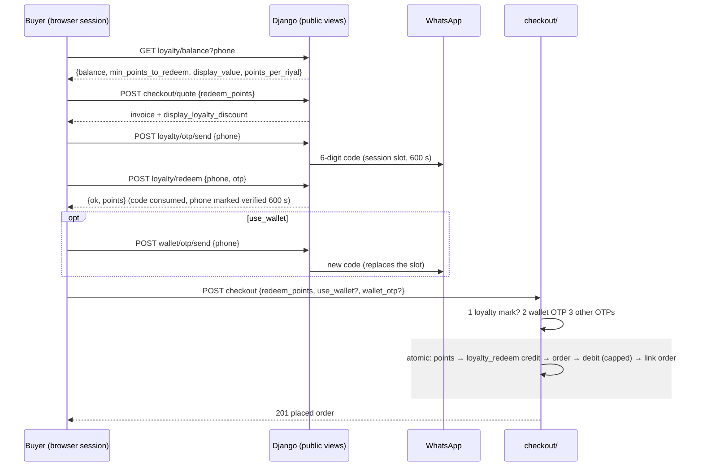

# Customer Wallets & Loyalty Points API — M35 (محافظ العملاء ونقاط الولاء)

> **Source**: DOC-132 → DOC-136 (Step 20) · INT-028 (M35), INT-019, INT-014 · inventory Domain 6 + A.7 + A.9
> **Live key**: `wallets` (`SHARWA_LIVE_MODULES`) — the **7 merchant** BFF rows call `liveOrMock(request, "wallets", …)`: `customers/wallets` (GET, POST), `customers/wallets/[id]`, `customers/wallets/[id]/transactions`, `customers/wallets/[id]/topup`, `customers/loyalty-program`, `loyalty/points`, `loyalty/points/[phone]/transactions`. The **5 storefront** rows (`wallet/balance-preview`, `wallet/otp/send`, `loyalty/balance`, `loyalty/otp/send`, `loyalty/redeem`) have **no live key**: they go through `storefrontAdapter` (Django first, fixture only as fallback). See [`architecture/22-live-module-keys.md`](../../../architecture/22-live-module-keys.md) (row 19)
> **Django provider**: `sharwa_saas/api/views_wallets.py` (`WalletsAPIMixin`, `PointsAPIMixin`, 12 views) · `sharwa_saas/products/services/wallet_service.py` (merchant side) · `products/services/storefront_wallet_service.py` (checkout-page side) · `products/loyalty.py` (`award_points_for_order`, `redeem_points_to_wallet`) · `products/services/storefront_checkout_service.py` + `checkout_service.py` (redemption at placement) · `products/services/marketing_service.py` (`loyalty_view`) · models `products/models/wallets.py` (`Wallet`, `WalletTransaction`, `WalletManager`) and `products/models/loyalty.py` (`LoyaltyProgram`, `CustomerPoints`, `CustomerPointsTransaction`) · migration `products/0227_wallets_api` · wired in `sharwa_saas/api/urls.py`
> **Frontend contract**: `sharwa-frontend/src/features/wallets/schemas.ts` (`walletItemSchema`, `walletTransactionSchema`, `topupResponseSchema`, `loyaltyProgramSchema`, `pointsTransactionSchema`) · hooks `src/features/wallets/api.ts` (`useTopup` sends `Idempotency-Key`) · fixture `src/mocks/wallets/state.ts` · BFF `src/app/api/bff/customers/wallets/**`, `…/loyalty/**`, `…/wallet/**`
> **Tests**: `sharwa_saas/api/test_wallets_api.py` (**5** tests: `test_feature_and_permissions`, `test_create_topup_idempotency_and_ledger`, `test_points_list_and_transactions`, `test_loyalty_balance_otp_and_checkout_redemption`, `test_wallet_preview_and_otp`) · mock E2E `sharwa-frontend/scripts/wallets-check.ts`
> **Last verified against code**: 2026-10-27 (step 20)

> **Scope note** — What a "customer wallet" is (always SAR, keyed by the cleaned phone, written only through `Wallet.objects.credit/debit`) and how it relates to the derived customer is explained once in the [domain overview](README.md#wallet); this page assumes it. The customer book and its wallet **tab** are M07 ([`m07-customers.md`](m07-customers.md)). The program **settings** (`loyalty/program/`, owner-only) are M13 (Domain 7, later step). The checkout page itself is M12 ([`../05-storefront/m12-checkout.md`](../05-storefront/m12-checkout.md)); this page documents only the rows and rules that M35 added to it. Example values come from `api/test_wallets_api.py`; ids and timestamps are **illustrative**.
>
> **Limitation of this step.** Five of the seven merchant BFF files sit deeper than the staging limit of the documentation session and could not be opened. Their paths, methods, keys and permission mapping were taken from the sibling files that could be read (`customers/wallets/route.ts`, the five storefront files), from `src/features/wallets/api.ts` and from the architecture register (7 rows). The Django side — which is what this page specifies — was read in full.

<a id="overview"></a>

## 1. Overview

M35 turns the store's **customer wallet** and **loyalty points** into a JSON API. Both already existed as models and as Django HTML screens (`products/views/{wallets,loyalty}.py`) and were already used by checkout and refunds; there was no JSON API for the merchant. INT-028 added:

| Surface | What it gives | Section |
|---|---|---|
| Merchant — wallets | list with totals, create for a phone, detail, append-only ledger, manual top-up / reward / adjustment | [§4.1](#wallets), [§4.2](#topup) |
| Merchant — points | read-only program settings, points balances, per-customer points ledger | [§4.3](#loyalty) |
| Checkout page — public | wallet balance preview, wallet OTP, points balance, points OTP, points confirmation | [§4.4](#storefront) |
| Checkout — placement | `redeem_points` on `checkout/quote/` and `checkout/` converts points into a wallet credit inside the order transaction | [§4.5](#checkout-redemption) |

**Rules that hold everywhere**

- The wallet balance is **always SAR**. Display strings on the storefront are converted to the cart currency (`convert_amount`); on the merchant side they are always «… ر.س» (`sar()` = `format_money(value, 'SAR')`).
- The ledger (`WalletTransaction`) is **append-only**; `balance_after` is stored per row. The only writer of `Wallet.balance` is `WalletManager.credit/debit` (select-for-update inside `transaction.atomic()`).
- **Points are integers**; they become money only through `redeem_points_to_wallet` (points → `loyalty_redeem` wallet credit). There is no "pay with points" path — a redemption always produces a wallet credit first.
- The merchant can change a balance only with three reasons (`manual_topup`, `reward`, `adjustment`); `refund`, `order_payment` and `loyalty_redeem` are written by the system.
- The wallet key is `clean_phone_number(digits)`: a leading `00` or one `0` is dropped and a 9-digit number starting with `7` gets `967`. **There is no Saudi (`966`) completion here** — see [§7](#open-items).

<a id="access"></a>

## 2. Access

### 2.1 Merchant routes — `WalletsAPIMixin.run`

The gates are evaluated in this order; the first failing gate answers.

| # | Gate | Requirement | Failure |
|---|---|---|---|
| 1 | CSRF / tenant / session | `ProductsAPIMixin.gate(request)` — session authentication with CSRF on unsafe methods, `HasTenantContext`, owner or staff session | `403` (CSRF) · tenant-guard answer · `401` `{"detail": "انتهت جلستك، سجّل الدخول مجدداً."}` |
| 2 | **Plan feature** | `settings_feature_enabled(request, feature)` — `customer_wallets` for the wallet rows, `loyalty_settings` for the three loyalty rows | `403` `{"detail": "هذه الميزة غير متاحة في باقتك الحالية"}` (no final full stop) |
| 3 | Permission key | `customers.view` for every read, `customers.edit_profile` for create and top-up | `403` `{"detail": "ليست لديك صلاحية لهذا الإجراء."}` |
| 4 | Resource state | wallet exists, input valid | `404` `{"detail": "المحفظة غير موجودة."}` · `400` `{field: [msg]}` |

The plan-feature check is `Feature.objects.filter(code=…).first()` then `is_enabled_for_client(tenant)`; a feature row that **does not exist** counts as disabled. The same two codes drive the sidebar, so a store that cannot see the page cannot call the API either. M07 has no such gate ([`m07-customers.md#access`](m07-customers.md#access)).

| Feature code | Routes |
|---|---|
| `customer_wallets` | `customers/wallets/` (GET, POST) · `customers/wallets/<pk>/` · `…/transactions/` · `…/topup/` |
| `loyalty_settings` | `customers/loyalty-program/` · `loyalty/points/` · `loyalty/points/<phone>/transactions/` |

| Permission key | Routes |
|---|---|
| `customers.view` | all reads, including the loyalty reads |
| `customers.edit_profile` | `POST customers/wallets/` · `POST customers/wallets/<pk>/topup/` |

`test_feature_and_permissions` covers: no session ⇒ `401`; feature off ⇒ `403`; a staff member holding only `customers.view` gets `200` on the list and on `customers/loyalty-program/`, and `403` on `POST customers/wallets/`.

> **Note — two keys, one resource.** The owner-only editor `loyalty/program/` (M13) is reached through the live key `marketing` (BFF `marketing/loyalty`), while its read-only twin `customers/loyalty-program/` is reached through `wallets` (BFF `loyalty/program`) — see [`architecture/22-live-module-keys.md`](../../../architecture/22-live-module-keys.md). A store that switches on `wallets` but not `marketing` therefore reads live points settings that it cannot edit from the dashboard.

### 2.2 Storefront routes — `_PublicView`

The five checkout-page rows use `permission_classes = [HasTenantContext]` and **no authentication**: no session login, no CSRF token requirement and no plan-feature gate. Identity is the **browser session** (cart, OTP keys) plus the phone typed by the buyer. Ownership of the phone is proven by a WhatsApp code before any money moves ([§4.4](#storefront)).

<a id="summary"></a>

## 3. Endpoint summary

| # | Method | Django path (`/api/v1/…`) | BFF path (`/api/bff/…`) | Purpose | Gate | Section |
|---|---|---|---|---|---|---|
| 1 | `GET` | `customers/wallets/` | `customers/wallets` | wallets + totals, search, sort, paging | `customer_wallets` + `customers.view` | [§4.1](#wallets) |
| 2 | `POST` | `customers/wallets/` | `customers/wallets` | create a wallet for a phone | `customer_wallets` + `customers.edit_profile` | [§4.1](#wallets) |
| 3 | `GET` | `customers/wallets/<pk>/` | `customers/wallets/[id]` | one wallet + points balance | `customer_wallets` + `customers.view` | [§4.1](#wallets) |
| 4 | `GET` | `customers/wallets/<pk>/transactions/` | `customers/wallets/[id]/transactions` | append-only ledger | `customer_wallets` + `customers.view` | [§4.1](#wallets) |
| 5 | `POST` | `customers/wallets/<pk>/topup/` | `customers/wallets/[id]/topup` | top-up / reward / adjustment | `customer_wallets` + `customers.edit_profile` | [§4.2](#topup) |
| 6 | `GET` | `customers/loyalty-program/` | `loyalty/program`† | program settings (read-only) | `loyalty_settings` + `customers.view` | [§4.3](#loyalty) |
| 7 | `GET` | `loyalty/points/` | `loyalty/points` | points balances, highest first | `loyalty_settings` + `customers.view` | [§4.3](#loyalty) |
| 8 | `GET` | `loyalty/points/<phone>/transactions/` | `loyalty/points/[phone]/transactions` | one customer's points ledger | `loyalty_settings` + `customers.view` | [§4.3](#loyalty) |
| 9 | `POST` | `wallet/balance-preview/` | `wallet/balance-preview` | wallet balance + applicable amount | public | [§4.4](#storefront) |
| 10 | `POST` | `wallet/otp/send/` | `wallet/otp/send` | WhatsApp code to use the wallet | public | [§4.4](#storefront) |
| 11 | `GET` | `loyalty/balance/?phone=` | `loyalty/balance` | points balance + value | public (program on) | [§4.4](#storefront) |
| 12 | `POST` | `loyalty/otp/send/` | `loyalty/otp/send` | WhatsApp code to redeem points | public (program on) | [§4.4](#storefront) |
| 13 | `POST` | `loyalty/redeem/` | `loyalty/redeem` | consume the code, mark the phone verified | public (program on) | [§4.4](#storefront) |

† The register lists the BFF path as `loyalty/program`, served by the `wallets` key. Rows 1–8 are the **7 merchant BFF files** (rows 1 and 2 share one file).

## 4. Merchant wallets

### 4.1 Wallets — list, create, detail, ledger (DOC-132) <a id="wallets"></a>

#### `GET /api/v1/customers/wallets/` — list

| Query | Default | Rules |
|---|---|---|
| `q` | — | **Phone search** when the text is only digits (and `+`, spaces, `-`, parentheses), at least 3 digits, Arabic-Indic digits accepted: leading zeros are stripped and the rest must be **contained** in the stored phone, so `0771234` finds `967771234567`. Otherwise a **name search**: the text is `normalize_arabic`-ed and must be contained in the normalized `customer_name` |
| `sort` | last transaction | `balance` ⇒ highest balance first; **anything else** (documented value: `last_transaction_at`) ⇒ latest transaction first, wallets without any transaction last |
| `page` | `1` | |
| `page_size` | `50` | clamped to `1 … 100` |

```json
{
  "count": 2,
  "totals": { "display_balance_sum": "50 ر.س", "active_count": 2 },
  "results": [
    {
      "id": 1,
      "customer_phone": "967771234567",
      "customer_name": "منى علي",
      "display_balance": "50 ر.س",
      "is_active": true,
      "last_transaction_at": "2026-10-26T18:20:00+03:00",
      "transactions_count": 3
    }
  ]
}
```

(From `test_create_topup_idempotency_and_ledger`: with `sort=balance` the wallet of `967771234567` comes first, `count` is 2 and `active_count` is 2; `q=0771234` returns 1 row and `q=سالم` returns the wallet named «سالم».)

- `count` is the number of **matching** wallets; `totals` always covers **all** wallets of the store (it ignores `q`). There is no `next` / `previous`.
- `customer_name` is the stored name, or — when the wallet has none — the customer name of the latest order of that phone (matched on the last 9 digits), or the literal «عميل».
- A name search only sees the **stored** name. A wallet created implicitly by a refund or by a points redemption has no stored name, so it is listed with the order-derived name but cannot be found by it.

#### `POST /api/v1/customers/wallets/` — create

Gate: `customer_wallets` + `customers.edit_profile`. `201` with the detail object below.

| Field | Type | Required | Rules |
|---|---|---|---|
| `customer_phone` | string | yes | digits are extracted (Arabic-Indic accepted) and passed to `clean_phone_number`; the result must match `^9(66|67)\d{8,9}$` |
| `customer_name` | string | no | trimmed, cut to 150 characters; empty ⇒ the name of the latest order for that phone, else «عميل» |

| Status | Body | When |
|---|---|---|
| `400` | `{"customer_phone": ["رقم الهاتف غير صالح."]}` | does not match the pattern (the test sends `"12"`) |
| `400` | `{"customer_phone": ["توجد محفظة لهذا الرقم."]}` | a wallet for the cleaned phone already exists — also when a concurrent request wins the unique constraint |

The test creates a wallet from `0771234567` with an existing order of «منى علي» on `967771234567` and reads back `customer_phone == "967771234567"`, `customer_name == "منى علي"`, `transactions_count == 0`, `points == null`; posting the already-clean phone again gives the duplicate message. The wallet starts active with a zero balance; nothing is credited.

#### `GET /api/v1/customers/wallets/<pk>/` — detail

The list item plus two fields:

```json
{
  "id": 1, "customer_phone": "967771234567", "customer_name": "منى علي",
  "display_balance": "35 ر.س", "is_active": true,
  "last_transaction_at": "2026-10-26T18:20:00+03:00", "transactions_count": 3,
  "created_at": "2026-10-26T18:00:00+03:00",
  "points": { "balance": 200 }
}
```

`points` is `{balance}` (integer) when a `CustomerPoints` row exists for the phone, otherwise `null`. Unknown id ⇒ `404` `{"detail": "المحفظة غير موجودة."}`.

#### `GET /api/v1/customers/wallets/<pk>/transactions/` — ledger

| Query | Default | Rules |
|---|---|---|
| `reason` | all | one of `manual_topup`, `refund`, `reward`, `order_payment`, `adjustment`, `loyalty_redeem`; **any other value is ignored** (no `400`) |
| `from`, `to` | — | `YYYY-MM-DD`, compared with the transaction date (`created_at__date` ≥ / ≤); a value in another format is ignored |
| `page`, `page_size` | `1`, `50` | `page_size` clamped to `1 … 100` |

Order: newest first (`-created_at`, `-id`). Response: `{ "count": <all matching>, "results": [...] }` — no `next` / `previous`.

```json
{
  "count": 3,
  "results": [
    {
      "id": 9,
      "amount": "15.00",
      "display_amount": "+15 ر.س",
      "reason": "refund",
      "note": "استرجاع",
      "reference": { "type": "refund", "id": 4, "label": "استرجاع الطلب #31" },
      "display_balance_after": "45 ر.س",
      "actor": "النظام",
      "created_at": "2026-10-26T18:20:00+03:00"
    }
  ]
}
```

| Field | Meaning |
|---|---|
| `amount` | **signed** string with two decimals: `"50.00"` for a credit, `"-20.00"` for a debit |
| `display_amount` | `+` or `-` followed by the SAR display of the absolute value |
| `reason` | the stored reason; a stored value outside the six known ones is reported as `adjustment` |
| `note` | `WalletTransaction.description`, or `null` when empty |
| `reference` | `{type: "refund", id: <OrderRefund id>, label: "استرجاع الطلب #<order id>"}` when an `OrderRefund` points at this transaction (`OrderRefund.wallet_transaction`); else `{type: "order", id: <order id>, label: "#<order id>"}` when the transaction has an order; else `null` |
| `display_balance_after` | `balance_after` in SAR |
| `actor` | the stored `WalletTransaction.actor`, or «النظام» when empty — see below |

**`actor`** (new in `0227`): `Wallet.objects.credit/debit` take an explicit `actor`; without one they use the current `acting_as` context (the request being served), and without that «النظام». The merchant top-up passes the signed-in identity (`actor_label`: the staff member's name, «مالك المتجر» for the owner). Refund credits ([`../04-orders-returns/m06-orders.md#refunds`](../04-orders-returns/m06-orders.md#refunds)) and checkout debits set no `acting_as` context in the code read for this step (`acting_as` is used by the product services only), so they read «النظام». In the test the refund credit made outside a request has `actor == "النظام"` and the reference shown above; `?reason=adjustment` returns the single adjustment row, and the wallet detail shows `transactions_count == 3` (50 top-up, −20 adjustment, +15 refund).

> ⚠️ Discrepancy — code vs code (not stated in the roadmap): the M07 tab ([`m07-customers.md#sub-resources`](m07-customers.md#sub-resources)) shows only the last 10 rows with `actor` derived from the reason and `reference.type` always `order` with the label «طلب #id». This ledger returns the stored actor and a `refund` reference. Reported in step 20.

> **Note.** The two reference labels differ in style: a refund reads «استرجاع الطلب #31», a plain order reads `#31` (without the word «طلب»). The fixture uses the same two shapes.

<a id="topup"></a>

### 4.2 Manual top-up, reward and adjustment (DOC-133)

`POST /api/v1/customers/wallets/<pk>/topup/` — gate `customer_wallets` + `customers.edit_profile`. BFF: `customers/wallets/[id]/topup/route.ts`; the hook `useTopup` generates one `idempotency_key` per opening of the form and sends it **both** as the `Idempotency-Key` header (`apiFetch(…, {idempotencyKey})`) and in the body.

**Request body**

| Field | Type | Required | Rules |
|---|---|---|---|
| `amount` | string or number | yes | converted to text and matched against `^-?\d{1,10}(\.\d{1,2})?$` — at most 10 integer digits, at most 2 decimals, optional leading `-`; no `+`, no exponent, no thousands separator; **positive = credit, negative = debit**; zero is refused |
| `reason` | string | yes | `manual_topup`, `reward` or `adjustment` |
| `note` | string | no | trimmed, cut to 200 characters; non-strings are ignored. **Required when the amount is negative** |
| `idempotency_key` | string | no | used only if the `Idempotency-Key` header is absent; trimmed, cut to 64 characters; empty ⇒ no protection |

**Request header** `Idempotency-Key` — the same, and it **wins** over the body field.

**Response `200`** (a replay is also `200`; the view does not answer `201`):

```json
{
  "display_balance": "30 ر.س",
  "transaction": {
    "id": 17, "amount": "50.00", "display_amount": "+50 ر.س", "reason": "manual_topup",
    "note": "تعويض", "reference": null, "display_balance_after": "50 ر.س",
    "actor": "مالك المتجر", "created_at": "2026-10-26T18:10:00+03:00"
  }
}
```

(The `transaction` object is the ledger shape of [§4.1](#wallets). `display_balance` is the wallet balance **after** the call, so it differs from `transaction.display_balance_after` only on a replay that happens after later movements.)

**Check order and errors** — the order is deliberate; for instance an unchanged replay is answered before the body is validated.

| # | Check | Status | Body |
|---|---|---|---|
| 1 | wallet exists | `404` | `{"detail": "المحفظة غير موجودة."}` |
| 2 | **replay** — a transaction with this key already exists **on this wallet** | `200` | the original `{display_balance, transaction}`; nothing is written and the new body is not compared |
| 3 | `reason` in the three manual reasons | `400` | `{"reason": ["السبب يجب أن يكون تعبئة يدوية أو مكافأة أو تسوية."]}` — so `refund`, `order_payment` and `loyalty_redeem` can never be posted by the merchant (the test posts `refund`) |
| 4 | `amount` matches the pattern | `400` | `{"amount": ["أدخل مبلغاً صالحاً."]}` |
| 5 | amount is not zero | `400` | `{"amount": ["أدخل مبلغاً غير صفري."]}` |
| 6 | a negative amount only with `adjustment` | `400` | `{"amount": ["الخصم متاح فقط بسبب «تسوية»."]}` |
| 7 | a negative amount needs a note | `400` | `{"note": ["الملاحظة مطلوبة عند الخصم."]}` |
| 8 | wallet is active | `400` | `{"detail": "المحفظة معطّلة."}` |
| 9 | debit not larger than the balance | `400` | `{"amount": ["المبلغ يتجاوز رصيد المحفظة."]}` (`InsufficientWalletBalanceError` from `Wallet.objects.debit`) |

**What is written.** Inside `transaction.atomic()`: a positive amount calls `Wallet.objects.credit(pk, amount, reason, description=note, actor=<actor_label>, idempotency_key=key)`; a negative one calls `Wallet.objects.debit(pk, -amount, …)`. Both lock the wallet row, update `balance`, and append one `WalletTransaction` with `balance_after`, `actor` and the key. A failed debit leaves nothing behind (the transaction rolls back). The credit side has no upper bound beyond the 10-digit pattern and the `DecimalField(12, 2)`.

**Idempotency (FR-35.09, A.7).** `WalletTransaction.idempotency_key` is `unique` (migration `0227`). A double click or a retry after a lost response with the same key is **one** movement: the second call finds the row and returns it (step 2); if two requests race, the loser hits the unique constraint, is caught as `IntegrityError`, and the winner's transaction is returned. The test sends the same `Idempotency-Key: k-1` twice and asserts identical bodies, identical transaction id and a balance of `50.00`.

> ⚠️ Discrepancy — roadmap says the key makes the call "exactly one transaction" per wallet / code does: the replay lookup is `filter(idempotency_key=key, wallet=wallet)` but the database constraint is **global**. Re-using one key on a **different** wallet is not recognised as a replay, the credit hits the unique constraint, the error handler then finds the other wallet's row and the call answers `200` with that other wallet's transaction beside *this* wallet's balance, while nothing is written for this wallet. The dashboard generates a fresh key per form opening, so this needs a client that re-uses keys across wallets. Reported in step 20.

**Tests.** `test_create_topup_idempotency_and_ledger` asserts, in order: reason `refund` ⇒ `400`; `-5` with `reward` ⇒ the «تسوية» message; a `50.00` `manual_topup` with note «تعويض» and key `k-1` (amount `"50.00"`, actor «مالك المتجر», `display_amount` starting with `+`); the identical replay; `-10` without note ⇒ the note message; `-90` with a note ⇒ the «يتجاوز» message; `-20` ⇒ amount `"-20.00"`.

<a id="loyalty"></a>

### 4.3 Loyalty reads (DOC-134)

All three need the plan feature **`loyalty_settings`** and `customers.view` ([§2.1](#access)). They are read-only: points are written only by `award_points_for_order` (an order) and `redeem_points_to_wallet` (a redemption), and by the clawback on cancellation.

#### `GET /api/v1/customers/loyalty-program/`

```json
{ "is_enabled": true, "riyals_per_point": 10, "points_per_riyal_redemption": 10, "min_points_to_redeem": 0 }
```

The shape is `loyalty_view(LoyaltyProgram.load())` — the same function behind the owner-only editor `GET/PUT loyalty/program/` (M13). Values: `riyals_per_point` = how many riyals of net spend earn one point; `points_per_riyal_redemption` = how many points make one riyal when redeemed; `min_points_to_redeem` = the smallest redemption. The program is a singleton (`pk=1`); a store that never configured it reads the model defaults with `is_enabled: false`. The test (staff, `customers.view` only) reads `is_enabled == false` and, after enabling, `points_per_riyal_redemption == 10`.

> ⚠️ Discrepancy — code vs model: `loyalty_view` casts both rates with `int(…)`, but the model fields are `DecimalField(10, 2)`. A rate set to `2.5` is read as `2`. The checkout maths use the stored decimals, so the dashboard would display a rate different from the one applied. Reported in step 20.

#### `GET /api/v1/loyalty/points/`

| Query | Default | Rules |
|---|---|---|
| `q` | — | same phone / name logic as the wallet list ([§4.1](#wallets)); the name is the wallet's name, else `CustomerPoints.customer_name`, else the latest order's name, else «عميل» |
| `page`, `page_size` | `1`, `50` | `page_size` clamped to `1 … 100` |

Order: `balance` descending, then id descending. Response `{count, results}` (no `next` / `previous`):

```json
{
  "count": 2,
  "results": [
    {
      "customer_phone": "967771234567",
      "customer_name": "منى علي",
      "balance": 200,
      "last_earn_at": "2026-10-26T18:30:00+03:00",
      "has_wallet": true,
      "wallet_id": 1
    }
  ]
}
```

`last_earn_at` is the latest `earn` transaction (or `null`); `has_wallet` / `wallet_id` link to the wallet of the same phone so the UI can jump to [§4.1](#wallets). In the test, after earning 300 and 50 points and redeeming 100 of the first, the balances read `[200, 50]`, the top row has `has_wallet: true`, a `last_earn_at`, and `wallet_id` equal to that phone's wallet (the redemption created it).

#### `GET /api/v1/loyalty/points/<phone>/transactions/`

`<phone>` is any spelling; it is passed through `normalize_phone` (so `0771234567` finds `967771234567`).

| Query | Default | Rules |
|---|---|---|
| `type` | all | `earn` or `redeem`; any other value is ignored |
| `page`, `page_size` | `1`, `50` | clamped as above |

```json
{
  "balance": 200,
  "count": 2,
  "results": [
    { "id": 8, "type": "redeem", "points": 100, "order_id": null, "wallet_transaction_id": 5, "created_at": "2026-10-26T18:31:00+03:00" },
    { "id": 7, "type": "earn", "points": 300, "order_id": null, "wallet_transaction_id": null, "created_at": "2026-10-26T18:30:00+03:00" }
  ]
}
```

A phone with no points row answers `200` `{"balance": 0, "count": 0, "results": []}` (no `404`). `wallet_transaction_id` is the **new column** `CustomerPointsTransaction.wallet_transaction` (migration `0227`): a `redeem` row points at the `loyalty_redeem` credit it produced, so the two ledgers can be followed in both directions. The test asserts `balance == 200`, `count == 2`, that the first row is `redeem` / `100` with `wallet_transaction_id` equal to the `loyalty_redeem` transaction, and that `?type=earn` returns one row.

<a id="storefront"></a>

### 4.4 Storefront rows — wallet and points on the checkout page (DOC-135)

Provider: `products/services/storefront_wallet_service.py`, exposed by public session views in `api/views_wallets.py` (tag «الدفع (Checkout)»). They are **Django-first**: each BFF route is `storefrontAdapter(request, "/api/v1/…", mockFn)` — the live call is used whenever the store is served by Django, the fixture handler only otherwise. There is no `wallets` key for them. The phone is validated with the storefront rule `^(967|966)\d{9}$` after `clean_phone_number`: exactly 12 digits (the merchant create route accepts 11 as well — see [§7](#open-items)); anything else answers `400` `{"phone": ["رقم واتساب غير صحيح."]}`.

#### OTP and session semantics (shared by rows 10, 12, 13)

| Item | Value |
|---|---|
| Session keys | `wallet_checkout_otp` (code), `wallet_checkout_otp_phone`, `wallet_checkout_otp_created_at` — the constants `WALLET_OTP_SESSION_KEY`, `WALLET_OTP_PHONE_KEY`, `WALLET_OTP_CREATED_AT_KEY` of `products/utils.py`, the same keys the legacy Django checkout screens used |
| Code | 6 digits, `secrets.randbelow(900000) + 100000` |
| Lifetime | `WALLET_OTP_TTL_SECONDS = 600` (10 minutes) |
| Delivery | WhatsApp, via `WhatsAppService.send_message`; failure ⇒ `502` `{"detail": "تعذّر إرسال رمز التحقق عبر واتساب. يرجى المحاولة مرة أخرى."}` (the code is already in the session) |
| Rate limits | `rate_limit_attempt` (session, 3 per 600 s) **and** `phone_cache_rate_limited` (phone, 3 per 600 s) — separate buckets per action: `wallet_otp_send`, `loyalty_otp_send`, `loyalty_otp_verify` (and `wallet_otp_verify` at checkout) |
| One slot | the wallet code and the points code share the **same three keys**: sending one replaces the other |
| Verification mark | `loyalty/redeem/` consumes the code and sets `request.session['loyalty_redeem_verified'] = {phone, at}`; valid `LOYALTY_VERIFIED_TTL_SECONDS = 600` |

The message texts: wallet code «🔐 *متجر {store}*» + «رمز التحقق لاستخدام رصيد محفظتك عند الدفع:» + the code + «لا تشارك هذا الرمز مع أحد. صالح لمدة 10 دقائق.»; points code the same with «رمز التحقق لاستبدال نقاط ولائك:».

#### `POST /api/v1/wallet/balance-preview/` — `{phone}`

Reveals the balance **without a code** (same as the legacy `wallet_balance_preview` and the fixture); moving the money is always protected by the code at checkout.

```json
{ "display_balance": "250 ر.س", "display_applicable": "100 ر.س", "currency_ok": true }
```

- Balance: the **active** wallet's balance converted from SAR to the session currency (`user_currency`, default SAR); `0` when there is no active wallet or the balance is not positive.
- `display_applicable`: with a readable cart, `min(balance, cart subtotal)` in the **cart's** currency; without a cart (or an unreadable one — swallowed on purpose) it equals the balance.
- `currency_ok`: `true` only when the currency shown is SAR.

Test: an unknown wallet gives `{"display_balance": "0 ر.س", "currency_ok": true}`; a wallet of 250 and a one-item cart of 100 gives `"250 ر.س"` and `"100 ر.س"`; `"12"` ⇒ `{"phone": ["رقم واتساب غير صحيح."]}`.

#### `POST /api/v1/wallet/otp/send/` — `{phone}`

| Status | Body | When |
|---|---|---|
| `200` | `{"ok": true}` | code issued and sent |
| `400` | `{"phone": ["رقم واتساب غير صحيح."]}` | invalid phone |
| `400` | `{"detail": "لا يوجد رصيد متاح لهذا الرقم."}` | no **active** wallet, or the balance is zero — one answer for both, so an outsider cannot learn whether a wallet exists |
| `429` | `{"detail": "تم تجاوز عدد محاولات إرسال رمز التحقق. يرجى المحاولة بعد قليل."}` | either rate limit |
| `502` | `{"detail": "تعذّر إرسال رمز التحقق عبر واتساب. يرجى المحاولة مرة أخرى."}` | WhatsApp refused |

The code is verified later by `POST checkout/`, field `wallet_otp` (`check_wallet_otp`, [§4.5](#checkout-redemption)); there is no separate verify route for the wallet.

#### `GET /api/v1/loyalty/balance/?phone=`

**Program must be on**: `404` `{"detail": "برنامج الولاء غير مفعّل في هذا المتجر."}` when `is_enabled` is false or `points_per_riyal_redemption <= 0` (the test reads `404` before enabling). Then:

```json
{ "balance": 1000, "min_points_to_redeem": 100, "display_value": "100 ر.س", "points_per_riyal": 10 }
```

`display_value` = `balance ÷ points_per_riyal_redemption` rounded to 2 decimals, converted to the session currency; `points_per_riyal` is the integer-cast rate. A phone without points reads `balance: 0`. Invalid phone ⇒ `400` `{"phone": ["رقم واتساب غير صحيح."]}`.

#### `POST /api/v1/loyalty/otp/send/` — `{phone}`

Same program gate (`404` above), then: invalid phone ⇒ `400` (phone message); no points row or zero balance ⇒ `400` `{"detail": "لا توجد نقاط متاحة لهذا الرقم."}`; rate limit ⇒ `429` (same text as above); sends the points message; `200` `{"ok": true}`. The test asserts the code is in the session and appears in the WhatsApp message.

#### `POST /api/v1/loyalty/redeem/` — `{phone, otp}`

Verifies ownership of the phone. **Nothing moves yet**: no points are deducted and no wallet is credited here; the conversion happens when the order is placed ([§4.5](#checkout-redemption)).

| Status | Body | When |
|---|---|---|
| `200` | `{"ok": true, "points": 1000}` | code accepted and consumed; `points` = the customer's current balance |
| `404` | program message | program off |
| `400` | phone message | invalid phone |
| `429` | `{"detail": "تم تجاوز عدد محاولات التحقق. يرجى المحاولة بعد قليل."}` | `loyalty_otp_verify` limit |
| `400` | `{"detail": "يرجى إرسال رمز التحقق عبر واتساب أولاً."}` | no code in the session, or it was issued for another phone |
| `400` | `{"detail": "انتهت صلاحية رمز التحقق. يرجى إعادة إرساله."}` | older than 600 s (the three keys are cleared) |
| `400` | `{"detail": "رمز التحقق غير صحيح."}` | wrong code (the test sends `000000`) |

On success the verify rate-limit counter for the phone is reset, the three OTP keys are removed (one-time use) and `loyalty_redeem_verified` is set to `{phone, at: time.time()}`. The request body may also carry `points`; Django ignores it.

> ⚠️ Discrepancy — fixture vs Django: the BFF file `loyalty/redeem/route.ts` documents `{phone, otp, points}` and the fixture answers `{ok: true, points: <the requested number>}`; Django ignores `points` and answers the customer's **real balance**. The UI must not treat the value as "points being redeemed". Likewise `loyalty/balance/route.ts` documents `{balance, min_points_to_redeem, display_value}` while Django also returns `points_per_riyal`. Reported in step 20.

<a id="checkout-redemption"></a>

### 4.5 Checkout — loyalty redemption and the wallet consent sequence (DOC-136)

Both `POST /api/v1/checkout/quote/` and `POST /api/v1/checkout/` accept `redeem_points` (a string of digits). The full request/response of those routes is M12 ([`../05-storefront/m12-checkout.md#quote`](../05-storefront/m12-checkout.md#quote), [`#place-order`](../05-storefront/m12-checkout.md#place-order)); this section is the M35 part.

#### 1) Validation — `_points_request` (quote **and** placement)

Empty or `"0"` ⇒ no redemption. Otherwise the checks run in this order and the first failure answers `400` `{"redeem_points": [msg]}`:

| # | Check | Message |
|---|---|---|
| 1 | digits only | «عدد النقاط غير صحيح.» |
| 2 | program enabled and `points_per_riyal_redemption > 0` | «برنامج الولاء غير مفعّل في هذا المتجر.» |
| 3 | `points >= min_points_to_redeem` | «أقل عدد نقاط للاستبدال {min}.» (test: `50` with a minimum of 100 gives «أقل عدد نقاط للاستبدال 100.») |
| 4 | a phone was supplied | «أدخل رقم واتساب أولاً.» |
| 5 | a points row exists and `points <= balance` | «رصيد النقاط لا يكفي.» (test: `5000` against 1000) |
| 6 | the phone's wallet, if any, is **not disabled** | «محفظة هذا الرقم معطّلة — تواصل مع المتجر.» |

The value is `points ÷ points_per_riyal_redemption` (2 decimals, SAR) converted to the cart currency and **capped at the amount still due** (upfront + amount on delivery). That capped value is `display_loyalty_discount` in the invoice view.

#### 2) Quote arithmetic — upfront first, then the wallet

`_wallet_split` takes the loyalty value off the **upfront** amount first, the remainder off the amount due on delivery; only then does the optional wallet (`use_wallet`) apply to what is left. Invoice fields: `display_loyalty_discount`, `display_wallet_amount_used` (`null` when zero), `display_total` (= total − wallet − loyalty), `fully_paid_by_wallet` (true when wallet + loyalty > 0 and nothing remains). Test: 500 points on a 100 ر.س cart at 10 points per riyal ⇒ `display_loyalty_discount == "50 ر.س"`, `display_total == "50 ر.س"`, `display_wallet_amount_used == null`.

#### 3) Placement — `POST /api/v1/checkout/`

The order of the guards matters, because each OTP is single-use:

1. Payment-method validation (including the COD decision, [`m07-customers.md#cod-enforcement`](m07-customers.md#cod-enforcement)) and the `redeem_points` validation above — all `400`s are collected into one body.
2. **Loyalty confirmation first — "before any other OTP is consumed":** if `redeem_points > 0` and the session has no `loyalty_redeem_verified` mark for this phone younger than 600 s ⇒ `400` `{"redeem_points": ["أكّد استبدال النقاط برمز واتساب أولاً."]}`. Nothing else has been spent yet.
3. Wallet consent: if `use_wallet`, `check_wallet_otp` verifies `wallet_otp` against the session slot (one-time, consumed even if the order later fails) — «يرجى إرسال رمز التحقق عبر واتساب أولاً لاستخدام رصيد المحفظة.» / «انتهت صلاحية رمز التحقق. يرجى إعادة إرساله.» / «تم تجاوز عدد محاولات التحقق من رمز المحفظة. يرجى المحاولة بعد قليل.» / «رمز التحقق من المحفظة غير صحيح.» under `wallet_otp`. Then Sharwa Pay and COD codes.
4. Inside **one** `transaction.atomic()`:
   1. `redeem_points_to_wallet(phone, points)` — deducts the points (`CustomerPoints.objects.redeem`, which raises `InsufficientPointsError` itself) and credits the wallet with reason `loyalty_redeem` (`get_or_create` on the phone), then links the new `CustomerPointsTransaction.wallet_transaction`. Returns the riyals credited (SAR).
   2. `draft.wallet_cap_sar = None if use_wallet else redeemed_sar`; `draft.use_wallet = True`. **Without** "use wallet" the order may consume **only the credit just created** (`OrderDraft.wallet_cap_sar`, applied in `reserve_and_create_order` as `usable_sar = min(balance, cap)`); with it, the whole balance is usable.
   3. `reserve_and_create_order(…)` — stock, invoice, the wallet debit (reason `order_payment`) against the capped balance, upfront first.
   4. After the order exists: the redemption's `CustomerPointsTransaction.order` and its `WalletTransaction.order` are set to the new order (the latest un-linked `redeem` row of that phone).
5. After the transaction: payment gateway (if any), cart cleared, **`loyalty_redeem_verified` removed** from the session, notifications. A failed order does **not** clear the mark, so the buyer can retry within the 10 minutes.



#### 4) Failure and rollback behaviour

| Failure | Result |
|---|---|
| Points/wallet validation fails (§1) | `400` before anything is touched |
| Loyalty mark missing/expired/other phone | `400` «أكّد استبدال النقاط برمز واتساب أولاً.»; no OTP consumed |
| Wallet OTP wrong/expired | `400` under `wallet_otp`; the loyalty mark stays; points not yet deducted |
| `LoyaltyRedeemError` / `InsufficientPointsError` inside the transaction (balance spent in another tab, program switched off meanwhile) | `400` `{"redeem_points": [message]}` — the exception leaves the `atomic()` block, so any partial points/wallet change is rolled back; messages from `redeem_points_to_wallet`: «برنامج الولاء غير مفعّل حالياً.», «إعدادات الاستبدال غير صالحة — راجع التاجر.», «الحد الأدنى للاستبدال {min} نقطة.», «عدد النقاط لا يكفي لتوليد أي رصيد.» |
| Out of stock, rejected payment method or any `CheckoutRejected` / `ValueError` in `reserve_and_create_order` | `400` (`payment_method` or `detail`); the whole block rolls back — **the points are restored and the wallet credit disappears** |
| Duplicate `client_uuid` (`IntegrityError`) | the existing order is returned `200`; the rolled-back redemption is not repeated |
| Definitive gateway failure **after** commit (`charge_direct_payment`) | the order is cancelled and stock released ([`m12-checkout.md#place-order`](../05-storefront/m12-checkout.md#place-order)); the redemption was already committed, so the points are now a `loyalty_redeem` wallet credit. This page's tests do not cover that path and the code read does not return the points; see [§7](#open-items) |

#### 5) Results to expect (test)

`test_loyalty_balance_otp_and_checkout_redemption`: 1000 points and a wallet of 30 ر.س; 500 points on a 100 ر.س COD order (OTP for COD done): the first placement without the mark ⇒ `400` «أكّد استبدال النقاط برمز واتساب أولاً.»; after `loyalty/otp/send` and `loyalty/redeem` the order is created `201` with `wallet_amount_used == 50.00`; the points balance ends at **505** (1000 − 500 redeemed + 5 earned: `award_points_for_order` earns on the net after the wallet-paid part, 50 ر.س ÷ 10 per point, so no points are earned on the part paid with points); the pre-existing wallet balance is still `30.00` (not touched without «use wallet»); the `redeem` points row and its `loyalty_redeem` wallet row both carry the order id.

**Surplus.** The conversion credits the *whole* `redeem_points` value, but the discount shown is capped at the amount due. If a buyer redeems more than the order needs, the unused part of the new credit stays in the wallet balance (and is then spendable only with "use wallet" and its code on a later order).

<a id="migration"></a>

## 5. Migration `products/0227_wallets_api` (A.9)

Additions only — no data migration. Depends on `0226_locations_api`.

| Model | Field | Definition |
|---|---|---|
| `WalletTransaction` | `actor` | `CharField(150, blank, default="")` — who made the movement |
| `WalletTransaction` | `idempotency_key` | `CharField(64, null, blank, unique)` — one movement per key |
| `CustomerPointsTransaction` | `wallet_transaction` | `ForeignKey(WalletTransaction, null, blank, SET_NULL, related_name="+")` — the credit produced by a redemption |

Apply on the tenant schemas with `python manage.py migrate_schemas` (the file ships with the code; `makemigrations` is not needed).

## 6. Tests and checks

| Test (`api/test_wallets_api.py`) | Covers |
|---|---|
| `test_feature_and_permissions` | `401` without session, `403` feature off, staff with `customers.view` only: list `200`, create `403`, loyalty program readable |
| `test_create_topup_idempotency_and_ledger` | create (phone cleaning, name from order, duplicate), reasons, debit rules, idempotent replay, actor, refund reference, ledger filter, list totals / sort / search, detail |
| `test_points_list_and_transactions` | points list order, `has_wallet` / `wallet_id` / `last_earn_at`, per-phone ledger with `wallet_transaction_id`, `type` filter, program read |
| `test_loyalty_balance_otp_and_checkout_redemption` | program gate, balance, quote messages, loyalty OTP and redeem, confirmation required, placement result and linking |
| `test_wallet_preview_and_otp` | phone error, empty preview, "no balance" OTP refusal, preview with cart, OTP sent |

The merchant class runs with `settings_feature_enabled` patched to `True`; the storefront class mocks `WhatsAppService.send_message`, the purchase tracker and the order notification. Run: `python manage.py test api.test_wallets_api`. The frontend fixture is exercised by `scripts/wallets-check.ts`.

<a id="open-items"></a>

## 7. Open items and observations

- **Saudi numbers on the merchant create route.** `normalize_phone` is `clean_phone_number` only. `0501234567` becomes `501234567`, which fails `^9(66|67)\d{8,9}$` (`customer_phone` error), while the customer book completes 9-digit `5…` numbers to `966…` ([`README.md#derived-customer`](README.md#derived-customer)). A Saudi wallet must be typed with `966`.
- **Pattern mismatch.** Merchant create accepts 11- or 12-digit `966/967` numbers; the storefront accepts exactly 12. A wallet created from an 11-digit number can never be reached from checkout.
- **No API sets `is_active`.** Nothing under `api/` or the services read for this step writes `Wallet.is_active`; the top-up refuses a disabled wallet (`المحفظة معطّلة.`), the checkout ignores it, and redemption is refused for it. Disabling is done outside this API (Django admin / legacy screens, not read in this step).
- **Name search** only sees the stored `customer_name` ([§4.1](#wallets)).
- **Wallet OTP has no verify route** — it is checked inside `checkout/` only; the points code has `loyalty/redeem/`.
- **Money after a post-commit payment failure** is not covered by the tests (see the table in [§4.5](#checkout-redemption)).
- **Rate-limit buckets** are created per action name (`wallet_otp_send`, `loyalty_otp_send`, `loyalty_otp_verify`, `wallet_otp_verify`); the exact counter implementation is in `products/utils.py` and is not repeated here.

### 7.1 Code vs fixture

| Aspect | Django | Fixture (`src/mocks/wallets/state.ts`, storefront mocks) |
|---|---|---|
| `loyalty/redeem` answer | `{ok, points: <real balance>}` | `{ok, points: <points from the request>}` |
| `loyalty/balance` | adds `points_per_riyal` | `{balance, min_points_to_redeem, display_value}` |
| Top-up status | `200` (also replay) | follows the fixture; the UI only reads the body |
| Idempotency scope | key unique across all wallets | per fixture state |
| Name search | stored name only | fixture names |
| Program rates | cast to integers | numbers as seeded |

## 8. Related pages

- Domain overview: [`README.md`](README.md) · customer book and wallet tab: [`m07-customers.md`](m07-customers.md)
- Checkout: [`../05-storefront/m12-checkout.md`](../05-storefront/m12-checkout.md) · refunds into the wallet: [`../04-orders-returns/m06-orders.md#refunds`](../04-orders-returns/m06-orders.md#refunds)
- Overview: [`../../overview/permissions.md`](../../overview/permissions.md), [`../../overview/csrf.md`](../../overview/csrf.md), [`../../overview/bff.md`](../../overview/bff.md), [`../../overview/errors.md`](../../overview/errors.md)
- Architecture: [`../../../architecture/22-live-module-keys.md`](../../../architecture/22-live-module-keys.md)
