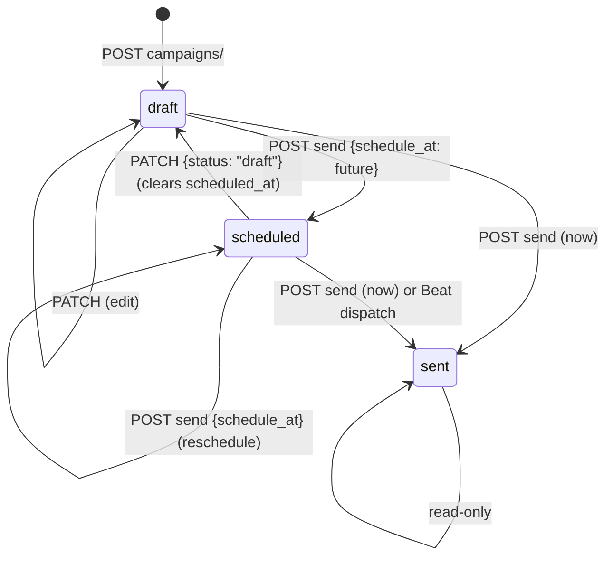

# Marketing Center API — M13 (مركز التسويق)

> **Source**: DOC-141 → DOC-146 (Step 21) · INT-019 (M13), INT-034, INT-013, INT-017, INT-002 hand-over · inventory Domain 7 + A.5 + A.7 + A.8 + A.9
> **Live key**: `marketing` (`SHARWA_LIVE_MODULES`) — **18 BFF rows** (15 readable + 3 deep, see [§3.1](#bff-rows)), all `liveOrMock(request, "marketing", "/api/v1/…", mockFn)`. The three deepest files (`abandoned-carts/[id]/remind`, `campaigns/[id]/preview`, `campaigns/[id]/send`) could not be opened in the documentation session; their rows are taken from the architecture register and the sibling files.
> **Django provider**: `sharwa_saas/api/views_marketing.py` (`MarketingAPIMixin`, 18 views, routes at `api/urls.py` lines 318–335) · `sharwa_saas/products/services/marketing_service.py` · `products/campaigns.py` (`resolve_audience`, `render_message`, `send_campaign`) · `products/abandoned_cart_service.py` (`_send_one_reminder`) · `products/services/messaging.py` (`CheckoutService._buy_x_get_y_discount`) · models `products/models/marketing.py` (`Coupon`, `PromotionalOffer`, `MarketingCampaign`, `CampaignRecipient`, `MarketingEvent`), `models/carts_recovery.py` (`AbandonedCart`), `models/loyalty.py` (`LoyaltyProgram`), `models/store_settings.py` (`GiftSettings`, `AbandonedCartSettings`) · migration `products/migrations/0220_marketing_api.py`
> **Frontend contract**: `sharwa-frontend/src/features/marketing/schemas.ts` (`couponSchema`, `offerSchema`, `abandonedCartSchema`, `abandonedSettingsSchema`, `campaignSchema`, `eventSchema`, `loyaltySchema`, `giftSchema`, `summarySchema`) · hooks `src/features/marketing/api.ts` · form `src/features/marketing/components/offer-form.tsx` · fixture `src/mocks/marketing/**` · BFF `src/app/api/bff/marketing/**`
> **Tests**: `sharwa_saas/api/test_marketing_api.py` (**10** tests: `test_auth_permissions_and_feature`, `test_coupons_crud_and_state`, `test_influencer_coupon_guarded`, `test_offers_conditions_image_and_engine`, `test_abandoned_carts_list_remind_settings`, `test_campaign_lifecycle`, `test_scheduled_campaigns_are_dispatched`, `test_channels`, `test_timeline`, `test_loyalty_gifting_summary`)
> **Last verified against code**: 2026-10-27 (step 21)

<a id="overview"></a>

## 1. Overview

M13 turns the seven marketing tools of the merchant dashboard into a JSON API: **coupons, promotional offers, abandoned-cart recovery, campaigns, the marketing timeline, the loyalty programme settings and the gifting switch**, plus a one-call **summary**. Before INT-019 these were Django HTML screens only.

**The API writes to the same models the cart and checkout engine reads.** A coupon saved here is the `Coupon` row `CheckoutService` validates at checkout; an offer saved here is the `PromotionalOffer` row the cart pricing evaluates; the reminder a merchant sends by hand goes through the same `_send_one_reminder` as the scheduled command. There is no parallel pricing path ([domain overview](README.md#shared-models)).

**Rules that hold everywhere**

- Amounts are stored in SAR and the `display_*` strings are formatted by the server in the store currency (`format_money`); the client never formats money.
- Enum **values** are the Django models' (`percent`/`fixed`, `discount`/`free_shipping`/`buy_x_get_y`, …); Arabic labels are UI text.
- Validation answers `400` with `{field: [message]}`; a missing object answers `404` with `{"detail": …}`. Messages are quoted verbatim in «…».
- List endpoints that page use `?page` (default `1`) and `?page_size` (default `50`, capped at `100`) and answer `{count, results}`; the offers list defaults to 100 per page ([§4.3](#offers)).

<a id="access"></a>

## 2. Access

`MarketingAPIMixin.check` runs the gates in this order; the first failing gate answers. The order is **different** for owner-only and permission-based routes.

| # | Gate | Permission-based routes (summary, coupons, offers) | Owner-only routes (carts, campaigns, timeline, loyalty, gifting) |
|---|---|---|---|
| 1 | CSRF / tenant / session | `ProductsAPIMixin.gate(request, permission)` — `401` `{"detail": "انتهت جلستك، سجّل الدخول مجدداً."}` | `gate(request, None)` — same `401`, **no permission key** |
| 2 | Permission key | `403` `{"detail": "ليست لديك صلاحية لهذا الإجراء."}` when the staff member lacks it | — |
| 3 | Owner only | — | staff session ⇒ `403` with the per-tool sentence below |
| 4 | Plan feature | `settings_feature_enabled(request, feature)` ⇒ `403` `{"detail": "هذه الميزة غير متاحة في باقتك الحالية"}` (no final full stop) | same |

Owner-only sentences (`OWNER_MESSAGES`, keyed by the plan feature):

| Plan feature | Sentence |
|---|---|
| `abandoned_carts` | «السلات المتروكة مقصورة على مالك المتجر.» |
| `campaigns` | «الحملات مقصورة على مالك المتجر.» |
| `timeline` | «الجدول الزمني مقصور على مالك المتجر.» |
| `loyalty_settings` | «إعدادات نقاط الولاء مقصورة على مالك المتجر.» |
| `gift_settings` | «إعدادات الإهداء مقصورة على مالك المتجر.» |

<a id="gates-summary"></a>

## 3. Endpoint summary and gate matrix (DOC-141)

The views register **17 routes under `/api/v1/promotions/…` plus `/api/v1/loyalty/program/`** — 18 routes in all (`api/urls.py` lines 318–335).

> ⚠️ Discrepancy — roadmap says (DOC-137/141) "18 routes under `promotions/` + `loyalty/program/`" (19) / code does: 17 `promotions/…` routes + `loyalty/program/` = **18** routes in total, matching the 18 BFF rows. The roadmap's own enumeration (summary · coupons · `<pk>` · offers · `<pk>` · abandoned-carts · `<pk>` · remind · abandoned-cart-settings · campaigns · channels · `<pk>` · preview · send · timeline · `<pk>` · gift-settings) lists 17.

| # | Method | Django path (`/api/v1/…`) | Gate (permission / owner) | Plan feature | Success | Section |
|---|---|---|---|---|---|---|
| 1 | `GET` | `promotions/summary/` | `discounts.apply` | **none** | `200` | [§4.1](#gates-summary) |
| 2 | `GET` | `promotions/coupons/` | `discounts.apply` | `coupon` | `200` | [§4.2](#coupons) |
| 3 | `POST` | `promotions/coupons/` | `discounts.manage` | `coupon` | `201` | [§4.2](#coupons) |
| 4 | `GET` | `promotions/coupons/<pk>/` | `discounts.apply` | `coupon` | `200` | [§4.2](#coupons) |
| 5 | `PATCH` | `promotions/coupons/<pk>/` | `discounts.manage` | `coupon` | `200` | [§4.2](#coupons) |
| 6 | `DELETE` | `promotions/coupons/<pk>/` | `discounts.manage` | `coupon` | `204` | [§4.2](#coupons) |
| 7 | `GET` | `promotions/offers/` | `discounts.apply` | `coupon` | `200` | [§4.3](#offers) |
| 8 | `POST` | `promotions/offers/` (JSON or multipart) | `discounts.manage` | `coupon` | `201` | [§4.3](#offers) |
| 9 | `GET` | `promotions/offers/<pk>/` | `discounts.apply` | `coupon` | `200` | [§4.3](#offers) |
| 10 | `PATCH` | `promotions/offers/<pk>/` (JSON or multipart) | `discounts.manage` | `coupon` | `200` | [§4.3](#offers) |
| 11 | `DELETE` | `promotions/offers/<pk>/` | `discounts.manage` | `coupon` | `204` | [§4.3](#offers) |
| 12 | `GET` | `promotions/abandoned-carts/` | owner | `abandoned_carts` | `200` | [§4.4](#abandoned-carts) |
| 13 | `GET` | `promotions/abandoned-carts/<pk>/` | owner | `abandoned_carts` | `200` | [§4.4](#abandoned-carts) |
| 14 | `POST` | `promotions/abandoned-carts/<pk>/remind/` | owner | `abandoned_carts` | `200` the cart | [§4.4](#abandoned-carts) |
| 15 | `GET` · `PATCH` | `promotions/abandoned-cart-settings/` | owner | `abandoned_carts` | `200` | [§4.4](#abandoned-carts) |
| 16 | `GET` · `POST` | `promotions/campaigns/` | owner | `campaigns` | `200` / `201` | [§4.5](#campaigns) |
| 17 | `GET` | `promotions/campaigns/channels/` | **session only** (no owner check) | **none** | `200` | [§4.5](#campaigns) |
| 18 | `GET` · `PATCH` | `promotions/campaigns/<pk>/` | owner | `campaigns` | `200` | [§4.5](#campaigns) |
| 19 | `GET` | `promotions/campaigns/<pk>/preview/` | owner | `campaigns` | `200` | [§4.5](#campaigns) |
| 20 | `POST` | `promotions/campaigns/<pk>/send/` | owner | `campaigns` | `200` | [§4.5](#campaigns) |
| 21 | `GET` · `POST` | `promotions/timeline/` | owner | `timeline` | `200` / `201` | [§4.6](#timeline-gifting-loyalty) |
| 22 | `PATCH` · `DELETE` | `promotions/timeline/<pk>/` | owner | `timeline` | `200` / `204` | [§4.6](#timeline-gifting-loyalty) |
| 23 | `GET` · `PATCH` | `promotions/gift-settings/` | owner | `gift_settings` | `200` | [§4.6](#timeline-gifting-loyalty) |
| 24 | `GET` · `PATCH` | `loyalty/program/` | owner | `loyalty_settings` | `200` | [§4.6](#timeline-gifting-loyalty) |

(The table lists verbs; the 18 **routes** are the distinct paths.)

> ⚠️ Discrepancy — roadmap says (DOC-141) "carts, campaigns, timeline, loyalty, gifting owner-only" and "coupons/offers/summary by `discounts.apply` / `discounts.manage`", with plan features only on the six tools / code does: **`promotions/campaigns/channels/` is not owner-only and has no plan feature** — `CampaignChannelsView` is a bare `MarketingAPIMixin` (any signed-in owner or staff session reads the six channel states). **`promotions/summary/` has the permission `discounts.apply` but no plan feature** (a store whose plan lacks `coupon` still reads the four numbers).

`test_auth_permissions_and_feature` covers: no session ⇒ `401`; a staff member without `discounts.apply` ⇒ `403`; a staff member on an owner-only route ⇒ `403` with the sentence above; feature off ⇒ `403` with the plan sentence.

<a id="bff-rows"></a>

### 3.1 BFF rows (18)

| Group | BFF paths (`/api/bff/marketing/…`) | Django upstream |
|---|---|---|
| Summary | `summary` | `promotions/summary/` |
| Coupons | `coupons`, `coupons/[id]` | `promotions/coupons/…` |
| Offers | `offers`, `offers/[id]` | `promotions/offers/…` |
| Carts | `abandoned-carts`, `abandoned-carts/[id]`, `abandoned-carts/[id]/remind`, `abandoned-carts/settings` | `promotions/abandoned-carts/…`, `promotions/abandoned-cart-settings/` |
| Campaigns | `campaigns`, `campaigns/[id]`, `campaigns/[id]/preview`, `campaigns/[id]/send`, `campaigns/channels` | `promotions/campaigns/…` |
| Timeline | `timeline`, `timeline/[id]` | `promotions/timeline/…` |
| Gifting | `gifting` | `promotions/gift-settings/` |
| Loyalty | `loyalty` | `loyalty/program/` |

Two names differ between BFF and Django: BFF `abandoned-carts/settings` ⇒ Django `promotions/abandoned-cart-settings/`, and BFF `gifting` ⇒ Django `promotions/gift-settings/`. The BFF `marketing/loyalty` row (live key `marketing`) is the owner editor `loyalty/program/`; its read-only twin `customers/loyalty-program/` is reached through key `wallets` ([M35](../06-customers-wallets/m35-wallets-loyalty.md)).

> Note — the BFF **mock** and Django word a few owner-only sentences differently (for example the mock cart-settings sentence «إعدادات السلات المتروكة مقصورة على مالك المتجر.» versus Django's «السلات المتروكة مقصورة على مالك المتجر.»). The live sentences are the ones in [§2](#access).

> **Limitation of this step.** The 15 BFF files above were read; the three deepest rows (`remind`, `preview`, `send`) sit beyond the staging limit of the documentation session and were taken from the architecture register ([`22-live-module-keys.md`](../../../architecture/22-live-module-keys.md)) and from the views.

<a id="summary"></a>

### 4.1 Summary — `GET /api/v1/promotions/summary/` (DOC-141)

Gate: `discounts.apply`, no plan feature. Response (four counters computed per call):

```json
{
  "active_coupons": 3,
  "active_offers": 1,
  "abandoned_today": 2,
  "last_campaign": { "id": 7, "name": "Weekend offer", "status": "sent", "sent_at": "2026-01-01T09:00:00+00:00" }
}
```

| Key | Definition |
|---|---|
| `active_coupons` | coupons whose temporal state is `active` ([§4.2](#coupons)) |
| `active_offers` | offers whose temporal state is `active` |
| `abandoned_today` | carts with status `abandoned` and `last_interaction_at` on today's local date |
| `last_campaign` | the campaign with the latest `sent_at`; when none was ever sent, the latest created campaign; `null` when there are no campaigns |

<a id="coupons"></a>

### 4.2 Coupons — `promotions/coupons/` · `<pk>/` (DOC-142)

**Row** (`coupon_view`): `id`, `code`, `discount_type` (`percent`/`fixed`), `discount_value` (percent as integer text, fixed as decimal text), `display_discount`, `apply_to` (`all`/`category`/`product`), `category` / `product` (`{id, name}` or `null`), `min_order_amount` + `display_min_order_amount`, `influencer` (`{id, name}` or `null`), `start_date`, `expires_at`, `is_active`, `max_uses`, `used_count`, `created_at`.

**List** `GET`: `?q` (Arabic-normalised substring of the code **or the influencer's name**), `?status` (one of the five temporal states), `?page`, `?page_size`; ordered newest first; `{count, results}`.

**Temporal state** (computed with `_temporal`, same order as the UI's `couponState`):

1. `is_active` false ⇒ `inactive`
2. `max_uses` set and `used_count ≥ max_uses` ⇒ `exhausted`
3. `start_date` in the future ⇒ `not_started`
4. `expires_at` in the past (or equal to now) ⇒ `expired`
5. otherwise `active`

**Write fields and validation** (`POST` needs every field marked *required*; `PATCH` is partial):

| Field | Rule | Message |
|---|---|---|
| `code` *(required)* | upper-cased; regex `^[A-Z0-9_-]{3,32}$` | «الكود من 3 إلى 32 حرفاً لاتينياً أو رقماً.» |
| `code` | unique, case-insensitive | «هذا الكود مستخدم لكوبون آخر.» |
| `code` (influencer coupon) | cannot change | «كود كوبون المؤثر لا يُغيَّر.» |
| `discount_type` | `percent` (default) or `fixed` | «نوع الخصم غير معروف.» |
| `discount_value` *(required)* | decimal > 0 | «القيمة يجب أن تكون أكبر من صفر.» |
| `discount_value` (percent) | **integer** 1–100 | «النسبة بين 1 و100.» |
| `apply_to` | `all` (default), `category`, `product` | «قيمة غير صالحة.» |
| `category_id` / `product_id` | required when `apply_to` is `category` / `product`; must exist; switching `apply_to` clears the other reference | «اختر التصنيف.» / «اختر المنتج.» |
| `min_order_amount` | decimal > 0 or empty | «القيمة يجب أن تكون أكبر من صفر.» |
| `max_uses` | integer > 0 or empty | «عدد صحيح أكبر من صفر.» |
| `start_date`, `expires_at` | parseable date-time or empty | «تاريخ غير صالح.» |
| `expires_at` | must be after `start_date` | «تاريخ النهاية يجب أن يكون بعد البداية.» |
| `is_active` | boolean | — |

**Influencer coupons.** A coupon with `influencer` set keeps its code and **cannot be deleted here**: `DELETE` answers `400` `{"detail": "كوبون المؤثر يُدار من صفحة المؤثرين."}`. Such coupons are linked to their influencer outside this API and managed from the influencer pages ([M17](m17-affiliates-influencers.md#resources)). A missing id answers `404` «الكوبون غير موجود.». `test_influencer_coupon_guarded` covers the guard; `test_coupons_crud_and_state` covers CRUD and the temporal filter.

<a id="offers"></a>

### 4.3 Offers — `promotions/offers/` · `<pk>/` (DOC-143)

**Row** (`offer_view`): `id`, `name`, `offer_type`, `discount_type`/`discount_value`/`display_discount` (only for `discount`), `min_order_amount` + `display_min_order_amount` (not for `buy_x_get_y`), `description`, `image` (absolute URL or `null`), `cta_text`, `buy_quantity`, `buy_condition_type`, `buy_category`, `buy_product`, `get_product`, `get_quantity`, `get_discount_percent`, `min_total_items`, `priority`, `valid_from`, `valid_until`, `is_active`, `created_at`.

**List**: `?q`, `?status` (temporal state), `?offer_type`, `?page`, `?page_size` (default **100**, cap 100); ordered `-priority, -created_at`. A missing id answers `404` «العرض غير موجود.».

**Priority.** Higher number first (`order_by('-priority', …)`): the storefront shows the offer with the larger `priority` first. The merchant-facing hint in `offer-form.tsx` was corrected to «الرقم الأكبر يظهر أولاً في واجهة المتجر.» to follow Django.

**Multipart `image`.** `POST` and `PATCH` accept JSON or multipart/form-data (`JSONParser`, `MultiPartParser`, `FormParser`); the BFF forwards the multipart body as it is. `image` extension must be `jpg, jpeg, png, webp, gif` and the file ≤ 5 MB; sending `image` as `null` or `''` clears it.

**The condition mapping.** The frontend contract has **one** condition (`buy_condition_type`, `buy_category`, `buy_product`, `min_total_items`) for every offer type, labelled «شرط التطبيق» in `offer-form.tsx` (legend added in INT-019, with schema validation and the mock). Django stores it in two places:

| Offer type | Frontend field | Django column read / written | Notes |
|---|---|---|---|
| `discount` | `buy_condition_type` | `condition_type` | `all` default |
| `discount` | `buy_category` (`buy_category_id` on write) | `category` | condition `category` |
| `discount` | `buy_product` (`buy_product_id`) | `product` | condition `product` |
| `discount` | `min_total_items` | `min_total_items` | condition `min_items` |
| `free_shipping` | same four fields | `condition_type`, `category`, `product`, `min_total_items` | same as `discount` |
| `buy_x_get_y` | `buy_condition_type` | `buy_condition_type` (default `category` when empty) | the «buy X» condition; `condition_type` is forced to `all` |
| `buy_x_get_y` | `buy_category` / `buy_product` | `buy_category` / `buy_product` | `category` / `product` columns are cleared |
| `buy_x_get_y` | `min_total_items` | `min_total_items` | condition `min_items` |

The view returns `buy_category` only when the condition is `category`, `buy_product` only when it is `product`, and `min_total_items` only when it is `min_items`; otherwise `null`.

**Per-type fields and validation**

| Field | Applies to | Rule | Message |
|---|---|---|---|
| `name` | all | ≥ 2 characters (cut at 150) | «أدخل اسم العرض.» |
| `offer_type` | all | `discount`, `free_shipping`, `buy_x_get_y` | «نوع العرض غير معروف.» |
| `discount_type`, `discount_value` | `discount` | as coupons | «نوع الخصم غير معروف.» · «القيمة يجب أن تكون أكبر من صفر.» · «النسبة بين 1 و100.» |
| `min_order_amount` | `discount`, `free_shipping` | decimal > 0 or empty (forced to empty for `buy_x_get_y`) | «القيمة يجب أن تكون أكبر من صفر.» |
| `buy_condition_type` | all | `all`, `category`, `product`, `min_items` | «شرط الشراء غير معروف.» |
| `buy_category_id` / `buy_product_id` | condition `category` / `product` | must exist | «اختر التصنيف.» / «اختر المنتج.» |
| `min_total_items` | condition `min_items` | integer > 0 | «عدد صحيح أكبر من صفر.» |
| `buy_quantity`, `get_quantity` | `buy_x_get_y` | integer > 0 (no model defaults on create) | «عدد صحيح أكبر من صفر.» |
| `get_product_id` | `buy_x_get_y` | must exist | «اختر المنتج الممنوح.» |
| `get_discount_percent` | `buy_x_get_y` | integer 1–100 | «النسبة بين 1 و100.» |
| `description` | all | ≤ 300 | «حتى 300 حرف.» |
| `cta_text` | all | ≤ 40 | «حتى 40 حرفاً.» |
| `priority` | all | integer ≥ 0 | «الأولوية عدد صحيح.» |
| `valid_from`, `valid_until` | all | date-time; `valid_until` after `valid_from` | «تاريخ غير صالح.» · «تاريخ النهاية يجب أن يكون بعد البداية.» |
| `image` | all | extension / size | «الصيغ المسموحة: jpg, jpeg, png, webp, gif» · «حجم الصورة أكبر من 5MB.» |

**Engine gap closed.** `CheckoutService._buy_x_get_y_discount` (`products/services/messaging.py`, about lines 233–268) understood only the `category` and `product` conditions. It now also supports:

- `all` — every unit in the cart counts as a «buy» unit;
- `min_items` — the offer applies once the number of buy units reaches `min_total_items`.

The reward is `min(buy_units // buy_quantity, get_units // get_quantity) × get_quantity × unit price × get_discount_percent / 100`. Migration `0220_marketing_api` adds the choices `all` and `min_items` to `PromotionalOffer.buy_condition_type` (and `MarketingCampaign.sent_at`, [§4.5](#campaigns)). `test_offers_conditions_image_and_engine` exercises the mapping, the image and the engine.

<a id="abandoned-carts"></a>

### 4.4 Abandoned carts — `promotions/abandoned-carts/` · `<pk>/` · `remind/` · `abandoned-cart-settings/` (DOC-144)

Owner-only, plan feature `abandoned_carts`.

**List** `GET`: `?status` (`active`/`abandoned`/`recovered`), `?from`, `?to` (dates on `last_interaction_at`), `?q` (a phone fragment of at least 3 digits, or an Arabic-normalised name part), `?page`, `?page_size`.

- **Lazy promotion.** Each list call first runs `promote_abandoned_carts()`, which moves idle `active` carts to `abandoned`; there is no dependency on a scheduled job for the screen to be current.
- Response: `{count, counters: {active, abandoned, recovered}, results}` — the counters count **all** carts, not just the filtered page.

**Row** (`cart_view`): `id`, `customer_name`, `customer_phone` (both `null` when empty), `display_total`, `currency`, `items_count`, `status`, `reminder_step` (0–2), `last_interaction_at`, `last_reminder_sent_at`, `recovered_order_id`, `reminder_discount_coupon` (the code of the step-2 coupon or `null`), `items[]` = `{product_id, name, quantity, display_price, image}`. Item prices are the product's **current** price converted to the **cart's currency** (`get_converted_price`), not a stored snapshot; an item whose product was deleted reads «منتج محذوف». A missing cart answers `404` «السلة غير موجودة.».

**Remind** `POST …/<pk>/remind/` sends the **next** step (`reminder_step + 1`) through `abandoned_cart_service._send_one_reminder(cart, step, settings, base_url)` — the same function as the scheduled command (template, channel, step-2 coupon). It answers the refreshed cart row. Errors (`400`, `{"detail": …}`), checked in this order:

| Condition | Message |
|---|---|
| no phone on the cart | «لا رقم هاتف لهذه السلة.» |
| status is not `abandoned` | «التذكير متاح للسلات المتروكة فقط.» |
| `reminder_step ≥ 2` | «أُرسل التذكيران لهذه السلة — لا تذكير ثالث.» |
| no channel could deliver | «لا قناة إرسال متاحة لهذه السلة — فعّل واتساب في إعدادات الاسترداد أو اربط القناة.» |

**Channel and coupon.** The channel is the conversational channel of the customer's latest `Conversation` when `channel_conversational_enabled`, else WhatsApp when `channel_whatsapp`. Step 2 creates a recovery coupon `BACK<cart id><4 random digits>` (percent type, `max_uses` 1, `discount_percent` and `discount_validity_hours` from the settings).

**Restore link.** The reminder text carries `{cart_url}`, built with `reverse('restore_abandoned_cart')` = `cart/restore/<token>/` on the tenant host (`config/urls_tenant.py:253`); the Next storefront serves `[store]/cart/restore/[token]/page.tsx` ([M11 cart](../05-storefront/m11-cart.md)).

> ⚠️ Discrepancy — roadmap says (DOC-144) "restore links `/cart/restore/<token>`" / code does: Django's route is `cart/restore/<token>/` **with** a trailing slash on the tenant host; the Next storefront route has no trailing slash. Both resolve; documentation of links should use the Django form when quoting the server.

**Settings** `GET|PATCH …/abandoned-cart-settings/` — row: `is_enabled`, `min_cart_value`, `channel_whatsapp`, `channel_email`, `channel_sms`, `channel_conversational_enabled`, `reminder_1_delay_hours`, `reminder_1_message`, `reminder_2_delay_hours`, `reminder_2_message`, `discount_percent`, `discount_validity_hours`.

| Field | Writable | Rule | Message |
|---|---|---|---|
| `is_enabled`, `channel_whatsapp`, `channel_conversational_enabled` | yes | boolean | — |
| `channel_email`, `channel_sms` | **no** (read-only) | the PATCH ignores them | — |
| `reminder_1_delay_hours`, `reminder_2_delay_hours`, `discount_validity_hours` | yes | integer ≥ 1 | «عدد صحيح 1 أو أكثر.» |
| `discount_percent` | yes | integer 0–100 | «النسبة بين 0 و100.» |
| `min_cart_value` | yes | decimal ≥ 0 | «قيمة غير صالحة.» |
| `reminder_1_message` | yes | non-empty; variables `{customer_name}`, `{cart_url}` only | «أدخل نص التذكير.» · «متغير غير معروف: {x}» |
| `reminder_2_message` | yes | non-empty; variables `{customer_name}`, `{cart_url}`, `{discount_percent}`, `{discount_code}` | same |

The unknown-variable message names the **first** unknown variable, for example «متغير غير معروف: {coupon}».

> ⚠️ Discrepancy — roadmap says (DOC-144) settings validate template variables per reminder, without saying which fields are writable / code does: `channel_email` and `channel_sms` are part of the settings **response** but the PATCH does not write them (only WhatsApp and the conversational channel are switchable here).

`test_abandoned_carts_list_remind_settings` covers the list and counters, each remind error, and the settings validation.

<a id="campaigns"></a>

### 4.5 Campaigns — `promotions/campaigns/` · `channels/` · `<pk>/` · `preview/` · `send/` (DOC-145)

Owner-only, plan feature `campaigns` — except `channels/` ([§3](#gates-summary)).

**Vocabulary**

| Item | Values |
|---|---|
| `channel` | `sms`, `email`, `whatsapp`, `meta_social_commerce`, `tiktok_shop`, `telegram_bot` |
| `audience_type` | `all`, `abandoned_carts`, `dormant`, `bought_product` (needs `product_id`) |
| `status` | `draft`, `scheduled`, `sent` |

**Row** (`campaign_view`): `id`, `name`, `channel`, `channel_connected`, `audience_type`, `product` (`{id, name}` or `null`), `message`, `status`, `scheduled_at`, `sent_at`, `recipients` = `{pending, sent, failed}`, `created_at`. In the list, `recipients` counts the `CampaignRecipient` rows by status; a scheduled campaign with no recipient rows yet shows the **live audience count as `pending`**.

**List** `GET ?status&q&page&page_size` → `{count, results}`, newest first.

**Create / update fields**

| Field | Rule | Message |
|---|---|---|
| `name` | ≥ 2 characters (cut at 150) | «أدخل اسم الحملة.» |
| `channel` | one of the six | «القناة غير معروفة.» |
| `audience_type` | one of the four | «الجمهور غير معروف.» |
| `product_id` | required when `audience_type` is `bought_product` | «اختر المنتج.» |
| `message` | 5–1000 characters | «أدخل نص الرسالة.» · «حتى 1000 حرف.» |

Every create and update stores `dormant_days = 90` (`DORMANT_DAYS`): API-created campaigns always use the 90-day «dormant» window of the M07 hand-over. A missing id answers `404` «الحملة غير موجودة.».

**State machine**



- `PATCH {status: "draft"}` on a **scheduled** campaign cancels the schedule (`status` back to `draft`, `scheduled_at` cleared). Any other PATCH edits the content fields.
- A **sent** campaign is read-only: PATCH answers `400` «الحملة المرسلة للقراءة فقط.».

**Preview** `GET …/<pk>/preview/` → `{recipients_count, rendered_message}`: `campaigns.resolve_audience` (channel-aware audience, so the count is what would really be sent) and `render_message` for the first recipient (`{customer_name}` replaced; the default name when unknown is «عميلنا العزيز»).

**Send** `POST …/<pk>/send/` with an optional body `{schedule_at}`:

| Order | Check | Result |
|---|---|---|
| 1 | campaign already `sent` | `400` «أُرسلت هذه الحملة من قبل.» |
| 2 | channel not connected | `400` «القناة غير مربوطة — اربطها أولاً.» |
| 3 | `schedule_at` present | in the future ⇒ `status = scheduled` and `scheduled_at` saved, answer the campaign; otherwise `400` `{"schedule_at": ["اختر وقتاً في المستقبل."]}` (also for an unparseable value) |
| 4 | no `schedule_at` | `dispatch_campaign` — send now |

**Send now (`dispatch_campaign`).** Inside `transaction.atomic()` the row is locked (`select_for_update`, deliberately **without** `select_related`: PostgreSQL rejects `FOR UPDATE` on the nullable side of a LEFT JOIN). If the status is not `draft`/`scheduled` it returns nothing (the API answers «أُرسلت هذه الحملة من قبل.»). Otherwise `status = sent`, `sent_at = now`, `scheduled_at = null` are written **first**, then `send_campaign` bulk-creates the `CampaignRecipient` rows and enqueues Celery chunks on the queue `channels_broadcast` (chunk size `SHARWA_CAMPAIGN_CHUNK_SIZE`, default 50). Flipping the status under the lock means a double click, or a worker and a button at once, cannot send twice.

**Channels** `GET …/channels/` → an array of six `{channel, connected, manage_href}`. WhatsApp, Meta, TikTok and Telegram are **connected** when the matching app is installed and active (`is_app_active`); **`sms` and `email` are always `false`** (no real provider yet — `LogGateway` only), so a campaign on those channels can be drafted and previewed but never sent.

**Scheduled sending.** Before INT-019 a scheduled campaign was never sent. The Beat entry `dispatch-scheduled-campaigns` (`config/settings.py`, `crontab(minute='*/5')`) runs the fan-out task `products.tasks.dispatch_scheduled_campaigns` (`products/tasks/operations.py`), which calls `dispatch_scheduled_campaigns_for_tenant` for each tenant and then `marketing_service.dispatch_due_campaigns` — campaigns with `status = scheduled` and `scheduled_at ≤ now` are dispatched (`expected=('scheduled',)`). A scheduled campaign therefore leaves up to five minutes late. `MarketingCampaign.sent_at` is added by migration `0220_marketing_api`.

`test_campaign_lifecycle`, `test_scheduled_campaigns_are_dispatched` and `test_channels` cover the lifecycle, the dispatcher and the channel states.

<a id="timeline-gifting-loyalty"></a>

### 4.6 Timeline, gifting and loyalty (DOC-146)

All three are owner-only with their own plan feature ([§2](#access)).

#### Timeline — `promotions/timeline/` · `<pk>/`

`GET ?from&to` returns a **plain array** ordered by `start_date, id`. The filter is an **overlap** test: `from` keeps events whose `end_date ≥ from` (or with no end date and `start_date ≥ from`); `to` keeps events whose `start_date ≤ to`. Both are `YYYY-MM-DD`; an unparseable value is ignored.

**Row** (`event_view`): `id`, `title`, `event_type`, `color`, `start_date`, `end_date`, `linked_campaign` (`{id, name, status}` or `null`), `linked_offer` (`{id, name, is_active}` or `null`), `notes`.

| Field | Rule | Message |
|---|---|---|
| `title` | ≥ 2 characters (cut at 150) | «أدخل عنوان الحدث.» |
| `event_type` | `seasonal`, `holiday`, `campaign_plan`, `custom` (default `custom`) | «النوع غير معروف.» |
| `color` | `indigo`, `emerald`, `amber`, `rose`, `sky` (default `indigo`) | «اللون غير معروف.» |
| `start_date`, `end_date` | valid dates (both required on create) | «تاريخ غير صالح.» |
| `end_date` | not before `start_date` | «تاريخ النهاية يجب أن يكون بعد البداية.» |
| `notes` | ≤ 300 | «حتى 300 حرف.» |
| `linked_campaign_id` / `linked_offer_id` | an existing id, or `null`/`''` to unlink | «الحملة غير موجودة.» / «العرض غير موجود.» |

`POST` answers `201`; `PATCH` and `DELETE` (`204`) exist on `<pk>/` only — there is no `GET <pk>/`. A missing id answers `404` «الحدث غير موجود.».

#### Gifting — `promotions/gift-settings/`

`GET` → `{"is_enabled": bool}`; `PATCH {is_enabled}` writes the flag (`GiftSettings`) and answers the same shape. The BFF row is `marketing/gifting`.

#### Loyalty programme — `loyalty/program/`

`GET` → `{is_enabled, riyals_per_point, points_per_riyal_redemption, min_points_to_redeem}` (integers). `PATCH` is partial.

| Field | Rule | Message |
|---|---|---|
| `riyals_per_point`, `points_per_riyal_redemption`, `min_points_to_redeem` | integers ≥ 0 | «القيمة يجب أن تكون عدداً صحيحاً.» |
| `riyals_per_point`, `points_per_riyal_redemption` | **must be > 0 when the programme is enabled** (checked on the merged values) | «القيمة يجب أن تكون أكبر من صفر.» |

The PATCH accepts integers only and `loyalty_view` casts the three numbers to integers, while the underlying model columns are decimals: a fractional rate set elsewhere (the Django screen) reads back truncated here (the same finding is recorded for the read twin in [M35](../06-customers-wallets/m35-wallets-loyalty.md)).

The programme settings are read by checkout and by the points ledger of [M35](../06-customers-wallets/m35-wallets-loyalty.md); the merchant's read-only copy is `customers/loyalty-program/`.

> ⚠️ Discrepancy — roadmap says (DOC-146) "`/config/` gifting/loyalty extensions handed over by INT-002 served here" / code does: neither `StoreConfigSerializer` (`api/serializers.py`) nor the frontend contract `src/features/storefront/schemas/config.ts` contains any gifting or loyalty field. The two areas are served **only** by `promotions/gift-settings/` and `loyalty/program/` (owner-only); the public `/config/` response carries the announcement and theme fields and the `sections`, nothing else from this page.

`test_timeline` and `test_loyalty_gifting_summary` cover this section.

<a id="schema-changes"></a>

## 5. Gaps closed, bugs fixed, migrations

| Item | Change |
|---|---|
| Migration `0220_marketing_api` | `MarketingCampaign.sent_at`; `PromotionalOffer.buy_condition_type` choices `all` and `min_items` |
| `_buy_x_get_y_discount` | now handles `all` and `min_items` (before: `category` / `product` only) |
| Scheduled campaigns | new Beat task `dispatch-scheduled-campaigns` every 5 minutes per tenant |
| Double send | status flipped to `sent` under a row lock before enqueueing |
| Offer condition | one frontend condition for every offer type, mapped to `condition_type` or `buy_condition_type` |
| Offer priority hint | UI text corrected to «higher first» |

<a id="open-items"></a>

## 6. Open items

- `sms` and `email` campaigns cannot be sent until a real provider replaces `LogGateway`.
- The coupon `expired` boundary is `expires_at ≤ now` on the server and `<` in the UI helper (`couponState`) — identical except at the exact instant.
- The BFF mock and Django differ in a few owner-only sentences ([§3.1](#bff-rows)).

<a id="related"></a>

## 7. Related pages

- [Domain 7 overview](README.md) · [Theme customizer](m08-theme-customizer.md) · [Affiliates & influencers](m17-affiliates-influencers.md)
- Checkout and cart engines that read these rows: [cart](../05-storefront/m11-cart.md) · [checkout](../05-storefront/m12-checkout.md)
- Customers and points: [M35 wallets & loyalty](../06-customers-wallets/m35-wallets-loyalty.md)
- Cross-cutting: [auth](../../overview/auth.md) · [permissions](../../overview/permissions.md) · [plan features](../../overview/plan-features.md) · [errors](../../overview/errors.md) · [pagination](../../overview/pagination.md) · [money](../../overview/money.md)
