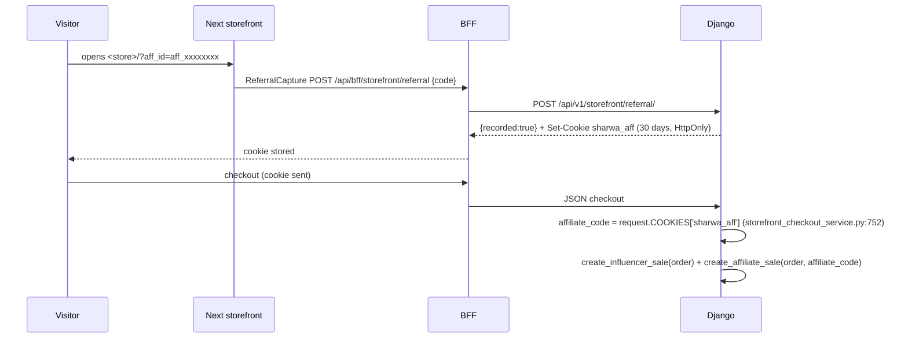

# Affiliates & Influencers API — M17 (المسوّقون والمؤثرون)

> **Source**: DOC-147 → DOC-149 (Step 21) · INT-034 (M17), INT-014 · inventory Domain 7
> **Live key**: `affiliates` (`SHARWA_LIVE_MODULES`) — **2 BFF catch-all rows**: `src/app/api/bff/affiliates/[[...path]]/route.ts` and `src/app/api/bff/influencers/[[...path]]/route.ts`, both `liveOrMock(request, "affiliates", "/api/v1/<kind>/<path>/", mockFn)` and exporting `GET`, `POST`, `PATCH`. The public referral row `src/app/api/bff/storefront/referral/route.ts` is **not** a live-key row: it uses the Django-first `storefrontAdapter` ([§4.3](#referral)). `.env.example` lists `affiliates` in its commented `SHARWA_LIVE_MODULES=` example.
> **Django provider**: `sharwa_saas/api/views_partners.py` (`PartnersAPIMixin`, `kind` passed from `urls.py`, 6 views) · `sharwa_saas/products/services/partners_service.py` · attribution `products/affiliates.py` (`create_affiliate_sale`) and `products/influencers.py` (`create_influencer_sale`) · models `products/models/marketing.py` (`Affiliate`, `AffiliateClick`, `AffiliateSale`, `Influencer`, `InfluencerSale`, `Coupon.influencer`) — **no migration**
> **Frontend contract**: `sharwa-frontend/src/features/affiliates/schemas.ts` (`affiliateSchema`, `influencerSchema`, `saleSchema`, `markPaidResultSchema`, `partnerSummarySchema`, input schemas, `referralLink`) · hooks `src/features/affiliates/api.ts` · fixture `src/mocks/affiliates/state.ts` · `src/features/storefront/components/referral-capture.tsx`
> **Tests**: `sharwa_saas/api/test_partners_api.py` (**8** tests: `test_gates`, `test_create_and_patch_affiliate`, `test_create_influencer_with_coupons`, `test_pending_counts_eligible_minus_clawback`, `test_search_sort_and_has_pending`, `test_mark_paid_rules`, `test_influencer_sales_and_payout_guard`, `test_referral_click_and_cookie`)
> **Last verified against code**: 2026-10-27 (step 21)

<a id="overview"></a>

## 1. Overview

M17 manages the two commission programmes of a store:

| Kind (`<kind>` in the path) | Who | How a sale is attributed |
|---|---|---|
| `affiliates` (مسوّقون) | people with a phone number and a share link `<store origin>/?aff_id=<referral_code>` | the `sharwa_aff` cookie read at checkout → `create_affiliate_sale` |
| `influencers` (مؤثرون) | people with a contact handle and one or more **coupons** | `Order.coupon_code` of a coupon whose `influencer` is set → `create_influencer_sale` |

**Before INT-034** every row of M17 §7 was `[NEEDS BACKEND]`; the models `Affiliate`, `AffiliateClick`, `AffiliateSale` (OneToOne per order), `Influencer`, `InfluencerSale` and `Coupon.influencer` already existed and the Django HTML screens used them. INT-034 added the JSON API **without a migration**.

**Rules that hold everywhere**

- Amounts (`commission_amount`, `order_total_at_sale`) are stored in **SAR**; every `display_*` string is converted to the store currency by the server. The client never sums or formats money, not even in previews.
- A fixed commission is **entered and shown in SAR** (UI label «المبلغ (ر.س)»); a percent commission is entered as a number such as «10».
- Every route is the same for both kinds; `kind` only changes the person's fields (`phone`/`clicks_count` for affiliates, `contact`/`coupons` for influencers) and the attribution source.
- `referral_code` is generated on first save: `aff_<8 hex>` for affiliates, `inf_<8 hex>` for influencers.

<a id="access"></a>

## 2. Access

`PartnersAPIMixin.run` evaluates the gates in this order; the first failing gate answers.

| # | Gate | Requirement | Failure |
|---|---|---|---|
| 1 | CSRF / tenant / session | `ProductsAPIMixin.gate(request)` — owner **or staff** session | `403` (CSRF) · tenant-guard answer · `401` `{"detail": "انتهت جلستك، سجّل الدخول مجدداً."}` |
| 2 | **Plan feature** | `settings_feature_enabled(request, kind)` — the feature code is the kind itself (`affiliates` / `influencers`) | `403`: affiliates «ميزة التسويق بالعمولة غير مفعّلة في خطتك.» · influencers «ميزة المؤثرين غير مفعّلة في خطتك.» |
| 3 | **Owner only, writes** | every write (`POST`, `PATCH`, `mark-paid`) by a staff session | `403` «إدارة المسوّقين والمؤثرين ومستحقاتهم لمالك المتجر.» |
| 4 | Resource state | the partner exists, input valid | `404` «غير موجود.» · `400` `{field: [msg]}` |

Staff sessions may **read** everything (list, summary, detail, sales) — there is no permission key for M17. The two plan sentences are the mock's sentences, kept verbatim by the Django provider.

`POST storefront/referral/` is public ([§4.3](#referral)) and does not pass through this mixin.

`test_gates` covers: no session ⇒ `401`; feature off ⇒ `403` with the matching sentence; staff read ⇒ `200`; staff write ⇒ `403` with the owner-only sentence.

<a id="summary"></a>

## 3. Endpoint summary

| # | Method | Django path (`/api/v1/…`) | Purpose | Gate | Success | Section |
|---|---|---|---|---|---|---|
| 1 | `GET` | `<kind>/` | list with performance, `?q&sort&has_pending` | session + feature | `200` array | [§4.1](#resources) |
| 2 | `POST` | `<kind>/` | create | owner + feature | `201` the row | [§4.1](#resources) |
| 3 | `GET` | `<kind>/summary/` | text strip above the list | session + feature | `200` | [§4.1](#resources) |
| 4 | `GET` | `<kind>/<pk>/` | one partner | session + feature | `200` | [§4.1](#resources) |
| 5 | `PATCH` | `<kind>/<pk>/` | edit / stop (`is_active`) | owner + feature | `200` the row | [§4.1](#resources) |
| 6 | `GET` | `<kind>/<pk>/sales/` | the partner's sales, `?payout_status` | session + feature | `200` array | [§4.2](#payouts) |
| 7 | `POST` | `<kind>/<pk>/sales/mark-paid/` | pay sales, `{sale_ids, dry_run?}` | owner + feature | `200` | [§4.2](#payouts) |
| 8 | `POST` | `storefront/referral/` | record a link visit `{code}` | public (tenant only) | `200` `{recorded}` | [§4.3](#referral) |

(Rows 1–7 exist twice — once with `kind = affiliates`, once with `influencers` — so the `urls.py` block holds 10 partner routes plus the referral route.)

<a id="resources"></a>

## 4. Endpoint groups

### 4.1 Lists, create, summary and detail (DOC-147)

#### Row shapes

Common keys: `id`, `name`, `referral_code`, `is_active`, `commission_type` (`percent`/`fixed`), `commission_value` (percent as integer text such as «10», fixed as a decimal text such as «15.00»), `display_commission` («10%» or «15 ر.س» — `format_money(commission_value, "SAR")`, always SAR, `partners_service.py:86-89`), `sales_count`, `display_sales_total`, `display_pending`, `display_paid`, `has_pending`, `last_sale_at`.

| Kind | Extra keys |
|---|---|
| `affiliates` | `phone` (digits, `967…`/`966…`), `clicks_count` |
| `influencers` | `contact`, `coupons[]` = `{id, code, used_count, max_uses, is_active}` sorted by code |

```json
{
  "id": 12,
  "name": "Sample Affiliate",
  "phone": "967770000000",
  "referral_code": "aff_1a2b3c4d",
  "is_active": true,
  "commission_type": "percent",
  "commission_value": "10",
  "display_commission": "10%",
  "clicks_count": 24,
  "sales_count": 3,
  "display_sales_total": "600 ر.س",
  "display_pending": "30 ر.س",
  "display_paid": "30 ر.س",
  "has_pending": true,
  "last_sale_at": "2026-01-01T09:00:00+00:00"
}
```

`display_sales_total` sums `order_total_at_sale` of sales whose order is not cancelled or refunded; `display_paid` sums every sale already paid; `display_pending` is the **owed** amount of [§4.2](#payouts) (it can be negative); `has_pending` is `owed > 0`.

#### List — `GET <kind>/`

| Query | Meaning |
|---|---|
| `q` | case-insensitive substring of `name`, `referral_code`, and `phone` (affiliates) or `contact` (influencers) |
| `has_pending` | `true` keeps only partners with owed > 0 (any other value is ignored) |
| `sort` | `name`, `pending`, `sales_count`, `clicks_count`, `last_sale_at`; prefix `-` for descending. `clicks_count` is **ignored for influencers**. Ties fall back to the newest partner first. Unknown keys keep the default order (newest first) |

The answer is a **plain array** (no `count` envelope, no paging).

#### Create — `POST <kind>/` and edit — `PATCH <kind>/<pk>/`

`POST` needs every field of the kind; `PATCH` is partial. `PATCH {is_active: false}` is how a partner is **stopped** (there is no `DELETE`). Both answer the full row (`201` / `200`).

| Field | Kind | Rule | Message |
|---|---|---|---|
| `name` | both | 2–150 characters (trimmed) | «أدخل الاسم.» · «150 حرفاً على الأكثر.» |
| `phone` | affiliates | non-digits stripped, then `^(967|966)\d{9}$`; the stored value is the digits only (`+967 771 111 111` ⇒ `967771111111`) | «رقم هاتف غير صحيح.» |
| `phone` | affiliates | unique among affiliates | «هذا الهاتف مسجّل لمسوّق آخر.» |
| `contact` | influencers | 3–100 characters | «أدخل وسيلة التواصل.» · «100 حرف على الأكثر.» |
| `commission_type` | both | `percent` or `fixed` | «نوع عمولة غير صالح.» |
| `commission_value` | both | regex `^\d{1,8}(\.\d{1,2})?$`, value > 0 | «قيمة غير صحيحة.» |
| `commission_value` | both | percent ≤ 100 (on edit it is checked against the **final** type, so an existing value above 100 cannot become a percent) | «النسبة بين 0 و100.» |
| `is_active` | `PATCH` only | boolean | «قيمة غير صالحة.» |

The value is stored with two decimals (`ROUND_HALF_UP`). Influencers are created **without** coupons through this API: the `Coupon.influencer` link is made outside it (the Django influencer screen). The row lists the linked coupons under `coupons`; [M13](m13-marketing.md#coupons) can list and edit them but never delete them (`DELETE` answers «كوبون المؤثر يُدار من صفحة المؤثرين.»). `test_create_influencer_with_coupons` creates the coupon directly on the model.

> ⚠️ Discrepancy — roadmap says (DOC-147) the UI validates a commission above zero / code does: the frontend input schema says «العمولة أكبر من صفر.» for a zero or negative value, but Django answers «قيمة غير صحيحة.» for the same input (`value <= 0` shares the format error). The live message is the Django one.

#### Summary — `GET <kind>/summary/`

```json
{ "display_pending_total": "30 ر.س", "display_paid_this_month": "10 ر.س", "attributed_orders_30d": 4 }
```

| Key | Definition |
|---|---|
| `display_pending_total` | all pending **eligible** sales minus the clawback of all partners of the kind |
| `display_paid_this_month` | commissions with `paid_at` on or after the first day of the **current month in the store timezone** (`StoreSetting.timezone`, falling back to `Asia/Aden`, then the Django default) |
| `attributed_orders_30d` | sales created in the last 30 days |

#### Detail — `GET <kind>/<pk>/`

The same row as the list. An unknown id answers `404` «غير موجود.». `PATCH` locks the row (`select_for_update`) and re-reads it.

<a id="payouts"></a>

### 4.2 Sales and payouts (DOC-148)

#### Sales — `GET <kind>/<pk>/sales/`

`?payout_status=pending|paid` filters (any other value is ignored). The answer is a **plain array**, newest first (`-created_at, -id`), **capped at 500 rows**.

| Key | Meaning |
|---|---|
| `id`, `order_id` | the sale and its order |
| `order_number` | `str(order.pk)` |
| `order_state` | `cancelled` or `refunded` when the order has that status, otherwise `active` |
| `coupon_code` | influencers: the **order's** `coupon_code` (the coupon that brought it, since an influencer may own several); affiliates: `null` |
| `display_order_total` | the order total **at sale time** (`order_total_at_sale`, the pre-discount subtotal in SAR) in the store currency |
| `display_commission` | the commission in the store currency |
| `payout_status` | `pending` or `paid` |
| `paid_at`, `created_at` | ISO 8601 or `null` |

#### Owed — «المستحق»

A sale is **eligible** when its order is **paid** (`payment_status = paid`) and **not** cancelled or refunded.

```
owed = Σ commission of PENDING sales whose order is eligible
     − clawback
clawback = Σ commission of sales ALREADY PAID whose order was refunded later
```

`owed` may be **negative** (more was paid out for orders that were refunded afterwards than is now pending). `has_pending` is `owed > 0`. The list row, the detail row and `summary/` all use this one formula (`partners_service._totals`, `_eligible_q`, `_clawback_q`).

#### Mark paid — `POST <kind>/<pk>/sales/mark-paid/`

Body: `{"sale_ids": [int, …], "dry_run": true|false}`. Owner only. Answer: `{"updated": N, "display_total": "…"}`, plus `"dry_run": true` for a preview.

Algorithm (one `transaction.atomic()`; the partner row and the eligible sales are locked):

1. Keep the positive integer ids of `sale_ids` (duplicates and junk dropped). If none remain ⇒ `400` `{"sale_ids": ["اختر عملية واحدة على الأقل."]}`.
2. `dry_run` counts only when it is **exactly `true`** (`is True`); any other value writes.
3. Load the partner's **eligible pending** sales, **oldest first** (`created_at, id`).
4. `allowance = max(Σ eligible pending − clawback, 0)`.
5. Walk the eligible sales in order; skip those not selected; **stop at the first selected sale that would exceed the allowance** (`running + commission > allowance` ⇒ `break`, not `continue`). There is no partial record.
6. `dry_run` returns the count and total without writing. Otherwise `payout_status = paid` and `paid_at = now` are set on the chosen sales and one audit entry is written — **only when something was paid**.
7. Ids that are not eligible (unpaid orders, cancelled, refunded, already paid, or another partner's) are silently left out of `updated`.

Audit: action code `affiliate.payout` or `influencer.payout`, target the partner, `before = {sale_ids, payout_status: "pending"}`, `after = {payout_status: "paid", total_sar}`, actor the staff member (or the owner).

`pending → paid` is the only transition; there is no un-pay.

**Worked example** (fixture values from `test_mark_paid_rules`, a fixed 10 SAR commission, all amounts in SAR):

Three sales exist for one affiliate: **s1** and **s2** (paid, active orders, 10 each, pending) and **u** (an order that is not paid yet, 10, pending — not eligible).

1. **Preview before any clawback.** `Σ eligible pending = 20` (s1 + s2), `clawback = 0`, `allowance = 20`.
   `POST … {"sale_ids": [s1, s2, u], "dry_run": true}` ⇒ `{"updated": 2, "display_total": "20 ر.س", "dry_run": true}`. Nothing is written; `u` is ignored because it is not eligible.
2. **An earlier payout is refunded.** A fourth sale **r** (10) was already paid and its order was later refunded ⇒ `clawback = 10`, so `owed = 20 − 10 = 10` and `allowance = 10`.
3. **The same selection, for real.** `POST … {"sale_ids": [s1, s2, u]}` ⇒ `{"updated": 1, "display_total": "10 ر.س"}`: s1 fits (`0 + 10 ≤ 10`), s2 would reach 20 > 10 ⇒ the walk stops; `u` was never eligible. After the call s1 is `paid` (with `paid_at`), s2 and u stay `pending`, and owed is `0`.

A second fixture from `test_pending_counts_eligible_minus_clawback` shows the display fields. One affiliate has four sales: an eligible pending sale of 10, a pending sale of 7 on an **unpaid** order, a pending sale of 5 on a **cancelled** order, and a sale of 3 that was **paid** and whose order was **refunded**. Then `display_pending = 10 − 3 = "7 ر.س"` (the unpaid and cancelled sales do not count), `display_paid = "3 ر.س"`, `display_sales_total = "200 ر.س"` (the two active orders at 100 each), and `has_pending` is true. The sales list returns the order states `active, active, cancelled, refunded`.

> ⚠️ Discrepancy — roadmap says (DOC-148) "pays only eligible selected sales, oldest first, within the net allowance (no partial record)" / code does: exactly that, but the walk **stops** at the first selected sale that does not fit, so a later, smaller selected sale is never paid in the same call even if it would fit. Select sales in oldest-first order, or call again after the owed figure changes.

**Fixed for influencers.** The legacy HTML action «تم الدفع» paid **every** pending influencer sale, including those of unpaid or cancelled orders. The API applies the affiliate guard (eligible only, oldest first, within the allowance) to both kinds. The BFF mock was aligned: its owed figure is "live orders minus clawback" and its mark-paid is eligible-only, oldest-first. `test_influencer_sales_and_payout_guard` covers the influencer guard.

<a id="referral"></a>

### 4.3 Referral visits — `POST /api/v1/storefront/referral/` and the `sharwa_aff` cookie (DOC-149)

**The gap.** The share link shown to the merchant is `<store origin>/?aff_id=<code>`. The legacy Django storefront captured `aff_id` itself (`products/views/storefront.py`: if `aff_id` differs from the current `sharwa_aff` cookie it records a click and sets the cookie). The Next.js storefront, which serves the same URL, captured **nothing**, so affiliate attribution silently stopped working on stores served by Next.

**The endpoint.** `POST storefront/referral/` with `{"code": "<referral_code>"}`.

| Property | Value |
|---|---|
| Access | public: `permission_classes = [HasTenantContext]`, `authentication_classes = []` — no session, no CSRF token, no plan feature |
| Answer | `200` `{"recorded": true|false}` (never an error status for an unknown or repeated code) |
| Cookie | set **only when `recorded` is true**: `sharwa_aff=<code>`, `max_age` 30 days (2 592 000 s), `SameSite=Lax`, `HttpOnly`, no `Secure` flag set by the view |

**When a click is recorded** (`record_referral_click`) — all of these must hold:

1. the code is non-empty and matches `^[A-Za-z0-9_\-]{1,32}$`;
2. the code differs from the visitor's **current** `sharwa_aff` cookie (one click per new code);
3. an **active** affiliate has exactly that `referral_code`.

Then an `AffiliateClick(affiliate, session_key)` is created (the key of the Django session when there is one, otherwise empty). Otherwise `recorded` is `false` and nothing is written or set. The rule is the same as the legacy storefront's.

**Frontend path.**

- `ReferralCapture` (`src/features/storefront/components/referral-capture.tsx`) reads `?aff_id`, validates it with `^[A-Za-z0-9_-]{1,32}$`, does nothing when the page is a preview (`?preview=1`), remembers the code in `sessionStorage` under `sharwa_aff_seen` (so it posts **once per tab session**), and calls `POST /api/bff/storefront/referral` with `{code}`.
- It is mounted in the storefront layout `src/app/(storefront)/%5Fs/[store]/layout.tsx`.
- The BFF row `src/app/api/bff/storefront/referral/route.ts` uses `storefrontAdapter`: Django first (`/api/v1/storefront/referral/`), the mock `recordReferralClick(store, code)` otherwise. The adapter forwards `Set-Cookie`, so the browser receives the `HttpOnly` cookie.

**From link to order (attribution flow).**



At checkout `storefront_checkout_service.py` (line 752) reads `affiliate_code = request.COOKIES.get('sharwa_aff', '')`, and `checkout_service.py` (around lines 713–718) then calls `create_influencer_sale(order)` and `create_affiliate_sale(order, draft.affiliate_code)`.

**`create_affiliate_sale`** (`products/affiliates.py`): no code ⇒ nothing; the affiliate must be active; **self-referral is skipped silently** (the affiliate's phone equals the customer's phone, logged only); the commission base is `subtotal − coupon discount − promotion discount − wallet used` in SAR, floored at `0`; a `fixed` commission is the fixed SAR value, a `percent` one is `base × percent / 100`; both are rounded to two decimals. `AffiliateSale.order` is **OneToOne**, so an order yields at most one affiliate sale. `order_total_at_sale` stores the **subtotal** in SAR.

**`create_influencer_sale`** (`products/influencers.py`): keyed by `Order.coupon_code` of a coupon with `influencer` set; same net base and commission rules; `InfluencerSale.order` is a **foreign key** (not one-to-one).

**Tests.** `test_referral_click_and_cookie` covers the click, the cookie flags, the repeated code and the unknown code; the 8 tests of `api/test_partners_api.py` plus the marketing, checkout and reports suites were green at integration time.

<a id="schema-changes"></a>

## 5. Gaps closed, bugs fixed, migrations

| Item | Change |
|---|---|
| Migration | **none** — INT-034 only added views and a service |
| Referral capture | the Next storefront now records `?aff_id=` visits (endpoint + `ReferralCapture`) |
| Influencer payout | the legacy «تم الدفع» paid every pending sale, including unpaid and cancelled orders; the API pays eligible sales only |
| Owed formula | one formula for rows, summary and payout (eligible pending − clawback) |
| `.env.example` | lists `affiliates` in `SHARWA_LIVE_MODULES` |

<a id="open-items"></a>

## 6. Open items

- The cookie has no `Secure` flag set by the view; behind HTTPS the reverse proxy / Django settings decide.
- The sales list is capped at 500 rows with no paging.
- A partner cannot be deleted, only stopped (`is_active: false`).

<a id="related"></a>

## 7. Related pages

- [Domain 7 overview](README.md) · [Theme customizer](m08-theme-customizer.md) · [Marketing](m13-marketing.md)
- Checkout that reads the cookie: [`../05-storefront/m12-checkout.md`](../05-storefront/m12-checkout.md) · orders and refunds that drive the clawback: [`../04-orders-returns/m06-orders.md`](../04-orders-returns/m06-orders.md) · [`../04-orders-returns/m24-returns.md`](../04-orders-returns/m24-returns.md)
- Cross-cutting: [auth](../../overview/auth.md) · [plan features](../../overview/plan-features.md) · [money](../../overview/money.md) · [BFF](../../overview/bff.md)
