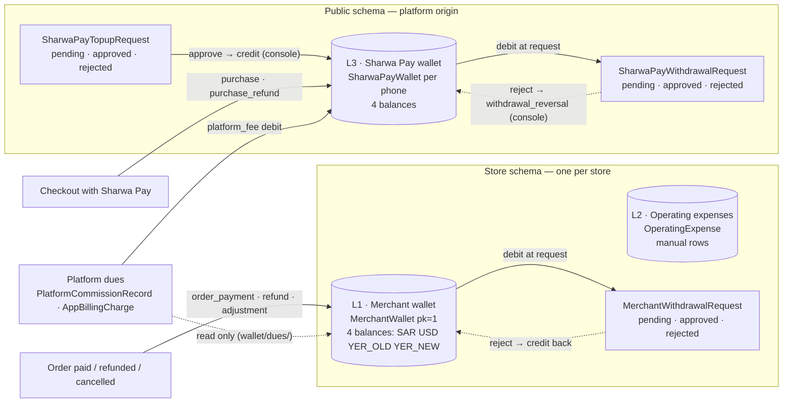

# Finance: payments, merchant wallet, expenses & Sharwa Pay — المالية: المدفوعات والمحفظة والمصروفات وشروة باي

> **Source**: DOC-150 (Step 22) · INT-020 (M14), INT-043 (M33), INT-048 (M40) · inventory Domain 8 + A.6
> **Scope**: Domain 08 — three money ledgers: the **merchant wallet** and its gateways, payout accounts, withdrawals and platform dues (M14); the **operating-expense ledger** (M33); and the **customer-side Sharwa Pay wallet** on the platform origin (M40).
> **Last verified against code**: 2026-10-27 (step 22)

This page is the entry point of Domain 8. The three module pages hold the endpoint-level detail:

| Page | DOC | What it documents |
|---|---|---|
| [`m14-payments-wallet.md`](m14-payments-wallet.md) | DOC-151 → DOC-156 | gateways, store payment switches, payout accounts, merchant wallet and statement, withdrawals and the admin decision, platform dues |
| [`m33-expenses.md`](m33-expenses.md) | DOC-157, DOC-158 | the monthly ledger with per-currency totals, recording an expense, `expenses.manage`, the `405` on `<id>/` |
| [`m40-sharwa-pay.md`](m40-sharwa-pay.md) | DOC-159 → DOC-163 | WhatsApp-code login, wallet, statement, requests, top-up with a receipt, withdrawal |

## 1. Overview

| Task | Module | Live key (`SHARWA_LIVE_MODULES`) | Service | Views | Routes · BFF rows |
|---|---|---|---|---|---|
| INT-020 | M14 Payments & Merchant Wallet (المدفوعات ومحفظة المتجر) | `payments` | `products/services/payments_service.py` | `api/views_payments.py` | **11** routes (`payments/gateways/`, `…/<code>/`, `…/<code>/credentials/`, `store/payments/`, `payments/payout-accounts/`, `…/<pk>/`, `…/reorder/`, `wallet/`, `wallet/transactions/`, `wallet/withdrawals/`, `wallet/dues/`) · **11** BFF rows (one of them nested too deep to stage for reading) |
| INT-043 | M33 Operating Expenses (المصروفات التشغيلية) | `expenses` | `products/services/expenses_api_service.py` | `api/views_expenses.py` | **2** routes (`expenses/`, `expenses/<id>/`) · 1 optional catch-all BFF row |
| INT-048 | M40 Sharwa Pay — customer side (محفظة شروة باي) | `sharwa_pay` | `sharwapay/customer_api.py` | `api/views_sharwa_pay.py` | **8** routes under `sharwa-pay/` (`otp/send/`, `otp/verify/`, `logout/`, `wallet/`, `transactions/`, `requests/`, `topups/`, `withdrawals/`) · 1 catch-all BFF row, platform origin only |

All Django paths are under `/api/v1/`; the BFF mirrors them under `/api/bff/` ([BFF](../../overview/bff.md)). Each live key switches its whole module from the mock fixture to Django (`liveOrMock`); the register is [`architecture/22-live-module-keys.md`](../../../architecture/22-live-module-keys.md) (rows 12 `payments`, 33 `expenses`, 38 `sharwa_pay`). The three keys are listed in the commented `SHARWA_LIVE_MODULES=` example of `.env.example`.

## 2. The three ledgers

Solid arrows are writes; dotted arrows are reversals or reads. The two withdrawal flows have the **same shape** — the money is taken when the request is made and returned only if the platform rejects it — but they run in different schemas and are decided by different screens.

### Ownership per ledger

| | **L1 — Merchant wallet** (M14) | **L2 — Operating expenses** (M33) | **L3 — Sharwa Pay wallet** (M40) |
|---|---|---|---|
| Belongs to | one store | one store | one **customer phone**, shared by all stores |
| Schema · origin | the store's tenant schema · the **store host** | the store's tenant schema · the store host | **public** schema · the **platform origin** only (a store host gets `404`) |
| Who calls the API | the **owner only** (a staff session gets «المدفوعات والمحفظة مقصورة على مالك المتجر.») | the owner, or staff holding **`expenses.manage`** | the customer, proven by a WhatsApp code; CSRF on every write |
| Plan features | `payment_gateways` / `local_wallets` per gateway, `bank_transfers` for payout accounts, `merchantwallet` for wallet and withdrawals; **none** for `store/payments/` and `wallet/dues/` | none | none |
| Who adds money | the platform's order code (`order_payment` on a Sharwa Pay payment or an official-delivery COD) — never the API | the user, through `POST expenses/` | the platform console approving a top-up (or the Kuraimi webhook); never the customer's own call |
| Who removes money | refund, order cancellation, the owner's withdrawal request | nobody — rows are never edited or deleted (`405`) | checkout purchases, platform fees, the customer's withdrawal request |
| Who decides a withdrawal | the platform, through the Django admin actions → `payments_service.decide_withdrawal` | — | the platform console (INT-031) → `withdrawal_reversal` on rejection |
| Detail | [`m14-payments-wallet.md`](m14-payments-wallet.md) | [`m33-expenses.md`](m33-expenses.md) | [`m40-sharwa-pay.md`](m40-sharwa-pay.md) |

Platform dues (`PlatformCommissionRecord`, `AppBillingCharge`) are **read** by M14 in `wallet/dues/` but **collected** from the merchant's own Sharwa Pay wallet by the platform — that is Domain 16, not an API of this domain.

## 3. Patterns shared by the three ledgers

- **Atomic managers, row locks, audit rows.** Every balance change goes through a manager — `MerchantWalletManager.credit/debit` (L1) and `SharwaPayWalletManager.credit/debit` (L3) — that runs in `transaction.atomic()`, locks the wallet row with `select_for_update`, writes the new balance and creates one transaction row carrying `balance_after`. Nothing else writes a balance column. The `currency` argument is mandatory and `wallet_balance_field(currency)` raises on an unknown code, so an amount can never land in the wrong balance. See [ledgers](../../../architecture/43-ledgers.md) and [concurrency](../../../architecture/42-concurrency.md).
- **Debit at request, refund on rejection.** A withdrawal is debited **the moment it is requested** (anti double-spend), shown as reserved or pending, and credited back only if the platform rejects it. L1: the Django admin action calls `payments_service.decide_withdrawal` (row lock + `pending` guard — two concurrent «reject» clicks used to refund twice). L3: the platform console (INT-031) credits `withdrawal_reversal`. Approval changes only the status; the actual bank transfer is made by hand.
- **Per-currency, never converted, never summed.** The four currencies `SAR`, `USD`, `YER_OLD` (يمني صنعاء), `YER_NEW` (يمني عدن) each have their own balance. Month totals of expenses, the wallet balances, the dues totals («2.50 ر.س · $1») and the Sharwa Pay balances are one figure **per currency**; the client never adds two currencies ([money](../../overview/money.md)).
- **Server display strings.** Money crosses the API as `display_*` strings produced by `format_money`; the few decimal strings (`available`, `amount`, `balance`) exist for sign and local checks only.
- **Idempotency.** The merchant withdrawal accepts an `Idempotency-Key` (a retried POST returns the same request with `200`, no second debit); the Sharwa Pay withdrawal does not ([idempotency](../../overview/idempotency.md)).
- **Errors.** Field errors are `{field: [message]}` with `400`; gate and state errors are `{"detail": message}`; the Arabic sentences are quoted verbatim in «…» on the module pages ([errors](../../overview/errors.md)).

## 4. Neighbouring documentation

- **Console approvals (INT-031)** — top-up and withdrawal decisions for Sharwa Pay, and the platform-side withdrawal view: [Domain 16](../16-platform-console/README.md).
- **Platform dues collection** — turning a due from `pending` to `collected` or `waived` and deducting it from the merchant's Sharwa Pay wallet: Domain 16 (`tenants/merchant_billing.py`).
- **Customer wallets (Domain 6)** — the per-store customer wallet and loyalty points, a different ledger: [`../06-customers-wallets/m35-wallets-loyalty.md`](../06-customers-wallets/m35-wallets-loyalty.md).
- **Checkout** — paying with Sharwa Pay or a gateway at checkout, and what credits the merchant wallet: [`../05-storefront/m12-checkout.md`](../05-storefront/m12-checkout.md).
- **Orders** — refunds and cancellations that debit the merchant wallet: [`../04-orders-returns/m06-orders.md`](../04-orders-returns/m06-orders.md).
- **Upload limits** — the 5 MB receipt limit against the request-body limits: [`../../../ops/upload-limits.md`](../../../ops/upload-limits.md).
- **Windows local-media fix** — the Windows local-media fix made in this batch is documented in Track 3 (inventory A.11), not in the API pages.

## 5. Related pages

- Merchant guides for these screens (Arabic): [`../../../guides/merchant/08-finance/README.md`](../../../guides/merchant/08-finance/README.md) · customer wallet help: [`../../../guides/sharwa-pay/08-finance/README.md`](../../../guides/sharwa-pay/08-finance/README.md)
- Architecture: [ledgers](../../../architecture/43-ledgers.md) · [approvals](../../../architecture/45-approvals.md) · [idempotency](../../../architecture/41-idempotency.md)
- Previous domain: [Marketing, design & partners](../07-marketing-design-partners/README.md) · Back to the [documentation home](../../../README.md)
