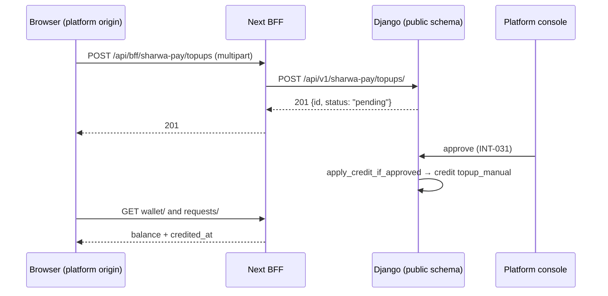

# Sharwa Pay API (customer side) — M40 (محفظة شروة باي)

> **Source**: DOC-159 → DOC-163 (Step 22) · INT-048 (M40), INT-031 · inventory Domain 8 + A.4
> **Live key**: `sharwa_pay` (`SHARWA_LIVE_MODULES`) — **1 BFF row**, a required catch-all `src/app/api/bff/sharwa-pay/[...path]/route.ts` exporting `GET` and `POST`, `liveOrMock(request, "sharwa_pay", "/api/v1/sharwa-pay/<path>/", mock)` **behind a platform-origin gate**; `.env.example` lists `sharwa_pay`
> **Django provider**: `sharwa_saas/api/views_sharwa_pay.py` (`SharwaPayView`, 8 views) · `sharwa_saas/sharwapay/customer_api.py` (all logic) · models `sharwapay/models.py` (`SharwaPayWallet`, `SharwaPayWalletTransaction`, `SharwaPayTopupRequest`, `SharwaPayWithdrawalRequest`, manager `SharwaPayWalletManager`) · currency list `sharwapay/constants.py` — **no migration**
> **Frontend contract**: `sharwa-frontend/src/features/sharwa-pay/schemas.ts` · hooks `src/features/sharwa-pay/api.ts` · fixture `src/mocks/sharwa-pay/`
> **Tests**: `sharwa_saas/api/test_sharwa_pay_api.py` (**9** tests — `LoginTests`: `test_otp_login_wallet_logout`, `test_send_limit_and_verify_lock`, `test_expired_code_and_whatsapp_failure`, `test_csrf_enforced_on_writes`, `test_store_origin_is_404`; `WalletTests`: `test_topup_validation_and_create`, `test_withdrawal_debits_now_and_links_its_transaction`, `test_transactions_filters_sources_and_requests`, `test_suspended_wallet`) · mock E2E `scripts/sharwa-pay-check.ts`
> **Last verified against code**: 2026-10-27 (step 22)

<a id="overview"></a>

## 1. Overview

**Sharwa Pay** is a prepaid wallet that belongs to a **customer's phone number**, not to a store: the same wallet pays in every store on the platform ([Domain 6](../06-customers-wallets/README.md) documents the per-store customer wallet, which is a different thing). This page documents the **customer-facing wallet app**: sign in with a WhatsApp code, see four balances, read the statement and the request lists, ask for a top-up with a bank receipt, ask for a withdrawal.

Everything lives in the **public schema** on the **platform origin**; a store host never reaches it (FR-40.01). Money only *enters* the wallet when the platform approves a top-up — the customer can only **ask** — and it leaves at the moment a withdrawal is requested.

**Before INT-048** the wallet existed only behind the legacy HTML page `tenants/sharwa_pay_views.py`: an OTP for every action, no lists, no JSON. INT-048 added the JSON API with **no new financial logic**: debits use `SharwaPayWalletManager.debit` (row lock + audit row in one transaction), crediting remains the console's decision (`console_money_service.topup_action` → `apply_credit_if_approved`, INT-031), and a withdrawal is reversed by the console on rejection (`withdrawal_reversal`). The ledger as a whole is [architecture/43-ledgers.md §4.3](../../../architecture/43-ledgers.md) (L3).

Out of scope here: paying at checkout with Sharwa Pay ([M12 checkout](../05-storefront/m12-checkout.md), INT-014), the console's approve / reject screens (INT-031, Domain 16), and the merchant's own Sharwa Pay wallet used to pay platform dues (`tenants/merchant_billing.py`).

All paths are under `/api/v1/sharwa-pay/` ; the BFF mirrors them under `/api/bff/sharwa-pay/` ([BFF](../../overview/bff.md)).

<a id="access"></a>

## 2. Access — gate chain

`SharwaPayView.initial` runs these steps in this order; the first failing step answers.

| # | Step | Requirement | Failure |
|---|---|---|---|
| 0 | BFF platform-origin gate | the request host resolves to the **platform** (not a store, a custom domain or the console) | `404` `{"detail": "غير موجود."}` from the BFF, before Django |
| 1 | Public schema only (`_public_only`) | `connection.schema_name` is the public schema; a store host or an `X-Store-Domain` header lands on a tenant schema | `404` `{"detail": "غير موجود."}` |
| 2 | **CSRF** (every non-safe method, login included) | the Django CSRF token — there is no "login CSRF" exemption | `403` `{"detail": "CSRF Failed: …"}` (the test asserts the text contains `CSRF`) |
| 3 | Wallet session | key `sharwa_pay_auth_phone` in the Django session — **skipped** for `otp/send`, `otp/verify` and `logout` (`signed_in = False`) | `401` `{"detail": "سجّل الدخول برقم جوالك."}` — the client returns to the phone screen |
| 4 | Wallet state | for `topups/` and `withdrawals/`: the wallet must be active | `403` `{"detail": "المحفظة موقوفة — تواصل مع الدعم."}` |
| 5 | Input | fields valid | `400` `{field: [msg]}` |

Notes:

- The view sets `authentication_classes = []`, `permission_classes = []` and `throttle_classes = []`: the session key is checked by hand and the only rate limits are the cache-based ones of the login ([§3](#auth)). DRF's `SessionAuthentication().enforce_csrf` is called explicitly.
- Because CSRF runs **before** the session check, an anonymous `POST` without a CSRF token answers `403`, not `401`. The client refreshes its token once on a CSRF `403` and retries (BFF comment).
- **Every** response — success, `4xx`, `5xx`, `404` — carries `Cache-Control: no-store` (`finalize_response`; balances must never be cached).
- The session is Django's `sessionid` cookie **on the platform origin**, shared with the legacy page (same key `sharwa_pay_auth_phone`). It is never read from a store origin.

The wallet app has **no plan feature and no permission key** — it is the customer's own account, identified by a phone number proven by WhatsApp ([auth identities](../../overview/auth.md), [OTP rules](../../overview/otp.md), [CSRF](../../overview/csrf.md)).

<a id="summary"></a>

## 3. Endpoint summary

| # | Method | Django path (`/api/v1/sharwa-pay/…`) | Purpose | Session | Success | Section |
|---|---|---|---|---|---|---|
| 1 | `POST` | `otp/send/` | send a WhatsApp code `{phone}` | no | `200` | [§4](#auth) |
| 2 | `POST` | `otp/verify/` | `{phone, code}` → wallet session | no | `200` | [§4](#auth) |
| 3 | `POST` | `logout/` | end the wallet session | no | `204` | [§4](#auth) |
| 4 | `GET` | `wallet/` | four balances | yes | `200` | [§5](#wallet-transactions) |
| 5 | `GET` | `transactions/` | statement | yes | `200` | [§5](#wallet-transactions) |
| 6 | `GET` | `requests/` | top-up and withdrawal requests | yes | `200` | [§6](#requests) |
| 7 | `POST` | `topups/` | ask for a top-up (multipart) | yes | `201` | [§7](#topups) |
| 8 | `POST` | `withdrawals/` | ask for a withdrawal | yes | `201` | [§8](#withdrawals) |

`api/urls.py` lines 463–470 hold exactly these 8 routes. The currencies are the four of `WALLET_CURRENCY_CHOICES`: `SAR`, `USD`, `YER_OLD` (يمني صنعاء), `YER_NEW` (يمني عدن) — one balance each, **never converted, never summed** (FR-40.03). Every amount in a response is a server display string (`format_money`), accompanied by a decimal string only where noted ([money](../../overview/money.md)).

<a id="auth"></a>

## 4. Authentication — `otp/send/`, `otp/verify/`, `logout/`

*(DOC-159)*

### Phone normalisation

`customer_api.normalize_phone` mirrors the frontend's `normalizePhone` and, for Yemeni local numbers, `clean_phone_number` — so the same key addresses the wallet in every path:

1. Arabic and Persian digits become Latin; every non-digit is removed. Nothing left ⇒ invalid.
2. A leading `00` is dropped (international form).
3. If the number does not start with `967` or `966`, leading zeros are stripped and `967` is prepended (`0770000111` → `967770000111`).
4. The result must match `^(967|966)\d{8,9}$`, otherwise it is invalid.

### `POST /api/v1/sharwa-pay/otp/send/`

Body `{"phone": "0770000111"}`. Response `200`:

```json
{"ok": true, "phone": "967770000111", "expires_in": 600}
```

| Status | Body | When |
|---|---|---|
| `400` | `{"phone": ["أدخل رقم جوال يمني أو سعودي صحيحاً."]}` | the number does not normalise |
| `429` | `{"detail": "طلبات كثيرة — حاول لاحقاً.", "retry_after": <seconds>}` + header `Retry-After` | a 4th send inside the window |
| `502` | `{"detail": "تعذّر إرسال رمز التحقق. حاول مرة أخرى."}` | WhatsApp delivery failed or raised |

- **Send limit: 3 per 10 minutes per number** (`SEND_LIMIT = 3`, `SEND_WINDOW_SECONDS = 600`), kept in the cache under `rl:public:sharwa_pay_api_otp_send:<phone>` — **per number, not per session**, so clearing cookies does not bypass it. `retry_after` is the time until the oldest of the three sends leaves the window.
- The code is six digits, `secrets.randbelow(900000) + 100000`. It is **bound to the requesting session**: the session stores `{phone, hash, at, attempts}` under `sharwa_pay_api_otp`, where `hash` is an **HMAC-SHA256** of `sharwa-pay-otp:<phone>:<code>` keyed with `SECRET_KEY` — the code itself is never stored. A new send replaces the record.
- Delivery goes through `WhatsAppService.send_message`. The message text:

  «🔐 *منصة شروة — محفظة شروة باي*

  رمز التحقق الخاص بك:
  *<code>*

  لا تشارك هذا الرمز مع أحد. صالح لمدة 10 دقائق.»

- The send is **counted before delivery is attempted**: a `502` still uses one of the three sends, and no OTP record is stored for it.
- `expires_in` is `600` seconds (`OTP_TTL_SECONDS`).

### `POST /api/v1/sharwa-pay/otp/verify/`

Body `{"phone": "0770000111", "code": "483920"}` (Arabic-Indic digits in `code` are converted). Success `200`:

```json
{"ok": true, "phone": "967770000111"}
```

Checks, in order:

| # | Check | Status and body |
|---|---|---|
| 1 | phone does not normalise | `400` `{"phone": ["أدخل رقم جوال صحيحاً."]}` |
| 2 | code is not exactly six digits | `400` `{"code": ["الرمز 6 أرقام."]}` |
| 3 | the number is **locked** | `429` `{"detail": "محاولات كثيرة — أُقفل التحقق مؤقتاً.", "retry_after": <remaining seconds>}` + `Retry-After` |
| 4 | no OTP record in this session, or it was issued for another number | `400` `{"detail": "اطلب رمزاً أولاً.", "reason": "no_code"}` |
| 5 | older than 600 seconds | the record is removed; `400` `{"detail": "انتهت صلاحية الرمز. اطلب رمزاً جديداً.", "reason": "expired"}` |
| 6 | wrong code (constant-time compare) | `attempts + 1`; on the **5th** wrong code the number is locked (below) and the answer is `429` `{"detail": "محاولات كثيرة — أُقفل التحقق مؤقتاً.", "retry_after": 300}`; otherwise `400` `{"detail": "الرمز غير صحيح.", "reason": "invalid"}` |

- **Lock: 5 wrong codes ⇒ 5 minutes per number** (`VERIFY_LIMIT = 5`, `VERIFY_LOCK_SECONDS = 300`), stored in the cache (`rl:public:sharwa_pay_api_otp_lock:<phone>`), not in the session. While it lasts, **even the correct code is refused** with `429`; after it expires the same code is still valid until its 10 minutes end.
- The `reason` values are `no_code`, `expired` and `invalid`; the screen uses them to decide between "request a new code" and "try again".
- On success: the OTP record and the lock are cleared, the session key is **cycled** (`request.session.cycle_key()` — no session fixation) and `sharwa_pay_auth_phone` is set to the normalised number. **A wallet is not created** by logging in.

### `POST /api/v1/sharwa-pay/logout/` → `204`

Removes `sharwa_pay_auth_phone` and any pending OTP record from the session. It needs no wallet session (`signed_in = False`) but, like every write, needs the CSRF token. No body.

Test coverage: `test_otp_login_wallet_logout` (full flow, one-time code, `no_code` for a different number, `401` before login, `204` and `401` after logout), `test_send_limit_and_verify_lock` (3 sends then `429` with `Retry-After`; 4 wrong codes `400`, the 5th `429` with `retry_after` 300; correct code refused while locked), `test_expired_code_and_whatsapp_failure` (601 seconds ⇒ `expired`; delivery failure ⇒ `502`), `test_csrf_enforced_on_writes`, `test_store_origin_is_404`.

> ⚠️ Discrepancy — roadmap says (DOC-159) "5 wrong codes → 5-min lock per number" / code does: the **count** of wrong codes lives in the session's OTP record, while the **lock** is per number in the cache. Requesting a new code creates a fresh record with `attempts = 0`, so the counter restarts — bounded only by the 3 sends per 10 minutes per number.

<a id="wallet-transactions"></a>

## 5. Wallet and statement — `wallet/` and `transactions/`

*(DOC-160)*

### `GET /api/v1/sharwa-pay/wallet/`

```json
{
  "customer_phone": "967770000111",
  "customer_name": null,
  "is_active": true,
  "exists": false,
  "balances": [
    {"currency": "SAR", "display_balance": "0 ر.س", "balance": "0.00"},
    {"currency": "USD", "display_balance": "$0", "balance": "0.00"},
    {"currency": "YER_OLD", "display_balance": "0 ر.ي", "balance": "0.00"},
    {"currency": "YER_NEW", "display_balance": "0 ر.ي", "balance": "0.00"}
  ]
}
```

(`test_otp_login_wallet_logout` asserts the key set, the four currencies in this order and the SAR row; the other three rows follow `format_money`.)

| Field | Meaning |
|---|---|
| `customer_phone` | the session's number |
| `customer_name` | the wallet's `customer_name`, `null` when empty or when there is no wallet |
| `is_active` | `false` for a suspended wallet; `true` when no wallet exists yet |
| `exists` | `false` until the first top-up request creates the wallet — **logging in never creates one** (`wallet_view` only reads) |
| `balances[]` | **always four rows**, in the order `SAR`, `USD`, `YER_OLD`, `YER_NEW`: `display_balance` is the server string, `balance` the decimal string with two places (`"20.00"`) |

A suspended wallet is still readable; only the two writes are refused ([§7](#topups), [§8](#withdrawals)).

### `GET /api/v1/sharwa-pay/transactions/`

| Query | Default | Notes |
|---|---|---|
| `currency` | — | one of the four codes; any other value is ignored |
| `reason` | — | one of the seven reasons below; any other value is ignored |
| `page` | `1` | below 1 or not a number ⇒ `1`; **20 rows per page** (`PAGE_SIZE`, fixed — no `page_size`) |

Order: `-created_at, -id`. A phone without a wallet gets `{"count": 0, "results": []}`. A page past the end returns `results: []`.

```json
{
  "count": 2,
  "results": [
    {
      "id": 2,
      "transaction_type": "debit",
      "reason": "purchase",
      "display_amount": "$5",
      "currency": "USD",
      "display_balance_after": "$20",
      "source_tenant_schema": "gone_store",
      "source_store_name": null,
      "source_store_available": false,
      "source_order_id": 77,
      "related_request": null,
      "created_at": "2026-10-27T09:00:00+00:00"
    },
    {
      "id": 1,
      "transaction_type": "credit",
      "reason": "topup_manual",
      "display_amount": "$25",
      "currency": "USD",
      "display_balance_after": "$25",
      "source_tenant_schema": null,
      "source_store_name": null,
      "source_store_available": true,
      "source_order_id": null,
      "related_request": {"kind": "topup", "id": 1},
      "created_at": "2026-10-27T08:00:00+00:00"
    }
  ]
}
```

(From `test_transactions_filters_sources_and_requests`: a 25 USD top-up credited, then a 5 USD purchase for order 77 of a store schema that no longer exists — `display_amount '$5'`, `display_balance_after '$20'`, `source_store_available false`; ids and timestamps illustrative.) The test also asserts the exact key set of a row (`TX_KEYS`).

| Field | Meaning |
|---|---|
| `transaction_type` | `credit` or `debit` |
| `reason` | `topup_manual` · `topup_auto` · `purchase` · `purchase_refund` · `withdrawal` · `withdrawal_reversal` · `platform_fee` |
| `display_amount` | the amount formatted in its currency (no sign — the type carries it) |
| `display_balance_after` | the audit row's own `balance_after`, formatted — the **real** balance at that moment, not a recomputation |
| `source_tenant_schema` | the store schema the movement came from, `null` for a top-up or withdrawal |
| `source_store_name` | `Client.name` looked up by schema (one query for the page), `null` when the schema has no store |
| `source_store_available` | `bool(store and store.is_active)` when there is a schema; **`true` when there is no schema** (a top-up or withdrawal is always available) |
| `source_order_id` | the order number inside that store, or `null` |
| `related_request` | `{kind: "topup" \| "withdrawal", id}` or `null` — see below |
| `created_at` | ISO timestamp |

**Reasons** (Django `REASON_CHOICES`, with the UI labels of `schemas.ts` in parentheses): `topup_manual` «شحن رصيد — تحويل بنكي مؤكَّد يدوياً» («شحن بمراجعة») · `topup_auto` «شحن رصيد — تأكيد تلقائي من البنك» («شحن تلقائي (بنك)») · `purchase` «شراء من متجر» («شراء») · `purchase_refund` «استرجاع قيمة شراء» («استرجاع شراء») · `withdrawal` «طلب سحب رصيد» («سحب») · `withdrawal_reversal` «إعادة رصيد — رُفِض طلب السحب» («استرجاع مبلغ سحب مرفوض») · `platform_fee` «رسوم منصة (عمولة مبيعات / اشتراك تطبيق)» («رسوم المنصة»).

**`related_request`.** A movement is tied to its request through its description: the first `#<digits>` in the text («طلب سحب رصيد #12 — قيد المراجعة», «شحن رصيد — طلب #3 …»). The id is returned only when the reason is `topup_*` (kind `topup`) or `withdrawal` / `withdrawal_reversal` (kind `withdrawal`) **and** that id is one of **this wallet's own** requests (one query per kind for the whole page); otherwise `null`. A number that happens to appear in someone else's description cannot leak another wallet's request.

> ⚠️ Discrepancy — roadmap says (DOC-160) "`source_store_name/available` from `tenants.Client` by `source_tenant_schema` (missing/suspended → «متجر غير متاح»)" / code does: the API sends `source_store_name: null` and `source_store_available: false`; **the sentence «متجر غير متاح» is not produced by the server** (no occurrence in `customer_api.py` or the Zod schema). It is a label the screen derives from `source_store_available`. A suspended store keeps its `source_store_name` and gets `source_store_available: false`.

<a id="requests"></a>

## 6. Requests — `GET /api/v1/sharwa-pay/requests/`

*(DOC-161)*

Returns both lists at once, newest first (`-created_at, -id`), each limited to the **latest 100** (`REQUESTS_LIMIT`); there is no pagination or filter.

```json
{
  "topups": [
    {
      "id": 3,
      "display_amount": "3 ر.س",
      "currency": "SAR",
      "bank_transaction_id": "TX-K",
      "reference_note": "",
      "status": "pending",
      "rejection_reason": null,
      "credited_at": null,
      "created_at": "2026-10-27T09:30:00+00:00"
    },
    {
      "id": 2,
      "display_amount": "9 ر.س",
      "currency": "SAR",
      "bank_transaction_id": "TX-R",
      "reference_note": "",
      "status": "rejected",
      "rejection_reason": "الإيصال غير واضح",
      "credited_at": null,
      "created_at": "2026-10-27T09:00:00+00:00"
    }
  ],
  "withdrawals": [
    {
      "id": 1,
      "display_amount": "40 ر.س",
      "currency": "SAR",
      "payout_destination": "IBAN SA00 1234",
      "status": "pending",
      "rejection_reason": null,
      "created_at": "2026-10-27T08:30:00+00:00"
    }
  ]
}
```

(Request rows follow `test_transactions_filters_sources_and_requests` — the rejected request's reason «الإيصال غير واضح», the Kuraimi transfer `TX-K` of 3 SAR with no wallet — and `test_withdrawal_debits_now_and_links_its_transaction`; the test asserts the exact key sets `TOPUP_KEYS` and `WITHDRAWAL_KEYS`. Ids and timestamps illustrative.)

- **Top-ups** are the requests of this wallet **plus** requests with `wallet = NULL` whose `claimed_phone` equals the session's number: a **Kuraimi bank transfer** that arrived for a phone with no wallet yet is shown to the owner of that number (the test lists 3 top-ups: the approved one, the rejected one and the unattached Kuraimi one).
- **Withdrawals** are only the requests of this wallet.
- `status` is `pending` · `approved` · `rejected`; the labels differ by kind: top-up «قيد المراجعة» / «مقبول» / «مرفوض», withdrawal «قيد المراجعة» / «مُنفَّذ» / «مرفوض».
- `rejection_reason` is **present only on rejected rows**; for any other status it is `null`. A rejected row whose reason is empty reads «رُفض الطلب.».
- `credited_at` (top-ups) is the moment the money actually reached the wallet; `status = "approved"` with `credited_at = null` means approved but not yet credited.
- `bank_transaction_id` and `reference_note` are `''` when empty.

<a id="topups"></a>

## 7. Ask for a top-up — `POST /api/v1/sharwa-pay/topups/` (multipart)

*(DOC-162)*

The customer transfers money by bank, then submits the transfer's details with a photo of the receipt. **The request never credits the wallet**: it is created `pending` and the platform console decides (INT-031). `Content-Type: multipart/form-data`; fields:

| Field | Type | Required | Rules and messages |
|---|---|---|---|
| `amount` | decimal string | yes | `^\d{1,10}(\.\d{1,2})?$` and ≥ 0.01, otherwise «أدخل مبلغاً صحيحاً لا يقل عن 0.01.» |
| `currency` | enum | yes | `SAR`, `USD`, `YER_OLD`, `YER_NEW`, otherwise «اختر العملة.» |
| `bank_transaction_id` | string | yes | trimmed; empty «أدخل رقم العملية البنكية.»; longer than 100 «رقم العملية طويل جداً.»; already used «رقم العملية مستخدم مسبقاً.» |
| `reference_note` | string | no | trimmed and **silently cut to 200 characters** |
| `receipt_image` | file | yes | see below |

**Receipt rules**, checked in this order, message in `{"receipt_image": [msg]}`:

| Check | Message |
|---|---|
| missing or empty file | «أرفق صورة الإيصال.» |
| extension not in `jpg`, `jpeg`, `png`, `webp`, `gif` | «الصيغ المسموحة: jpg, jpeg, png, webp, gif.» |
| larger than 5 MB (`5 × 1024 × 1024` bytes) | «حجم الصورة أكبر من 5 ميغابايت.» |
| not a real image (`forms.ImageField().clean` — Pillow decodes the content) | «الملف ليس صورة صالحة.» |

So a PDF renamed `r.png` fails the fourth check; the test uploads the text `not an image` as `r.png` and expects «الملف ليس صورة صالحة.», and a `.pdf` file and expects the formats sentence. The 5 MB file limit is below Django's 8 MB request-body setting (file parts of a multipart request are not counted in it) and Nginx's 55 MB request limit — see [`ops/upload-limits.md`](../../../ops/upload-limits.md).

An empty POST returns all four required keys at once: `{amount, currency, bank_transaction_id, receipt_image}` (`test_topup_validation_and_create`).

**Response `201`**:

```json
{"id": 1, "status": "pending"}
```

| Status | Body | When |
|---|---|---|
| `400` | `{field: [msg]}` | validation, all fields reported together |
| `403` | `{"detail": "المحفظة موقوفة — تواصل مع الدعم."}` | the wallet exists and `is_active` is false — checked **before** validation |

**Rules**

- **First top-up creates the wallet.** If the phone has no wallet, `SharwaPayWallet.objects.get_or_create(customer_phone=phone)` runs in the same `transaction.atomic()` as the request. After it, `GET wallet/` returns `exists: true`.
- **`bank_transaction_id` is unique at database level** over **all** requests, including rejected ones and the ones created by the Kuraimi webhook: a rejected request's number cannot be reused (the mock allowed it). The pre-check message and the `IntegrityError` race both answer `400` `{"bank_transaction_id": ["رقم العملية مستخدم مسبقاً."]}`.
- **No credit here.** The test asserts `balance_sar == 0` right after the request. The platform approves in the console (`topup_action`) or the Django admin; approval calls `apply_credit_if_approved`, the only place that credits a top-up: it re-reads the request with `select_for_update`, does nothing unless `status = 'approved'`, `credited_at` is empty and a wallet is linked, and sets `credited_at` in the same transaction — **`credited_at`, not `status`, is the double-credit guard**.
- The receipt is stored under the platform's `sharwa_pay_topups` upload folder with a randomised file name.

**Bug fixed — mislabelled reason.** `apply_credit_if_approved` used to label **any** top-up that had a bank transaction id as `topup_auto`, so customer top-ups (id + receipt) were shown as automatic. Now `topup_auto` means *a transaction id and **no** receipt image* — the Kuraimi webhook only; a customer request credits as **`topup_manual`** (UI «شحن بمراجعة»). The statement description is «شحن رصيد — طلب #<id>» followed by « (عملية بنكية <transaction id>)» when there is one. No migration.

**Sequence**



<a id="withdrawals"></a>

## 8. Ask for a withdrawal — `POST /api/v1/sharwa-pay/withdrawals/`

*(DOC-163)*

Body (`application/json`):

| Field | Type | Required | Rules and messages |
|---|---|---|---|
| `amount` | decimal string | yes | same rule as a top-up: «أدخل مبلغاً صحيحاً لا يقل عن 0.01.» |
| `currency` | enum | yes | «اختر العملة.» |
| `payout_destination` | string | yes | trimmed; shorter than 6 characters «أدخل بيانات الحساب المستقبِل كاملة.»; longer than 255 «بيانات الحساب طويلة جداً.» — free text (bank, account number, name) |

**Response `201`**:

```json
{"id": 1, "status": "pending", "display_balance_after": "60 ر.س"}
```

(`test_withdrawal_debits_now_and_links_its_transaction`: wallet of 100 SAR, withdrawal of 40 ⇒ `display_balance_after` «60 ر.س».) `display_balance_after` is the wallet's balance in that currency after the debit.

**Order of answers**

1. wallet exists and is suspended ⇒ `403` «المحفظة موقوفة — تواصل مع الدعم.»;
2. invalid fields ⇒ `400` with **all** the failing keys (`{amount, currency, payout_destination}` for `x`, `EUR`, `123` in the test);
3. no wallet at all ⇒ `400` `{"amount": ["الرصيد غير كافٍ."]}`;
4. amount above the balance of that currency ⇒ `400` `{"amount": ["الرصيد غير كافٍ."]}`.

**Atomicity.** The request row and the debit are written in **one `transaction.atomic()`** block:

1. `SharwaPayWithdrawalRequest` is created (`status = 'pending'`);
2. `SharwaPayWallet.objects.debit(wallet.id, amount, reason='withdrawal', currency, description=…)` locks the wallet row (`select_for_update`), refuses an amount above the balance (`InsufficientSharwaPayBalanceError`), subtracts, and writes the audit row `SharwaPayWalletTransaction` with `balance_after`.

If the debit raises, the whole block rolls back: **no orphan request is left** (the test asserts `SharwaPayWithdrawalRequest.objects.exists()` is false after a refused 500 SAR). The debit description is «طلب سحب رصيد #<request id> — قيد المراجعة»; that `#<id>` is how `transactions/` fills `related_request` ([§5](#wallet-transactions)).

So the money is gone from the balance **at request time** (anti double-spend) and returns only if the platform rejects: the console locks the request row, credits the amount back as reason `withdrawal_reversal` and sets the status in one transaction (`console_money_service.withdrawal_action`, INT-031; the Django admin `reject_withdrawal` does the same). Approval changes only the status — the real transfer is made by hand before it. The customer sees `pending` → `approved` («مُنفَّذ») or `rejected` with the reason in `requests/` ([§6](#requests)).

**Limits worth knowing**

- There is **no `Idempotency-Key`** on this route (unlike the merchant withdrawal in [M14](m14-payments-wallet.md#withdrawals)): the same request sent twice creates two requests and two debits.
- A suspended wallet can neither request a top-up nor a withdrawal, but can still read everything.
- Insufficient balance carries no figure: the message is the fixed sentence «الرصيد غير كافٍ.», while the merchant wallet states the available amount.

<a id="bff"></a>

## 9. BFF row and live key

`/api/bff/sharwa-pay/[...path]` (GET, POST):

1. The request host is resolved with `resolveTenant(host, TENANT_BASE_DOMAIN)`; **anything other than the platform origin** (a store, a custom domain, the console) answers `404` `{"detail": "غير موجود."}` — in live **and** mock mode. Django's own public-schema check is the second line.
2. The path after `sharwa-pay/` is joined (each segment encoded) and sent to `/api/v1/sharwa-pay/<path>/` when `sharwa_pay` is in `SHARWA_LIVE_MODULES`.
3. Otherwise the mock `src/mocks/sharwa-pay` answers when mocks are on (a dev-only `sharwa_mock_pay` marker cookie keeps its session), with `Cache-Control: no-store`; with mocks off the fixture reply is "not available".

The key register row is 38 in [`architecture/22-live-module-keys.md`](../../../architecture/22-live-module-keys.md) (*1 catch-all, platform origin only*); its troubleshooting table lists "Sharwa Pay rows `404` on a store host" as expected behaviour.

<a id="schema-changes"></a>

## 10. Gaps closed, bugs fixed and migrations

- **No migration.** The tables keep their historical names (`tenants_sharwapaywallet`, `…transaction`, `…topuprequest`, `…withdrawalrequest`) in every published database.
- **Gap closed** — the legacy page had no JSON, no lists and one OTP per action; the API adds a session, the statement and the request lists.
- **Rules reused unchanged**: row-locked manager, `apply_credit_if_approved` as the single credit point, the console's reversal on rejection.
- **Bug fixed** — top-up reason labelling ([§7](#topups)).
- **Decision recorded** — a rejected top-up's `bank_transaction_id` can never be reused (database uniqueness).

<a id="open-items"></a>

## 11. Open items and legacy-only behaviour

- No `Idempotency-Key` on `withdrawals/` ([§8](#withdrawals)).
- The statement and the lists have no date filter; the statement is paged by 20, the lists are capped at 100.
- Paying at checkout with the wallet, the merchant-side Sharwa Pay wallet and the console approvals are other integrations (INT-014, INT-031).
- The legacy page `tenants/sharwa_pay_views.py` still works beside the API and shares the session key `sharwa_pay_auth_phone`.

<a id="related"></a>

## 12. Related pages

- Domain overview: [`README.md`](README.md) · merchant wallet and expenses: [`m14-payments-wallet.md`](m14-payments-wallet.md) · [`m33-expenses.md`](m33-expenses.md)
- Checkout with Sharwa Pay: [`../05-storefront/m12-checkout.md`](../05-storefront/m12-checkout.md) · store customer wallets: [`../06-customers-wallets/m35-wallets-loyalty.md`](../06-customers-wallets/m35-wallets-loyalty.md)
- Cross-cutting: [auth](../../overview/auth.md) · [OTP](../../overview/otp.md) · [CSRF](../../overview/csrf.md) · [rate limits](../../overview/rate-limits.md) · [errors](../../overview/errors.md) · [money](../../overview/money.md) · [BFF](../../overview/bff.md)
- Architecture: [ledgers](../../../architecture/43-ledgers.md) · [OTP](../../../architecture/33-otp.md) · [approvals](../../../architecture/45-approvals.md) · [live module keys](../../../architecture/22-live-module-keys.md)
- Customer help (Arabic): [`../../../guides/sharwa-pay/08-finance/README.md`](../../../guides/sharwa-pay/08-finance/README.md)
