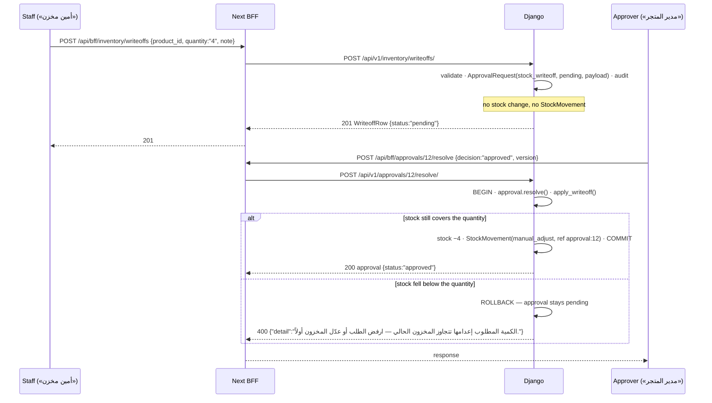

# Inventory API — M21 (مركز المخزون ودفتر الحركات)

> **Source**: DOC-169, DOC-170, DOC-171, DOC-172, DOC-173, DOC-174 (Step 23) · INT-024 (M21), INT-022 (M18) · inventory Domain 10 + A.3, A.9, A.11, A.12
> **Live key**: `inventory` (`SHARWA_LIVE_MODULES`) — 8 BFF route files, 9 exported handlers, each `liveOrMock(request, "inventory", "/api/v1/inventory/…", …)`; **missing from `.env.example:79`** (see [§9](#bff))
> **Django provider**: `sharwa_saas/api/views_inventory.py` (`InventoryAPIMixin`, 8 views, 9 URL patterns) · `sharwa_saas/products/services/inventory_service.py` · ledger writer `products/services/stock_movement.py` (`record_stock_movement`) · approval decision `products/services/staff_service.py` (`resolve_approval`) · migration `products/0225_inventory_api`
> **Frontend contract**: `sharwa-frontend/src/features/inventory/schemas.ts` · hooks `src/features/inventory/api.ts` · fixture `src/mocks/inventory/state.ts` · BFF `src/app/api/bff/inventory/**`
> **Tests**: `sharwa_saas/api/test_inventory_api.py` (**9**) · mock E2E `scripts/inventory-check.ts`
> **Last verified against code**: 2026-10-27 (step 23)

<a id="overview"></a>

## 1. Overview

M21 is the merchant's **inventory hub**. It gives one table row per product with the variants nested under it, a counter strip, CSV export, manual adjustments, the stock ledger (movements), serial units, reservations and write-off requests. Before INT-024, Django had only the HTML `inventory_hub_view` (`products/views/inventory.py:88`) and `update_product_stock` (`:186`), with no JSON API. Now the nine `/api/v1/inventory/…` URL patterns answer the Zod contract field by field.

There is **one source of truth per mode** ([architecture/44-stock-ledger.md](../../../architecture/44-stock-ledger.md)):

- **Multi-location off** (`StoreSetting.multi_location_enabled = false`): `Product.stock` / `ProductVariant.stock` is the source. A variant write calls `Product.recalculate_stock_from_variants()`, so the parent always mirrors its variants.
- **Multi-location on**: the `LocationInventory` row is the source. Writes change its `quantity_on_hand`, and the `post_save` signal `mirror_location_inventory_to_product_stock` (`products/signals.py:27`) then rewrites the variant/product mirrors. The service never writes both.

Every change goes through `record_stock_movement`, an append-only ledger. A write-off is **an approval request**: nothing is deducted until M18 approves it ([§8](#writeoffs)).

The caller is the merchant owner or a staff member, on the store host (see [auth](../../overview/auth.md)). Quantities are **decimal strings with three places** (`"2.000"`). Prices are plain two-place strings (`"100.00"`), not display strings.

<a id="access"></a>

## 2. Access — gate chain

`InventoryAPIMixin.check(request, permission)` (`views_inventory.py:39`) evaluates the gates in this order. The first gate that fails sends the response.

| # | Gate | Requirement | Failure |
|---|---|---|---|
| 1 | Session | owner session (`is_merchant_authenticated`) or a resolved staff member (`ProductsAPIMixin.gate`) | `401` `{"detail": "انتهت جلستك، سجّل الدخول مجدداً."}` |
| 2 | Plan feature | `inventory` — `settings_feature_enabled(request, 'inventory')`, the same decision as the legacy `require_feature('inventory')` on `inventory_hub_view` | `403` `{"detail": "هذه الميزة غير متاحة في باقتك الحالية"}` |
| 3 | Permission key | `inventory.view` (reads) · `inventory.adjust` (adjustments) · `inventory.writeoff` (write-off request) · `reports.export` (CSV). A staff member must hold the key; the **owner holds every key implicitly** | `403` `{"detail": "ليست لديك صلاحية لهذا الإجراء."}` |
| — | Owner-only | none — every M21 route is open to staff who hold the key | — |

`inventory` is on for every store by default ([plan features](../../overview/plan-features.md)). The keys are seeded by migration `0144` ([permissions](../../overview/permissions.md)):

- `inventory.view`: the managers, «كاشير» and «أمين مخزن»
- `inventory.adjust` and `inventory.writeoff`: the managers and «أمين مخزن»
- `reports.export`: the managers

`test_auth_feature_and_permissions` asserts these outcomes:

- no session ⇒ `401`
- feature off ⇒ `403` «هذه الميزة غير متاحة في باقتك الحالية»
- a staff member with only `inventory.view` reads the list (`200`) but gets `403` on `POST inventory/adjustments/` and on `GET inventory/export.csv`

<a id="summary"></a>

## 3. Endpoint summary

| Method | Django path (`/api/v1/…`) | BFF path (`/api/bff/…`) | Purpose | Key |
|---|---|---|---|---|
| `GET` | `inventory/` | `inventory` | the table (product rows, variants nested) | `inventory.view` |
| `GET` | `inventory/counters/` | `inventory/counters` | strip counters + pending write-offs | `inventory.view` |
| `GET` | `inventory/export.csv` (also `inventory/export.csv/`) | `inventory/export.csv` | CSV of the current filter | `reports.export` |
| `POST` | `inventory/adjustments/` | `inventory/adjustments` | manual adjustment / restock | `inventory.adjust` |
| `GET` | `inventory/movements/` | `inventory/movements` | stock ledger | `inventory.view` |
| `GET` | `inventory/items/` | `inventory/items` | serial units | `inventory.view` |
| `GET` | `inventory/reservations/` | `inventory/reservations` | stock holds | `inventory.view` |
| `GET` | `inventory/writeoffs/` | `inventory/writeoffs` | write-off requests | `inventory.view` |
| `POST` | `inventory/writeoffs/` | `inventory/writeoffs` | request a write-off (creates an approval) | `inventory.writeoff` |

Two routes outside this module reuse the same logic:

- M22 `POST locations/<pk>/inventory/adjust/` calls `inventory_service.adjust` with `location_id` forced ([m22-locations.md › location inventory](m22-locations.md#location-inventory)).
- M18 `approvals/<pk>/resolve/` applies an approved write-off ([§8](#writeoffs)).

<a id="list"></a>

## 4. Inventory list — `GET /api/v1/inventory/` (DOC-169)

`svc.list_inventory(params)` (`inventory_service.py:225`) over `_inventory_rows` (`:176`).

**Query parameters**

| Name | Type | Default | Notes |
|---|---|---|---|
| `q` | string | — | Arabic-normalized substring over the product `name`, product `sku`, product `barcode` and every **variant `sku`** (see *Search* below) |
| `status` | `in_stock` \| `low` \| `out` \| `backorder` | — | other values are ignored. A product is kept when its **parent status or any variant's status** equals the value |
| `location` | int | — | applied **only when multi-location is on**; otherwise ignored, and `source` stays `"catalog"` |
| `category` | int | — | `Product.category_id` |
| `is_serialized` | `true` \| `false` | — | any other value: no filter |
| `page` | int ≥ 1 | `1` | |
| `page_size` | int | `50` | clamped to **10…100** (`_page`) |

Archived products (`archived_at` set) are never listed. Rows are sorted by the normalized product name, then by `product_id`. Filtering and paging run in Python, after all non-archived products are loaded.

**Response `200`** — from `test_list_contract_variants_search_and_counters`. The ids and the auto-generated parent SKU are illustrative; variant rows are abridged.

```json
{
  "count": 3, "page": 1, "page_size": 10, "multi_location": false, "source": "catalog",
  "results": [
    {
      "product_id": 41, "variant_id": null, "name": "قهوة يمنية", "variant_label": null,
      "sku": "COF-1", "barcode": null, "unit": "piece", "stock": "2.000", "low_stock_threshold": 3,
      "allow_backorder": false, "is_serialized": false, "is_bundle": false, "is_auction": false,
      "category_id": null, "cost_price": "40.00", "price": "100.00",
      "status": "low", "location": null, "reserved_total": "0.000", "variants": []
    },
    {
      "product_id": 43, "variant_id": null, "name": "تيشيرت", "variant_label": null,
      "sku": "SHW-0043", "barcode": null, "unit": "piece", "stock": "4.000", "low_stock_threshold": 3,
      "allow_backorder": false, "is_serialized": false, "is_bundle": false, "is_auction": false,
      "category_id": null, "cost_price": null, "price": "100.00",
      "status": "out", "location": null, "reserved_total": "0.000",
      "variants": [
        { "product_id": 43, "variant_id": 7, "variant_label": "S0", "sku": "تيشيرت-0", "stock": "4.000", "status": "in_stock", "location": null, "reserved_total": "0.000" },
        { "product_id": 43, "variant_id": 8, "variant_label": "S1", "sku": "تيشيرت-1", "stock": "0.000", "status": "out", "location": null, "reserved_total": "0.000" }
      ]
    }
  ]
}
```

| Field | Type | Meaning (Django source) |
|---|---|---|
| `count` / `page` / `page_size` | int | product rows after the filters; the effective page and size |
| `multi_location` | bool | `StoreSetting.multi_location_enabled` |
| `source` | `"location"` \| `"catalog"` | `"location"` only when `?location` was applied (multi-location on) |
| `results[]` | product row | one per product. `variants[]` holds the variant rows, which carry every unit field of the parent (no `variants`) |
| `variant_label` | string \| null | the option values joined by « / » in attribute order; a variant without options shows «متغيّر» |
| `barcode` | string \| null | the product barcode; always `null` on variant rows |
| `unit` | string | `Product.unit`, `"piece"` when empty |
| `stock` | decimal string | `ProductVariant.stock` / `Product.stock`. On a parent with variants it is **the sum of its variants** |
| `low_stock_threshold` | int | `Product.low_stock_threshold`, default `3` |
| `cost_price` / `price` | string \| null | two-place strings (`_money`), no currency |
| `status` | enum | see *Status* below |
| `location` | object \| null | `{on_hand, reserved, quarantine, available}` of the `LocationInventory` row at `?location`. It is `null` without `?location` or when the unit has no row there. On a parent with variants it is the sum over the variants that have a row |
| `reserved_total` | decimal string | the sum of `InventoryReservation.quantity` with `status = 'active'` **and** `expires_at > now` for that `(product, variant)`. On a parent with variants it is the sum of its variants |

**Status** (`_status`, `:115`) of one unit is computed on a basis value. The basis is the location row's `available` (`on_hand − reserved − quarantine`) when `?location` applies and the row exists; otherwise it is the catalog `stock`.

| Condition | Status |
|---|---|
| `basis ≤ 0` and `allow_backorder` | `backorder` |
| `basis ≤ 0` | `out` |
| `basis ≤ low_stock_threshold` | `low` |
| otherwise | `in_stock` |

**Parent status with variants** is the **worst** variant status, in the order `out › backorder › low › in_stock` (`STATUS_SEVERITY`, `:40`). In the example, one variant `in_stock` and one `out` ⇒ parent `out`.

**Search.** `normalize_arabic` (`products/services/search_service.py:44`) is the Python twin of the frontend `normalizeArabic` (`src/lib/i18n/normalize.ts`, inventory A.11). It does the following:

- strips tashkeel and tatweel
- folds the hamza forms `[أإآٱ]` → «ا», «ة» → «ه», «ى» and «ئ» → «ي», «ؤ» → «و»
- turns Arabic-Indic digits into 0-9
- lowercases and collapses whitespace

The test finds «قهوة يمنية» with `?q=قهوه`, and the variant SKU `تيشيرت-1` with `?q=تيشيرت-1`.

> ⚠️ Discrepancy — roadmap says `?q` uses the shared normalization "↔ PostgreSQL `lower(translate(…))`" / code matches in Python: `_inventory_rows` loads every non-archived product and compares `normalize_arabic(q)` with `normalize_arabic(name | sku | barcode | variant sku)` in memory (`inventory_service.py:187`, `:214-217`). The SQL twin `search_service.normalized()` is not used by this route. The results are the same; the cost grows with the catalog. Reported in step 23.

**Errors**: only the gate failures in [§2](#access). Unknown filter values are ignored and never cause a `400`.

<a id="counters-export"></a>

## 5. Counters and CSV export (DOC-170)

### `GET /api/v1/inventory/counters/`

`svc.counters()` (`:242`) computes the status of every **product row**: the parent status, with no location, no filters, and archived products excluded. It counts those statuses and adds the number of pending write-off approvals.

```json
{ "low": 1, "out": 1, "backorder": 0, "in_stock": 1, "pending_writeoffs": 0 }
```

| Key | Meaning |
|---|---|
| `in_stock` · `low` · `out` · `backorder` | number of products whose parent status has that value. A product with variants counts once, with its worst variant status |
| `pending_writeoffs` | `ApprovalRequest` rows with `request_type = 'stock_writeoff'` and `status = 'pending'` |

The four status counters always use catalog stock, even on a multi-location store.

### `GET /api/v1/inventory/export.csv`

`InventoryExportView` (`views_inventory.py:73`) → `svc.export_csv(params)` (`:250`). Django routes both `inventory/export.csv` and `inventory/export.csv/` here.

- **Gate**: session → plan feature `inventory` → **`reports.export`** only. A staff member does not also need `inventory.view`.
- **Filters**: the same as the list (`q`, `status`, `location` when multi-location is on, `category`, `is_serialized`). Paging is ignored, so the CSV holds **every** matching row.
- **Rows**: **one line per sellable unit**. A product without variants is one line; a product with variants writes one line per variant and no parent line.
- **Format**: UTF-8 with a **BOM** (`U+FEFF`) at the start, every field quoted (`csv.QUOTE_ALL`), `\n` line endings.
- **Columns**:
  - `product_id`
  - `variant_id` (empty for a product)
  - `name`
  - `variant` (the variant label, empty for a product)
  - `sku`, `unit`, `stock`, `low_stock_threshold`, `status`

  `stock` and `status` follow the same rules as the list; with `?location`, `status` uses the location's `available`.
- **Headers**:
  - `Content-Type: text/csv; charset=utf-8`
  - `Content-Disposition: attachment; filename="inventory-<YYYY-MM-DD>.csv"` (store-local date)
  - `Cache-Control: no-store`
  - `X-Export-Rows: <n>` (the number of data lines)
- **Audit**: one `write_audit_log` row with:
  - `action_code = 'inventory.export'`
  - `target_model = 'Product'`, `target_id = '*'`
  - `after = {rows, filters, actor}`, where `filters` is the query string as a dict and `actor` is «مالك المتجر» or the staff member's name

```csv
"product_id","variant_id","name","variant","sku","unit","stock","low_stock_threshold","status"
"41","","قهوة","","C1","piece","2.000","3","low"
"43","7","تيشيرت","S0","تيشيرت-0","piece","4.000","3","in_stock"
"43","8","تيشيرت","S1","تيشيرت-1","piece","0.000","3","out"
```

`test_export_csv` checks the shape above:

- the body starts with the BOM + `"product_id"`
- there are 4 lines: the header, one product and two variants
- the response carries `X-Export-Rows: 3`

**BFF.** `src/lib/bff/upstream.ts` forwards `x-export-rows` and `content-disposition` on every proxied response (`FORWARD_RESPONSE_HEADERS`, added for M07 / INT-017). In live mode the export therefore reaches the browser with its count and file name.

> ⚠️ Discrepancy — roadmap says the BFF forwards `x-export-rows` / that holds in **live** mode only. The mock handler (`src/app/api/bff/inventory/export.csv/route.ts`) differs from Django in three ways: it sets no `x-export-rows`, it names the file `inventory.csv` (no date), and it writes an unquoted header line (`inventoryCsv`, `src/mocks/inventory/state.ts:596-597`) where Django quotes every field. Reported in step 23.

<a id="adjustments"></a>

## 6. Stock adjustments — `POST /api/v1/inventory/adjustments/` (DOC-171)

`InventoryAdjustmentView` → `svc.adjust(body, actor=self.actor(request))` (`inventory_service.py:322`). The call runs in one `transaction.atomic()`. The product and variant rows are locked with `select_for_update`; in multi-location mode `_apply_delta` also locks the location row.

**Request body** (`application/json`)

| Field | Type | Required | Rules / limits |
|---|---|---|---|
| `product_id` | int | yes | must exist |
| `variant_id` | int \| null | when the product has variants | must belong to the product |
| `location_id` | int \| null | **yes when multi-location is on** | needs a `LocationInventory` row for this unit; ignored when multi-location is off |
| `new_quantity` | decimal string | one of `new_quantity` / `delta` | `^-?\d{1,9}(\.\d{1,3})?$`. **Wins over `delta`** when present and non-empty; the server computes `delta = new_quantity − current` |
| `delta` | signed decimal string | one of the two | `^[+-]?\d{1,9}(\.\d{1,3})?$` (`"+2.5"`, `"-3"`) |
| `reason` | `manual_adjust` \| `restock` | yes | the other ledger reasons (`sale`, `cancel_restock`, `refund_restock`, `po_received`) are refused |
| `note` | string | **yes when the delta is negative** | trimmed, ≤ 300 characters |

"Current" is the location row's `quantity_on_hand` (multi-location) or the variant/product `stock`.

**Response `200`**

```json
{ "stock": "7.500", "location_stock": null, "movement_id": 118, "quantity_available": null }
```

| Field | Meaning |
|---|---|
| `stock` | `Product.stock` after the write (the mirror, in multi-location mode) |
| `location_stock` | the row's `quantity_on_hand` after the write; `null` when multi-location is off |
| `movement_id` | the id of the `StockMovement` written |
| `quantity_available` | the row's `on_hand − reserved − quarantine`; `null` when multi-location is off |

**Errors — in the order they are checked**

| # | Status | Body | When |
|---|---|---|---|
| 1 | `404` | `{"detail": "المنتج غير موجود."}` | unknown or missing `product_id` |
| 2 | `404` | `{"detail": "المتغير غير موجود."}` | `variant_id` is not a variant of this product |
| 3 | `400` | `{"variant_id": ["المخزون يُدار على المتغيرات — حدد المتغير."]}` | no `variant_id` and the product has variants |
| 4 | `400` | `{"reason": ["السبب يجب أن يكون manual_adjust أو restock."]}` | any other reason |
| 5 | `400` | `{"detail": "المنتجات المسلسلة تُدار بالوحدات."}` | `is_serialized` product |
| 5 | `400` | `{"detail": "مخزون الحزمة محسوب من المكوّنات."}` | `is_bundle` product |
| 5 | `400` | `{"detail": "مخزون المزاد ثابت على 1."}` | `is_auction` product |
| 6 | `400` | `{"location_id": ["حدد الموقع."]}` | multi-location on, no `location_id` |
| 7 | `400` | `{"location_id": ["لا مخزون لهذا المنتج في الموقع — عيّنه من صفحة الموقع."]}` | multi-location on, no `LocationInventory` row for this unit at that location |
| 8 | `400` | `{"new_quantity": ["الكمية رقم حتى 3 خانات عشرية."]}` | malformed `new_quantity` |
| 8 | `400` | `{"delta": ["الفرق رقم حتى 3 خانات عشرية."]}` | malformed or missing `delta` (and no `new_quantity`) |
| 9 | `400` | `{"delta": ["لا تغيير في الكمية."]}` | the computed delta is `0` |
| 10 | `400` | `{"note": ["300 حرف على الأكثر."]}` | note longer than 300 |
| 11 | `400` | `{"note": ["الملاحظة مطلوبة عند تخفيض الكمية."]}` | negative delta with an empty note |
| 12 | `400` | `{"delta": ["الكمية لا يمكن أن تصبح سالبة."]}` | `current + delta < 0` and the product does **not** allow backorder |

The three product-type refusals (#5) are the same sentences as the mock (`src/mocks/inventory/state.ts:232-234`), so the screen shows the same text in both modes. In multi-location mode the negative-stock check (#12) compares against the row's **`quantity_on_hand`**, not its `available`.

**Rules and side effects** (`_apply_delta`, `:273`)

1. **Multi-location on**: the `LocationInventory` row is written (`quantity_on_hand`, `updated_at`). The signal `mirror_location_inventory_to_product_stock` then rewrites the variant/product stock; there is no double write here.
2. **Multi-location off, variant**: `variant.stock` is written, then `product.recalculate_stock_from_variants()` runs.
3. **Multi-location off, simple product**: `product.stock` is written.
4. **Ledger**: one `StockMovement` is written through `record_stock_movement`, inside `acting_as(actor)`. It carries:
   - `quantity_change = delta`, `reason`, `variant`, `note`
   - `location`: the row's location, or `null`
   - **`actor`**
   - **`quantity_after`**: the new on-hand of the source (row or variant/product)

   `record_stock_movement` takes the passed actor, else the `acting_as` context, else «النظام». This route always passes `actor_label(staff)`: «مالك المتجر» for the owner, or the staff member's name. An adjustment therefore never shows «النظام».
5. **No idempotency key.** The row locks serialise concurrent writers on the same unit ([concurrency](../../../architecture/42-concurrency.md)).

`test_adjust_rules_and_ledger` checks each refusal above, then two writes:

- a `+2.5` restock gives `stock` `"7.500"`
- `new_quantity: "3"` writes `quantity_change = -4.500`, `quantity_after = 3.000` and actor «مالك المتجر»

`test_multi_location_row_is_source_of_truth` starts with on-hand 8 and reserved 2, applies a delta of −3, and gets `location_stock "5.000"`, `quantity_available "3.000"` and `stock "3.000"`.

**Reuse by M22.** `POST /api/v1/locations/<pk>/inventory/adjust/` sends the same body to `inventory_service.adjust`, with `location_id` overwritten by `<pk>`, behind `inventory.adjust` and the M22 gates ([m22-locations.md › location inventory](m22-locations.md#location-inventory)).

<a id="ledger"></a>

## 7. Movements, serial units and reservations (DOC-172)

All three routes are `GET`, behind `inventory.view`. They are paginated with `page` (≥ 1, default 1) and `page_size` (default 50, clamped to 10…100), and return `{count, results}`. Movements also return `net_delta`.

### `GET /api/v1/inventory/movements/`

`svc.list_movements` (`:448`).

| Query | Rule |
|---|---|
| `product` · `variant` · `location` | int ids, exact match |
| `reason` | one of `sale`, `cancel_restock`, `refund_restock`, `manual_adjust`, `restock`, `po_received`; other values ignored |
| `from` · `to` | `YYYY-MM-DD`, inclusive, compared with the **date** part of `created_at`; other formats ignored |

Rows are newest first (`-created_at`, `-id`). `net_delta` is the sum of `quantity_change` over **the whole filtered set**, not only the page.

The example below is from `test_legacy_movements_reference_and_balance`: two rows written before `0225`, with current stock 7.

```json
{
  "count": 2,
  "net_delta": "2.000",
  "results": [
    { "id": 2, "product_id": 41, "product_name": "منتج", "variant_id": null, "variant_label": null, "location_id": null, "location_name": null,
      "delta": "4.000", "quantity_after": "7.000", "reason": "po_received", "note": "أمر شراء #3",
      "reference": { "type": "purchase_order", "id": 3, "label": "PO-3" }, "actor": "النظام", "created_at": "2026-10-25T09:12:00+03:00" },
    { "id": 1, "product_id": 41, "product_name": "منتج", "variant_id": null, "variant_label": null, "location_id": null, "location_name": null,
      "delta": "-2.000", "quantity_after": "3.000", "reason": "sale", "note": "طلب #12",
      "reference": { "type": "order", "id": 12, "label": "#12" }, "actor": "النظام", "created_at": "2026-10-25T09:10:00+03:00" }
  ]
}
```

| Field | Meaning |
|---|---|
| `delta` | `quantity_change`, signed |
| `quantity_after` | the stored `quantity_after`; for **legacy rows** (`NULL`) a derived value, see below |
| `reference` | `{type, id, label}` or `null` |
| `actor` | the stored `actor`; «النظام» when empty |
| `note` | `null` when empty |

**Reference mapping** (`_reference`, `:396`; labels `_ref_label`, `:387`). A stored `reference_type` / `reference_id` always wins. For a legacy row without them, the note is matched against these patterns, in this order:

| Note pattern | `type` | `label` |
|---|---|---|
| «أمر شراء #N» | `purchase_order` | `PO-N` |
| regex `(?:استرجاع\|إرجاع) #(\d+)` | `return` | `إرجاع #N` (or the id itself when it starts with `RMA-`) |
| «طلب #N» | `order` | `#N` |
| *(stored only)* `approval` — write-offs | `approval` | `طلب إعدام #N` |

> ⚠️ Discrepancy — roadmap says legacy references are parsed from «طلب #N» / «أمر شراء #N» / code also parses returns: a note matching `(?:استرجاع|إرجاع) #(\d+)` maps to `type: "return"` (`NOTE_REFS`, `inventory_service.py:380-384`). Reported in step 23.

**Legacy balance.** When `quantity_after` is `NULL`, it is derived **backwards from current stock**: the current variant/product stock minus the sum of `quantity_change` over the same unit's later movements (`_later_sum`, a subquery on `id > this id`). In the example, the newest row is 7 and the older row is 7 − 4 = 3. The derivation always uses catalog stock, even for a movement that carries a location.

**PO receiving** (`purchase_order_service.py:165-172`) now stores:

- `reference_type = 'purchase_order'` and `reference_id = <po id>`
- `actor`: the receiving staff member's name, or «النظام» when the owner receives

It writes the row with `StockMovement.objects.create`, not `record_stock_movement`. As a result `quantity_after` stays `NULL`, and the movements API derives it as above.

### `GET /api/v1/inventory/items/`

`svc.list_items` (`:481`) lists serialized `InventoryItem` units, ordered by `id`.

| Query | Rule |
|---|---|
| `product` | int |
| `status` | `available` \| `reserved` \| `sold` |
| `q` | case-insensitive substring of the serial code (`code__icontains`) — **not** Arabic-normalized |

```json
{ "count": 2, "results": [
  { "id": 1, "product_id": 50, "product_name": "هاتف", "serial_number": "IMEI-001", "status": "available", "location_id": 3, "location_name": "الفرع", "order_id": null },
  { "id": 2, "product_id": 50, "product_name": "هاتف", "serial_number": "IMEI-002", "status": "sold", "location_id": null, "location_name": null, "order_id": 55 }
] }
```

- `serial_number` is `InventoryItem.code`.
- `location_id` comes from the `0225` FK.
- `order_id` is the `0225` `order` FK, falling back to `meta.order_id` (`_order_of`).

The mock pages exactly like Django (`pageOf`, `src/mocks/inventory/state.ts:546`, same bounds), and the screen tables use manual pagination.

### `GET /api/v1/inventory/reservations/`

`svc.list_reservations` (`:528`) lists `InventoryReservation` holds, newest first.

| Query | Rule |
|---|---|
| `status=active` | `status = 'active'` **and** `expires_at > now` |
| `status=released` | `status = 'released'` **or** (`status = 'active'` and `expires_at ≤ now`) |
| `status=consumed` | `status = 'consumed'` |
| `product` | int |

**Self-healing release (#33).** An `active` hold whose `expires_at` has passed holds nothing. It is therefore **shown as `released`** (`_reservation_status`, `:521`) and is filtered as released, without the row itself being rewritten. The same rule keeps it out of the list's `reserved_total`.

**Reference mapping** (`_reservation_reference`, `:508`) over `session_or_order_ref`:

| Stored ref | `reference` |
|---|---|
| `order:N`, `order#N`, `#N` or digits only | `{type: "order", id: N, label: "#N"}` |
| `b2b:N`, `b2b_draft:N` (separator `:`, `#`, `-`, `_` or none) | `{type: "b2b_draft", id: N, label: "مسودة جملة #N"}` |
| anything else (a checkout session) | `{type: "cart", id: <raw ref or "—">, label: "سلة (جلسة دفع)"}` |

```json
{ "count": 1, "results": [
  { "id": 9, "product_id": 50, "product_name": "هاتف", "variant_id": null, "variant_label": null, "location_id": 3, "location_name": "الفرع",
    "quantity": "1.000", "status": "active", "reference": { "type": "order", "id": 77, "label": "#77" }, "created_at": "2026-10-25T10:00:00+03:00" }
] }
```

`test_items_and_reservations` checks three things:

- `order:77`, not yet expired, is `active`
- `sess-abc`, expired, shows as `released`, type `cart`, quantity `"2.000"`
- the list's `reserved_total` is `"1.000"`

The mock filters reservations on the stored status (`src/mocks/inventory/state.ts:583`), without the expiry rule.

<a id="writeoffs"></a>

## 8. Write-offs and the M18 approval flow — `inventory/writeoffs/` (DOC-173)

A write-off is **requested** in M21 and **decided** in M18. Nothing is deducted at request time.

### `GET /api/v1/inventory/writeoffs/` — `inventory.view`

`svc.list_writeoffs()` (`:601`) returns every `stock_writeoff` approval, newest first, **not paginated** (`{count, results}`).

### `POST /api/v1/inventory/writeoffs/` — `inventory.writeoff`

**Request body**

| Field | Type | Required | Rules |
|---|---|---|---|
| `product_id` | int | yes | must exist |
| `variant_id` | int \| null | when the product has variants | must belong to the product |
| `quantity` | decimal string | yes | `^\d{1,9}(\.\d{1,3})?$`, `> 0`, `≤` the quantity on hand |
| `note` | string | yes | trimmed, ≤ 300 |
| `location_id` | int | **yes when multi-location is on** | must exist; ignored otherwise |

**Response `201`** — a `WriteoffRow`:

```json
{
  "id": 12, "status": "pending",
  "product_id": 61, "product_name": "طقم صحون", "variant_id": null, "variant_label": null,
  "location_id": null, "location_name": null,
  "quantity": "4.000", "note": "كسر أثناء الجرد",
  "requester_name": "مالك المتجر", "created_at": "2026-10-27T11:00:00+03:00", "decided_at": null
}
```

- `requester_name` is the requesting staff member's `full_name`, or «مالك المتجر» for the owner.
- `decided_at` is `ApprovalRequest.resolved_at`.

**Errors — in order** (`request_writeoff`, `:609`)

| Status | Body | When |
|---|---|---|
| `404` | `{"product_id": ["المنتج غير موجود."]}` | unknown product (a field-shaped body on a 404) |
| `400` | `{"variant_id": ["حدد المتغير."]}` | the product has variants and none (or a foreign one) is given |
| `400` | `{"quantity": ["أدخل كمية أكبر من صفر."]}` | malformed or ≤ 0 |
| `400` | `{"note": ["الملاحظة مطلوبة لطلب الإعدام."]}` | empty note |
| `400` | `{"note": ["300 حرف على الأكثر."]}` | note > 300 |
| `400` | `{"location_id": ["حدد الموقع."]}` | multi-location on, no `location_id` |
| `400` | `{"location_id": ["الموقع غير موجود."]}` | unknown location |
| `400` | `{"quantity": ["الكمية تتجاوز المتاح (6.000)."]}` | quantity > on hand. The figure is the location row's `quantity_on_hand` (multi-location) or the variant/product `stock`, with three places |
| `400` | `{"detail": "لا يوجد دور معتمِد متاح — أنشئ دوراً أولاً."}` | no approver role can be found |

**What the POST writes**

- `ApprovalRequest(request_type='stock_writeoff', status='pending', requested_by=<staff or null>, approver_role=<default>, target_ref='product:<id>', location=<location or null>)`.
- **`payload`** (field added by `0225`) holds the snapshot: `product_id`, `product_name`, `variant_id`, `variant_label`, `location_id`, `quantity`, `note`.
- **`location`** is **nullable** since `0225`, and stays `null` on a single-location store. In that case `can_decide` (`staff_service.py:869`) lets **anyone holding the approver role at any location** decide. When a location is set, the role must be held at that location.
- One audit row `inventory.writeoff_request` (`target_model = 'ApprovalRequest'`, `after = {product_id, quantity, note}`).
- **No stock change and no `StockMovement`.**

The approver role comes from `_default_approver_role()` (`purchase_order_service.py:54`): the system role «مدير المتجر», **else the first active role**.

> ⚠️ Discrepancy — roadmap says the request is created "for «مدير المتجر»" / code falls back to the first active role when no system role named «مدير المتجر» exists. It refuses with «لا يوجد دور معتمِد متاح — أنشئ دوراً أولاً.» only when no role exists at all (`purchase_order_service.py:54-59`, `inventory_service.py:649-651`). Reported in step 23.

**Not checked at request time.** `request_writeoff` does not apply `_stock_guard`, so serialized, bundle and auction products can be requested. On approval, `_apply_delta` writes their stock like any other product's.

### Deciding — `POST /api/v1/approvals/<id>/resolve/` (M18)

`ApprovalResolveView` (`views_staff.py:234`) → `staff_service.resolve_approval` (`:880`). BFF `/api/bff/approvals/[id]/resolve`. Body `{decision: "approved" | "rejected", note?, version}`.

1. **M18 gates**: session → plan feature **`staff_rbac`** → `staff.view` (the owner holds it implicitly).
2. **Refusals before any write**:
   - `404` «طلب الموافقة غير موجود.»
   - `403` with the f-string `الحسم لحامل دور «{approver_role.name}» في هذا الموقع أو للمالك.` when the caller may not decide
   - `409` «حُسم الطلب من مستخدم آخر.» when the request is no longer pending or `version` is stale
   - `403` «لا يمكنك الموافقة على طلبك.» on self-approval
   - `400` `{"decision": ["القرار يجب أن يكون approved أو rejected."]}`
   - `400` `{"note": ["الملاحظة مطلوبة عند الرفض."]}` on a rejection without a note
3. **Inside one `transaction.atomic()`**: `approval.resolve(…)` runs first (optimistic lock on `version`). When the decision is `approved`, `inventory_service.apply_writeoff(approval, actor=actor_label(staff))` (`:671`) follows:
   - it locks the product (and variant) and re-reads the snapshot;
   - `400` `{"detail": "المنتج لم يعد موجوداً — ارفض الطلب."}` or `{"detail": "المتغيّر لم يعد موجوداً — ارفض الطلب."}` when they are gone;
   - `400` `{"detail": "المتجر أصبح متعدد المواقع والطلب بلا موقع — ارفضه واطلب من جديد."}` when the store switched to multi-location after a request without a location;
   - otherwise it calls `_apply_delta(…, −quantity, reason='manual_adjust', note='إعدام مخزون: <note>' (≤ 255), reference=('approval', <id>))`. This is the adjustment write path, so the same locks, mirror and ledger apply;
   - when the stock **no longer covers** the quantity (`_apply_delta` raises on `delta`), the answer is `400` `{"detail": "الكمية المطلوب إعدامها تتجاوز المخزون الحالي — ارفض الطلب أو عدّل المخزون أولاً."}`. The exception aborts the whole transaction, so the **approval stays `pending`**.
4. A rejection deducts nothing.
5. On success, `resolution_note` is saved, an `approval.resolve` audit row is written, and the M18 approval object is returned.



**In the M18 approvals list** (`staff_service._approval_context`, `:809`), a `stock_writeoff` row shows:

- `payload`: the snapshot (`product_id`, `product_name`, `variant_id`, `variant_label`, `location_id`, `quantity`, `note`); `location` falls back to the location name
- `entity`: `{kind: "product", …}`
- `summary`: built by `writeoff_summary` from the template `إعدام {quantity} × {product_name} ({variant_label}) — {note}`, with the variant part only when there is one. Example: «إعدام 4.000 × طقم صحون — كسر أثناء الجرد»

`test_writeoff_is_an_approval_and_deducts_on_approval` walks through the whole flow:

1. the two refusals (empty note; quantity over the 6 on hand)
2. the `201` row: `pending`, `"4.000"`, «مالك المتجر», `location_id` `null`
3. stock still 6, `pending_writeoffs = 1`, and the summary above
4. after approval, stock 2 and a movement with reference `{type: "approval", label: "طلب إعدام #<id>"}`
5. a second request approved after stock drops to 1 gets `400` and stays `pending`

> ⚠️ Discrepancy — roadmap says approval goes "via M18 `approvals/<id>/resolve/`" without naming its gates / code gates that route on the plan feature **`staff_rbac`** and on `staff.view` (`views_staff.py:41`, `:238`). `staff_rbac` is **off by default** for every store ([plan features](../../overview/plan-features.md)). A store with `inventory` on and `staff_rbac` off can therefore create write-off requests (they show in `pending_writeoffs`) that nobody can decide through the API: even the owner gets `403` «هذه الميزة غير متاحة في باقتك الحالية». The test patches both feature checks to `True`. Reported in step 23.

<a id="bff"></a>

## 9. BFF wiring (DOC-174)

| BFF file (`src/app/api/bff/inventory/…`) | Exports | Live upstream | Mock (`mockRoute` permission) |
|---|---|---|---|
| `route.ts` | `GET` | `/api/v1/inventory/` | `listInventory` (`inventory.view`) |
| `counters/route.ts` | `GET` | `/api/v1/inventory/counters/` | `inventoryCounters` (`inventory.view`) |
| `export.csv/route.ts` | `GET` | `/api/v1/inventory/export.csv` | `inventoryCsv` (`reports.export`) |
| `adjustments/route.ts` | `POST` | `/api/v1/inventory/adjustments/` | `adjustStock` (`inventory.adjust`) |
| `movements/route.ts` | `GET` | `/api/v1/inventory/movements/` | `listMovements` (`inventory.view`) |
| `items/route.ts` | `GET` | `/api/v1/inventory/items/` | `listItems` (`inventory.view`) |
| `reservations/route.ts` | `GET` | `/api/v1/inventory/reservations/` | `listReservations` (`inventory.view`) |
| `writeoffs/route.ts` | `GET`, `POST` | `/api/v1/inventory/writeoffs/` | `listWriteoffs` (`inventory.view`) · `requestWriteoff` (`inventory.writeoff`) |

Every handler is `liveOrMock(request, "inventory", "<upstream>", () => mock…(request))`, and the query string is forwarded verbatim. This is row 16 of the key register in [`architecture/22-live-module-keys.md`](../../../architecture/22-live-module-keys.md).

> ⚠️ Discrepancy — roadmap says "the 8 handlers" / code has **8 route files exporting 9 handlers** (`writeoffs/route.ts` exports `GET` and `POST`). Reported in step 23.

**`.env.example`.** Line 79 lists 35 keys and **omits `inventory`** (as well as `locations`, `returns` and `wallets`). Copying the sample line therefore leaves this module on fixtures (`x-sharwa-mock: 1`). This is a known A.13 inconsistency. The file is configuration, not documentation, so it is not edited here (fix DOC-461 — **done in Step 52, 2026-10-30**: the sample line now has all 39 keys). Use the 39-key line in [`ops/environment.md › live modules`](../../../ops/environment.md#live-modules).

<a id="data-model"></a>

## 10. Data model — migration `products/0225_inventory_api` (DOC-174)

`0225_inventory_api` (depends on `0224_webhooks`) only adds fields; it has no data migration.

| Model | Field | Type | Use |
|---|---|---|---|
| `StockMovement` | `actor` | `CharField(150)`, default `""` | who made the change. `record_stock_movement` fills it from the passed actor, else `acting_as`, else «النظام» |
| `StockMovement` | `quantity_after` | `DecimalField(12, 3)`, nullable | balance after the movement, read at write time (callers record **after** saving stock). `NULL` on older rows ⇒ derived backwards ([§7](#ledger)) |
| `StockMovement` | `reference_type` | `CharField(20)`, choices `order` · `return` · `purchase_order` · `approval` | what caused the movement |
| `StockMovement` | `reference_id` | `CharField(64)` | the id of that cause |
| `InventoryItem` | `location` | FK `Location`, `SET_NULL`, nullable | where a serial unit is |
| `InventoryItem` | `order` | FK `Order`, `SET_NULL`, nullable | the order that sold it (falls back to `meta.order_id`) |
| `ApprovalRequest` | `payload` | `JSONField`, default `{}` | the write-off snapshot ([§8](#writeoffs)) |
| `ApprovalRequest` | `location` | FK `Location`, `PROTECT`, **now nullable** | `null` for single-location stores |

`StockMovement.reason` choices are unchanged: `sale`, `cancel_restock`, `refund_restock`, `manual_adjust`, `restock`, `po_received`. The full ledger picture is in [architecture/44-stock-ledger.md](../../../architecture/44-stock-ledger.md), and the approval kinds in [architecture/45-approvals.md](../../../architecture/45-approvals.md).

<a id="gates"></a>

## 11. Gates — full list (DOC-174)

| Route | Plan feature | Permission key | Owner-only |
|---|---|---|---|
| `GET inventory/`, `counters/`, `movements/`, `items/`, `reservations/`, `writeoffs/` | `inventory` | `inventory.view` | no |
| `POST inventory/adjustments/` | `inventory` | `inventory.adjust` | no |
| `POST inventory/writeoffs/` | `inventory` | `inventory.writeoff` | no |
| `GET inventory/export.csv` | `inventory` | `reports.export` | no |
| *(decision)* `POST approvals/<id>/resolve/` | `staff_rbac` | `staff.view` + the approver role at the location (or `staff.manage`, or the owner) | no |
| *(M22)* `GET locations/<pk>/inventory/` · `POST …/inventory/adjust/` · `PATCH …/inventory/<unit>/` | `multi_location` | `inventory.view` / `inventory.adjust` | no |

<a id="tests"></a>

## 12. Tests (DOC-174)

Run with `python manage.py test api.test_inventory_api`. `InventoryApiTests(TenantTestCase)` patches `api.views_inventory.settings_feature_enabled` and `api.views_staff.settings_feature_enabled` to `True`; the first test then switches the inventory feature off on purpose.

| # | Test | Covers |
|---|---|---|
| 1 | `test_auth_feature_and_permissions` | 401 · feature 403 · `inventory.view` only ⇒ list 200, adjust 403, export 403 |
| 2 | `test_list_contract_variants_search_and_counters` | list envelope, archived products excluded, variant sum + worst status, normalized search, variant SKU search, `status` filter, empty page 2, counters |
| 3 | `test_adjust_rules_and_ledger` | note on decrease, zero delta, negative stock, wrong reason, `+2.5`, `new_quantity`, ledger actor / `quantity_after`, serialized refusal, unknown product `404` (the bundle and auction refusals are not tested) |
| 4 | `test_adjust_variant_mirrors_product` | variant required on a product with variants; a variant adjustment ⇒ the product mirrors its variants (`stock "7.000"`), the movement carries `variant_label` |
| 5 | `test_multi_location_row_is_source_of_truth` | `location_id` required, the row is the source, mirror, `?location` cell, movement `location_name` |
| 6 | `test_legacy_movements_reference_and_balance` | reference from the note, backward balance, «النظام», `reason` filter |
| 7 | `test_items_and_reservations` | serial units with location / `meta.order_id`, reservation reference mapping, expired ⇒ `released`, `reserved_total` |
| 8 | `test_writeoff_is_an_approval_and_deducts_on_approval` | the full [§8](#writeoffs) sequence, including the 400 refusal |
| 9 | `test_export_csv` | BOM, one line per unit, `X-Export-Rows` |

**Mock E2E**: `scripts/inventory-check.ts` runs Playwright on the `noor` fixture. As the merchant it checks that:

- the strip counts equal `/counters` and the filtered list
- the location filter switches the header to «المصدر: مخزون الموقع»
- a +12 restock lands in the ledger with its note
- a decrease without a note is blocked by the client and by the server (`400 note`)
- serialized products are managed by units
- a write-off request creates a pending approval

As a cashier it checks that there is no cost column and no CSV export, and that «طلب إعدام» is disabled (`POST` → `403`).

<a id="open-items"></a>

## 13. Open items and legacy-only behaviour

- **Write-off decisions need `staff_rbac`** — see the discrepancy in [§8](#writeoffs).
- **`cost_price` is in every list row** for any `inventory.view` holder. The cashier's screen hides the cost column (`scripts/inventory-check.ts`), but the API does not mask the field.
- **Mirror vs `available`.** The signal mirror sums `quantity_on_hand − quantity_reserved` across locations (`recalculate_stock_from_locations`, `products/models/locations.py:429`). The API's `available` also subtracts `quarantine_quantity`. Quarantined units therefore still count in `Product.stock`.
- **No `Idempotency-Key`** on `POST inventory/adjustments/` or `POST inventory/writeoffs/`; a retried POST writes twice.
- **PO receiving** leaves `quantity_after` `NULL` and shows «النظام» when the owner receives ([§7](#ledger)).
- ~~**`.env.example`** lacks the `inventory` key~~ — fixed in Step 52 (DOC-461, 2026-10-30).
- The legacy HTML `inventory_hub_view` / `update_product_stock` still exist, behind the same `inventory` feature.

<a id="related"></a>

## 14. Related pages

- Domain: [`README.md`](README.md) · locations [`m22-locations.md`](m22-locations.md) · procurement [`m23-procurement.md`](m23-procurement.md) · approvals decided in [`../12-settings-staff-integrations/m18-staff-permissions.md`](../12-settings-staff-integrations/m18-staff-permissions.md) · returns restock [`../04-orders-returns/m24-returns.md`](../04-orders-returns/m24-returns.md) · product stock edit [`../03-catalog/m04-products.md`](../03-catalog/m04-products.md)
- Cross-cutting: [permissions](../../overview/permissions.md) · [plan features](../../overview/plan-features.md) · [errors](../../overview/errors.md) · [pagination](../../overview/pagination.md) · [BFF](../../overview/bff.md)
- Architecture: [stock ledger](../../../architecture/44-stock-ledger.md) · [approvals](../../../architecture/45-approvals.md) · [concurrency](../../../architecture/42-concurrency.md) · [live module keys](../../../architecture/22-live-module-keys.md) · [data model — Domain 10](../../../architecture/data-model/10-inventory-locations-procurement.md)
- Merchant guides (Arabic): [inventory hub](../../../guides/merchant/10-inventory-locations-procurement/inventory-hub.md) · [adjust stock](../../../guides/merchant/10-inventory-locations-procurement/adjust-stock.md) · [export](../../../guides/merchant/10-inventory-locations-procurement/export-inventory.md) · [movements & reservations](../../../guides/merchant/10-inventory-locations-procurement/movements-and-reservations.md) · [write-offs](../../../guides/merchant/10-inventory-locations-procurement/writeoffs.md)
