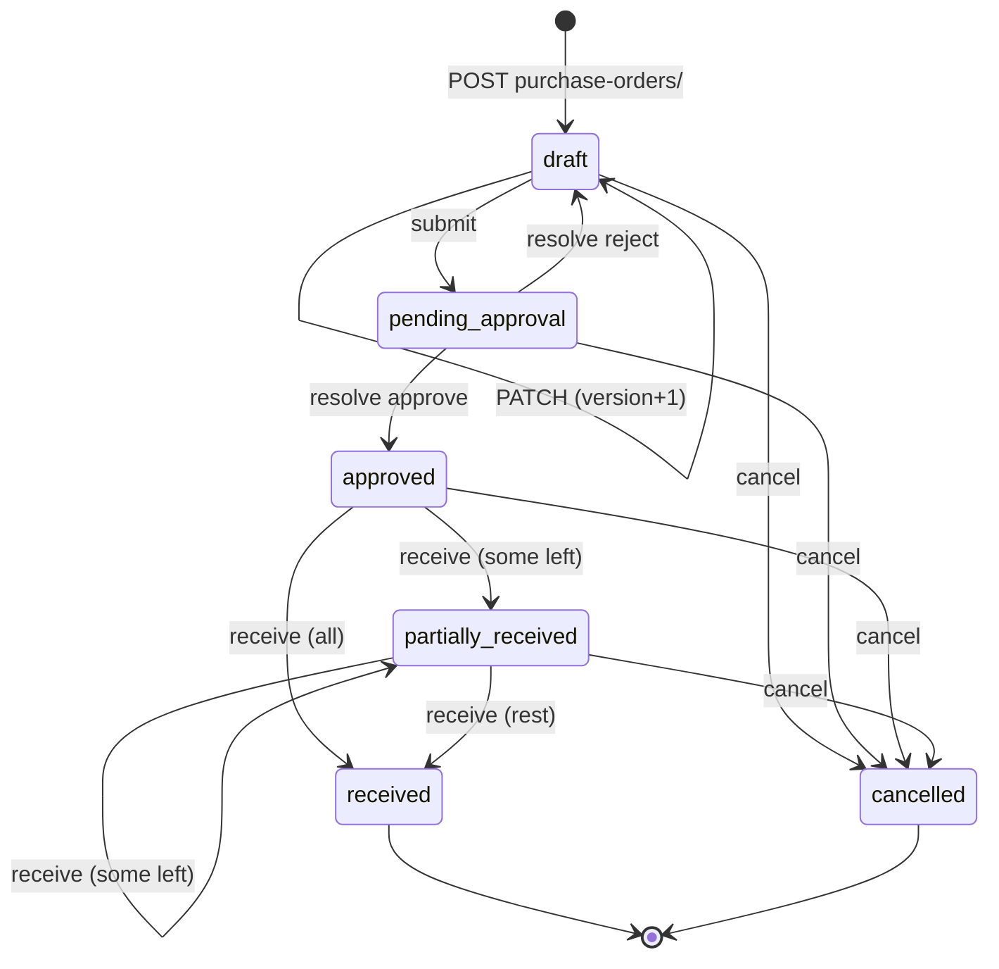

# Procurement API — M23 (الموردون وأوامر الشراء)

> **Source**: DOC-181, DOC-182, DOC-183, DOC-184 (Step 24) · INT-035 (M23), INT-022 (M18), INT-024 (M21) · inventory Domain 10
> **Live key**: `procurement` (`SHARWA_LIVE_MODULES`) — **one switch** for both resources; it **is** in `.env.example` (the commented `SHARWA_LIVE_MODULES=` line 79 and the module list above it)
> **Django provider**: `sharwa_saas/api/views_procurement.py` (`ProcurementAPIMixin`, 7 URL patterns) · `sharwa_saas/products/services/procurement_service.py` (validation, versioning, display shapes) · shared lifecycle core `products/services/purchase_order_service.py` · models `products/models/suppliers.py` (`Supplier`, `PurchaseOrder`, `PurchaseOrderLineItem`), `products/models/staff_approvals.py` (`ApprovalRequest`) · migration `products/0230_procurement_api`
> **Frontend contract**: `sharwa-frontend/src/features/procurement/schemas.ts` · hooks `src/features/procurement/api.ts` · fixtures `src/mocks/procurement/` (`router.ts`, `state.ts`, `kit.ts`) · BFF `src/app/api/bff/suppliers/[[...path]]/route.ts`, `src/app/api/bff/purchase-orders/[[...path]]/route.ts`
> **Tests**: `sharwa_saas/api/test_procurement_api.py` (9) + four legacy suites in `products/` (26 tests)
> **Last verified against code**: 2026-10-27 (step 24)

<a id="overview"></a>

## 1. Overview

M23 lets a store keep a list of **suppliers** and place **purchase orders** with them: draft an order (supplier, receiving location, lines with a quantity and a unit cost), send it for approval, approve or reject it, **receive** the goods (fully or in parts) and cancel it. Receiving is the only step that touches stock.

Before INT-035 the Django side already had the models `Supplier`, `PurchaseOrder`, `PurchaseOrderLineItem`, the approval and receive core (`purchase_order_service`) and HTML screens, but **no JSON API**: every M23 row of the BFF was a mock-only `[NEEDS BACKEND]` row. `api/views_procurement.py` now serves the contract of the frontend (`schemas.ts` and the mock are the source of truth). Its docstring and the service docstring state the design rule *reuse, do not rewrite*: every transition goes through the **same** `purchase_order_service` functions the legacy screens and the M18 approvals queue use, so there is one lifecycle, not two.

Callers are the owner or a staff member on the store host. There is **no plan feature** gate (the legacy screens have none), and no owner-only area: access is decided by two M18 permission keys ([§2](#access)).

`Supplier` here is a **purchasing** supplier that sells the merchant stock. It is deliberately separate from `DropshipSupplierDetails` (a dropshipping supplier with no owned stock, in `products/models/locations.py`, documented with M29) — the two share the word "supplier" and nothing else.

<a id="access"></a>

## 2. Access — gate chain

`ProcurementAPIMixin.run(request, fn, perms=…)` (`views_procurement.py:32`) evaluates, in this order:

| # | Gate | Requirement | Failure |
|---|---|---|---|
| 1 | Session | owner session or a resolved staff member (`ProductsAPIMixin.gate`) | `401` `{"detail": "انتهت جلستك، سجّل الدخول مجدداً."}` |
| 2 | Permission key | any one of the keys the route needs (table below); the **owner holds all implicitly** | `403` `{"detail": "ليست لديك صلاحية لهذا الإجراء."}` |
| 3 | Resource state | the entity exists and the state allows the action | `404` / `409` / `400` ([§6](#lifecycle)) |

| Keys | Routes |
|---|---|
| read = `suppliers.manage` **or** `suppliers.approve` | `GET suppliers/`, `GET suppliers/<id>/`, `GET purchase-orders/`, `GET purchase-orders/form-options/`, `GET purchase-orders/products/`, `GET purchase-orders/<id>/` |
| write = `suppliers.manage` | `POST`/`PATCH`/`DELETE` on suppliers, `POST purchase-orders/`, `PATCH purchase-orders/<id>/`, `submit/`, `receive/`, `cancel/` |
| decide = `suppliers.approve` | `POST purchase-orders/<id>/resolve/` — its `403` reads `{"detail": "الاعتماد لمن يحمل صلاحية اعتماد المشتريات."}` |

These two keys are among the M18 permission keys (migration `0178`, per the view docstring). Holding `suppliers.approve` alone is enough to **read** everything and to approve, but not to write.

`test_permissions` asserts: no session ⇒ `401`; a staff member holding only `suppliers.approve` gets `200` on `GET purchase-orders/` and `403` on `POST suppliers/`; with no keys at all, `GET suppliers/` ⇒ `403`.

> The unknown-action branch of `POST purchase-orders/<id>/<action>/` (any `<action>` other than `submit|resolve|receive|cancel`) answers `404` `{"detail": "غير موجود."}` **before** any gate runs, so even an anonymous caller gets `404`, not `401`.

<a id="summary"></a>

## 3. Endpoint summary

| Method | Django path (`/api/v1/…`) | BFF path (`/api/bff/…`) | Purpose | Gate | DOC |
|---|---|---|---|---|---|
| `GET` · `POST` | `suppliers/` | `suppliers` | list · create | read · `suppliers.manage` | 181 |
| `GET` · `PATCH` · `DELETE` | `suppliers/<id>/` | `suppliers/<id>` | one · edit · delete | read · `suppliers.manage` | 181 |
| `GET` · `POST` | `purchase-orders/` | `purchase-orders` | filtered list · create a draft | read · `suppliers.manage` | 182 |
| `GET` | `purchase-orders/form-options/` | `purchase-orders/form-options` | the form's lists | read | 182 |
| `GET` | `purchase-orders/products/` | `purchase-orders/products` | line picker | read | 182 |
| `GET` · `PATCH` | `purchase-orders/<id>/` | `purchase-orders/<id>` | detail + timeline · edit a draft | read · `suppliers.manage` | 183 |
| `POST` | `purchase-orders/<id>/submit/` | `purchase-orders/<id>/submit` | send for approval | `suppliers.manage` | 183 |
| `POST` | `purchase-orders/<id>/resolve/` | `purchase-orders/<id>/resolve` | approve / reject | `suppliers.approve` | 183 |
| `POST` | `purchase-orders/<id>/receive/` | `purchase-orders/<id>/receive` | receive goods | `suppliers.manage` | 183 |
| `POST` | `purchase-orders/<id>/cancel/` | `purchase-orders/<id>/cancel` | cancel | `suppliers.manage` | 183 |

The last four rows are one URL pattern, `purchase-orders/<int:pk>/<str:action>/`, with the action in the path. `<id>` is an `<int:…>` converter. In `api/urls.py` (lines 550-556) `form-options/` and `products/` are declared **before** `<int:pk>/`, so they are never read as an id.

<a id="suppliers"></a>

## 4. Suppliers (DOC-181)

<a id="supplier-object"></a>

### 4.1 The supplier object

```json
{
  "id": 3,
  "name": "مؤسسة البن اليمني",
  "contact_name": "ريم",
  "phone": "967771234501",
  "email": "",
  "address": "الرياض",
  "tax_number": "3001",
  "notes": "",
  "is_active": true,
  "created_at": "2026-10-25T09:12:04.511203+00:00",
  "orders_count": 1,
  "open_orders_count": 1
}
```

(values are from `test_supplier_crud` and `setUp`; ids and the timestamp are illustrative.)

| Field | Type | Meaning |
|---|---|---|
| `id` | integer | supplier id |
| `name` | string | unique, case-insensitively ([§4.3](#supplier-write)) |
| `contact_name` | string | stored in `Supplier.contact_person` |
| `phone` | string | digits only, 9-15; may be `""` |
| `email` | string | may be `""` |
| `address` | string | ≤ 300; new in `0230` |
| `tax_number` | string | ≤ 30; new in `0230` |
| `notes` | string | ≤ 1000 |
| `is_active` | boolean | an inactive supplier cannot be chosen for a new order |
| `created_at` | string \| `null` | ISO-8601 |
| `orders_count` | integer | **all** purchase orders of the supplier, cancelled included |
| `open_orders_count` | integer | orders whose status is not `cancelled` (so `received` orders count as open here) |

Not exposed: `default_currency` (set to the store currency at creation).

<a id="supplier-list"></a>

### 4.2 `GET /api/v1/suppliers/` — read keys

| Query | Type | Default | Notes |
|---|---|---|---|
| `q` | string | — | case-insensitive "contains" on name, phone **or** contact name |
| `page` | integer | `1` | invalid → `1` |
| `page_size` | integer | `20` | capped at `200`; not in the roadmap list (`?q&page`), but the shared pager reads it |

Newest first (`-id`). The answer is an envelope:

```json
{ "count": 1, "next": null, "previous": null, "results": [ { "id": 3, "…": "…" } ] }
```

`next` and `previous` are **page numbers** (`page ± 1`), not URLs, and `null` at the ends. The test searches `?q=التغليف` and gets `count: 1`, `next: null`.

<a id="supplier-write"></a>

### 4.3 `POST /api/v1/suppliers/` → `201` · `PATCH /api/v1/suppliers/<id>/` → `200` — `suppliers.manage`

**Request body** (`PATCH` is partial: only the keys sent are validated and written)

| Field | Type | Create | Rules |
|---|---|---|---|
| `name` | string | required | trimmed; ≤ 150; unique ignoring case |
| `contact_name` | string | optional | ≤ 150 |
| `phone` | string | optional | `^\d{9,15}$` when non-empty |
| `email` | string | optional | shape `x@y.z` when non-empty; ≤ 150 |
| `address` | string | optional | ≤ 300 |
| `tax_number` | string | optional | ≤ 30 |
| `notes` | string | optional | ≤ 1000 |
| `is_active` | boolean | optional, default `true` | must be a real boolean |

**Errors** — `400` with `{field: [message]}`; every field is validated and the errors are returned together:

| Field | Message | When |
|---|---|---|
| `name` | «اسم المورد مطلوب.» | empty |
| `name` | «الاسم أطول من 150 حرفاً.» | over 150 |
| `name` | «مورد بهذا الاسم موجود.» | another supplier has the same name ignoring case (on `PATCH` the supplier itself is excluded) |
| `phone` | «رقم الهاتف أرقام فقط بالصيغة الدولية.» | not 9-15 digits |
| `email` | «بريد إلكتروني غير صالح.» | wrong shape |
| `contact_name`, `address`, `tax_number`, `notes`, `email` | «150 حرفاً على الأكثر.» / «300 حرفاً على الأكثر.» / «30 حرفاً على الأكثر.» / «1000 حرفاً على الأكثر.» | over the field's limit (the number is the limit) |
| `is_active` | «قيمة غير صالحة.» | not a boolean |

Example error bodies (the first is asserted by `test_supplier_crud`):

```json
{ "name": ["مورد بهذا الاسم موجود."] }
```

```json
{ "phone": ["رقم الهاتف أرقام فقط بالصيغة الدولية."], "email": ["بريد إلكتروني غير صالح."] }
```

`PATCH` on an unknown id answers `404` `{"detail": "المورد غير موجود."}`. `PATCH` locks the row (`select_for_update`). Sending `phone: ""` clears the phone (the test patches `{"is_active": false, "phone": ""}`). The success body is the full supplier object ([§4.1](#supplier-object)), counts included.

> The database also has `UniqueConstraint(name)` (`unique_supplier_name`), which is case-**sensitive**. The case-insensitive rule lives only in this API's pre-check, so two simultaneous requests could still differ only by case. The legacy screens enforce only the constraint.

<a id="supplier-delete"></a>

### 4.4 `DELETE /api/v1/suppliers/<id>/` — `suppliers.manage`

`204` with an empty body for a supplier with **no** purchase order. The supplier is a **protected** reference (`PurchaseOrder.supplier` is `on_delete=PROTECT`) and even cancelled orders are a financial record, so **any** linked order blocks the delete:

```json
{ "detail": "لا يمكن حذف المورد: مرتبط بـ 1 أمر شراء — عطّله بدلاً من ذلك.", "orders_count": 1 }
```

Status `409`; `orders_count` is the number of linked orders, the same number as in the sentence. The remedy is to set `is_active: false` with `PATCH`; the supplier then disappears from `form-options/` but stays on its existing orders. Unknown id: `404` «المورد غير موجود.». The test deletes an unused supplier (`204`), then tries the supplier with one draft (`409`, `orders_count: 1`). The Next.js mock was aligned to the same rule (unique name, delete blocked by any order).

<a id="po-list-create"></a>

## 5. Purchase-order list, draft creation, form options and product picker (DOC-182)

<a id="po-number"></a>

### 5.1 The order number

`number` is **derived**, never stored: `PO-` followed by the id zero-padded to four digits — id 7 is `PO-0007`, id 12345 is `PO-12345`. It is the same text on the list, the detail and the M18 approvals card (`entity.label` in `staff_service._approval_context`; `test_resolved_from_approvals_queue` asserts it). An unsaved order shows `PO-—`.

<a id="po-list"></a>

### 5.2 `GET /api/v1/purchase-orders/` — read keys

| Query | Type | Notes |
|---|---|---|
| `status` | string | one of `draft`, `pending_approval`, `approved`, `partially_received`, `received`, `cancelled`; any other value is **ignored** (no filter, no error) |
| `supplier` | integer | supplier id |
| `location` | integer | receiving-location id |
| `from`, `to` | date | first 10 characters read as `YYYY-MM-DD`; filter `created_at` by **date**, inclusive; an invalid date is ignored |
| `q` | string | matches the supplier name (contains), a line's product SKU or variant SKU (contains), **or** the order number: text of the form `PO-0012`, `po12`, `0012` or `12` (optional `po`/`po-` prefix, leading zeros ignored) also matches the order with that id |
| `page`, `page_size` | integer | as in [§4.2](#supplier-list) (default 20, max 200) |

Newest first (`created_at`, then `id`, both descending). Envelope `{count, next, previous, results}` with these list items:

```json
{
  "id": 7,
  "number": "PO-0007",
  "supplier": { "id": 3, "name": "مؤسسة البن اليمني" },
  "location": { "id": 1, "name": "المستودع الرئيسي" },
  "status": "draft",
  "display_total": "300 ر.س",
  "lines_count": 1,
  "created_at": "2026-10-27T08:30:00+00:00"
}
```

`display_total` is the server's `format_money(Σ unit_cost × quantity_ordered, order currency)`; the client never sums or formats money. A bare number in `q` also matches supplier names and SKUs containing it, so `q=12` can return more than order 12. The test lists `?status=draft&q=COF` (→ the draft, `lines_count: 1`) and `?q=PO-<id>` (→ `count: 1`).

<a id="po-create"></a>

### 5.3 `POST /api/v1/purchase-orders/` — `suppliers.manage` → `201`

**Request body**

| Field | Type | Required | Rules |
|---|---|---|---|
| `supplier_id` | integer | yes | an existing, **active** supplier |
| `location_id` | integer | multi-location stores only | an active location; **ignored** when the store is in single-location mode |
| `notes` | string | no | ≤ 1000 |
| `lines` | array | no (may be empty on create) | see [§5.4](#po-lines) |

**Receiving location.** If `StoreSetting.multi_location_enabled` is off, the order uses the **first active location** by `(sort_order, id)` whatever `location_id` says. If it is on, `location_id` must be an active location. The order is saved in the **store currency at that moment** (`PurchaseOrder.currency`); unit costs are entered and shown in that currency.

**Errors** — `400`, `{key: [message]}`, validated together:

| Key | Message | When |
|---|---|---|
| `supplier_id` | «اختر المورد.» | missing or unknown |
| `supplier_id` | «المورد غير نشط.» | the supplier is inactive |
| `location_id` | «اختر موقع الاستلام.» | multi-location on and the id is missing, inactive or unknown |
| `location_id` | «لا يوجد موقع نشط — أضف موقعاً من صفحة المواقع.» | single-location mode and there is no active location |
| `lines` | «السطور مطلوبة.» | `lines` is present but not an array |
| `notes` | «1000 حرف على الأكثر.» | notes longer than 1000 |
| `lines.<i>.…` | see [§5.4](#po-lines) | a line is invalid |

The success body is the full order detail ([§6.1](#po-detail)) with `status: "draft"`, `version: 1` and a one-event timeline. The order is created with `created_by` = the calling staff member (empty for the owner) and the timeline event «أُنشئ أمر الشراء كمسودة.» is written in the same transaction. In `test_draft_validation_and_listing` the first request (unknown supplier, quantity `0`, cost `1.234`) is refused with exactly `supplier_id` and `lines.0.quantity_ordered`; the second creates `PO-<id>` with `display_total` `300 ر.س`.

<a id="po-lines"></a>

### 5.4 Line validation

Each element of `lines` is checked in order and the **first** failing rule of a line is reported under `lines.<i>.<field>` (`i` is the zero-based index); a line with a product error is not checked further.

| Order | Field | Rule | Message |
|---|---|---|---|
| 1 | `product_id` | product exists | «المنتج غير موجود.» |
| 1 | `product_id` | the product is **not** serialized, a bundle or an auction | «هذا المنتج لا يُستلم بأمر شراء (مسلسل/حزمة/مزاد).» |
| 2 | `variant_id` | if sent, the variant must belong to the product; if the product **has** variants, one is required | «حدد المتغير.» |
| 3 | `quantity_ordered` | whole number 1 – 999 999 999, sent as an integer or a digit string (a decimal, a float or a boolean is refused) | «الكمية عدد صحيح موجب.» |
| 4 | `unit_cost` | up to 10 integer digits and **at most 2 decimals**, not negative | «تكلفة الوحدة رقم حتى خانتين عشريتين.» |

A line is stored as `(product, variant, quantity_ordered, unit_cost)`; the cost is a **snapshot** and does not follow later changes of the product's cost. The Zod form (`poFormSchema`) applies the same two patterns on the client (`^[1-9]\d*$`, `^\d+(\.\d{1,2})?$`) and `poPayload` sends the quantity as a number and the cost as a string. `test_receive_variant_mirrors_product_stock` asserts «حدد المتغير.» for a product with variants and no `variant_id`.

<a id="form-options"></a>

### 5.5 `GET /api/v1/purchase-orders/form-options/` — read keys

```json
{
  "multi_location": false,
  "locations": [ { "id": 1, "name": "المستودع الرئيسي" } ],
  "suppliers": [ { "id": 3, "name": "مؤسسة البن اليمني" } ]
}
```

`locations` are the **active** locations ordered by `(sort_order, name, id)`; `suppliers` are the **active** suppliers ordered by `(name, id)`. The client hides the location field when `multi_location` is `false`. The test asserts `multi_location: false` and the first supplier.

<a id="line-picker"></a>

### 5.6 `GET /api/v1/purchase-orders/products/?q=` — read keys

A bare **array** (no envelope), at most **20** rows, one per orderable *unit* — a product without variants, or each variant of a product:

```json
[ { "product_id": 5, "variant_id": null, "name": "قهوة", "sku": "COF-1", "cost": "30.00", "display_cost": "30 ر.س" } ]
```

| Field | Meaning |
|---|---|
| `product_id`, `variant_id` | the unit (`variant_id` is `null` for a product without variants) |
| `name` | the product name, or «`<product> — <variant label>`» for a variant |
| `sku` | the variant's SKU, else the product's, else `""` |
| `cost` | the product's `cost_price` **converted into the store currency** (`convert_amount`), 2 decimals; `"0.00"` when the product has no cost |
| `display_cost` | `format_money(cost, store currency)` |

Which products appear: not archived, and **not** serialized, bundle or auction (the same exclusion as the line rule). With `q`, a product matches on name, SKU or any variant SKU, and each unit is kept only if `q` (case-insensitive) occurs in its label or its SKU. Without `q` the first 20 units by name are returned. The test searches `q=COF` and reads `sku: "COF-1"`, `cost: "30.00"`.

<a id="lifecycle"></a>

## 6. Detail, edits and lifecycle (DOC-183)

<a id="po-detail"></a>

### 6.1 `GET /api/v1/purchase-orders/<id>/` — read keys

Unknown id: `404` `{"detail": "أمر الشراء غير موجود."}`. The body extends the list item of [§5.2](#po-list):

| Field | Type | Meaning |
|---|---|---|
| *(list-item fields)* | | `id`, `number`, `supplier`, `location`, `status`, `display_total`, `lines_count`, `created_at` |
| `notes` | string | |
| `version` | integer | the optimistic-lock counter ([§6.3](#version-contract)) |
| `updated_at` | string | ISO-8601; for orders that existed before `0230` it was backfilled from `created_at` |
| `multi_location` | boolean | the store's current mode |
| `lines` | array | ordered by line id, shape below |
| `approval` | object \| `null` | the **latest** `po_approval` request of this order: `{id, status, approver, approver_role}` — `status` is `pending`, `approved` or `rejected`; `approver` is `null` while pending, else the resolver's name or «مالك المتجر»; `approver_role` is the role that must decide. `null` if the order was never submitted |
| `approver` | string \| `null` | set only when the approval is `approved` **and** the order is `approved`, `partially_received` or `received`; otherwise `null` |
| `timeline` | array | events, newest first ([§6.10](#timeline)) |

Line object:

| Field | Type | Meaning |
|---|---|---|
| `id` | integer | line id (used by `receive/`) |
| `product_id`, `variant_id` | integer, integer \| `null` | |
| `product_name` | string | the product's name (not the variant label) |
| `sku` | string | the variant's SKU, else the product's, else `""` |
| `quantity_ordered`, `quantity_received` | number | an integer when the value is whole, else a float |
| `unit_cost` | string | 2 decimals, e.g. `"30.00"` |
| `display_unit_cost`, `display_line_total` | string | `format_money`, in the order currency |
| `product_deleted` | boolean | `true` when the product is **archived**. Products are protected (`PROTECT`) so they are never really deleted; receiving still works |

<a id="po-edit"></a>

### 6.2 `PATCH /api/v1/purchase-orders/<id>/` — `suppliers.manage`, drafts only

Accepts the same fields as create (`supplier_id`, `location_id`, `notes`, `lines`) plus an **optional** `version`. Only the keys sent change; **`lines` replaces the whole line set** (all lines are deleted and recreated). On success `version` is incremented by one, the event «عُدّلت المسودة.» is written and the full detail is returned. Order of checks: lock the row → status (`409` «التعديل متاح للمسودة فقط.» unless `draft`) → `version` if sent (`409` stale, [§6.3](#version-contract)) → field validation (`400`, same messages as [§5.3](#po-create)); any failure rolls the whole edit back. `test_draft_validation_and_listing` patches with `version: 1` (→ `200`, `version: 2`, `display_total` `100 ر.س`) and then repeats `version: 1` (→ `409`).

<a id="version-contract"></a>

### 6.3 The `version` contract and the `409`

Every successful change of an order — create (`1`), edit, submit, approve or reject, receive, cancel — increments `PurchaseOrder.version` by one (FR-23.05). The client sends the version it last read; the server compares it with the **locked** row.

Stale version → `409`:

```json
{ "detail": "حُدِّث الأمر من مستخدم آخر.", "version": 4 }
```

`version` in the body is the **current** value. The client must refetch and let the user decide; the hook comment says a `409` is never retried automatically. A missing or non-numeric `version` counts as stale where it is required.

| Route | `version` | Check order |
|---|---|---|
| `PATCH <id>/` | optional | status, then version |
| `submit/` | **optional** (the UI always sends it) | status, then version |
| `resolve/` | required | version, then status |
| `receive/` | required | version, then status |
| `cancel/` | required | version, then status |

> ⚠️ Discrepancy — roadmap says "`submit/`, `resolve/`, `receive/`, `cancel/` — all with `version`" / `submit_po` calls `_check_version(po, body, required=False)`, so `submit/` accepts a request without `version` (a stale one still fails). The other three require it.

All other `409` answers carry **only** `detail` (no `version`): a state conflict, not a stale read. They are listed per transition below. The approval request has its **own** `version` (see [§6.7](#queue-door)); the two counters are independent.

<a id="po-state"></a>

### 6.4 Status machine



Every arrow except the `[*]` ones increments `version`; a stale `version` on any of them answers `409` and changes nothing.

| `status` | Label in the model (`STATUS_CHOICES`) | Label in the UI (`PO_STATUS_LABELS`) | Allowed actions (`PO_ACTIONS`, mirrored by the server) |
|---|---|---|---|
| `draft` | «مسودة» | «مسودة» | edit, submit, cancel |
| `pending_approval` | «بانتظار الاعتماد» | «بانتظار الموافقة» | resolve, cancel |
| `approved` | «مُعتمَد — بانتظار التوريد» | «معتمد» | receive, cancel |
| `partially_received` | «استلام جزئي» | «مستلَم جزئياً» | receive, cancel |
| `received` | «مكتمل الاستلام» | «مستلَم» | — |
| `cancelled` | «ملغي» | «ملغى» | — |

The API sends only the code; the two label columns differ (admin vs. UI wording). **Rejection returns the order to `draft`** (spec M23 §5) so it can be edited and re-submitted; before INT-035 the shared service cancelled a rejected order, and `test_suppliers_phase2` / `test_suppliers_purchase_orders` were updated to match.

<a id="submit"></a>

### 6.5 `POST …/<id>/submit/` — `suppliers.manage`

Body `{"version": 1}` (version optional). Creates an `ApprovalRequest` of type `po_approval` (location = the order's, `requested_by` = the caller or empty for the owner, `amount` = the order total, `target_ref` = `po:<id>`), moves the order to `pending_approval`, bumps `version` and writes the event «أُرسل للموافقة (طلب #<n>).». The approving role is the system role «مدير المتجر» (seeded by migration `0144`), else the first active role.

```json
{ "status": "pending_approval", "approval_id": 21, "version": 2 }
```

| Status | Body | When |
|---|---|---|
| `409` | `{"detail": "الإرسال متاح للمسودة فقط."}` | the order is not a draft |
| `409` | stale-version body ([§6.3](#version-contract)) | `version` sent and stale |
| `400` | `{"lines": ["أضف سطراً واحداً على الأقل."]}` | the draft has no lines |
| `400` | `{"detail": "لا يوجد دور معتمد متاح — أنشئ دوراً أولاً."}` | no role can approve |

<a id="resolve"></a>

### 6.6 `POST …/<id>/resolve/` — `suppliers.approve`

Body `{"decision": "approve" | "reject", "version": 2}`. Answers the full detail ([§6.1](#po-detail)). Approve → `approved` (event «اعتُمد الأمر.»); reject → back to `draft` (event «رُفض الأمر وأُعيد مسودة.»); the stock is **not** touched either way. The resolver is the calling staff member, or the owner (shown as «مالك المتجر»).

| Status | Body | When |
|---|---|---|
| `409` | stale-version body | `version` is not the order's current one |
| `409` | `{"detail": "الأمر ليس بانتظار الموافقة."}` | status is not `pending_approval` |
| `400` | `{"decision": ["القرار approve أو reject."]}` | any other `decision` |
| `409` | `{"detail": "لا يوجد طلب اعتماد معلّق لهذا الأمر."}` | no pending `po_approval` request exists |
| `409` | `{"detail": "تم حسم هذا الاعتماد بالفعل من طرف آخر.", "version": 3}` | the approval request was decided concurrently (`ConcurrencyError`); `version` is the order's |
| `403` | `{"detail": "لا يمكن الموافقة على طلبك الخاص."}` | self-approval |

**Self-approval.** `ApprovalRequest.resolve` raises `PermissionError` when the resolver is the staff member who requested it (its own text is «لا يمكن للموظف الموافقة على طلبه الخاص.»); this route maps that to the `403` above. The owner has no staff record, so the check never applies to the owner. `test_self_approval_refused` creates, submits and approves as the same staff member and asserts `403` with «لا يمكن الموافقة على طلبك الخاص.». The two stale cases are checked in `test_submit_resolve_reject_returns_draft` (a stale `version: 1` → `409`).

<a id="queue-door"></a>

### 6.7 The second door: the M18 approvals queue

A pending `po_approval` request also appears in the M18 queue (`GET approvals/?type=po_approval`, label `PO-0012`). Deciding it there — `POST approvals/<pk>/resolve/` — runs the **same** `resolve_purchase_order`, so the order moves, `version` increments and the timeline is written exactly as above (`test_resolved_from_approvals_queue`: order `approved`, `version` 3). The two doors differ:

| | M23 `purchase-orders/<id>/resolve/` | M18 `approvals/<pk>/resolve/` |
|---|---|---|
| Who may call | `suppliers.approve` | any session that can view the queue **and** may decide that request (approver role / owner) |
| Body | `{decision: "approve" \| "reject", version}` — the **order's** version | `{decision: "approved" \| "rejected", note?, version}` — the **request's** version |
| Rejection note | none | required on reject («الملاحظة مطلوبة عند الرفض.») |
| Self-approval message | «لا يمكن الموافقة على طلبك الخاص.» | «لا يمكنك الموافقة على طلبك.» |
| Stale answer | «حُدِّث الأمر من مستخدم آخر.» / «تم حسم هذا الاعتماد بالفعل من طرف آخر.» | «حُسم الطلب من مستخدم آخر.» |

The M18 route is documented with the staff module (Domain 12); it is listed here only because it moves an M23 order.

<a id="receive"></a>

### 6.8 `POST …/<id>/receive/` — `suppliers.manage`

Body:

```json
{ "version": 3, "lines": [ { "line_id": 14, "quantity_received_now": 4 } ] }
```

| Status | Body | When |
|---|---|---|
| `409` | stale-version body | stale `version` |
| `409` | `{"detail": "الاستلام متاح للأوامر المعتمدة فقط."}` | status is not `approved` / `partially_received` |
| `400` | `{"lines.<i>.line_id": ["السطر غير موجود في الأمر."]}` | the line is not on this order |
| `400` | `{"lines.<i>.quantity_received_now": ["الكمية عدد صحيح غير سالب."]}` | not a whole number ≥ 0 (digits only; a float or boolean is refused) |
| `400` | `{"lines.<i>.quantity_received_now": ["تتجاوز المتبقي (10)."]}` | more than ordered − received (the number is the remaining quantity) |
| `400` | `{"lines": ["أدخل كمية مستلمة لسطر واحد على الأقل."]}` | every quantity is `0` or `lines` is empty |
| `400` | `{"detail": "…"}` | the shared service refuses: «لا يمكن الاستلام قبل اعتماد أمر الشراء.» (status re-read on the locked row), «بند غير موجود في هذا الأمر: <id>», or a total over the remainder when the same line is sent twice («الكمية (<n>) تتجاوز المتبقي للاستلام (<n>) لبند «<product>».») |

A row with quantity `0` is allowed and skipped. The same `line_id` sent twice is summed. On success (`receive_purchase_order`, one `transaction.atomic()` with `select_for_update` on the order, its lines and the stock row):

| Store mode | Stock effect |
|---|---|
| multi-location on | the `LocationInventory` row of (the order's location, product, variant) gains `quantity_on_hand`; it is **created** if it does not exist |
| off, line has a variant | `ProductVariant.stock` is increased **and** the product's stock is recomputed from its variants (`recalculate_stock_from_variants`) |
| off, no variant | `Product.stock` is increased |

In every mode a `StockMovement` is written per line: `reason = po_received`, a **positive** `quantity_change`, `location` = the order's location, `note` «أمر شراء #<id>» (the raw id, not `PO-…`), `reference_type = purchase_order`, `reference_id` = the id, and `actor` = the staff member's name, or «النظام» when the owner receives. Then `quantity_received` is increased, the order becomes `partially_received` (some line still has a remainder) or `received` (and `received_at` is set), `version` is bumped, and the event «استلام جزئي.» or «استُلمت كل الكميات.» is written with `quantities: [{sku, quantity}]`. The response is the full detail. Approval alone never touches stock; receiving is the only step that does. The database also enforces `quantity_received ≤ quantity_ordered` (`po_line_received_not_exceed_ordered`) as a second line of defence.

> A bug fixed in INT-035: receiving a **variant** line in flat-stock mode used to leave `Product.stock` stale because the product was not recomputed. `test_receive_variant_mirrors_product_stock` receives 3 on a variant at 2 and asserts variant `5` and product `5`.

`test_receive_partial_then_full` covers: over-receipt → «تتجاوز المتبقي (10).»; quantity `0` → `400`; partial receive of 4 → `partially_received`, `Product.stock` 5 → 9, a `po_received` movement with the order's reference, `quantities` `[{"sku": "COF-1", "quantity": 4}]`; a stale re-send → `409`; the remaining 6 → `received`; cancelling a received order → `409`.

<a id="cancel"></a>

### 6.9 `POST …/<id>/cancel/` — `suppliers.manage`

Body `{"version": n}`. Allowed from `draft`, `pending_approval`, `approved` and `partially_received` (FR-23.04). Otherwise `409` `{"detail": "لا يمكن إلغاء أمر مستلَم أو ملغى."}`. On success the status becomes `cancelled`, `version` is bumped, and the event «أُلغي الأمر.» is written. If the order was `pending_approval`, its pending approval request is **closed as `rejected`** with the note «أُلغي أمر الشراء.», so it does not stay in the M18 queue for an order that no longer exists. Whatever was received before the cancel stays in stock. The response is the full detail, where `approval.status` is `rejected` (`test_cancel_pending_closes_approval`, which also checks the supplier's `open_orders_count` drops to `0`).

The service function takes an `allowed` statuses tuple; this API uses the default (all four). The roadmap says the legacy screen keeps its draft-only limit; the legacy view was not read in this step.

<a id="timeline"></a>

### 6.10 The timeline (FR-23.08)

`timeline` is built from the append-only `AuditLog` rows `po.<kind>` written by `record_po_event`:

| `kind` | Text |
|---|---|
| `created` | «أُنشئ أمر الشراء كمسودة.» |
| `updated` | «عُدّلت المسودة.» |
| `submitted` | «أُرسل للموافقة (طلب #<n>).» |
| `approved` | «اعتُمد الأمر.» |
| `rejected` | «رُفض الأمر وأُعيد مسودة.» |
| `received` | «استلام جزئي.» or «استُلمت كل الكميات.», plus `quantities: [{sku, quantity}]` |
| `cancelled` | «أُلغي الأمر.» |

Each event is `{id, kind, text, actor, at}` (`quantities` only on `received`); `actor` is the staff member's name or «مالك المتجر» («—» if the row has none). Events are sorted **newest first**. An order created before INT-035 (or by the legacy screen) has no `created` row, so one is **derived** from `created_at` with `id: 0`. Rows with any other `kind` are skipped. In `test_submit_resolve_reject_returns_draft` the first three events after approve are `approved`, `submitted`, `rejected`.

<a id="bff"></a>

## 7. BFF wiring and tests (DOC-184)

Both resources use **one optional catch-all route** each — `src/app/api/bff/suppliers/[[...path]]/route.ts` and `src/app/api/bff/purchase-orders/[[...path]]/route.ts` — exporting `GET`, `POST`, `PATCH`, `DELETE` from one `handle`. Each builds the Django path from the segments after `/api/bff/<resource>/`:

```text
/api/v1/<resource>/<segment>/<segment>/…/      (each segment encodeURIComponent-ed; trailing slash always)
/api/v1/<resource>/                            (no segments)
```

and calls `liveOrMock(request, "procurement", <that path>, <mock>)`:

| Browser calls `/api/bff/…` | Upstream `/api/v1/…` |
|---|---|
| `suppliers` | `suppliers/` |
| `suppliers/3` | `suppliers/3/` |
| `purchase-orders` | `purchase-orders/` |
| `purchase-orders/form-options` | `purchase-orders/form-options/` |
| `purchase-orders/products?q=COF` | `purchase-orders/products/?q=COF` |
| `purchase-orders/7` | `purchase-orders/7/` |
| `purchase-orders/7/receive` | `purchase-orders/7/receive/` |

In **live mode** (`procurement` in `SHARWA_LIVE_MODULES`, or mocks off) the request is forwarded verbatim — query string, cookies, CSRF header, body, status — and Django answers `401`, `403` and `409` itself, so no Next.js session gate runs. In **mock mode** `mockRoute` applies the merchant/staff session and `procurementMock` (`src/mocks/procurement/router.ts`) dispatches on `["suppliers" | "purchase-orders", …path]` with the same gates: read needs `suppliers.manage` or `suppliers.approve`, writes `suppliers.manage`, `resolve` needs `suppliers.approve` and answers «الاعتماد لمن يحمل صلاحية اعتماد المشتريات.». The mock was aligned with Django in INT-035: unique supplier name, delete blocked by any order.

The key is in the register [`architecture/22-live-module-keys.md`](../../../architecture/22-live-module-keys.md) (row 25, "2 catch-alls") and, unlike `locations`, **is present** in the sample line of `.env.example`. The frontend hooks (`src/features/procurement/api.ts`) call `/api/bff/suppliers`, `/api/bff/purchase-orders[/…]` with Zod on every response and never auto-retry a `409`.

<a id="tests"></a>

### 7.1 Tests

**`api/test_procurement_api.py`** — nine tests in `ProcurementApiTests` (a `TenantTestCase` with a merchant session; store currency `SAR`, single-location mode):

| Test | Covers | Section |
|---|---|---|
| `test_permissions` | 401, keys `suppliers.approve` / none | [§2](#access) |
| `test_supplier_crud` | create, duplicate name, phone/email, patch, list `?q`, delete, delete-protection `409` | [§4](#suppliers) |
| `test_draft_validation_and_listing` | line validation, number and total, edit with `version`, list filters, form options, picker | [§5](#po-list-create), [§6.2](#po-edit) |
| `test_submit_resolve_reject_returns_draft` | submit → `po_approval`, stale `409`, reject → `draft`, re-submit, approve, timeline order | [§6.5](#submit), [§6.6](#resolve) |
| `test_self_approval_refused` | `403` self-approval | [§6.6](#resolve) |
| `test_receive_partial_then_full` | over-receipt, partial then full, `StockMovement`, stale `409`, cancel after receive | [§6.8](#receive) |
| `test_receive_variant_mirrors_product_stock` | «حدد المتغير.», variant and product stock | [§6.8](#receive) |
| `test_cancel_pending_closes_approval` | cancel of a pending order | [§6.9](#cancel) |
| `test_resolved_from_approvals_queue` | M18 queue decision moves the order | [§6.7](#queue-door) |

Run: `python manage.py test api.test_procurement_api`.

**Legacy suites** that exercise the shared service (they run the lifecycle functions directly, without HTTP):

| File | Tests |
|---|---|
| `products/test_suppliers_phase1.py` | 4 — unique name, derived total, default `draft`, received ≤ ordered |
| `products/test_suppliers_phase2.py` | 4 — submit, non-draft refused, approve, reject (**updated**: the order returns to `draft`) |
| `products/test_suppliers_phase3.py` | 4 — receive before approval refused, stock and movement, over-receipt refused, full receive |
| `products/test_suppliers_purchase_orders.py` | 14 — totals, submit, approval, rejection → draft, self-approval, double resolve (optimistic lock), receiving |

> ⚠️ Discrepancy — roadmap says "the three legacy supplier suites (reject test updated)" / there are **four** legacy files: `test_suppliers_phase1/2/3.py` and `test_suppliers_purchase_orders.py` (26 tests in all). The updated reject test is `test_resolve_rejects_and_cancels_po` in `test_suppliers_phase2.py` — it now asserts `draft`, but its **name** still says "cancels". `test_suppliers_purchase_orders.py` has `test_rejection_returns_order_to_draft`.

The roadmap also mentions "staff/inventory/reports green". Nothing was run in this step; that statement is not verified here.

Not asserted by a test: the `403` message of `resolve/` for a staff member with only `suppliers.manage`, `GET` filters `supplier`, `location`, `from`, `to`; `submit/` without lines; the unknown-action `404`; `PATCH` of a non-draft order; the `receive/` `lines.<i>.line_id` error.

<a id="schema-changes"></a>

## 8. Migration `products/0230_procurement_api`

Depends on `0229_pos_api`.

| Model | Change | Contract |
|---|---|---|
| `Supplier` | `phone` altered: `CharField(20, blank=True, db_index=True)` — **optional** now (`SupplierForm`) | `phone` may be `""` |
| `Supplier` | `address` added: `CharField(300, blank=True)` | `address` |
| `Supplier` | `tax_number` added: `CharField(30, blank=True)` | `tax_number` |
| `PurchaseOrder` | `notes` added: `TextField(blank=True)` | `notes` |
| `PurchaseOrder` | `version` added: `PositiveIntegerField(default=1)` | the optimistic lock |
| `PurchaseOrder` | `updated_at` added: `DateTimeField(auto_now=True)` | `updated_at` |
| data | `RunPython(backfill_updated_at)` sets `updated_at = created_at` for existing orders (reverse is a no-op) | |

<a id="open-items"></a>

## 9. Open items and quirks

- **Draft can be empty.** `POST purchase-orders/` accepts no lines; only `submit/` requires one.
- **`status` filter silently ignored** for an unknown value ([§5.2](#po-list)).
- **Owner receives as «النظام».** The `StockMovement.actor` of an owner's receive is «النظام», while the timeline says «مالك المتجر» ([§6.8](#receive), [§6.10](#timeline)).
- **Two decision doors** with different gates, bodies and messages ([§6.7](#queue-door)).
- **Case-insensitive supplier name** is enforced in code only ([§4.3](#supplier-write)).
- **Status labels differ** between the model and the UI ([§6.4](#po-state)).
- **No lines editing on non-drafts**, and no way to change an order's currency after creation.

<a id="related"></a>

## 10. Related pages

- Domain: [`README.md`](README.md) · inventory [`m21-inventory.md`](m21-inventory.md) · locations [`m22-locations.md`](m22-locations.md) · staff roles and the approvals queue [`../12-settings-staff-integrations/m18-staff-permissions.md`](../12-settings-staff-integrations/m18-staff-permissions.md)
- Cross-cutting: [permissions](../../overview/permissions.md) · [errors](../../overview/errors.md) · [BFF](../../overview/bff.md) · [money](../../overview/money.md) · [idempotency and concurrency](../../overview/idempotency.md)
- Architecture: [approvals](../../../architecture/45-approvals.md) · [stock ledger](../../../architecture/44-stock-ledger.md) · [concurrency](../../../architecture/42-concurrency.md) · [live module keys](../../../architecture/22-live-module-keys.md) · [data model — Domain 10](../../../architecture/data-model/10-inventory-locations-procurement.md)
