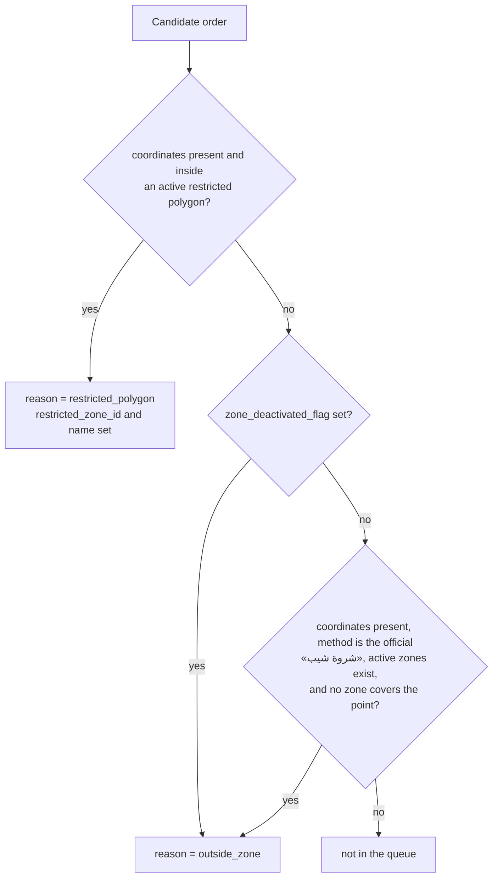

# Shipping & zones API — M15 (الشحن والمناطق والمندوبون)

> **Source**: DOC-185, DOC-186, DOC-187, DOC-188, DOC-189, DOC-190, DOC-191, DOC-192, DOC-193, DOC-194 (Step 25) · INT-021 (M15), INT-010 (M34), INT-025 (M22) · inventory Domain 11
> **Live key**: `shipping` (`SHARWA_LIVE_MODULES`) — one switch for all 25 routes of this page; it **is** in the sample line `.env.example:79`. The seven `sharwa_ship` rows (INT-047, Step 26) are a different key.
> **Django provider**: `sharwa_saas/api/views_shipping.py` (`ShippingAPIMixin`, 25 URL patterns) · `sharwa_saas/products/services/shipping_service.py` (validation, display shapes, review and edge-case logic) · carrier adapters `products/carriers/` · helpers `carrier_service.py`, `zone_routing_service.py`, `shipment_operations_service.py` · no DRF serializers: the JSON shapes are built by dict functions in the service
> **Frontend contract**: `sharwa-frontend/src/features/shipping/schemas.ts` · hooks `src/features/shipping/api.ts` · fixtures `src/mocks/shipping/state.ts`, `ops.ts` · BFF `src/app/api/bff/shipping/**`, `src/app/api/bff/shipments/[id]/address/route.ts`, `src/app/api/bff/orders/[id]/convert-to-pickup/route.ts`
> **Tests**: `sharwa_saas/api/test_shipping_api.py` (9)
> **Last verified against code**: 2026-10-27 (step 25)

<a id="overview"></a>

## 1. Overview

M15 is where the **owner** decides how an order leaves the store. It covers:

- the default delivery fee and the free-shipping threshold ([§5](#settings));
- the **delivery methods** a buyer picks at checkout, including the platform's official «شروة شيب» ([§6](#methods));
- **pickup points** ([§7](#pickups));
- **own-fleet agents** and **3PL company accounts**, both stored as `ShippingProvider` ([§8](#providers));
- the connection to the external **carriers** `aramex` and `smsa` — credentials, a connection test, the webhook address ([§9](#carriers));
- the platform's **Sharwa Ship zones** (read only) and **packaging profiles** ([§10](#zones-packaging));
- the **zone review** queue and the **restricted polygons** ([§11](#zone-review));
- **SLA rules** and the **edge-cases** feed ([§12](#sla-edge));
- two actions on a shipment: **change the address while in transit** and **convert the order to pickup** ([§13](#shipment-actions)).

Before INT-021 the Django side had only HTML dashboard screens for this module — they are still registered in `config/urls_tenant.py` (lines 656–711) and share the same models:

| Legacy screen (URL name) | Dashboard path | Now served as |
|---|---|---|
| `shipping_companies` | `dashboard/shipping-companies/` | delivery methods ([§6](#methods)) |
| `shipping_providers` | `dashboard/shipping-providers/` | providers ([§8](#providers)) |
| `pickup_locations` | `dashboard/pickup-locations/` | pickup points ([§7](#pickups)) |
| `carrier_settings` (+ `carrier_settings_save`) | `dashboard/carrier-settings/` | carriers ([§9](#carriers)) |
| `packaging_profiles` | `dashboard/packaging-profiles/` | packaging profiles ([§10](#zones-packaging)) |
| `zone_review` | `dashboard/zone-review/` | zone review ([§11](#zone-review)) |
| `update_address_in_transit` | `dashboard/orders/<order_id>/update-address-in-transit/` | address change ([§13](#shipment-actions)) |
| `convert_order_to_pickup` | `dashboard/orders/<order_id>/convert-to-pickup/` | convert to pickup ([§13](#shipment-actions)) |

Every row of the contract in `schemas.ts` was written first (Phase 001, as a `[NEEDS BACKEND]` mock-only row); `shipping_service.py` builds the same shapes from the Django models, so the Zod schemas are the contract and the service is the provider.

**Out of scope here.** The 12 `views_sharwa_ship` patterns that sit between the two M15 blocks of `api/urls.py` (lines 367–378 — pending orders, waybill issuance, shipments, AWB queue, rate cards, supervision, shifts) are M39 and are documented in `m39-sharwa-ship.md` (Step 26). The courier app is M38.

Callers are the **owner** on the store host. A staff member reaches only three routes — the edge-cases feed, the address change and convert-to-pickup — each behind an M18 permission key ([§2](#access)).

<a id="access"></a>

## 2. Access — gate chain

`ShippingAPIMixin.check` (`views_shipping.py:45`) evaluates, in this order; the first failing gate answers:

| # | Gate | Requirement | Failure |
|---|---|---|---|
| 1 | Session | an owner session or a resolved staff member (`ProductsAPIMixin.gate`) | `401` `{"detail": "انتهت جلستك، سجّل الدخول مجدداً."}` |
| 2 | Owner only | the session must be the owner — **any** resolved staff member is refused, whatever permissions they hold | `403` `{"detail": "إعدادات الشحن مقصورة على مالك المتجر."}` |
| 3 | Plan feature | the feature of the resource (table below); none for carriers, zones, packaging, review, restricted zones and SLA rules | `403` `{"detail": "هذه الميزة غير متاحة في باقتك الحالية"}` |
| 4 | Resource state | the entity exists and the state allows the action | `404` / `400` / `409` (per section) |

The message of gate 3 has **no** final full stop (`FEATURE_MESSAGE` in `views_settings.py`); the messages of gates 1 and 2 do.

> The owner-only gate runs **before** the plan feature. A staff session on a store whose plan lacks the feature therefore gets the owner message, not the feature message. (M22 evaluates the feature first.)

**Plan features** — the legacy `require_feature` codes, checked by `settings_feature_enabled`:

| Feature code | Resources |
|---|---|
| `shipping_settings` | `shipping/settings/` |
| `shipping_companies` | `shipping/delivery-methods/` and `<pk>/` |
| `pickuplocation` | `shipping/pickup-locations/`, `<pk>/`, `reorder/` |
| `shipping_providers` | `shipping/providers/`, `<pk>/`, `staff-options/` |
| *none* | carriers, `sharwa-ship/zones/`, packaging profiles, zone review, restricted zones, SLA rules, edge cases, address change, convert-to-pickup |

**The three staff doors.** These routes skip gates 2 and 3 and call `self.gate(request, permission)` instead:

| Route | Permission key | Failure for a staff member without it |
|---|---|---|
| `GET shipping/edge-cases/` | `orders.view` | `403` `{"detail": "ليست لديك صلاحية لهذا الإجراء."}` |
| `POST shipments/<pk>/address/` | `orders.update_status` | same |
| `POST orders/<pk>/convert-to-pickup/` | `orders.update_status` | same |

The owner holds every key implicitly. These three routes have no plan-feature gate.

`test_auth_owner_only_features_and_edge_permissions` asserts: no session ⇒ `401`; a staff session on `GET shipping/delivery-methods/` ⇒ `403` with the owner message while `GET shipping/edge-cases/` ⇒ `200`; with the `shipping_companies` feature switched off, `delivery-methods` ⇒ `403` while `pickup-locations` and `packaging-profiles` ⇒ `200`. `test_edge_cases_address_and_convert` adds: a staff session whose permission check fails gets `403` on `POST shipments/<pk>/address/`.

> **Marketplace orders.** The three order-writing routes (`zone-review/<order_id>/resolve/`, `shipments/<pk>/address/`, `orders/<pk>/convert-to-pickup/`) lock the order through `order_api_service.lock_order`, which refuses an order that came from an external marketplace: `400` `{"detail": "طلب {name}: تُحدَّث حالته من السوق نفسه ولا تُغيَّر من هنا."}` (`{name}` comes from the marketplace registry; `status_change_block_reason` may supply a more specific sentence). No test covers this branch.

<a id="summary"></a>

## 3. Endpoint summary — the 25 routes

All Django paths are under `/api/v1/`; the BFF mirrors them under `/api/bff/` ([BFF](../../overview/bff.md)). `Gate` is the identity requirement after the session; `Plan feature` is gate 3 of [§2](#access).

| # | Method | Django path | BFF path | Purpose | Gate | Plan feature | DOC |
|---|---|---|---|---|---|---|---|
| 1 | `GET` · `PATCH` | `shipping/settings/` | `shipping/settings` | default fee and free-shipping threshold (the M34 row) | owner | `shipping_settings` | 185 |
| 2 | `GET` · `POST` | `shipping/delivery-methods/` | `shipping/delivery-methods` | list (`?is_active`, paged) · create (`201`) | owner | `shipping_companies` | 186 |
| 3 | `PATCH` · `DELETE` | `shipping/delivery-methods/<pk>/` | `shipping/delivery-methods/<id>` | edit · delete (`204`) — **no `GET`** | owner | `shipping_companies` | 186 |
| 4 | `GET` · `POST` | `shipping/pickup-locations/` | `shipping/pickup-locations` | list (+ M22 hint) · create | owner | `pickuplocation` | 187 |
| 5 | `POST` | `shipping/pickup-locations/reorder/` | `shipping/pickup-locations/reorder` | set the full order | owner | `pickuplocation` | 187 |
| 6 | `PATCH` · `DELETE` | `shipping/pickup-locations/<pk>/` | `shipping/pickup-locations/<id>` | edit · delete (renumbers) | owner | `pickuplocation` | 187 |
| 7 | `GET` · `POST` | `shipping/providers/` | `shipping/providers` | list (`?kind`) · create | owner | `shipping_providers` | 188 |
| 8 | `GET` | `shipping/providers/staff-options/` | `shipping/providers/staff-options` | staff picker | owner | `shipping_providers` | 188 |
| 9 | `PATCH` · `DELETE` | `shipping/providers/<pk>/` | `shipping/providers/<id>` | edit · delete (`409` with past orders) | owner | `shipping_providers` | 188 |
| 10 | `GET` | `shipping/carriers/` | `shipping/carriers` | the registered carriers (plain array) | owner | — | 189 |
| 11 | `GET` | `shipping/carriers/<code>/` | `shipping/carriers/<code>` | one carrier | owner | — | 189 |
| 12 | `PUT` | `shipping/carriers/<code>/credentials/` | `shipping/carriers/<code>/credentials` † | save the merchant's credentials | owner | — | 189 |
| 13 | `POST` | `shipping/carriers/<code>/test/` | `shipping/carriers/<code>/test` † | connection test | owner | — | 189 |
| 14 | `GET` | `shipping/sharwa-ship/zones/` | `shipping/sharwa-ship/zones` | platform zones, read only | owner | — | 190 |
| 15 | `GET` · `POST` | `shipping/packaging-profiles/` | `shipping/packaging-profiles` | list · create | owner | — | 190 |
| 16 | `PATCH` · `DELETE` | `shipping/packaging-profiles/<pk>/` | `shipping/packaging-profiles/<id>` | edit · delete | owner | — | 190 |
| 17 | `GET` | `shipping/zone-review/` | `shipping/zone-review` | orders outside every zone or inside a restricted polygon (`?reason`) | owner | — | 191 |
| 18 | `POST` | `shipping/zone-review/<order_id>/resolve/` | `shipping/zone-review/<orderId>/resolve` † | confirm · convert to pickup · cancel | owner | — | 191 |
| 19 | `GET` · `POST` | `shipping/restricted-zones/` | `shipping/restricted-zones` | list · create | owner | — | 191 |
| 20 | `PATCH` · `DELETE` | `shipping/restricted-zones/<pk>/` | `shipping/restricted-zones/<id>` | edit · delete | owner | — | 191 |
| 21 | `GET` · `POST` | `shipping/sla-rules/` | `shipping/sla-rules` | list · create | owner | — | 192 |
| 22 | `PATCH` · `DELETE` | `shipping/sla-rules/<pk>/` | `shipping/sla-rules/<id>` | edit · delete | owner | — | 192 |
| 23 | `GET` | `shipping/edge-cases/` | `shipping/edge-cases` | flagged events and SLA breaches (`?kind`) | `orders.view` | — | 192 |
| 24 | `POST` | `shipments/<pk>/address/` | `shipments/<id>/address` | change the address while `in_transit` | `orders.update_status` | — | 193 |
| 25 | `POST` | `orders/<pk>/convert-to-pickup/` | `orders/<id>/convert-to-pickup` | convert an order to pickup | `orders.update_status` | — | 193 |

† Files nested too deeply to stage for reading — see [§15.1](#bff-table).

The table has one row per URL pattern: **14** patterns at `api/urls.py` lines 352–365 (settings → Sharwa Ship zones) and **11** at lines 379–389 (packaging → convert-to-pickup).

**No `GET <pk>/`.** The six `_crud`-built resources — methods, pickups, providers, packaging profiles, restricted zones and SLA rules — define a `ListView` (`GET` list, `POST` create `201`) and a `DetailView` with **`PATCH` and `DELETE` only** (`DELETE` answers `204` with no body). A `GET …/<pk>/` has no handler, so DRF answers `405`; no test asserts it. The screens read from the list.

<a id="conventions"></a>

## 4. Conventions shared by every route

- **Paging.** List routes take `page` (default 1) and `page_size` (1–100, default 50; a value that is not a number falls back to the default). The body is `{"count": N, "results": […]}`. A page past the end returns an empty `results`. Two routes return a plain array instead: `GET shipping/carriers/` and `GET shipping/providers/staff-options/`. Extra keys: `counts` on providers, `pickup_point_locations` on pickups, `kind`, `counts` and `pickup_options` on edge cases.
- **Filter `is_active`.** Delivery methods and pickup points accept `?is_active=true|false`; any other value is ignored.
- **Errors.** Field errors are `400 {"field": ["«…»"]}`; every other refusal is `{"detail": "«…»"}` with `403`, `404`, `409` or `400`. The Arabic sentences are quoted verbatim in «…» below.
- **Body.** A JSON object. Text values are trimmed; a body that is not an object is read as `{}` (`ProductsAPIMixin.data`), so the service's own «جسم الطلب غير صالح.» branch is not reachable through these views.
- **Booleans.** `is_active`, `is_default` and `accepts_hazardous` count as true **only** for JSON `true`, the string `"true"` or the number `1` (`_bool`); `"1"`, `"True"` and `"on"` are read as false.
- **Numbers.** `_decimal(raw, places)` accepts Arabic-Indic digits, rejects a sign, an exponent, more than `places` decimals and any value ≥ 1,000,000; `_int` accepts digits only (Arabic-Indic too).
- **Money.** Delivery prices are always **`YER_NEW`**. Each money field is a two-decimal string (`"1500.00"`) beside a server display string made by `format_money` (`"1,500 ر.ي"` — whole numbers for the two Yemeni currencies, `"10 ر.س"` for SAR, `"$10"` for USD).
- **Phone.** `_phone` turns Arabic-Indic digits into ASCII, removes spaces and a leading `+`. A number is valid when it is all digits, starts with `967` or `966`, and has 11 or 12 digits (the client rule `/^(967|966)\d{8,9}$/`). The refusal is «رقم يمني أو سعودي بالصيغة الدولية (967… أو 966…).».
- **Order writes.** Zone-review resolution, the address change and convert-to-pickup lock the order row (`lock_order`) and raise its `version` by one ([§13](#shipment-actions)).

<a id="settings"></a>

## 5. Shipping settings (DOC-185)

### `GET /api/v1/shipping/settings/` · `PATCH /api/v1/shipping/settings/`

Gate: owner · plan feature `shipping_settings`. `PATCH` answers `200` with the same body as `GET`.

**Request body** (`PATCH`, either key or both; other keys are ignored)

| Field | Type | Required | Rules / limits |
|---|---|---|---|
| `default_delivery_fee` | string or number | no | `^\d+(\.\d{1,2})?$`, at most 8 digits before the point; the amount is in **`YER_NEW`** |
| `free_shipping_threshold` | string or number | no | same pattern; the amount is in the **store currency** (`store_display_currency`); `0` means "no free-shipping threshold" |

**Response `200`** — the Django test `test_settings_share_the_m34_row` sends `{"default_delivery_fee": "1500", "free_shipping_threshold": "300"}` and asserts the first three keys; the last two are shown for a store whose currency is `SAR`:

```json
{
  "default_delivery_fee": "1500.00",
  "free_shipping_threshold": "300.00",
  "display_default_delivery_fee": "1,500 ر.ي",
  "display_free_shipping_threshold": "300 ر.س",
  "currency": "YER_NEW",
  "store_display_currency": "SAR"
}
```

| Field | Type | Meaning (Django source) |
|---|---|---|
| `default_delivery_fee` | string | `StoreSetting.default_delivery_fee`, two decimals |
| `free_shipping_threshold` | string | `StoreSetting.free_shipping_threshold`, two decimals |
| `display_default_delivery_fee` | string | `format_money(fee, "YER_NEW")` |
| `display_free_shipping_threshold` | string | `format_money(threshold, store currency)` |
| `currency` | `"YER_NEW"` | always — the currency of the **fee**, not of the threshold |
| `store_display_currency` | string | `StoreSetting.currency` when it is one of `SAR`, `USD`, `YER_OLD`, `YER_NEW`, otherwise `"SAR"` |

**Errors**

| Status | Body | When |
|---|---|---|
| `400` | `{"default_delivery_fee": ["أدخل مبلغاً صحيحاً (مثال: 1500.00)"]}` (same for `free_shipping_threshold`) | the value does not match the pattern (the test sends `"abc"`) |

The message has **no** final full stop — unlike the delivery-method price message ([§6](#methods)).

**Rules**

- **One row, no copy.** `PATCH` calls `settings_service.patch_shipping`, the same function behind the M34 section `settings/shipping`; both write the two columns of the one `StoreSetting` row (the test reads `StoreSetting.load().default_delivery_fee` back).
- **Threshold compared in the dashboard currency (INT-013).** At checkout `build_order_invoice` (`products/pricing.py`) converts the threshold from the store currency to the cart currency (`convert_amount`) and grants free shipping when the cart subtotal is ≥ that value. The delivery fee is zero as well when a cart item has `is_free_shipping`, a `free_shipping` promotion applies, the cart is empty, or every line is bookable.
- **Default fee.** The fee actually charged comes from the selected delivery method (`delivery_fee_override`); `default_delivery_fee` applies only when the checkout has no selected method. Either way the amount is converted from `YER_NEW` to the cart currency.

<a id="methods"></a>

## 6. Delivery methods (DOC-186)

A delivery method is what the buyer picks at checkout: a name, a price in `YER_NEW` and an estimated time. One row of it is special — the official «شروة شيب» method ([§6.3](#official-method)).

### 6.1 List and create

#### `GET /api/v1/shipping/delivery-methods/`

Query: `is_active` (`true` | `false`), `page`, `page_size` ([§4](#conventions)). Ordered by `sort_order`, then `id`.

```json
{
  "count": 1,
  "results": [
    {
      "id": 4,
      "name": "توصيل سريع",
      "price": "1500.00",
      "display_price": "1,500 ر.ي",
      "currency": "YER_NEW",
      "estimated_time": "1-2 يوم",
      "is_active": true,
      "is_sharwa_official": false
    }
  ]
}
```

(`price`, `display_price` and `currency` are asserted by `test_delivery_methods_and_official_rules`; `id` is whatever the sequence gives.)

| Field | Type | Meaning |
|---|---|---|
| `price` | string | two decimals, `YER_NEW` |
| `display_price` | string | `format_money(price, "YER_NEW")` — whole rial, rounded half up |
| `currency` | `"YER_NEW"` | always |
| `estimated_time` | string | free text, `""` when empty |
| `is_sharwa_official` | boolean | `true` only for the platform's «شروة شيب» row |

A **disabled official** method is not in this list at all, with or without a filter ([§6.3](#official-method)).

#### `POST /api/v1/shipping/delivery-methods/` → `201`

| Field | Type | Required | Rules / limits |
|---|---|---|---|
| `name` | string | yes | 1–100 characters |
| `price` | string or number | yes | `_decimal` with 2 decimals, `0` ≤ value < 1,000,000 |
| `estimated_time` | string | no | at most 50 characters |
| `is_active` | boolean | no | default `true` |

The row is created with `sort_order` = the number of existing `DeliveryMethod` rows and `is_sharwa_official = false`; a client can **never** create an official method (the key is not read).

**Errors** (`400`, field-keyed)

| Field | Message | When |
|---|---|---|
| `name` | «أدخل اسم الطريقة.» | empty |
| `name` | «100 حرف على الأكثر.» | longer than 100 |
| `price` | «أدخل سعراً صحيحاً (مثال: 1500.00).» | missing, negative, more than 2 decimals, or ≥ 1,000,000 |
| `estimated_time` | «50 حرفاً على الأكثر.» | longer than 50 |

The test posts `{"name": "", "price": "-1"}` and gets errors under exactly `name` and `price`.

### 6.2 Edit and delete

#### `PATCH /api/v1/shipping/delivery-methods/<pk>/` · `DELETE …/<pk>/`

`PATCH` is partial: only the keys sent are validated and saved (same rules as create) and the response is the updated row. `DELETE` answers `204`.

| Status | Body | When |
|---|---|---|
| `404` | `{"detail": "طريقة التوصيل غير موجودة."}` | no such row — **or** a disabled official row ([§6.3](#official-method)) |

**Side effects of `DELETE`.** `Order.delivery_method` becomes `NULL` (an old order keeps its stored method name) and the SLA rules of the method are deleted with it ([§12](#sla-edge)). The screen warns: «تختفي الطريقة من صفحة الدفع فوراً، وتُحذف قواعد SLA المرتبطة بها. الطلبات السابقة تحتفظ باسمها.»

<a id="official-method"></a>

### 6.3 The official «شروة شيب» method

`is_sharwa_official = true` marks the platform's own carrier as a delivery method. The model's help text says it is activated from the central admin only; the merchant may change its **price, time and active flag**, nothing else.

| Action | Result | Status |
|---|---|---|
| `PATCH` with `name` **different** from the stored name | `{"name": ["اسم طريقة «شروة شيب» الرسمية ثابت — يُدار من المنصة."]}` | `400` |
| `PATCH` with `name` equal to the stored name | accepted — the name key is dropped, other keys apply | `200` |
| `PATCH` of `price`, `estimated_time`, `is_active` | allowed (the test sets `price` `"2500"` → `"2500.00"`) | `200` |
| `DELETE` | `{"detail": "لا يمكن حذف «شروة شيب» — هذه طريقة شحن رسمية من المنصة، يمكنك تعطيلها فقط."}` | `403` |
| `POST` with `is_sharwa_official` | key ignored — a normal method is created | `201` |
| Set `is_active` to `false` | the row **leaves the merchant's list** (`_methods()` excludes official + inactive; decision of the legacy `shipping_companies_view`) | `200`, then absent |

> The same exclusion backs every lookup (`_method_or_404` reads `_methods()`), so once the merchant has disabled the official method, `PATCH` and `DELETE` on its id answer `404` «طريقة التوصيل غير موجودة.» — it cannot be re-enabled through this API; the platform brings it back. (Derived from the code; no test asserts the `404`.)

**The screen.** `delivery-methods.tsx` shows a tag on the official row and opens its form with the name input `readOnly` — not `disabled`, because a disabled input drops out of the submitted values and fails the schema. Its delete button is disabled with the title «طريقة «شروة شيب» الرسمية لا تُحذف — يمكنك تعديل سعرها ومدتها أو تعطيلها».

**Checkout (INT-014).** `quote_checkout` (`products/services/checkout_service.py`) looks up the plan feature `sharwa_ship`; when the row exists and is **not** enabled for the store, it removes `is_sharwa_official` methods from the one queryset that feeds the listed methods, the default selection and the POST validation. A buyer therefore cannot select the official method: sending its id by hand is refused by the storefront checkout with `400` `{"delivery_method_id": ["طريقة التوصيل لم تعد متاحة، اختر غيرها."]}`. If the `sharwa_ship` feature row does not exist, nothing is hidden. See [`../05-storefront/m12-checkout.md`](../05-storefront/m12-checkout.md).

<a id="pickups"></a>

## 7. Pickup locations (DOC-187)

A pickup point is a branch or warehouse where the buyer collects the order instead of receiving a delivery.

### 7.1 List and the M22 hint

#### `GET /api/v1/shipping/pickup-locations/`

Query: `is_active`, `page`, `page_size`. Ordered by `sort_order`, then `id`.

```json
{
  "count": 1,
  "results": [
    {
      "id": 1,
      "name": "فرع 0",
      "address": "عنوان",
      "phone": "967770000033",
      "is_active": true,
      "sort_order": 1
    }
  ],
  "pickup_point_locations": []
}
```

(`results[0]` follows the creation call of `test_pickups_reorder_and_renumber`. `pickup_point_locations` is empty here because the test creates no M22 location; each element has the shape `{"id": <Location.id>, "code": "<Location.code>", "name": "<Location.name>"}`.)

| Field | Type | Meaning |
|---|---|---|
| `results[].phone` | string | `""` when empty |
| `results[].sort_order` | integer | position, 1-based after a reorder or delete |
| `pickup_point_locations` | array | **M22 hint** (US-15.2.2): the `Location` rows with `is_pickup_point = true` **and** `is_active = true`, by name, as `{id, code, name}` (`code` is `""` when empty) |

The hint is **only** a hint: nothing is merged, copied or linked. A `PickupLocation` and an M22 `Location` stay separate tables, and the screen shows the M22 points beside the list ([M22](../10-inventory-locations-procurement/m22-locations.md)).

### 7.2 Create, edit, delete

#### `POST /api/v1/shipping/pickup-locations/` → `201` · `PATCH …/<pk>/` · `DELETE …/<pk>/` → `204`

| Field | Type | Required | Rules / limits |
|---|---|---|---|
| `name` | string | yes | 1–100 characters |
| `address` | string | yes | not empty |
| `phone` | string | no | empty, or a valid number ([§4](#conventions)) |
| `is_active` | boolean | no | default `true` |

Create sets `sort_order` to the highest existing value plus one (`1` for the first row). `PATCH` is partial; `phone: ""` clears the phone.

**Errors**

| Status | Body | When |
|---|---|---|
| `400` | `{"name": ["أدخل اسم نقطة الاستلام."]}` | empty name |
| `400` | `{"name": ["100 حرف على الأكثر."]}` | longer than 100 |
| `400` | `{"address": ["أدخل العنوان."]}` | empty address |
| `400` | `{"phone": ["رقم يمني أو سعودي بالصيغة الدولية (967… أو 966…)."]}` | invalid number (the test sends `"0777"`) |
| `404` | `{"detail": "نقطة الاستلام غير موجودة."}` | no such row (`PATCH`, `DELETE`) |

**Delete.** In one transaction the row is deleted — `Order.pickup_location` becomes `NULL` on the orders that used it — and the remaining rows are renumbered `1…n` in their current order. No check is made for open orders. The test deletes the third of three points and reads `sort_order` `[1, 2]`.

### 7.3 Reorder

#### `POST /api/v1/shipping/pickup-locations/reorder/`

```json
{ "ordered_ids": [12, 11, 10] }
```

`ordered_ids` must be **the complete set** of existing pickup ids — active and inactive, each once. Anything else (a subset, an unknown id, a duplicate) is refused:

| Status | Body |
|---|---|
| `400` | `{"ordered_ids": ["أرسل كل نقاط الاستلام بالترتيب الجديد."]}` |

Otherwise the rows are locked, `sort_order` is set to the 1-based position of each id, and the response is the new order:

```json
{ "ok": true, "reordered": 3, "results": [ { "id": 12, "…": "…", "sort_order": 1 }, { "id": 11, "…": "…", "sort_order": 2 }, { "id": 10, "…": "…", "sort_order": 3 } ] }
```

The test sends the first two of three ids (`400`), then the three ids reversed, and asserts the result lists them in the reversed order.

### 7.4 What a pickup point does at checkout and after

- **Zero fee and the link (INT-014).** The storefront checkout accepts `pickup_location_id`; only an **active** point is valid, otherwise `400` `{"pickup_location_id": ["نقطة الاستلام غير متاحة."]}`. With a pickup point the delivery method is ignored, the quote is rebuilt with `delivery_fee_override = 0` (a zero delivery fee), the address/zone guard is skipped, and `Order.pickup_location` is written in the same transaction as the order.
- **Pickup code (INT-015).** When a fulfillment of such an order is marked ready (`fulfillment_service.mark_fulfillment_prepared`), `ensure_pickup_code` (`order_tracking_service.py`) issues **one** `PickupCode` per fulfillment: six digits (`secrets.randbelow(1_000_000)`, zero-padded), valid for 30 days (`PICKUP_CODE_TTL`), re-issued never — a second call returns the existing code; a collision on the unique `code` is retried up to 8 times. The public tracking page shows the code while the state is `ready_for_pickup` and `picked_up_at` is empty, and a push `ready_for_pickup` is sent (INT-016).
- **Open item.** Verifying the code at the counter is **not built**: `PickupCode.picked_up_at` exists, but no code in the files read for this step sets it (inventory A.13 — [§16](#open-items)).

<a id="providers"></a>

## 8. Own-fleet providers and company accounts (DOC-188)

One entity, `ShippingProvider`, covers two kinds split by `carrier_code`: **empty** = an own-fleet **agent** (a courier the merchant employs; the legacy docstring calls it «مندوب شروة شيب»); **set** = a **company** account bound to a carrier adapter (`aramex`, `smsa`). The courier app identifies an agent through the linked staff account ([M38](m38-courier-app.md)).

### 8.1 List and staff picker

#### `GET /api/v1/shipping/providers/`

Query: `kind` (`agents` → `carrier_code = ''`, `companies` → `carrier_code ≠ ''`, anything else → all), `page`, `page_size`. Ordered by `sort_order`, then `id`.

```json
{
  "count": 1,
  "results": [
    {
      "id": 1,
      "name": "خالد المطيري",
      "phone_number": "967771020304",
      "is_active": true,
      "max_weight_per_awb": "40.00",
      "max_items_per_awb": 20,
      "accepts_hazardous": true,
      "volumetric_divisor": 5000,
      "carrier_code": "",
      "staff_account": 1,
      "kind": "agent",
      "staff_account_name": "خالد",
      "staff_account_terminated": false,
      "carrier_connection": null
    }
  ],
  "counts": { "agents": 1, "companies": 1 }
}
```

(Built from the creation call of `test_providers_staff_link_rules`, which asserts `kind`, `staff_account_name` and `max_weight_per_awb`; the ids are sequence values.)

| Field | Type | Meaning |
|---|---|---|
| `max_weight_per_awb` | string or `null` | kilograms per waybill, two decimals — **nullable** |
| `max_items_per_awb` | integer or `null` | pieces per waybill — **nullable** |
| `volumetric_divisor` | integer or `null` | volumetric-weight divisor of this carrier — **nullable** |
| `carrier_code` | string | `""` or a registry code; a stored code that is no longer in the registry reads as `""` |
| `staff_account` | integer or `null` | the linked `StaffMember` id |
| `kind` | `"agent"` \| `"company"` | `"company"` when `carrier_code` is set |
| `staff_account_name` | string or `null` | the staff member's full name |
| `staff_account_terminated` | boolean | the linked staff member has a `terminated_at` |
| `carrier_connection` | `null` \| `"not_connected"` \| `"connected"` \| `"error"` | for a company, the state computed by `carrier_state` ([§9](#carriers)), once per carrier per response; `null` for an agent |
| `counts` | object | the totals of both kinds, **ignoring** `kind` |

**Nullable limits (legacy rows).** The three limits are nullable in the model: rows created before the limits existed carry `null`. The API returns `null`, `schemas.ts` types them `nullable`, the list shows «—» and the form asks for a value on the next save. A `PATCH` that does not send a limit leaves it `null`.

#### `GET /api/v1/shipping/providers/staff-options/`

A plain array of **all** staff members ordered by `full_name`, then `id`:

```json
[ { "id": 1, "full_name": "خالد", "phone": "967771020304", "is_terminated": false } ]
```

> ⚠️ Discrepancy — roadmap says `staff-options/` "lists eligible staff" (the view summary reads «موظفو المتجر المتاحون للربط») / code does **not filter**: every `StaffMember` is returned, terminated ones with `is_terminated: true`, and staff already linked to another provider too. Eligibility is enforced at write time ([§8.3](#staff-link)); the screen disables a terminated option (labelled « — الحساب مُنهى») unless it is the currently linked one.

### 8.2 Create, edit, delete

#### `POST /api/v1/shipping/providers/` → `201` · `PATCH …/<pk>/` · `DELETE …/<pk>/` → `204`

| Field | Type | Required | Rules / limits |
|---|---|---|---|
| `name` | string | yes | 1–100 characters |
| `phone_number` | string | yes | valid number ([§4](#conventions)) |
| `max_weight_per_awb` | string or number | yes | greater than 0, 2 decimals, < 1,000,000 |
| `max_items_per_awb` | integer | yes | ≥ 1 |
| `volumetric_divisor` | integer | yes | 1000 – 10000 |
| `accepts_hazardous` | boolean | no | model default `false` |
| `is_active` | boolean | no | model default `true` |
| `carrier_code` | string | no | `""` or a registry code (lower-cased) |
| `staff_account` | integer or `""`/`null` | no | see [§8.3](#staff-link) |

Create sets `sort_order` to the number of existing providers. `PATCH` is partial.

**Errors**

| Status | Body | When |
|---|---|---|
| `400` | `{"name": ["أدخل الاسم."]}` · `{"name": ["100 حرف على الأكثر."]}` | empty · too long |
| `400` | `{"phone_number": ["رقم يمني أو سعودي بالصيغة الدولية (967… أو 966…)."]}` | invalid number |
| `400` | `{"max_weight_per_awb": ["أدخل وزناً أكبر من صفر بالكيلوغرام."]}` | missing, zero or malformed |
| `400` | `{"max_items_per_awb": ["عدد صحيح ≥ 1."]}` | missing or < 1 |
| `400` | `{"volumetric_divisor": ["بين 1000 و 10000 (عادة 5000)."]}` | outside the range |
| `400` | `{"carrier_code": ["اختر من القائمة."]}` | not in the registry |
| `404` | `{"detail": "الجهة غير موجودة."}` | no such row (`PATCH`, `DELETE`) |

The test posts `volumetric_divisor` `"99"` with `phone_number` `"77"` and gets errors under exactly those two fields.

<a id="staff-link"></a>

### 8.3 Linking a staff account

`staff_account` is a **OneToOne**: one staff member ↔ one agent. A non-empty value is checked in this order and the first failure answers `400 {"staff_account": [message]}`:

| # | Rule | Message |
|---|---|---|
| 1 | only an **agent** may be linked — the provider has no `carrier_code` (taken from the body, else from the stored row) | «الربط بموظف للمندوب الداخلي فقط (بلا شركة شحن).» |
| 2 | the staff id exists | «الموظف غير موجود.» |
| 3 | the staff member is **not terminated** (`terminated_at` empty) | «حساب هذا الموظف مُنهى — اختر موظفاً نشطاً.» |
| 4 | the staff member is not already linked to **another** provider (the row being edited is excluded) | «هذا الموظف مرتبط بالمندوب «{name}» — كل موظف لمندوب واحد.» |

An empty value (`""` or `null`) unlinks the agent. For a **company** the link is forced to `NULL` whenever the row is saved with a `carrier_code` — so a `PATCH` that turns an agent into a company drops its staff link silently.

The test links a staff member to the first agent (`201`), tries to link the same member to a second one (rule 4, the message contains «مرتبط بالمندوب»), tries a terminated member (rule 3, «مُنهى»), and creates a company with `staff_account: ""`.

### 8.4 Delete and the 409

`DELETE` is refused when the provider has past orders (`Order.shipping_provider` points at it):

| Status | Body |
|---|---|
| `409` | `{"detail": "لا يمكن حذف «{name}» — مرتبط بطلبات سابقة. عطّله بدل حذفه للحفاظ على سجل تلك الطلبات."}` |

Disable it instead (`PATCH {"is_active": false}`). A provider without orders is deleted (`204`) — the test deletes the company that way and gets `409` for the agent that has an order.

<a id="carriers"></a>

## 9. 3PL carriers, credentials and the connection test (DOC-189)

The external carriers are the adapters registered in `CARRIER_REGISTRY` (`products/carriers/registry.py`): **`aramex`** (display name «أرامكس») and **`smsa`** («SMSA»). Adding a carrier is one adapter file that declares its `credential_fields` plus one registry line — no migration. The merchant connects **their own** carrier account here; otherwise the platform's shared account is used.

### 9.1 Credential fields per carrier

`credential_fields` is `(name, label, is_secret, required)` in the adapter; `GET` returns exactly these, in this order.

| Carrier | `name` | `label` | `is_secret` | `required` |
|---|---|---|---|---|
| `aramex` | `username` | اسم المستخدم | yes | yes |
| `aramex` | `password` | كلمة المرور | yes | yes |
| `aramex` | `account_number` | رقم الحساب | **no** | yes |
| `aramex` | `account_pin` | الرقم السري للحساب | yes | yes |
| `smsa` | `username` | اسم المستخدم | yes | yes |
| `smsa` | `password` | كلمة المرور | yes | yes |

`account_pin` is a **secret** since INT-021 (SC-15.4): write-only, never returned.

**Where the values live.** In `ThirdPartyLogisticsClientAgreement` (public schema; one row per platform carrier × store, stored encrypted), whose `credential_source` is `merchant_own` (the merchant's credentials) or `platform_shared` (the credentials on the platform's `ThirdPartyLogisticsProvider` row). `resolve_carrier_credentials` (`carrier_service.py`) returns the merchant's values only for `merchant_own`, else the platform's.

### 9.2 Read

#### `GET /api/v1/shipping/carriers/` (plain array of one object per registered carrier) · `GET /api/v1/shipping/carriers/<code>/`

`<code>` is lower-cased. After the merchant saved an Aramex account (the values of `test_carrier_credentials_never_leak`):

```json
{
  "carrier_code": "aramex",
  "name": "أرامكس",
  "connection": "connected",
  "is_connected": true,
  "last_error": null,
  "credential_source": "merchant_own",
  "platform_enabled": true,
  "fields": [
    { "name": "username", "label": "اسم المستخدم", "is_secret": true, "required": true, "value": null, "has_value": true },
    { "name": "password", "label": "كلمة المرور", "is_secret": true, "required": true, "value": null, "has_value": true },
    { "name": "account_number", "label": "رقم الحساب", "is_secret": false, "required": true, "value": "45796", "has_value": true },
    { "name": "account_pin", "label": "الرقم السري للحساب", "is_secret": true, "required": true, "value": null, "has_value": true }
  ],
  "webhook_url": "https://<store host>/api/v1/webhooks/carrier/aramex/",
  "signature_header": "X-Carrier-Signature",
  "last_event_at": null,
  "last_event_waybill": null,
  "no_events_warning": true
}
```

(The test asserts `connection`, `password.value = null`, `password.has_value = true`, `account_number.value = "45796"` and the `webhook_url` suffix; the other values follow from the code.)

| Field | Type | Meaning |
|---|---|---|
| `carrier_code`, `name` | string | registry key and adapter `display_name` |
| `connection` | `"not_connected"` \| `"connected"` \| `"error"` | [§9.3](#carrier-state) |
| `is_connected` | boolean | `connection == "connected"` |
| `last_error` | string or `null` | the error text — present **only** when `connection` is `"error"` |
| `credential_source` | `"merchant_own"` \| `"platform_shared"` | `platform_shared` when the store has no agreement row |
| `platform_enabled` | boolean | an **active** platform `ThirdPartyLogisticsProvider` exists for this code; saving is refused while `false` |
| `fields[].value` | string or `null` | the merchant's own value for a non-secret field (`""` when unset); **always `null` for a secret** |
| `fields[].has_value` | boolean | the merchant's own value is non-empty |
| `webhook_url` | string | `{store url}/api/v1/webhooks/carrier/<code>/` — the address the carrier must call |
| `signature_header` | string | `"X-Carrier-Signature"` — the header that carries the webhook signature |
| `last_event_at`, `last_event_waybill` | string or `null` | the latest `ShipmentEvent` with `source = "webhook"` on a shipment of this carrier (by `received_at`), and its waybill |
| `no_events_warning` | boolean | the carrier is connected or in error **and** there was no webhook event, or the last one is older than 7 days (`NO_EVENTS_DAYS`) |

**No secret leaves the service.** A secret field returns `value: null` plus `has_value`. The **platform's shared credentials are never exposed**, not even the non-secret ones: `fields` reflects only the merchant's own values, so under `platform_shared` every `has_value` is `false` even when `connection` is `"connected"` on the platform's account.

| Status | Body | When |
|---|---|---|
| `404` | `{"detail": "ناقل غير معروف."}` | `<code>` is not in the registry (the test asks for `dhl`) |

The providers screen shows `smsa` as «سمسا» (`CARRIER_LABELS` in `schemas.ts`) while this endpoint returns the name `SMSA`.

<a id="carrier-state"></a>

### 9.3 How `connection` and `last_error` are computed

`carrier_state(code)`:

1. `complete` = an active platform provider row exists **and** every `required` field is non-empty in the **effective** credentials (the merchant's own for `merchant_own`, else the platform's).
2. `last_error` = the cached test failure for this store and carrier ([§9.5](#carrier-test)); if there is none and `complete` is true and the circuit breaker is open (`is_circuit_open`: 5 consecutive failures, cooling off 300 seconds) the text «{display_name} متوقفة مؤقتاً بعد إخفاقات متتالية — يُعاد المحاولة تلقائياً.».
3. `connection` = `"error"` when `complete` and there is a `last_error`; `"connected"` when `complete`; otherwise `"not_connected"`.

So a failed test on a carrier whose credentials are incomplete still reads `"not_connected"`.

### 9.4 Save credentials

#### `PUT /api/v1/shipping/carriers/<code>/credentials/`

**Request body**

| Field | Type | Required | Rules |
|---|---|---|---|
| `credential_source` | `"platform_shared"` | no | switches back to the platform's account: the stored values are cleared and `credential_source` becomes `platform_shared`; any other value or none means "save my own" (`merchant_own`) |
| one key per `credential_fields` entry | string | per `required` | trimmed; at most 500 characters |

For each field of the adapter, in order:

| Case | Result |
|---|---|
| longer than 500 characters | «500 حرف على الأكثر.» |
| **secret** and empty | the stored value is **kept**; «هذا الحقل مطلوب.» only when the field is required and **nothing is stored yet** |
| non-secret, required and empty | «هذا الحقل مطلوب.» |
| otherwise | stored; the field name is recorded as changed when the value differs from the stored one |

**Response `200`** — the carrier object of [§9.2](#carriers) after the save. Example request (the test's values) and the refusal of an incomplete first save:

```json
{ "username": "noor.api", "account_number": "45796", "password": "<secret>", "account_pin": "543543" }
```

```json
{ "password": ["هذا الحقل مطلوب."], "account_pin": ["هذا الحقل مطلوب."] }
```

(the second body is the `400` for a request that carries only `username` and `account_number`.)

**Errors**

| Status | Body | When |
|---|---|---|
| `400` | `{"detail": "{display_name} غير مفعّلة على مستوى المنصة بعد — تواصل مع دعم شروة."}` | no active platform provider for the carrier (`platform_enabled: false`) |
| `400` | `{"<field>": ["…"]}` | a field rule above |
| `400` | `{"detail": "تعذّر تحديد المتجر."}` | no `Client` row for the current schema |
| `404` | `{"detail": "ناقل غير معروف."}` | unknown code |

**Side effects.** The agreement row is created on first save (`started_at` = today) and updated; the cached test failure of [§9.5](#carrier-test) is deleted; and one audit row `shipping.carrier_credentials` (target `Carrier`, id = the code) is written with `after = {credential_source, changed_fields}` — **field names only, never a value**.

**Empty secret keeps the stored one.** The test saves the full set, saves again with `password: ""` and `account_pin: ""` but a new `account_number`, and reads back through `resolve_carrier_credentials("aramex")["password"]` — still the original secret. No response body contains `SECRET` or `543543` (`assertNotIn`).

<a id="carrier-test"></a>

### 9.5 Connection test

#### `POST /api/v1/shipping/carriers/<code>/test/`

No body. The adapter is built from the **effective** credentials, then `adapter.test_connection()` returns `(ok, message)`; the message is shown to the merchant as written.

**Response `200`**

```json
{ "ok": false, "message": "رفضت أرامكس." }
```

(the body asserted by the test, which patches `AramexAdapter.test_connection`.)

| Status | Body | When |
|---|---|---|
| `200` | `{"ok": bool, "message": string}` | the adapter answered — also when `ok` is `false` |
| `400` | `{"detail": "أدخل بيانات الاعتماد واحفظها قبل اختبار الاتصال."}` | the effective credentials are incomplete (`CarrierConfigurationError`) — the test asks `smsa` with nothing saved |
| `404` | `{"detail": "ناقل غير معروف."}` | unknown code |

What each adapter checks:

| Adapter | `test_connection()` |
|---|---|
| `aramex` | only that Aramex's **server** answers (a `GET` to the platform setting `ARAMEX_API_URL`, timeouts 3 s and 5 s). `False` «واجهة أرامكس غير مهيأة على المنصة بعد — تواصل مع دعم شروة.» when the URL is unset; `False` «أرامكس لا تستجيب حالياً — أعد المحاولة بعد قليل.» on a network error; `False` «خادم أرامكس أعاد خطأ ({status_code}) — أعد المحاولة بعد قليل.» on a `5xx`; otherwise `True` «نجح الاتصال — خادم أرامكس متاح، وتُطابَق بيانات الحساب {account_number} عند أول بوليصة.» The credentials themselves are checked by Aramex at the first waybill (no ping endpoint in the contract) |
| `smsa` | **not wired yet**: always `False` «SMSA غير مرتبطة بواجهة فعلية بعد — لا يمكن اختبار الاتصال الآن.» — the adapter is a stub, so with complete credentials the test answers `200 {"ok": false, …}` and flips the carrier to `error` (inventory A.13) |
| base class (an adapter without its own test) | `True` «بيانات اعتماد {display_name} مكتملة — تُستخدم عند إصدار أول بوليصة.» |

**The 24-hour error state.** On `ok: false` the message is cached for **24 hours** (`TEST_ERROR_TTL = 86400`) under `carrier_test_error:<schema>:<code>`; while the credentials are complete the carrier then reads `connection: "error"` with that `last_error` — the test reads it back (`("error", "رفضت أرامكس.")`). The state ends when the cache entry expires, when a later test succeeds, or when the credentials are saved again. On `ok: true` the entry is deleted and `record_carrier_success` resets the circuit-breaker failure counter.

### 9.6 Bugs fixed in INT-021

- `resolve_carrier_credentials` (`carrier_service.py`) and the legacy `carrier_settings_save_view` (`products/views/carrier_settings.py`) read `connection.schema_name` **inside** `schema_context('public')`, where it is `"public"`: the merchant's agreement (`merchant_own`) was never matched and a saved agreement was tied to the wrong client. Both now capture the store's schema **before** switching. The code comments carry the tag «[إصلاح INT-021]».

<a id="zones-packaging"></a>

## 10. Sharwa Ship zones (read) and packaging profiles (DOC-190)

### 10.1 Zones — read only

#### `GET /api/v1/shipping/sharwa-ship/zones/`

Query: `page`, `page_size`. The rows are the platform's `SharwaShipZone` records read from the **public** schema (`schema_context('public')`), ordered by `sort_order`, then `name`, **including inactive zones**. The merchant cannot create or edit them — the platform manages them (M20). Gate: owner, no plan feature.

```json
{
  "count": 1,
  "results": [
    {
      "code": "SAN-01",
      "name": "صنعاء — داخل المدينة",
      "price": "10.00",
      "display_price": "10 ر.س",
      "currency": "SAR",
      "volumetric_divisor": 5000,
      "center_latitude": "15.3547",
      "center_longitude": "44.2066",
      "radius_km": "15",
      "is_active": true,
      "sort_order": 1
    }
  ]
}
```

(The Django test patches the zone list with this record and asserts `code`, `display_price` and `radius_km`.)

| Field | Type | Meaning |
|---|---|---|
| `price`, `display_price`, `currency` | string | the zone's own price and currency — **not** `YER_NEW` — formatted by `format_money(price, currency)` |
| `volumetric_divisor` | integer | volumetric-weight divisor of the zone |
| `center_latitude`, `center_longitude`, `radius_km` | string | `""` when the platform left them empty |
| `is_active`, `sort_order` | boolean, integer | as stored |

**Zones without a centre.** A zone whose centre or radius is `""` stays in the table but is **not drawn** on the schematic map (`zones-screen.tsx` filters it out; there is no circle to draw). The zone-review rule of [§11.2](#review-reason) also skips such zones.

**Live key.** This route is a `shipping` row, not a `sharwa_ship` row: with `sharwa_ship` live and `shipping` absent, the zones table would still show fixtures ([register row 13](../../../architecture/22-live-module-keys.md)).

### 10.2 Packaging profiles

A packaging profile is a box the packer uses — dimensions in centimetres and an empty weight in **grams**.

#### `GET /api/v1/shipping/packaging-profiles/` · `POST …` → `201` · `PATCH …/<pk>/` · `DELETE …/<pk>/` → `204`

Query (`GET`): `page`, `page_size`. Ordered by `is_default` descending, then `name`, then `id`. The list holds every profile, including those attached to an M22 location; profiles created here have no location (the store-wide scope).

| Field | Type | Required (create) | Rules / limits |
|---|---|---|---|
| `name` | string | yes | 1–100 characters |
| `length_cm`, `width_cm`, `height_cm` | string or number | yes | greater than 0, at most 2 decimals, < 1,000,000 |
| `empty_weight_g` | integer | yes | digits only, ≤ 99,999,999 |
| `is_default` | boolean | no | see below |

```json
{ "id": 1, "name": "علبة", "length_cm": "20.0", "width_cm": "15.0", "height_cm": "10.0", "empty_weight_g": 180, "is_default": true }
```

(the first profile created by `test_zones_packaging_restricted_sla`: the test asserts `empty_weight_g` 180, `is_default` true, `length_cm` `"20.0"`.)

**Mapping — grams in the contract, kilograms in Django.** The model stores `box_weight_kg` with three decimals.

| Direction | Rule | Example |
|---|---|---|
| write | `box_weight_kg = (grams / 1000)` quantized to `0.001` | `180` → `0.180` (the test reads `Decimal("0.180")`), `450` → `0.450` |
| read | `empty_weight_g = int((box_weight_kg × 1000) rounded to an integer)` | `0.180` → `180` |

Dimensions go in as decimals (up to 2) and come out formatted with **one** decimal (`"20.0"`, `"40.0"`).

**The default profile.** Defaults are one per scope (`location`; here `NULL`). Creating a profile with no `is_default` makes it the default **only if no store-wide default exists yet**; saving a profile with `is_default: true` clears the flag on the other defaults of the same scope (the same rule as the legacy `set_default_packaging_profile`). The test creates `علبة` (default) and then `كرتون` with `is_default: true` and sees the first lose the flag. Unsetting or deleting the only default leaves the store with none; no other profile is promoted.

**Errors**

| Status | Body | When |
|---|---|---|
| `400` | `{"name": ["أدخل اسم الملف."]}` · `{"name": ["100 حرف على الأكثر."]}` | empty · too long |
| `400` | `{"length_cm": ["بُعد أكبر من صفر بالسنتيمتر."]}` (same for `width_cm`, `height_cm`) | missing, zero, or malformed |
| `400` | `{"empty_weight_g": ["وزن صحيح بالغرام."]}` | not digits, or > 99,999,999 |
| `404` | `{"detail": "ملف التغليف غير موجود."}` | no such row |

<a id="zone-review"></a>

## 11. Zone review and restricted zones (DOC-191)

### 11.1 Restricted zones

A restricted zone is a polygon where the merchant does not deliver.

#### `GET /api/v1/shipping/restricted-zones/` · `POST …` → `201` · `PATCH …/<pk>/` · `DELETE …/<pk>/` → `204`

Query (`GET`): `page`, `page_size`; ordered by `name`, then `id`.

| Field | Type | Required (create) | Rules / limits |
|---|---|---|---|
| `name` | string | yes | 1–100 characters |
| `reason` | string | no | at most 200 characters; `""` when empty |
| `polygon_points` | array of `[lat, lng]` | yes | at least 3 points |
| `is_active` | boolean | no | default `true` |

```json
{
  "id": 1,
  "name": "منطقة عسكرية",
  "reason": "لا يُسمح",
  "is_active": true,
  "polygon_points": [[15.47, 44.15], [15.5, 44.24], [15.44, 44.27]]
}
```

(the request and response of the polygon creation in `test_zones_packaging_restricted_sla`.)

**Mapping — the polygon.** The contract is `[[lat, lng], …]`; Django stores `RestrictedZonePolygon.polygon_points` as `[{"lat": …, "lng": …}, …]`, the shape `point_in_polygon` reads. The test posts the contract form and finds `{"lat": 15.47, "lng": 44.15}` first in the stored list. On read, `_points_out` also accepts rows already stored as 2-element lists and skips malformed points. The `reason` column was added by migration `0222` ([§14](#schema-changes)).

**Errors**

| Status | Body | When |
|---|---|---|
| `400` | `{"name": ["أدخل اسم النطاق."]}` · `{"name": ["100 حرف على الأكثر."]}` | empty · too long |
| `400` | `{"reason": ["200 حرف على الأكثر."]}` | longer than 200 |
| `400` | `{"polygon_points": ["إحداثيات غير صحيحة — كل نقطة «خط العرض، خط الطول»."]}` | not a list of two-number points, a boolean, `|lat| > 90` or `|lng| > 180` |
| `400` | `{"polygon_points": ["النطاق يحتاج 3 نقاط على الأقل."]}` | fewer than 3 points (the test sends 2) |
| `404` | `{"detail": "النطاق غير موجود."}` | no such row |

`PATCH` is partial and also saves `updated_at`. The form checks the same rules locally first (`parsePolygonText`: one «lat, lng» per line; «السطر {n}: اكتب «خط العرض، خط الطول».»).

**Where it bites.** At checkout `checkout_geography_guard` refuses a delivery point inside an **active** polygon before stock is reserved: «عنوان التوصيل يقع داخل منطقة لا نغطيها حالياً ({names}). يرجى اختيار عنوان آخر.» (under the `address` field). Pickup orders skip the guard ([§7.4](#pickups)).

### 11.2 The review queue

An order enters the **zone-review queue** when its delivery point is a problem. Two reasons exist: `restricted_polygon` (inside a restricted zone) and `outside_zone` (outside every Sharwa Ship zone).

#### `GET /api/v1/shipping/zone-review/`

Query: `reason` (`outside_zone` | `restricted_polygon`; any other value matches nothing), `page`, `page_size`. Newest order first.

An order is a **candidate** only when all of these hold (`_review_queryset`):

- `status` is `new`, `awaiting_payment` or `payment_review`;
- it has **no** `pickup_location`, and `zone_review_resolved_at` is empty;
- it is not a POS sale (`sales_channel != "pos"`);
- none of its shipments is `picked_up`, `in_transit`, `delivered`, `returned` or `compensated_lost`;
- and either `zone_deactivated_flag` is set, or **both** `delivery_latitude` and `delivery_longitude` are present.

The service scans the **newest 500** candidates (`REVIEW_SCAN_LIMIT`), computes each reason, drops the others and pages the rest.

<a id="review-reason"></a>

#### How the reason is decided



A zone **covers** a point when the haversine distance to its centre is at most `radius_km × 1000 + 500` metres (`ZONE_BUFFER_M`, the same 500 m buffer as `zone_routing_service`); a zone without a centre or radius, and an inactive zone, never covers. The first branch is checked first, so a flagged order inside a polygon is `restricted_polygon`.

```json
{
  "count": 1,
  "results": [
    {
      "order_id": 12,
      "customer_name": "أحمد",
      "address": "صنعاء، شارع الزبيري",
      "city": "",
      "latitude": 12.805,
      "longitude": 44.975,
      "reason": "restricted_polygon",
      "restricted_zone_id": 1,
      "restricted_zone_name": "الميناء",
      "created_at": "2026-10-27T10:15:00+03:00"
    }
  ]
}
```

(The shape of a row of `test_zone_review_reasons_and_resolve` — the test seeds the polygon `الميناء` and an order at `12.805, 44.975`; the ids and `created_at` are illustrative.)

| Field | Type | Meaning |
|---|---|---|
| `city` | string | always `""` — `Order` has no city field, the address is free text |
| `latitude`, `longitude` | number or `null` | `Order.delivery_latitude` / `delivery_longitude`; `null` for an order flagged only by `zone_deactivated_flag` whose buyer sent no coordinates — it is listed but **not drawn** on the map (the test asserts `latitude: null` for such an order) |
| `reason` | `"restricted_polygon"` \| `"outside_zone"` | the diagram above |
| `restricted_zone_id`, `restricted_zone_name` | integer, string, or `null` | the polygon, for `restricted_polygon` only |

The coordinates come from the checkout — saved with the order for a delivery (non-pickup) order, INT-021 US-15.6 — and from an address change in transit ([§13](#shipment-actions)).

### 11.3 Resolve an order

#### `POST /api/v1/shipping/zone-review/<order_id>/resolve/`

| Field | Type | Required | Rules |
|---|---|---|---|
| `action` | `"confirm"` \| `"convert_pickup"` \| `"cancel"` | yes | |
| `pickup_location_id` | integer | for `convert_pickup` | an **active** pickup point |

No `version` is needed: the order is locked (`lock_order(…, version_required=False)`) and its `version` is raised by the call.

**Checks, in order**

| # | Condition | Status · body |
|---|---|---|
| 1 | no such order | `404` `{"detail": "الطلب غير موجود."}` |
| 2 | the order is `cancelled` | `409` `{"detail": "أُلغي الطلب #{pk} من شاشة الطلبات أثناء المراجعة — أُزيل من القائمة.", "code": "order_cancelled"}` |
| 3 | the order is no longer in the queue (not a candidate, or no reason) | `404` `{"detail": "الطلب لم يعد في قائمة المراجعة."}` |
| 4 | `action` is not one of the three | `400` `{"action": ["اختر إجراءً: تأكيد أو تحويل إلى استلام أو إلغاء."]}` |
| 5 | `convert_pickup` without an active pickup point | `400` `{"pickup_location_id": ["اختر نقطة استلام نشطة."]}` |

**The three actions** — one transaction each:

| `action` | What happens | `message` in the response |
|---|---|---|
| `confirm` | an order-timeline note «أُكِّد عنوان التوصيل بعد مراجعة المنطقة.»; the order ships as it is | «أُكِّد عنوان الطلب #{pk} — يُشحن كما هو.» |
| `convert_pickup` | `order_api_service.patch_order` sets `pickup_location` and cancels the open waybills before pick-up (the chain of [§13.2](#convert)) | «حُوِّل الطلب #{pk} إلى استلام من «{name}».» |
| `cancel` | `_cancel_open_shipments`: every shipment in `label_pending` or `pending_pickup` moves to `cancelled` through `apply_shipment_transition` (source `merchant_manual`, `raw_payload.event_type = "zone_review_cancel"`) and its `billing_status` becomes `waived`; **the order itself is kept** and a timeline note «أُلغي شحن الطلب بعد مراجعة المنطقة{suffix}.» is written | «أُلغي شحن الطلب #{pk}{suffix}.» |

`{suffix}` is « (أُلغيت N بوليصة)» and appears only when N > 0. After **any** action the order gets `zone_review_resolved_at = now`, `zone_deactivated_flag = false` and `version + 1`, so it never returns to the queue. Through this owner-only route the actor of a cancelled waybill is always the merchant (`actor_type = "merchant"`).

```json
{ "action": "convert_pickup", "pickup_location_id": 3 }
```

```json
{ "order_id": 12, "action": "convert_pickup", "message": "حُوِّل الطلب #12 إلى استلام من «فرع التحرير»." }
```

(The test resolves one order with `confirm` — then asks again and gets `404` — and one with `convert_pickup` and checks the shipment ends `cancelled` / `waived` and the order holds the pickup point; a `cancelled` order answers `409` with `code: "order_cancelled"`. The `cancel` message is built from the template above.)

<a id="sla-edge"></a>

## 12. SLA rules and the edge-cases feed (DOC-192)

### 12.1 SLA rules

An SLA rule says how many hours a shipment may stay open, by destination **zone**, by **delivery method**, or both.

#### `GET /api/v1/shipping/sla-rules/` · `POST …` → `201` · `PATCH …/<pk>/` · `DELETE …/<pk>/` → `204`

Query (`GET`): `page`, `page_size`. Ordered by `sla_hours`, then `id`; the list shows **every** `DeliverySLARule` row.

| Field | Type | Required (create) | Rules / limits |
|---|---|---|---|
| `sla_hours` | integer | yes | 1 – 720 |
| `zone_code` | string or `""`/`null` | one of the two | the `code` of a platform zone ([§10.1](#zones-packaging)) |
| `delivery_method_id` | integer or `""`/`null` | one of the two | the id of an existing `DeliveryMethod` |

```json
{ "id": 1, "zone_code": "SAN-01", "delivery_method_id": 5, "sla_hours": 24, "zone_name": "صنعاء — داخل المدينة", "delivery_method_name": "عادي" }
```

(the rule created by `test_zones_packaging_restricted_sla`, with the zone patched in; `id` and `delivery_method_id` are sequence values.)

| Field | Meaning |
|---|---|
| `zone_code`, `delivery_method_id` | `null` for the side the rule does not use |
| `zone_name` | the zone's name, or the code itself when the zone no longer exists; `null` without a zone |
| `delivery_method_name` | `null` without a method |

**Rules**

- A rule needs a zone, a method, or both. The pair (zone, method) must be **unique** among rules without an origin location. `PATCH` merges the stored values with the body — send `""` or `null` to clear one side — and validates the whole rule again, excluding itself from the duplicate check.
- Rules created here have `source_location = NULL` and `is_active = true`; the API has no field to deactivate a rule.
- Legacy rules that name an origin location (`source_location` set) are listed but **not used** by the resolution below; they are read by the older `resolve_delivery_sla` (origin ↔ destination zone) only.

**Errors**

| Status | Body | When |
|---|---|---|
| `400` | `{"sla_hours": ["عدد ساعات صحيح بين 1 و 720."]}` | missing, not an integer, or outside 1 – 720 |
| `400` | `{"zone_code": ["المنطقة غير موجودة."]}` | the code is not a platform zone |
| `400` | `{"delivery_method_id": ["طريقة التوصيل غير موجودة."]}` | no such method |
| `400` | `{"zone_code": ["اختر منطقة أو طريقة توصيل على الأقل."]}` | neither side given |
| `400` | `{"zone_code": ["توجد قاعدة لنفس المنطقة والطريقة."]}` | the pair already exists (checked only when no other error was found) |
| `404` | `{"detail": "القاعدة غير موجودة."}` | no such rule |

The test creates the rule, repeats the pair with 12 hours (the duplicate message), posts `{"zone_code": "NOPE", "sla_hours": 0}` (errors under exactly `zone_code` and `sla_hours`) and patches the hours to 48.

<a id="sla-chain"></a>

### 12.2 How the deadline is resolved

`sla_hours_for(zone_code, method_id, rules)` takes the **first** of these that exists among the **active rules without an origin**; only the lookups that can apply are tried (no zone ⇒ the first two are skipped; no method ⇒ the first and third):

1. the rule for the zone **and** the method;
2. the rule for the zone alone (no method);
3. the rule for the method alone (no zone);
4. the default, **72 hours** (`DEFAULT_SLA_HOURS`, the same threshold as `check_sla_breaches`).

The **zone** of a shipment is found from `ShipmentOrder.zone_name_snapshot`, looked up among the platform zones by name (Sharwa Ship stores the zone's name) or by code (3PL waybills store the code); an unknown name means "no zone". The **method** is `Order.delivery_method` (empty once that method was deleted). The deadline is `shipment.created_at + hours`.

### 12.3 The edge-cases feed

#### `GET /api/v1/shipping/edge-cases/`

Gate: **`orders.view`** (staff may read it; no owner-only, no plan feature). Query: `kind` (`out_of_order` | `flagged` | `rejected` | `sla_breach`; a missing or unknown value is read as `out_of_order`), `page`, `page_size`.

| `kind` | Source rows | Order |
|---|---|---|
| `out_of_order` | `ShipmentEvent.out_of_order` is true | newest event first (`event_time`, `id`) |
| `flagged` | `ShipmentEvent.flagged_for_review` is true | same |
| `rejected` | `ShipmentEvent.is_rejected` is true | same |
| `sla_breach` | shipments still open — `label_pending`, `pending_pickup`, `picked_up` or `in_transit` — whose deadline ([§12.2](#sla-chain)) is already past | oldest shipment first (`created_at`, `id`) |

```json
{
  "count": 1,
  "results": [
    {
      "id": "ev-2",
      "shipment_id": 7,
      "waybill": "",
      "order_id": 11,
      "customer_name": "أحمد",
      "status": "in_transit",
      "address": "صنعاء، شارع الزبيري",
      "carrier": "شروة شيب",
      "version": 1,
      "sla_deadline": "2026-10-30T10:15:00+03:00",
      "convert_block_reason": "الشحنة قيد التوصيل — استخدم تحديث العنوان.",
      "address_block_reason": null,
      "event_label": "تم التسليم",
      "source": "agent_app",
      "occurred_at": "2026-10-27T10:15:00+03:00",
      "note": "موقع الحدث يبعد 1400 م عن العنوان المرجعي."
    }
  ],
  "kind": "flagged",
  "counts": { "out_of_order": 1, "flagged": 1, "rejected": 1, "sla_breach": 1 },
  "pickup_options": []
}
```

(The row follows the `flagged` event of `test_edge_cases_address_and_convert` — `note`, `convert_block_reason` and `counts` are asserted; the ids, waybill, timestamps and `event_label` are illustrative.)

| Field | Type | Meaning |
|---|---|---|
| `id` | string | `ev-<event id>` for the three event kinds, `sla-<shipment id>` for `sla_breach` |
| `shipment_id`, `waybill`, `order_id`, `customer_name`, `address`, `status` | | the shipment and its order |
| `carrier` | string | «شروة شيب» for an empty or `sharwa_ship` carrier code; otherwise the adapter's display name, or the raw code |
| `version` | integer | the **order** `version` — the optimistic-lock value that `convert-to-pickup` expects |
| `sla_deadline` | string | ISO timestamp from [§12.2](#sla-chain) |
| `convert_block_reason` | string or `null` | the sentence of the convert table in [§13.2](#convert) for this shipment status; `null` for `label_pending` and `pending_pickup`, where converting is allowed |
| `address_block_reason` | string or `null` | `null` only for `in_transit`; otherwise «تحديث العنوان متاح فقط والشحنة قيد التوصيل.» |
| `event_label` | string or `null` | `null` for `sla_breach`. Otherwise: the label stored in the payload for an address change, «عُدِّل العنوان أثناء النقل» if none; «أُلغيت للتحويل إلى استلام» for a cancel-for-pickup event; else the Arabic label of the event's `to_status` |
| `source` | string or `null` | `webhook`, `agent_app`, `merchant_manual` or `system` of the event; `null` for `sla_breach` |
| `occurred_at` | string | the event time — or, for `sla_breach`, the deadline |
| `note` | string | the explanation below |
| `counts` | object | the four totals **ignoring** `kind` |
| `pickup_options` | array | the **active** pickup points `{id, name}` by `sort_order` — the choices of the convert action |

**The note.** For an event the first matching rule wins:

1. **rejected** — by `rejection_reason`:

| `rejection_reason` | `note` |
|---|---|
| `invalid_transition` | «انتقال غير مسموح في آلة حالات الشحنة — لم يُطبَّق.» |
| `compensated_lost_scan` | «مسح لاحق لشحنة مُعوَّضة — يتطلب قراراً بشرياً.» |
| `order_already_reversed` | «الطلب معكوس مالياً — لم يُطبَّق الحدث.» |
| `stale_event` | «حدث أقدم من حالة الشحنة الحالية — لم يُطبَّق.» |
| `geo_required` | «تسليم من تطبيق المندوب بلا إحداثيات — رُفض.» |
| anything else | the reason itself, or «حدث مرفوض.» when empty |

2. **flagged** — «تعذّر التحقق من موقع التسليم — لا إحداثيات مرجعية للعنوان.» when the payload says `geofence_verifiable` is `false`; «موقع الحدث يبعد {N} م عن العنوان المرجعي.» when it carries `geofence_distance_m` (`N` is the integer part: `1400.5` → `1400`, as the test asserts); otherwise «معلَّم للمراجعة البشرية.»
3. **out of order** — «وصل الحدث بعد حدث أحدث منه — طُبِّق برتبة «{status label}».» (the label of the event's `to_status`)

For `sla_breach` the note is «تجاوزت مهلة SLA ({zone code or "بلا منطقة"}).» — the zone **code**, e.g. `SAN-01`.

The breaches are computed in Python over every open shipment on each call, and `counts` is computed with the same pass. The feed only **shows** what the state machine flagged; acting on a row uses the two routes of [§13](#shipment-actions).

<a id="shipment-actions"></a>

## 13. Address change in transit and convert-to-pickup (DOC-193)

Both routes are staff doors: gate `orders.update_status` ([§2](#access)). Both write an order timeline note, lock the order row and raise its `version` by one. Both also refuse an order that came from a marketplace ([§2](#access)).

### 13.1 Change the address while the shipment is in transit

#### `POST /api/v1/shipments/<pk>/address/`

**Request body**

| Field | Type | Required | Rules |
|---|---|---|---|
| `address` | string | yes | at least 8 characters after trimming; different from the current address |
| `latitude`, `longitude` | number or string | no | each empty or a number with `|lat| ≤ 90`, `|lng| ≤ 180` (booleans refused); the order's delivery coordinates are changed only when **both** are given |

**Checks, in order**

| # | Condition | Status · body |
|---|---|---|
| 1 | no such shipment | `404` `{"detail": "الشحنة غير موجودة."}` |
| 2 | `status` is not `in_transit` | `400` `{"detail": "تحديث العنوان متاح فقط والشحنة قيد التوصيل."}` |
| 3 | `address` shorter than 8 characters | `400` `{"address": ["أدخل العنوان الجديد كاملاً (8 أحرف على الأقل)."]}` |
| 4 | `address` equals the order's current address | `400` `{"address": ["العنوان الجديد مطابق للحالي."]}` |
| 5 | a coordinate is out of range or not a number | `400` `{"latitude": ["إحداثيات غير صحيحة."]}` — **always** under `latitude`, even when `longitude` is the bad one |
| 6 | marketplace order (inside the lock, before any write) | `400` `{"detail": …}` — see the note in [§2](#access) |

**What it writes**, in one transaction:

1. `Order.address` ← the new address, and `delivery_latitude` / `delivery_longitude` ← the coordinates when both are given (7 decimals);
2. a `ShipmentEvent` on the **same** shipment: `source = "merchant_manual"`, `from_status = to_status = "in_transit"`, `actor_type` `staff` or `merchant`, a unique `idempotency_key` (`addr-<shipment>-<random>`) and a payload with `event_type = "address_changed_in_transit"`, the `label`, `previous_address`, `new_address` and the coordinates (strings or `null`);
3. an order-timeline note «عُدِّل عنوان التوصيل أثناء النقل (بوليصة {waybill}).»;
4. `version + 1`.

The event label is «عُدِّل العنوان أثناء النقل بواسطة {actor}», where `{actor}` is «مالك المتجر» for the owner or the staff member's full name.

**Response `200`**

```json
{
  "shipment_id": 7,
  "address": "صنعاء، حدة، جوار مول السعيدة",
  "status": "in_transit",
  "version": 2,
  "event": { "source": "merchant_manual", "label": "عُدِّل العنوان أثناء النقل بواسطة مالك المتجر" }
}
```

for the request `{"address": "صنعاء، حدة، جوار مول السعيدة", "latitude": "15.31", "longitude": "44.19"}`. The test asserts `version == order.version + 1`, `event.source == "merchant_manual"`, and that the order now holds the address and `delivery_latitude = 15.3100000`; the ids and the version number are illustrative.

The test also sends the address of a `pending_pickup` shipment (`400`), `"قصير"` (error under exactly `address`) and, as a staff member whose permission check fails, `403`.

<a id="convert"></a>

### 13.2 Convert an order to pickup

#### `POST /api/v1/orders/<pk>/convert-to-pickup/`

**Request body**

| Field | Type | Required | Rules |
|---|---|---|---|
| `pickup_location_id` | integer | yes | an **active** pickup point |
| `version` | integer | yes | the order's current `version` (the feed's `version`, or the order detail) |

**Checks, in order** — all inside one transaction with the order row locked:

| # | Condition | Status · body |
|---|---|---|
| 1 | no such order | `404` `{"detail": "الطلب غير موجود."}` |
| 2 | `version` missing, not an integer, or different from the order's | `409` — see below |
| 2b | marketplace order | `400` `{"detail": …}` — see the note in [§2](#access) |
| 3 | any shipment is `picked_up`, `in_transit`, `delivered`, `returned` or `compensated_lost` (the latest of them decides the text) | `400` `{"detail": <sentence of the table below>}` |
| 4 | the pickup point is missing, unknown or inactive | `400` `{"pickup_location_id": ["اختر نقطة استلام نشطة."]}` |
| 5 | the order already has that pickup point | `400` `{"detail": "الطلب استلام من «{name}» بالفعل."}` |

**`409` — stale version**

```json
{ "detail": "حُدِّث الطلب من مستخدم آخر — أعد تحميل الصفحة.", "current_version": 1, "status": "pending_pickup" }
```

`current_version` is the order's version now (`null` if it vanished); `status` is the status of the order's **latest** shipment, or `null` when it has none. The test sends `version + 5` and asserts `409`, `current_version == order.version` and `status == "pending_pickup"`. A request **without** `version` also gets this `409`.

**Blocked statuses (check 3)** — also the `convert_block_reason` of the feed:

| Latest blocking shipment status | Sentence |
|---|---|
| `picked_up` | «استُلمت الشحنة من المتجر — لم يعد التحويل إلى استلام ممكناً.» |
| `in_transit` | «الشحنة قيد التوصيل — استخدم تحديث العنوان.» |
| `delivered` | «سُلِّمت الشحنة.» |
| `returned` | «الشحنة مُعادة.» |
| `compensated_lost` | «الشحنة مُعوَّضة.» |
| `cancelled` | «الشحنة ملغاة.» — appears **only** in the feed's `convert_block_reason`; the route itself does not refuse an order whose shipments are all cancelled |

**What it does.** `order_api_service.patch_order` sets `Order.pickup_location`, empties `delivery_method_name`, writes the timeline note «حُوِّل الطلب إلى استلام من «{name}»{suffix}.» (`{suffix}` = « (أُلغيت N بوليصة)» when N > 0) and calls `shipment_operations_service.convert_order_to_pickup`, which moves every shipment in **`label_pending` or `pending_pickup`** to `cancelled` through `apply_shipment_transition` (source `system`, `event_type = "cancelled_for_pickup"`) and sets its `billing_status` to `waived` — the platform fee is dropped. The `label_pending` case is the INT-021 fix: a 3PL waybill still waiting for its label used to stay active after the conversion (the state machine allows `label_pending → cancelled`). The route then sets `zone_review_resolved_at` and raises `version`. Cancelling the waybill at the external carrier is not done here (it needs `CarrierAdapter.cancel`, which the code comments defer).

**Response `200`**

```json
{ "order_id": 12, "pickup_location": { "id": 3, "name": "فرع التحرير" }, "version": 2, "status": "cancelled" }
```

`status` is the latest shipment status after the cancellation, and `"cancelled"` when the order has no shipment at all. The test converts an order with a `pending_pickup` shipment and asserts `("cancelled", "فرع التحرير", version + 1)`; it also asserts the `400` for the `in_transit` order.

<a id="schema-changes"></a>

## 14. Migrations — `products/0222_shipping_api`

One migration, `0222_shipping_api` (depends on `0221_merchant_wallet_api`):

| Model | Field | Change |
|---|---|---|
| `Order` | `delivery_latitude`, `delivery_longitude` | **added** — `DecimalField(10, 7)`, null, blank: the delivery point saved at checkout and by the address change |
| `Order` | `zone_review_resolved_at` | **added** — `DateTimeField`, null, blank: set when a review is resolved or the order is converted |
| `RestrictedZonePolygon` | `reason` | **added** — `CharField(200)`, blank, default `""` |
| `DeliverySLARule` | `source_location` | **altered** — now a nullable `ForeignKey` (CASCADE, `related_name="sla_rules"`): the origin became optional |
| `DeliverySLARule` | `destination_zone_code` | **altered** — `CharField(50)`, blank, default `""` |
| `DeliverySLARule` | `delivery_method` | **added** — nullable `ForeignKey` to `DeliveryMethod` (CASCADE, `related_name="sla_rules"`): deleting a method deletes its rules |

Apply with `python manage.py migrate` (the migration was already written; nothing to generate).

**Other INT-021 changes callers can observe**

- Carrier credentials are resolved against the store's own schema ([§9.6](#carriers)).
- Converting to pickup also cancels `label_pending` waybills ([§13.2](#convert)).
- The `zone_deactivated_flag` order flag, the polygon rule and the zone coverage rule feed one queue ([§11.2](#zone-review)).

<a id="bff"></a>

## 15. BFF wiring and tests (DOC-194)

Every handler of the 25 routes is wrapped by `liveOrMock(request, "shipping", "/api/v1/…", mockHandler)` (`src/lib/bff/live-route.ts`). With `shipping` in `SHARWA_LIVE_MODULES` the request goes to Django (`api/views_shipping.py`); otherwise the fixture handler (`src/mocks/shipping/state.ts`, `ops.ts`) answers. In live mode the call is a transparent passthrough: query string, cookies, CSRF header, body and status are forwarded, and Django answers `401`/`403`/`409` itself. Dynamic segments are `encodeURIComponent`-ed; static folders (`reorder`, `staff-options`) win over `[id]` in the router as the fixed paths do in `api/urls.py`.

<a id="bff-table"></a>

### 15.1 The 25 rows

`Mock guard` is what the fixture handler enforces when the module is not live: `ownerOnly` (`src/app/api/bff/shipping/_guard.ts`) answers `403` «إعدادات الشحن مقصورة على مالك المتجر.» for a session whose `kind` is not `merchant` — the same sentence and status as Django's gate 2; the mock does **not** emulate plan features.

| # | Method | BFF file (`src/app/api/bff/…`) | Mock guard | DOC |
|---|---|---|---|---|
| 1 | `GET` · `PATCH` | `shipping/settings/route.ts` | `ownerOnly` | 185 |
| 2 | `GET` · `POST` | `shipping/delivery-methods/route.ts` | `ownerOnly` | 186 |
| 3 | `PATCH` · `DELETE` | `shipping/delivery-methods/[id]/route.ts` | `ownerOnly` | 186 |
| 4 | `GET` · `POST` | `shipping/pickup-locations/route.ts` | `ownerOnly` | 187 |
| 5 | `POST` | `shipping/pickup-locations/reorder/route.ts` | `ownerOnly` | 187 |
| 6 | `PATCH` · `DELETE` | `shipping/pickup-locations/[id]/route.ts` | `ownerOnly` | 187 |
| 7 | `GET` · `POST` | `shipping/providers/route.ts` | `ownerOnly` | 188 |
| 8 | `GET` | `shipping/providers/staff-options/route.ts` | `ownerOnly` | 188 |
| 9 | `PATCH` · `DELETE` | `shipping/providers/[id]/route.ts` | `ownerOnly` | 188 |
| 10 | `GET` | `shipping/carriers/route.ts` | `ownerOnly` | 189 |
| 11 | `GET` | `shipping/carriers/[code]/route.ts` | `ownerOnly`; unknown code → `404` «ناقل غير معروف.» | 189 |
| 12 | `PUT` | `shipping/carriers/[code]/credentials/route.ts` † | not read † | 189 |
| 13 | `POST` | `shipping/carriers/[code]/test/route.ts` † | not read † | 189 |
| 14 | `GET` | `shipping/sharwa-ship/zones/route.ts` | `ownerOnly` | 190 |
| 15 | `GET` · `POST` | `shipping/packaging-profiles/route.ts` | `ownerOnly` | 190 |
| 16 | `PATCH` · `DELETE` | `shipping/packaging-profiles/[id]/route.ts` | `ownerOnly` | 190 |
| 17 | `GET` | `shipping/zone-review/route.ts` | `ownerOnly` | 191 |
| 18 | `POST` | `shipping/zone-review/[orderId]/resolve/route.ts` † | not read † | 191 |
| 19 | `GET` · `POST` | `shipping/restricted-zones/route.ts` | `ownerOnly` | 191 |
| 20 | `PATCH` · `DELETE` | `shipping/restricted-zones/[id]/route.ts` | `ownerOnly` | 191 |
| 21 | `GET` · `POST` | `shipping/sla-rules/route.ts` | `ownerOnly` | 192 |
| 22 | `PATCH` · `DELETE` | `shipping/sla-rules/[id]/route.ts` | `ownerOnly` | 192 |
| 23 | `GET` | `shipping/edge-cases/route.ts` | permission `orders.view` | 192 |
| 24 | `POST` | `shipments/[id]/address/route.ts` | permission `orders.update_status` | 193 |
| 25 | `POST` | `orders/[id]/convert-to-pickup/route.ts` | permission `orders.update_status` | 193 |

The table matches the register [`architecture/22-live-module-keys.md`](../../../architecture/22-live-module-keys.md) row 13, `shipping`: "25 (22 + 3 deep), incl. the Sharwa Ship zones list". The three deep files are rows 12, 13 and 18.

† **Limitation of this step**: these three files are nested 8 folders below the connected frontend folder (at most 7 can be staged) and could not be read. Their rows come from the Django views and the client hooks (`useCarrierWrites`, `useResolveReview` in `src/features/shipping/api.ts`), which call `/api/bff/shipping/carriers/<code>/credentials` (`PUT`), `…/test` (`POST`) and `…/zone-review/<orderId>/resolve` (`POST`). The other 22 rows were read in this step.

The seven `shipping/{sharwa-ship (catch-all), shipments (catch-all), awb-queue, rate-cards, supervisor, agents, agent-shifts}` BFF files that sit in the same folder belong to the `sharwa_ship` key (INT-047, Step 26) and are **not** part of this table.

**Live key.** `shipping` is row 13 of the register and **is** in the sample line `.env.example:79` (the 35-key list, between `payments` and `staff`).

### 15.2 Contract changes in the frontend (INT-021)

The comments tagged `INT-021` in `src/features/shipping/schemas.ts` record where the contract moved to what Django can provide:

| Schema | Change |
|---|---|
| `providerSchema` | `max_weight_per_awb`, `max_items_per_awb`, `volumetric_divisor` are **nullable** (legacy rows) |
| `carrierSchema` | `credential_source` and `platform_enabled` added as optional |
| `reviewItemSchema` | `latitude` and `longitude` are nullable |

### 15.3 Where mock mode and Django differ

| Area | Mock (`src/mocks/shipping/`) | Django |
|---|---|---|
| provider limits | fixture `max_weight_per_awb` has three decimals (`"25.000"`) | two decimals (`"40.00"`) |
| staff picker | only the fixture staff ids 2–5 | all staff members |
| convert-to-pickup | the version belongs to the **shipment**; `409` text «حُدِّثت الشحنة من مستخدم آخر.»; `404` «لا شحنة لهذا الطلب.»; no «already that pickup point» rule | the **order** version; `409` text «حُدِّث الطلب من مستخدم آخر — أعد تحميل الصفحة.»; the rule of check 5 |
| plan features | not emulated | gate 3 of [§2](#access) |
| money inputs | the forms accept `\d+(\.\d+)?` | at most 2 decimals — a longer value is refused by Django under the field |

<a id="tests"></a>

### 15.4 Tests — `api/test_shipping_api.py`

**Nine** test methods in one class, `ShippingApiTests` (a `TenantTestCase` driven through `TenantClient` with a merchant session; the platform zones and `settings_feature_enabled` are patched):

| Test | Covers | Page section |
|---|---|---|
| `test_auth_owner_only_features_and_edge_permissions` | `401`, staff `403` owner message, staff `200` on edge cases, plan feature off | [§2](#access) |
| `test_settings_share_the_m34_row` | `PATCH` settings, `1500.00`, display string, the M34 row, error key | [§5](#settings) |
| `test_delivery_methods_and_official_rules` | create, validation keys, official name / price / `DELETE` `403`, disabled official leaves the list, `?is_active`, delete | [§6](#methods) |
| `test_pickups_reorder_and_renumber` | create three, phone error, partial reorder `400`, full reorder, delete renumbers | [§7](#pickups) |
| `test_providers_staff_link_rules` | agent create, duplicate link, terminated staff, field errors, company, `?kind`, `409` and `204` on delete | [§8](#providers) |
| `test_carrier_credentials_never_leak` | platform-disabled `400`, required secrets, no secret in the response, empty secret keeps the stored one, failed test → `error`, `smsa` test `400`, unknown `404` | [§9](#carriers) |
| `test_zones_packaging_restricted_sla` | zones list, grams ⇄ kg, one default, polygon mapping, 3-point rule, SLA create / duplicate / errors / patch | [§10](#zones-packaging), [§11.1](#zone-review), [§12.1](#sla-edge) |
| `test_zone_review_reasons_and_resolve` | both reasons, null coordinates, covered order absent, `confirm`, repeat `404`, `convert_pickup`, cancelled order `409` | [§11.2](#zone-review) |
| `test_edge_cases_address_and_convert` | the four counts, flagged note, convert block reason, SLA breach, address `400`s and success, convert block, stale `409`, success, staff `403` | [§12.3](#sla-edge), [§13](#shipment-actions) |

Run: `python manage.py test api.test_shipping_api`. The roadmap also records that the carrier, zone, orders, checkout, settings and tracking suites were re-run green after INT-021; they were **not** re-run for this documentation step.

Not asserted by any test: `GET` on a detail URL (`405`), re-enabling a disabled official method (`404`), `PATCH` of a pickup point, packaging profile, restricted zone or delivery-method price on a non-official row, the `platform_shared` switch, the webhook fields and `no_events_warning`, the circuit-breaker text, the `reason` filter of the review, the `cancel` action's success path (only its `409` is tested), duplicate ids in `reorder`, clearing one side of an SLA rule, a request to `convert-to-pickup` without `version`, and the marketplace-order refusal.

<a id="open-items"></a>

## 16. Open items and legacy-only behaviour

- **Pickup code at the counter (inventory A.13).** The code is issued and shown ([§7.4](#pickups)); checking it at hand-over and setting `PickupCode.picked_up_at` is **not built**.
- **`smsa` is a stub.** The adapter declares credentials but is not wired to a real API: its connection test always fails ([§9.5](#carrier-test)) and waybill calls raise `CarrierUnavailableError` so they queue instead of failing silently (A.13). `aramex`'s test checks server reachability only.
- **The disabled official method.** Once disabled it is invisible to M15, so only the platform can re-enable it ([§6.3](#official-method)).
- **Staff picker.** It lists every staff member; eligibility is checked on write ([§8.1](#providers)).
- **Waybill cancellation at the carrier.** Converting to pickup cancels the waybill inside Sharwa's state machine only; the external call is deferred to `CarrierAdapter.cancel` (the `shipment_operations_service` docstring).
- **Sharwa Ship operations.** Waybill issuance, shipment lists, the AWB queue, rate cards, supervision and shifts (INT-047/046) are Step 26: `m39-sharwa-ship.md`.
- **Legacy HTML screens** ([§1](#overview)) are still registered beside this API.
- **Three BFF files unread** ([§15.1](#bff-table)).

<a id="related"></a>

## 17. Related pages

- Domain overview: [`README.md`](README.md) · next pages: [`m38-courier-app.md`](m38-courier-app.md), [`m39-sharwa-ship.md`](m39-sharwa-ship.md)
- Locations and pickup points of M22: [`../10-inventory-locations-procurement/m22-locations.md`](../10-inventory-locations-procurement/m22-locations.md)
- Checkout, pickup and the official method at the storefront: [`../05-storefront/m12-checkout.md`](../05-storefront/m12-checkout.md)
- Orders and order timeline: [`../04-orders-returns/m06-orders.md`](../04-orders-returns/m06-orders.md)
- Live-module register: [`../../../architecture/22-live-module-keys.md`](../../../architecture/22-live-module-keys.md)
- Merchant guide (Arabic): [`../../../guides/merchant/11-shipping/README.md`](../../../guides/merchant/11-shipping/README.md)
