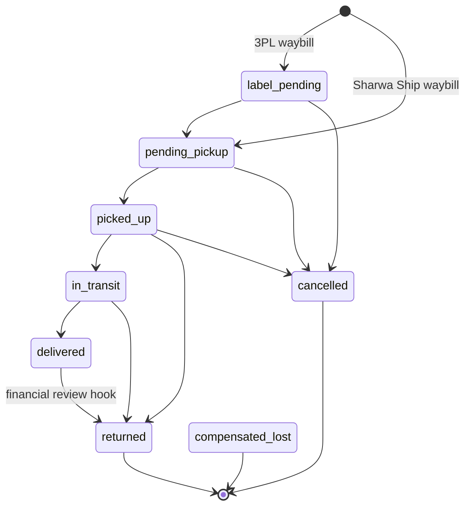

# Courier app API — M38 (تطبيق مندوب التوصيل)

> **Source**: DOC-195, DOC-196, DOC-197 (Step 26) · INT-046 (M38) · inventory Domain 11, A.4, A.11
> **Live key**: `courier` — covers the **four reads** only (`/api/bff/agent/*`). The **five actions** have *no switch*: they are Django-first and reach Django through the same-origin `/api/v1/agent/*` passthrough ([§8](#bff)).
> **Django provider**: `sharwa_saas/api/views_courier.py` (`AgentReadMixin`, 4 views) · `sharwa_saas/products/services/courier_app_service.py` (the read shapes) · the five actions in `sharwa_saas/api/views.py` (`AgentShiftStartView`, `AgentShiftEndHandoverView`, `AgentShipmentStatusView`, `AgentScanPickupView`, `AgentPartialDeliveryView`, helpers `_resolve_agent`, `_agent_owns`) · money and custody in `products/services/cod_collection_service.py` · the status gate in `products/services/shipment_state_service.py` · serializer `AgentShipmentStatusSerializer` (`api/serializers.py`)
> **Frontend contract**: `sharwa-frontend/src/features/courier/schemas.ts` · hooks `src/features/courier/api.ts`, offline queue `queue.ts` · fixtures `src/mocks/shipping/sharwa-ship.ts` (`agentMe`, `agentShipments`, `agentShipmentDetail`, `agentCustody`), gate `src/mocks/courier/gate.ts`, passthrough fixtures `src/mocks/courier/passthrough.ts` · BFF `src/app/api/bff/agent/[...path]/route.ts`
> **Tests**: `sharwa_saas/api/test_courier_api.py` (5) · `sharwa_saas/products/test_cod_collection.py` (6)
> **Last verified against code**: 2026-10-27 (step 26)

<a id="overview"></a>

## 1. Overview

M38 is the courier's mobile app. The courier — «المندوب» — is a **staff member** of the store whose `StaffMember` row is linked to a `ShippingProvider` row (the *agent profile*, `ShippingProvider.staff_account`, reverse name `shipping_provider_profile`). There is no token of the courier's own: the app runs on the same staff session as the dashboard (see [`../../overview/auth.md`](../../overview/auth.md)).

The module has nine routes under `/api/v1/agent/`:

- **four reads** — who am I, my shipments, one shipment, my custody ledger ([§4](#me), [§5](#reads));
- **five actions** — start a shift, end a shift or hand it over, change a shipment's status, scan a pickup, and record a (partial) delivery ([§6](#actions)).

Before INT-046 Django already had the data — `ShipmentOrder` and `ShipmentEvent`, `CourierShift`, `CourierCustodyLedger` and `get_courier_balance` — but only HTML screens, and the five actions existed as «Ready» rows that let any agent act on any shipment or shift. INT-046 added the four reads and tightened the actions ([§7](#fixes)).

Two things to keep in mind when reading the rest of the page:

1. **"My shipments" means the sub-shipment is assigned to me.** A shipment is mine when `ShipmentOrder.fulfillment.shipping_provider` is my profile. That is the same assignment `transfer_shift` moves when a shift is handed over ([§6.2](#shift-end)).
2. **Every status change goes through one gate**, `apply_shipment_transition` (state machine in [§6.3](#status)). Shift handover goes through `transfer_shift`.

<a id="access"></a>

## 2. Access — identity and gates

### 2.1 The four reads

`AgentReadMixin.agent_or_error` (`views_courier.py:31`) evaluates, in this order; the first failing gate answers:

| # | Gate | Requirement | Failure |
|---|---|---|---|
| 1 | Store | the request resolves to a store (`HasTenantContext`) | `403` «لم يتم تحديد المتجر المطلوب. استخدم النطاق الفرعي للمتجر أو أرسل ترويسة X-Store-Domain.» · with **no session cookie** on the public host the answer is `403` «لم يتم تزويد بيانات الدخول.» instead ([rule](../../overview/auth.md#no-store-no-session)) |
| 2 | Session | an owner session or a resolved staff member | `401` `{"detail": "لم تُقدَّم بيانات الاعتماد."}` |
| 3 | Not the owner | the session is a **staff** session | `403` `{"detail": "هذا التطبيق لحسابات المندوبين. يدير مالك المتجر المندوبين من شاشة الإشراف في لوحة التحكم."}` |
| 4 | Agent profile | `staff.shipping_provider_profile` exists | `403` `{"detail": "حساب الموظف هذا غير مرتبط بأي ملف مندوب شحن."}` |
| 5 | Profile active | `ShippingProvider.is_active` | `403` `{"detail": "ملف المندوب هذا معطّل. تواصل مع مالك المتجر."}` |

There is **no plan feature and no permission key** on the courier app: the identity is the whole gate. The owner manages couriers from the supervision screen of M39 ([`m39-sharwa-ship.md`](m39-sharwa-ship.md#supervisor)), not from this app.

> Gate 1 is the shared `HasTenantContext` permission. When the request carries no session at all, DRF answers first with `403` «لم يتم تزويد بيانات الدخول.» instead of the store sentence (probed live in Step 51; [rule](../../overview/auth.md#no-store-no-session)); the test suite does not cover a request on the public schema.

### 2.2 The five actions

The actions live in `api/views.py` and use a different identity helper, so their messages differ from the reads:

| # | Gate | Requirement | Failure |
|---|---|---|---|
| 1 | Store | as above | `403` as above |
| 2 | CSRF | `MerchantSessionAuthentication` checks `X-CSRFToken` on every `POST` of a session ([`csrf.md`](../../overview/csrf.md)) | `403` `{"detail": "CSRF Failed: …"}` |
| 3 | Session | owner flag or `request.staff` | `401` `{"detail": "غير مصرح لك بالوصول."}` |
| 4 | Who is the agent (`_resolve_agent`) | a staff member **with** an active agent profile → acts as that agent. The owner → must name an agent with `agent_id` | staff without a profile: `403` «حساب الموظف هذا غير مرتبط بأي ملف مندوب شحن.» · inactive profile: `403` «ملف المندوب هذا معطّل. تواصل مع مالك المتجر.» · owner without a valid id: `400` «agent_id مطلوب وصحيح.» · unknown id: `404` «المندوب غير موجود.» |
| 5 | Ownership (`_agent_owns`, shipment/fulfillment actions only) | a staff-agent may touch only a fulfillment assigned to his profile; the owner skips the check | `404` `{"detail": "الشحنة غير موجودة."}` |

The owner is **not** refused on the actions (he is on the reads): the owner acts for a courier from the supervisor screen. Which action needs `agent_id` is in [§6.6](#ownership).

`_resolve_agent` also contains a `403` «غير مصرح لك بتحديد مندوب صراحة.» for a request that is neither staff nor an owner session; the `401` of gate 3 answers first, so it cannot be reached through these views.

<a id="summary"></a>

## 3. Endpoint summary — the 9 routes

All paths are under `/api/v1/`; the BFF column is under `/api/bff/`. `—` means the route has no BFF row: the browser calls Django through the `/api/v1/*` passthrough ([§8](#bff)).

| Method | Django path | BFF path | Purpose | Gate |
|---|---|---|---|---|
| `GET` | `agent/me/` | `agent/me` | the agent, the open shift, the custody balance ([§4](#me)) | staff-agent |
| `GET` | `agent/shipments/?status` | `agent/shipments` | my shipments with tab counters ([§5.1](#shipments)) | staff-agent |
| `GET` | `agent/shipments/<id>/` | `agent/shipments/<id>` | one of my shipments with allowed moves and events ([§5.2](#shipment-detail)) | staff-agent, own shipment |
| `GET` | `agent/custody/?page` | `agent/custody` | my custody ledger, 50 per page ([§5.3](#custody)) | staff-agent |
| `POST` | `agent/shifts/start/` | — | start a shift ([§6.1](#shift-start)) | staff-agent · owner with `agent_id` |
| `POST` | `agent/shifts/end-and-handover/` | — | end a shift, or hand it over ([§6.2](#shift-end)) | own shift · owner |
| `POST` | `agent/shipments/<id>/status/` | — | change a shipment's status ([§6.3](#status)) | own shipment · owner |
| `POST` | `agent/fulfillments/<id>/scan-pickup/` | — | check the barcode scanned at the warehouse ([§6.4](#scan)) | own fulfillment · owner with `agent_id` |
| `POST` | `agent/fulfillments/<id>/partial-delivery/` | — | record a delivery line by line and the COD collected ([§6.5](#partial)) | own fulfillment · owner with `agent_id` |

URL order matters in `api/urls.py`: `agent/shipments/<id>/status/` is declared at line 191 with the shipping actions; the other eight are together at lines 199–206.

<a id="me"></a>

## 4. Who am I — `GET /api/v1/agent/me/` (DOC-195)

No query parameters. The response is built by `courier_app_service.me`.

**Response `200`** (illustrative values; shape from `meSchema`)

```json
{
  "agent": { "id": 12, "name": "خالد" },
  "open_shift": { "id": 41, "started_at": "2026-10-27T05:30:00+00:00", "vehicle_ref": "دباب 12" },
  "display_balance": "70 ر.س",
  "currency": "SAR"
}
```

| Field | Type | Meaning (Django source) |
|---|---|---|
| `agent.id`, `agent.name` | number, string | the `ShippingProvider` row of the session's staff member |
| `open_shift` | object or `null` | the latest `CourierShift` of the agent with `ended_at` empty (`started_at` newest first); `vehicle_ref` is `""` when empty; `null` when no shift is open |
| `display_balance` | string | the custody balance as the server formats it (`format_money`) — never recompute it on the client |
| `currency` | string | the ledger currency of the balance; the store currency when the agent has no ledger entry or has several currencies |

**How the balance is computed** (`_balances`, `_display_balance`). The balance is not stored; it is the sum of the agent's `CourierCustodyLedger` rows, with the sign of `get_courier_balance`: `collected_cod` counts **+**, every other entry type (`handed_over`, `lost`, `written_off`, `reversed`) counts **−**.

| Ledger content | `display_balance` | `currency` |
|---|---|---|
| no rows | zero in the store currency (`StoreSetting.currency`, `SAR` when empty) | the store currency |
| rows in one currency | that total, formatted | that currency |
| rows in several currencies | **one total per currency**, joined by ` · ` (never summed across currencies) | the store currency |

**Errors**: the five gates of [§2.1](#access). There is no `404`.

> Test-derived example: a ledger of one `collected_cod` of 100 and one `handed_over` of 30 in `SAR` gives `display_balance` `70 ر.س` and `currency` `SAR` (`test_me_shipments_detail_custody`).

<a id="reads"></a>

## 5. Courier reads (DOC-196)

<a id="shipments"></a>

### 5.1 `GET /api/v1/agent/shipments/`

**Query parameters**

| Name | Type | Default | Notes |
|---|---|---|---|
| `status` | string | *(all)* | one of the eight shipment statuses (`label_pending`, `pending_pickup`, `picked_up`, `in_transit`, `delivered`, `returned`, `cancelled`, `compensated_lost`), or `other` (every status that is not one of the four tabs). An unknown value is ignored and returns all rows. |

There is no pagination: the list holds every shipment assigned to the agent, ordered by `id` ascending (`courier_app_service.shipments`).

**Response `200`** (illustrative values; shape from `shipmentListSchema`)

```json
{
  "count": 1,
  "counts": { "pending_pickup": 0, "picked_up": 0, "in_transit": 1, "delivered": 0, "other": 0 },
  "results": [
    {
      "id": 301,
      "waybill_number": "SHW-T-1",
      "status": "in_transit",
      "customer_name": "عميل",
      "address": "صنعاء — حدة",
      "display_cod_amount": "30 ر.س",
      "fulfillment_id": 77,
      "flagged_for_review": false,
      "items": [{ "fulfillment_item_id": 91, "product_name": "كوب", "quantity": 3 }]
    }
  ]
}
```

| Field | Type | Meaning |
|---|---|---|
| `count` | number | rows **after** the `status` filter |
| `counts` | object | rows per tab over **all** the agent's shipments, whatever the filter: the four tabs `pending_pickup`, `picked_up`, `in_transit`, `delivered`, plus `other` = every other status (`label_pending`, `returned`, `cancelled`, `compensated_lost`) |
| `results[].display_cod_amount` | string | the **amount to collect** — see below |
| `results[].fulfillment_id` | number or `null` | the sub-shipment the actions below take as their id |
| `results[].flagged_for_review` | boolean | `flagged_for_review` of the **latest** event of the shipment (any event, rejected or not) |
| `results[].items[]` | array | the lines of the sub-shipment: `fulfillment_item_id` (the id `partial-delivery` expects), `product_name`, `quantity` |

**COD amount.** `display_cod_amount` is the sum, over the fulfillment's lines, of `OrderItem.price × FulfillmentItem.quantity`, formatted in the **order's** currency (`Order.currency`). It is exactly what `finalize_partial_delivery` records as collected on a full delivery ([§6.5](#partial)). It does not subtract anything that was already delivered.

<a id="shipment-detail"></a>

### 5.2 `GET /api/v1/agent/shipments/<id>/`

`<id>` is the `ShipmentOrder` id. The response is the list row plus three differences:

**Response `200`** (illustrative values; shape from `shipmentDetailSchema`)

```json
{
  "id": 301,
  "waybill_number": "SHW-T-1",
  "status": "in_transit",
  "customer_name": "عميل",
  "address": "صنعاء — حدة",
  "display_cod_amount": "30 ر.س",
  "fulfillment_id": 77,
  "flagged_for_review": false,
  "items": [
    { "fulfillment_item_id": 91, "product_name": "كوب", "quantity": 3, "delivered_quantity": null, "rejection_reason": "" }
  ],
  "allowed_transitions": ["delivered", "returned"],
  "events": [
    {
      "id": 905,
      "event_time": "2026-10-27T08:10:00+00:00",
      "received_at": "2026-10-27T08:10:02+00:00",
      "from_status": "picked_up",
      "to_status": "in_transit",
      "source": "agent_app",
      "actor_name": "خالد المندوب",
      "is_rejected": false,
      "rejection_reason": null,
      "flagged_for_review": false
    }
  ]
}
```

| Field | Meaning (Django source) |
|---|---|
| `items[].delivered_quantity` | the delivered quantity, or `null` **before any delivery** — it is `null` while `Fulfillment.delivered_at` is empty (the DB column starts at zero, the API hides that, like the mock) |
| `items[].rejection_reason` | the free text the courier gave for a rejected line; `""` when none |
| `allowed_transitions` | the statuses the shipment may move to, from `ALLOWED_TRANSITIONS[status]`, listed in the fixed status order (`label_pending` … `compensated_lost`). Terminal statuses give `[]`. See the diagram in [§6.3](#status). |
| `events[]` | the shipment's `ShipmentEvent` rows, **newest first** (`event_time`, then `id`). Events whose `to_status` is not one of the eight statuses are dropped. `from_status` is `null` when it is not one of the eight. |
| `events[].actor_name` | who acted: a staff member → his `full_name` (`«موظف»` when the staff row no longer exists); the owner (`actor_type` `merchant` or `owner`) → «مالك المتجر»; otherwise by source: `system` → «النظام», `webhook` → «شركة الشحن»; else the raw `actor_type` or `source` |
| `events[].rejection_reason` | one of `invalid_transition`, `stale_event`, `order_already_reversed`, `compensated_lost_scan`; any other stored reason is shown as `null` — see the call-out in [§6.3](#status) |

**Errors**: the gates of [§2.1](#access), then `404` `{"detail": "الشحنة غير موجودة."}` when the shipment does not exist **or belongs to another agent** (the query is filtered by `fulfillment__shipping_provider = me`, so a foreign id is indistinguishable from a missing one).

<a id="custody"></a>

### 5.3 `GET /api/v1/agent/custody/`

**Query parameters**

| Name | Type | Default | Notes |
|---|---|---|---|
| `page` | integer | `1` | 50 rows per page (`PAGE = 50`); a value below 1 or not a number falls back to `1`; a page past the end returns an empty `results` |

**Response `200`** (illustrative values; shape from `custodySchema`)

```json
{
  "count": 2,
  "display_balance": "70 ر.س",
  "results": [
    {
      "id": 503,
      "entry_type": "handed_over",
      "display_amount": "30 ر.س",
      "sign": "-",
      "currency": "SAR",
      "related_shipment": null,
      "related_shift": null,
      "reverses": null,
      "note": "",
      "created_at": "2026-10-27T12:00:00+00:00"
    },
    {
      "id": 502,
      "entry_type": "collected_cod",
      "display_amount": "100 ر.س",
      "sign": "+",
      "currency": "SAR",
      "related_shipment": { "id": 301, "waybill_number": "SHW-T-1" },
      "related_shift": 41,
      "reverses": null,
      "note": "تحصيل تسليم (جزئي/كلي) — شحنة #77",
      "created_at": "2026-10-27T09:40:00+00:00"
    }
  ]
}
```

| Field | Meaning |
|---|---|
| `count` | total rows of the agent's ledger (not of the page) |
| `display_balance` | the balance of the **whole** ledger, same value as `agent/me/` |
| `results[]` | newest first (`created_at`, then `id`) |
| `entry_type` | `collected_cod`, `handed_over`, `lost`, `written_off`, `reversed` |
| `sign` | `+` for `collected_cod`, `-` for every other type; `display_amount` is always the absolute amount |
| `related_shipment` | `{id, waybill_number}` of the linked `ShipmentOrder`, or `null` |
| `related_shift` | the shift id, or `null` |
| `reverses` | always `null` — the ledger has no reversal link; `reversed` is its own entry type |
| `note` | the free text of the entry (`CourierCustodyLedger.notes`) |

<a id="bff-reads"></a>

### 5.4 BFF wiring of the reads

`src/app/api/bff/agent/[...path]/route.ts` is one catch-all handler: `liveOrMock(request, "courier", "/api/v1/agent/<path>/", mock)`. With `courier` in `SHARWA_LIVE_MODULES` the request is a transparent passthrough to the Django path of [§3](#summary). In mock mode the handler first runs the identity gate (`src/mocks/courier/gate.ts`), which answers the same `401`/`403` sentences as Django, and then serves `agentMe`, `agentShipments`, `agentShipmentDetail` or `agentCustody` from `src/mocks/shipping/sharwa-ship.ts`.

In mock mode the handler answers `405` `{"detail": "الطريقة «POST» غير مسموحة."}` (the method name is filled in) to any method but `GET`, and `404` `{"detail": "غير موجود."}` to an unknown path. `.env.example` lists `courier` (line 69, and in the sample `SHARWA_LIVE_MODULES` of line 79).

<a id="actions"></a>

## 6. The five courier actions (DOC-197)

The five actions are `POST`s that existed before the BFF as «Ready» rows (`ready-api-v1.md`). The browser calls them directly on the same-origin `/api/v1/agent/*` passthrough ([§8](#bff)); the offline queue (`queue.ts`) posts to these endpoints and replays them in creation order. Each needs the CSRF header ([§2.2](#access)).

> **Body forwarding.** Since the `upstream.ts` buffering fix the passthrough sends the body with a `Content-Length` (`bufferedBody`, `src/lib/bff/upstream.ts`). Before it, a streamed body went out chunked and Django — `runserver` and gunicorn alike — read an **empty body**, so every action answered with "required field" errors.

<a id="shift-start"></a>

### 6.1 `POST /api/v1/agent/shifts/start/`

**Request body**

| Field | Type | Required | Rules |
|---|---|---|---|
| `vehicle_ref` | string | no | trimmed, cut to 100 characters; free text such as a plate or bike label |
| `agent_id` | integer | **owner only** | ignored for a staff-agent (he always acts as himself) |

**Response `200`**

```json
{
  "shift_id": 42,
  "agent": { "id": 12, "name": "خالد" },
  "started_at": "2026-10-27T05:30:00+00:00",
  "closed_previous_shift_id": 41
}
```

`closed_previous_shift_id` is the id of the shift that was still open for this agent, or `null`. `start_shift` **closes any open shift of the agent first** (sets `ended_at`), then creates the new one, in one transaction — an agent never has two open shifts. The closed shift is not handed to anyone and moves no custody.

**Errors**: the gates of [§2.2](#access).

<a id="shift-end"></a>

### 6.2 `POST /api/v1/agent/shifts/end-and-handover/`

**Request body**

| Field | Type | Required | Rules |
|---|---|---|---|
| `shift_id` | integer | yes | the shift to close |
| `new_agent_id` | integer | no | present → **hand over** to that agent; absent or empty → plain end |
| `vehicle_ref` | string | no | the new agent's vehicle when handing over; trimmed, 100 characters |

**Response `200` — plain end** (no `new_agent_id`)

```json
{ "shift_id": 42, "ended_at": "2026-10-27T17:00:00+00:00" }
```

**Response `200` — handover**

```json
{
  "new_shift_id": 43,
  "handed_over_to": { "id": 13, "name": "سالم" },
  "balance": "100.00"
}
```

**Errors**, in the order the view tests them

| Status | Body | When |
|---|---|---|
| `401` | `{"detail": "غير مصرح لك بالوصول."}` | no session |
| `400` | `{"detail": "shift_id مطلوب وصحيح."}` | `shift_id` missing or not an integer |
| `404` | `{"detail": "المناوبة غير موجودة."}` | no such shift, **or** a staff-agent asking for another agent's shift |
| `403` | the profile sentences of [§2.2](#access) | staff without a profile or with an inactive one (checked once the shift exists) |
| `400` | `{"detail": "هذه المناوبة مغلقة مسبقاً."}` | the shift already has `ended_at` — a closed shift cannot be ended again |
| `400` | `{"detail": "new_agent_id غير صالح."}` | `new_agent_id` is not an integer |
| `404` | `{"detail": "المندوب الجديد غير موجود."}` | no such agent |
| `400` | `{"detail": "اختر مندوباً آخر لتسليم المناوبة."}` | handing over to oneself |
| `400` | `{"detail": "المندوب الجديد معطّل."}` | the target profile is inactive |

**What a handover does** (`transfer_shift`, one transaction — the same mechanism the supervisor's emergency reassignment uses, [`m39-sharwa-ship.md`](m39-sharwa-ship.md#reassign)):

1. closes the shift (`ended_at`, `handed_over_to`) and opens a new shift for the target;
2. when the old agent's balance is **greater than zero**, writes two ledger rows of the same amount — `handed_over` for the old agent with the note «تسليم مناوبة إلى {name}» and `collected_cod` for the new agent with the note «استلام عهدة من {name}» — so the balance moves without being edited;
3. moves every sub-shipment of the old agent whose status is not `delivered` or `cancelled` to the new agent (`Fulfillment.shipping_provider`).

`balance` is the **new agent's total custody balance after the handover** (`str(get_courier_balance(new_agent))`), a plain decimal string with no currency — not a `display_*` string, and not only the amount that was just handed over.

<a id="status"></a>

### 6.3 `POST /api/v1/agent/shipments/<id>/status/`

`<id>` is the `ShipmentOrder` id.

**Request body** (`AgentShipmentStatusSerializer`)

| Field | Type | Required | Rules |
|---|---|---|---|
| `to_status` | string | yes | one of the eight shipment statuses |
| `client_generated_uuid` | string | yes | at most 64 characters; generated on the device when the button is pressed; the base of the idempotency key |
| `event_time` | ISO date-time | no | device time of the event; defaults to the server time |
| `geo_lat`, `geo_lng` | decimal | no | up to 10 digits, 7 decimals; **needed to deliver** (see below) |
| `geo_accuracy_m` | decimal | no | metres, 2 decimals |
| `raw_payload` | object | no | stored on the event |

**Response `200`** — always `200` for a well-formed request, accepted or refused

```json
{
  "shipment_id": 301,
  "waybill_number": "SHW-T-1",
  "status": "picked_up",
  "accepted": true,
  "rejection_reason": null,
  "flagged_for_review": false
}
```

A refused move is **not** an error status: it comes back with `"accepted": false`, the unchanged `status` and the `rejection_reason`:

```json
{
  "shipment_id": 301,
  "waybill_number": "SHW-T-1",
  "status": "in_transit",
  "accepted": false,
  "rejection_reason": "invalid_transition",
  "flagged_for_review": false
}
```

**Errors**: `401` «غير مصرح لك بالوصول.»; `404` (DRF's default body) when the id does not exist; the profile `403`s and the ownership `404` «الشحنة غير موجودة.» of [§2.2](#access); `400` with DRF field errors for a bad body (unknown `to_status`, missing or too long `client_generated_uuid`, bad number or date).

**The state machine** (`ALLOWED_TRANSITIONS`, `shipment_state_service.py`). Any move not drawn here is recorded as a rejected event with reason `invalid_transition`:



`compensated_lost` has no incoming arrow in the table: it is set outside the app, and a scan of a compensated shipment is refused with its own reason.

**Rejection reasons** (stored on the `ShipmentEvent`, returned as `rejection_reason`):

| Reason | When |
|---|---|
| `invalid_transition` | the move is not in the table above |
| `compensated_lost_scan` | the shipment is `compensated_lost` — a manual decision is needed, never a normal delivery |
| `order_already_reversed` | `to_status` is `delivered` and the order is `cancelled` or `refunded` |
| `stale_event` | `event_time` is older than the latest accepted event **and** the new status does not rank higher (rank by status, not by time) |
| `geo_required` | `to_status` is `delivered`, the source is the courier app, and `geo_lat`/`geo_lng` are missing |

> ⚠️ Discrepancy — the Zod contract (`REJECTION_REASONS` in `src/features/courier/schemas.ts`, `transitionResultSchema`) allows four reasons; the status view returns `event.rejection_reason` as stored, so a delivery without coordinates answers `"rejection_reason": "geo_required"`, a value that schema does not list (`views.py:629`, `shipment_state_service.py:209-216`). The M38 and M39 **read** shapes hide it instead (`rejection_reason` becomes `null` on an event with `is_rejected: true`). Reported in step 26.

**Rules**

- **Delivery needs coordinates.** For `to_status = delivered` from the courier app the event must carry `geo_lat` and `geo_lng`. The server compares them with a reference point (the migrated pickup point of the order, else the fulfillment's source location) using the haversine distance; beyond `SHIPMENT_DELIVERY_GEOFENCE_RADIUS_M` (300 m by default), or when no reference point exists, the delivery is **accepted but flagged** (`flagged_for_review: true`, `geofence_verifiable` and `geofence_distance_m` in the event payload). The app sends geolocation best effort and never blocks the action (`currentGeo`, `api.ts`).
- **`delivered → returned`** is allowed and adds `financial_review_required` to the event; a Celery task opens a human review. No refund is automatic.
- **Ordering.** A late event that moves the status *forward* is accepted and marked `out_of_order`; one that does not is `stale_event`.

**Side effects.** An accepted move updates `ShipmentOrder.status` (and `delivered_at` on delivery) under a row lock, records the `ShipmentEvent`, pushes a browser notification to the subscribers of the order's phone, and emits the outgoing webhook `shipment.event`.

**Idempotency.** The server builds the key `"{shipment_id}:{to_status}:{client_generated_uuid}"`. Sending the same triple again returns the stored event — no second transition — so the offline queue can replay safely. See [`idempotency.md`](../../overview/idempotency.md).

<a id="scan"></a>

### 6.4 `POST /api/v1/agent/fulfillments/<id>/scan-pickup/`

`<id>` is the **fulfillment** id (`fulfillment_id` of the list row).

**Request body**: `scanned_code` (string). The server compares it, after trimming, with the waybill number of the fulfillment's shipment — or, when the fulfillment has no `ShipmentOrder`, with the fulfillment id as text.

**Response `200`**: `{"ok": true, "fulfillment_id": 77}`.

**Errors**

| Status | Body | When |
|---|---|---|
| `400` | `{"detail": "عدم تطابق الباركود: المسح {scanned_code} لا يطابق الشحنة المتوقعة {expected}.", "scan_mismatch": true}` | the code differs — a swapped label is blocked at once |
| `404` | `{"detail": "الشحنة غير موجودة."}` | another agent's fulfillment |

The scan **only verifies**. It does not move the shipment to `picked_up`; that is a separate status call ([§6.3](#status)).

<a id="partial"></a>

### 6.5 `POST /api/v1/agent/fulfillments/<id>/partial-delivery/`

Records what was delivered line by line, the COD collected, and finishes the delivery.

**Request body**

| Field | Type | Required | Rules |
|---|---|---|---|
| `line_items` | array | yes | each `{fulfillment_item_id, delivered_quantity, rejection_reason}`; `rejection_reason` is text and is kept only when `delivered_quantity < quantity` |
| `client_generated_uuid` | string | yes | no time-based fallback — a missing value is refused so a retry always carries the same key |
| `geo_lat`, `geo_lng`, `geo_accuracy_m` | number | for a real delivery | needed by the delivery gate ([§6.3](#status)) |
| `agent_id` | integer | **owner only** | |

**Response `200`** (illustrative values; shape from `partialResultSchema`)

```json
{
  "collected_amount": "20.00",
  "display_collected_amount": "20 ر.س",
  "currency": "SAR",
  "delivered": 1,
  "rejected": 1,
  "duplicate": false,
  "status": "delivered"
}
```

| Field | Meaning |
|---|---|
| `collected_amount` | decimal **string** (`'10.00'`), as the service returns it |
| `display_collected_amount` | the same amount formatted by the server (`format_money`) — the client shows this one |
| `delivered`, `rejected` | counts of lines with `delivered_quantity > 0` and lines with `delivered_quantity < quantity`. They are **numbers, never `null`**: on a duplicate the service has no counts and the view sends `0` |
| `duplicate` | `true` when the same key was already used |
| `status` | the `ShipmentOrder.status` after the call; omitted when the fulfillment has no shipment |

**Errors**

| Status | Body | When |
|---|---|---|
| `400` | `{"detail": "line_items مطلوبة."}` | empty or missing `line_items` |
| `400` | `{"detail": "client_generated_uuid مطلوب."}` | no uuid |
| `400` | `{"detail": "عنصر شحنة غير صالح في طلب التسليم الجزئي."}` | a `fulfillment_item_id` that is not in this fulfillment |
| `400` | `{"detail": "الكمية المُسلَّمة ({delivered_qty}) خارج النطاق الصالح (0-{fi.quantity})."}` | below zero or above the line quantity |
| `409` | `{"detail": "رُفض التسليم.", "rejection_reason": "…"}` | the transition gate refused the delivery — any reason of [§6.3](#status) |
| `404` | `{"detail": "الشحنة غير موجودة."}` | another agent's fulfillment |

**Rules**

- **The gate comes first.** When the fulfillment has a `ShipmentOrder`, the delivery is first sent through `apply_shipment_transition(…, "delivered")`. A refusal stops everything: no ledger row, no stock change. The shipment must therefore be `in_transit` — a `picked_up` shipment answers `409` with `invalid_transition`. A fulfillment without a shipment (for example a self-pickup) skips the gate, but a `cancelled` or `refunded` order is still refused (`order_already_reversed`).
- **Amount.** `collected = Σ (OrderItem.price × delivered_quantity)`, using the price locked on the order — no currency conversion. A full rejection collects `0.00` and still writes the ledger row.
- **One ledger row per delivery.** `CourierCustodyLedger(entry_type = collected_cod, idempotency_key = "pd-{fulfillment_id}-{client_generated_uuid}")`; the unique key is the guard even when no `ShipmentOrder` exists.
- **Fulfillment status.** `delivered` when no line was rejected, otherwise `shipped`. Note the shipment itself still goes to `delivered` through the gate ([§6.3](#status)).
- **Lines rejected with a reason** (`delivered_quantity < quantity` and a non-empty `rejection_reason`) create a return authorization for the missing quantity (reason `customer_rejected`, destination = the fulfillment's location) and update the customer's reliability record. A short line with no reason text does neither.
- **Duplicate.** The same key returns the first collected amount and currency with `duplicate: true` and no new row.

> Unvalidated input: a `delivered_quantity` that is not a number is cast with `int(…)` without a guard, so such a body would raise instead of answering `400`. This was read from the code, not run.

<a id="ownership"></a>

### 6.6 Who may do what — the ownership matrix

| Action | Staff-agent | Owner |
|---|---|---|
| `shifts/start/` | acts as his own profile; `agent_id` ignored | must send `agent_id` (`400` / `404` otherwise) |
| `shifts/end-and-handover/` | only **his own** shift — another agent's id answers `404` «المناوبة غير موجودة.» | any shift, with no `agent_id` |
| `shipments/<id>/status/` | only a shipment whose fulfillment is assigned to him — else `404` «الشحنة غير موجودة.» | any shipment, no `agent_id`; the event actor is `merchant` / `owner` |
| `fulfillments/<id>/scan-pickup/` | only his own fulfillment | any, must send `agent_id` |
| `fulfillments/<id>/partial-delivery/` | only his own fulfillment | any, must send `agent_id` |

<a id="fixes"></a>

## 7. Gaps closed, bugs fixed and migrations

**Contract fixes (INT-046).** The Zod schemas are the contract; Django was aligned to them.

| Action | Before | Now |
|---|---|---|
| `shifts/start/` | `agent` was an id or name | `agent: {id, name}` and `closed_previous_shift_id` |
| `shifts/end-and-handover/` | `handed_over_to` was a name or id | `handed_over_to: {id, name}` |
| `fulfillments/<id>/partial-delivery/` | no display amount; `null` counts on a duplicate | `display_collected_amount` and `status`; `delivered` / `rejected` are numbers on a duplicate; amounts formatted by `format_money` |

**Security gaps closed.**

| Gap | Fix |
|---|---|
| Any authenticated user could name any `agent_id` and act as that courier (audit 2026-09-16) | `_resolve_agent`: a staff member acts only as his own profile; an explicit `agent_id` is accepted from the owner only |
| An agent could end or hand over **any** shift, move **any** shipment, scan or deliver **any** fulfillment | only his own — `404` otherwise (`_agent_owns`, and the shift check in the handover view). The owner keeps acting for any agent through `agent_id` |
| A closed shift could be ended again | `400` «هذه المناوبة مغلقة مسبقاً.» |
| A handover to oneself or to an inactive agent | refused with the two sentences of [§6.2](#shift-end) |
| An inactive agent profile could still act | `403` «ملف المندوب هذا معطّل. تواصل مع مالك المتجر.» on every action and read |

**Migrations**: none. The related fix is in a test: `products/test_cod_collection.py` now expects the decimal string `'10.00'` for `collected_amount` (`test_finalize_partial_delivery_computes_collected`), because the value flows into the contract field `collected_amount: z.string()`.

<a id="bff"></a>

## 8. BFF wiring and the passthrough

| Route family | Path in the browser | Goes to | Switch |
|---|---|---|---|
| 4 reads | `/api/bff/agent/{me, shipments, shipments/<id>, custody}` | `agent/[...path]/route.ts` → `/api/v1/agent/<path>/` | `courier` in `SHARWA_LIVE_MODULES` |
| 5 actions | `/api/v1/agent/shifts/start/`, `…/shifts/end-and-handover/`, `…/shipments/<id>/status/`, `…/fulfillments/<id>/scan-pickup/`, `…/fulfillments/<id>/partial-delivery/` | `src/app/api/v1/[...path]/route.ts` → Django | none (Django-first) |

The passthrough answers from Django. Only when `SHARWA_MOCKS=on` **and** Django is unreachable or answers `404` for a registered path does it serve the fixtures of `src/mocks/courier/passthrough.ts`, marked `x-sharwa-mock: 1`; a real Django answer always wins. The fixtures apply the same gates (`401` session, then `403` profile) and cover the five `POST`s. The general mechanism is in [`bff.md`](../../overview/bff.md#passthrough).

<a id="tests"></a>

## 9. Tests

`api/test_courier_api.py` holds **five** test methods (two classes, `AgentReadsTests` and `AgentActionsContractTests`, on `TenantTestCase` with `TenantClient`; the staff identity is patched with `mock.patch('api.views_courier.resolve_request_staff')`, the action views are called through `APIRequestFactory`):

| Test | Covers | Page section |
|---|---|---|
| `test_identity_gate` | `401` with no session, owner `403` («لحسابات المندوبين»), staff without a profile `403`, inactive profile `403` | [§2.1](#access) |
| `test_me_shipments_detail_custody` | `me` (open shift, balance `70 ر.س`), list (only my shipments, counts, COD `30 ر.س`, `?status=other`), detail (allowed moves, `delivered_quantity` null, actor name, `404` for another agent's shipment), custody (signs, linked waybill, amount) | [§4](#me), [§5](#reads) |
| `test_start_shift_shape` | `agent: {id, name}`, `closed_previous_shift_id` `null` then the previous id | [§6.1](#shift-start) |
| `test_end_and_handover_only_my_open_shift` | `404` on another agent's shift, handover to oneself, success with `handed_over_to`, second end → «هذه المناوبة مغلقة مسبقاً.» | [§6.2](#shift-end) |
| `test_actions_refuse_shipments_of_another_agent` | status and scan on another agent's shipment → `404` and unchanged status; own shipment accepted | [§6.3](#status), [§6.4](#scan) |

> ⚠️ Discrepancy — roadmap says `api/test_courier_api.py` (6) / code does five test methods (`grep -c "    def test_"` over the file). Reported in step 26.

`products/test_cod_collection.py` (**6** tests) covers the service layer: the balance as the sum of entries, scan mismatch, the partial-delivery amount (`'10.00'`, fulfillment `shipped`), full delivery (`delivered`), `transfer_shift` (balance and fulfillments move), and `reverse_cod_collection`.

Run: `python manage.py test api.test_courier_api products.test_cod_collection`. These suites were **not** run for this documentation step.

Not asserted by any test: the `partial-delivery` and `scan-pickup` routes over HTTP, the `geo_required` and geofence paths, a rejected delivery (`409`), the owner acting with `agent_id`, custody pagination past page 1, multi-currency balances, `?status=` values other than `other`, and the mock-mode branch of the BFF.

<a id="open-items"></a>

## 10. Open items and observations

- **`geo_required` is outside the Zod enum** ([§6.3](#status)); until the schema lists it, a delivery without coordinates cannot be parsed by `transitionResultSchema`.
- **Handover ledger rows are written in `SAR`.** `transfer_shift` creates its two rows with `currency='SAR'` whatever the store currency, while `get_courier_balance` adds all currencies together without conversion. A store that collects in another currency can therefore see a balance that mixes currencies. The `me` and `custody` reads, by contrast, group by currency ([§4](#me)).
- **`balance` of the handover response** is a raw decimal string of the new agent's total, not a `display_*` string ([§6.2](#shift-end)).
- **`reverses`** in the custody read is always `null`; `reversed` entries carry no link to the entry they reverse.
- **`flagged_for_review`** is read from the latest event including rejected ones in this module (`_flagged` in `courier_app_service.py`), but from the latest *accepted* event in M39 ([`m39-sharwa-ship.md`](m39-sharwa-ship.md#shipments)).
- **Agent lists are not paginated** (`agent/shipments/`); the app filters by tab with `?status=`.
- **Legacy HTML screens** for shifts and custody are still registered beside this API.

<a id="related"></a>

## 11. Related pages

- Domain overview: [`README.md`](README.md) · shipping settings and operations: [`m15-shipping.md`](m15-shipping.md) · Sharwa Ship operations and courier supervision: [`m39-sharwa-ship.md`](m39-sharwa-ship.md)
- Staff sessions and the identity model: [`../../overview/auth.md`](../../overview/auth.md) · CSRF: [`../../overview/csrf.md`](../../overview/csrf.md) · idempotency: [`../../overview/idempotency.md`](../../overview/idempotency.md) · the BFF and the passthrough: [`../../overview/bff.md`](../../overview/bff.md)
- Orders and the order timeline: [`../04-orders-returns/m06-orders.md`](../04-orders-returns/m06-orders.md) · returns created by a rejected line: [`../04-orders-returns/m24-returns.md`](../04-orders-returns/m24-returns.md)
- Courier guide (Arabic): [`../../../guides/courier/README.md`](../../../guides/courier/README.md)
