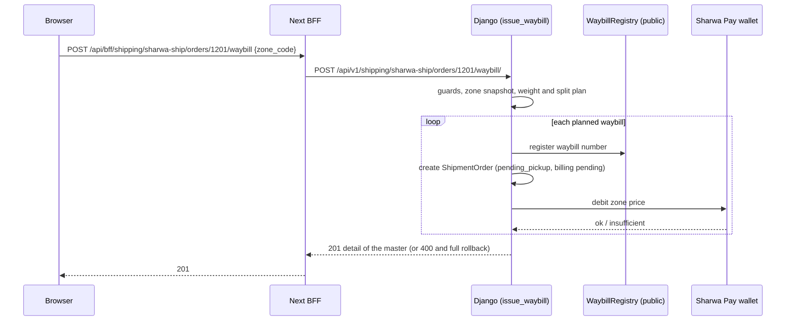

# Sharwa Ship & courier supervision API — M39 (شروة شيب: البوليصات وأحداث الشحن)

> **Source**: DOC-198, DOC-199, DOC-200, DOC-201, DOC-202 (Step 26) · INT-047 (M39), INT-048 (M40), INT-046 (M38) · inventory Domain 11, A.3, A.5, A.7, A.8, A.12
> **Live key**: `sharwa_ship` (`SHARWA_LIVE_MODULES`) — one switch for the seven BFF adapters of this page; it **is** in the sample line `.env.example:79`. The zones list `shipping/sharwa-ship/zones/` stays on the `shipping` key ([`m15-shipping.md`](m15-shipping.md#zones-packaging)).
> **Django provider**: `sharwa_saas/api/views_sharwa_ship.py` (`SharwaShipMixin`, 12 URL patterns) · `sharwa_saas/products/services/sharwa_ship_api_service.py` (the JSON shapes) · waybill issuance `products/services/shipping_billing_service.py` (`issue_waybill`) · weights and splitting `products/services/shipment_weight_service.py` · status gate `products/services/shipment_state_service.py` · custody `products/services/cod_collection_service.py` (`transfer_custody`, `transfer_shift`) · Celery task `products/tasks/shipping.py` · no DRF serializers
> **Frontend contract**: `sharwa-frontend/src/features/shipping/sharwa-ship/schemas.ts` · hooks `…/api.ts` · fixtures `src/mocks/shipping/sharwa-ship.ts` and the gate router `src/mocks/shipping/sharwa-ship-router.ts` · BFF `src/app/api/bff/shipping/{sharwa-ship,shipments,awb-queue,rate-cards,supervisor,agents,agent-shifts}`
> **Tests**: `sharwa_saas/api/test_sharwa_ship_api.py` (6)
> **Last verified against code**: 2026-10-27 (step 26)

<a id="overview"></a>

## 1. Overview

«شروة شيب» is the platform's own carrier. M39 is the merchant dashboard's side of it, and also the supervision screen for the store's own couriers. It covers:

- **Issuing a waybill** for an order that has none yet. The fee of the platform zone is debited from the store's **Sharwa Pay wallet** in the same transaction ([§4](#pending)).
- **Waybills** — the list, the detail with its timeline, a manual status change and the assignment to a courier ([§5](#shipments)).
- **The AWB queue** of external carriers (`aramex`, `smsa`) with a retry, and the **rate-card** snapshots ([§6](#awb)).
- **Courier supervision** — the courier board, the emergency reassignment and the shift log ([§7](#supervisor)).

The caller is the store **owner** (or, for reads, a staff member with `orders.view`) on the store host. The module has 12 routes under `/api/v1/shipping/`. Before INT-047 all of them were `[NEEDS BACKEND]` mock rows, except the zones list (live on `shipping` since INT-021). Django already had the building blocks — `issue_waybill`, `ShipmentOrder` / `ShipmentEvent`, `PendingAWBQueue`, `CarrierRateCardSnapshot`, shifts and custody — but only HTML screens. The service reuses them instead of rewriting them:

| Verb | Delegates to |
|---|---|
| issue a waybill | `shipping_billing_service.issue_waybill` (atomic Sharwa Pay debit, weight, split, hazard and marketplace guards, `WaybillRegistry`) |
| manual status | `shipment_state_service.apply_shipment_transition` with source `merchant_manual` — the only status gate |
| assign | `cod_collection_service.transfer_custody` |
| emergency reassign | `cod_collection_service.transfer_shift` (shipments **and** custody) |
| AWB retry | `PendingAWBQueue` + the Celery task `retry_pending_awb_issuance_for_tenant` |

A *courier* («مندوب») in this module is a `ShippingProvider` row **without a carrier code** (`kind = agent` in M15). The courier of a waybill is the courier of its sub-shipment (`Fulfillment.shipping_provider`); a child waybill of a split takes its parent's courier. The courier's own app is M38 ([`m38-courier-app.md`](m38-courier-app.md)).

<a id="access"></a>

## 2. Access — gate chain and gate matrix (DOC-202)

`SharwaShipMixin.run` (`views_sharwa_ship.py:41`) evaluates, in this order; the first failing gate answers:

| # | Gate | Requirement | Failure |
|---|---|---|---|
| 1 | Store | the request resolves to a store (`HasTenantContext`) | `403` «لم يتم تحديد المتجر المطلوب. استخدم النطاق الفرعي للمتجر أو أرسل ترويسة X-Store-Domain.» · with **no session cookie** on the public host the answer is `403` «لم يتم تزويد بيانات الدخول.» instead ([rule](../../overview/auth.md#no-store-no-session)) |
| 2 | CSRF | `MerchantSessionAuthentication` checks `X-CSRFToken` on every `POST` ([`csrf.md`](../../overview/csrf.md)) | `403` `{"detail": "CSRF Failed: …"}` |
| 3 | Session | an owner session or a resolved staff member (`ProductsAPIMixin.gate`) | `401` `{"detail": "انتهت جلستك، سجّل الدخول مجدداً."}` |
| 4 | Plan feature | `sharwa_ship` — or, on the **supervision rows**, `sharwa_ship` **or** `shipping_providers` | `403` «ميزة شروة شيب غير مفعّلة لمتجرك.» · supervision rows: `403` «الإشراف على المندوبين يتطلب «شروة شيب» أو التوصيل المحلي.» |
| 5 | Permission | `orders.view` (the owner holds every permission) | `403` «ليست لديك صلاحية لعرض الشحنات.» |
| 6 | Owner only | the row is a write, or a supervision row | `403` «هذا الإجراء مقصور على مالك المتجر.» |
| 7 | Resource state | the entity exists and the state allows the action | `404` / `400` / `409` (per section) |

The plan feature is checked **before** the permission, and the permission before the owner check — so a staff member without `orders.view` gets the permission sentence even on an owner-only write. The feature test is `settings_feature_enabled` (`views_settings.py:32`): a missing `Feature` row counts as disabled.

**Supervision rows** are the four that run with `courier=True`: `supervisor/`, `agent-shifts/`, `agents/<id>/emergency-reassign/` and `shipments/<pk>/assign/` — stores with their own local couriers but no Sharwa Ship open them through `shipping_providers` (Phase 7 decision 3).

### 2.1 Gate matrix — route × feature × permission × owner

| # | Route | Method | Plan feature | Permission | Owner only |
|---|---|---|---|---|---|
| 1 | `sharwa-ship/pending-orders/` | `GET` | `sharwa_ship` | `orders.view` | no |
| 2 | `sharwa-ship/orders/<order_id>/waybill/` | `POST` | `sharwa_ship` | `orders.view` | **yes** |
| 3 | `shipments/` | `GET` | `sharwa_ship` | `orders.view` | no |
| 4 | `shipments/<pk>/` | `GET` | `sharwa_ship` | `orders.view` | no |
| 5 | `shipments/<pk>/status/` | `POST` | `sharwa_ship` | `orders.view` | **yes** |
| 6 | `shipments/<pk>/assign/` | `POST` | `sharwa_ship` **or** `shipping_providers` | `orders.view` | **yes** |
| 7 | `awb-queue/` | `GET` | `sharwa_ship` | `orders.view` | no |
| 8 | `awb-queue/<pk>/retry/` | `POST` | `sharwa_ship` | `orders.view` | **yes** |
| 9 | `rate-cards/` | `GET` | `sharwa_ship` | `orders.view` | no |
| 10 | `supervisor/` | `GET` | `sharwa_ship` **or** `shipping_providers` | `orders.view` | **yes** (a read) |
| 11 | `agents/<agent_id>/emergency-reassign/` | `POST` | `sharwa_ship` **or** `shipping_providers` | `orders.view` | **yes** |
| 12 | `agent-shifts/` | `GET` | `sharwa_ship` **or** `shipping_providers` | `orders.view` | **yes** (a read) |

Rows 10 and 12 are reads that only the owner may call. The mock router applies the same matrix (`sharwa-ship-router.ts`: `courierRow`, `COURIER_SUPERVISION_FEATURES` from `src/lib/access.ts`, `hasPermission`, `owner`).

<a id="messages"></a>

### 2.2 The four gate messages, verbatim

| Constant (`views_sharwa_ship.py`) | Sentence | Status |
|---|---|---|
| `MSG_FEATURE` | «ميزة شروة شيب غير مفعّلة لمتجرك.» | `403` |
| `MSG_COURIER_FEATURE` | «الإشراف على المندوبين يتطلب «شروة شيب» أو التوصيل المحلي.» | `403` |
| `MSG_VIEW` | «ليست لديك صلاحية لعرض الشحنات.» | `403` |
| `MSG_OWNER` | «هذا الإجراء مقصور على مالك المتجر.» | `403` |

All four are copied from `views_sharwa_ship.py:33-36` and match the sentences in `sharwa-ship-router.ts`. They have a final full stop. The `401` sentence comes from `ProductsAPIMixin.gate`.

<a id="summary"></a>

## 3. Endpoint summary — the 12 routes

Django paths are under `/api/v1/shipping/`; BFF paths are under `/api/bff/shipping/` and have the same suffix.

| Method | Path | Purpose | Gate row |
|---|---|---|---|
| `GET` | `sharwa-ship/pending-orders/` | orders without a waybill, with weight preview ([§4.1](#pending)) | 1 |
| `POST` | `sharwa-ship/orders/<order_id>/waybill/` | issue the waybill and charge the wallet ([§4.2](#issue)) | 2 |
| `GET` | `shipments/` | master waybills, filters and counters ([§5.1](#shipments-list)) | 3 |
| `GET` | `shipments/<pk>/` | one waybill with children, lines and timeline ([§5.2](#shipment-detail)) | 4 |
| `POST` | `shipments/<pk>/status/` | manual status change ([§5.3](#manual-status)) | 5 |
| `POST` | `shipments/<pk>/assign/` | assign to a courier ([§5.4](#assign)) | 6 |
| `GET` | `awb-queue/` | the external-carrier AWB queue ([§6.1](#awb)) | 7 |
| `POST` | `awb-queue/<pk>/retry/` | retry a failed item ([§6.2](#retry)) | 8 |
| `GET` | `rate-cards/` | rate-card snapshots and drift ([§6.3](#rate-cards)) | 9 |
| `GET` | `supervisor/` | courier board ([§7.1](#supervisor)) | 10 |
| `POST` | `agents/<agent_id>/emergency-reassign/` | move a courier's shipments and custody ([§7.2](#reassign)) | 11 |
| `GET` | `agent-shifts/` | shift log ([§7.3](#shifts)) | 12 |

The request body of every `POST` is JSON (`parser_classes = [JSONParser]`); a body that is not a JSON object is treated as `{}`, so the required-field errors answer instead.

<a id="pending"></a>

## 4. Pending orders and waybill issuance (DOC-198)

### 4.1 `GET /api/v1/shipping/sharwa-ship/pending-orders/`

No query parameters. Lists the orders that **have no waybill** (`sharwa_shipments` empty) **and** whose status is one of `new`, `awaiting_payment`, `payment_review`, `pending_payment`; newest first (`created_at`, `id`), at most **50** (`PENDING_LIMIT`).

**Response `200`** (illustrative values; shape from `pendingOrderListSchema`)

```json
{
  "count": 1,
  "results": [
    {
      "order_id": 1201,
      "customer_name": "عميل",
      "address": "عدن",
      "fulfillment_id": 88,
      "weight_preview": { "actual": "1.250", "volumetric": "0.800", "chargeable": "1.250" },
      "awb_plan_count": 1,
      "created_at": "2026-10-27T07:05:00+00:00"
    }
  ]
}
```

| Field | Meaning (Django source) |
|---|---|
| `fulfillment_id` | the **first** sub-shipment of the order, or `null` when the order has none |
| `weight_preview` | `calculate_chargeable_weight` of that sub-shipment, three decimals, in kg: `actual` (products + box), `volumetric` (box volume ÷ divisor), `chargeable` (the larger). `null` when there is no sub-shipment or the calculation fails — the preview never breaks the list |
| `awb_plan_count` | how many waybills `split_fulfillment_into_awbs` would produce for that sub-shipment and its courier (`1` when there is no sub-shipment or the plan fails) |

> The preview does not know the zone yet, so `weight_preview` always divides by the default 5000 and `awb_plan_count` uses the courier's own divisor when it has one (else 5000). `issue_waybill` passes the zone's `volumetric_divisor` as the fallback instead, so a courier without its own divisor can get different weights at issue time. The chargeable weight shown here is therefore a preview, not the issued snapshot.

<a id="issue"></a>

### 4.2 `POST /api/v1/shipping/sharwa-ship/orders/<order_id>/waybill/` → `201`

**Request body**

| Field | Type | Required | Rules |
|---|---|---|---|
| `zone_code` | string | yes | the `code` of an **active** platform zone (`SharwaShipZone`, read in the `public` schema). The list is `GET shipping/sharwa-ship/zones/` of M15. |

**Response `201`** — the detail of the new master waybill (shape of [§5.2](#shipment-detail)), for example (illustrative values):

```json
{
  "id": 7001,
  "waybill_number": "SHW-20261027071500123456",
  "order_id": 1201,
  "customer_name": "عميل",
  "address": "عدن",
  "carrier_code": "sharwa_ship",
  "zone_code": "aden_city",
  "zone_name_snapshot": "عدن",
  "display_cost": "12 ر.س",
  "actual_weight_snapshot": "1.250",
  "status": "pending_pickup",
  "billing_status": "collected",
  "master_waybill_number": null,
  "parent_shipment": null,
  "children_count": 0,
  "agent": null,
  "flagged_for_review": false,
  "created_at": "2026-10-27T07:15:00+00:00",
  "fulfillment_id": 88,
  "version": 1,
  "display_cod_amount": "30 ر.س",
  "cod_amount": "30.00",
  "delivered_at": null,
  "collected_at": "2026-10-27T07:15:00+00:00",
  "allowed_transitions": ["picked_up", "cancelled"],
  "children": [],
  "items": [
    { "fulfillment_item_id": 91, "product_name": "كوب", "quantity": 3, "delivered_quantity": null, "rejection_reason": "", "display_unit_price": "10 ر.س" }
  ],
  "events": []
}
```

**Errors**

| Status | Body | When |
|---|---|---|
| `404` | `{"detail": "الطلب غير موجود أو صدرت له بوليصة."}` | the order does not exist, already has a waybill, **or its status is not one of the four pending statuses** (the same filter as the list) |
| `400` | `{"zone_code": ["يرجى تحديد منطقة الشحن."]}` | `zone_code` missing or blank |
| `400` | `{"detail": "…"}` | `issue_waybill` refused — see the table below |

Messages of `issue_waybill` (`WaybillError`) and of the weight service, all returned as `400 {"detail": …}`:

| Sentence | Cause |
|---|---|
| «تعذّر تحديد المتجر الحالي.» | the current schema has no `Client` row |
| «شروة شيب غير متاحة لهذا المتجر حالياً.» | the `sharwa_ship` feature is off for the store |
| «المتجر موقوف/معطَّل مؤقتاً — لا يمكن إصدار بوليصات شحن جديدة.» | an open suspension or deactivation record for the store |
| «بانتظار تأكيد الدفع من {market} — لا يمكن شحن الطلب أو تغيير حالته حتى يُعتمد الدفع.» | a marketplace order whose payment is on hold |
| «هذا الطلب يشحنه {market} من مستودعه — لا يُشحن من مخزونك.» | a marketplace order fulfilled by the marketplace (FBA / FBN) |
| *(supplier reason)* | every line is forwarded to suppliers automatically (dropshipping); the text is built by `supplier_block_reason` (`suppliers/order_forward_service.py`) |
| «لهذه الشحنة بوليصة شحن قائمة بالفعل.» | a waybill already exists for this (order, sub-shipment) |
| «منطقة الشحن المحددة غير موجودة أو غير مفعّلة.» | unknown or inactive `zone_code` |
| «تعذّر إصدار البوليصة: المنتجات التالية خطرة ولا يدعمها الناقل «{courier}»: {products}» | a hazardous product and a courier with `accepts_hazardous = false` (up to three product names, joined by «،») |
| «لا عناصر في هذه الشحنة لإصدار بوليصة.» | the sub-shipment has no lines |
| «رصيدك في شروة باي غير كافٍ لإصدار هذه البوليصة — اشحن محفظتك أولاً.» | the wallet debit failed |

> The route issues the waybill for the order's **first** sub-shipment only (`fulfillment_id` of the list). `issue_waybill` itself supports one waybill per sub-shipment, but once the first exists the order leaves the pending list and a second call answers `404`.

**Rules — what `issue_waybill` does** (`@transaction.atomic`; the order of the steps is fixed):

1. Feature check, then the suspension guard, the marketplace / supplier guard, and the duplicate guard.
2. Read the zone in the `public` schema and **snapshot** its name, price and currency on each waybill. The zone's `volumetric_divisor` is not stored; it is only the fallback for the weight calculation (a courier's own divisor wins).
3. With a sub-shipment: check hazards against its courier, then plan the waybills with `split_fulfillment_into_awbs` (below). With none, a single order-level waybill.
4. For each planned waybill: register its number in `WaybillRegistry` (a global unique, `public` schema), create the `ShipmentOrder` with `status = pending_pickup`, `billing_status = pending`, `carrier_code = sharwa_ship`, the zone snapshots and the three weight snapshots (actual, volumetric, chargeable), then **debit the zone price from the store's Sharwa Pay wallet** (`collect_platform_fee_from_merchant`, description «رسوم شحن شروة شيب — بوليصة #{waybill} (طلب #{order})») and set `billing_status = collected` with `collected_at`.
5. Any failure raises, so the transaction rolls back completely: **no `ShipmentOrder` and no debit remain**.

No `ShipmentEvent` is written at issue time; the new waybill's `events` list is empty until its first status change.

**The split.** Django **splits** a sub-shipment into several waybills when its courier (`Fulfillment.shipping_provider`) has a limit — `max_weight_per_awb` or `max_items_per_awb` — that the lines exceed (greedy packing; one line heavier than the limit gets a waybill of its own). Without a limit, or with no courier, there is exactly one waybill. The mock **refuses** a heavy order instead (see [§8.2](#mock-diffs)).

| Plan | `waybill_number` | `master_waybill_number` | `fulfillment` | `parent_shipment` |
|---|---|---|---|---|
| one waybill | `SHW-<base>` | `""` (shown `null`) | the sub-shipment | none |
| split, first | `SHW-<base>-0` | `<base>` | the sub-shipment | none (the **master**) |
| split, next | `SHW-<base>-1`, `-2`… | `<base>` | none | the master |

`<base>` is the issue time as `YYYYMMDDHHMMSSffffff`. Each waybill is a separate `ShipmentOrder` with its own weight snapshots **and its own wallet debit**: a three-way split charges the zone price three times. The list shows only the master ([§5.1](#shipments-list)), with `children_count`.

**Worked example** (illustrative numbers; the courier has `max_weight_per_awb = 5`, the packaging box weighs 0.5 kg, no box dimensions, the zone price is 12 ر.س). The sub-shipment has three lines of one unit each: A 2 kg, B 2 kg, C 3 kg.

| Step | Running weight of the open waybill | Decision |
|---|---|---|
| start | 0.5 (the box) | — |
| add A | 0.5 + 2 = 2.5 | fits |
| add B | 2.5 + 2 = 4.5 | fits (≤ 5) |
| add C | 4.5 + 3 = 7.5 | exceeds 5 → close the waybill, open a new one at 0.5 |
| end | 0.5 + 3 = 3.5 | closed at the end |

Result: two waybills. `SHW-<base>-0` carries A and B (`actual_weight_snapshot` `4.500`) and is the master; `SHW-<base>-1` carries C (`3.500`) and is its child. The wallet is debited **twice**, 12 ر.س each, 24 ر.س in total, and the box weight is counted on every waybill. Both rows are `billing_status = collected`. If the wallet only covers the first debit, the second debit raises and **both** waybills are rolled back, so nothing is kept and nothing is charged.

**Mapping.** `zone_code` is **not stored** on the waybill; every row derives it from the snapshotted zone *name* by looking it up in the current platform zones (`zone_codes.get(zone_name_snapshot)`). It is `null` when the zone was renamed or removed after issue.



<a id="shipments"></a>

## 5. Shipments (DOC-199)

<a id="shipments-list"></a>

### 5.1 `GET /api/v1/shipping/shipments/`

**Query parameters**

| Name | Type | Default | Notes |
|---|---|---|---|
| `status` | string | *(all)* | one of the eight shipment statuses; an unknown value is ignored |
| `billing_status` (alias `billing`) | string | *(all)* | `pending`, `collected`, `waived`; unknown ignored |
| `carrier` | string | *(all)* | `sharwa_ship`, `aramex`, `smsa`. `sharwa_ship` also matches waybills with an empty carrier code |
| `q` | string | *(none)* | contains-match on the waybill number or the customer name; a purely numeric `q` also matches the order id |
| `from`, `to` | `YYYY-MM-DD` | *(none)* | on `created_at` (date), inclusive; anything else is ignored |
| `page` | integer | `1` | below 1 or not a number → `1` |
| `page_size` | integer | `20` | clamped to 1–100 |

Only **masters** are listed (`parent_shipment` empty); children appear under their master. Order: `created_at` descending, then `id`.

**Response `200`** (illustrative values; shape from `shipmentListSchema`)

```json
{
  "count": 1,
  "results": [
    {
      "id": 7001,
      "waybill_number": "SHW-20261027071500123456-0",
      "order_id": 1201,
      "customer_name": "عميل",
      "address": "عدن",
      "carrier_code": "sharwa_ship",
      "zone_code": "aden_city",
      "zone_name_snapshot": "عدن",
      "display_cost": "12 ر.س",
      "actual_weight_snapshot": "2.500",
      "status": "pending_pickup",
      "billing_status": "collected",
      "master_waybill_number": "20261027071500123456",
      "parent_shipment": null,
      "children_count": 1,
      "agent": { "id": 12, "name": "خالد" },
      "flagged_for_review": false,
      "created_at": "2026-10-27T07:15:00+00:00"
    }
  ],
  "counts": { "pending_pickup": 1, "in_transit": 0, "delivered": 0 }
}
```

| Field | Meaning |
|---|---|
| `counts` | number of **master** waybills in each of `pending_pickup`, `in_transit`, `delivered`, over all masters, whatever the filters |
| `carrier_code` | `sharwa_ship`, `aramex` or `smsa`; any other stored value is shown as `sharwa_ship` |
| `display_cost` | the snapshotted zone price, formatted by the server |
| `actual_weight_snapshot` | kg, three decimals (`"0.000"` when empty) |
| `billing_status` | `pending`, `collected` or `waived`; anything else is shown as `pending` |
| `master_waybill_number` | the group number, or `null` |
| `children_count` | number of child waybills |
| `agent` | `{id, name}` of the courier of the sub-shipment (the parent's for a child); `null` when none, or when the assignee has a carrier code (a 3PL account is not a courier) |
| `flagged_for_review` | `flagged_for_review` of the latest **accepted** event |

<a id="shipment-detail"></a>

### 5.2 `GET /api/v1/shipping/shipments/<pk>/`

The list row plus these fields (full example in [§4.2](#issue)):

| Field | Meaning (Django source) |
|---|---|
| `fulfillment_id` | the sub-shipment, `null` for a child or an order-level waybill |
| `version` | **accepted transitions + 1** (`ShipmentEvent` rows with `is_rejected = false`, plus one). There is no version column; the number changes with every accepted move |
| `display_cod_amount`, `cod_amount` | the amount to collect: Σ `price × quantity` of the lines, in the order's currency; `cod_amount` is a two-decimal string, `"0.00"` when there is no sub-shipment |
| `delivered_at`, `collected_at` | when it was delivered / when the fee was debited |
| `allowed_transitions` | statuses reachable from the current one (`ALLOWED_TRANSITIONS`), in the fixed status order — the diagram is in [`m38-courier-app.md`](m38-courier-app.md#status) |
| `children` | `[{id, waybill_number, status}]`, by id |
| `items` | the lines with `delivered_quantity` (`null` until delivery), `rejection_reason`, and `display_unit_price` |
| `events` | the timeline, **newest first**, see below |

**An event** (`shipmentEventSchema`):

```json
{
  "id": 905,
  "event_time": "2026-10-27T08:10:00+00:00",
  "received_at": "2026-10-27T08:10:02+00:00",
  "from_status": "picked_up",
  "to_status": "in_transit",
  "source": "agent_app",
  "actor_type": "staff",
  "actor_id": 4,
  "actor_name": "خالد المندوب",
  "is_rejected": false,
  "rejection_reason": null,
  "out_of_order": false,
  "flagged_for_review": false,
  "geo": { "lat": 12.7855, "lng": 45.0187, "accuracy_m": 8.0 }
}
```

| Field | Meaning |
|---|---|
| `source` | `webhook`, `agent_app`, `merchant_manual` or `system` (anything else is shown as `system`) |
| `actor_name` | a staff member → his `full_name` («موظف» if the row is gone); the owner (`merchant` / `owner`) → «مالك المتجر»; a `webhook` event → its `actor_id` or «شركة الشحن»; a `system` event → «النظام»; otherwise the raw `actor_type` or `source` |
| `rejection_reason` | `invalid_transition`, `stale_event`, `order_already_reversed`, `compensated_lost_scan`; any other stored reason (`geo_required`) is shown as `null` with `is_rejected: true` — see [`m38-courier-app.md`](m38-courier-app.md#status) |
| `geo` | `{lat, lng, accuracy_m}` (numbers) when both coordinates exist, else `null` |
| `out_of_order` | a late event that moved the status forward |

**Errors**: the gates of [§2](#access), then `404` `{"detail": "الشحنة غير موجودة."}`. Any waybill id is visible, child or master.

<a id="manual-status"></a>

### 5.3 `POST /api/v1/shipping/shipments/<pk>/status/`

The owner's manual correction. It goes through the **same gate** as the courier and the carrier webhooks, with `source = merchant_manual`, actor `merchant` / `owner`, payload `{"via": "dashboard"}`.

**Request body**

| Field | Type | Required | Rules |
|---|---|---|---|
| `to_status` | string | yes | one of the eight statuses |
| `client_generated_uuid` | string | yes | at most 64 characters |
| `event_time` | ISO date-time | no | naive values are made timezone-aware; defaults to now |

**Response `200`** — also when the move is refused

```json
{
  "shipment_id": 7001,
  "waybill_number": "SHW-20261027071500123456-0",
  "status": "picked_up",
  "accepted": true,
  "rejection_reason": null,
  "flagged_for_review": false
}
```

A refused move keeps `200` and carries `"accepted": false`, the **unchanged** `status` and the reason (test-derived: asking `delivered` from `picked_up` gives `rejection_reason: "invalid_transition"`, `status: "picked_up"`). Refused moves are still recorded as `ShipmentEvent` rows, so they count in the timeline but not in `version`.

**Errors**

| Status | Body | When |
|---|---|---|
| `400` | `{"to_status": ["حالة غير معروفة."]}` | unknown status |
| `400` | `{"client_generated_uuid": ["هذا الحقل مطلوب."]}` | missing uuid |
| `400` | `{"client_generated_uuid": ["تأكد أن هذا الحقل لا يحتوي على أكثر من 64 حرفاً."]}` | longer than 64 |
| `400` | `{"event_time": ["صيغة التاريخ غير صحيحة."]}` | unparsable date |
| `404` | `{"detail": "الشحنة غير موجودة."}` | no such waybill |

The `400`s are all returned together as one object (the test expects both keys for `{"to_status": "flying"}`).

**Idempotency.** Key `"{pk}:{to_status}:{client_generated_uuid}"`; the same triple returns the stored event, no second transition ([`idempotency.md`](../../overview/idempotency.md)).

**Side effects.** An accepted move updates the status, pushes a browser notification to the buyer's subscribers and emits the webhook `shipment.event`; `delivered → returned` opens the human financial-review task.

<a id="assign"></a>

### 5.4 `POST /api/v1/shipping/shipments/<pk>/assign/`

**Request body**: `agent_id` (integer, required).

**Response `200`** — the list row ([§5.1](#shipments-list)) with the new `agent`.

**What it does.** `transfer_custody` sets `Fulfillment.shipping_provider` to the agent and clears `requires_reassignment`. For a child waybill the **parent's** sub-shipment is reassigned, so the whole split moves together.

**Errors**

| Status | Body | When |
|---|---|---|
| `400` | `{"agent_id": ["يرجى اختيار مندوب نشط."]}` | missing, not a number, unknown, inactive, **or a provider with a carrier code** (only own-fleet couriers are assignable) |
| `400` | `{"detail": "هذه البوليصة بلا شحنة فرعية قابلة للإسناد."}` | neither the waybill nor its parent has a sub-shipment |
| `404` | `{"detail": "الشحنة غير موجودة."}` | no such waybill |

The gates are the supervision gates ([§2.1](#access), row 6): either feature, owner only.

<a id="awb"></a>

## 6. AWB failure queue and rate cards (DOC-200)

### 6.1 `GET /api/v1/shipping/awb-queue/`

The 3PL waybills that could not be issued at the carrier. `PendingAWBQueue` rows for `aramex` and `smsa`, newest `updated_at` first, at most **200**.

> ⚠️ Discrepancy — roadmap says "`awb-queue/` (failed only)" / code does list **every** status (`pending`, `processing`, `issued`, `failed`) of the two external carriers (`list_awb` has no status filter; the Zod `AWB_STATUSES` and the fixtures also carry all four). Only the **retry** is limited to `failed` ([§6.2](#retry)). Reported in step 26.

**Response `200`** (illustrative values; shape from `awbListSchema`)

```json
{
  "count": 1,
  "results": [
    {
      "id": 31,
      "shipment_id": 7002,
      "waybill_number": "SHW-M39-1",
      "order_id": 1202,
      "fulfillment_id": 89,
      "carrier_code": "aramex",
      "status": "failed",
      "attempts": 3,
      "error_detail": "timeout",
      "updated_at": "2026-10-27T09:00:00+00:00"
    }
  ]
}
```

| Field | Meaning |
|---|---|
| `shipment_id`, `waybill_number` | the `ShipmentOrder` of the queued sub-shipment; `null` while none exists |
| `status` | `pending` (will be retried), `processing`, `issued`, `failed` (final) |
| `attempts`, `error_detail` | tries so far and the last error text |

<a id="retry"></a>

### 6.2 `POST /api/v1/shipping/awb-queue/<pk>/retry/`

No body. Inside one transaction, with a row lock on the item:

1. `404` `{"detail": "العنصر غير موجود."}` if the item does not exist;
2. `409` `{"detail": "إعادة المحاولة متاحة للعناصر الفاشلة فقط."}` unless `status = failed`;
3. set `status = pending`, clear `error_detail`;
4. **on commit**, queue the Celery task `retry_pending_awb_issuance_for_tenant` (registered name `products.tasks.retry_pending_awb_issuance_for_tenant`) with the current schema. If the dispatch itself fails the error is swallowed — the periodic dispatcher `products.tasks.retry_pending_awb_issuance` (Beat `retry-pending-awb-issuance`, every 15 minutes) picks the item up.

**Response `200`** — the queue item, now `status: "pending"` with `error_detail: ""`.

The task is not specific to the item: it walks **all** `pending` rows of the tenant, calls `issue_external_waybill` for each, adds one to `attempts`, and leaves the row `issued` (a waybill came back), `failed` (nothing issued and nothing re-queued) or `pending` (queued again). Retrying one item therefore also retries the other pending ones.

<a id="rate-cards"></a>

### 6.3 `GET /api/v1/shipping/rate-cards/`

A **plain array** (not wrapped in an object; `rateCardListSchema`) of the `CarrierRateCardSnapshot` rows of `aramex` and `smsa`, ordered by carrier then zone code.

```json
[
  {
    "carrier_code": "aramex",
    "zone_code": "ADEN",
    "zone_name": "ADEN",
    "currency": "SAR",
    "display_expected_price": "120 ر.س",
    "display_last_confirmed_price": "100 ر.س",
    "drift_percent": "+20.0%",
    "awaiting_confirmation": true,
    "updated_at": "2026-10-27T06:00:00+00:00"
  },
  {
    "carrier_code": "smsa",
    "zone_code": "SAN",
    "zone_name": "SAN",
    "currency": "SAR",
    "display_expected_price": "50 ر.س",
    "display_last_confirmed_price": "—",
    "drift_percent": "—",
    "awaiting_confirmation": true,
    "updated_at": "2026-10-27T06:00:00+00:00"
  }
]
```

| Field | Meaning |
|---|---|
| `drift_percent` | `(expected − last confirmed) ÷ last confirmed`, one decimal, signed `+` or `−` (the typographic minus), e.g. `+20.0%`; «—» when no price was ever confirmed |
| `display_last_confirmed_price` | «—» when none |
| `awaiting_confirmation` | `true` when the drift is above **10 %** in either direction (`DRIFT_THRESHOLD = 0.10`), **and also when no price was ever confirmed** |
| `zone_name` | the name of the platform zone with that code; the code itself when the zone is gone |

(The first row is the test-derived pair 120 / 100; `zone_name` there is the code because the test creates no platform zone.)

<a id="supervisor"></a>

## 7. Courier supervision, emergency reassignment and shifts (DOC-201)

All three routes use the dual feature gate (`sharwa_ship` **or** `shipping_providers`) and are owner only ([§2.1](#access), rows 10–12).

### 7.1 `GET /api/v1/shipping/supervisor/`

**Response `200`** (illustrative values; shape from `supervisorSchema`)

```json
{
  "agents": [
    {
      "id": 12,
      "name": "خالد",
      "is_active": true,
      "open_shift": { "id": 41, "started_at": "2026-10-27T05:30:00+00:00", "vehicle_ref": "دباب" },
      "open_shipments": 1,
      "display_balance": "80 ر.س"
    }
  ],
  "unassigned_new_orders": [],
  "reversals": [
    {
      "id": 504,
      "entry_type": "reversed",
      "display_amount": "10 ر.س",
      "sign": "-",
      "currency": "SAR",
      "related_shipment": { "id": 7001, "waybill_number": "SHW-M39-1" },
      "related_shift": null,
      "reverses": null,
      "agent_name": "خالد",
      "note": "",
      "created_at": "2026-10-27T10:00:00+00:00"
    }
  ]
}
```

| Part | Meaning (Django source) |
|---|---|
| `agents` | every `ShippingProvider` **without a carrier code** (inactive ones too, flagged by `is_active`), in `sort_order`. `open_shift` is the latest open `CourierShift`; `open_shipments` is the number of their sub-shipments whose status is not `delivered` or `cancelled` (it works for local couriers with no Sharwa Ship waybills); `display_balance` is the custody balance exactly as `agent/me/` shows it |
| `unassigned_new_orders` | Sharwa Ship waybills **without a courier**: masters, status `label_pending`, `pending_pickup`, `picked_up` or `in_transit`, carrier `sharwa_ship` or empty, with a sub-shipment whose `shipping_provider` is empty; newest first, at most **100**. Same row shape as [§5.1](#shipments-list). It is **empty when the store only has `shipping_providers`** (no Sharwa Ship) |
| `reversals` | the last **100** custody entries of type `reversed`, newest first, with the extra `agent_name` |

<a id="reassign"></a>

### 7.2 `POST /api/v1/shipping/agents/<agent_id>/emergency-reassign/`

For a broken vehicle or a missing courier: move **all** active shipments and the whole custody of one courier to another.

**Request body**: `new_agent_id` (integer, required).

**Response `200`**

```json
{
  "detail": "أُعيد إسناد كل شحنات «خالد» إلى «سالم» (شحنات + عهدة).",
  "moved_shipments": 1,
  "display_balance_moved": "80 ر.س"
}
```

The sentence is built as «أُعيد إسناد كل شحنات «{source}» إلى «{target}» (شحنات + عهدة).» with the two courier names.

**Errors**

| Status | Body | When |
|---|---|---|
| `404` | `{"detail": "المندوب غير موجود."}` | `<agent_id>` is not a courier (no such id, or it has a carrier code) |
| `400` | `{"new_agent_id": ["يرجى اختيار مندوب آخر صالح."]}` | missing, unknown, inactive, a carrier account, or the same courier |

**What it does** (one transaction, the same `transfer_shift` as the courier's own handover, [`m38-courier-app.md`](m38-courier-app.md#shift-end)):

1. counts the source's sub-shipments that are not `delivered` or `cancelled` (`moved_shipments`) and takes his balance;
2. takes his open shift — or **starts one** with `vehicle_ref` «طوارئ» when none is open, so there is always a shift to hand over;
3. `transfer_shift` closes it, opens a shift for the target (also «طوارئ»), writes the pair of ledger rows `handed_over` / `collected_cod` when the balance is above zero, and moves the active sub-shipments.

`display_balance_moved` is the source's balance **before** the transfer, formatted in the currency of his latest ledger row (`SAR` when he has none). The ledger rows written by `transfer_shift` are always tagged `SAR` ([`m38-courier-app.md`](m38-courier-app.md#open-items)).

<a id="shifts"></a>

### 7.3 `GET /api/v1/shipping/agent-shifts/`

The shift log: the latest **200** `CourierShift` rows, newest `started_at` first. No filters.

```json
{
  "results": [
    {
      "id": 44,
      "agent_id": 12,
      "agent_name": "خالد",
      "vehicle_ref": "طوارئ",
      "started_at": "2026-10-27T05:30:00+00:00",
      "ended_at": "2026-10-27T11:00:00+00:00",
      "handed_over_to": 13,
      "handed_over_to_name": "سالم"
    }
  ]
}
```

`ended_at` is `null` for an open shift; `handed_over_to` and `handed_over_to_name` are `null` when the shift ended without a handover.

<a id="bff"></a>

## 8. BFF wiring and tests (DOC-202)

### 8.1 The seven adapters

Every handler is `liveOrMock(request, "sharwa_ship", "/api/v1/shipping/<path>/", mock)` (`src/lib/bff/live-route.ts`). With `sharwa_ship` in `SHARWA_LIVE_MODULES` the request is a transparent passthrough: query string, cookies, CSRF header, body and status are forwarded and Django answers the `401` / `403` / `409` itself. Otherwise `mockRoute` runs `sharwaShipMock` (`sharwa-ship-router.ts`), which applies the same gates in front of the fixtures. Each file exports `GET` and `POST`.

| # | BFF file (`src/app/api/bff/shipping/…`) | Django path (`/api/v1/shipping/…`) | Rows |
|---|---|---|---|
| 1 | `sharwa-ship/[...path]/route.ts` | `sharwa-ship/<path>/` | 1, 2 |
| 2 | `shipments/[[...path]]/route.ts` | `shipments/` · `<path>/` | 3–6 |
| 3 | `awb-queue/[[...path]]/route.ts` | `awb-queue/` · `<path>/` | 7, 8 |
| 4 | `rate-cards/route.ts` | `rate-cards/` | 9 |
| 5 | `supervisor/route.ts` | `supervisor/` | 10 |
| 6 | `agents/[...path]/route.ts` | `agents/<path>/` | 11 |
| 7 | `agent-shifts/route.ts` | `agent-shifts/` | 12 |

The zones list `sharwa-ship/zones/` has its own file (`sharwa-ship/zones/route.ts`) on the `shipping` key. `.env.example` lists `sharwa_ship` (lines 71–73 and the sample line 79). **No migration** came with INT-047.

<a id="mock-diffs"></a>

### 8.2 Where mock mode and Django differ

| Topic | Mock (`sharwa-ship.ts`) | Django |
|---|---|---|
| Heavy order | `400` with `reason: "max_weight_per_awb"` and a `split_plan` (limit 25 kg) | **splits** into a master and children ([§4.2](#issue)) |
| Unknown zone | `400 {"zone_code": ["المنطقة غير متاحة."]}` | `400 {"detail": "منطقة الشحن المحددة غير موجودة أو غير مفعّلة."}` |
| New waybill | `billing_status: "pending"`, two system events | `billing_status: "collected"` after the debit, no events |
| Pending list | at most 8 rows | at most 50 |
| `carrier=sharwa_ship` | exact match | also matches an empty carrier code |

<a id="tests"></a>

### 8.3 Tests — `api/test_sharwa_ship_api.py`

**Six** test methods in two classes (`GatesAndShipmentsTests`, `IssueQueueRatesSupervisorTests`) on `TenantTestCase` with `TenantClient`; `settings_feature_enabled` is patched by `features(...)` and the staff identity by `as_staff`:

| Test | Covers | Page section |
|---|---|---|
| `test_gates` | `401`; feature off → «ميزة شروة شيب غير مفعّلة لمتجرك.»; supervisor feature sentence; `shipping_providers` alone opens `supervisor/` (`200`) but not `shipments/` (`403`); staff without `orders.view`; staff with it reads (`200`) but writes → «هذا الإجراء مقصور على مالك المتجر.» | [§2](#access) |
| `test_list_detail_and_manual_status` | masters only, counts, `children_count`, `agent`, `display_cost`, `?status`, `?q`, detail (allowed moves, children, COD, unit price, actor «النظام»), `400` keys, accepted and refused (`invalid_transition`) manual moves, two `merchant_manual` events | [§5.1](#shipments-list)–[§5.3](#manual-status) |
| `test_assign` | unknown agent → `agent_id` error, success sets `Fulfillment.shipping_provider` | [§5.4](#assign) |
| `test_pending_orders_and_issue` | only pending orders without a waybill, `zone_code` error, a `WaybillError` → `400 {"detail"}`, `201`, then `404` | [§4](#pending) |
| `test_awb_queue_retry_and_rate_cards` | queue item and waybill, retry → `pending`, second retry → `409`, drift `+20.0%`, never confirmed → «—» and awaiting | [§6](#awb) |
| `test_supervisor_reassign_and_shifts` | agents, open shipments, balance, unassigned orders, reversals, reassign to oneself → error, success counts, the shift log | [§7](#supervisor) |

> ⚠️ Discrepancy — roadmap says `api/test_sharwa_ship_api.py` (7) / code does six test methods (`grep -c "    def test_"` over the file). Reported in step 26.

`issue_waybill` is **patched** in `test_pending_orders_and_issue`; the real wallet debit, the split, the hazard and marketplace guards, the weight preview and the Celery dispatch are not exercised by this suite. Run: `python manage.py test api.test_sharwa_ship_api` (not run for this documentation step).

Not asserted: `?billing_status`, `?carrier`, `?from` / `?to`, pagination, a numeric `?q`, the `client_generated_uuid` length error, `event_time` parsing, the `agents/<id>` `404`, `assign` on a child or a waybill with no sub-shipment, the 200-row and 100-row caps, and the BFF files.

<a id="open-items"></a>

## 9. Open items and observations

- **One sub-shipment per call.** The issue route works on the order's first sub-shipment ([§4.2](#issue)), although `issue_waybill` supports one waybill per sub-shipment.
- **One debit per waybill of a split** — no single combined charge ([§4.2](#issue)).
- **Preview vs issue weights** can use different volumetric divisors: the preview ignores the zone's ([§4.1](#pending)).
- **`assign` does not run the marketplace / supplier fulfilment guard** that `issue_waybill` and the legacy assignment screen use (`fulfillment_block_reason`); it only checks the courier and the sub-shipment.
- **Retry runs the whole pending queue** of the tenant, not just the chosen item ([§6.2](#retry)).
- **`geo_required`** is never shown by this module (it becomes `null`), while the courier routes return it ([`m38-courier-app.md`](m38-courier-app.md#status)).
- **Legacy HTML screens** (waybill issue, AWB, rate cards, supervisor, emergency reassignment) are still registered beside this API.

<a id="related"></a>

## 10. Related pages

- Domain overview: [`README.md`](README.md) · shipping settings, zones and packaging: [`m15-shipping.md`](m15-shipping.md) · the courier's own app: [`m38-courier-app.md`](m38-courier-app.md)
- Sharwa Pay wallet that pays the fee: [`../08-finance/m40-sharwa-pay.md`](../08-finance/m40-sharwa-pay.md) · platform zones and prices in the console: [`../16-platform-console/README.md`](../16-platform-console/README.md)
- Orders: [`../04-orders-returns/m06-orders.md`](../04-orders-returns/m06-orders.md) · the BFF and live keys: [`../../overview/bff.md`](../../overview/bff.md) · idempotency: [`../../overview/idempotency.md`](../../overview/idempotency.md)
- Merchant guides (Arabic): [`../../../guides/merchant/11-shipping/README.md`](../../../guides/merchant/11-shipping/README.md)
