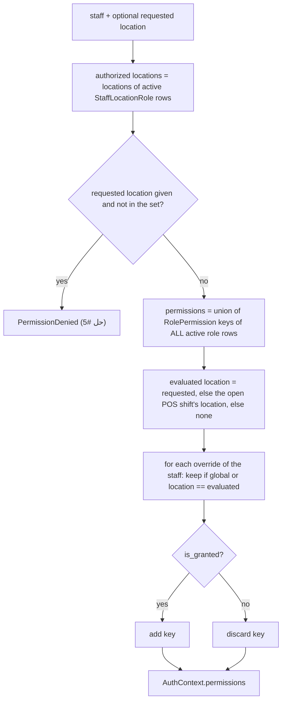
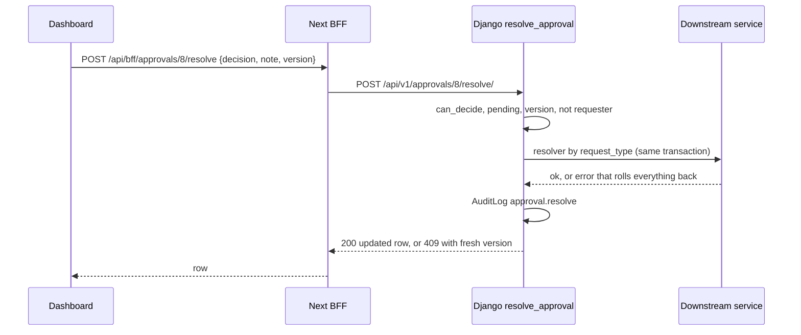

# Staff & permissions API — M18 (الموظفون والأدوار والصلاحيات)

> **Source**: DOC-207, DOC-208, DOC-209, DOC-210, DOC-211, DOC-212, DOC-213 (Step 27) · INT-022 (M18), INT-003, INT-024, INT-033, INT-035, INT-043, INT-044 · inventory Domain 12, A.3, A.5, A.7, A.9, A.12, A.13
> **Live key**: `staff` (`SHARWA_LIVE_MODULES`) — one switch for all 26 BFF files of this page; it **is** in the sample line `.env.example:79`.
> **Django provider**: `sharwa_saas/api/views_staff.py` (`StaffAPIMixin`, 26 URL patterns) · `sharwa_saas/products/services/staff_service.py` (every JSON shape and rule) · `products/services/permission_resolver.py` · `products/services/behavior_service.py` · `products/services/audit_service.py` · models `products/models/{staff_rbac,staff_sessions,staff_approvals,audit,behavior}.py` · no DRF serializers
> **Frontend contract**: `sharwa-frontend/src/features/staff/schemas.ts` · hooks `…/api.ts` · fixture `src/mocks/staff/state.ts` and `src/mocks/approvals/state.ts` · BFF `src/app/api/bff/{staff,roles,permissions,approvals,audit-log,behavior-alerts}`
> **Tests**: `sharwa_saas/api/test_staff_api.py` (9)
> **Last verified against code**: 2026-10-27 (step 27)

<a id="overview"></a>

## 1. Overview

M18 is the dashboard's team screen: the staff list and detail, roles and the permission matrix, per-location assignments, individual overrides, sessions, personal keys, trusted devices, the weekly roster, the approvals queue, the audit log and the behaviour alerts. Before INT-022 these were HTML screens (`staff_list_view`, `roles_list_view`, `staff_detail_view` with "end sessions", `approval_requests_view` / `resolve_approval_view`, `audit_log_view` / `verify_audit_chain_view`, `behavior_alerts_view`). `views_staff.py` is the JSON provider of the Next.js contract; it keeps the same models and moves the rules into `staff_service.py`.

The caller is the store **owner** or a **staff member** on the store host. The owner session has no `request.staff`, so every permission test passes for it (`ProductsAPIMixin.can`). A staff member needs the plan feature `staff_rbac` and the keys below. The full key catalogue is in [`permissions.md`](../../overview/permissions.md); this page owns the M18 routes that use five of those keys (`staff.view`, `staff.manage`, `staff.manage_roles`, `staff.manage_assignments`, `staff.view_sessions`).

Rules that run through the whole module:

- **Staff = phone + `auth.User`.** The phone is normalised with `customer_key` (so `0770841802`, `770841802` and `967770841802` are one number) and the `auth.User.username` is that phone. Duplicates are checked across all stored forms ([§4](#staff)).
- **Secrets are shown once.** A temporary password and a personal key are returned in the response that creates them and never again ([§4.2](#temp-password), [§6.3](#tokens)).
- **Nothing is hard-deleted** except overrides, custom roles and (with their rows) assignments. Termination is soft; trusted devices are deactivated; sessions and keys are revoked.
- **Every write is audited** with an `AuditLog` row ([§9.3](#audit-codes)).
- **A staff member cannot raise their own privileges**: assignments and overrides refuse the caller's own id ([§5.4](#self-edit)).

<a id="access"></a>

## 2. Access — gate chain

`StaffAPIMixin.check` (`views_staff.py:37`) evaluates, in this order; the first failing gate answers:

| # | Gate | Requirement | Failure |
|---|---|---|---|
| 1 | Store | the request resolves to a store (`HasTenantContext`) | `403` «لم يتم تحديد المتجر المطلوب. استخدم النطاق الفرعي للمتجر أو أرسل ترويسة X-Store-Domain.» · with **no session cookie** on the public host the answer is `403` «لم يتم تزويد بيانات الدخول.» instead ([rule](../../overview/auth.md#no-store-no-session)) |
| 2 | CSRF | `MerchantSessionAuthentication` checks `X-CSRFToken` on every write ([`csrf.md`](../../overview/csrf.md)) | `403` `{"detail": "CSRF Failed: …"}` |
| 3 | Session | an owner session or a resolved staff member (`ProductsAPIMixin.gate`) | `401` `{"detail": "انتهت جلستك، سجّل الدخول مجدداً."}` |
| 4 | Plan feature | `staff_rbac` (`settings_feature_enabled`; a missing `Feature` row counts as disabled) | `403` «هذه الميزة غير متاحة في باقتك الحالية» |
| 5 | Permission | the key in the route table (§3); a few routes accept **any of** two keys | `403` «ليست لديك صلاحية لهذا الإجراء.» |
| 6 | Self-edit | only `PUT assignments/`, `POST overrides/`, `DELETE overrides/<oid>/` — the caller's own id | `403` «لا يمكنك تعديل تعييناتك أو استثناءات صلاحياتك بنفسك.» |
| 7 | Resource state | the entity exists and the state allows the action | `404` / `400` / `403` / `409` (per section) |

Notes:

- The plan feature is checked **before** the permission; the permission before the self-edit test.
- The owner never meets gates 5 and 6 (`resolve_request_staff` is `None`).
- `POST approvals/<pk>/resolve/` has only `staff.view` at gate 5; the real decision rule is gate 7 ([§8](#approvals)).
- Service errors are `ProductApiError(status, body)` and are returned as `Response(body, status)`: a message is `{"detail": "…"}`, a field error is `{"field": ["…"]}`.

<a id="routes"></a>

## 3. Endpoint summary — the 26 routes (DOC-213)

Django paths are under `/api/v1/`; BFF paths under `/api/bff/`. "Key" is the permission at gate 5. The BFF mirrors the Django path 1:1 (without the trailing slash), so only one column is shown.

| # | Verbs | Path | Purpose | Key | § |
|---|---|---|---|---|---|
| 1 | `GET` · `POST` | `staff/` | list `?status&q&page&page_size` · create (`temporary_password` once) | read `staff.view` · write `staff.manage` | [4.1](#staff-list) · [4.2](#temp-password) |
| 2 | `GET` | `staff/counters/` | `{pending_approvals, unread_alerts}` | `staff.view` | [4.6](#counters) |
| 3 | `GET` · `PATCH` | `staff/<pk>/` | one member · edit name, phone, flags | read `staff.view` · write `staff.manage` | [4.1](#staff-list) · [4.3](#staff-patch) |
| 4 | `POST` | `staff/<pk>/terminate/` | soft termination | `staff.manage` | [4.4](#terminate) |
| 5 | `POST` | `staff/<pk>/revoke-sessions/` | `token_version + 1`, end sessions | `staff.manage` | [4.5](#revoke) |
| 6 | `POST` | `staff/<pk>/reset-password/` | new temporary password once | `staff.manage` | [4.2](#temp-password) |
| 7 | `GET` · `PUT` | `staff/<pk>/assignments/` | location × role × operational-role matrix | read `staff.view` · write `staff.manage_assignments` | [5.1](#assignments) |
| 8 | `GET` · `POST` | `staff/<pk>/overrides/` | individual grants / revokes | read `staff.view` · write `staff.manage_assignments` | [5.2](#overrides) |
| 9 | `DELETE` | `staff/<pk>/overrides/<oid>/` | remove an override | `staff.manage_assignments` | [5.2](#overrides) |
| 10 | `GET` | `staff/<pk>/effective-permissions/` | final result per key `?location_id` | `staff.view` | [5.3](#effective) |
| 11 | `GET` · `DELETE` | `staff/<pk>/sessions/` | active sessions · end all | `staff.view_sessions` | [6.1](#sessions) |
| 12 | `DELETE` | `staff/<pk>/sessions/<sid>/` | end one session | `staff.view_sessions` | [6.1](#sessions) |
| 13 | `GET` · `POST` | `staff/<pk>/tokens/` | personal keys · create (value once) | read `staff.view_sessions` · create `staff.manage` | [6.3](#tokens) |
| 14 | `DELETE` | `staff/<pk>/tokens/<tid>/` | revoke a key | `staff.manage` | [6.3](#tokens) |
| 15 | `GET` | `staff/<pk>/devices/` | trusted devices | `staff.view_sessions` | [6.4](#devices) |
| 16 | `DELETE` | `staff/<pk>/devices/<did>/` | deactivate a device | `staff.manage` | [6.4](#devices) |
| 17 | `GET` · `PUT` | `staff/<pk>/roster/` | weekly roster (7 rows) | read `staff.view` · write `staff.manage` | [6.5](#roster) |
| 18 | `GET` | `permissions/` | catalogue `[{code, name, category}]` | `staff.view` | [7.1](#catalogue) |
| 19 | `GET` · `POST` | `roles/` | roles · create | read `staff.view` · write `staff.manage_roles` | [7.2](#roles) |
| 20 | `GET` · `PATCH` · `DELETE` | `roles/<pk>/` | one role · replace · delete | read `staff.view` · write `staff.manage_roles` | [7.2](#roles) |
| 21 | `GET` | `approvals/` | queue `?status&type&page` | `staff.view` | [8.1](#approvals-list) |
| 22 | `POST` | `approvals/<pk>/resolve/` | decide | `staff.view` + decider rule | [8.2](#approvals-resolve) |
| 23 | `GET` | `audit-log/` | log `?actor&action&q&from&to&page` | `staff.view_sessions` **or** `reports.sales.view` | [9.1](#audit-list) |
| 24 | `POST` | `audit-log/verify/` | `verify_chain()` | same either-key gate | [9.2](#audit-verify) |
| 25 | `GET` | `behavior-alerts/` | alerts `?level&unread&page` | `staff.view` | [9.4](#alerts) |
| 26 | `POST` | `behavior-alerts/<pk>/read/` | mark read | `staff.view` | [9.4](#alerts) |

The table has one row per URL pattern in `api/urls.py` (lines 393–418): **26 patterns**, 36 verb-routes counting each verb.

> **Pagination**: `page` (default 1) and `page_size` (default 50, clamped to 1–100) apply to `staff/`, `approvals/`, `audit-log/`, `behavior-alerts/`. Lists answer `{count, results}`; `permissions/`, `roles/`, `assignments/`, `overrides/`, `sessions/`, `tokens/`, `devices/`, `roster/` answer a bare array.

<a id="staff"></a>

## 4. Staff — CRUD, counters, termination, temporary passwords (DOC-207)

### The staff object

```json
{
  "id": 12,
  "full_name": "منى القحطاني",
  "phone": "967770841802",
  "is_active": true,
  "terminated_at": null,
  "enforce_ip_whitelist": false,
  "enforce_roster_schedule": false,
  "token_version": 1,
  "last_seen_at": null,
  "created_at": "2026-10-27T09:12:44.318201+00:00",
  "status": "active",
  "roles_summary": "كاشير · فرع التحرير"
}
```

| Field | Meaning (Django source) |
|---|---|
| `status` | `terminated` if `terminated_at` is set, else `active` / `inactive` from `is_active` (`staff_status`) |
| `roles_summary` | the member's active location roles as `<role> · <location>` joined with `، ` (ordered by location, then role); `""` when none |
| `last_seen_at` | newest `StaffSession.last_seen_at` of the member, or `null` |
| `token_version` | the counter that invalidates every session and key issued earlier ([§4.5](#revoke)) |

<a id="staff-list"></a>

### 4.1 `GET /api/v1/staff/` and `GET /api/v1/staff/<pk>/`

| Query | Type | Default | Notes |
|---|---|---|---|
| `status` | `active` · `inactive` · `terminated` | all | `active` = not terminated and `is_active`; `inactive` = not terminated and not `is_active` |
| `q` | string | — | name `icontains`; and, when the digits of `q` (leading zeros stripped) are ≥ 3, `phone` contains the last 9 digits — so `0770841802` finds `967770841802`. Arabic-Indic digits are converted. |
| `page`, `page_size` | int | 1, 50 | max 100 |

Sorted in memory: active and inactive first (by name), terminated last. `404` «الموظف غير موجود.» for an unknown `<pk>`.

<a id="temp-password"></a>

### 4.2 `POST /api/v1/staff/` — create, temporary password once (`201`)

| Field | Type | Required | Rules |
|---|---|---|---|
| `full_name` | string | yes | 2–150 characters |
| `phone` | string | yes | normalised by `customer_key`; must match `^(967|966)\d{8,9}$`; any form of an existing staff number is a duplicate |
| `is_active` | bool | no | default `true` |
| `enforce_ip_whitelist` | bool | no | default `false` — stored only ([§12](#open-items)) |
| `enforce_roster_schedule` | bool | no | default `false` — enforced at login ([§6.5](#roster)) |

**Response `201`** — the staff object plus `temporary_password`:

```json
{ "id": 12, "full_name": "منى القحطاني", "phone": "967770841802", "status": "active", "roles_summary": "", "temporary_password": "k7Qm4-x9Rt2" }
```

(The password above is an illustration of the shape, not a value from a run.)

**Errors**

| Status | Body | When |
|---|---|---|
| `400` | `{"full_name": ["الاسم مطلوب."]}` | shorter than 2 characters |
| `400` | `{"full_name": ["150 حرفاً على الأكثر."]}` | longer than 150 |
| `400` | `{"phone": ["رقم الهاتف غير صالح."]}` | not 967/966 + 8–9 digits after normalisation |
| `400` | `{"phone": ["هذا الرقم مسجَّل لموظف آخر."]}` | another member has the number in any stored form (the legacy screen stored `0770…`) |
| `400` | `{"phone": ["هذا الرقم مسجَّل لحساب آخر."]}` | an `auth.User` with that username exists |
| `400` | `{"detail": "جسم الطلب غير صالح."}` | body is not a JSON object |

**Rules** — in one transaction: an `auth.User(username = phone)` with the generated password, then the `StaffMember` linked to it. The member has **no roles** yet; assign them with `PUT assignments/` ([§5.1](#assignments)). Saudi numbers are accepted: `0551234567` becomes `966551234567`.

**Side effects** — audit `staff.create`.

> ⚠️ **One-time password — it can never be read again.** `temporary_password` exists only in this response (and in the `reset-password/` response). Django stores only the hash; `GET staff/<pk>/` never returns it. The merchant must hand it to the member immediately. If it is lost, call `reset-password/` — there is no recovery. The dashboard shows it in `PasswordOnceDialog` and must not cache it (do not put it in a query cache or a log).

**Format** — `secrets`-generated, `XXXXX-XXXX`: six letters from an alphabet without look-alikes (`abcdefghjkmnpqrstuvwxyzABCDEFGHJKLMNPQRSTUVWXYZ`) and three digits from `2`–`9`, shuffled, with a hyphen after the fifth character (`temporary_password()`). It passes the password-strength validator.

> ⚠️ Discrepancy — the `temporary_password()` docstring says "10 خانات … رقمان على الأقل" / the code produces 9 alphanumerics (six letters + three digits) plus the hyphen: 10 characters on screen, **three** digits. The code is the authority; the docstring is stale.

**Login with it** — staff sign in with **phone + password** at `auth/staff/login/` ([`m03-auth.md`](../02-dashboard-shell/m03-auth.md)); there is no one-time code («رمز تحقق») step for staff — the legacy form's wording was wrong (gap 1). The temporary password is an ordinary password for `authenticate`; `test_create_normalizes_phone_and_returns_password_once` logs in with it (`204`).

#### `POST /api/v1/staff/<pk>/reset-password/` (`200`)

Issues a new temporary password (same format, same one-time rule), sets it on the linked `auth.User` (creating the user if the member had none, unless a user with that phone already exists: `400` «يوجد حساب دخول آخر بنفس الرقم — عدّل رقم الموظف أولاً.»), bumps `token_version`, and ends every open session.

```json
{ "temporary_password": "m3Yc8-pQ5w", "token_version": 2 }
```

Errors: `404` «الموظف غير موجود.»; `400` «الموظف مُنهى الخدمة.» for a terminated member. Audit `staff.password_reset`. The route is the one added for `PasswordOnceDialog`; the Zod schema is `passwordResetSchema`.

<a id="staff-patch"></a>

### 4.3 `PATCH /api/v1/staff/<pk>/`

Partial: only keys present are validated and applied (`full_name`, `phone`, `is_active`, `enforce_ip_whitelist`, `enforce_roster_schedule`), same messages as create. `400` «الموظف مُنهى الخدمة.» when terminated.

**Rules** — changing `phone` also updates `auth.User.username`. Setting `is_active` from `true` to `false` bumps `token_version` (the member is signed out of every device on the next request). Audit `staff.update` with the before/after of the changed keys.

> **Note** — deactivating through `PATCH` bumps the counter but does **not** mark the `StaffSession` rows revoked (only `terminate/`, `revoke-sessions/`, `reset-password/` and the `sessions/` DELETEs do). Those rows keep showing in `GET sessions/` until one of those calls runs, although the session middleware already refuses them (`token_version_at_issue` no longer matches).

<a id="terminate"></a>

### 4.4 `POST /api/v1/staff/<pk>/terminate/` — soft termination

Body `{"reason": "انتهى العقد"}` (optional, cut at 255). One locked transaction:

1. `is_active = false`, `terminated_at = now`, `terminated_reason`.
2. `token_version + 1` — every session and key issued before this is dead on its next request.
3. Every open `StaffSession` gets `revoked_at`; every open `PersonalAccessToken` gets `revoked_at`.
4. Audit `staff.terminate` (before `{is_active: true, terminated_at: null}`, after `{token_version, reason}`).

The row stays (`status: "terminated"`, listed last). Assignments, overrides and history are kept.

| Status | Body | When |
|---|---|---|
| `404` | «الموظف غير موجود.» | unknown id |
| `400` | «الموظف مُنهى الخدمة أصلاً.» | already terminated |
| `400` | «لا يمكنك إنهاء خدمتك بنفسك.» | the caller is that member |

> ⚠️ Discrepancy — roadmap says "never terminate yourself" and the self-edit rule answers `403` / code answers **`400`** «لا يمكنك إنهاء خدمتك بنفسك.» for termination. The `403` self-edit gate of §2 does not apply to `terminate/`, `revoke-sessions/` or `reset-password/` (they pass no `target`), so a member with `staff.manage` may revoke their own sessions or reset their own password (which signs them out).

<a id="revoke"></a>

### 4.5 `POST /api/v1/staff/<pk>/revoke-sessions/`

`token_version + 1`, ends every open session. Does not set `revoked_at` on personal keys, but keys carry `token_version_at_issue` and the model docstring says they get the same version check, so the bump invalidates them too. Response `{"token_version": 2}`. Audit `staff.sessions_ended`.

<a id="counters"></a>

### 4.6 `GET /api/v1/staff/counters/`

```json
{ "pending_approvals": 0, "unread_alerts": 2 }
```

`pending_approvals` = `ApprovalRequest.status = 'pending'` (all types, all locations); `unread_alerts` = unread `BehaviorAlert` rows whose `alert_type` is one of `export_volume`, `view_volume`, `message_volume`. Feeds the sidebar badges; the dashboard polls it every 60 s.

<a id="assignments"></a>

## 5. Assignments, overrides and effective permissions (DOC-208)

### 5.1 `staff/<pk>/assignments/`

<a id="assignments-get"></a>

`GET` returns **one row per location of the store** (active first, then by name), whether or not the member is assigned:

```json
[
  { "location_id": 3, "location_name": "فرع التحرير", "location_active": true, "role_id": 2, "location_role": "cashier" },
  { "location_id": 5, "location_name": "مستودع عدن", "location_active": true, "role_id": null, "location_role": null }
]
```

| Field | Source |
|---|---|
| `role_id` | the permission **role** (`StaffLocationRole`, `is_active`) at that location — first by assignment time; `null` = none |
| `location_role` | the **operational** role (`LocationStaffAssignment.role`): `manager` · `cashier` · `warehouse_operator` · `driver` · `pickup_agent`; `null` = none |

`PUT` **replaces everything** (the matrix is the whole truth). Body: an array of `{location_id, role_id?, location_role?}`.

| Status | Body | When |
|---|---|---|
| `400` | `{"detail": "قائمة التعيينات مطلوبة."}` | body is not an array |
| `400` | `{"detail": "صف تعيين غير صالح."}` | an item is not an object |
| `400` | `{"location_id": ["الموقع <id> غير موجود."]}` | unknown location (the `<id>` is the value sent) |
| `400` | `{"role_id": ["الدور غير موجود أو معطّل."]}` | unknown or inactive role |
| `400` | `{"location_role": ["الدور التشغيلي غير معروف."]}` | not one of the five |
| `400` | `{"detail": "الموظف مُنهى الخدمة."}` | terminated member |

**Rules** — in one transaction: `StaffLocationRole` rows not in the new `(location, role)` set are **deleted**, the others are created or reactivated (`assigned_by` = the caller); the same for `LocationStaffAssignment` and `(location, location_role)`. An item without `role_id` keeps no permission role for that location. Sending `[]` removes all assignments. The response is the new `GET` result. Audit `staff.assignments_change` (counts only).

<a id="overrides"></a>

### 5.2 `staff/<pk>/overrides/` and `overrides/<oid>/`

```json
{ "id": 7, "staff_id": 12, "permission_code": "orders.refund", "allow": true, "location_id": null, "location_name": null, "reason": "" }
```

`GET` lists all of the member's overrides ordered by key. `POST {permission_code, allow, reason?}`:

| Status | Body | When |
|---|---|---|
| `201` | the override | created |
| `200` | the override | an override for that key already existed — it is updated in place (`update_or_create` on staff + key + no location) |
| `400` | `{"permission_code": ["مفتاح صلاحية غير معروف."]}` | key not in the catalogue |

`reason` is cut at 255. `DELETE overrides/<oid>/` answers `204`, or `404` «الاستثناء غير موجود.» (also when the override belongs to another member). Audit `staff.override` / `staff.override_removed`.

> **Limit** — an override created through this API is always **global** (`location = null`). Rows with a `location_id` exist in the model and are returned and honoured by the resolver, but this API cannot create them. `allow: false` is a **revoke**: it removes the key even if a role grants it.

<a id="effective"></a>

### 5.3 `GET staff/<pk>/effective-permissions/?location_id=<id>`

One row **per catalogue key** (ordered by category, then code):

```json
[
  { "code": "orders.refund", "from_role": false, "override": true, "effective": true },
  { "code": "customers.view", "from_role": true, "override": false, "effective": false }
]
```

`from_role` = a role grants it; `override` = `true` / `false` / `null` (none); `effective` = `override` if not `null`, else `from_role`.

<a id="resolver"></a>

**The resolver algorithm** (`permission_resolver.resolve_context`, the single source of truth for enforcement):



**Worked example.** Sara holds «كاشير» at فرع التحرير and «أمين مخزن» at مستودع عدن, with two global overrides: grant `orders.refund`, revoke `customers.view`.

1. Union of roles (no location given): `orders.view`, `orders.update_status`, `customers.view`, `inventory.view`, `discounts.apply` (كاشير) ∪ `orders.view`, `inventory.view`, `inventory.adjust`, `inventory.writeoff`, `reports.view` (أمين مخزن) = 8 keys.
2. Overrides: `orders.refund` added; `customers.view` discarded.
3. Result: `orders.refund` ✔ (`from_role: false, override: true`), `customers.view` ✘ (`from_role: true, override: false`), `inventory.adjust` ✔ — 8 keys.

`test_assignments_overrides_effective` asserts that, without a location, the set of `effective: true` keys equals `resolve_context(sara).permissions`.

> ⚠️ Discrepancy — roadmap says the route is "verified equal to `resolve_context()`" / it is equal **only without `location_id`**. With `?location_id=<id>` the route (`effective_permissions`) keeps only the roles assigned **at that location** and does not refuse an unassigned location, while `resolve_context(staff, location_id)` still unions the roles of **all** locations (only the override filter uses the location) and raises `PermissionDenied` for an unassigned one. In the example, `?location_id=<التحرير>` answers `inventory.adjust` with `from_role: false`, but enforcement (`staff_has_permission(staff, code, location)`) still grants it. Treat the location variant as a per-location preview, not as the enforcement result.
>
> **Related** — for one key with both a global and a location override, the route lets the location one win; `resolve_context` iterates the overrides unordered and the last one applied wins. Only rows created outside this API can have both.

<a id="self-edit"></a>

### 5.4 A member can never edit their own assignments or overrides

`PUT assignments/`, `POST overrides/` and `DELETE overrides/<oid>/` pass `target=pk`; if the caller's `StaffMember.pk` equals it, the answer is `403` «لا يمكنك تعديل تعييناتك أو استثناءات صلاحياتك بنفسك.» (the owner is never blocked). `test_feature_and_permissions` covers it. Gate `staff.manage_assignments`.

<a id="sessions"></a>

## 6. Sessions, personal keys, trusted devices and roster (DOC-209)

### 6.1 `staff/<pk>/sessions/` and `sessions/<sid>/`

`GET` (key `staff.view_sessions`) lists the member's `StaffSession` rows with `revoked_at` null, newest activity first:

```json
[ { "id": 31, "device": "Chrome · Android", "ip": "5.106.44.12", "last_activity_at": "2026-10-27T08:50:02+00:00", "created_at": "2026-10-27T07:01:10+00:00", "is_current": false } ]
```

`device` is `StaffSession.device_label` (new in 0223) or «جهاز غير معروف»; `is_current` compares `session_key` with the caller's own Django session key. `device_label()` builds «المتصفح · النظام» from the User-Agent (`Edge`, `Opera`, `Samsung Internet`, `Firefox`, `Chrome`, `Safari` × `Android`, `iPhone`, `iPad`, `Windows`, `macOS`, `Linux`), cut at 100; it is **display only**. `StaffLoginView` fills it at login; the roadmap says the legacy screen fills it too, which was not re-read here.

`DELETE sessions/` ends all open sessions → `{"ended": 2}`; `DELETE sessions/<sid>/` ends one → `{"ended": 1}` or `404` «الجلسة غير موجودة.». Audit `staff.sessions_ended` / `staff.session_ended`. Both ends are gated by **`staff.view_sessions`** (not `staff.manage`), unlike `revoke-sessions/` ([§4.5](#revoke)), which also bumps `token_version`. Ending a session does **not** bump it.

### 6.2 What the session is checked against

Every session and key stores `token_version_at_issue`. `StaffSessionMiddleware` (`products/middleware.py`) compares it with `StaffMember.token_version` for the **cookie session** on every store request: when the member is inactive or the numbers differ it flushes the session, so any bump (terminate, revoke, reset, deactivate) logs the member out at once without a deny-list. The middleware reads only the session cookie; it never looks at a key (see the call-out in [§6.2](#tokens)).

<a id="tokens"></a>

### 6.3 `staff/<pk>/tokens/` and `tokens/<tid>/` — personal access keys

`POST {"name": "تطبيق نقطة البيع"}` → `201` (key `staff.manage`):

```json
{ "id": 4, "name": "تطبيق نقطة البيع", "created_at": "2026-10-27T09:30:00+00:00", "last_used_at": null, "token": "shw_pat_…" }
```

| Item | Rule |
|---|---|
| Value | `shw_pat_` + `secrets.token_urlsafe(32)`; **returned once** in `token`, never listed again |
| Storage | `token_hash = SHA-256(raw)` hex; the raw value is not stored |
| Expiry | `expires_at = now + 90 days` (`TOKEN_TTL_DAYS`); there is no non-expiring key |
| Version | `token_version_at_issue = member.token_version` |
| `name` | required, 2–100: `400` `{"name": ["اسم الرمز مطلوب."]}` / `{"name": ["100 حرف على الأكثر."]}` |
| Eligibility | `400` «لا تُصدر مفاتيح لموظف غير نشط.» for a terminated or inactive member |

`GET` (key `staff.view_sessions`) lists unrevoked, unexpired keys, newest first, as `{id, name, created_at, last_used_at}` (`name` falls back to «مفتاح»). `DELETE tokens/<tid>/` (key `staff.manage`) sets `revoked_at` → `204`, or `404` «الرمز غير موجود.». Audit `staff.token_created` / `staff.token_revoked`.

> ⚠️ **The key value is shown once and is not recoverable.** Lose it and revoke the key; create another.

> ⚠️ Discrepancy — roadmap lists `PersonalAccessToken.name/last_used_at` as part of the contract / the sources read **return** `last_used_at` (it is in the response) but nothing in them **writes** it, and no authentication class or middleware read for this step accepts a `shw_pat_` bearer — `api/authentication.py` has only the session classes, and `api/middleware.py` and `products/middleware.py` (`StaffSessionMiddleware`, cookie sessions only) never look at an `Authorization` header. A key can therefore be created, listed and revoked, but no route uses it, and `last_used_at` is always `null` in the documented flows. This agrees with the DOC-024 note that personal access tokens are not yet accepted by any route.

<a id="devices"></a>

### 6.4 `staff/<pk>/devices/` and `devices/<did>/`

`GET` (key `staff.view_sessions`) lists the member's active `TrustedDevice` rows (those with `staff` = the member), newest first:

```json
[ { "id": 2, "label": "Galaxy A54", "trusted_at": "2026-10-20T10:00:00+00:00", "last_seen_at": "2026-10-20T10:00:00+00:00", "location_name": "فرع التحرير" } ]
```

`label` falls back to `device_id`; `last_seen_at` falls back to `created_at`. `DELETE devices/<did>/` (key `staff.manage`) **deactivates** (`is_active = false`, the row and who approved it stay) → `204`, or `404` «الجهاز غير موجود.». Audit `staff.device_removed`. Shared location devices (`staff` null) are not listed here.

> ⚠️ Discrepancy — roadmap lists `TrustedDevice.staff/last_seen_at` / nothing in the sources read writes `last_seen_at` (the field is nullable and the list falls back to `created_at`); the Zod `deviceSchema` has no `location_name`, so that extra key is stripped by the client.

<a id="roster"></a>

### 6.5 `staff/<pk>/roster/` and the login refusal

`GET` always answers **7 rows**, weekday `0` = Sunday … `6` = Saturday:

```json
[ { "weekday": 0, "from": "09:00", "to": "17:00" }, { "weekday": 5, "from": null, "to": null } ]
```

It reads only the store-wide slots (`RosterSchedule.location` is null — nullable since 0223 because the dashboard grid is store-wide) and shows the earliest slot of a day.

`PUT` (key `staff.manage`) replaces the store-wide slots with the 7 rows sent. All errors are `400` `{"detail": …}`:

| Message | When |
|---|---|
| «سبعة أيام مطلوبة.» | not an array of 7 |
| «صف غير صالح.» | an item is not an object |
| «اليوم بين 0 و6، مرة واحدة لكل يوم.» | weekday missing, out of range, or repeated |
| «اليوم <n>: أدخل البداية والنهاية معاً أو اتركهما فارغين.» | only one of `from` / `to` |
| «صيغة الوقت HH:MM.» | not `HH:MM` (00:00–23:59) |
| «اليوم <n>: وقت النهاية بعد البداية.» | `from >= to` (no overnight shifts) |

A day with both empty has no slot. Audit `staff.roster_change`.

**Enforcement (gap 2)** — `enforce_roster_schedule` is now checked in `StaffLoginView` (`views_auth.py:322`), **after** the password and the active-account test and before the session is created:

| Condition | Result |
|---|---|
| flag off | allowed |
| flag on, member has **no** roster rows | allowed (no restriction until a roster exists; the dashboard shows a warning) |
| flag on, rows exist, now is inside a slot `starts_at <= time < ends_at` on today's weekday | allowed |
| otherwise | `403` {"detail": "الدخول خارج أوقات جدول عملك غير مسموح — تواصل مع مدير المتجر."} |

"Now" is in the **store timezone** (`StoreSetting.timezone`, default `Asia/Aden`; an unknown zone falls back to the server's local time), weekday = `(python_weekday + 1) % 7`. The check uses **all** of the member's slots, including any location-specific rows. It runs **only at login**: an open session is not cut off when its window ends. An inactive account answers first with `403` «هذا الحساب غير مفعّل، تواصل مع مدير المتجر.». `test_roster_enforced_at_login` unit-tests `roster_allows`.

<a id="catalogue"></a>

## 7. Permissions catalogue and roles (DOC-210)

### 7.1 `GET /api/v1/permissions/`

Returns `[{code, name, category}]` ordered by category then code. `name` is the seeded Arabic name. **Categories**: the first seeds store English identifiers (`orders`, `staff`, `customers`, `inventory`, `reports`, `discounts`, `suppliers`) and `CATEGORY_LABELS` serves them in Arabic (`الطلبات`, `الموظفون`, `العملاء`, `المخزون`, `التقارير`, `الخصومات`, `الموردون`); the later seeds already store Arabic categories and pass through unchanged. The dashboard builds the matrix **only** from this response (FR-18.03).

The catalogue holds **36 keys**. Default roles: «مدير المتجر» and «مدير الفرع» hold 29 (all 20 of `0144`, the 3 of `0159` and the 6 later single-key seeds); «كاشير» 5; «أمين مخزن» 5; **—** = no seeded role.

| Key | Arabic name (seed) | Category served | Seed | Default roles |
|---|---|---|---|---|
| `orders.view` | عرض الطلبات | الطلبات | 0144 | all four |
| `orders.update_status` | تحديث حالة الطلب | الطلبات | 0144 | managers, كاشير |
| `orders.refund` | استرجاع مبلغ | الطلبات | 0144 | managers |
| `orders.delete` | حذف طلب | الطلبات | 0144 | managers |
| `orders.process_returns` | معالجة استرجاعات الفروع | الطلبات | 0159 | managers |
| `orders.create_b2b` | إنشاء طلبات الجملة (B2B) | الطلبات | 0159 | managers |
| `orders.approve_b2b` | الموافقة على طلبات الجملة (B2B) | الطلبات | 0159 | managers |
| `staff.view` | عرض الموظفين | الموظفون | 0144 | managers |
| `staff.manage` | إدارة الموظفين (إنشاء/فصل) | الموظفون | 0144 | managers |
| `staff.manage_roles` | إدارة الأدوار والصلاحيات | الموظفون | 0144 | managers |
| `staff.manage_assignments` | إدارة إسنادات المواقع | الموظفون | 0144 | managers |
| `staff.view_sessions` | عرض جلسات الموظفين | الموظفون | 0144 | managers |
| `customers.view` | عرض العملاء | العملاء | 0144 | managers, كاشير |
| `customers.edit_profile` | تعديل بيانات العميل | العملاء | 0144 | managers |
| `customers.manage_tier` | إدارة فئة العميل (VIP) | العملاء | 0144 | managers |
| `customers.export` | تصدير بيانات العملاء | العملاء | 0144 | managers |
| `inventory.view` | عرض المخزون | المخزون | 0144 | managers, كاشير, أمين مخزن |
| `inventory.adjust` | تعديل المخزون | المخزون | 0144 | managers, أمين مخزن |
| `inventory.writeoff` | إتلاف مخزون | المخزون | 0144 | managers, أمين مخزن |
| `reports.view` | عرض التقارير | التقارير | 0144 | managers, أمين مخزن |
| `reports.export` | تصدير التقارير | التقارير | 0144 | managers |
| `reports.sales.view` | عرض تقارير المبيعات (الإيراد الإجمالي) | التقارير | 0172 | — |
| `reports.profit.view` | عرض صافي الربح والهامش (حساس) | التقارير | 0172 | — |
| `reports.customers.view` | عرض تقارير العملاء | التقارير | 0172 | — |
| `reports.inventory.view` | عرض تقارير المخزون | التقارير | 0172 | — |
| `reports.staff_performance.view` | عرض تقرير أداء الموظفين (حساس — يكشف أداء أفراد) | التقارير | 0174 | — |
| `discounts.apply` | تطبيق خصم | الخصومات | 0144 | managers, كاشير |
| `discounts.manage` | إدارة الخصومات | الخصومات | 0144 | managers |
| `suppliers.manage` | إدارة الموردين وأوامر الشراء (إنشاء/تعديل) | الموردون | 0178 | — |
| `suppliers.approve` | اعتماد/رفض أوامر الشراء | الموردون | 0178 | — |
| `expenses.manage` | إدارة المصروفات التشغيلية (عرض الدفتر وتسجيل المصروفات) | المالية | 0235 | managers |
| `support.takeover_session` | استلام محادثات الدعم الفني | الدعم الفني | 0182 | managers |
| `channels.inbox.access` | الوصول لصندوق وارد قنوات البيع | قنوات البيع | 0186 | managers |
| `channels.marketplaces.manage` | إدارة الأسواق الإلكترونية (أمازون، نون) | قنوات البيع | 0194 | managers |
| `channels.dropshipping.manage` | إدارة استيراد المنتجات والدروبشيبينغ | قنوات البيع | 0200 | managers |
| `catalog.manage` | إدارة الكتالوج (التصنيفات والعلامات والوسوم والتشكيلات والشارات) | المنتجات والكتالوج | 0210 | managers |

`reports.export` is also listed by `0172`, but `get_or_create` keeps the `0144` row (and its name). The endpoints that check each key, the two keys no route uses (`orders.delete`, `customers.manage_tier`) and the managers' missing grants (no seeded role holds the seven `—` keys, so a manager is refused at sales reports until the owner builds a custom role) are in [`permissions.md`](../../overview/permissions.md#2-the-keys); this table is the API's own view and must stay consistent with it.

<a id="roles"></a>

### 7.2 Roles — `roles/` and `roles/<pk>/`

```json
{ "id": 2, "name": "كاشير", "is_system_role": true, "is_active": true, "max_discount_percent": "10", "permission_codes": ["customers.view", "discounts.apply", "inventory.view", "orders.update_status", "orders.view"], "members_count": 1 }
```

| Field | Meaning |
|---|---|
| `max_discount_percent` | the POS discount ceiling as a trimmed decimal string (`"20"`, `"7.5"`); `null` = no ceiling ([`permissions.md` §4.1](../../overview/permissions.md#41-pos-discount-ceiling-and-approver-roles), INT-033) |
| `permission_codes` | sorted codes |
| `members_count` | **distinct** staff with an assignment to the role (inactive assignments included) |

`GET roles/` is ordered system roles first, then by id. Seeded: «مدير المتجر» (no ceiling), «مدير الفرع» (20), «كاشير» (10), «أمين مخزن» (none).

**`POST roles/`** (`201`, key `staff.manage_roles`) and **`PATCH roles/<pk>/`** take the **full** body — `PATCH` is a replace: `name` and `permission_codes` are required every time.

| Field | Rules |
|---|---|
| `name` | 2–100, unique: `{"name": ["اسم الدور مطلوب."]}` · `["100 حرف على الأكثر."]` · `["يوجد دور بهذا الاسم."]` |
| `max_discount_percent` | `""`/`null` = no ceiling; otherwise `^\d{1,3}(\.\d{1,2})?$` and ≤ 100: `["النسبة بين 0 و100."]` |
| `permission_codes` | at least one: `["حدد صلاحية واحدة على الأقل."]`; unknown keys: `["مفاتيح غير معروفة: a, b"]` (first five) |

On `PATCH`, permissions no longer listed are removed and new ones added. Audit `role.create` / `role.change` (name, ceiling, number of permissions).

**System roles are read-only (FR-18.04).** `PATCH` and `DELETE` on a system role answer `403`: «الأدوار النظامية للقراءة فقط — انسخها كدور مخصص.» / «الأدوار النظامية لا تُحذف.». The legacy screen let the owner edit them; to change a combination, create a custom role. `404` «الدور غير موجود.».

**`DELETE roles/<pk>/`** (`204`, audit `role.delete`):

| Status | Body | When |
|---|---|---|
| `403` | `{"detail": "الدور مُعيَّن لموظفين — أعد تعيينهم أولاً.", "staff": [{"id": 4, "full_name": "سارة"}]}` | any assignment (active or not) uses the role — the list is sorted by name |
| `409` | `{"detail": "الدور معتمِد في طلبات موافقة سابقة — لا يُحذف حفاظاً على سجلها."}` | any `ApprovalRequest` (even decided) names it as `approver_role` (PROTECT) |

`test_roles_system_read_only_and_delete_rules` covers system read-only, create/replace, validation and the `403` staff list.

<a id="approvals"></a>

## 8. Approvals queue (DOC-211)

An `ApprovalRequest` is addressed to a **role** (`approver_role`), not a person. It carries `status` (`pending` → `approved` / `rejected`), an optimistic `version` (starts at 1, +1 on a decision), `amount`, a `target_ref`, a `payload` snapshot, an optional `location` and `escalated_at`.

<a id="approvals-list"></a>

### 8.1 `GET /api/v1/approvals/`

| Query | Notes |
|---|---|
| `status` | `pending` · `approved` · `rejected` (anything else = all) |
| `type` | one of the six types below |
| `page`, `page_size` | as in §3 |

Order: **escalated first** (`escalated_at` desc, nulls last), then newest. Sample row (fixture shape of `approvalSchema`):

```json
{
  "id": 8, "request_type": "order_approval", "status": "pending",
  "requester_id": 3, "requester_name": "سارة", "approver_role": "مدير الفرع",
  "payload": { "target_ref": "41", "location": "فرع التحرير", "order_id": 41, "customer_name": "أحمد", "display_total": "100.00 SAR", "display_amount": "100.00 SAR" },
  "summary": "اعتماد طلب الجملة #41 — أحمد بقيمة 100.00 SAR",
  "entity": { "kind": "order", "id": 41, "label": "#41", "available": true },
  "note": null, "decided_by": null, "decided_at": null, "escalated_at": null,
  "version": 1, "created_at": "2026-10-27T08:00:00+00:00", "is_mine": false
}
```

(The money strings above show the shape; real values come from `format_money`.)

**Mapping** (`staff_service._approval_context`) — `ApprovalRequest` has no summary field, so `payload`, `summary` and `entity` are **derived** from `target_ref`, `amount` and the stored `payload`:

| Part | Rule |
|---|---|
| `requester_name` | the member's name, or «مالك المتجر» when `requested_by` is empty (the owner created it) |
| `decided_by` | `null` while pending; afterwards the resolver's name or «مالك المتجر» |
| `is_mine` | the caller is the requester (they may not decide it) |
| `payload.display_amount` / `summary` suffix | `amount` formatted in the related order/PO currency, else the store currency; appended as «<summary> بقيمة <amount>» |
| `entity` | `null` when `target_ref` has no numeric id; `available` is `false` when the order/PO is `cancelled`, or the product/shift is gone |
| `escalated_at` | passed through; see the note below |

Summaries: PO → «أمر شراء PO-0007» (4-digit padded id); B2B → «اعتماد طلب الجملة #<id> — <customer>»; refund → «استرجاع للطلب #<id>»; discount exception → «استثناء خصم على الطلب #<id>»; **POS discount** (`payload.source = pos`) → «خصم 15% في نقطة البيع يتجاوز حد الدور (10%)» (percentages are the stored strings; « — الطلب #<id>» is added once an order is linked); shift → «عجز في وردية #<id>»; write-off → «إعدام <qty> × <product> (<variant>) — <note>» (via `writeoff_summary`), or «إعدام مخزون — <product>» when the note is empty. A write-off also puts `product_id`, `product_name`, `variant_id`, `variant_label`, `location_id`, `quantity` and `note` in `payload`.

<a id="approvals-resolve"></a>

### 8.2 `POST /api/v1/approvals/<pk>/resolve/`

Body `{ "decision": "approved" | "rejected", "note": "…", "version": 1 }` → `200` with the updated row (`status`, `decided_by`, `note`, `version + 1`).

Checks run in this order (`resolve_approval`):

| # | Check | Result |
|---|---|---|
| 1 | request exists | `404` «طلب الموافقة غير موجود.» |
| 2 | **decider rule** (`can_decide`) | `403` «الحسم لحامل دور «<role>» في هذا الموقع أو للمالك.» |
| 3 | still `pending` | `409` «حُسم الطلب من مستخدم آخر.» + `status`, `version` |
| 4 | `version` equals the current one | `409` «حُسم الطلب من مستخدم آخر.» + `version` (the current one) |
| 5 | not the requester | `403` «لا يمكنك الموافقة على طلبك.» |
| 6 | `decision` valid | `400` `{"decision": ["القرار يجب أن يكون approved أو rejected."]}` |
| 7 | note on rejection | `400` `{"note": ["الملاحظة مطلوبة عند الرفض."]}` |
| 8 | note length | `400` `{"note": ["255 حرفاً على الأكثر."]}` |

**Decider rule** — the owner always; a staff member who holds `staff.manage` (for **any** request); otherwise a staff member who holds the request's `approver_role` through an active `StaffLocationRole` **at the request's location** (a request with no location — a store without multi-location — is decided by a holder of that role at any location). The route's own `staff.view` is only the entry gate.

**Concurrency** — the row is locked (`select_for_update`) inside `ApprovalRequest.resolve()`; a `ConcurrencyError` (status or version changed) becomes the `409` of row 4 with the fresh `version`; the client must reload ([`conflicts.md`](../../overview/conflicts.md)). `ApprovalRequest.resolve()` itself also refuses self-approval (`PermissionError` → the `403` of row 5), so it holds even for direct callers.

**Downstream effects** run **in the same transaction** as the decision; any failure rolls the whole decision back and leaves the request pending:

| `request_type` | Arabic label | Created by | `target_ref` | `entity.kind` | Resolver on decision | Approved | Rejected |
|---|---|---|---|---|---|---|---|
| `order_approval` | موافقة طلب جملة | `order_approval_service.create_b2b_draft_order` (B2B draft) | `<order_id>` | `order` | `resolve_order_approval` | order `status = 'new'` (enters fulfilment) | order `cancelled` |
| `po_approval` | موافقة أمر شراء | `purchase_order_service.submit_purchase_order` | `po:<id>` | `purchase_order` | `resolve_purchase_order` | PO `approved` (no stock touched) — only if it is still `pending_approval` | PO back to `draft` (editable, resubmittable) |
| `shift_shortage` | عجز وردية | `pos_service` on closing a shift whose count is below expected | `shift:<id>` | `shift` | `approval.resolve` + `settle_shift_for_approval` | shift closed | shift closed |
| `stock_writeoff` | إتلاف مخزون | `inventory_service.request_writeoff` (`inventory/writeoffs/`) | `product:<id>` | `product` | `approval.resolve` + `apply_writeoff` (approve only) | stock deducted by a `manual_adjust` movement referencing the approval | nothing |
| `discount_exception` | استثناء خصم | `pos_service.request_discount_approval` (and pre-approved when a manager code is used) | `pos:pending` | `order` | `approval.resolve` only | status only; the POS then consumes it by `approval_id` | status only |
| `refund` | استرجاع مبلغ | **none found** in the sources read | `<order_id>` | `order` | `approval.resolve` only | status only | status only |

- **B2B**: the legacy HTML resolve skipped the order update; M18 goes through `resolve_order_approval`, so the order follows the decision ([`09-b2b`](../09-b2b/README.md)).
- **Write-off**: the quantity is re-checked at approval time. If stock was sold meanwhile the approval is refused with `400` «الكمية المطلوب إعدامها تتجاوز المخزون الحالي — ارفض الطلب أو عدّل المخزون أولاً.» and the request stays pending; other refusals: «المنتج لم يعد موجوداً — ارفض الطلب.», «المتغيّر لم يعد موجوداً — ارفض الطلب.», «المتجر أصبح متعدد المواقع والطلب بلا موقع — ارفضه واطلب من جديد.». The approver role of a new write-off or PO is «مدير المتجر» (else the first active role); for POS requests it is «مدير الفرع», else «مدير المتجر» ([`m21-inventory.md`](../10-inventory-locations-procurement/m21-inventory.md), [`m23-procurement.md`](../10-inventory-locations-procurement/m23-procurement.md)).
- **POS shift variance** can also be settled directly from the POS (`pos/shifts/<pk>/resolve-variance/`), which resolves the same request.



> ⚠️ Discrepancy — roadmap lists the six approval types as one working queue / in the sources read, **`refund` has no creator** and approving it, like `discount_exception`, only flips the status: the refund itself is not executed by the queue. And `escalated_at` is exposed and used for ordering, but nothing in the sources read ever sets it (the automatic escalation job is not among them), so it is `null` in practice.

> ⚠️ Discrepancy — mock vs Django: the BFF mock (`approvals/[id]/resolve/route.ts`) lets a non-owner decide only with `staff.manage` («حسم الطلبات مقصور على المالك أو من يملك إدارة الموظفين.»). Django also lets the holder of the request's approver role decide. The mock writes the audit code `approval.resolved`; Django writes `approval.resolve`.

<a id="audit"></a>

## 9. Audit log, chain verification and behaviour alerts (DOC-212)

<a id="audit-list"></a>

### 9.1 `GET /api/v1/audit-log/`

Gate: `staff.view_sessions` **or** `reports.sales.view` (the key of the legacy `audit_log_view`). Since no seeded role holds `reports.sales.view`, a manager sees the log through `staff.view_sessions`.

| Query | Notes |
|---|---|
| `actor` | the owner label («مالك المتجر») → rows with no actor; otherwise `actor.full_name icontains` |
| `action` | `action_code` **starts with** (e.g. `staff.`) |
| `q` | `action_code`/actor name/model name contain it, or `target_id` equals it |
| `from`, `to` | dates `YYYY-MM-DD` (first 10 characters); inclusive on `created_at` date |
| `page`, `page_size` | as in §3 |

Newest first (`-id`). Row:

```json
{ "id": 90, "action_code": "staff.sessions_ended", "actor": "مالك المتجر", "entity": "موظف #12", "before_snapshot": { "token_version": 1 }, "after_snapshot": { "token_version": 2 }, "prev_hash": "…", "row_hash": "…", "created_at": "2026-10-27T09:40:00+00:00" }
```

`entity` is «<label> #<id>» with the label from `TARGET_LABELS` (موظف, دور, طلب, طلب موافقة, منتج, أمر شراء, وردية, ناقل, عميل, موقع, كوبون, إعدادات المتجر), else the raw model name; `actor` is the member's name or «مالك المتجر»; empty snapshots are `null`. `ip_address`, `device_fingerprint` and `request_id` are part of the hash but **not** returned.

> **Quirk** — the owner test is `actor in OWNER_LABEL or 'مالك' in actor`, a substring test, so any fragment of «مالك المتجر» typed in `actor` (such as «المتجر») also selects the owner's rows.

<a id="audit-verify"></a>

### 9.2 `POST /api/v1/audit-log/verify/` — chain verification

```json
{ "ok": false, "broken_at": 1, "rows": 14 }
```

`AuditLog` is append-only by three layers: `save()` / `delete()` raise `ValueError` for an existing row; migration `0149_auditlog_revoke` runs `REVOKE UPDATE, DELETE ON products_auditlog FROM PUBLIC`; and each row stores `row_hash = SHA-256(prev_hash + '::' + canonical JSON of actor id, action, model, id, both snapshots, IP, fingerprint, request id)`. `verify_chain()` walks the rows by id and reports a row whose `prev_hash` is not its predecessor's hash or whose recomputed hash differs.

**`broken_at` semantics** — it is the **1-based position in insert order** of the **first** broken row (position among all rows ordered by id, not the row's `id`), or `null` when `ok`. `rows` is the total count. In the test, changing the first row's snapshot gives `broken_at = 1`. The server returns only the first break; later breaks are not listed. (The `?break=1` parameter of the BFF is mock-only — it simulates a break for the check script.)

<a id="audit-codes"></a>

### 9.3 Action codes written by M18

`staff.create`, `staff.update`, `staff.terminate`, `staff.sessions_ended`, `staff.session_ended`, `staff.password_reset`, `staff.assignments_change`, `staff.override`, `staff.override_removed`, `staff.token_created`, `staff.token_revoked`, `staff.device_removed`, `staff.roster_change`, `role.create`, `role.change`, `role.delete`, `approval.resolve`. Each call passes the request so IP and device fingerprint are stored. The log is also read by other modules (order and return timelines): [`37-audit.md`](../../../architecture/37-audit.md).

<a id="alerts"></a>

### 9.4 `behavior-alerts/` and `behavior-alerts/<pk>/read/`

`GET` (key `staff.view`) `?level=warning|critical&unread=true&page`. Only the three M18 types are listed (`export_volume`, `view_volume`, `message_volume`); order: unread first, then newest.

```json
{ "id": 5, "staff_id": 3, "staff_name": "سارة", "staff_terminated": false, "level": "critical", "alert_type": "export_volume", "value": 3, "limit": 2, "is_read": false, "created_at": "2026-10-27T09:00:00+00:00", "detail": "رصد النظام نشاطاً غير طبيعي من الموظف «سارة»: customers.export (3 عملية اليوم)." }
```

| Field | Rule |
|---|---|
| `value`, `limit` | `BehaviorAlert.value/limit` written by `behavior_service` (0223). For **legacy rows** with nulls: `value` is parsed from the first number after `(` in `detail`, else `0`; `limit` comes from the action's current `ALERT_THRESHOLDS`, else `0` |
| `staff_id` | **nullable** — `null` when the member row is gone (`SET_NULL`); `staff_name` is the stored snapshot (or «—») |
| `staff_terminated` | `true` when the member is terminated **or** the row is gone, so the client hides the member actions |
| `detail` | extra key, not in the Zod schema |

`behavior_service` raises **one** alert per staff, type and day when the daily count reaches the threshold (`customers.export` 1000 → `critical`; `customers.view` 5000 and `message.send` 200 → `warning`). Hard limits and the 429 they cause are in [`permissions.md` §4.4](../../overview/permissions.md#44-behaviour-limits-tied-to-keys) and [`rate-limits.md`](../../overview/rate-limits.md).

`POST behavior-alerts/<pk>/read/` → `{"id": 5, "is_read": true}` (no body, key `staff.view`), or `404` «التنبيه غير موجود.».

<a id="wiring"></a>

## 10. BFF wiring and mock/live differences (DOC-213)

Every one of the 26 BFF route files has the same shape: a mock handler (fixture state with `mockRoute`) and `liveOrMock(request, "staff", "<upstream path>", mock)`. The module key is `staff`; with `SHARWA_LIVE_MODULES` containing `staff` the call goes to Django, otherwise the fixture answers. `.env.example` lists `staff` in the sample line (line 79) and describes it at lines 32–33.

| BFF file | Verbs |
|---|---|
| `staff/route.ts` | `GET`, `POST` |
| `staff/counters/route.ts` | `GET` |
| `staff/[id]/route.ts` | `GET`, `PATCH` |
| `staff/[id]/{terminate,revoke-sessions,reset-password}/route.ts` | `POST` |
| `staff/[id]/assignments/route.ts` | `GET`, `PUT` |
| `staff/[id]/overrides/route.ts` (+ `overrides/[oid]/route.ts`) | `GET`, `POST` (+ `DELETE`) |
| `staff/[id]/effective-permissions/route.ts` | `GET` |
| `staff/[id]/sessions/route.ts` (+ `sessions/[sid]/route.ts`) | `GET`, `DELETE` (+ `DELETE`) |
| `staff/[id]/tokens/route.ts` (+ `tokens/[tid]/route.ts`) | `GET`, `POST` (+ `DELETE`) |
| `staff/[id]/devices/route.ts` (+ `devices/[did]/route.ts`) | `GET` (+ `DELETE`) |
| `staff/[id]/roster/route.ts` | `GET`, `PUT` |
| `permissions/route.ts` | `GET` |
| `roles/route.ts`, `roles/[id]/route.ts` | `GET`, `POST` · `GET`, `PATCH`, `DELETE` |
| `approvals/route.ts`, `approvals/[id]/resolve/route.ts` | `GET` · `POST` |
| `audit-log/route.ts`, `audit-log/verify/route.ts` | `GET` · `POST` |
| `behavior-alerts/route.ts`, `behavior-alerts/[id]/read/route.ts` | `GET` · `POST` |

That is 22 files read directly plus the four nested ones (`overrides/[oid]`, `sessions/[sid]`, `tokens/[tid]`, `devices/[did]`), which the file tool could not read (path too deep); their `DELETE` verbs and upstream paths are taken from the hooks in `features/staff/api.ts` (lines 178–194) and from the Django routes. The roadmap's "25 M18 rows + the new reset-password row" is these 26 files.

**Mock vs Django differences**

| Topic | Mock | Django |
|---|---|---|
| Approval deciders | owner or `staff.manage` only | owner, `staff.manage`, or holder of the approver role at the location |
| Audit code on resolve | `approval.resolved` | `approval.resolve` |
| Verify gate | `staff.view_sessions` only | `staff.view_sessions` or `reports.sales.view` |
| Roster weekday message | «اليوم بين 0 و6.» | «اليوم بين 0 و6، مرة واحدة لكل يوم.» |
| Verify break simulation | `?break=1` | not supported |

The role, staff-not-found, system-role and delete-with-staff messages are identical in both.

<a id="migrations"></a>

## 11. Gaps closed and migrations (DOC-213)

**`products/0223_staff_api`** (depends on `0222_shipping_api`) — INT-022:

| Model | Change |
|---|---|
| `StaffSession` | `+ device_label` (`CharField(100)`, blank, default `''`) |
| `PersonalAccessToken` | `+ name` (`CharField(100)`, blank), `+ last_used_at` (nullable) |
| `TrustedDevice` | `+ staff` (nullable FK, `CASCADE`, `related_name='trusted_devices'`), `+ last_seen_at` (nullable) |
| `RosterSchedule` | `location` made **nullable** (store-wide roster) |
| `BehaviorAlert` | `+ value`, `+ limit` (`PositiveIntegerField`, nullable) |

**Migrations this page depends on**: `0143_staff_rbac` (models), `0144_seed_staff_rbac` (20 keys, 4 system roles), `0145_staff_sessions`, `0146_staff_pos`, `0148_auditlog` + `0149_auditlog_revoke` (append-only), `0159_seed_returns_b2b_permissions`, `0172_seed_report_permissions`, `0174_utm_and_staff_performance`, `0178_po_approval` (supplier keys, `po_approval`), `0179_alter_approvalrequest_request_type_and_more` (six request types, nullable `requested_by`), `0182`, `0186`, `0194`, `0200`, `0210`, `0235` (one key each), `0223` above.

**Behaviour fixed for the contract**: gap 1 — staff sign in with phone + password and get a one-time temporary password (not a one-time code); gap 2 — `enforce_roster_schedule` is enforced at login; B2B approvals now update the order; write-offs and POS shortages follow the decision in the same transaction; system roles are read-only through the API.

<a id="open-items"></a>

## 12. Open items and legacy-only behaviour (DOC-213)

- **IP allow-list** — `StaffMember.enforce_ip_whitelist` is stored and returned, but there is no Django model for the allowed addresses and nothing enforces it (no call site in the sources read). The toggle and its warning in the dashboard are unchanged.
- **Personal keys in use** — see the discrepancy in [§6.3](#tokens): `last_used_at` is never written in the sources read.
- **Approval escalation** — `escalated_at` has no writer in the sources read ([§8.2](#approvals-resolve)).
- **`refund` approvals** — no creator and no executing resolver ([§8.2](#approvals-resolve)).
- **Location-scoped overrides** — readable and enforced, not creatable through the API ([§5.2](#overrides)).
- **Roster at login only** — a session is not ended when the window closes ([§6.5](#roster)).
- **Stale comment** — `temporary_password()` docstring ([§4.2](#temp-password)).

**Tests** — `api/test_staff_api.py` has **9** tests: feature and permissions (and the self-edit `403`), create with phone normalisation and one-time password (including a successful login and revocation by reset), soft termination, roles (system read-only and delete rules), assignments/overrides/effective permissions, sessions/tokens/devices/roster, roster enforcement, approvals resolve rules, and audit/verify/alerts/counters. The roadmap adds 101 tests in the auth, notifications, dashboard, customers, orders, suppliers and staff legacy suites; those suites were not among the sources read and were **not re-counted**. No test was run for this step.

<a id="related"></a>

## 13. Related pages

- Key catalogue and owner-only sentences: [`permissions.md`](../../overview/permissions.md) · conflict shapes: [`conflicts.md`](../../overview/conflicts.md) · gate order: [`conventions.md`](../../overview/conventions.md) · authentication: [`auth.md`](../../overview/auth.md), [`m03-auth.md`](../02-dashboard-shell/m03-auth.md)
- Same domain: [`m34-store-settings.md`](m34-store-settings.md) · [`m19-domains-integrations.md`](m19-domains-integrations.md)
- Producers of approvals: [`m21-inventory.md`](../10-inventory-locations-procurement/m21-inventory.md) (write-offs) · [`m23-procurement.md`](../10-inventory-locations-procurement/m23-procurement.md) (purchase orders) · [B2B](../09-b2b/README.md)
- Architecture: [`45-approvals.md`](../../../architecture/45-approvals.md) · [`37-audit.md`](../../../architecture/37-audit.md) · [`31-authorization.md`](../../../architecture/31-authorization.md)
- Guide: [`permissions-matrix.md`](../../../guides/merchant/12-settings-staff-integrations/permissions-matrix.md)
