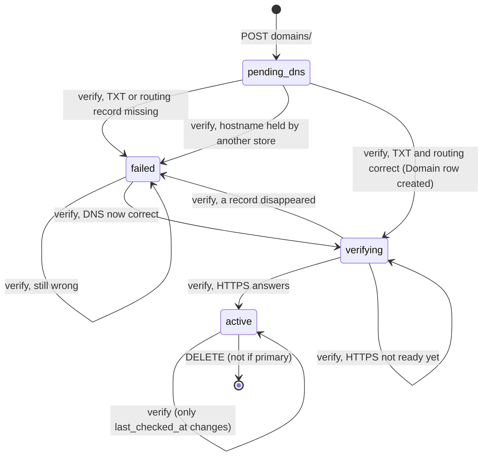

# Custom domains, tracking tools, webhooks & integrations API — M19 (النطاقات والتكاملات)

> **Source**: DOC-214, DOC-215, DOC-216, DOC-217 · INT-023 (M19), INT-002 · inventory Domain 12, A.3, A.10, A.12
> **Live key**: `integrations` (`SHARWA_LIVE_MODULES`) — one switch for the 13 BFF adapters of this page. It is in the sample line `.env.example:79`; the file has no comment bullet for it (see [§8.4](#env)).
> **Django provider**: `sharwa_saas/api/views_integrations.py` (`OwnerAPIMixin`, 13 URL patterns) · `products/services/domain_service.py` · `products/services/integrations_service.py` · `products/services/webhook_service.py` · public model `tenants.CustomDomain` (migration `tenants/0026_customdomain`) · `products.WebhookEndpoint` / `WebhookDelivery` (migration `products/0224_webhooks`) · `products.TrackingSettings` (migration `0055`, unchanged) · no DRF serializers
> **Frontend contract**: `sharwa-frontend/src/features/integrations/schemas.ts` · hooks `…/api.ts` · fixtures `src/mocks/integrations/{domains,tracking,webhooks,statuses,guard}.ts` · BFF `src/app/api/bff/{domains,store/tracking,webhooks,integrations/status}` · storefront `src/features/storefront/components/tracking-scripts.tsx`
> **Tests**: `sharwa_saas/api/test_integrations_api.py` (21)
> **Last verified against code**: 2026-10-27 (step 27)

<a id="overview"></a>

## 1. Overview

M19 is the merchant dashboard's «النطاقات والتكاملات» area. It has four parts:

- **Custom domains** ([§4](#domains), DOC-214) — a merchant claims a hostname, proves ownership with a DNS `TXT` record, and the platform routes it to the store.
- **Tracking tools** ([§5](#tracking), DOC-215) — pixel ids for Meta, TikTok, Snapchat, Google Tag Manager, GA4 and Google Ads, plus two write-only server-side API tokens. The public ids also reach the storefront through `GET /api/v1/config/`.
- **Outgoing webhooks** ([§6](#webhooks), DOC-216) — endpoints, signing secrets, a delivery log, test and redeliver.
- **Integrations overview** ([§7](#status), DOC-217) — one read-only list of the 13 connections the store can have (apps, social channels, marketplaces, dropshipping suppliers, carriers).

The caller is the store **owner** on the store host. Domains, tracking and webhooks are closed to staff sessions (FR-19.09); only the overview is open to staff, filtered by their permissions. Before INT-023 Django had only `tenants.Domain` (admin-only), `TrackingSettings` with an HTML form, and no webhook feature at all. The service layer reuses `TrackingSettings` and adds the other models.

<a id="access"></a>

## 2. Access — gate chain and gate matrix

`OwnerAPIMixin.check` (`views_integrations.py:36`) evaluates, in this order; the first failing gate answers:

| # | Gate | Requirement | Failure |
|---|---|---|---|
| 1 | Store | the request resolves to a store (`HasTenantContext`) | `403` «لم يتم تحديد المتجر المطلوب. استخدم النطاق الفرعي للمتجر أو أرسل ترويسة X-Store-Domain.» · with **no session cookie** on the public host the answer is `403` «لم يتم تزويد بيانات الدخول.» instead ([rule](../../overview/auth.md#no-store-no-session)) |
| 2 | CSRF | `MerchantSessionAuthentication` checks `X-CSRFToken` on every write ([`csrf.md`](../../overview/csrf.md)) | `403` `{"detail": "CSRF Failed: …"}` |
| 3 | Session | an owner session or a resolved staff member (`ProductsAPIMixin.gate`, no permission key) | `401` `{"detail": "انتهت جلستك، سجّل الدخول مجدداً."}` |
| 4 | Plan feature | **tracking only**: `tracking_tools` (`settings_feature_enabled`; a missing `Feature` row counts as disabled) | `403` «أدوات التتبع غير مفعّلة في خطتك.» |
| 5 | Owner only | `resolve_request_staff(request)` is `None` — any staff session is refused, whatever its permissions | `403` «{what} مقصورة على مالك المتجر.» |
| 6 | Resource state | the entity exists and the state allows the action | `400` / `404` / `503` (per section) |

The plan feature is checked **before** the owner check, so a staff member on a store without `tracking_tools` gets the feature sentence. The mock applies the same order (`store/tracking/route.ts`: `gate`).

<a id="messages"></a>

### 2.1 Owner-only sentence per area

The sentence is `f'{what} مقصورة على مالك المتجر.'` with a class-level `what`:

| Area | `what` | Full sentence | Test |
|---|---|---|---|
| domains (4 routes) | `النطاقات` | «النطاقات مقصورة على مالك المتجر.» | `test_owner_only_and_auth` |
| tracking | `أدوات التتبع` | «أدوات التتبع مقصورة على مالك المتجر.» | `test_feature_gate_and_owner` |
| webhooks (7 routes) | `الـ Webhooks` | «الـ Webhooks مقصورة على مالك المتجر.» | `test_owner_only` |

All are copied from `views_integrations.py:23-90` and match `mocks/integrations/guard.ts` (`ownerOnly`). They have a final full stop.

### 2.2 Gate matrix — route × feature × owner

| # | Route | Method | Plan feature | Owner only |
|---|---|---|---|---|
| 1 | `domains/` | `GET`, `POST` | — | **yes** |
| 2 | `domains/<pk>/` | `DELETE` | — | **yes** |
| 3 | `domains/<pk>/verify/` | `POST` | — | **yes** |
| 4 | `domains/<pk>/set-primary/` | `POST` | — | **yes** |
| 5 | `store/tracking/` | `GET`, `PATCH` | `tracking_tools` | **yes** |
| 6 | `webhooks/events/` | `GET` | — | **yes** |
| 7 | `webhooks/endpoints/` | `GET`, `POST` | — | **yes** |
| 8 | `webhooks/endpoints/<pk>/` | `GET`, `PATCH`, `DELETE` | — | **yes** |
| 9 | `webhooks/endpoints/<pk>/rotate-secret/` | `POST` | — | **yes** |
| 10 | `webhooks/endpoints/<pk>/test/` | `POST` | — | **yes** |
| 11 | `webhooks/endpoints/<pk>/deliveries/` | `GET` | — | **yes** |
| 12 | `webhooks/deliveries/<pk>/redeliver/` | `POST` | — | **yes** |
| 13 | `integrations/status/` | `GET` | per row ([§7](#status)) | **no** — any member, rows filtered by permission |

> ⚠️ Discrepancy — roadmap says "`api/views_integrations.py` (13 routes, owner-only FR-19.09 — staff 403 `<what> مقصورة على مالك المتجر.`)" / code does register 13 URL patterns but only **12** are owner-only; `integrations/status/` is open to owner and staff (it is a plain `ProductsAPIMixin` view with no owner check). The 13 URL patterns carry 18 method + path operations. Reported in step 27.

<a id="summary"></a>

## 3. Endpoint summary — the 13 routes

Django paths are under `/api/v1/`; BFF paths are under `/api/bff/` and have the same suffix, except `store/tracking/` and `integrations/status/` which keep their prefix.

| Method | Path | Purpose | Section |
|---|---|---|---|
| `GET` | `domains/` | subdomain row (id `0`) + custom claims | [§4.1](#domains-list) |
| `POST` | `domains/` | add a claim (`pending_dns`) | [§4.2](#domains-add) |
| `DELETE` | `domains/<pk>/` | remove a claim (never the subdomain or the primary) | [§4.7](#domains-delete) |
| `POST` | `domains/<pk>/verify/` | «تحقّق الآن» — DNS then HTTPS | [§4.4](#domains-verify) |
| `POST` | `domains/<pk>/set-primary/` | make an active domain primary (`0` = subdomain) | [§4.6](#domains-primary) |
| `GET`, `PATCH` | `store/tracking/` | tracking settings, tokens write-only | [§5.1](#tracking-settings) |
| `GET` | `webhooks/events/` | subscribable events | [§6.1](#webhooks-events) |
| `GET`, `POST` | `webhooks/endpoints/` | list · create (secret returned once) | [§6.2](#webhooks-endpoints) |
| `GET`, `PATCH`, `DELETE` | `webhooks/endpoints/<pk>/` | read · update · delete | [§6.3](#webhooks-detail) |
| `POST` | `webhooks/endpoints/<pk>/rotate-secret/` | new secret, returned once | [§6.4](#webhooks-secret) |
| `POST` | `webhooks/endpoints/<pk>/test/` | synchronous test delivery | [§6.5](#webhooks-test) |
| `GET` | `webhooks/endpoints/<pk>/deliveries/` | delivery log with filters | [§6.6](#webhooks-deliveries) |
| `POST` | `webhooks/deliveries/<pk>/redeliver/` | resend a failed delivery | [§6.7](#webhooks-redeliver) |
| `GET` | `integrations/status/` | 13 integration rows | [§7](#status) |

Every `POST` / `PATCH` body is JSON (`parser_classes = [JSONParser]`); a body that is not a JSON object is treated as `{}`.

<a id="domains"></a>

## 4. Custom domains (DOC-214)

A custom domain lives in **two** public-schema tables on purpose. `tenants.Domain` is what django-tenants routes on, and its unique constraint would let the first merchant who types a hostname "own" it. So the merchant first creates a **claim** (`tenants.CustomDomain`, unique per `(client, domain)`), proves ownership with a `TXT` record, and only then does a `Domain` row appear. Two stores may hold pending claims for the same hostname; whoever proves ownership first wins.

<a id="domains-list"></a>

### 4.1 `GET /api/v1/domains/`

No parameters. Returns the base domain and one row per domain: the subdomain first (always `id: 0`), then the claims by creation time.

**Response `200`** (illustrative values; shape from `domainListSchema`)

```json
{
  "base_domain": "sharwaah.com",
  "results": [
    {
      "id": 0,
      "domain": "noor.sharwaah.com",
      "is_primary": false,
      "kind": "subdomain",
      "status": "active",
      "dns_ok": true,
      "dns_records": [],
      "failure_reason": null,
      "next_step": null,
      "verified_at": null,
      "last_checked_at": null,
      "created_at": "2026-07-01T09:00:00+00:00"
    },
    {
      "id": 3,
      "domain": "shop.example.com",
      "is_primary": true,
      "kind": "custom",
      "status": "active",
      "dns_ok": true,
      "dns_records": [
        { "type": "CNAME", "name": "shop", "value": "sharwaah.com" },
        { "type": "TXT", "name": "_sharwa.shop", "value": "sharwa-verify=3f9c1a7e5b2d4c8a9e0f1b2c3d4e5f60" }
      ],
      "failure_reason": null,
      "next_step": null,
      "verified_at": "2026-10-26T10:30:00+00:00",
      "last_checked_at": "2026-10-27T08:00:00+00:00",
      "created_at": "2026-10-25T09:00:00+00:00"
    }
  ]
}
```

| Field | Meaning (Django source) |
|---|---|
| `base_domain` | `TENANT_BASE_DOMAIN` (lower-cased, default `localhost`) |
| `id` | the claim id; the subdomain row is always `0` (read-only) |
| `kind` | `subdomain` or `custom` |
| `is_primary` | custom row: its `Domain` row is primary; subdomain row: **true when no custom claim is primary** |
| `status` | `pending_dns`, `verifying`, `active`, `failed` ([§4.5](#domains-state)); the subdomain is always `active` |
| `dns_ok` | the last check found both DNS records correct |
| `dns_records` | what the merchant must add ([§4.3](#domains-records)); empty for the subdomain |
| `failure_reason`, `next_step` | set only on `failed` / `verifying` ([§4.4](#domains-verify)); otherwise `null` |
| `verified_at`, `last_checked_at`, `created_at` | ISO date-times; the subdomain row uses the store's `created_on` for `created_at` |

If the store has no `Domain` rows at all the subdomain row is simply absent. The frontend polls this list every 30 s while any custom row is `pending_dns` or `verifying` (`domainsNeedPolling`).

<a id="domains-add"></a>

### 4.2 `POST /api/v1/domains/` → `201`

**Request body**: `domain` (string, required). It is trimmed, lower-cased and stripped of one trailing dot first.

**Response `201`**: one custom row (shape of [§4.1](#domains-list)) with `status: "pending_dns"`, `dns_ok: false`, `is_primary: false`, the DNS records and the fresh token.

**Format validation** — `format_error`, which copies `domainFormatError` of the frontend word for word. The first failing check answers `400 {"domain": ["…"]}`:

| # | Check | Message |
|---|---|---|
| 1 | empty | «أدخل النطاق.» |
| 2 | has `scheme://` or `/` | «أدخل النطاق وحده بلا بروتوكول أو مسار (مثل shop.example.com).» |
| 3 | not only `a-z 0-9 . -` | «النطاق أحرف لاتينية وأرقام ونقاط وشرطات فقط.» |
| 4 | fewer than 2 labels, or an empty label, or a label starting/ending with `-` | «صيغة النطاق غير صحيحة (مثل example.com).» |
| 5 | last label is not 2+ letters | «امتداد النطاق غير صحيح.» |
| 6 | equals or ends with `.<TENANT_BASE_DOMAIN>` | «لا يمكن ربط نطاق تحت {base} — هذا نطاق المنصة.» |
| 7 | longer than 253 characters | «النطاق أطول من المسموح.» |

**Business checks** (after the format passes):

| Status | Body | When |
|---|---|---|
| `400` | `{"domain": ["هذا النطاق مضاف لمتجرك بالفعل."]}` | a claim or a `Domain` row of this store already has it |
| `400` | `{"domain": ["هذا النطاق مرتبط بمتجر آخر."]}` | a `Domain` row of **another** store has it (a pending claim of another store does not block) |
| `400` | `{"detail": "وصلت إلى الحد الأقصى (5 نطاقات مخصصة)."}` | the store already has 5 claims (`MAX_CUSTOM`) |

`www.` and any other label are allowed on the merchant's own domain (decision 2026-10-19 in `schemas.ts`).

**Worked example.** `POST {"domain": " SHOP.Example.com. "}` is stored as `shop.example.com`, answers `201` with `status: "pending_dns"` and the two records of [§4.3](#domains-records). The test `test_add_validates_and_returns_records` also shows: `https://shop.example.com/x` → «أدخل النطاق وحده بلا بروتوكول أو مسار (مثل shop.example.com).», the same name in capitals → «هذا النطاق مضاف لمتجرك بالفعل.», and a sixth claim → the limit sentence.

<a id="domains-records"></a>

### 4.3 The DNS records

The server decides the records from the shape of the hostname (`dns_records` in `domain_service.py`). `host` is the part before the registered domain (`shop.example.com` → `shop`; for `example.co.uk`-style names the second-level suffixes `com`, `net`, `org`, `gov`, `edu` with a 2-letter country code are recognised).

| Hostname | Type | Name | Value |
|---|---|---|---|
| subdomain (`shop.example.com`) | `CNAME` | `shop` | `SHARWA_EDGE_CNAME` (default `TENANT_BASE_DOMAIN`) |
| apex (`example.org`) | `A` | `@` | `SHARWA_EDGE_IP`; **if that is empty, the `SHARWA_EDGE_CNAME` hostname** |
| both | `TXT` | `_sharwa.<host>` (apex: `_sharwa`) | `sharwa-verify=<32 hex>` — the claim's `verification_token` (`secrets.token_hex(16)`) |

The TXT value is generated once at claim time and never changes, so the records shown by `GET` and `POST` are always the same for one claim.

<a id="domains-verify"></a>

### 4.4 `POST /api/v1/domains/<pk>/verify/` — «تحقّق الآن»

No body. Checks the claim and returns the updated row. The merchant can call it as often as wanted.

| Case | Result |
|---|---|
| `<pk>` is `0` | `400 {"detail": "النطاق الفرعي يعمل دائماً ولا يحتاج تحققاً."}` |
| claim of another store, or no such id | `404 {"detail": "النطاق غير موجود."}` |
| claim is already `active` | only `last_checked_at` is updated; row returned unchanged |
| `dnspython` cannot be imported | `503 {"detail": "فحص DNS غير متاح على الخادم الآن — حاول لاحقاً."}` |
| `TXT _sharwa.<domain>` does not contain the token, or the routing record is wrong | `status: "failed"`, `dns_ok: false`, `failure_reason` below, `next_step` below |
| both records correct, but another store already holds a `Domain` row for it | `status: "failed"`, `dns_ok: true`, `failure_reason: "هذا النطاق مرتبط بمتجر آخر."` |
| both records correct | a `Domain` row is created (`is_primary: false`) → `status: "verifying"`, `dns_ok: true`; **then** if `https://<domain>/` answers a `HEAD` request (any status code, certificate valid) → `status: "active"`, `verified_at` set |

**What counts as correct routing** (`_routing_ok`): apex — the `A` records of the domain are all within `SHARWA_EDGE_IP` (or within the `A` records of `SHARWA_EDGE_CNAME` when no IP is configured); subdomain — the `CNAME` equals `SHARWA_EDGE_CNAME`, or, for providers that flatten CNAMEs, the domain's `A` records are within those of `SHARWA_EDGE_CNAME`. DNS queries use a 5-second lifetime; "no answer" counts as missing.

**Messages** (copied from `domain_service.py:39-40` and `:299`):

| Field | When | Sentence |
|---|---|---|
| `failure_reason` | a record is missing | «لم نجد سجل {TXT \| CNAME \| A} المطلوب لـ {domain} عند مزوّد النطاق.» — `TXT` if the TXT is missing, otherwise the type of the routing record |
| `next_step` | `status = failed` | «أضف السجلات أعلاه كما هي عند مزوّد النطاق، انتظر حتى ساعة لانتشارها، ثم اضغط «تحقّق الآن».» |
| `next_step` | `status = verifying` | «سجلات DNS صحيحة — نُصدر شهادة HTTPS للنطاق الآن؛ تحقّق مرة أخرى بعد قليل.» |

`pending_dns` has `next_step: null`. The frontend shows `verifying` with `dns_ok: true` as «جارٍ إصدار الشهادة» (`domainStatusText`).

> **Important** — the certificate is **not** issued by this API. `verifying` lasts until the domain answers over HTTPS, and that depends on the operations step in `deploy/README.md §3` (a certificate and a server block per custom domain; until then the request hits the catch-all server and is refused). See [§10](#open-items).

<a id="domains-state"></a>

### 4.5 State diagram



The roadmap names the first state `pending`; the stored value is `pending_dns` (model `STATUS_CHOICES` and the Zod enum agree). A `failed` claim keeps its token and can be re-verified without re-adding. When a `verifying` claim later fails a DNS check, the `Domain` row created earlier is **not** removed ([§10](#open-items)).

<a id="domains-primary"></a>

### 4.6 `POST /api/v1/domains/<pk>/set-primary/`

No body. Makes one domain the store's primary.

| Case | Result |
|---|---|
| `<pk>` is `0` | the subdomain's `Domain` row becomes primary; `StoreSetting.custom_domain` is cleared. Response `200 {"id": 0, "is_primary": true}` |
| unknown or foreign claim | `404 {"detail": "النطاق غير موجود."}` |
| claim not `active` | `400 {"detail": "لا يصير النطاق أساسياً قبل أن يكون نشطاً."}` |
| claim `active` | its `Domain` row becomes primary, all other `Domain` rows of the store lose `is_primary`, `StoreSetting.custom_domain` is set to the domain. Response `200`: the claim row with `is_primary: true` |

The `StoreSetting.custom_domain` mirror exists for legacy consumers (abandoned-cart links, catalogue sync). Test `test_set_primary_and_delete` shows the list after the switch: `is_primary` is `[false, true]`, and after `domains/0/set-primary/` the setting is empty again.

<a id="domains-delete"></a>

### 4.7 `DELETE /api/v1/domains/<pk>/` → `204`

| Case | Result |
|---|---|
| `<pk>` is `0` | `400 {"detail": "النطاق الفرعي لا يُحذف."}` |
| unknown or foreign claim | `404 {"detail": "النطاق غير موجود."}` |
| the claim's `Domain` row is primary | `400 {"detail": "لا يُحذف النطاق الأساسي — اجعل نطاقاً آخر أساسياً أولاً."}` |
| otherwise | in one transaction the store's `Domain` row (if any) and the claim are deleted → `204` |

A `pending_dns` or `failed` claim has no `Domain` row, so only the claim goes. Deleting it twice answers `404`.

<a id="tracking"></a>

## 5. Tracking tools (DOC-215)

The caller must be the owner **and** the store's plan must include `tracking_tools` (gates 4 and 5 of [§2](#access)). One row per store (`TrackingSettings`, singleton `pk = 1`, created on first read).

<a id="tracking-settings"></a>

### 5.1 `GET` and `PATCH /api/v1/store/tracking/`

**Response `200`** (both methods; illustrative values; shape from `trackingSchema`)

```json
{
  "is_tracking_enabled": true,
  "meta_pixel_id": "781240965531208",
  "tiktok_pixel_id": "",
  "snapchat_pixel_id": "",
  "gtm_container_id": "GTM-W7Q2KXD",
  "ga4_measurement_id": "G-8JX2K4LQ9P",
  "google_ads_conversion_id": "",
  "google_ads_conversion_label": "",
  "has_meta_conversions_api_token": true,
  "has_tiktok_events_api_token": false,
  "updated_at": "2026-10-21T08:00:00+00:00"
}
```

Ids are returned as strings (`""` when empty, although the column is nullable). The two server-side tokens are **never** returned — only `has_meta_conversions_api_token` and `has_tiktok_events_api_token`.

**PATCH body** — every field is optional; a field that is absent is left alone.

| Field | Type | Rules |
|---|---|---|
| `is_tracking_enabled` | boolean | master switch (default `true` on a new row) |
| `meta_pixel_id`, `tiktok_pixel_id`, `snapchat_pixel_id`, `gtm_container_id`, `ga4_measurement_id`, `google_ads_conversion_id` | string | trimmed; at most **50** characters; no whitespace and none of `< > " '`; empty string stores `NULL` |
| `google_ads_conversion_label` | string | same rules, at most **100** characters |
| `meta_conversions_api_token`, `tiktok_events_api_token` | string or `null` | write-only, see below; at most **255** characters |

**Token semantics** (`FR-19.04`)

| Sent | Effect |
|---|---|
| a value of 10–255 characters (after trim) | stored |
| `""` or whitespace only | the saved token is **kept** |
| `null` | the saved token is **deleted** |
| fewer than 10 characters | `400 {"<field>": ["الرمز أقصر من المعتاد — انسخه كاملاً من مدير الأعمال."]}` |
| more than 255 characters | `400 {"<field>": ["الرمز أطول من المسموح (255)."]}` |

**Id errors**

| Status | Body | When |
|---|---|---|
| `400` | `{"<field>": ["50 حرفاً كحد أقصى."]}` | over the limit (the number is the field's limit, `100` for the label) |
| `400` | `{"<field>": ["المعرّف لا يحتوي مسافات أو رموز HTML."]}` | whitespace or `<>"'` inside |

All field errors are returned together in one object and **nothing is saved** when there is any error. A successful `PATCH` always saves, so `updated_at` moves even when no value changed. The frontend only shows a non-blocking warning for odd id shapes (`trackingFormatWarning`); the server does not enforce them.

**Worked example** (from `test_tokens_write_only`): `PATCH {"meta_pixel_id": "123456", "meta_conversions_api_token": "EAAB-secret-token-xyz"}` → `meta_pixel_id: "123456"`, `has_meta_conversions_api_token: true`, no token key in the body. Then `PATCH {"meta_conversions_api_token": ""}` keeps it (`true`); `{"tiktok_events_api_token": "abc"}` → `400`; `{"meta_conversions_api_token": null}` → `false`.

<a id="tracking-config"></a>

### 5.2 `GET /api/v1/config/` — the public `tracking` object

The storefront reads the ids from the public config endpoint, which needs no login. `StoreConfigView.get` (`api/views.py:83-84`) adds `data['tracking'] = public_tracking(request, settings_feature_enabled)` after serialising the store settings:

| Condition | `tracking` value |
|---|---|
| plan lacks `tracking_tools` | `null` |
| `is_tracking_enabled` is `false` | `null` |
| no id is filled | `null` |
| any error while reading (logged) | `null` |
| otherwise | an object with **only the filled** ids among `meta_pixel_id`, `tiktok_pixel_id`, `snapchat_pixel_id`, `gtm_container_id`, `ga4_measurement_id`, `google_ads_conversion_id`, `google_ads_conversion_label` |

Example from `test_config_exposes_public_ids_only`: with ids `999` (Meta) and `GTM-ABC` and a saved Meta token, the config carries `{"meta_pixel_id": "999", "gtm_container_id": "GTM-ABC"}` and no token; with the feature off it carries `null`. The Zod schema (`store-config.ts`) types it as nullable with every key optional. The other `/config/` extensions are in [`m34-store-settings.md`](m34-store-settings.md).

<a id="tracking-storefront"></a>

### 5.3 Storefront injection

`<TrackingScripts tracking={config.tracking ?? null} />` is mounted once in the storefront layout (`src/app/(storefront)/%5Fs/[store]/layout.tsx:133`). It renders the same snippets that Django's `_tracking_scripts.html` partial renders, and only for the ids that are present:

| Pixel | Needs | Script id | Page views after the first load |
|---|---|---|---|
| Google Tag Manager | `gtm_container_id` | `sharwa-gtm` | GTM's own history trigger |
| Meta Pixel | `meta_pixel_id` | `sharwa-meta-pixel` | `fbq("track", "PageView")` on every pathname change |
| TikTok Pixel | `tiktok_pixel_id` | `sharwa-tiktok-pixel` | `ttq.page()` on every pathname change |
| Snapchat Pixel | `snapchat_pixel_id` | `sharwa-snap-pixel` | `snaptr("track", "PAGE_VIEW")` on every pathname change |
| gtag (GA4 + Google Ads) | `ga4_measurement_id` **or** `google_ads_conversion_id` | `sharwa-gtag-src`, `sharwa-gtag` | GA4 enhanced measurement |

Rules: ids are embedded with `JSON.stringify`, so a value cannot break out of the inline script (the server also refuses `<>"'` and whitespace). Nothing renders on the server or inside the dashboard's theme-preview frame (`?preview=1` inside an iframe), so the merchant editing colours does not inflate their own audiences. A blocked or half-loaded pixel never breaks navigation.

**Google Ads purchase conversion.** `<AdsConversion tracking orderId />` runs on the order-success page `checkout/success/[public_uuid]`. It needs both `google_ads_conversion_id` and `google_ads_conversion_label`, waits up to 20 × 250 ms for `gtag`, then sends `gtag("event", "conversion", { send_to: "<id>/<label>", transaction_id: "<orderId>" })`. It writes `sharwa:ads-conversion:<orderId>` to `sessionStorage` so a reload does not count twice.

> **Note** — the success page file itself (`checkout/success/[public_uuid]/page.tsx`) is nested too deeply to be staged in this step; its use of `AdsConversion` is documented from the component's own doc comment and the roadmap. The server-side Conversions API tokens are stored and masked here, but nothing in the files read for this page sends events with them ([§10](#open-items)).

<a id="webhooks"></a>

## 6. Outgoing webhooks (DOC-216)

A webhook endpoint is an HTTPS URL of the merchant's that receives a signed `POST` when a subscribed event happens. The merchant manages endpoints here; the platform sends. The receiving side — payload, headers and signature verification — is specified for integrators in section 1.17 of the roadmap (planned for Step 28 under [`../../integrators/README.md`](../../integrators/README.md)); this section only summarises what the engine does ([§6.8](#webhooks-engine)).

<a id="webhooks-events"></a>

### 6.1 `GET /api/v1/webhooks/events/`

A **plain array** (not wrapped) of the 7 subscribable events (`webhookEventListSchema`). The list is a constant of `webhook_service.py`; the UI always reads it from the server.

| `code` | `name` | `description` |
|---|---|---|
| `order.created` | طلب جديد | عند إنشاء طلب من المتجر أو الكاشير أو القنوات. |
| `order.status_changed` | تغيّر حالة الطلب | عند نقل الطلب إلى حالة جديدة. |
| `order.fulfillment_changed` | تغيّر حالة التجهيز | عند تغيّر التجهيز أو الشحن للطلب. |
| `order.refunded` | استرداد طلب | عند استرداد كامل أو جزئي لمبلغ طلب. |
| `shipment.event` | حدث شحنة | كل تحديث تتبع مقبول على بوليصة. |
| `product.updated` | تحديث منتج | عند تعديل السعر أو البيانات أو الظهور. |
| `inventory.low_stock` | مخزون منخفض | عند وصول كمية منتج إلى حد التنبيه. |

The ids are emitted by the existing sources of truth: order events, `Order.set_fulfillment_status`, `process_order_refund`, `apply_shipment_transition`, `Product._log_field_changes` (a stock-only change does **not** fire `product.updated`, test `test_emit_and_retry`) and the low-stock scan job. `webhook.test` is sent only by [§6.5](#webhooks-test) and is not subscribable.

<a id="webhooks-endpoints"></a>

### 6.2 `GET` and `POST /api/v1/webhooks/endpoints/`

**`GET` response `200`** (illustrative; shape from `webhookEndpointListSchema`) — newest first, no pagination:

```json
{
  "count": 1,
  "results": [
    {
      "id": 5,
      "url": "https://erp.example.com/hooks",
      "events": ["order.created", "order.refunded"],
      "is_active": true,
      "description": "ERP",
      "has_secret": true,
      "created_at": "2026-10-25T12:00:00+00:00",
      "last_delivery_at": "2026-10-27T07:00:00+00:00",
      "last_delivery_status": "delivered",
      "failure_count": 0,
      "auto_disabled": false
    }
  ]
}
```

`last_delivery_at` / `last_delivery_status` come from the newest delivery row (`null` when none). The secret is never in this shape.

**`POST` request body**

| Field | Type | Required | Rules |
|---|---|---|---|
| `url` | string | yes | trimmed; must pass the URL check below |
| `events` | string[] | yes | at least one; every code must be in the [§6.1](#webhooks-events) list; duplicates are removed |
| `description` | string | no | trimmed, at most 200 characters |
| `is_active` | boolean | no | default `true` |

**`POST` response `201`** — the only response besides rotation that carries the secret (`webhookSecretResponseSchema`):

```json
{
  "endpoint": { "id": 5, "url": "https://erp.example.com/hooks", "events": ["order.created"], "is_active": true, "description": "ERP", "has_secret": true, "created_at": "2026-10-25T12:00:00+00:00", "last_delivery_at": null, "last_delivery_status": null, "failure_count": 0, "auto_disabled": false },
  "secret": "whsec_<32 url-safe characters>"
}
```

> **Warning** — the `secret` is shown **once**. The database stores it encrypted (`django_cryptography`), no route returns it again, and the only way to get a new one is [rotation](#webhooks-secret). Show it to the owner immediately and tell them to copy it.

**URL check** (`url_error`) — the first failing line answers `400 {"url": ["…"]}`:

| # | Check | Message |
|---|---|---|
| 1 | the URL cannot be parsed | «عنوان غير صالح.» |
| 2 | empty | «أدخل عنوان نقطة النهاية.» |
| 3 | scheme is not `https` | «العنوان يجب أن يبدأ بـ https://» |
| 4 | host is `localhost` or ends in `.local`, `.internal`, `.localhost` | «لا تُقبل العناوين الداخلية — استخدم عنواناً عاماً.» |
| 5 | no host, a host with neither a dot nor a colon, or a URL longer than 500 characters | «عنوان غير صالح.» |
| 6 | the host is an IP literal that is not a global address | «لا تُقبل العناوين الداخلية — استخدم عنواناً عاماً.» |
| 7 | the host name resolves to a private, loopback, link-local, reserved, multicast or unspecified address | «لا تُقبل العناوين الداخلية — استخدم عنواناً عاماً.» |

A host name that does not resolve **yet** is accepted at save time and refused at send time (the delivery fails with «تعذّر الوصول للعنوان أو أنه عنوان داخلي.»). The same address check runs before every send, so a later DNS change cannot reach an internal address.

**Other errors**

| Status | Body | When |
|---|---|---|
| `400` | `{"events": ["اختر حدثاً واحداً على الأقل."]}` | empty or non-list `events` |
| `400` | `{"events": ["أحداث غير معروفة: {codes}"]}` | codes joined by «،» |
| `400` | `{"description": ["200 حرف كحد أقصى."]}` | description too long |
| `400` | `{"url": ["هذا العنوان مضاف بالفعل."]}` | the same URL already exists in this store |
| `400` | `{"detail": "الحد الأقصى 10 نقاط نهاية لكل متجر."}` | 10 endpoints already (`MAX_ENDPOINTS`) |

The `url`, `events` and `description` errors are returned together; the duplicate and limit checks run after they pass.

<a id="webhooks-detail"></a>

### 6.3 `GET`, `PATCH`, `DELETE /api/v1/webhooks/endpoints/<pk>/`

- `GET` → `200`, the endpoint object of [§6.2](#webhooks-endpoints) (no secret).
- `PATCH` → `200`, the updated endpoint. The body takes the same four fields as `POST`; a missing field keeps its current value, and the full set is re-validated with the same messages. Changing `url` to one used by another endpoint answers `{"url": ["هذا العنوان مضاف بالفعل."]}`.
- `DELETE` → `204`. The endpoint's delivery rows are deleted with it (cascade).
- An unknown id answers `404 {"detail": "نقطة النهاية غير موجودة."}`.

**Re-enabling resets the failure counter.** When a `PATCH` turns `is_active` from `false` to `true`, the server also sets `auto_disabled = false` and `failure_count = 0` (the «إعادة التفعيل» action; test `test_auto_disable_and_reenable`). This applies to any `false → true` change, not only to an automatic disable.

<a id="webhooks-secret"></a>

### 6.4 `POST /api/v1/webhooks/endpoints/<pk>/rotate-secret/`

No body. Replaces the secret at once — deliveries signed from now on use the new one, and the old one stops being valid with no grace period. Response `200`: `{"endpoint": {…}, "secret": "whsec_…"}` (same shape as the create response, secret shown once). `404` for an unknown id.

<a id="webhooks-test"></a>

### 6.5 `POST /api/v1/webhooks/endpoints/<pk>/test/`

No body. Sends one `webhook.test` event **synchronously** and returns the delivery. It is sent even when the endpoint is disabled, so the owner can test before enabling. The payload data is `{"message": "حدث تجريبي من شروة — تحقّق من التوقيع ثم أعد 2xx."}`.

**Response `200`** — a delivery object (shape of [§6.6](#webhooks-deliveries)); `200` even when the delivery itself failed:

```json
{ "id": 71, "endpoint_id": 5, "event": "webhook.test", "status": "delivered", "response_code": 200, "duration_ms": 142, "attempt": 1, "created_at": "2026-10-27T09:00:00+00:00", "error": null }
```

The test counts like any other delivery: a failure increments `failure_count`, a success resets it (test `test_auto_disable_and_reenable` reaches the auto-disable with a test event).

<a id="webhooks-deliveries"></a>

### 6.6 `GET /api/v1/webhooks/endpoints/<pk>/deliveries/`

**Query parameters**

| Name | Type | Default | Notes |
|---|---|---|---|
| `status` | string | *(all)* | `pending`, `delivered` or `failed`; any other value is ignored |
| `event` | string | *(all)* | exact event code, e.g. `order.created` |
| `from`, `to` | `YYYY-MM-DD` | *(none)* | on the date of `created_at`, inclusive; the first 10 characters are parsed, anything unparsable is ignored |
| `page` | integer | `1` | below 1 → `1` |
| `page_size` | integer | `20` | clamped to 1–100; if `page` or `page_size` is not a number **both** fall back to `1` / `20` |

Newest first. Response `200` (shape from `webhookDeliveryListSchema`):

```json
{
  "count": 2,
  "results": [
    { "id": 72, "endpoint_id": 5, "event": "order.created", "status": "failed", "response_code": 502, "duration_ms": 910, "attempt": 1, "created_at": "2026-10-27T09:05:00+00:00", "error": "Bad Gateway" },
    { "id": 71, "endpoint_id": 5, "event": "webhook.test", "status": "delivered", "response_code": 200, "duration_ms": 142, "attempt": 1, "created_at": "2026-10-27T09:00:00+00:00", "error": null }
  ]
}
```

| Field | Meaning |
|---|---|
| `status` | `pending` (queued, not sent yet), `delivered` (any 2xx), `failed` |
| `response_code` | HTTP status of the receiver; `null` when none was received |
| `duration_ms` | time of the attempt; `null` while `pending` |
| `attempt` | 1 for the first send; each automatic retry or manual redelivery is a **new row** with `attempt + 1` |
| `error` | `null` when empty. Texts: the HTTP reason (up to 255 characters, or `HTTP {code}`), «انتهت مهلة الاستجابة.», «تعذّر الاتصال: {exception name}», «تعذّر الوصول للعنوان أو أنه عنوان داخلي.», «نقطة النهاية معطّلة.» |

An unknown endpoint id answers `404 {"detail": "نقطة النهاية غير موجودة."}`. The payload of a delivery is stored but not returned by this route.

<a id="webhooks-redeliver"></a>

### 6.7 `POST /api/v1/webhooks/deliveries/<pk>/redeliver/`

No body. Resends a **failed** delivery now: the server creates a **new** delivery row with the same event id, event and payload and `attempt + 1`, sends it synchronously, and returns it (`200`, delivery object). The old row is not changed, so the log stays complete. The send counts toward the endpoint's `failure_count` like any other.

| Status | Body | When |
|---|---|---|
| `404` | `{"detail": "التسليم غير موجود."}` | unknown delivery id |
| `400` | `{"detail": "إعادة الإرسال للتسليمات الفاشلة فقط."}` | the delivery is `pending` or `delivered` |

Test `test_deliveries_filters_and_redeliver`: a failed attempt 1 redelivered with a 200 receiver returns `status: "delivered"`, `attempt: 2`; redelivering that new row answers the `400`.

<a id="webhooks-engine"></a>

### 6.8 What the engine sends (summary for the integrator page)

| Topic | Behaviour (`webhook_service.py`) |
|---|---|
| Trigger | `emit(event, data)` after the database transaction commits; it never raises, so a webhook problem cannot fail the business operation. One delivery row per **active** endpoint subscribed to the event |
| Request | `POST`, `Content-Type: application/json`, `User-Agent: Sharwa-Webhooks/1.0`, no redirects, timeout 3 s connect / 10 s read |
| Headers | `X-Sharwa-Event: <event>` · `X-Sharwa-Delivery: <delivery id>` · `X-Sharwa-Signature: t=<unix>,v1=<hex>` |
| Signature | `v1 = HMAC-SHA256(secret, "<t>." + body)` where `body` is the exact JSON bytes sent (compact separators, UTF-8) — verified by test `test_test_event_signed` |
| Body | `{"id": "evt_<hex>", "event": "…", "created_at": "<ISO>", "store": {"schema": "…", "name": "…"}, "data": {…}}` |
| Automatic retries | up to **3 attempts**: attempt 2 after 60 s, attempt 3 after 300 s; no fourth. Retries stop if the endpoint was disabled meanwhile |
| Auto-disable | every failed send adds 1 to `failure_count`, any success resets it to 0; at **10** consecutive failures an active endpoint gets `is_active = false` and `auto_disabled = true` (`AUTO_DISABLE_AFTER`) |
| Delivery task | the Celery task `deliver_webhook` (imported from `products.tasks`) with `(schema_name, delivery_id)` |
| Low stock | `low_stock_scan()` fires `inventory.low_stock` once each time a product **enters** the low range (it remembers the previous set in the cache for 30 days) |

A disabled endpoint receives nothing, except the manual test and a redelivery.

<a id="status"></a>

## 7. Integrations overview (DOC-217)

### 7.1 `GET /api/v1/integrations/status/`

No parameters. A **plain array** of the integration rows the caller may see (`integrationStatusListSchema`). It aggregates existing sources read-only — no new table.

**Gate**: session only (owner or staff) — no plan feature and no owner check at the route. Each row is filtered and flagged individually.

**Response `200`** (illustrative values)

```json
[
  { "code": "whatsapp", "name": "واتساب (SharwaConnect)", "group": "apps", "status": "connected", "available": true, "last_event_at": "2026-10-27T08:56:00+00:00", "detail": null, "manage_href": "/dashboard/apps" },
  { "code": "tiktok", "name": "TikTok", "group": "channels", "status": "error", "available": true, "last_event_at": "2026-10-24T09:00:00+00:00", "detail": "انتهت صلاحية الربط — أعد الربط من صفحة القنوات.", "manage_href": "/dashboard/channels/social" },
  { "code": "amazon", "name": "Amazon", "group": "marketplaces", "status": "disconnected", "available": false, "last_event_at": null, "detail": null, "manage_href": "/dashboard/channels/marketplaces" }
]
```

| Field | Meaning |
|---|---|
| `status` | `connected`, `disconnected`, `error` |
| `available` | the plan feature of the row is on. When `false` the row is still listed, `status` is forced to `disconnected` and the source is not read |
| `last_event_at` | time of the last event from that integration (source in the table below), or `null` |
| `detail` | a short explanation when `status` is `error`, else usually `null` |
| `manage_href` | the dashboard page that manages it |

**Visibility.** The owner sees all 13 rows. A staff member sees only the rows whose permission key they hold. The three rows with permission **«owner only»** (`sharwa_ai`, `aramex`, `smsa`) are never shown to staff, because the check `can(None)` is false for a staff session (test `test_staff_sees_permitted_rows_only`: with only `channels.inbox.access` the staff list is `whatsapp`, `meta`, `tiktok`, `telegram`).

<a id="status-rows"></a>

### 7.2 The 13 rows — source and permission

| # | `code` | `name` | `group` | Permission for staff | Plan feature | Status source | `last_event_at` |
|---|---|---|---|---|---|---|---|
| 1 | `whatsapp` | واتساب (SharwaConnect) | `apps` | `channels.inbox.access` | `app_marketplace` | `StoreAppInstallation` `whatsapp`; connected when `config.connected_phone_number` is set | newest conversation message on channel `whatsapp` |
| 2 | `sharwa_ai` | Sharwa AI | `apps` | owner only | `app_marketplace` | installation `sharwa_ai` active ⇒ `connected` | — |
| 3 | `meta` | Meta (فيسبوك وإنستغرام) | `channels` | `channels.inbox.access` | `social_channels` | installation `meta_social_commerce`, `config.connection_health` | newest conversation message of that channel |
| 4 | `tiktok` | TikTok | `channels` | `channels.inbox.access` | `social_channels` | installation `tiktok_shop`, same health rule | same |
| 5 | `telegram` | Telegram | `channels` | `channels.inbox.access` | `social_channels` | installation `telegram_bot`, same health rule | same |
| 6 | `amazon` | Amazon | `marketplaces` | `channels.marketplaces.manage` | `marketplaces` | `marketplace_status('amazon')` | `MarketplaceSettings.last_orders_pull_at` |
| 7 | `noon` | noon | `marketplaces` | `channels.marketplaces.manage` | `marketplaces` | `marketplace_status('noon')` | same |
| 8 | `cj` | CJ Dropshipping | `suppliers` | `channels.dropshipping.manage` | `dropshipping` | `supplier_status('cj')` | `SupplierConnection.last_inventory_sync_at`, else `last_catalog_sync_at` |
| 9 | `makhazen` | مخازن | `suppliers` | `channels.dropshipping.manage` | `dropshipping` | `supplier_status('makhazen')` | same |
| 10 | `knawat` | Knawat | `suppliers` | `channels.dropshipping.manage` | `dropshipping` | `supplier_status('knawat')` | same |
| 11 | `flat_feed` | موجز ملفات (CSV/XML) | `suppliers` | `channels.dropshipping.manage` | `dropshipping` | `supplier_status('flat_feed')` | same |
| 12 | `aramex` | Aramex | `carriers` | owner only | `shipping_companies` | `carrier_state('aramex')['connection']` | newest `ShipmentEvent` from a `webhook` for that carrier |
| 13 | `smsa` | SMSA Express | `carriers` | owner only | `shipping_companies` | `carrier_state('smsa')['connection']` | same |

`manage_href`: apps → `/dashboard/apps`; channels → `/dashboard/channels/social`; marketplaces → `/dashboard/channels/marketplaces`; suppliers → `/dashboard/channels/dropshipping`; carriers → `/dashboard/shipping/carriers`.

**How the status and `detail` are derived**

| Source | Rule |
|---|---|
| Apps | no installation ⇒ `disconnected`. `suspended_by_platform` ⇒ `error`, «أوقفته المنصة — تواصل مع دعم شروة.». Installation not effectively active: if it is still `is_active` (expired subscription) ⇒ `error`, «انتهى الاشتراك — جدّده من متجر التطبيقات.», otherwise `disconnected`. WhatsApp additionally needs a connected phone number |
| Social channels | no installation or not effectively active ⇒ `disconnected`. `connection_health` `healthy` ⇒ `connected`; `reauth_required` ⇒ `error`, «انتهت صلاحية الربط — أعد الربط من صفحة القنوات.»; `error` ⇒ `error`, «خطأ في الاتصال.»; the stored `last_health_error` text wins when present |
| Marketplaces, suppliers | installed with health `reauth_required` or `error` ⇒ `error` with the stored error or the health label; otherwise `connected` / `disconnected` from the connection status |
| Carriers | `connected` / `error` as reported by `carrier_state`, anything else `disconnected`; `detail` is its `last_error` |
| Any exception while reading one row | that row becomes `error` with «تعذّر قراءة الحالة الآن.» — the others are unaffected |

<a id="bff"></a>

## 8. BFF wiring, environment and tests (DOC-217)

### 8.1 The 13 adapters

Every handler is `liveOrMock(request, "integrations", "/api/v1/<path>/", mock)` (`src/lib/bff/live-route.ts`). With `integrations` in `SHARWA_LIVE_MODULES` the request is a transparent passthrough (query, cookies, CSRF header, body and status are forwarded and Django answers the `401` / `403` itself). Otherwise `mockRoute` runs the fixture handler behind the same owner/feature guard (`mocks/integrations/guard.ts`).

| # | BFF file (`src/app/api/bff/…`) | Methods | Django path (`/api/v1/…`) |
|---|---|---|---|
| 1 | `domains/route.ts` | `GET`, `POST` | `domains/` |
| 2 | `domains/[id]/route.ts` | `DELETE` | `domains/<id>/` |
| 3 | `domains/[id]/verify/route.ts` | `POST` | `domains/<id>/verify/` |
| 4 | `domains/[id]/set-primary/route.ts` | `POST` | `domains/<id>/set-primary/` |
| 5 | `store/tracking/route.ts` | `GET`, `PATCH` | `store/tracking/` |
| 6 | `webhooks/events/route.ts` | `GET` | `webhooks/events/` |
| 7 | `webhooks/endpoints/route.ts` | `GET`, `POST` | `webhooks/endpoints/` |
| 8 | `webhooks/endpoints/[id]/route.ts` | `GET`, `PATCH`, `DELETE` | `webhooks/endpoints/<id>/` |
| 9 | `webhooks/endpoints/[id]/rotate-secret/route.ts` | `POST` | `webhooks/endpoints/<id>/rotate-secret/` |
| 10 | `webhooks/endpoints/[id]/test/route.ts` | `POST` | `webhooks/endpoints/<id>/test/` |
| 11 | `webhooks/endpoints/[id]/deliveries/route.ts` | `GET` | `webhooks/endpoints/<id>/deliveries/` |
| 12 | `webhooks/deliveries/[id]/redeliver/route.ts` | `POST` | `webhooks/deliveries/<id>/redeliver/` |
| 13 | `integrations/status/route.ts` | `GET` | `integrations/status/` |

> **Note** — files 9–12 are nested too deeply to be staged in this step (8 folders below the repository root). Their rows come from the Django URL table, the client hooks in `features/integrations/api.ts` (`useRotateSecret`, `useTestEndpoint`, `useDeliveries`, `useRedeliver`) and the sibling files that were read (5–8, 13 and 1–4 all follow the same `liveOrMock(…, "integrations", …)` pattern, with the id passed through `encodeURIComponent`).

<a id="parity"></a>

### 8.2 Mock-vs-Django parity

The contract was proposed by the frontend (the header of `schemas.ts` still says "all `[NEEDS BACKEND]`", which is no longer true). The fixtures follow the server on the points the roadmap lists, and differ on a few details:

| Topic | Parity |
|---|---|
| Tracking limits | **same**: ids 50, Ads label 100, tokens 10–255 (`trackingInputSchema` and `mocks/integrations/tracking.ts` copy the Django columns and messages) |
| Subdomain row | **same**: `id 0`, `kind: "subdomain"`, `status: "active"` (`SUBDOMAIN_ID = 0` in the mock) |
| Owner / feature sentences | **same**: `ownerOnly(session, "النطاقات" \| "أدوات التتبع" \| "الـ Webhooks")` and «أدوات التتبع غير مفعّلة في خطتك.» |
| Domain verify | **differs**: the mock advances `pending_dns → verifying → active` one step per click and fails any host ending `.invalid`; Django queries DNS and HTTPS |
| TXT name for a multi-label host | **differs**: for `a.b.example.com` the mock gives `_sharwa.a`, Django gives `_sharwa.a.b` |
| Second-level suffixes | **differs**: the mock knows `com`, `net`, `org`; Django also `gov`, `edu` |
| Edge targets | **differs**: the mock uses fixed `edge.sharwa.app` / `76.76.21.21`; Django uses `SHARWA_EDGE_CNAME` / `SHARWA_EDGE_IP` |
| Webhook event descriptions | **differs** for two events: `shipment.event` («كل تحديث تتبع من شركة الشحن.» in the mock) and `inventory.low_stock` («عند وصول كمية متغيّر إلى حد التنبيه.» in the mock) |
| Internal-address check | **differs**: the mock tests the host with a regex (`localhost`, `127.`, `10.`, `192.168.`); Django resolves the name and checks every address |
| Failed delivery | **differs**: the mock fails any endpoint whose host contains `fail` with `503` / «Service Unavailable»; Django sends for real |
| Status row with the plan feature off | **differs**: the mock keeps the demo status and sets `available: false`; Django forces `disconnected` |

<a id="env"></a>

### 8.3 New dependencies and environment

| Item | Where | Notes |
|---|---|---|
| `dnspython>=2.6,<3` | `requirements.txt` | DNS lookups in `domain_service.lookup`; if the import fails `verify` answers `503` |
| `SHARWA_EDGE_IP` | `config/settings.py` | IP for the apex `A` record; default empty |
| `SHARWA_EDGE_CNAME` | `config/settings.py` | target of the subdomain `CNAME`; default `TENANT_BASE_DOMAIN` |
| `TENANT_BASE_DOMAIN` | `config/settings.py` | store-name suffix, default `localhost`; also the base for the "no domain under the platform domain" rule |
| `django_cryptography` | `WebhookEndpoint.secret` | encrypts the signing secret at rest |

### 8.4 Frontend switch

`.env.example` lists `integrations` in the sample `SHARWA_LIVE_MODULES` line (line 79) but has no comment bullet for M19, unlike `courier` or `sharwa_ship`. No `SHARWA_EDGE_*` variable exists on the frontend side.

<a id="tests"></a>

### 8.5 Tests — `api/test_integrations_api.py`

**21** test methods in four classes (`DomainApiTests` 7, `TrackingApiTests` 3, `WebhookApiTests` 8, `IntegrationStatusTests` 3) on `TenantTestCase` with `TenantClient`; `settings_feature_enabled` is patched, DNS is faked with a patched `domain_service.lookup`, HTTPS with `https_ready`, `requests.post` and `_host_is_public` for webhooks.

| Test | Covers | Page section |
|---|---|---|
| `test_owner_only_and_auth` | `401`; staff → «النطاقات مقصورة على مالك المتجر.» | [§2](#access) |
| `test_list_has_subdomain_row` | id `0`, kind, status, primary, empty records | [§4.1](#domains-list) |
| `test_add_validates_and_returns_records` | format error, records CNAME+TXT / A+TXT, token prefix, duplicate, limit of 5 | [§4.2](#domains-add), [§4.3](#domains-records) |
| `test_add_rejects_domain_of_other_store` | «هذا النطاق مرتبط بمتجر آخر.» | [§4.2](#domains-add) |
| `test_verify_flow` | `failed` (TXT) → `verifying` (+ `Domain` row) → `active`; subdomain verify `400` | [§4.4](#domains-verify) |
| `test_dns_unavailable_is_503` | `DnsUnavailable` → `503` | [§4.4](#domains-verify) |
| `test_set_primary_and_delete` | early primary `400`, switch, `custom_domain` mirror, delete refusals, `204`, then `404` | [§4.6](#domains-primary), [§4.7](#domains-delete) |
| `test_feature_gate_and_owner` | feature sentence, then owner sentence | [§2](#access) |
| `test_tokens_write_only` | `has_*`, keep on empty, short token, HTML id, 60-character id, delete on `null` | [§5.1](#tracking-settings) |
| `test_config_exposes_public_ids_only` | `/config/` tracking object and `null` | [§5.2](#tracking-config) |
| `test_owner_only` | «الـ Webhooks مقصورة على مالك المتجر.» | [§2](#access) |
| `test_events_and_validation` | event list, URL errors, unknown / empty `events` | [§6.1](#webhooks-events), [§6.2](#webhooks-endpoints) |
| `test_secret_once_and_rotate` | `whsec_` prefix, no secret on read, duplicate URL, rotation | [§6.2](#webhooks-endpoints), [§6.4](#webhooks-secret) |
| `test_test_event_signed` | synchronous test, headers, HMAC, no redirects | [§6.5](#webhooks-test), [§6.8](#webhooks-engine) |
| `test_auto_disable_and_reenable` | 10th failure disables, re-enable resets | [§6.3](#webhooks-detail) |
| `test_deliveries_filters_and_redeliver` | `?status`, `?page_size`, redeliver, non-failed `400`, unknown `404`, cascade delete | [§6.6](#webhooks-deliveries), [§6.7](#webhooks-redeliver) |
| `test_emit_and_retry` | `product.updated` on commit, retries at 60 s then stop at 3, stock-only change silent | [§6.8](#webhooks-engine) |
| `test_low_stock_scan_once_per_entry` | one `inventory.low_stock` per entry | [§6.8](#webhooks-engine) |
| `test_owner_sees_all_rows` | 13 rows, the 8 keys, 5 groups | [§7](#status) |
| `test_unavailable_feature` | all `available: false` and `disconnected` | [§7](#status) |
| `test_staff_sees_permitted_rows_only` | staff row filter | [§7](#status) |

The roadmap count (21) matches the file. Not asserted: `?event`, `?from` / `?to` and the pagination of deliveries, `PATCH` of an endpoint's URL / events, the endpoint limit of 10, the `shipment.event` / `order.*` triggers, `rotate-secret` / `test` / `deliveries` `404`s, the apex `A`-record routing check, the "held by another store at verify time" branch, and the BFF files.

Run: `python manage.py test api.test_integrations_api` (not run for this documentation step).

<a id="schema-changes"></a>

## 9. Gaps closed, migrations and what changed

- **`tenants/0026_customdomain`** (public schema) — creates `CustomDomain(client, domain, verification_token, status, dns_ok, failure_reason, last_checked_at, verified_at, created_at)` with the unique constraint `unique_custom_domain_per_client`.
- **`products/0224_webhooks`** (tenant schema) — creates `WebhookEndpoint(url, events, is_active, description, secret [encrypted], failure_count, auto_disabled, created_at, updated_at)` and `WebhookDelivery(endpoint, event_id, event, payload, status, response_code, duration_ms, attempt, error, created_at)` with an index on `(endpoint, created_at)`.
- **No migration for tracking** — `TrackingSettings` (migration `0055`) is reused as is.
- The storefront gap of INT-002 is closed in the frontend: `tracking-scripts.tsx` plus `config.tracking` in `store-config.ts`.

<a id="open-items"></a>

## 10. Open items and observations

- **Certificate issuance is manual.** `verifying → active` waits for HTTPS to answer, but `deploy/README.md §3` says custom-domain certificates are issued per domain by hand and that automating it "is a separate task". Until then a verified domain stays `verifying`.
- **`SHARWA_EDGE_IP` empty ⇒ an `A` record with a host name.** For an apex domain the record value falls back to the `SHARWA_EDGE_CNAME` host name, which is not a valid `A` value. The two `SHARWA_EDGE_*` variables are not described in `deploy/README.md` or the frontend `.env.example`.
- **A later DNS failure keeps routing.** If a `verifying` claim fails a later check, the claim becomes `failed` but its `Domain` row stays, so the host keeps routing to the store.
- **Tokens are stored as plain columns.** `meta_conversions_api_token` and `tiktok_events_api_token` are ordinary `CharField`s (masked in the API), unlike the encrypted webhook secret. No code read for this page uses them to send server-side events.
- **"Once per order" is per browser session.** `AdsConversion` remembers the order in `sessionStorage`, so opening the success link in another tab session sends the conversion again.
- **The public `tracking` object is added in `StoreConfigView.get`**, not inside `StoreConfigSerializer` ([§5.2](#tracking-config)).
- **Redeliver ignores the endpoint state.** A failed delivery can be redelivered repeatedly, and also when its endpoint is disabled; each resend adds to `failure_count`.
- **Re-enable resets on any `false → true`**, not only after an automatic disable.
- **Webhook payload spec** for receivers is not on this page; it belongs to the integrator specs (Step 28).
- **Stale header comments** in `schemas.ts` and the mock files still say "`[NEEDS BACKEND]`".

<a id="related"></a>

## 11. Related pages

- Domain overview: [`README.md`](README.md) · store settings and `/config/` extensions: [`m34-store-settings.md`](m34-store-settings.md) · staff and permissions: [`m18-staff-permissions.md`](m18-staff-permissions.md)
- Integrator specs (webhook receivers, planned): [`../../integrators/README.md`](../../integrators/README.md)
- Conventions: [`../../overview/conventions.md`](../../overview/conventions.md) · CSRF: [`../../overview/csrf.md`](../../overview/csrf.md) · BFF: [`../../overview/bff.md`](../../overview/bff.md) · plan features: [`../../overview/plan-features.md`](../../overview/plan-features.md) · errors: [`../../overview/errors.md`](../../overview/errors.md)
- Architecture: [`../../../architecture/12-custom-domains.md`](../../../architecture/12-custom-domains.md) · outbound-request safety (the address check used for webhook URLs): [`../../../architecture/35-outbound-and-redirect-safety.md`](../../../architecture/35-outbound-and-redirect-safety.md)
- Merchant guides (Arabic): [`../../../guides/merchant/12-settings-staff-integrations/README.md`](../../../guides/merchant/12-settings-staff-integrations/README.md)
