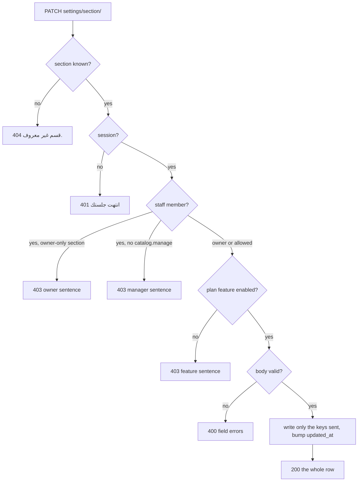

# Store settings API — M34 (مركز إعدادات المتجر)

> **Source**: DOC-203, DOC-204, DOC-205, DOC-206 · INT-010 (M34), INT-002, INT-018, INT-019, INT-020, INT-021, INT-023, INT-025 · inventory Domain 12
> **Live key**: `settings` (`SHARWA_LIVE_MODULES`) — one switch for the ten BFF rows of this page; it **is** in the sample line `.env.example:79` (see the comment at `.env.example:24-25`). `/api/v1/config/` has no switch ([`config.md`](../01-public-onboarding/config.md)).
> **Django provider**: `sharwa_saas/api/views_settings.py` (`SettingsAPIMixin`, 3 URL patterns at `api/urls.py:186-188`) · `sharwa_saas/products/services/settings_service.py` · public config `api/serializers.py` (`StoreConfigSerializer`) + `api/views.py` (`StoreConfigView`) · image field `api/serializers_catalog.py` (`Base64ImageField`) · no DRF serializer for the settings row itself
> **Frontend contract**: `sharwa-frontend/src/features/settings/schemas.ts` (`settingsSchema`, one input schema per section) · hooks `…/api.ts` · fixture `src/mocks/settings/{state,routes,overlay}.ts` · BFF `src/app/api/bff/settings/` · public contract `src/lib/schemas/store-config.ts`
> **Tests**: `sharwa_saas/api/test_settings_api.py` (11) · mock functional check `scripts/settings-check.ts`
> **Last verified against code**: 2026-10-27 (step 27)

<a id="overview"></a>

## 1. Overview

M34 is the store's **settings hub**: one `StoreSetting` row (singleton `pk=1` in the store's schema) that eight sections edit and that other modules reuse. The module has three Django routes: one **read** of the whole row, one **PATCH per section** (eight sections) and one **POST** for the multi-location switch.

- Every write returns the **whole row** again, so the browser replaces its cache with one response (`useSaveSettings` in `src/features/settings/api.ts`).
- The row never contains a secret: `admin_password` is neither read nor written here, and the fields owned by other modules (logo, colours, fonts → M08; domain → M19) are only echoed, never edited.
- Four other modules call the **same service functions**, so one rule has one place: `patch_shipping` is used by M15 (`shipping/settings/`, [`m15-shipping.md`](../11-shipping/m15-shipping.md#settings)), `patch_announcement` by M08 (`store/announcement/`, [`m08-theme-customizer.md`](../07-marketing-design-partners/m08-theme-customizer.md#presets-announcement)), `patch_payments` by M14 (`store/payments/`, [`m14-payments-wallet.md`](../08-finance/m14-payments-wallet.md#store-payments)) and `set_multi_location` by M22 (`locations/mode/`, [`m22-locations.md`](../10-inventory-locations-procurement/m22-locations.md#mode)).
- The same row feeds the **public** `GET /api/v1/config/`, which a store visitor reads without logging in ([§7](#config)).

The caller is the store **owner** or a staff member on the store host. Before INT-010 the settings lived in seven HTML forms and two payment toggle views (the form list is taken from the docstring of `settings_service.py`; the legacy views were not re-read for this step).

<a id="access"></a>

## 2. Access — gate chain and gate matrix

`SettingsAPIMixin` (`views_settings.py:41`) evaluates, in this order; the first failing gate answers.

| # | Gate | Requirement | Failure |
|---|---|---|---|
| 1 | Store | the request resolves to a store (`HasTenantContext`) | `403` «لم يتم تحديد المتجر المطلوب. استخدم النطاق الفرعي للمتجر أو أرسل ترويسة X-Store-Domain.» · with **no session cookie** on the public host the answer is `403` «لم يتم تزويد بيانات الدخول.» instead ([rule](../../overview/auth.md#no-store-no-session)) |
| 2 | CSRF | `MerchantSessionAuthentication` checks `X-CSRFToken` on every write ([`csrf.md`](../../overview/csrf.md)) | `403` `{"detail": "CSRF Failed: …"}` |
| 3 | Session | an owner session or a resolved staff member (`ProductsAPIMixin.gate`) | `401` `{"detail": "انتهت جلستك، سجّل الدخول مجدداً."}` |
| 4 | Staff scope *(writes by a staff member only)* | owner-only section → refused; otherwise the staff member needs `catalog.manage` | `403` «هذا الإعداد يحتاج صلاحية مالك المتجر.» · `403` «تعديل الإعدادات مقصور على المالك ومدير المتجر.» |
| 5 | Plan feature *(sections that have one)* | the section's feature is enabled for the store | `403` «هذه الميزة غير متاحة في باقتك الحالية» |
| 6 | Validation / state | the body passes the section's rules | `400` `{field: [msg]}` · `400` `{"detail": …}` · `409` `{detail, conflicts}` |

Notes:

- The staff check (gate 4) comes **before** the plan feature (gate 5): a staff member without the right gets the permission sentence even when the plan lacks the feature. The owner (no staff identity) skips gate 4. This is the opposite order of M22, where the feature comes first ([§6](#multi-location)).
- `GET settings/` runs gates 1–3 only: **no plan feature and no permission key**, so any session reads the whole row.
- `SettingsSectionView.patch` rejects an unknown section **before** gate 3: `404` `{"detail": "قسم غير معروف."}` even without a session. `multi-location` is not a valid `<section>` there; it has its own route.
- The plan feature is `settings_feature_enabled` (`views_settings.py:32`): a missing `Feature` row counts as disabled.
- The body parser is `JSONParser` only: a non-JSON content type answers DRF's `415`, a body that is not a JSON object is treated as `{}`.

### 2.1 Gate matrix — route × plan feature × who may write

| # | Route | Method | Plan feature | Owner | Staff with `catalog.manage` | Other staff |
|---|---|---|---|---|---|---|
| 1 | `settings/` | `GET` | — | read | read | read |
| 2 | `settings/identity/` | `PATCH` | — | write | write | `403` manager sentence |
| 3 | `settings/contact/` | `PATCH` | `contact_info` | write | write | `403` manager sentence |
| 4 | `settings/policies/` | `PATCH` | `store_policies` | write | write | `403` manager sentence |
| 5 | `settings/shipping/` | `PATCH` | `shipping_settings` | write | `403` owner sentence | `403` owner sentence |
| 6 | `settings/currency/` | `PATCH` | `currency_settings` | write | `403` owner sentence | `403` owner sentence |
| 7 | `settings/seo/` | `PATCH` | `seo_settings` | write | write | `403` manager sentence |
| 8 | `settings/announcement/` | `PATCH` | `coupon` | write | write | `403` manager sentence |
| 9 | `settings/payments/` | `PATCH` | — | write | `403` owner sentence | `403` owner sentence |
| 10 | `settings/multi-location/` | `POST` | `multi_location` | write | `403` owner sentence | `403` owner sentence |

The matrix is `SECTIONS` (`settings_service.py:45`): section → (plan feature, owner only). Money and structure (rows 5, 6, 9, 10) are owner-only; the text sections (rows 2, 3, 4, 7, 8) accept the owner and any staff member holding `catalog.manage`. The mock BFF applies the same two staff sentences, but **no plan-feature check** (the Next UI hides the section instead, `SECTION_META.feature`).

### 2.2 The three gate messages, verbatim

| Constant (`views_settings.py`) | Sentence | Status |
|---|---|---|
| `OWNER_ONLY_MESSAGE` | «هذا الإعداد يحتاج صلاحية مالك المتجر.» | `403` |
| `MANAGER_MESSAGE` | «تعديل الإعدادات مقصور على المالك ومدير المتجر.» | `403` |
| `FEATURE_MESSAGE` | «هذه الميزة غير متاحة في باقتك الحالية» | `403` |

`FEATURE_MESSAGE` has **no final full stop** (it is copied from the legacy `require_feature` text); the other two end with one.



<a id="summary"></a>

## 3. Endpoint summary — the 10 routes

Django paths are under `/api/v1/`; BFF paths are under `/api/bff/` with the same suffix.

| Method | Django path | BFF path | Purpose | Gate row | DOC |
|---|---|---|---|---|---|
| `GET` | `settings/` | `settings` | the whole row ([§4](#read)) | 1 | 203 |
| `PATCH` | `settings/identity/` | `settings/identity` | name, about, timezone, week start ([§5.1](#identity)) | 2 | 204 |
| `PATCH` | `settings/contact/` | `settings/contact` | WhatsApp, e-mail, social links ([§5.2](#contact)) | 3 | 204 |
| `PATCH` | `settings/policies/` | `settings/policies` | return policy ([§5.3](#policies)) | 4 | 204 |
| `PATCH` | `settings/shipping/` | `settings/shipping` | delivery fee, free-shipping threshold ([§5.4](#shipping)) | 5 | 204 |
| `PATCH` | `settings/currency/` | `settings/currency` | display currency, three rates ([§5.5](#currency)) | 6 | 204 |
| `PATCH` | `settings/seo/` | `settings/seo` | SEO texts and share image ([§5.6](#seo)) | 7 | 204 |
| `PATCH` | `settings/announcement/` | `settings/announcement` | announcement bar ([§5.7](#announcement)) | 8 | 204 |
| `PATCH` | `settings/payments/` | `settings/payments` | manual payment, Sharwa Pay ([§5.8](#payments)) | 9 | 204 |
| `POST` | `settings/multi-location/` | `settings/multi-location` | multi-location switch ([§6](#multi-location)) | 10 | 205 |

`GET /api/v1/config/` (DOC-206) is a separate, public route described in [§7](#config).

<a id="read"></a>

## 4. The full settings read — `GET /api/v1/settings/` (DOC-203)

**Query parameters**: none. **Request body**: none.

**Response `200`** — `svc.read(request)`, exactly the 40 keys of `settingsSchema` (`test_read_shape_has_no_secrets` asserts the key set). Illustrative values: the defaults of the code, a delivery fee of `2500`, no other change.

```json
{
  "store_name": "متجر نور",
  "about_us": "",
  "timezone": "Asia/Aden",
  "week_start_day": "sunday",
  "whatsapp_number": "967770000011",
  "contact_email": "",
  "custom_domain": null,
  "facebook_link": "",
  "instagram_link": "",
  "tiktok_link": "",
  "snapchat_link": "",
  "return_policy": "",
  "default_delivery_fee": "2500.00",
  "free_shipping_threshold": "0.00",
  "display_default_delivery_fee": "2,500 ر.ي",
  "display_free_shipping_threshold": "0 ر.س",
  "currency": "SAR",
  "usd_to_sar": "3.75",
  "sar_to_yer_old": "140.00",
  "sar_to_yer_new": "520.00",
  "fx_preview": [
    { "currency": "SAR", "display_100_sar": "100 ر.س" },
    { "currency": "USD", "display_100_sar": "$26.67" },
    { "currency": "YER_OLD", "display_100_sar": "14,000 ر.ي" },
    { "currency": "YER_NEW", "display_100_sar": "52,000 ر.ي" }
  ],
  "seo_title": "",
  "seo_description": "",
  "seo_keywords": "",
  "seo_og_image": null,
  "enable_announcement_bar": false,
  "announcement_text": "",
  "announcement_bg_color": "#000000",
  "announcement_text_color": "#FFFFFF",
  "announcement_scroll_speed": "medium",
  "show_banner_on_home": true,
  "show_banner_on_products": true,
  "show_banner_on_product_detail": true,
  "show_banner_on_checkout": true,
  "enable_manual_payment": true,
  "enable_sharwa_pay": false,
  "multi_location_enabled": false,
  "store_url": "https://noor.example.com",
  "pending_payment_orders": 0,
  "updated_at": "2026-10-15T09:30:00+00:00"
}
```

(The 100 SAR previews are computed from the default rates with `format_money`: 100 ÷ 3.75 = 26.67, 100 × 140, 100 × 520. `test_currency_four_decimals_and_preview` asserts `"53,000 ر.ي"` for a rate of 530.)

### 4.1 Every field — type and source

Types are the Zod types of `settingsSchema`. "Source" is the `StoreSetting` column unless it says otherwise. A missing or `NULL` text reads as `""`.

| Field | Type | Source and mapping |
|---|---|---|
| **Identity** | | |
| `store_name` | string | `store_name` (column max 150; the API accepts 3–100 on write) |
| `about_us` | string | `about_us` |
| `timezone` | string | `timezone`, `"Asia/Aden"` when empty |
| `week_start_day` | `"sunday"` \| `"monday"` | `week_start_day`; any other stored value reads as `"sunday"` |
| **Contact** | | |
| `whatsapp_number` | string | `whatsapp_number` (stored as digits only) |
| `contact_email` | string | `contact_email` |
| `custom_domain` | string \| null | `custom_domain` or `null`. **Read-only here**: it mirrors the primary custom domain written by M19 `set-primary/`, no M34 section changes it |
| `facebook_link` · `instagram_link` · `tiktok_link` · `snapchat_link` | string | the four link columns |
| **Policies** | | |
| `return_policy` | string | `return_policy` |
| **Shipping** | | |
| `default_delivery_fee` | string | `default_delivery_fee` as `"%.2f"`. Stored in **YER_NEW** (the column help text: «بالريال اليمني الجديد دائماً — يُحوَّل تلقائياً لعملة عرض كل زبون.») |
| `free_shipping_threshold` | string | `free_shipping_threshold` as `"%.2f"` (`"0.00"` = disabled) |
| `display_default_delivery_fee` | string | `format_money(default_delivery_fee, 'YER_NEW')`, e.g. `"2,500 ر.ي"` |
| `display_free_shipping_threshold` | string | `format_money(free_shipping_threshold, <store currency>)`, e.g. `"300 ر.س"` for `currency = SAR` |
| **Currency** | | |
| `currency` | `SAR` \| `USD` \| `YER_OLD` \| `YER_NEW` | `currency`; any other stored value reads as `SAR` |
| `usd_to_sar` · `sar_to_yer_old` · `sar_to_yer_new` | string | the three rate columns (4 decimals since migration `0217`), shown **without trailing zeros but with at least two decimals**: `3.7525`, `3.75`, `140.00` (`_rate`) |
| `fx_preview` | array of `{currency, display_100_sar}` | what 100 SAR is worth in each currency, in the fixed order `SAR`, `USD`, `YER_OLD`, `YER_NEW`, formatted by the server. `USD` = 100 ÷ `usd_to_sar` (0 when the rate is 0) |
| **SEO** | | |
| `seo_title` · `seo_description` · `seo_keywords` | string | the three columns |
| `seo_og_image` | string \| null | **absolute** URL of the share image (`absolute_media_url`), `null` when none |
| **Announcement bar** | | |
| `enable_announcement_bar` | boolean | `enable_announcement_bar` |
| `announcement_text` | string | `announcement_text` |
| `announcement_bg_color` · `announcement_text_color` | string | the two colour columns, defaults `#000000` / `#FFFFFF` when empty |
| `announcement_scroll_speed` | `"slow"` \| `"medium"` \| `"fast"` | the column; any other value reads as `"medium"` |
| `show_banner_on_home` · `show_banner_on_products` · `show_banner_on_product_detail` · `show_banner_on_checkout` | boolean | the four columns |
| **Switches** | | |
| `enable_manual_payment` · `enable_sharwa_pay` | boolean | the two payment columns |
| `multi_location_enabled` | boolean | `multi_location_enabled` |
| **Derived** | | |
| `store_url` | string | `https://` + the tenant's **primary domain** (`tenant.get_primary_domain()`), else the request host |
| `pending_payment_orders` | integer | number of `Order` rows with status `pending_payment`, for the Sharwa Pay warning |
| `updated_at` | string | `updated_at` as ISO 8601, `""` when never saved |

> ⚠️ Discrepancy — roadmap says "`display_*` in YER_NEW" / code does: only `display_default_delivery_fee` is in YER_NEW. `display_free_shipping_threshold` uses the store's **dashboard currency** (`settings_service.py:read`, comment «INT-013»), because that is the currency in which `pricing.build_order_invoice` compares the threshold. The Zod comment «stored in YER_NEW (FR-34.07)» is therefore true for the fee only. Reported in step 27.

**Never in the response**: `admin_password`, `merchant_balance`, `payment_methods_info`, payment credentials. `test_read_shape_has_no_secrets` stores `admin_password = 'secret'` and asserts it is absent from the JSON.

**Errors**: only the gates (`401`, `403`). There is no `404` and no filter.

<a id="sections"></a>

## 5. The eight section PATCHes (DOC-204)

### 5.0 Rules shared by every section

- **Request body**: a JSON object. Only the keys of the section are read; other keys are ignored, and **a key that is not sent is not touched** (partial updates). An empty body is a no-op that still answers `200` with the unchanged row and does not change `updated_at`.
- **Response `200`**: the whole row of [§4](#read) after the change.
- **Errors `400`**: DRF-shaped `{"field": ["message"]}` for field errors, all fields of the section together in one object. Two guards answer `{"detail": "…"}` instead ([§5.8](#payments)). Nothing is saved when any field fails: the service validates first and calls `_commit` last.
- **Commit**: `_commit` sets only the validated keys and saves with `update_fields = [keys…, 'updated_at']`.
- **Side effects**: the service writes no audit-log row and emits no webhook. (Signals on `StoreSetting` itself were not traced for this step.) Through the BFF, a successful live write drops the store's cached storefront reads (`revalidateTag`), so `/config/` shows the change at once ([§8](#bff)).
- **Messages** are the same as the mock's (`src/mocks/settings/state.ts`). The Zod input schemas in the browser use slightly different client-side texts, see [§9](#open-items).

<a id="identity"></a>

### 5.1 `PATCH /api/v1/settings/identity/`

Gate: row 2 — no plan feature; owner or `catalog.manage`.

| Field | Type | Rules | Error (`400`) |
|---|---|---|---|
| `store_name` | string | trimmed, 3–100 characters | «اسم المتجر من 3 إلى 100 حرف» |
| `about_us` | string | up to 2000 characters (not trimmed) | «2000 حرف على الأكثر.» |
| `timezone` | string | an IANA name known to `zoneinfo`, at most 50 characters | «منطقة زمنية غير معروفة.» |
| `week_start_day` | string | `sunday` or `monday` | «اختر الأحد أو الاثنين.» |

`test_identity_and_validation`: `{'store_name': '  متجر نور  ', 'timezone': 'Asia/Riyadh', 'week_start_day': 'monday'}` → `200` with the trimmed name; `{'store_name': 'ab', 'timezone': 'Mars/Base', 'week_start_day': 'friday'}` → `400` with exactly the three keys. The first message has **no final full stop**.

<a id="contact"></a>

### 5.2 `PATCH /api/v1/settings/contact/`

Gate: row 3 — plan feature `contact_info`; owner or `catalog.manage`.

| Field | Type | Rules | Error (`400`) |
|---|---|---|---|
| `whatsapp_number` | string | every non-digit is removed first; the rest must be empty or `967` / `966` followed by 9 digits | «رقم واتساب غير صحيح» |
| `contact_email` | string | trimmed; empty or `name@host.tld`, at most 254 characters | «أدخل بريداً إلكترونياً صحيحاً.» |
| `facebook_link` · `instagram_link` · `tiktok_link` · `snapchat_link` | string | trimmed; empty or `http(s)://host.tld…`, at most 200 characters | «أدخل رابطاً صحيحاً.» |

**Mapping.** An empty value is stored as `NULL` and read back as `""`. `"967-771-234-567"` is stored and returned as `"967771234567"` (`test_contact_policies_shipping`). `custom_domain` is not a field of this section even though it is shown with the contact group in the UI: it is edited in M19 ([`m19-domains-integrations.md`](m19-domains-integrations.md)).

<a id="policies"></a>

### 5.3 `PATCH /api/v1/settings/policies/`

Gate: row 4 — plan feature `store_policies`; owner or `catalog.manage`.

| Field | Type | Rules | Error (`400`) |
|---|---|---|---|
| `return_policy` | string | up to 10000 characters; Markdown text, stored as sent | «10000 حرف على الأكثر.» |

A body without `return_policy` is a no-op. `test_contact_policies_shipping`: `'x' * 10001` → `400` with the `return_policy` key.

<a id="shipping"></a>

### 5.4 `PATCH /api/v1/settings/shipping/` — shared with M15

Gate: row 5 — plan feature `shipping_settings`; **owner only**.

| Field | Type | Rules | Error (`400`) |
|---|---|---|---|
| `default_delivery_fee` | decimal string or number | trimmed; `digits` or `digits.dd` (1–2 decimals), at most 8 digits before the point; so `-1` is refused | «أدخل مبلغاً صحيحاً (مثال: 1500.00)» |
| `free_shipping_threshold` | decimal string or number | same rule | the same sentence |

**Mapping.** Both are stored as `Decimal`: `"1500.50"` → `1500.50`, `"30000"` → `30000.00` (`test_contact_policies_shipping`). The fee is in **YER_NEW**; the threshold is read back in the store currency ([§4.1](#read)). A missing key keeps its stored value, so the two can be saved separately.

**Reuse.** `shipping_service.patch_settings` (M15, `shipping/settings/`) calls `settings_service.patch_shipping` and answers its own response shape; the validation and the messages are these ([`m15-shipping.md`](../11-shipping/m15-shipping.md#settings)).

<a id="currency"></a>

### 5.5 `PATCH /api/v1/settings/currency/`

Gate: row 6 — plan feature `currency_settings`; **owner only**.

| Field | Type | Rules | Error (`400`) |
|---|---|---|---|
| `currency` | string | one of `SAR`, `USD`, `YER_OLD`, `YER_NEW` | «اختر عملة من القائمة.» |
| `usd_to_sar` · `sar_to_yer_old` · `sar_to_yer_new` | decimal string or number | trimmed; `digits` or `digits.dddd` (**up to 4 decimals**), at most 8 digits before the point | «أدخل رقماً صحيحاً.» |
| *(same three)* | | must be greater than zero | «يجب أن يكون أكبر من صفر.» |

The shape error wins: `"1.12345"` gets the first sentence, `"0"` gets the second. `test_currency_four_decimals_and_preview` sends `{'currency': 'EUR', 'usd_to_sar': '0', 'sar_to_yer_old': '1.12345'}` and expects exactly the keys `currency`, `usd_to_sar`, `sar_to_yer_old`.

**Worked example.** `{'currency': 'YER_NEW', 'usd_to_sar': '3.7525', 'sar_to_yer_new': '530'}` answers `200` with `currency: "YER_NEW"`, `usd_to_sar: "3.7525"`, `sar_to_yer_new: "530.00"` and the `YER_NEW` preview row `"53,000 ر.ي"`. The rates have 4 decimals since migration `0217_storesetting_fx_rate_precision` (they had 2).

<a id="seo"></a>

### 5.6 `PATCH /api/v1/settings/seo/`

Gate: row 7 — plan feature `seo_settings`; owner or `catalog.manage`.

| Field | Type | Rules | Error (`400`) |
|---|---|---|---|
| `seo_title` | string | up to 70 characters | «70 حرفاً على الأكثر.» |
| `seo_description` | string | up to 160 characters | «160 حرفاً على الأكثر.» |
| `seo_keywords` | string | up to 255 characters | «255 حرفاً على الأكثر.» |
| `seo_og_image` | string \| null | see the table below | the messages below |

**The share image** goes through `Base64ImageField` (`api/serializers_catalog.py`), the same field the catalogue and the theme use:

| Value sent | Result |
|---|---|
| `"data:image/png;base64,…"` | a new image: decoded, checked with Pillow, saved under the store's `seo/` upload path with a random name |
| an `http://`, `https://` or `/…` string (the current URL as the browser received it) | **unchanged** — the image stays, an external URL is never accepted as an image |
| `null` or `""` | the image is **removed** (`seo_og_image` reads `null`) |
| anything else (`"not-an-image"`, a number) | error |

| Check | Limit | Error (`400`, key `seo_og_image`) |
|---|---|---|
| format (from the file content, not the declared MIME) | JPEG, PNG, WebP, GIF; no SVG | «الصيغ المسموحة: jpg, jpeg, png, webp, gif» |
| decoded size | 5 MB (`MAX_IMAGE_BYTES`) | «حجم الصورة 5MB على الأكثر.» |
| pixels | 40 000 000 (`MAX_IMAGE_PIXELS`) | «أبعاد الصورة كبيرة جداً.» |

The response carries the new **absolute** URL. `test_seo_image_round_trip`: a PNG data URL → a `http…` URL; sending that URL back keeps it; `null` removes it; `"not-an-image"` → `400`.

> The request as a whole is limited by Django's `DATA_UPLOAD_MAX_MEMORY_SIZE = 8 * 1024 * 1024` (`config/settings.py:368`); the BFF's body buffering names the same 8 MB ceiling in its comment (it adds no check of its own). A 5 MB image is about 6.7 MB as base64, so it fits. A body over 8 MB is refused by Django before the view reads it (`RequestDataTooBig`); no test covers that case.

> ⚠️ Discrepancy — roadmap says "SEO image: … `DATA_UPLOAD_MAX_MEMORY_SIZE` 8 MB" as the limit of the image / code does: two limits apply — the **decoded image** must be at most 5 MB (`MAX_IMAGE_BYTES`, the 5 MB sentence above) and the **whole request body** at most 8 MB (`DATA_UPLOAD_MAX_MEMORY_SIZE`). Reported in step 27.

<a id="announcement"></a>

### 5.7 `PATCH /api/v1/settings/announcement/` — shared with M08

Gate: row 8 — plan feature `coupon`; owner or `catalog.manage`. (M08's `store/announcement/` has the same plan feature but is **owner-only**, [`m08-theme-customizer.md`](../07-marketing-design-partners/m08-theme-customizer.md#presets-announcement).)

| Field | Type | Rules | Error (`400`) |
|---|---|---|---|
| `enable_announcement_bar` · `show_banner_on_home` · `show_banner_on_products` · `show_banner_on_product_detail` · `show_banner_on_checkout` | boolean | a real JSON boolean | «قيمة غير صالحة.» |
| `announcement_text` | string | up to 255 characters; an empty value is stored as `NULL` | «255 حرفاً على الأكثر.» |
| `announcement_bg_color` · `announcement_text_color` | string | `#RRGGBB` (six hex digits) | «لون بصيغة #RRGGBB.» |
| `announcement_scroll_speed` | string | `slow`, `medium` or `fast` | «اختر سرعة.» |

**The merged-row rule.** After the field checks, the service overlays the body on the stored row and requires text for an enabled bar, **whichever field changed**:

> `enabled = body.enable_announcement_bar ?? stored`, `text = body.announcement_text ?? stored`. If `enabled` is `true` and `text.strip()` is empty, then `announcement_text` fails with «اكتب نص الشريط قبل تفعيله، أو أوقفه.»

The rule is skipped when `announcement_text` already has its own error (the length error). So a PATCH that only **clears the text** of a bar that is on is refused, and so is one that only **switches the bar on** when no text is stored. `test_announcement_needs_text_when_enabled` covers the first case (`'  '`) and the success case (colour `#112233`, speed `fast`); `{'announcement_text_color': 'red'}` → `400` with that key.

**Worked example.** The bar is off and `announcement_text` is `""`. `PATCH {"enable_announcement_bar": true}` → `400` `{"announcement_text": ["اكتب نص الشريط قبل تفعيله، أو أوقفه."]}`. `PATCH {"enable_announcement_bar": true, "announcement_text": "شحن مجاني"}` → `200`.

**Reuse.** M08 `design_service.patch_announcement` forwards only these nine keys to `settings_service.patch_announcement`.

<a id="payments"></a>

### 5.8 `PATCH /api/v1/settings/payments/` — shared with M14

Gate: row 9 — no plan feature; **owner only**.

| Field | Type | Rules | Error (`400`) |
|---|---|---|---|
| `enable_manual_payment` | boolean | a real JSON boolean | `{"enable_manual_payment": ["قيمة غير صالحة."]}` |
| `enable_sharwa_pay` | boolean | a real JSON boolean | `{"enable_sharwa_pay": ["قيمة غير صالحة."]}` |

The non-boolean check answers on the **first** bad key only.

**Guard — at least one payment method.** The service overlays the body on the stored switches. If manual payment is off, Sharwa Pay is off **and** `get_enabled_gateway_codes()` is empty, the request fails with `400` `{"detail": "يجب تفعيل طريقة دفع واحدة على الأقل."}` and nothing is saved. The three kinds of method are therefore *manual payment + Sharwa Pay + direct gateways* (Jeeb, Kuraimi) — a gateway counts only when it is **enabled and its credentials are complete** (`registry.py`). This is the legacy rule of `save_manual_payment_toggle` / `save_sharwa_pay_toggle`, shared with M14: `store/payments/` calls the same function, and M14 also applies it when the last gateway is disabled.

`test_payments_keep_one_method` patches the gateway list to `[]`: both switches off → `400` with the sentence; `{'enable_sharwa_pay': True}` → `200`.

**Side effect to know.** `pending_payment_orders` in the row exists for the warning the UI shows before Sharwa Pay is switched off; the server does not block on it.

<a id="multi-location"></a>

## 6. The multi-location switch — `POST /api/v1/settings/multi-location/` (DOC-205)

Gate: row 10 — plan feature `multi_location`; **owner only**. Gates 1–4 are the same as for the sections; the feature check follows the owner check.

**Request body**

| Field | Type | Required | Rules |
|---|---|---|---|
| `enabled` | boolean | yes | a real JSON boolean; otherwise `400` `{"enabled": ["قيمة غير صالحة."]}` |
| `merge` | boolean | no | only the value `true` confirms the merge; anything else counts as not sent |

**Response `200`** — the whole settings row ([§4](#read)) with the new `multi_location_enabled`.

**The `409` conflict.** The refusal applies only when **all** of these hold: `enabled` is `false`, the store's mode is currently **on**, `merge` is not `true`, and **more than one location** holds stock. `location_stock_conflicts()` lists the locations with `quantity_on_hand > 0` in `LocationInventory`, with their number of distinct products, ordered by location name; the refusal needs at least two rows.

```json
{
  "detail": "يوجد مخزون في أكثر من موقع؛ الإيقاف يجعل مخزون كل منتج رقماً واحداً (مجموع المواقع).",
  "conflicts": [
    { "location": "المستودع", "products_with_stock": 3 },
    { "location": "فرع عدن", "products_with_stock": 1 }
  ]
}
```

| Case | Result |
|---|---|
| turning the mode **on** | `200`, never refused |
| turning it **off**, stock in one location only (or none) | `200` |
| turning it **off**, stock in two or more locations, no `merge` | `409` `{detail, conflicts}` |
| the same with `"merge": true` | `200` |
| `enabled: false` while the mode is already off | `200`, no check |

**What `merge: true` does.** Nothing moves. `Product.stock` already mirrors the sum of the locations (the signal `mirror_location_inventory_to_product_stock`), so switching the mode off just makes that sum the single stock number of each product. The service writes only `multi_location_enabled` and `updated_at`; it creates or deletes no `LocationInventory` row. The `409` exists so the owner confirms that the per-location split stops being used.

**Mock.** The fixture returns the same sentence, but only for the store `noor` and with a fixed conflict list (`فرع الرياض`, 14 products).

**The same service, another route.** `POST /api/v1/locations/mode/` ([`m22-locations.md`](../10-inventory-locations-procurement/m22-locations.md#mode)) calls the same `set_multi_location` and returns only `{"multi_location_enabled": …}`. It checks the plan feature **before** the owner check and answers a different owner sentence, «إدارة المواقع مقصورة على مالك المتجر.»; here the owner check comes first and the sentence is «هذا الإعداد يحتاج صلاحية مالك المتجر.».

`test_multi_location_conflict` patches `location_stock_conflicts` with two locations: `enabled: false` → `409` with two `conflicts`; with `merge: true` → `200`, `multi_location_enabled: false`; `enabled: 'yes'` → `400`. The real query is not exercised by this test (it is covered from the M22 side).

<a id="config"></a>

## 7. The public `/api/v1/config/` extensions (DOC-206)

`GET /api/v1/config/` is the public description of a store ([`config.md`](../01-public-onboarding/config.md): gates, caching, sections, `tracking`). This page owns the part that comes from the **settings row**: `StoreConfigSerializer.Meta.fields` has 39 names, 16 of them from the first layer (INT-002) and **23 added by INT-010**; the view adds `tracking` (INT-023), 40 in all. They were `[NEEDS BACKEND]` extensions in `store-config.ts` that INT-002 handed over; INT-010 now serves them, with no secret and no merchant money.

### 7.1 The 23 extension fields, with the section that edits them

| Field | Type in the payload | Served by | Edited by |
|---|---|---|---|
| `card_border_color` | string | INT-010 | M08 theme ([`store/theme/`](../07-marketing-design-partners/m08-theme-customizer.md#theme)), not an M34 section |
| `announcement_bg_color` · `announcement_text_color` | string (`#RRGGBB`) | INT-010 | [§5.7](#announcement) |
| `announcement_scroll_speed` | `slow` \| `medium` \| `fast` | INT-010 | [§5.7](#announcement) |
| `show_banner_on_home` · `show_banner_on_products` · `show_banner_on_product_detail` · `show_banner_on_checkout` | boolean | INT-010 | [§5.7](#announcement) |
| `free_shipping_threshold` | string \| null | INT-010 | [§5.4](#shipping); `"%.2f"` of the stored value in the **store currency**, `null` when unset |
| `currency` | `SAR` \| `USD` \| `YER_OLD` \| `YER_NEW` | INT-010 | [§5.5](#currency) |
| `seo_title` · `seo_description` · `seo_keywords` | string | INT-010 | [§5.6](#seo) |
| `seo_og_image` | string \| null | INT-010 | [§5.6](#seo); **absolute** URL, `null` when none |
| `contact_email` | string \| null | INT-010 | [§5.2](#contact) |
| `facebook_link` · `instagram_link` · `tiktok_link` · `snapchat_link` | string \| null | INT-010 | [§5.2](#contact) |
| `about_us` · `return_policy` | string \| null | INT-010 | [§5.1](#identity), [§5.3](#policies) |
| `timezone` | string | INT-010 | [§5.1](#identity) |
| `week_start_day` | `sunday` \| `monday` | INT-010 | [§5.1](#identity) |

The 16 fields of the first layer (`store_name`, the five colours, two fonts, `design_style`, `theme_preset`, `brand_shades`, `theme_choice`, `logo`, `whatsapp_number`, `announcement_text`, `enable_announcement_bar`, `sections`) belong to INT-002 / INT-018 and are listed with their owners in [`config.md`](../01-public-onboarding/config.md#42-every-field-and-its-owner). Two of them (`store_name`, `whatsapp_number`) and `announcement_text` / `enable_announcement_bar` are edited by the sections of this page.

**Not in `/config/`** (settings-only): `custom_domain`, `default_delivery_fee`, the three rates and `fx_preview`, `enable_manual_payment`, `enable_sharwa_pay`, `multi_location_enabled`, `store_url`, `pending_payment_orders`, `updated_at`, and every display string.

| Owner | Field | State |
|---|---|---|
| INT-019 (M13) | `gifting_enabled`, `loyalty_enabled` | in the Zod schema, **not emitted by Django** |
| INT-023 (M19) | `tracking` | emitted; public ids only ([`config.md`](../01-public-onboarding/config.md#44-tracking-int-023--m19), [`m19-domains-integrations.md`](m19-domains-integrations.md)) |

> ⚠️ Discrepancy — roadmap says "gifting/loyalty (INT-019)" are among the `/config/` extensions now served / code does: `StoreConfigSerializer.Meta.fields` and `StoreConfigView` emit neither `gifting_enabled` nor `loyalty_enabled`; no Django code in the staged sources mentions them. The storefront layout defaults both to `false`, so the gift block and the loyalty block of checkout stay hidden in live mode. Already reported for `config.md` (step 06); repeated here because DOC-206 lists them. Reported in step 27.

### 7.2 Differences between the settings row and `/config/`

| Topic | `GET settings/` | `GET config/` |
|---|---|---|
| Caller | owner or staff session | anyone, no session |
| `seo_og_image` | `absolute_media_url(request, …)` | `request.build_absolute_uri(…)`, `null` without a request |
| Empty texts | `""` for a `NULL` or empty column | the raw column value: `null` when a nullable column (`contact_email`, links, `about_us`, `return_policy`) is `NULL` |
| `free_shipping_threshold` | always a string | a string, or `null` |
| Language of money | `display_*` strings from the server | raw decimal text only |

<a id="bff"></a>

## 8. BFF wiring and tests

### 8.1 The ten BFF rows

Every handler goes through `liveOrMock(request, "settings", "/api/v1/settings/…", mock)` (`src/lib/bff/live-route.ts`). With `settings` in `SHARWA_LIVE_MODULES`, or `SHARWA_MOCKS=off`, the request is a **transparent passthrough**: query string, cookies, CSRF header, body and status are forwarded and Django answers the `401` / `403` / `409` itself (no Next-side gate runs). The body is buffered first, because a streamed body arrives at Django with no `Content-Length` and every write would answer «required field». After a successful live write on a store host the BFF calls `revalidateTag` for that store, so the cached storefront config and pages refresh.

| # | BFF file (`src/app/api/bff/settings/…`) | Method | Django path | Mock gate (`settingsWrite`) | Mock function |
|---|---|---|---|---|---|
| 1 | `route.ts` | `GET` | `settings/` | session only | `readSettings` |
| 2 | `identity/route.ts` | `PATCH` | `settings/identity/` | owner or `catalog.manage` | `patchIdentity` |
| 3 | `contact/route.ts` | `PATCH` | `settings/contact/` | owner or `catalog.manage` | `patchContact` |
| 4 | `policies/route.ts` | `PATCH` | `settings/policies/` | owner or `catalog.manage` | `patchPolicies` |
| 5 | `shipping/route.ts` | `PATCH` | `settings/shipping/` | owner only | `patchShipping` |
| 6 | `currency/route.ts` | `PATCH` | `settings/currency/` | owner only | `patchCurrency` |
| 7 | `seo/route.ts` | `PATCH` | `settings/seo/` | owner or `catalog.manage` | `patchSeo` |
| 8 | `announcement/route.ts` | `PATCH` | `settings/announcement/` | owner or `catalog.manage` | `patchAnnouncement` |
| 9 | `payments/route.ts` | `PATCH` | `settings/payments/` | owner only | `patchPayments` |
| 10 | `multi-location/route.ts` | `POST` | `settings/multi-location/` | owner only | `setMultiLocation` |

Rows 2–10 are built by one factory, `settingsWrite(upstream, ownerOnly, apply)` (`src/mocks/settings/routes.ts`). The browser side is `useSettings` (one query for the whole row, stale time 30 s) and `useSaveSettings`: the section key `locations` maps to the `multi-location` endpoint with `POST`, every other section to `PATCH`, and the response replaces the cache. `.env.example` lists `settings` (comment at lines 24-25 and the sample line 79). No Next-owned route exists for `/config/`; its fetchers are server-side ([`config.md`](../01-public-onboarding/config.md)).

### 8.2 Where mock mode and Django differ

| Topic | Mock (`state.ts`) | Django |
|---|---|---|
| Payments guard | **none** — both switches can be turned off | `400` «يجب تفعيل طريقة دفع واحدة على الأقل.» when no gateway is enabled either |
| Plan feature | not checked in the BFF | `403` «هذه الميزة غير متاحة في باقتك الحالية» |
| Multi-location `409` | only for the store `noor`, fixed list | the real stock query, two or more locations |
| `announcement` flags | not checked for type | «قيمة غير صالحة.» for a non-boolean |
| `seo_og_image` | accepts any `data:image/…` or `http(s)://` string; one format error | decodes the image, 5 MB and pixel limits, URLs mean «unchanged» |
| `timezone` | accepted if `Intl.DateTimeFormat` knows it | `zoneinfo` and at most 50 characters |
| Default bar colours | `#18181b` / `#ffffff` (schema constants) | `#000000` / `#FFFFFF` (model defaults) |
| Empty `contact_email` / links | stored as `""` | stored as `NULL`, read as `""` |

<a id="tests"></a>

### 8.3 Tests — `api/test_settings_api.py`

**Eleven** test methods in one class (`SettingsApiTests`, `TenantTestCase` + `TenantClient` with an owner session). The class patches `api.views_settings.settings_feature_enabled` to `True`, so the plan-feature gate is only exercised in `test_feature_and_role_gates`.

| Test | Covers | Page section |
|---|---|---|
| `test_anonymous_gets_401` | read and write without a session → `401` | [§2](#access) |
| `test_read_shape_has_no_secrets` | the 40 keys, no `admin_password`, `"2500.00"`, `"2,500 ر.ي"`, `"3.75"`, preview order, `https://` store URL | [§4](#read) |
| `test_identity_and_validation` | trim, timezone, week start, the three errors | [§5.1](#identity) |
| `test_contact_policies_shipping` | phone normalisation, contact errors, policy length, fee and threshold, negative fee | [§5.2](#contact)–[§5.4](#shipping) |
| `test_currency_four_decimals_and_preview` | `3.7525`, `"530.00"`, `"53,000 ر.ي"`, three error keys | [§5.5](#currency) |
| `test_seo_image_round_trip` | data URL → URL, URL unchanged, `null` removes, bad value, 71-character title | [§5.6](#seo) |
| `test_announcement_needs_text_when_enabled` | merged-row rule, success, bad colour | [§5.7](#announcement) |
| `test_payments_keep_one_method` | the guard sentence, then `200` | [§5.8](#payments) |
| `test_multi_location_conflict` | `409` with two conflicts, `merge`, non-boolean | [§6](#multi-location) |
| `test_feature_and_role_gates` | feature off → `403` on `contact`, `200` on `identity`; staff on `currency` → owner sentence; staff with / without `catalog.manage` on `policies`; unknown section → `404` | [§2](#access) |
| `test_config_exposes_storefront_extensions` | `/config/` shows the saved colour, `"25000.00"`, `monday`, the extension keys, no `admin_password` | [§7](#config) |

Not asserted by any test: `pending_payment_orders` and `store_url` with a primary domain, the USD preview value, `about_us` and `timezone` limits, non-boolean announcement flags, the 5 MB / pixel / 8 MB image limits, `GET` as a staff member, a `415` body, the plan-feature gate of `shipping`, `currency`, `seo`, `announcement`, `policies` and `multi-location`, the owner-before-feature order, the real `location_stock_conflicts` query, and the BFF files. The mock side is covered by `scripts/settings-check.ts` (Playwright, run against the mock; screenshots in `docs/visual-checks/34-settings/`), which was not run for this documentation step.

<a id="schema-changes"></a>

## 9. Gaps closed, bugs fixed and migrations

- **Migration `products/0217_storesetting_fx_rate_precision`** (INT-010): `usd_to_sar`, `sar_to_yer_old` and `sar_to_yer_new` change from 2 to **4 decimals** (`DecimalField(max_digits=12, decimal_places=4)`, defaults 3.75 / 140.00 / 520.00), because the contract accepts rates such as `3.7525`.
- **`StoreConfigSerializer`** gained the 23 extension fields of [§7](#config) (INT-010).
- **One service, several callers**: `patch_shipping`, `patch_announcement`, `patch_payments` and `set_multi_location` are reused by M15, M08, M14 and M22, so the legacy rules («طريقة دفع واحدة على الأقل») survive in one place.
- No other migration comes with this module.

<a id="open-items"></a>

## 10. Open items and observations

- **Zod client texts differ from the server texts** for four checks: contact e-mail «بريد إلكتروني غير صحيح» (server «أدخل بريداً إلكترونياً صحيحاً.»), rates «أدخل رقماً (حتى 4 خانات عشرية)» (server «أدخل رقماً صحيحاً.»), the example in the threshold message «مثال: 30000.00» (server «مثال: 1500.00» for both fields), and «اختر المنطقة الزمنية.» for an empty timezone (server «منطقة زمنية غير معروفة.»). The browser validates first, so the server texts appear only for a value the client let through.
- **The read has no permission key.** Any staff session reads delivery fees, payment switches and the order count of `pending_payment`.
- **Unknown section before login.** `PATCH settings/<unknown>/` answers `404`, not `401`, because the route checks the section first.
- **Empty or foreign body is a `200`.** A body with none of the section's keys changes nothing and still answers the full row.
- **`announcement_text` is not trimmed.** Only emptiness is tested on the stripped text; a whitespace-only text is stored as sent when the bar is off. ([`m08-theme-customizer.md`](../07-marketing-design-partners/m08-theme-customizer.md#presets-announcement) says "trimmed".)
- **Empty contact values are stored as `NULL`** and read back as `""`, while `/config/` returns `null` for them.
- **Gate order differs between M34 and M22** for the same switch ([§6](#multi-location)).
- **The 409 needs two locations with stock.** A single location with stock is merged silently.
- **`custom_domain` is read-only in M34** and only mirrors M19.
- **Signals on `StoreSetting` were not traced** (cache invalidation, theme timestamps); only the service code and the views were read.

<a id="related"></a>

## 11. Related pages

- Public config payload and caching: [`config.md`](../01-public-onboarding/config.md)
- Shared sections: [`m15-shipping.md`](../11-shipping/m15-shipping.md) (shipping fee) · [`m08-theme-customizer.md`](../07-marketing-design-partners/m08-theme-customizer.md) (announcement bar) · [`m14-payments-wallet.md`](../08-finance/m14-payments-wallet.md) (payment switches) · [`m22-locations.md`](../10-inventory-locations-procurement/m22-locations.md) (multi-location mode)
- Same domain: [`m18-staff-permissions.md`](m18-staff-permissions.md) (who holds `catalog.manage`) · [`m19-domains-integrations.md`](m19-domains-integrations.md) (custom domain, tracking)
- Conventions: [`../../overview/csrf.md`](../../overview/csrf.md) · [`../../overview/bff.md`](../../overview/bff.md) · [`../../overview/plan-features.md`](../../overview/plan-features.md) · [`../../overview/permissions.md`](../../overview/permissions.md) · [`../../overview/money.md`](../../overview/money.md)
- Merchant guides (Arabic): [`../../../guides/merchant/12-settings-staff-integrations/README.md`](../../../guides/merchant/12-settings-staff-integrations/README.md)
