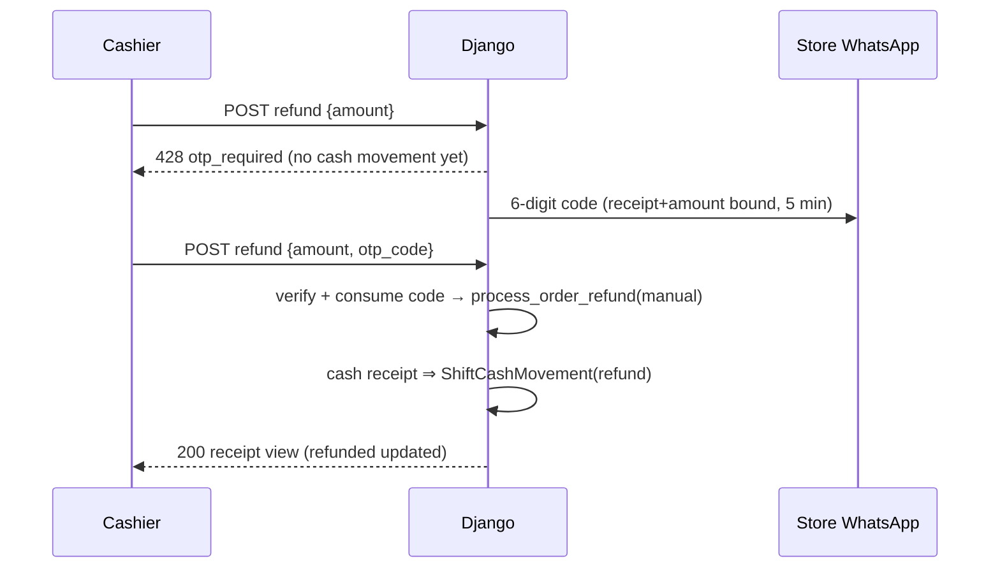

# Point of Sale API — M16 (نقطة البيع)

> **Source**: DOC-242, DOC-243, DOC-244, DOC-245, DOC-246, DOC-247, DOC-248 · INT-033 (M16), INT-022 (M18) · inventory Domain 13, A.3, A.5, A.6, A.7, A.8, A.10, A.12
> **Live key**: `pos` (`SHARWA_LIVE_MODULES`) — one catch-all `api/bff/pos/[...path]` (GET/POST only; `__reset` is fixture-only).
> **Django provider**: `sharwa_saas/products/services/pos_service.py` (whole service — one state machine shared with the legacy screens) + `api/views_pos.py` (14 routes)
> **Frontend contract**: `sharwa-frontend/src/features/pos/schemas.ts` · fixtures `src/mocks/pos/` · BFF `src/app/api/bff/pos/[...path]/route.ts`
> **Tests**: `sharwa_saas/api/test_pos_api.py` (17 test methods) · legacy staff/orders/inventory/auth/dashboard/tasks suites · mock E2E `scripts/pos-check.ts`
> **Last verified against code**: 2026-10-29 (step 46)

## 1. Overview

The cashier terminal: open a shift on a register, sell (products, quotes, receipts as real M06 orders with `sales_channel='pos'`), move cash in/out, close the shift against a counted drawer, and resolve shortages through the M18 approvals queue. Before INT-033 this was the HTML screen `products/views/staff_pos.py` with no plan feature; the API is a contract over the same `pos_service` state machine the legacy screens call — `CashRegister`, `Shift`, `ShiftCashMovement`, `OTPChallenge` and `ApprovalRequest` are the backing models, and the discount ceiling / refund permission / variance resolution all read M18 roles. The caller is the owner or an assigned staff member, on the store host through the Next BFF.

## 2. Access — gate chain

Every route shares `PosAPIMixin.run` (`views_pos.py:42-59`); the first failing gate answers.

| # | Gate | Requirement | Failure |
|---|---|---|---|
| 1 | Session | owner or staff session | `401` `{"detail": "انتهت جلستك، سجّل الدخول مجدداً."}` |
| 2 | Plan feature | `pos` — **a paid feature by owner decision** | `403` `{"detail": "ميزة نقطة البيع غير مفعّلة في خطتك.", "code": "feature_disabled"}` |
| 3 | Locations | staff: active `StaffLocationRole` ∩ locations with `has_pos_terminal` (M22); the owner sees **all** terminal locations | a register/route outside the assignments → `403` `{"detail": "لست معيَّناً على هذا الموقع."}` (registers filter) or `404` on the shift |
| 4 | M18 permission keys | per action: `discounts.apply` (ceiling from the role), `orders.refund`; variance resolution = owner, `staff.manage`, or a holder of the approver roles «مدير الفرع» / «مدير المتجر» in a POS location | `403` with the action's message (Step 46 sections) |

The `Feature(code='pos', requires_plan=True)` row is seeded by migration `billing/0013_seed_pos_feature` — but while `PlatformBillingSettings.subscriptions_enabled` is off the feature is open to every store (a `requires_plan` feature only restricts when plan assignment is enforced); stores can still be excluded individually via a `TenantFeatureOverride`. Gate 2's body carries `code: "feature_disabled"` so the terminal can distinguish "not in your plan" from a plain 403.

## 3. Endpoint summary — the 14 routes

Declared in `api/urls.py:521-534`.

> ⚠️ **Discrepancy — roadmap says 15 routes / code has 14.** DOC-242 counts "15 routes under `/api/v1/pos/`" and DOC-248 asks for "the 15-route table"; `api/urls.py` registers **14** (the force-close of an abandoned shift is a Celery-driven state, not an HTTP route — see §11).

| Method | Django path (`/api/v1/pos/…`) | Purpose | Doc |
|---|---|---|---|
| `GET` | `context/` | cashier context: locations, ceiling, permissions, force-close notice | §4 |
| `GET` | `registers/?location` | registers + the live shift on each | §5 |
| `POST` | `shifts/` | open a shift `{register_id, opening_float}` | §6 |
| `GET` | `shifts/current/` · `shifts/pending/` | my live shift · shortage shifts awaiting my decision | §6 |
| `POST` | `shifts/<id>/movements/` | cash in/out with a note (idempotent) | §7 |
| `POST` | `shifts/<id>/close/` | close against the counted drawer | §7 |
| `POST` | `shifts/<id>/resolve-variance/` | manager decision on a shortage (version-checked) | §7 |
| `GET` | `products/?q&barcode&location&page_size` | sale search with location stock | §8 |
| `POST` | `quote/` | running total from the server | §8 |
| `POST` | `discount-approvals/` | over-ceiling discount → M18 queue | §9 |
| `GET`, `POST` | `orders/` | the shift's receipts · complete a sale (`Idempotency-Key` required) | §8 |
| `GET` | `orders/<id>/` | one receipt (id = order id) | §8 |
| `POST` | `orders/<id>/refund/` | refund from a receipt (`428` OTP step-up above the store limit) | §10 |

## 4. Cashier context

#### `GET /api/v1/pos/context/`

Everything the terminal needs at load (`context`, `pos_service.py:265-284`):

```json
{
  "staff_name": "منى",
  "locations": [{"id": 3, "name": "فرع صنعاء"}],
  "max_discount_percent": "10.00",
  "can_discount": true,
  "can_refund": true,
  "can_resolve_variance": false,
  "force_closed_notice": null
}
```

- `locations` — the cashier's POS locations (gate 3's list; the owner gets every terminal location).
- `max_discount_percent` — the **discount ceiling**: the highest `Role.max_discount_percent` among the staff member's active roles granting `discounts.apply` in those locations (`null` = no ceiling — the owner always, or a role configured without one); `"0.00"` when no granting role exists.
- `can_discount` / `can_refund` — the M18 keys `discounts.apply` / `orders.refund` (owner: both true).
- `can_resolve_variance` — owner, `staff.manage`, or an active assignment of the approver roles «مدير الفرع» / «مدير المتجر» in one of the cashier's POS locations.
- `force_closed_notice` — when Celery force-closed one of the cashier's shifts (`open → force_closed`, abandoned-shift cleanup) and the notice was not yet acknowledged: `{shift_id, register_name, closed_at}`. Acknowledgement happens on the next shift open (Step 46).

## 5. Registers

#### `GET /api/v1/pos/registers/?location=<id>`

The registers of the cashier's locations (ordered by location then name), each with the live shift sitting on it (`open` or `pending_manager_approval`):

```json
{
  "id": 7,
  "name": "كاشير 1",
  "location": {"id": 3, "name": "فرع صنعاء"},
  "is_active": true,
  "open_shift": {"id": 91, "staff_name": "منى", "opened_at": "2026-10-29T08:02:00+00:00", "is_mine": true}
}
```

Rules: `?location=` narrows to one location — one the cashier is **not** assigned to → `403` «لست معيَّناً على هذا الموقع.»; a cashier with no POS locations gets `[]`. A **disabled register stays listed only while an open shift sits on it** (so the shift can be closed); otherwise disabled registers are hidden. `is_mine` marks the cashier's own shift for the "busy" state on the device tile.

## 6. Shifts: open, current, pending — DOC-243

#### `POST /api/v1/pos/shifts/` — body `{register_id, opening_float}`

Every outcome, in evaluation order (`open_shift`, `pos_service.py:403-433`):

| Outcome | Status | Body |
|---|---|---|
| register unknown or outside the cashier's locations | `404` | `{"detail": "جهاز الكاش غير موجود."}` |
| register disabled | `400` | `{"detail": "جهاز الكاش معطّل ولا يمكن فتح وردية جديدة عليه."}` |
| your own live shift **on this register** | **`200`** | the shift row — idempotent open (no second shift) |
| your live shift on **another** register | `409` | `{"detail": "لديك وردية قائمة على «<جهاز الكاش>»."}` (f-string) |
| the register already has a live shift (anyone) | `409` | `{"detail": "الجهاز مشغول بوردية <الموظف>."}` (f-string) |
| `opening_float` missing/invalid | `400` | `{"opening_float": ["أدخل الرصيد الافتتاحي (مثال: 200.00)."]}` |
| new shift | `201` | the shift row |

A "live" shift is `open` **or** `pending_manager_approval` — a parked shortage shift also blocks the register. The register row is locked and a DB constraint (`unique_open_shift_per_register`) backs the race: a simultaneous open from a second device still answers `409` «الجهاز مشغول بوردية أخرى.». **Opening a new shift also clears the force-close notice** (§11): all the cashier's unseen `force_closed` notices are marked seen.

#### `GET /api/v1/pos/shifts/current/` → `{shift: <row> | null}`

The cashier's own live shift (open or pending approval), with its full money breakdown: `display_opening_float/cash_sales/refunds/cash_in/cash_out/rounding/expected_closing/actual_closing`, `display_variance` (signed), `variance_kind` (`shortage · overage · none`), `sales_count`, `approval {id, status, note}` and the `movements` list (each `{id, movement_type, direction, display_amount (±), note, order_id, actor, created_at}`).

#### `GET /api/v1/pos/shifts/pending/`

Shortage shifts awaiting a decision, **only for a resolver** (owner, `staff.manage`, or the approver roles in a POS location — §2 gate 4); everyone else gets `[]`. Scoped to the caller's locations, oldest close first.

## 7. Cash movements, close and variance resolution — DOC-244

#### `POST /api/v1/pos/shifts/<id>/movements/` — body `{movement_type, amount, note}` (+ idempotency key)

Own shift only (`404` «الوردية غير موجودة.»); must be open (`409` «الوردية ليست مفتوحة.»). `movement_type` ∈ `cash_in · cash_out` («اختر إدخال نقد أو سحب نقد.»); `amount` > 0 («أدخل مبلغاً أكبر من صفر.»); **a note (reason) is mandatory** («اذكر سبب الحركة.», ≤ 255 chars — f-string `255 حرفاً على الأكثر.`); a `cash_out` larger than the expected drawer («المبلغ أكبر من النقد المتوقع في الدرج.»). `201` returns the refreshed shift row; an idempotency-key replay returns it with `200` and writes nothing.

#### `POST /api/v1/pos/shifts/<id>/close/` — body `{actual_closing}`

The counted amount is required («أدخل المبلغ المعدود فعلياً (مثال: 1250.00).»). The server computes expected = opening float + sale + cash-in + rounding − refund − cash-out, then (spec §5, shared with the legacy screens):

- **overage or zero variance** → `status: "closed"`;
- **shortage only** (actual < expected) → `status: "pending_manager_approval"` + an `ApprovalRequest(shift_shortage)` for the approver role («مدير الفرع», falling back to «مدير المتجر») at the register's location, `amount = expected − actual`; the response carries `approval_id`.

Response `{status, display_variance, approval_id, shift}`; the close bumps `version` and writes an audit row (`shift.close`). **Sign convention**: the DB column `Shift.variance` keeps its legacy meaning (expected − actual, positive = shortage); the contract shows `display_variance` = **actual − expected** (negative = shortage, prefixed `+` for overage).

**Either manager decision closes the shift.** On the device:

#### `POST /api/v1/pos/shifts/<id>/resolve-variance/` — body `{decision: approved|rejected, version, note?}`

| Check | Failure |
|---|---|
| caller may resolve (§2 gate 4) | `403` «حلّ فرق الوردية لمدير الفرع أو مالك المتجر.» |
| shift's location in caller's locations | `403` «هذه الوردية في موقع لست معيَّناً عليه.» |
| shift still pending | `409` «حُسم فرق هذه الوردية من مستخدم آخر.» (+`version`) |
| body `version` matches | `409` «تغيّرت الوردية، أعد التحميل.» (+`version`) |
| **no self-approval** (non-owner) | `403` «لا يمكنك اعتماد عجز ورديتك.» |
| decision value | `400` `{"decision": ["القرار يجب أن يكون approved أو rejected."]}` |
| approval queue rights (`can_decide`) | `403` «الحسم لحامل دور «<الدور>» في هذا الموقع أو للمالك.» (f-string) |

Both `approved` and `rejected` settle the shift to `closed` (`version + 1`, audit `shift.variance_resolve`, the note stored on the approval). The same settlement happens when the manager decides **from the M18 approvals screen** — `staff_service.resolve_approval` calls `settle_shift_for_approval` inside the approval's transaction. Before INT-033 any variance parked the shift and «reject» reopened it.

## 8. Product search, quote and sales — DOC-245

#### `GET /api/v1/pos/products/?q&barcode&location&page_size`

What the cashier may sell (`sellable()`): published, not archived, **not bookable, not auction, and not a bundle** — bundles are online-only (their price/stock derive from components, M37). `barcode=` returns the one match with `exact {product_id, variant_id}` (product barcode or variant SKU); free-text `q` puts exact SKU/barcode matches first (FR-16.03). Stock shown is **the device location's** when the store is multi-location (`?location=` or the live shift's register decides — `_selling_location`). Row: `{id, name, name_en, sku, barcode, image, display_price, stock (3 decimals), out_of_stock (unless backorder), has_variants, variants[], min/max_quantity, is_serialized}` — every price already converted to the store currency.

#### `POST /api/v1/pos/quote/` — body `{items: [{product_id, variant_id?, quantity, discount_percent?}], cart_discount_percent?}`

The running total **from the server only** (FR-16.07), in the store currency. Per-line errors (shown in place, they do not fail the request): «نسبة خصم غير صحيحة.» · «الحد الأدنى للكمية <n>.» · «الحد الأقصى للكمية <n>.» (f-strings) · «منتج بأرقام تسلسلية: أضِف كل قطعة سطراً مستقلاً.» · «الكمية أكبر من المتوفر في هذا الفرع.» · «المتغير غير موجود.» · «اختر المتغير.». Response `{lines[], display_subtotal, display_discount, display_total, items_count, discount_exceeds_limit}` — the last flags a discount above the ceiling (§9).

#### `POST /api/v1/pos/orders/` — the sale

**The `Idempotency-Key` header (or `idempotency_key` body field) is mandatory** — `400` `{"idempotency_key": ["مفتاح منع التكرار مطلوب."]}`. Gates: your **open** shift on `register_id` (`409` «لا وردية مفتوحة لك على هذا الجهاز.»); a non-empty cart (`400` `{"items": ["السلة فارغة."]}`); no line errors (first offending line → `400` «<المنتج>: <خطأ>»); any discount needs `discounts.apply` (`403` «ليست لديك صلاحية تطبيق الخصم.»); over-ceiling discounts need §9's approval. `201 {id, display_total, receipt}` — a replay with the same key returns the **first receipt** with `200`.

The receipt is a **real M06 order**: `sales_channel='pos'`, `status='completed'`, `payment_status='paid'`, `payment_method` `pos_cash` | `pos_sharwa_pay`, `source_location` = the register's location, traffic `direct`, fulfilment = the marks-completed status, customer «عميل نقطة البيع», every line priced server-side in the store currency (`convert_amount` — Django is the authority, there is no live «mixed currencies» error). Side effects inside one transaction:

- `PosReceipt` snapshot — number **`POS-<shift>-<seq>`** (`POS-0091-003`), line snapshots with `discount_percent`, and `discount_allocated` per line: the line's own discount **plus its proportional share of the cart discount** (the last line takes the remainder, so the sum equals the cart discount exactly);
- stock leaves the register's location through `inventory_service._apply_delta` — the `LocationInventory` row when multi-location, else the product/variant row — with a `StockMovement(sale)` noted «إيصال <رقم>»; **serialized units** are marked `sold` and linked to the order;
- cash payment → a `ShiftCashMovement(sale)` for the total; **Sharwa Pay is recorded outside the drawer** (`pos_sharwa_pay` on the order, no drawer movement, no wallet debit — the till holds no customer identity);
- the discount approval (if any) binds to the order (`target_ref order:<id>`) and a timeline event «أُنشئ الطلب من نقطة البيع (<الجهاز>) بواسطة <الاسم>.» is written.

#### `GET /api/v1/pos/orders/?q` · `GET /api/v1/pos/orders/<id>/`

The **live shift's receipts only** (US-16.6; `[]` without a shift), searchable by receipt number or order id. The detail (id = order id) is the printable receipt: store/register/location/cashier names, lines, totals, `display_refunded`, `refundable_amount` and the discount approval.

**Idempotency contract (SC-16.3)**: `PosIdempotencyKey` is inserted **first inside the write transaction** (`_claim`); a concurrent duplicate waits on the unique index and then reads the first writer's result, so a double click can never produce two receipts/movements/refunds. A key is typed (`order · movement · refund`) and rejected for a different use — `409` «مفتاح منع التكرار مستخدم لعملية أخرى.».

## 9. Discount ceiling, manager code and approvals — DOC-246

The ceiling is the highest `Role.max_discount_percent` among the caller's active roles granting `discounts.apply` at the register's location (`NULL` = no ceiling; the owner has none; `0.00` when no granting role). Over it, the sale takes **one** of three approval paths (`_discount_approval`):

| Path | Input | Outcome |
|---|---|---|
| within ceiling | — | proceeds, no approval |
| manager code | `manager_code` | hashed `StoreSetting.pos_manager_code_hash`, set with `manage.py set_pos_manager_code --schema=… <code>` (never stored in clear). Wrong → `400` `{"manager_code": ["رمز المدير غير صحيح."]}`; **5 wrong = 15-min lock per register** → `429` «أُقفل رمز المدير مؤقتاً بعد 5 محاولات خاطئة. حاول بعد 15 دقيقة أو أرسل طلب اعتماد.»; none set → `400` «لم يُعيَّن رمز مدير لنقطة البيع بعد — أرسل طلب اعتماد للمدير.» (**under DEBUG `2468` works while none is set**). Success mints an already-approved `discount_exception` («اعتُمد برمز المدير على جهاز الكاشير.») |
| pre-approved request | `approval_id` from `discount-approvals/` | unknown/not yours → `404` «طلب الاعتماد غير موجود.»; **pending → `409` «طلب الاعتماد ما زال بانتظار المدير.»**; rejected → `403` «رفض المدير هذا الخصم.»; already bound to a receipt (`target_ref order:…`) → `409` «استُخدم هذا الاعتماد لإيصال سابق — أرسل طلباً جديداً.» (**covers ONE receipt**); asking more than granted → `403` «الاعتماد يغطي خصماً حتى <n>% فقط — أرسل طلباً جديداً.» (f-string) |
| neither | — | `403` `{"code": "discount_exceeds_limit", "detail": "الخصم يتجاوز حدّك (<n>%) — يلزم اعتماد المدير.", "max_discount_percent": "<n>"}` |

#### `POST /api/v1/pos/discount-approvals/` — body `{discount_percent, display_total?}` → `201`

Queues an `ApprovalRequest(discount_exception)` for the approver role at the live shift's location (payload: the percent, the caller's ceiling, the register, the displayed total) → `{approval_id, status: "pending", detail: "أُرسل طلب الاعتماد إلى المدير."}`. The manager decides in the M18 approvals screen; the cashier retries the sale with `approval_id` (§8).

## 10. Refunds with OTP step-up — DOC-247

#### `POST /api/v1/pos/orders/<id>/refund/` — body `{amount, otp_code?}` (+ idempotency key)

Gate chain: `orders.refund` (`403` «ليست لديك صلاحية الاسترجاع.»); receipt visible in the caller's locations (`404` «الإيصال غير موجود.»); **an open shift of your own** (`409` «افتح وردية لتسجيل الاسترجاع في الدرج.» — the refund leaves the drawer); `amount` > 0 («أدخل مبلغ الاسترجاع.») and ≤ the refundable remainder (`400` «أقصى مبلغ قابل للاسترجاع <المبلغ>.» f-string).

**OTP step-up**: above `StoreSetting.pos_refund_otp_threshold` (default `200.00`, **store currency**, converted to the receipt's) *without* a code → **`428`** `{"code": "otp_required", "detail": "استرجاع كبير — أدخل رمز التحقق المرسل إلى جوال مالك المتجر.", "challenge": "large_refund", "sent_to": "<masked>"}`. The 6-digit `OTPChallenge(large_refund)` is bound to **receipt + amount together** (`pos_refund:<order>:<amount>` — it cannot authorize a bigger refund or another receipt), lives 5 minutes, and goes to the **store's WhatsApp number** (no number → `400` «لا يوجد رقم واتساب مسجَّل للمتجر لإرسال رمز التحقق — راجع المالك.»; more than 3 sends in 10 minutes → `429` «أُرسلت رموز تحقق كثيرة لهذا الإيصال — انتظر 10 دقائق.»). **Under DEBUG `123456` verifies.** A wrong code costs one of 3 attempts — «رمز التحقق غير صحيح.» followed by the remaining count (the test pins the rendered form «المتبقي 2 محاولتان.»); an expired one: «انتهت صلاحية الرمز — أعد المحاولة بلا رمز لطلب رمز جديد.» + the same count; 3 failures lock refunds on that receipt for 15 minutes — `429` «أُقفل الاسترجاع مؤقتاً بعد 3 محاولات خاطئة. حاول بعد 15 دقيقة أو راجع المدير.»; a reused code → `409` «استُخدم رمز التحقق هذا مسبقاً — اطلب رمزاً جديداً.».



The refund itself goes through `refund_service.process_order_refund(method='manual')` (the shared ceilings + `refunded` status), reason «استرجاع نقطة البيع — <رقم>», with a timeline event; only **cash** receipts add the drawer `refund` movement. An idempotency-key replay returns the receipt view with `200`.

## 11. Force close, migrations, BFF wiring and tests — DOC-248

**Force close**: the Beat task `force_close_expired_shifts` (every 30 minutes) closes any `open` shift older than **12 hours** (`SHIFT_MAX_DURATION_HOURS`): `status='force_closed'`, `closed_at` set, **`version` bumped**, and `force_close_notice_seen=False` — the cashier sees the notice on returning to the terminal (`context.force_closed_notice`, §4), and it clears when they open their next shift (§6). There is **no HTTP route** for force-close (see the §3 callout).

**Migration `products/0229_pos_api`**: `Shift.opened_by` nullable (NULL = the owner) + `version` + `approval` FK + `force_close_notice_seen` (existing rows marked seen); `ShiftCashMovement.created_by` nullable + `note`; new models `PosReceipt` and `PosIdempotencyKey`; `StoreSetting.pos_refund_otp_threshold` (default 200) + `pos_manager_code_hash`. Plus `billing/0013_seed_pos_feature` (§2).

**BFF**: `src/app/api/bff/pos/[...path]/route.ts` — GET/POST catch-all through `liveOrMock(request, "pos", …)`; the `Idempotency-Key` header is forwarded by `upstreamFetch`; `__reset` stays fixture-only. `.env.example` lists `pos` in `SHARWA_LIVE_MODULES`. **Tests**: `api/test_pos_api.py` (17 methods — gates, context/registers, shifts open/current/pending, movements, close/variance incl. the device + approvals-screen settlement, search/quote/sale incl. idempotency and stock movements, discount ceiling/manager code/approvals, refund with OTP, force-close); the legacy staff/orders/inventory/auth/dashboard/tasks suites still pin the pre-contract behaviour.

## 12. Open items and legacy-only behaviour

- The roadmap's 15-route count vs the 14 registered routes (§3 callout) — force-close is Celery-only.
- The legacy HTML screens (`products/views/staff_pos.py`) share this service and remain the fallback UI; no POS behaviour is HTML-only.
- DEBUG conveniences — the manager code `2468` (while none is set) and the OTP `123456` — are development-only and documented above; they never work with `DEBUG=False`.

## 13. Related pages

- Same domain: [`m27-inbox-channels.md`](m27-inbox-channels.md) · [`m28-marketplaces.md`](m28-marketplaces.md) · [`m29-dropshipping.md`](m29-dropshipping.md) · [`m26-bookings.md`](m26-bookings.md)
- Approvals queue: `../12-settings-staff-integrations/` (M18)
- Refund service: `../04-orders-returns/` (M06)
- Guide: `../../../guides/merchant/13-sales-channels/` (Step 49)
- Conventions: `../../overview/conventions.md` · `../../overview/otp.md` · `../../overview/idempotency.md`
