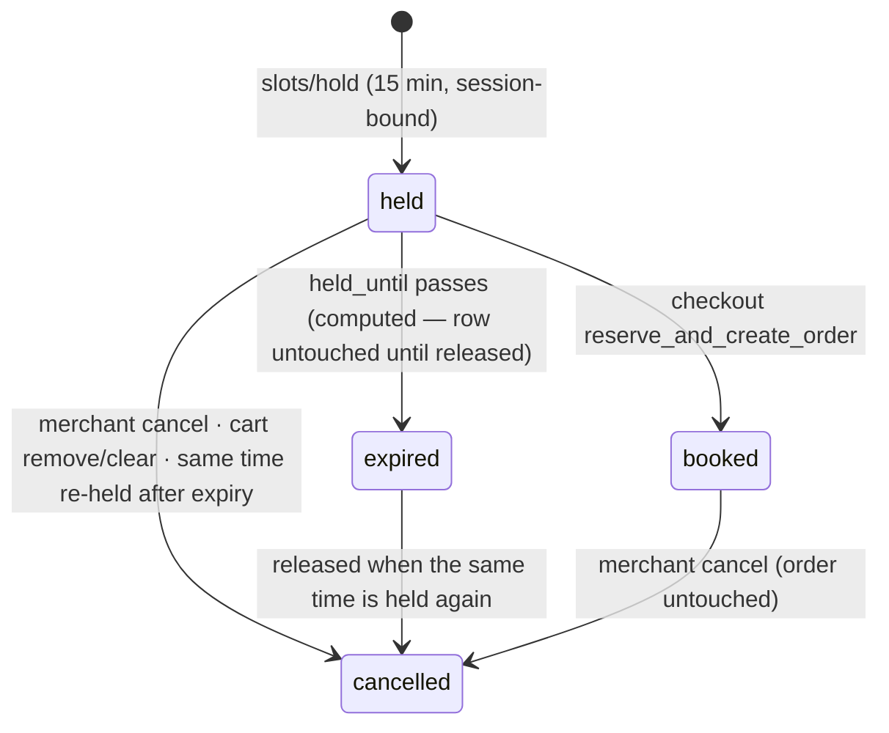

# Bookings API — M26 (الحجوزات والمواعيد)

> **Source**: DOC-249, DOC-250, DOC-251, DOC-252 · INT-036 (M26), INT-012, INT-013, INT-014 · inventory Domain 13
> **Live key**: `bookings` (`SHARWA_LIVE_MODULES`) for the merchant routes; the two buyer routes are **Django-first through `storefrontAdapter` — no switch**.
> **Django provider**: `sharwa_saas/products/services/booking_service.py` (whole service — the legacy screens call it too) + `api/views_bookings.py` (6 routes: 4 merchant + 2 public) · backing models `ServiceAvailability`, `BookingSlot` — **no migration** (INT-036 added none)
> **Frontend contract**: `sharwa-frontend/src/features/bookings/schemas.ts` + `SlotsSchema`/`SlotHoldSchema` in `src/features/storefront/schemas/catalog.ts` · fixtures `src/mocks/bookings/` · BFF `src/app/api/bff/bookings/[...path]/route.ts` + the storefront slot routes under `api/bff/catalog/products/[id]/slots/`
> **Tests**: `sharwa_saas/api/test_bookings_api.py` (9 test methods) · legacy `products/views/bookings.py` suites
> **Last verified against code**: 2026-10-29 (step 46)

## 1. Overview

Appointment selling: a bookable product (a service) offers time slots computed from weekly availability windows; a buyer holds a time for 15 minutes into their visitor session, it rides the cart (or an isolated buy-now), and checkout turns the hold into a confirmed booking on a real M06 order. The merchant side lists services, edits availability as a full weekly replacement, watches the calendar and cancels bookings. Slot math, holds and cancellation live in one service shared with the legacy HTML screens — nothing is generated in the browser, and rows are never pre-created: slots are **computed** from the active `ServiceAvailability` windows, and only holds/bookings become `BookingSlot` rows.

## 2. Access — gate chain

**Merchant routes** (`bookings/*`, `BookingsAPIMixin.run`):

| # | Gate | Requirement | Failure |
|---|---|---|---|
| 1 | Session | owner or staff session | `401` `{"detail": "انتهت جلستك، سجّل الدخول مجدداً."}` |
| 2 | Plan feature | `bookings` | `403` `{"detail": "ميزة الحجوزات غير مفعّلة في خطتك."}` |

**No M18 permission key exists for bookings** — any member who can see the module may use all four merchant routes. **Buyer routes** (`catalog/products/<id>/slots/…`) are public (tenant context only, no session), but the feature gate applies to them too: feature off → `403` with the same message (the picker disappears; the storefront also reports `is_bookable: false` while the feature is off — FR-26.01). A product that is not visible/bookable → `404` `{"detail": "هذا المنتج لا يُحجز بموعد."}`.

## 3. Endpoint summary — the 6 routes

Declared in `api/urls.py:81-82` (buyer, before the generic catalog routes) and `:559-562` (merchant).

| Method | Django path | BFF path | Caller | Purpose | Doc |
|---|---|---|---|---|---|
| `GET` | `catalog/products/<id>/slots/?date=` | `api/bff/catalog/products/<id>/slots` | buyer | one day's slots + next available date | §6 |
| `POST` | `catalog/products/<id>/slots/hold/` | `…/slots/hold` | buyer | hold a time for the session | §6 |
| `GET` | `bookings/services/` | `api/bff/bookings/services` | merchant | bookable services + window counts | §4 |
| `GET`, `PUT` | `bookings/services/<id>/availability/` | `…/availability` | merchant | weekly windows (PUT = full replacement) | §4 |
| `GET` | `bookings/slots/?from&to&product&status` | `api/bff/bookings/slots` | merchant | the booking calendar | §5 |
| `POST` | `bookings/slots/<id>/cancel/` | `…/cancel` | merchant | cancel a booking | §5 |

## 4. Bookable services and availability — DOC-249

#### `GET /api/v1/bookings/services/`

Bookable, non-archived products: `{id, name, booking_duration_minutes, availability_count, image}` — `availability_count` counts **active** windows only (paused ones are invisible to the contract).

#### `GET · PUT /api/v1/bookings/services/<id>/availability/`

`GET` returns `{timezone, week_start_day, product, results}` where each row is `{weekday, start_time "HH:MM", end_time "HH:MM"}` ordered by weekday then start. **Weekday convention: 0 = Monday … 6 = Sunday** (`date.weekday()`); `timezone`/`week_start_day` travel with the data.

`PUT` is a **full replacement of the active windows**: the body is a list (or `{results: […]}`); the server deletes the service's active rules and bulk-creates the new set. Validation is per-row, returned as `{results: [{field: [msg]}]}`:

| Rule | Error |
|---|---|
| `weekday` an integer 0–6 | `{"weekday": ["يوم غير صالح (0 = الاثنين … 6 = الأحد)."]}` |
| `start_time`/`end_time` parse as `HH:MM(:SS)` | `{"start_time": ["وقت غير صالح."]}` |
| end after start | `{"end_time": ["يجب أن ينتهي الوقت بعد بدايته."]}` |
| no overlap within the same weekday | `{"start_time": ["تتداخل مع نافذة أخرى في اليوم نفسه."]}` |

Whole-body errors: a non-list body → `400` «أرسل قائمة النوافذ.»; more than 70 windows → `400` `{"detail": "الحد الأقصى 70 نافذة للخدمة."}` (f-string of `MAX_WINDOWS`). **Windows paused on the legacy screen (`is_active=False`) are untouched** by the replacement — the contract does not know them; existing `BookingSlot` rows are never affected (same rule as the legacy `manage_service_availability`, which — fixed by INT-036 — now carries the `require_feature('bookings')` gate it lacked).

## 5. Merchant calendar and cancellation — DOC-250

#### `GET /api/v1/bookings/slots/?from&to&product&status`

Day bounds in the **store's timezone**; `to` is **inclusive** (the filter runs to the *end* of `to`'s day). `status` is a comma list, default `held,booked` (allowed `held · booked · cancelled` — unknown → `400` `{"status": ["حالة غير معروفة."]}`); `product` filters one service. Bad dates → `{"from": ["تاريخ غير صالح."]}` / `{"to": ["تاريخ غير صالح."]}`; `to` before `from` → `{"to": ["يجب ألا يسبق تاريخ النهاية تاريخ البداية."]}`. At most 2000 rows, earliest first. Row: `{id, product, start_datetime, end_datetime, status, held_until (held only), is_expired, customer_name, customer_phone, order_id}` — **`is_expired` is computed** (a `held` whose `held_until` passed); the customer comes from the linked order, else «زائر المتجر».

#### `POST /api/v1/bookings/slots/<id>/cancel/`

Already cancelled → `409` «هذا الحجز ملغى مسبقاً.»; unknown → `404` «الحجز غير موجود.» (`MSG_SLOT_NOT_FOUND`). Success `{detail: "أُلغي الحجز وأصبح الموعد متاحاً للحجز من جديد.", order_effect}` where `order_effect` names the untouched order — «بقي الطلب #<id> كما هو؛ راجعه لاسترجاع المبلغ إن لزم.» — or `null` for a hold with no order (FR-26.09: cancelling the booking never touches the order itself). An `AuditLog booking.cancel` row records the before/after.

## 6. Buyer slots and holds — DOC-251

#### `GET /api/v1/catalog/products/<id>/slots/?date=YYYY-MM-DD`

Bad date → `400` `{"date": ["تاريخ غير صالح."]}`. Response `{date, timezone, slots: [{start_datetime, end_datetime, status}], next_available_date}` — times as **ISO with the store zone's offset** (`StoreSetting.timezone`, falling back to `Asia/Aden`; the legacy screen used the server zone — FR-26.06). When no slot is free that day, `next_available_date` scans up to **21 days** ahead over the service's active weekdays.

**Slot generation, step by step** (`day_slots`) — computed per request, never stored:

1. load the service's **active** windows whose weekday equals the day's (`date.weekday()`, 0 = Monday);
2. inside each window, offer candidate starts **every 30 minutes** (`SLOT_STEP_MINUTES`) where a full `booking_duration_minutes` fits before the window ends;
3. drop candidates at or before **now**;
4. a candidate overlapping a **booked** slot → `booked`; overlapping a **live hold** (`held` with `held_until` in the future) → `held`; otherwise `available` — **an expired hold never counts** (§7);
5. emit the survivors sorted, each `{start, end, status}`.

#### `POST /api/v1/catalog/products/<id>/slots/hold/` — body `{start_datetime, release_slot_id?}`

`201 {slot_id, start_datetime, held_until}` — the hold lives **15 minutes** (`HOLD_MINUTES`, the legacy value) and belongs to the visitor's session (the session is created on demand). Outcomes:

| Condition | Status | Body |
|---|---|---|
| unparseable `start_datetime` | `400` | `{"start_datetime": ["اختر موعداً صالحاً."]}` |
| a time the generator does not offer (outside windows, or in the past) | `400` | `{"start_datetime": ["هذا الوقت خارج ساعات توفر الخدمة."]}` |
| the time was taken between load and hold | `409` | `{"detail": "لم يعد هذا الموعد متاحاً."}` |
| the partial-unique race lost | `409` | same message — the DB constraint `(product, start_datetime)` over live rows is the only race guard (`IntegrityError` ⇒ 409) |
| ≥ 10 live holds already in this session | `429` | `{"detail": "احتجزت مواعيد كثيرة في الوقت نفسه — أكمل الطلب أو أزل بعضها من السلة أولاً."}` |
| this session already holds this exact time | `201` | the existing hold returned as is |

`release_slot_id` (the picker's "choose another time") releases this session's previous hold **first**. A naive `start_datetime` (no offset) is read as the store's wall-clock time. Before INT-036 the legacy `book_appointment` accepted **any** instant — outside availability or in the past; now only offered times can be held.

## 7. Hold lifecycle and the cart/checkout integration — DOC-252

**Bugs fixed by INT-036** (each observable at these routes):

- an expired hold used to stay `held` **forever** — it blocked the time for everyone (the partial unique), stayed in the cart and then failed checkout. Now an expired hold never counts in availability or the cart, is dropped from the session lists silently, and is **released (`cancelled`) the moment someone holds the same time again** (FR-26.07).
- `book_appointment` accepted any instant — now only generator-offered times (§6).
- buy-now used to include the session's **cart** bookings; the two are now separate lists — `cart_bookings` and `buy_now_bookings` (the gift flow holds none).
- `booking_slot_ids` at checkout now come from the **effective cart lines** (the legacy HTML checkout included too).
- `manage_service_availability` (legacy screen) lacked the `bookings` feature gate — added.

**Cart integration** (`storefront_cart_service`): adding a bookable product to the cart requires `start_datetime` — it re-holds under the same §6 rules and joins `cart_bookings` as a **quantity-1 line** (taken meanwhile → the hold's `409`); decreasing the quantity or removing the line **releases the hold** (the time returns to the pool immediately); `cart_count`/`product_qty` count live bookings; clearing the cart releases all its holds; the cart's «+» is disabled on an appointment line.

**Buy-now and checkout**: a buy-now of a service holds `start_datetime` into the isolated `buy_now_bookings` (no product line, no cart bookings); when the time was taken the checkout answers `409 {detail: "لم يعد هذا الموعد متاحاً.", changed: ["<المنتج>"]}`. Checkout (`reserve_and_create_order`) locks the held rows `select_for_update` inside its transaction and rejects any whose hold expired mid-payment — the message is «عذراً، الموعد الذي اخترته» + the slot's date-time + «انتهت مهلة حجزه المؤقت. الرجاء العودة للسلة واختيار موعد آخر.» — then turns the holds **`booked`** and links them to the created order.

**BFF / mock / tests**: the merchant catch-all `src/app/api/bff/bookings/[...path]/route.ts` (`liveOrMock(…, "bookings", …)`); the buyer routes ride the storefront slot routes, Django-first with no switch. `.env.example` lists `bookings`. The mock is aligned on the 15-minute hold and the 30-minute step. Tests: `api/test_bookings_api.py` (9 methods — gates, services/availability replacement, calendar filters, cancel, buyer slots incl. the weekday convention, holds incl. re-hold/release/race, the expiry fix, the session isolation).

## 8. Open items and legacy-only behaviour

- **Paused windows** (`is_active=False`) are a legacy-screen-only concept — the contract replaces only the active set and never lists paused ones (§4).
- Booking **reminders/rescheduling** and staff assignment do not exist in M26 — a booking is a one-time slot on an order.

## 9. Related pages

- Same domain: [`m16-pos.md`](m16-pos.md) (also sells — but bookable products are excluded from POS) · [`m27-inbox-channels.md`](m27-inbox-channels.md) · [`m28-marketplaces.md`](m28-marketplaces.md) · [`m29-dropshipping.md`](m29-dropshipping.md)
- Buyer guide (booking a service): `../../../guides/buyer/` (bookings page, Step 16)
- Cart/checkout contract: `../05-storefront/` (Domain 5)
- Conventions: `../../overview/conventions.md` · `../../overview/plan-features.md`
