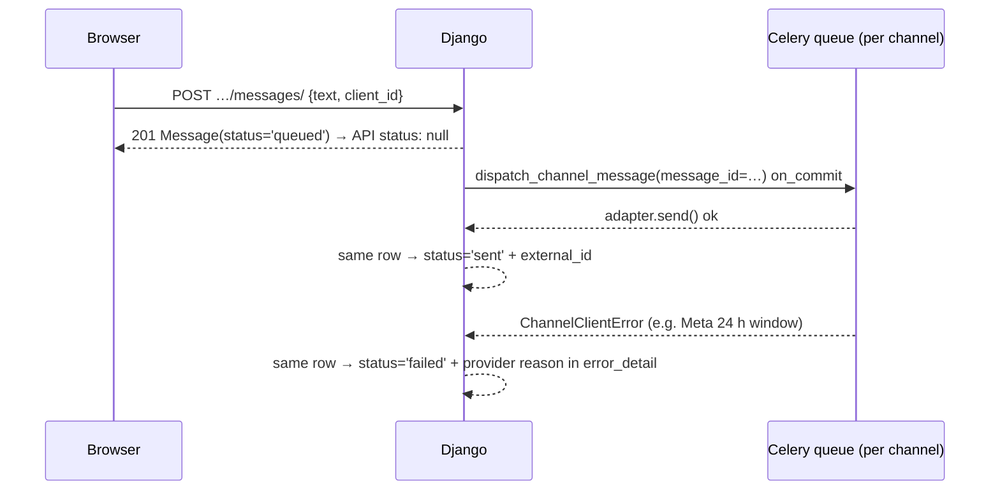
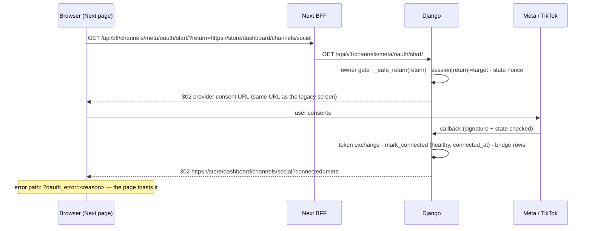

# Inbox & Channels API — M27 (صندوق المحادثات وقنوات التواصل)

> **Source**: DOC-222, DOC-223, DOC-224, DOC-225, DOC-226, DOC-227, DOC-228, DOC-229, DOC-230 · INT-037 (M27) · inventory Domain 13, A.5, A.7, A.8, A.9, A.12, A.13
> **Live key**: `channels` (`SHARWA_LIVE_MODULES`) — one toggle for the inbox **and** the channel settings; the whole module shares the two BFF catch-alls below.
> **Django provider**: `sharwa_saas/products/services/social_channels/inbox_api_service.py` (inbox) + `channels_api_service.py` (settings) · `api/views_channels.py` (21 routes) · conversion `social_channels/chat_to_order_service.py` · Celery `products/tasks/channels.py`
> **Frontend contract**: `sharwa-frontend/src/features/inbox/schemas.ts` · `src/features/channels/schemas.ts` · fixtures `src/mocks/inbox/` · BFF `src/app/api/bff/inbox/[...path]/route.ts` + `src/app/api/bff/channels/[[...path]]/route.ts`
> **Tests**: `sharwa_saas/api/test_channels_api.py` (10 test methods) · legacy suites `products/test_social_channels_phase1.py` … `phase8.py` (8 suites)
> **Last verified against code**: 2026-10-28 (step 44)

## 1. Overview

The unified inbox and the social-channel settings behind it. Store staff read and answer customer conversations arriving from Facebook/Instagram (one Meta install), TikTok Shop, Telegram and WhatsApp (installed from the App Store, M30), assign them, convert them into real M06 orders, and configure keyword auto-replies, catalog sync and per-staff access. The API is a thin provider over the existing M27 domain — encrypted `StoreAppInstallation` credentials, the public `ChannelSessionIndex` bridge, the webhook receivers ([inbound webhooks](../../integrators/webhooks-inbound.md)) and the outbound `dispatch_channel_message` pipeline are shared with the legacy HTML screens, which call the same service functions. The caller is the owner or an inbox staff member on the store host, through the Next BFF.

## 2. Access — gate chain

Every route goes through `_ChannelsBase.guard` (`views_channels.py:48-62`); the first failing gate answers. Gates 5–6 run inside the services, per conversation/channel.

| # | Gate | Requirement | Failure |
|---|---|---|---|
| 1 | Session | owner or staff session (`MerchantSessionAuthentication`) | `401` `{"detail": "انتهت جلستك، سجّل الدخول مجدداً."}` |
| 2 | Plan feature | `social_channels` | `403` `{"detail": "ميزة قنوات التواصل غير مفعّلة في خطتك."}` |
| 3 | Inbox membership | permission key `channels.inbox.access` (the owner always passes) | `403` `{"detail": "ليست لديك صلاحية لهذا الإجراء."}` |
| 4 | Owner-only | every channel-settings route (`channels/*` except template list GET) | `403` `{"detail": "إعدادات القنوات لمالك المتجر فقط."}` |
| 5 | `StaffChannelAccess` | staff visibility/reply rows, inside the service (see below) | hidden conversation `404` `{"detail": "المحادثة غير موجودة."}` · reply without `can_reply` `403` `{"detail": "لا تملك صلاحية الردّ على هذه القناة."}` |
| 6 | Resource state | channel must be connected to reply | `409` `{"detail": "القناة غير مربوطة — لا يمكن الردّ."}` |

**Gate 3 vs 4 for staff**: `guard(owner=True)` rejects *any* staff member with the owner-only message — except `GET channels/templates/`, which passes for every inbox member (`inbox_member_ok=True`, the `/` quick-reply picker); its writes stay owner-only. A staff member without `channels.inbox.access` gets the same owner-only message on that route (the inbox-membership check is folded into gate 4 there).

**Gate 5 — `StaffChannelAccess` rules** (`Viewer`, `inbox_api_service.py:60-88`): a staff member **with no rows sees every channel** (and the owner, who has no `StaffMember`, sees everything); the **first row turns the remainder into a whitelist** — channels without a row are hidden. `can_view` filters the conversation list/counters; a conversation on a hidden channel is `404`, and `can_reply=false` blocks POST replies and conversion with the `403` above. This is the same rule the legacy screen enforces.

**Secrets never leave the server** (FR-27.08): tokens live only in the encrypted `StoreAppInstallation.config`; `test_channels_api.py::test_channels_telegram_and_oauth` asserts the bot token never appears in any response JSON.

## 3. Endpoint summary — the 21 routes

Declared in `api/urls.py:565-585`. Inbox routes need membership (gate 3); every `channels/*` route is owner-only (gate 4) unless noted.

| Method | Django path (`/api/v1/…`) | BFF path (`/api/bff/…`) | Purpose | Gate |
|---|---|---|---|---|
| `GET` | `inbox/counters/` | `inbox/counters/` | unread badge over visible channels | inbox |
| `GET` | `inbox/conversations/` | `inbox/conversations/` | paged, filtered conversation list | inbox |
| `GET`, `PATCH` | `inbox/conversations/<id>/` | `inbox/conversations/<id>/` | detail + context · status/assign/mark-read | inbox |
| `GET`, `POST` | `inbox/conversations/<id>/messages/` | `inbox/conversations/<id>/messages/` | `?after=` incremental read · reply POST | inbox; POST also 5/6 |
| `POST` | `inbox/conversations/<id>/convert-to-order/` | `…/convert-to-order/` | chat-to-order conversion | inbox + 5 |
| `GET` | `inbox/products/` | `inbox/products/` | product picker (`?q`) | inbox |
| `GET` | `channels/` | `channels/` | Meta · TikTok · Telegram connection state | owner |
| `POST` | `channels/telegram/connect/` | `channels/telegram/connect/` | connect a Telegram bot | owner |
| `POST` | `channels/<code>/disconnect/` | `channels/<code>/disconnect/` | disconnect a channel | owner |
| `GET` | `channels/<code>/oauth/start/` | `channels/<code>/oauth/start/` | 302 to Meta/TikTok consent (`?return=`) | owner |
| `GET`, `POST` | `channels/keywords/` | `channels/keywords/` | keyword triggers list · create | owner |
| `PATCH`, `DELETE` | `channels/keywords/<id>/` | `channels/keywords/<id>/` | edit/toggle · delete (204) | owner |
| `GET`, `POST` | `channels/templates/` | `channels/templates/` | reply templates list · create | GET: inbox members; POST: owner |
| `PATCH`, `DELETE` | `channels/templates/<id>/` | `channels/templates/<id>/` | edit · delete (204) | owner |
| `GET`, `PUT` | `channels/<meta\|tiktok>/catalog-sync/` | `channels/<code>/catalog-sync/` | sync settings + report · save | owner |
| `POST` | `channels/<meta\|tiktok>/catalog-sync/run/` | `…/catalog-sync/run/` | queue the Celery sync | owner |
| `GET` | `channels/<code>/products/` | `channels/<code>/products/` | per-product sync status (`?sync_status`) | owner |
| `POST` | `channels/<code>/products/<product_id>/resync/` | `…/products/<id>/resync/` | re-sync one product | owner |
| `GET` | `channels/tiktok/categories/` | `channels/tiktok/categories/` | TikTok Shop category choices | owner |
| `GET`, `PUT` | `channels/tiktok/category-mapping/` | `channels/tiktok/category-mapping/` | store category → TikTok mapping | owner |
| `GET`, `PUT` | `channels/staff-access/` | `channels/staff-access/` | per-staff view/reply matrix | owner |

## 4. Inbox

### 4.1 Counters and conversation list — DOC-223

#### `GET /api/v1/inbox/counters/`

`{"unread": N}` — the sum of `unread_count` over the conversations on the channels **this viewer can see** (FR-27.10).

#### `GET /api/v1/inbox/conversations/?status&channel&assigned&unread&q&page&page_size`

**Query parameters**

| Name | Type | Default | Notes |
|---|---|---|---|
| `status` | `open\|pending\|resolved` | — | any other value yields an empty page |
| `channel` | `facebook\|instagram\|tiktok\|telegram\|whatsapp` | — | UI code, translated below; unknown ⇒ empty page |
| `assigned` | `me\|none\|<staff_id>` | — | `me` for the owner means *unassigned* (the owner is not assignable); for staff, assigned to them |
| `unread` | `1\|true` | — | `unread_count > 0` |
| `q` | text | — | matches contact name or external id; digits also match `customer_phone` |
| `page`, `page_size` | int | 1, 50 | `page_size` caps at 100 |

Ordered by last message time, newest first; DRF-style envelope `{count, next, previous, results}`. Row (`conversation_view`):

```json
{
  "id": 12,
  "channel_code": "facebook",
  "contact_name": "ريم",
  "external_contact_id": "psid-1",
  "last_message_preview": "هل يتوفر مقاس L؟",
  "last_message_at": "2026-10-28T09:00:00+00:00",
  "unread_count": 2,
  "status": "open",
  "assigned_staff": null,
  "order_id": null,
  "channel_connected": true,
  "can_reply": true
}
```

**Code mapping — one place.** The UI speaks five channel codes; Django stores installation codes. Translated only in `inbox_api_service.py` / `channels_api_service.py` (`CHANNEL_FILTER`, `ui_channel`, `CONNECTION_CODES`):

| UI `channel_code` | Django `Conversation.channel_code` | Note |
|---|---|---|
| `facebook` | `meta_social_commerce` | **and** `source_platform != 'instagram'` (legacy Meta rows have an empty platform → facebook) |
| `instagram` | `meta_social_commerce` | **and** `source_platform = 'instagram'` (set by the Meta webhook `object=page\|instagram`) |
| `tiktok` | `tiktok_shop` | |
| `telegram` | `telegram_bot` | |
| `whatsapp` | `whatsapp` | added by INT-037 — before it, a WhatsApp conversation failed the list's Zod parse |

Conversations on any other `channel_code` are **never listed** (`INBOX_CODES` filter in `_visible_qs`) — the fixture's `other_channel` row is invisible even to the owner.

**Reopen rule (US-27.3.2)**: a new inbound customer message moves a `resolved` or `pending` conversation back to `open` (`process_inbound_channel_message`, `tasks/channels.py:571`). Before INT-037 Django never reopened; the UI's resolved filter now matches reality.

### 4.2 Conversation detail, assignment and mark-read — DOC-223

#### `GET /api/v1/inbox/conversations/<id>/`

The list row plus: `contact` `{name, phone, city (always null today), external_contact_id}`, `order` `{id, status, status_label, display_total, created_at}` when the conversation is linked to an order (money as a server display string from `format_money`), and `staff` — the active staff list for the assignment dropdown. A conversation on a channel hidden from this viewer is `404` «المحادثة غير موجودة.».

#### `PATCH /api/v1/inbox/conversations/<id>/`

| Field | Type | Required | Rules / limits |
|---|---|---|---|
| `status` | `open\|pending\|resolved` | no | other value → `400` `{"status": ["حالة غير صحيحة."]}` |
| `assigned_staff_id` | int \| null | no | must be an active staff member → `400` `{"assigned_staff_id": ["الموظف غير موجود أو غير نشط."]}`; null/"" unassigns |
| `mark_read` | bool | no | truthy ⇒ `unread_count = 0` |

Returns the refreshed conversation row. Fields are optional and applied together; an empty body is a no-op that still returns the row.

### 4.3 Product picker — DOC-223

#### `GET /api/v1/inbox/products/?q=`

For the reply-with-product-card dialog and the convert-to-order form: unarchived products (`archived_at__isnull=True`) matching name or SKU, ordered by name, **at most 12**. Row: `{id, name, sku, display_price}` — `display_price` a server money string.

### 4.4 Messages: incremental read and replies — DOC-224

#### `GET /api/v1/inbox/conversations/<id>/messages/?after=<message_id>`

Polling read: return every message with `id > after` (a plain `GET` returns the whole thread). Ordered by `created_at, id`. Row (`message_view`):

```json
{
  "id": 331,
  "direction": "outbound",
  "sender_type": "staff",
  "sender_name": "مالك المتجر",
  "text": "مرحباً",
  "media": [],
  "status": null,
  "error": null,
  "product": null,
  "client_id": "c-1",
  "created_at": "2026-10-28T09:05:00+00:00"
}
```

`status` is `null` for inbound messages and for outbound messages still `queued` (the UI shows «جارٍ الإرسال» — the model label, migration `0231`); otherwise `sent · delivered · read · failed`. `error` carries the provider's failure reason verbatim (`Message.error_detail`). `media` entries are `{url, type}` with a presigned URL; `product` is present when the message was sent as a product card. The owner's outbound messages show `sender_name` «مالك المتجر»; keyword/bot messages show «الرد الآلي».

#### `POST /api/v1/inbox/conversations/<id>/messages/`

**Request body** (`application/json`)

| Field | Type | Required | Rules / limits |
|---|---|---|---|
| `text` | string | no | ≤ 2000 chars → `400` `{"text": ["الرسالة أطول من 2000 حرف."]}` (f-string of `MAX_TEXT`) |
| `template_id` | int | no | quick-reply template; unknown id → `400` `{"template_id": ["القالب غير موجود."]}`; fills `text` only when text is empty |
| `product_id` | int | no | product card; unknown id → `400` `{"product_id": ["المنتج غير موجود."]}` |
| `client_id` | string ≤ 64 | no | idempotency; also accepted via the `Idempotency-Key` header (body wins) |

Neither text nor product → `400` `{"text": ["اكتب رداً أو اختر منتجاً."]}`. Channel disconnected → **`409` «القناة غير مربوطة — لا يمكن الردّ.»**; viewer without reply rights → `403` «لا تملك صلاحية الردّ على هذه القناة.».

**Reply lifecycle** — the row is saved first, the network send happens later, and the *same row* is updated (no extra «الرد الآلي» row, which is what the legacy path wrote):



Details (`queue_outbound` + `dispatch_channel_message`): the `Message(staff, status='queued')` row and a pending `AppUsageLog` are created in one transaction; on commit the task is queued on the **channel's own queue** (`CHANNEL_DISPATCH_QUEUE_MAP`: `channels_meta`, `channels_tiktok`, `channels_telegram`; WhatsApp shares the `whatsapp` queue). The task updates that same row — `sent` + `external_message_id`, or `failed` + the provider's message in `error_detail` (e.g. Meta's 24-hour window, shown verbatim — the fixture test uses «انقضت نافذة الـ 24 ساعة.»). If the channel was deactivated between save and execution, the row becomes `failed` with «القناة غير مربوطة — لم تُرسَل الرسالة.». Sending also resets the conversation's `unread_count` and refreshes `last_message_at`.

**Idempotency**: `client_id` is unique on `Message` (migration `0231`). A retry with the same `client_id` returns the **first** message with `200` (not a duplicate); the race between two clicks is caught by the DB constraint and resolved the same way. A `template_id` fills only an empty text; a `product_id` composes the card text + image via `compose_product_message` (WhatsApp catalog composer) and links `Message.product` for the card shown in the thread.

### 4.5 Chat-to-order conversion — DOC-225

#### `POST /api/v1/inbox/conversations/<id>/convert-to-order/`

**Request body** — staff picks the items manually (no AI extraction):

| Field | Type | Required | Rules / limits |
|---|---|---|---|
| `customer_name` | string | no | falls back to the conversation snapshot, else «عميل القناة» |
| `customer_phone` | string | no | digits only; required in the end → `400` `{"detail": "رقم هاتف العميل مطلوب لإنشاء الطلب."}` |
| `address` | string | no | free text |
| `items` | `[{product_id, quantity}]` | yes | ≥ 1 valid item → `400` `{"detail": "يجب تحديد منتج واحد على الأقل لتحويل المحادثة لطلب."}`; bad rows → «بيانات منتج غير صالحة.» / «الكمية يجب أن تكون عدداً صحيحاً موجباً.» / «منتج غير موجود: <id>» |

**Response `201`** `{"order_id": <int>}` — the conversation row links to the order (`order_id` appears in list/detail), and the customer phone is back-filled onto the conversation when it was empty.

Already linked → `409` `{"detail": "المحادثة مرتبطة بالطلب #<id> مسبقاً."}` (re-checked under `select_for_update` so two tabs cannot create two orders). Without reply rights on the channel → `403` «لا تملك صلاحية الردّ على هذه القناة.».

**What the legacy `chat_to_order_service` does** (unchanged rules, called verbatim):

- Products are locked (`select_for_update`, ordered by id — deadlock-safe) and stock is **decremented immediately**, one `record_stock_movement('sale')` per item with the note «تحويل محادثة #<id> (<channel>) لطلب #<id>».
- A shortage does **not** refuse the order — it sets `is_backordered` («طلب مسبق»); bookable products never block or decrement.
- The order is a real M06 manual order: `sales_channel='chat'`, `payment_method='manual'`, `status='new'`, `payment_status='unpaid'`; `traffic_source` from the channel via `map_channel_to_traffic_source`; fulfilment status = the channel's `ChannelOrderRoutingSettings.default_order_status` (else the store default).
- A confirmation message is queued into the thread (`social_order_confirmation` template + the public `order_status_public` tracking link, sender «الرد الآلي») when the channel is connected — a failed confirmation never rolls back the order.

**Bugs fixed by INT-037** (documented in the service header): the order used to be written with a fixed `'SAR'` currency while summing each product's own-currency price — now it uses the dashboard currency and converts each price (`convert_amount`, same as the M06 manual order); and no timeline event was written — now `record_event(order, 'created', …)` writes «أُنشئ من محادثة #<id>.» like every other creation path. The stored `traffic_source` was also normalized (the raw `telegram_bot`/`meta_social_commerce` codes silently failed `Order.TRAFFIC_SOURCES`).

## 5. Channels

### 5.1 Connection list, Telegram connect, disconnect — DOC-226

#### `GET /api/v1/channels/`

One row per UI channel (`meta`, `tiktok`, `telegram` — owner-only). Connected = an active installation **and** the credential key present (`access_token` / `bot_token`); `error` is set only when the health task marked the install `connection_health='unhealthy'`:

| `channel_code` | Unhealthy message |
|---|---|
| `meta` | «انتهت صلاحية رمز الوصول من Meta — أعد الربط لمتابعة استقبال الرسائل ومزامنة الكتالوج.» |
| `tiktok` | «انتهت صلاحية رمز الوصول من TikTok Shop — أعد الربط لمتابعة مزامنة الكتالوج.» |
| `telegram` | «تعذّر التحقق من بوت تيليجرام — تأكد أن الرمز ما زال صالحاً أو أعد الربط.» |
| (`whatsapp`, from M30) | «انقطع اتصال واتساب — أعد الربط من متجر التطبيقات.» |

Row: `{channel_code, connected, account_name (page/shop name or bot username), bot_username (telegram only), error, connected_at, open_conversations}` — `open_conversations` counts this channel's non-resolved conversations. No secrets (FR-27.08). The health marks come from the Beat task `check_channel_connection_health` (every 15 min; §7).

#### `POST /api/v1/channels/telegram/connect/` — owner

Body `{bot_token}`. Telegram has **no OAuth** — the UI shows a token form; an error keeps the form open. Flow: format check `^\d{6,12}:[A-Za-z0-9_-]{30,}$` → bad token `400` `{"bot_token": ["رمز البوت غير صحيح — انسخه كما يعطيه @BotFather."]}` → `getMe` → `setWebhook` (with a fresh `secret_token`) → encrypted install + public `ChannelSessionIndex` bridge row. A provider failure returns `400` `{"bot_token": ["<provider message>"]}`. **`201`** `{"bot_username": "…"}`.

#### `POST /api/v1/channels/<code>/disconnect/` — owner

`code` ∈ `meta · tiktok · telegram` (unknown → `404` «قناة غير معروفة.»). Clears the encrypted credentials, removes the public bridge rows (`unregister_channel_session` for page/shop/bot ids) and deactivates the installation without deleting it. **Conversations stay, read-only** — the list keeps showing them with `channel_connected: false` and replying returns the `409` of §4.4. Returns `{"ok": true}`.

### 5.2 OAuth start and the validated round trip — DOC-226

#### `GET /api/v1/channels/<meta|tiktok>/oauth/start/?return=<url>` — owner

`OAUTH_CODES` is `meta · tiktok`; anything else → `404` `{"detail": "هذه القناة لا تُربط عبر OAuth."}` (Telegram is token-based, §5.1). The authorize URL is built by the **same helpers as the legacy screen** (`meta_authorize_url` / `tiktok_authorize_url`): missing `META_APP_ID` / `TIKTOK_APP_KEY` → the error «إعدادات فيسبوك غير مكتملة — أضف META_APP_ID في البيئة.» / «إعدادات تيك توك غير مكتملة — أضف TIKTOK_APP_KEY في البيئة.» with `400`, and a `state` nonce is stored in the session.

The `return` URL is validated by `_safe_return` (`views_channels.py:156-174`) — **no open redirect**: scheme http/https, path under `/dashboard/`, and hostname equal to the store's own host (`X-Forwarded-H`/`X-Store-Domain`/`Host`). An invalid or foreign URL is silently dropped (the legacy hub flow then applies). Gate failures and build errors redirect to the return URL with `?oauth_error=<message>` when one was stored, else answer as JSON.



With no stored return URL the callback behaves exactly like the legacy hub flow (unchanged). The connect/disconnect internals (`mark_connected`, `disconnect`) are the same functions the legacy `products/views/social_channels_connect.py` calls.

### 5.3 Keyword triggers — DOC-227

#### `GET · POST /api/v1/channels/keywords/` · `PATCH · DELETE /api/v1/channels/keywords/<id>/` — owner

Trigger row: `{id, keyword, match_type (contains|exact), reply_type (text|product_card|catalog_link), reply_text, product_id, product_name, is_active, created_at}`. Create → `201`; delete → `204` (missing → `404` «المحفّز غير موجود.»).

**Validation (`400`, field-keyed)**: keyword required («أدخل الكلمة المفتاحية.») and ≤ 60 chars («60 حرفاً كحد أقصى.»); `match_type` ∈ `contains|exact` («نوع مطابقة غير صحيح.»); `reply_type` ∈ `text|product_card|catalog_link` («نوع ردّ غير صحيح.»); `text` replies need text («اكتب نص الردّ.») ≤ 1000 chars («1000 حرف كحد أقصى.»); `product_card` needs an existing product («اختر المنتج.»).

**Uniqueness**: a keyword is unique **case-insensitively, whatever the match type** — the service checks `keyword__iexact` («يوجد محفّز بالكلمة نفسها.») on top of the DB `unique=True` on `ConversationKeywordTrigger.keyword`; the mock was aligned to the same rule. Triggers fire on every inbound message (`find_active_match`) — note the model's optional per-channel scoping (`channel_code`) is not part of this contract; rows created here apply to all channels.

### 5.4 Reply templates — DOC-227

#### `GET /api/v1/channels/templates/` · `POST` — list readable by every inbox member (the `/` picker); writes owner-only

`ChannelReplyTemplate` is **new in INT-037** — staff quick replies; Django previously had only system notification templates (`TEMPLATE_REGISTRY`). Row: `{id, title, body, updated_at}`. Validation: title required («أدخل عنوان القالب.») ≤ 60 chars («60 حرف كحد أقصى.»); body required («اكتب نص القالب.») ≤ 1000 chars («1000 حرف كحد أقصى.»). Missing id on PATCH/DELETE → `404` «القالب غير موجود.».

### 5.5 Catalog sync, product links, TikTok categories — DOC-228

#### `GET · PUT /api/v1/channels/<meta|tiktok>/catalog-sync/` — owner

`GET` returns `{channel_code, scope (all|selected_categories), category_ids, price_adjustment_percent, stock_shield_enabled, last_run_at, included_products_count, report, categories}` — `categories` is the store's category list for the scope picker; `report` is null until the first run, then `{pending, synced, error, hidden_out_of_stock}` counts of this channel's `ChannelProductLink` rows (product-level links only).

`PUT` body: `scope`, `category_ids` (required when scoped; every id must exist — «اختر فئة واحدة على الأقل.» / «فئة غير موجودة.»), `price_adjustment_percent` as text, ±50 max → `{"price_adjustment_percent": ["نسبة بين −50 و50."]}`, `stock_shield_enabled`. `scope` must be `all|selected_categories` («نطاق غير صحيح.»). Any other channel code → `404` «لا مزامنة كتالوج لهذه القناة.».

#### `POST /api/v1/channels/<meta|tiktok>/catalog-sync/run/` — owner

`409` «القناة غير مربوطة.» when disconnected, or `409` with the unhealthy message of §5.1 when the health task flagged the token expired. Otherwise sets `ChannelCatalogSync.last_run_at = now`, queues Celery `sync_channel_catalog` and returns the refreshed settings view — the report updates when the task finishes.

#### `GET /api/v1/channels/<code>/products/?sync_status&page&page_size` — owner

Per-product sync state (product-level links, ordered by product name): `{product_id, name, sku, sync_status, error, synced_at}`; `sync_status` ∈ `pending · synced · error · hidden_out_of_stock`, unknown filter → `400` `{"sync_status": ["حالة غير معروفة."]}`. `error` is the last provider rejection verbatim.

#### `POST /api/v1/channels/<code>/products/<product_id>/resync/` — owner

Only for a product already in the sync scope — otherwise `404` «المنتج غير مشمول في المزامنة.». Resets the link to `pending` (clears the error) and queues the INT-037 task `sync_channel_product` (the same `_sync_one_product` path as the full batch). Returns `{product_id, sync_status: "pending"}`.

#### `GET /api/v1/channels/tiktok/categories/` · `GET · PUT /api/v1/channels/tiktok/category-mapping/` — owner

The category list is a **static starter list** (8 codes, `TIKTOK_CATEGORIES`) — there is no TikTok Get-Categories client yet — plus any code previously saved from the legacy free-text screen (label preserved, generated label «تصنيف <code>» when only the code survived). The mapping is a list body `[{category_id, external_category_id}]`: store categories must exist («فئة المتجر #<id> غير موجودة.»), TikTok codes must match `^\d{3,12}$` («فئة تيك توك <code> غير موجودة.»); a non-list body → `400` «صيغة غير صحيحة.». Empty `external_category_id` clears the mapping. `GET` returns one row per store category.

> ⚠️ **Open item (pinned by `test_social_channels_phase2`)** — a product syncs to **Meta** only through a Meta category mapping (`ChannelCategoryMapping` for `meta_social_commerce`), but no screen offers one; every unmapped product therefore fails with «لا يوجد ربط تصنيف لهذا المنتج على هذه القناة.». TikTok has the mapping screen above; Meta does not (inventory A.13).

### 5.6 Staff channel access — DOC-229

#### `GET · PUT /api/v1/channels/staff-access/` — owner

`GET` returns `{staff: [{id, name}], rows}` — **4 rows per active staff member** (`meta · tiktok · telegram · whatsapp`; WhatsApp rows were added to the matrix by INT-037). The rows *display* the whitelist rule: a staff member with no rows at all shows `can_view/can_reply: true` on every channel; once any row exists, unlisted channels show `false`.

`PUT` body is a **list of changed cells** `{staff_id, channel_code, can_view, can_reply}`. On save, the server writes **the staff member's 4 rows at once** (`update_or_create` per channel, current values for untouched cells) — before INT-037 one toggle silently created a single row and hid the other channels under the first-row-is-a-whitelist rule. **Reply folds into view**: `can_reply` is stored as `can_view AND can_reply`, so reply-without-view is impossible (`meta: view=false, reply=true` saves as `(false, false)`). Unknown channel/staff → `400` «قناة غير معروفة.» / «الموظف غير موجود.»; non-list body → «صيغة غير صحيحة.». Returns the refreshed matrix.

## 6. Gaps closed, bugs fixed and migrations — DOC-230

**Migration `products/0231_inbox_api`** (no other migration): `Conversation.source_platform` (facebook/instagram for Meta); `Message.status` gains `'queued'` («قيد الإرسال») + new fields `error_detail`, `client_id` (unique, ≤ 64), `product` FK (product cards); `ChannelCatalogSync.last_run_at`; new model `ChannelReplyTemplate` (title ≤ 60, body ≤ 1000).

**Bugs fixed that change observable behaviour**: the fixed-`'SAR'` order currency and missing timeline event in chat-to-order (§4.5); the un-normalized `traffic_source`; inbound messages now reopen resolved/pending conversations (§4.1); `whatsapp` added to the conversation channel codes (a WhatsApp conversation previously failed the list's Zod parse); the reply task updates the sender's own `Message` row instead of appending a bot row (§4.4); staff-access save writes all 4 rows at once (§5.6).

**Celery tasks behind the contract** (`products/tasks/channels.py`, import from `products.tasks`): `dispatch_channel_message(message_id=…)` — the outbound pipeline of §4.4, per-channel queues; `sync_channel_catalog` — the full batch of §5.5; `sync_channel_product` (new) — one product; `check_channel_connection_health` (Beat, every 15 min, fan-out per store via `ChannelSessionIndex`) — writes `connection_health` (+`last_health_check_at`) into the encrypted config for meta/tiktok/telegram; WhatsApp's flag is set by the SharwaConnect side. Related, unchanged: `process_inbound_channel_message` (webhook ingestion, reopen rule), `upload_inbound_channel_media_task`, `hide_channel_product_out_of_stock` / `show_channel_product_back_in_stock` (stock shield), `archive_stale_conversations` (Beat daily: resolved conversations untouched for 90 days are archived away — they disappear from the API).

**BFF wiring**: `src/app/api/bff/inbox/[...path]/route.ts` (required catch-all → `/api/v1/inbox/<path>/`) and `src/app/api/bff/channels/[[...path]]/route.ts` (optional catch-all → `/api/v1/channels/<path>/`), both through `liveOrMock(request, "channels", …)` — one live key for both. Mock mode serves `src/mocks/inbox`; `inbox/_mock/*` (simulated inbound webhook, fixture reset) stays **fixture-only** and never reaches Django. `.env.example` lists `channels` in `SHARWA_LIVE_MODULES`. The OAuth link passes `?return=` through (§5.2).

**Tests**: `api/test_channels_api.py` — 10 methods covering the gates, list filters (facebook/instagram split, preview, StaffChannelAccess hiding), detail/patch/assignment, messages (`?after`, queued→null, `client_id` dedup, template, product card, 409/403), the dispatch task updating the same row (sent/failed + reason), inbound reopen + `source_platform`, conversion (chat + 409 repeat), Telegram connect/disconnect + OAuth error path + token secrecy, keywords/templates CRUD, catalog sync + mapping + staff access (4 rows). Legacy behaviour stays pinned by `products/test_social_channels_phase1.py` … `phase8.py` (8 suites). Run: `python manage.py test api.test_channels_api`.

## 7. Open items and legacy-only behaviour

- **Meta category mapping has no screen** — §5.5 callout; every unmapped product reports «لا يوجد ربط تصنيف لهذا المنتج على هذه القناة.» until one exists (inventory A.13).
- **TikTok categories are a static list** — no TikTok category API client; saved legacy codes are merged in (§5.5).
- **Keyword per-channel scoping** (`ConversationKeywordTrigger.channel_code`) is a model capability the contract does not expose — API-created triggers fire on every channel (§5.3).
- **Broadcast campaigns and the Instagram comment auto-reply** remain legacy-HTML/Twitter-side paths (`dispatch_broadcast_campaign_chunk`, `dispatch_instagram_comment_auto_reply`); no API route serves them.
- **`Conversation.customer_phone` is captured only for WhatsApp** inbound (cleaned); Meta/TikTok/Telegram conversations rely on the convert-to-order form for the phone.
- WhatsApp connection itself is managed in the App Store (M30), not by `channels/` — only its conversations, staff-access rows and unhealthy message appear here.

## 8. Related pages

- Guide: `../../../guides/merchant/13-sales-channels/` (Step 48)
- Inbound webhooks: `../../integrators/webhooks-inbound.md` (Meta/TikTok/Telegram receivers)
- WhatsApp app: `../14-apps-ai-support/m30-app-store.md`
- Conventions, auth, idempotency: `../../overview/conventions.md` · `../../overview/auth.md` · `../../overview/idempotency.md`
