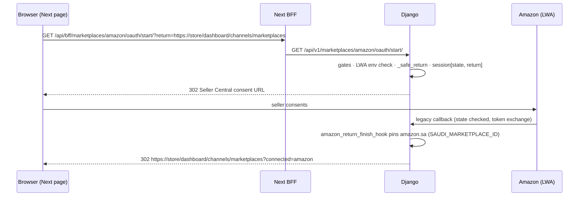

# Marketplaces API — M28 (الأسواق الإلكترونية)

> **Source**: DOC-231, DOC-232, DOC-233, DOC-234 · INT-038 (M28) · inventory Domain 13, A.6, A.8, A.10
> **Live key**: `marketplaces` (`SHARWA_LIVE_MODULES`) — one optional catch-all `api/bff/marketplaces/[[...path]]` for the whole module.
> **Django provider**: `sharwa_saas/products/services/marketplaces/api_service.py` (contract provider) + `api/views_marketplaces.py` (14 routes) · reused verbatim: `connection_service`, `listing_service`, `bulk_sync_service`, `order_pull_service` / `fba_inventory_service`, `shipment_confirm_service`, `amazon_auth`, `noon_adapter` (picked via `registry.py`, switch `NOON_MARKETPLACE_ADAPTER`)
> **Frontend contract**: `sharwa-frontend/src/features/marketplaces/schemas.ts` · fixtures `src/mocks/marketplaces/` · BFF `src/app/api/bff/marketplaces/[[...path]]/route.ts`
> **Tests**: `sharwa_saas/api/test_marketplaces_api.py` (9 test methods, all 14 routes) · legacy `products/test_marketplaces_phase1.py` … `phase5.py` (5 suites) · mock E2E `scripts/marketplaces-check.ts`
> **Last verified against code**: 2026-10-29 (step 45)

## 1. Overview

Sell on Amazon.sa and noon from one dashboard: connect each market once (Amazon via Seller Central OAuth, noon with API credentials), keep one listing row per product/variant per market with its marketplace identifier and price, and push catalog changes. The API is a contract provider over the existing M28 domain — encrypted `StoreAppInstallation` credentials, the public bridge, the SP-API/noon adapters, Feeds bulk jobs and Celery queues are the same ones the legacy HTML screens use; **no migration was needed** (INT-038 added no schema). The caller is the owner or a staff member holding the M18 permission key, on the store host through the Next BFF.

## 2. Access — gate chain

All 14 routes share `MarketplacesAPIMixin.guard` (`views_marketplaces.py:43-49`). Note the order: the **permission key is checked before the plan feature** — the reverse of M27's chain.

| # | Gate | Requirement | Failure |
|---|---|---|---|
| 1 | Session | owner or staff session | `401` `{"detail": "انتهت جلستك، سجّل الدخول مجدداً."}` |
| 2 | Permission key | `channels.marketplaces.manage` (owner has every key implicitly) | `403` `{"detail": "ليست لديك صلاحية لهذا الإجراء."}` |
| 3 | Plan feature | `marketplaces` | `403` `{"detail": "ميزة الأسواق الإلكترونية غير مفعّلة في خطتك."}` |

Beyond the gates, connection-dependent actions answer `409` when the market is not connected («السوق غير مربوط.») or the health task flagged re-auth («انتهت صلاحية الربط — أعد ربط السوق.») — the health task `check_marketplace_connection_health` runs every 15 min, same cadence as the social channels.

## 3. Endpoint summary — the 14 routes

Declared in `api/urls.py:588-601`; the literal paths (`amazon/oauth/start`, `noon/connect`, `jobs/…`) are declared **before** `<str:market>/` so they cannot be swallowed.

| Method | Django path (`/api/v1/…`) | BFF path (`/api/bff/…`) | Purpose | Doc |
|---|---|---|---|---|
| `GET` | `marketplaces/` | `marketplaces/` | per-market status + listing counters + last job | §4.1 |
| `GET` | `marketplaces/amazon/oauth/start/?return=` | `marketplaces/amazon/oauth/start/` | 302 to Seller Central consent | §4.2 |
| `POST` | `marketplaces/noon/connect/` | `marketplaces/noon/connect/` | connect noon `{api_key, seller_id, marketplace_country}` | §4.3 |
| `POST` | `marketplaces/<market>/disconnect/` | `marketplaces/<market>/disconnect/` | disconnect (listings preserved) | §4.3 |
| `GET`, `PUT` | `marketplaces/<market>/settings/` | `marketplaces/<market>/settings/` | pricing/sync settings + price preview | §4.4 |
| `GET` | `marketplaces/<market>/listings/` | `marketplaces/<market>/listings/` | paged listings (`?sync_status&identifier_type&q&page`) | §5 |
| `PATCH` | `marketplaces/<market>/listings/<id>/` | `…/listings/<id>/` | set identifier / price override | §5 |
| `POST` | `marketplaces/<market>/listings/push/` | `…/listings/push/` | push selected listings → `202 {job_id, count}` | §6 |
| `POST` | `marketplaces/<market>/jobs/` | `marketplaces/<market>/jobs/` | trigger `order_pull` / `fba_inventory` → `202 {job_id}` | §6 |
| `GET` | `marketplaces/jobs/` | `marketplaces/jobs/` | job history (`?market&job_type&status&triggered_by&page`) | §6 |
| `GET` | `marketplaces/jobs/<id>/` | `marketplaces/jobs/<id>/` | one job (counts, summary, CSV url) | §6 |
| `GET` | `marketplaces/jobs/<id>/errors.csv/` | `…/errors.csv` | streamed error CSV (UTF-8 + BOM) | §6 |
| `GET` | `marketplaces/orders/` | `marketplaces/orders/` | imported marketplace orders | §7 |
| `POST` | `marketplaces/orders/<order_id>/confirm-shipment/` | `…/confirm-shipment` | retry a failed shipment confirmation | §7 |

`<market>` ∈ `amazon · noon` (`MARKETS`); anything else → `404` `{"detail": "السوق غير موجود."}`.

## 4. Connections and settings — DOC-231

### 4.1 Hub

#### `GET /api/v1/marketplaces/`

First materializes the missing listing rows (§5), then one row per market:

```json
{
  "marketplace": "amazon",
  "connected": true,
  "needs_reauth": false,
  "account_label": "A1SELLER",
  "connected_at": "2026-10-20T08:00:00+00:00",
  "listings_count": 2,
  "needs_identifier_count": 2,
  "failed_count": 0,
  "last_job": {"id": 88, "job_type": "catalog_push", "status": "completed_with_errors", "finished_at": "2026-10-27T18:02:11+00:00"}
}
```

`connected` comes from the same `connection_service.is_connected` the legacy hub uses (active install + credential + marketplace pinned); `needs_reauth` mirrors the health flag. `account_label` is the seller/partner id label (`P7788 · AE` for noon); `last_job` is the newest `MarketplaceSyncJob` for that market.

### 4.2 Amazon OAuth

#### `GET /api/v1/marketplaces/amazon/oauth/start/?return=<url>`

Owner flow onto Login-with-Amazon / Seller Central: needs all three env vars (`AMAZON_SP_APP_ID`, `AMAZON_SP_LWA_CLIENT_ID`, `AMAZON_SP_LWA_CLIENT_SECRET`) — missing → error «إعدادات أمازون غير مكتملة — أضف AMAZON_SP_APP_ID وAMAZON_SP_LWA_CLIENT_ID وAMAZON_SP_LWA_CLIENT_SECRET في البيئة.» (`400`, or a redirect to `return` with `?oauth_error=` when a validated return URL was stored). A `state` nonce goes into the session and the validated return URL into `marketplace_oauth_return` (same `_safe_return` as the social channels: same store host, under `/dashboard/`, no open redirect).

The callback is the legacy one (`products/views/marketplaces_connect.py`) — when the flow started from Next, it **pins amazon.sa automatically** (`amazon_return_finish_hook` writes `SAUDI_MARKETPLACE_ID` into the install when the seller participates) instead of the legacy "confirm, don't choose" marketplace page, then redirects to the return URL with `?connected=amazon`, or `?oauth_error=` with the reason — «اربط حساب أمازون أولاً.» when nothing is installed, «حساب البائع غير مشارك في سوق أمازون السعودية — لا يمكن تثبيت الربط.» when the Saudi marketplace is not among the participations (the page toasts it). Without a stored return URL the flow stays on the legacy hub pages unchanged.



### 4.3 noon connect and disconnect

#### `POST /api/v1/marketplaces/noon/connect/`

**Request body**: `api_key`, `seller_id`, `marketplace_country` (`SA` → SAR, `AE` → AED — `NOON_COUNTRIES`). All three are required: «أدخل مفتاح API.» · «أدخل معرّف البائع.» · «اختر دولة نون (السعودية أو الإمارات).» (`400`, field-keyed). Before INT-038 the frontend only sent the API key; the dialog and the mock now collect seller id + country too. The adapter verifies the credentials (a failure returns `400` under `api_key` with the adapter message); on success the credentials are stored encrypted, and the market's `price_currency` switches to the country's currency (SAR/AED). Returns the refreshed hub row of §4.1.

The noon adapter is swappable: `NOON_MARKETPLACE_ADAPTER` (`fake` by default) selects `FakeNoonAdapter`; the real one is not built yet and answers «محوّل نون الحقيقي غير مبني بعد — استخدم NOON_MARKETPLACE_ADAPTER=fake حتى يصل التوثيق الرسمي.» (open item, §7).

#### `POST /api/v1/marketplaces/<market>/disconnect/`

Drops the connection (encrypted credentials + bridge rows, same `disconnect_marketplace` as the legacy screen). **Listings and settings are preserved** — reconnecting finds them as they were. Returns the hub row (`connected: false`).

### 4.4 Settings and the price preview

#### `GET · PUT /api/v1/marketplaces/<market>/settings/`

| Field | Type | Rules / limits |
|---|---|---|
| `currency` | `SAR` \| `AED` | other → `400` `{"currency": ["العملة SAR أو AED."]}` |
| `markup_percent` | text, 0–500, ≤ 2 decimals | → `400` `{"markup_percent": ["نسبة الهامش بين 0 و500 حتى خانتين عشريتين."]}` |
| `fx_rate` | text, positive, ≤ 6 decimals (displayed to 4) | → `400` `{"fx_rate": ["سعر الصرف رقم موجب حتى 4 خانات."]}` |
| `stock_buffer` | non-negative int | safety stock subtracted from the quantity sent → `400` `{"stock_buffer": ["احتياطي المخزون عدد صحيح غير سالب."]}` |
| `auto_push` | bool | see below |
| `inventory_sync` | bool | off ⇒ no quantity is sent at all |
| `order_pull` | bool | scheduled order import |
| `import_marketplace_fulfilled` | bool | **added to the contract by INT-038** — import orders the market itself fulfils (FBA-style) instead of skipping them |
| `default_order_status_id` | int \| null | must exist → `400` `{"default_order_status_id": ["الحالة غير موجودة."]}` |

`GET` adds `preview` — the server computes it over the first available product: `{sample_product, display_store_price (in SAR), display_sample_price (the same formula as §5 applied)}` — plus `order_status_options`. Money appears only as server display strings (`100.00 ر.س`, `115.00 ر.س`).

**`auto_push` means**: when a product's price or stock changes locally, its **published** listings (with an identifier, `synced`/`hidden_out_of_stock`) are re-sent to the market, debounced (`signals_marketplaces.py` → `update_marketplace_price_quantity_task`). It does **not** publish new products — the Next toggle is labelled «دفع تغيّرات السعر والمخزون تلقائياً» with the note «تُدفع تغيّرات السعر والمخزون للقوائم المنشورة تلقائياً.», matching Django's meaning.

## 5. Listings, identifiers and prices — DOC-232

#### `GET /api/v1/marketplaces/<market>/listings/?sync_status&identifier_type&q&page&page_size`

**One row per available product (or variant) per market.** Rows are created **lazily**: before any listing read, `materialize_listings` bulk-creates the missing ones as `sync_status='needs_identifier'`, **unpublished** — materialization never pushes anything to the market. The seller SKU defaults to the product/variant SKU (`SHW-<id>` fallback, `-V<id>` variant suffix, capped at 40 chars; a duplicate SKU is skipped until edited on the legacy screen). Filters: `sync_status` (`needs_identifier · pending · unpublished · synced · failed · hidden_out_of_stock`), `identifier_type`, `q` (product name/SKU, variant SKU, identifier, seller SKU); page size defaults to 25, caps at 200.

Row (`listing_view`):

```json
{
  "id": 41,
  "marketplace": "amazon",
  "product": {"id": 7, "name": "عطر عود", "sku": "OUD-1", "image": "/media/…", "barcode": "6281000000017"},
  "identifier_type": "ean",
  "identifier_value": "6281000000017",
  "display_market_price": "100.00 ر.س",
  "display_computed_price": "100.00 ر.س",
  "price_override": null,
  "sync_status": "unpublished",
  "last_error": null,
  "last_synced_at": null
}
```

**Price formula** (`compute_effective_price`, `listing_service.py:56-66`):

```
effective = price_override            (when set — always wins)
          else base_sar × fx_rate × (1 + markup% / 100)
```

- `base_sar` — the store price (variant `effective_price` if present) converted to SAR through the standing currency converter;
- × the market's `fx_rate` (from settings), × `1 + markup_percent/100`.

`display_market_price` shows the effective price in the market currency; `display_computed_price` shows the **same computation without the override** — so a merchant with `price_override: "130.50"` sees both `130.50 ر.س` (what sells) and `100.00 ر.س` (what the formula would give). Both are server display strings (money never travels as numbers in the contract).

#### `PATCH /api/v1/marketplaces/<market>/listings/<id>/`

Two independent edits; unknown listing → `404` «القائمة غير موجودة.».

**Identifier** (`identifier_type` + `identifier_value`, uppercase; empty value clears back to `needs_identifier`):

| Type | Amazon | noon | Format check (`ID_PATTERNS`) | Error |
|---|---|---|---|---|
| `asin` | ✓ | — | `^B0[A-Z0-9]{8}$` (B0 + 8) | «قيمة ASIN غير صالحة.» |
| `nsku` | — | ✓ | `^[A-Z0-9-]{4,40}$` | «قيمة NSKU غير صالحة.» |
| `ean` | ✓ | ✓ | 13 digits | «قيمة EAN غير صالحة.» |
| `upc` | ✓ | — | 12 digits | «قيمة UPC غير صالحة.» |
| `gtin` | ✓ | ✓ | 8–14 digits | «قيمة GTIN غير صالحة.» |

A type the market's adapter does not accept → `400` `{"identifier_type": ["نوع المعرّف <TYPE> غير مدعوم على <السوق>."]}` (f-string; e.g. asin on noon, nsku on Amazon); an unknown type → «نوع المعرّف غير صالح.». `set_identifier` moves the listing to `unpublished` (when not yet published) — it publishes **only when pushed** (Step 45), and clears any previous error.

**Price override** (`price_override`): positive number with ≤ 2 decimals → `400` `{"price_override": ["السعر رقم موجب حتى خانتين."]}`; null/`""` removes it (back to the formula). Changing the price of a published, synced listing flips it to `pending` — it needs a new push.

## 6. Listing push and marketplace jobs — DOC-233

### 6.1 Push selected listings

#### `POST /api/v1/marketplaces/<market>/listings/push/` → `202 {job_id, count}`

Body `{listing_ids: [int, …]}` — unknown/empty selection → `400` `{"listing_ids": ["حدد قائمة واحدة على الأقل."]}`. Gates beyond §2: not connected → `409` «السوق غير مربوط.»; health flag `reauth_required` → `409` «انتهت صلاحية الربط — أعد ربط السوق.». The selection is then split:

- **Listings without an identifier** never reach the market — they are recorded in the **same job** as `NO-ID` errors («Missing product identifier.») and counted as failed items. If *nothing* in the selection has an identifier → `400` `{"detail": "كل القوائم المحددة تحتاج معرّفاً قبل الدفع."}`.
- **The rest are marked published** (`set_published(True)` → `pending`) and pushed. Two execution shapes (`adapter.supports_bulk_feed` — Amazon yes, noon no):
  - **Amazon bulk Feeds above the threshold** (`len(targets) > BULK_FEED_THRESHOLD = 20`): one `start_bulk_push_job` Feeds job for all targets. While such a job is already live (`active_push_job`) → `409` «هناك عملية نشر جماعي جارية لهذا السوق — انتظر اكتمالها.». The blocked NO-ID rows are written into that job's error summary before the task starts.
  - **Otherwise (noon always; Amazon ≤ 20)**: one `catalog_push` job for the whole selection, then **one Celery task per listing** on the job (`push_marketplace_listing_task`, queue `marketplaces_amazon`/`marketplaces_noon`).

`count` in the `202` body is the **whole selection** (including the NO-ID rows); `job_id` is either job shape.

### 6.2 Trigger a job

#### `POST /api/v1/marketplaces/<market>/jobs/` → `202 {job_id}`

Body `{job_type}` ∈ `order_pull · fba_inventory` — anything else → `400` `{"job_type": ["النوع order_pull أو fba_inventory."]}`. These are the **same legacy start functions** the old screens call, with their one-live-job rules:

- `order_pull` — `order_pull_service.start_order_pull_job`; a live pull already running → `409` «يجري سحب الطلبات الآن بالفعل — ستظهر الطلبات الجديدة خلال لحظات.». A job "running" for more than 30 minutes (`STALE_JOB_MINUTES`, a dead worker) is closed failed («توقفت عملية السحب السابقة دون اكتمال — بدأ سحب جديد من نفس النقطة.») and a new pull starts from the same cursor — no loss and no duplicate import.
- `fba_inventory` — only where `adapter.supports_fulfillment_inventory` (Amazon yes, noon → `400` `{"job_type": ["هذا السوق لا يدعم قراءة مخزون مستودعه."]}`); live one → `409` «يجري جلب مخزون المستودع الآن بالفعل.». Same staleness rule.
- Either type with the market not connected/re-authed → `409` «السوق غير مرتبط أو يتطلب إعادة الربط.»

Both enqueue on the market's queue (`_enqueue_order_pull` / `_enqueue_fba_inventory` → `pull_marketplace_orders_task` / `refresh_fba_inventory_task`).

### 6.3 Job history, detail and the errors CSV

#### `GET /api/v1/marketplaces/jobs/?market&job_type&status&triggered_by&page`

`job_type` values: `catalog_push · bulk_push · order_pull · fba_inventory …`; `triggered_by` accepts `merchant` / `system` (anything but `merchant`, incl. `auto`/`beat`). Page size defaults to 20, caps at 200; newest first. Row (`job_view`):

```json
{
  "id": 88,
  "marketplace": "amazon",
  "job_type": "catalog_push",
  "status": "completed_with_errors",
  "triggered_by": "التاجر",
  "created_at": "2026-10-27T17:58:02+00:00",
  "started_at": "2026-10-27T17:58:03+00:00",
  "finished_at": "2026-10-27T18:02:11+00:00",
  "duration_seconds": 248,
  "total": 2,
  "success_count": 0,
  "error_count": 1,
  "errors_csv_url": "/api/bff/marketplaces/jobs/88/errors.csv",
  "summary": null
}
```

`triggered_by` is labelled «التاجر» / «النظام (تلقائي)» / «النظام (مجدول)» (`TRIGGER_LABELS`). While queued/running, `success_count`/`error_count` are `0` and no CSV url is offered. `summary` is the general (SKU-less) error, or for order pulls the Arabic counter line «أُنشئ <n> · حُدّث <n> · تُخطّي <n>» built from the job payload (created/updated/skipped). Missing job → `404` «المهمة غير موجودة.».

#### `GET /api/v1/marketplaces/jobs/<id>/errors.csv/`

The legacy streamed CSV (UTF-8 + BOM, `attachment; filename="marketplace-job-<id>-errors.csv"`). Columns (`CSV_HEADER`): «SKU البائع» · «المنتج» · «نوع المعرّف» · «المعرّف الخارجي» · «الحالة» · «كود الخطأ» · «رسالة الخطأ» · «آخر دفعة». Rows: the NO-ID entries excluded before sending (empty identifier columns, «الحالة» = «خطأ»), then each listing the job touched with an error — streamed with `iterator(chunk_size=500)` so a ten-thousand-listing job never loads into memory.

## 7. Marketplace orders and shipment re-confirmation — DOC-234

### 7.1 Orders

#### `GET /api/v1/marketplaces/orders/?market&fulfillment&status&page`

The `MarketplaceOrderDetail` rows (imported orders; the local `Order` is created by the pull). Filters: `market` (`amazon|noon`), `fulfillment` (`merchant|marketplace`), `status` (the market's `status_class` `pending · open · shipped · canceled · unknown`). Row (`order_view`):

| Field | Meaning |
|---|---|
| `order_id`, `order_number` | the local order id / `#<id>` |
| `marketplace`, `external_order_id` | market code + the market's own id |
| `fulfillment` | `merchant` (we ship) or `marketplace` (FBA-style) |
| `marketplace_status` | `status_class`, mapped to `unknown` when unrecognized |
| `shipment_confirm_status` | the mapping below |
| `shipment_confirm_error` | the failure text — or the hint «أدخل رقم التتبع ليُؤكَّد الشحن للسوق آلياً.» while `needs_tracking` |
| `display_total` | server money string of the local order |

**Confirmation status mapping** — the model's raw `shipment_confirm_status` never leaves as-is:

| Stored value | Contract value | When |
|---|---|---|
| `''` | `not_required` | no confirmation needed (incl. every marketplace-fulfilled order) |
| `needs_tracking` | `pending` | waiting for a tracking number on the order |
| `queued` | `pending` | confirmation task queued |
| `confirmed` | `confirmed` | the market accepted it |
| `failed` | `failed` | the market rejected it — `shipment_confirm_error` carries the reason |

### 7.2 Shipment re-confirmation

#### `POST /api/v1/marketplaces/orders/<order_id>/confirm-shipment/`

Confirmation itself is **automatic** — every tracking-number entry on the order queues it. This route only resumes a **failed** one (`retry_failed_confirmation`: resets attempts, re-queues on commit); it is not a manual confirm button.

| Condition | Result |
|---|---|
| failed confirmation with a tracking number | `{…order row…}` with `shipment_confirm_status: "pending"` (queued again) |
| marketplace-fulfilled order | `409` «ينفّذه السوق — لا تأكيد شحنة من المتجر.» |
| already confirmed | `409` «الشحنة مؤكدة مسبقاً.» |
| not failed (pending/queued/none) | `409` «التأكيد آلي عند إدخال رقم التتبع — لا يوجد تأكيد فاشل لإعادته.» |
| failed but no tracking number | `409` «لا يوجد رقم تتبع لإعادة التأكيد — أدخله من صفحة الطلب.» |
| unknown order | `404` «طلب السوق غير موجود.» |

## 8. Gaps closed and wiring — DOC-231…234

INT-038 added **no migration** — the listing/settings/job models already existed for the legacy screens; the provider only reads and writes them. The contract surfaced `seller_id` + `marketplace_country` for noon (the dialog and mock were aligned) and the `import_marketplace_fulfilled` settings toggle. BFF: `src/app/api/bff/marketplaces/[[...path]]/route.ts` — optional catch-all through `liveOrMock(request, "marketplaces", …)`; `.env.example` lists `marketplaces` in `SHARWA_LIVE_MODULES`; the OAuth start and the errors CSV pass through as-is (302 / streamed); the mock E2E `scripts/marketplaces-check.ts` follows the noon dialog. Tests: `api/test_marketplaces_api.py` (9 methods — gates, hub/noon connect/disconnect, OAuth start, Saudi pin, settings, listings, push NO-ID + job, trigger 409s, orders + confirm-shipment) plus the five legacy `products/test_marketplaces_phase1…5.py` suites that pin the pre-contract behaviour.

## 9. Open items and legacy-only behaviour

- **The real noon adapter is not built** — `NOON_MARKETPLACE_ADAPTER=fake` (default) answers everything; the real class returns «محوّل نون الحقيقي غير مبني بعد — استخدم NOON_MARKETPLACE_ADAPTER=fake حتى يصل التوثيق الرسمي.» (inventory A.13).
- Duplicate default seller SKUs (two products sharing a SKU) are skipped by `materialize_listings` until renamed on the legacy screen.

## 10. Related pages

- Same domain: [`m27-inbox-channels.md`](m27-inbox-channels.md) · dropshipping/POS/bookings pages (Steps 45–46)
- Guide: `../../../guides/merchant/13-sales-channels/` (Step 48)
- Data model: `../../../architecture/data-model/13-*` (Step 50)
- Conventions: `../../overview/conventions.md` · `../../overview/money.md`
