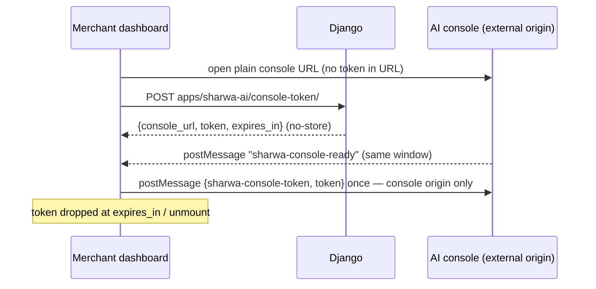

# Sharwa AI API — M31 (شروة AI)

> **Source**: DOC-257, DOC-258, DOC-259 · INT-041 (M31) · inventory Domain 14, A.8, A.10
> **Live key**: `sharwa_ai` (`SHARWA_LIVE_MODULES`) — the four rows ride the M30 catch-all `api/bff/apps/[[...path]]`, which switches to `sharwa_ai` when the first path segment is `sharwa-ai` (`route.ts:26`).
> **Django provider**: `sharwa_saas/products/services/sharwa_ai_api_service.py` (whole file) + `api/views_sharwa_ai.py` (4 routes, declared **before** `apps/<str:code>/`) · reused verbatim: the gateway session (`services/sharwa_ai_client`), the session id rule (`views/sharwa_ai_hub._get_or_create_session_id`), `SupportBotSettings`, the `session-status` webhook rule, and `services/sharwa_ai_sso` (RS256 console SSO)
> **Frontend contract**: `sharwa-frontend/src/features/apps/schemas.ts` (Sharwa AI rows) · screen `src/features/apps/components/sharwa-ai-screen.tsx` (status/settings + the console handshake) · fixtures `src/mocks/apps/`
> **Tests**: `sharwa_saas/api/test_sharwa_ai_api.py` (6 `def test_` methods)
> **Last verified against code**: 2026-10-28 (step 43)

## 1. Overview

Sharwa AI is the WhatsApp support bot, installed like any app (M30) and paired to a WhatsApp number through the platform's AI gateway. The merchant dashboard shows the pairing status (with a QR while connecting), two bot settings, and a button that opens the **engine console** — an external window authenticated with a short-lived RS256 token that is delivered by a `postMessage` handshake and never appears in a URL. Live sessions created by the bot are handed to the support module ([`m32-support.md`](m32-support.md)).

Before INT-041 all of this was the HTML hub (`views/sharwa_ai_hub.py`) with a `SupportBotSettings` form and the legacy pairing page.

## 2. Access — gate chain

The four routes extend the M30 gate (`SharwaAiAPIMixin` → `AppsAPIMixin.guard`); the first failure answers.

| # | Gate | Requirement | Failure |
|---|---|---|---|
| 1 | Session | owner or staff session | `401` |
| 2 | Plan feature | `app_marketplace` | `403` `{"detail": "متجر التطبيقات غير مفعّل في خطتك."}` |
| 3 | Owner-only | `reconnect`, `settings` PUT, `console-token` | `403` `{"detail": "إدارة التطبيقات لمالك المتجر فقط."}` |
| 4 | Resource state | the `sharwa_ai` app installed **and** effectively active | `409` `{"detail": "شروة AI غير مثبَّت أو غير مفعّل."}` |

Reads (`status`, `settings` GET) are open to staff of the store.

## 3. Endpoint summary

| Method | Django path (`/api/v1/…`) | Purpose | Owner-only |
|---|---|---|---|
| `GET` | `apps/sharwa-ai/status/` | pairing status (polled) | no |
| `POST` | `apps/sharwa-ai/reconnect/` | fresh QR after a drop | yes |
| `GET`, `PUT` | `apps/sharwa-ai/settings/` | bot settings | PUT yes |
| `POST` | `apps/sharwa-ai/console-token/` | one-time console SSO token | yes |

## 4. Endpoint groups

### 4.1 Pairing status and reconnect

#### `GET apps/sharwa-ai/status/`

```json
{
  "connected": false,
  "connecting": true,
  "error": null,
  "connected_at": null,
  "connected_phone_number": null,
  "qr_image": "data:image/png;base64,…"
}
```

- **First call after install starts the gateway session** — exactly what the legacy pairing page did on first visit: the session id is created by `_get_or_create_session_id` (a random id stored in `StoreAppInstallation.config['ai_session_id']`, indexed in public — deliberately **not** the schema name) and `POST /sessions` runs against the gateway (idempotent per id there).
- Later calls ask the gateway **live** — the gateway is the source of truth — and the last seen value is persisted to `config['wa_session_status']` (the `session-status` webhook writes the same key through the same rule).
- **A gateway outage never drops a known connection**: on `SharwaAIError` the last saved state is returned, and the error text only surfaces when the store is not connected (`_status_view`).
- Connected aliases (`ACTIVE`, `READY`, `OPEN`, `AUTHENTICATED`) are normalised to `CONNECTED`. `qr_image` is returned only while connecting (a `data:` URL fit for ``), `connected_at` / `connected_phone_number` only while connected.

**Gateway state → Arabic message** (`FAILED` map, `sharwa_ai_api_service.py:35-42`):

| Gateway status | `error` shown |
|---|---|
| `DISCONNECTED` | «انقطع اتصال واتساب — أعد الربط.» |
| `SESSION_EXPIRED` | «انتهت جلسة واتساب — أعد الربط.» |
| `LOGGED_OUT` | «سُجِّل الخروج من واتساب على الهاتف — أعد الربط.» |
| `BANNED` | «حظر واتساب هذا الرقم — اربط رقماً آخر.» |
| `FAILED` / `ERROR` | «تعذّر ربط واتساب — أعد المحاولة.» |

**One recording rule, shared by polling and webhook** — `record_status`: `ai_connected_at` is written **once**, on the first `CONNECTED` (whichever path sees it), and both `ai_connected_at` and `connected_phone_number` are cleared on any failure state. No drift between the two paths is possible.

#### `POST apps/sharwa-ai/reconnect/` — owner only

Refused while already connected: `409` `{"detail": "واتساب مربوط فعلاً."}`. Otherwise the status flips to `PENDING` and the **same session id** gets a fresh `POST /sessions` → a new QR (the response is the status shape). The old QR dies with the new session on the gateway side.

### 4.2 Bot settings

#### `GET / PUT apps/sharwa-ai/settings/`

```json
{
  "ai_enabled": true,
  "max_consecutive_bot_replies_override": 10,
  "platform_default_max_replies": 4
}
```

- `SupportBotSettings` is a per-store singleton; `PUT` is **all-or-nothing** (both fields, like the legacy form): `ai_enabled` must be a boolean («قيمة منطقية (true/false).») and the override an integer **1–50 or null** («عدد صحيح من 1 إلى 50، أو اتركه فارغاً لافتراضي المنصة.» — the form refuses > 50 exactly like the server). The whole PUT is rejected on any error; nothing is half-saved.
- `platform_default_max_replies` is read-only: the Django setting `SHARWA_AI_MAX_CONSECUTIVE_BOT_REPLIES`, default **4**.
- Writes are owner-only (gate 3).

### 4.3 Console SSO token and the `postMessage` handshake

#### `POST apps/sharwa-ai/console-token/` — owner only

```json
{ "console_url": "https://…", "token": "eyJ…", "expires_in": 900 }
```

- The token is `issue_console_token(tenant_ref = <schema>, sub = "merchant:<schema>", role = "merchant_admin")` — an **RS256** JWT signed with the platform key (`sharwa_ai_sso`); TTL from `SHARWA_AI_SSO_TTL_S` (default 900 s, clamped 60–3600).
- The session must be pinned to **this** store (`auth_tenant_schema` = current schema — the same rule as the legacy launch page), else `401` «انتهت جلستك، سجّل الدخول مجدداً.».
- Not configured → `503` «رابط لوحة شروه AI غير مضبوط بعد (SHARWA_AI_CONSOLE_URL).» or «الدخول الموحد إلى لوحة شروه AI غير مهيأ بعد.» (missing URL / missing SSO keys).
- Response headers: `Cache-Control: no-store` and `Referrer-Policy: no-referrer` — the token exists only in this response body.

**The handshake (security fix, FR-31.08)** — the token is **never put in a URL** (`?token=` is forbidden). The Next.js screen (`sharwa-ai-screen.tsx:209-251`):

1. On click, open the console's **plain URL** in a new window (synchronously, so popup blockers allow it).
2. Ask Django for the token; derive the **trusted origin from `console_url`** — never a hard-coded `https://ai.sharwa.app`.
3. Wait for `sharwa-console-ready` posted by **that window and that origin only** (`e.source` and `e.origin` both checked).
4. Post `{type: "sharwa-console-token", token}` **once**, addressed to the console's origin.
5. An unclaimed token is dropped when `expires_in` elapses or the screen unmounts; refreshes from the console are accepted from its origin only.



## 5. Gaps closed, bugs fixed and migrations

- **No migration.** The installation `config` (session id, status, timestamps) and `SupportBotSettings` already existed; INT-041 added the JSON provider and the handshake on top.
- **Token-leak fix in Next.js**: the legacy launch page put the token in the URL; the new screen uses the `postMessage` handshake above (origin learned from `console_url`).

## 6. Open items and legacy-only behaviour

- Live sessions the bot creates are owned by M32 ([`m32-support.md`](m32-support.md)) — this page only covers pairing, settings and console access.
- The `session-status` webhook remains the async status source; polling (`status/`) and the webhook share `record_status`.
- The mock issues a 900-second token mirroring the real TTL.

## 7. Related pages

- [`m30-app-store.md`](m30-app-store.md) — the shared gate, the app installation, the BFF catch-all · [`m32-support.md`](m32-support.md) — support sessions and tickets.
