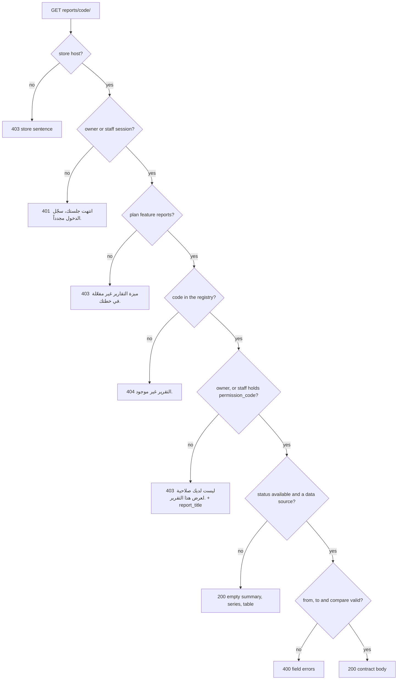
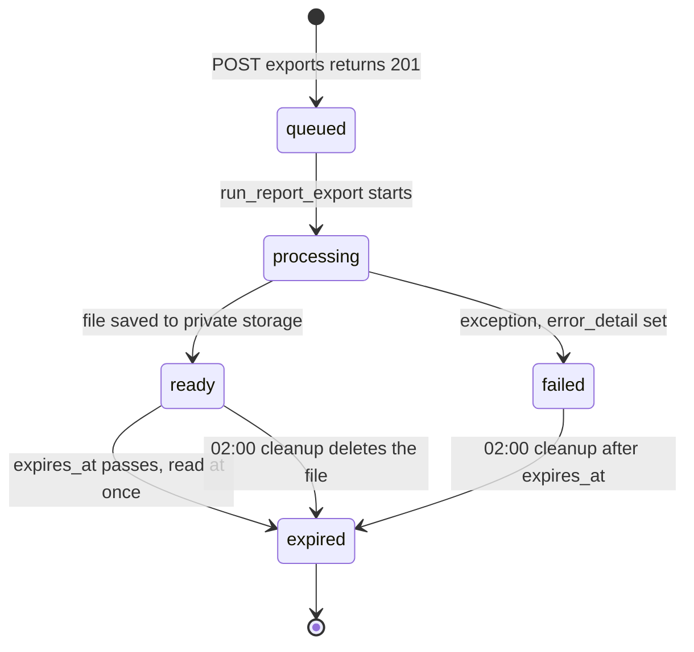
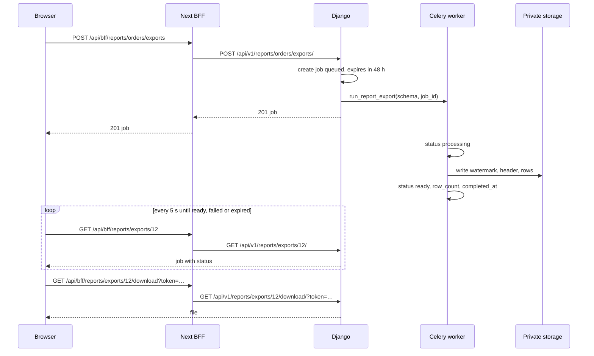

# Reports API — M25 (التقارير والتحليلات)

> **Source**: DOC-263, DOC-264, DOC-265 · INT-027 (M25), INT-025, INT-003, INT-009, INT-016 · inventory Domain 15
> **Live key**: `reports` (`SHARWA_LIVE_MODULES`) — one switch for the nine BFF rows of this page; it **is** in `.env.example` (module list at line 21, sample line at line 79)
> **Django provider**: `sharwa_saas/api/views_reports.py` (9 URL patterns at `api/urls.py:240-248`) · `sharwa_saas/products/services/{reports_contract,reports_registry,reports_aggregation,reports_finance_service,export_service}.py` · serializers `api/serializers.py` (`ReportExportJobSerializer`, `ReportExportCreateSerializer`, `ScheduledReportSerializer`) · models `products/models/reports.py` · Celery `products/tasks/reports.py` · notification `products/services/notification_service.py` (`_exports`)
> **Frontend contract**: `sharwa-frontend/src/features/reports/{schemas,permissions,range,api}.ts` · fixture `src/mocks/reports/{registry,data,exports,schedules}.ts` · BFF `src/app/api/bff/reports/`
> **Tests**: `sharwa_saas/api/test_reports_api.py` (19, of which `ReportsLocationFilterTests` has 3) · mock E2E `scripts/reports-check.ts`
> **Last verified against code**: 2026-10-27 (step 28)

<a id="overview"></a>

## 1. Overview

M25 is the store's **reports hub**: a registry of **42 reports in 10 categories**, a data endpoint that returns one report in a fixed shape (summary tiles, a chart series and a table), an **asynchronous export** engine (CSV or XLSX) and **scheduled e-mail reports**. It was the first module that went live, before Phase 002.

- **One shape for 42 reports.** `reports_contract.py` adapts what already existed — it computes no business number itself. Numbers come from two places only: the pre-computed daily rollup `DailyStoreMetrics` (plus today, computed live by `compute_day_metrics`) for the three daily-series reports and `best_sellers`, and the per-report `query_builder` of `REPORT_REGISTRY` for the rest. The Django dashboard and the Next.js screen therefore show the same number for the same range.
- **The rollup.** Beat task `compute-all-tenants-daily-metrics` (`crontab(hour=0, minute=10)`) fans out `compute_daily_store_metrics` per store, which stores *yesterday* (in the store's own timezone) in `DailyStoreMetrics`. Beat task `populate-tenant-stats-snapshot` (`00:40`) copies the same rows to the public `TenantStatsSnapshot` for the platform console (revenue converted to SAR with the store's own rates).
- **Money** is a server display string (`"500 ر.س"`) next to a raw number in `<key>__value`; the screen never formats money itself.
- **Callers.** The store owner (`is_merchant_authenticated`) or a staff member, on the store host. The browser calls the BFF (`/api/bff/reports/…`), which forwards to Django when `reports` is live ([`bff.md`](../../overview/bff.md#liveormock)).
- **Neighbours.** The *today* refresh shares its 5-minute cooldown with the dashboard overview refresh ([§4.4](#refresh)); the location filter reads the `multi_location_enabled` switch of M34 and the `Location` rows of M22 ([§5](#locations)); finished exports raise a notification ([§6.5](#export-ready)); the push stats card of INT-016 lives on the same screen but is served by `GET push/stats/`, which is outside this page.

<a id="access"></a>

## 2. Access — gate chain and gate matrix

Every view mixes in `ReportsAPIMixin` (`views_reports.py:68`) with `MerchantSessionAuthentication` and `HasTenantContext`. DRF runs authentication before the permission classes, then `gate()` runs inside the view. The first failing gate answers.

| # | Gate | Requirement | Failure |
|---|---|---|---|
| 1 | CSRF *(authentication, only when a session cookie is present)* | `X-CSRFToken` on every unsafe method ([`csrf.md`](../../overview/csrf.md)) | `403` `{"detail": "CSRF Failed: …"}` |
| 2 | Store | the request resolves to a store (`HasTenantContext`) | `403` «لم يتم تحديد المتجر المطلوب. استخدم النطاق الفرعي للمتجر أو أرسل ترويسة X-Store-Domain.» · with **no session cookie** on the public host the answer is `403` «لم يتم تزويد بيانات الدخول.» instead ([rule](../../overview/auth.md#no-store-no-session)) |
| 3 | Session | an owner session or a resolved staff member | `401` «انتهت جلستك، سجّل الدخول مجدداً.» |
| 4 | Plan feature | the `reports` feature is enabled for the store (`reports_feature_enabled`; a missing `Feature` row counts as disabled) | `403` «ميزة التقارير غير مفعّلة في خطتك.» |
| 5 | Permission *(staff only; the owner holds everything implicitly)* | the key the route needs ([§2.1](#gate-matrix)) | `403` «ليست لديك صلاحية لهذا الإجراء.» |
| 6 | Resource and per-report permission | the report exists (`404`), the member may open **that** report (`403`), the report is exportable (`400`) | see each endpoint |

Notes:

- `gate()` returns `(staff, None)` on success; `staff` is `None` for the owner. Everything that scopes by requester (export jobs) reads that value.
- Gate 5 is evaluated in `gate()` only for routes that pass a `permission_code`. `GET reports/` and `GET reports/<code>/` pass none: the first lists every report with an `allowed` flag, the second checks the **report's own** `permission_code` after the registry lookup (gate 6).
- Other methods on these routes answer DRF's `405`.
- Route order matters: `reports/refresh-today/`, `reports/exports/…` and `reports/schedules/…` are declared **before** `reports/<slug:code>/` (`api/urls.py:240-247`), so those words are never read as report codes.

<a id="gate-matrix"></a>

### 2.1 Gate matrix — route × plan feature × who may call

| # | Route | Method | Plan feature | Staff permission | Further scope |
|---|---|---|---|---|---|
| 1 | `reports/` | `GET` | `reports` | none (any session) | `allowed` per report |
| 2 | `reports/<code>/` | `GET` | `reports` | the report's `permission_code` | `403` with `report_title`, no numbers |
| 3 | `reports/refresh-today/` | `POST` | `reports` | `reports.sales.view` | store-wide 5-minute cooldown |
| 4 | `reports/<code>/exports/` | `POST` | `reports` | `reports.export` **and** the report's `permission_code` | report must be `available` and `export_enabled` |
| 5 | `reports/exports/` | `GET` | `reports` | `reports.export` | staff see their own jobs, the owner sees all |
| 6 | `reports/exports/<id>/` | `GET` | `reports` | `reports.export` | same scope, `404` outside it |
| 7 | `reports/exports/<id>/download/` | `GET` | `reports` | `reports.export` | same scope **and** `?token=` |
| 8 | `reports/schedules/` | `GET` | `reports` | `reports.export` | all subscriptions of the store |
| 9 | `reports/schedules/` | `POST` | `reports` | `reports.export` | |
| 10 | `reports/schedules/<id>/` | `PATCH` | `reports` | `reports.export` | |
| 11 | `reports/schedules/<id>/` | `DELETE` | `reports` | `reports.export` | |

The owner passes the permission gates on every row.

<a id="gate-messages"></a>

### 2.2 The messages, verbatim

| Where | Sentence | Status |
|---|---|---|
| `gate()` | «انتهت جلستك، سجّل الدخول مجدداً.» | `401` |
| `gate()` | «ميزة التقارير غير مفعّلة في خطتك.» | `403` |
| `gate()` | «ليست لديك صلاحية لهذا الإجراء.» | `403` |
| `ReportDataView` | «ليست لديك صلاحية لعرض هذا التقرير.» + `report_title` | `403` |
| `ReportExportCreateView` | «ليست لديك صلاحية لتصدير هذا التقرير.» | `403` |
| data / export create | «التقرير غير موجود.» | `404` |
| export detail / download | «مهمة التصدير غير موجودة.» | `404` |
| schedule detail | «الاشتراك غير موجود.» | `404` |



<a id="summary"></a>

## 3. Endpoint summary — the 11 method-routes

Django paths are under `/api/v1/`; BFF paths are under `/api/bff/` with the same suffix (no trailing slash). Nine URL patterns carry eleven method-routes.

| # | Method | Django path | BFF path | Purpose | Gate row | DOC |
|---|---|---|---|---|---|---|
| 1 | `GET` | `reports/` | `reports` | the registry grouped by category ([§4.1](#registry-index)) | 1 | 263 |
| 2 | `GET` | `reports/<code>/` | `reports/<code>` | one report: summary, series, table ([§4.3](#report-data)) | 2 | 263, 264 |
| 3 | `POST` | `reports/refresh-today/` | `reports/refresh-today` | recompute today's rollup row ([§4.4](#refresh)) | 3 | 263 |
| 4 | `POST` | `reports/<code>/exports/` | `reports/<code>/exports` | request a CSV/XLSX export ([§6.1](#export-create)) | 4 | 265 |
| 5 | `GET` | `reports/exports/` | `reports/exports` | «تصديراتي», the last 50 jobs ([§6.2](#export-jobs)) | 5 | 265 |
| 6 | `GET` | `reports/exports/<id>/` | `reports/exports/<id>` | one job, polled every 5 s ([§6.2](#export-jobs)) | 6 | 265 |
| 7 | `GET` | `reports/exports/<id>/download/?token=` | `reports/exports/<id>/download?token=` | the file ([§6.3](#export-download)) | 7 | 265 |
| 8 | `GET` | `reports/schedules/` | `reports/schedules` | list subscriptions ([§7.1](#schedule-endpoints)) | 8 | 265 |
| 9 | `POST` | `reports/schedules/` | `reports/schedules` | subscribe ([§7.1](#schedule-endpoints)) | 9 | 265 |
| 10 | `PATCH` | `reports/schedules/<id>/` | `reports/schedules/<id>` | pause, resume, edit ([§7.1](#schedule-endpoints)) | 10 | 265 |
| 11 | `DELETE` | `reports/schedules/<id>/` | `reports/schedules/<id>` | delete → `204` ([§7.1](#schedule-endpoints)) | 11 | 265 |

<a id="registry"></a>

## 4. The report registry and report data (DOC-263)

<a id="registry-index"></a>

### 4.1 `GET /api/v1/reports/` — the registry grouped by category

No query parameters. The answer is an array of **10 categories**, each with its reports **in registry order**. It never filters: a report the member may not open is still listed with `"allowed": false`, and a report that is not available is listed with its status.

```json
[
  {
    "category": "core",
    "title": "اللاعبون الأساسيون",
    "reports": [
      {
        "code": "sales_overview",
        "title": "المبيعات",
        "description": "الإيرادات والطلبات يومياً مع متوسط السلة",
        "status": "available",
        "permission": "reports.sales.view",
        "core": true,
        "allowed": true
      },
      {
        "code": "best_sellers",
        "title": "المنتجات الأكثر مبيعاً",
        "description": "أفضل المنتجات بالكمية المباعة والإيراد من الطلبات المكتملة",
        "status": "available",
        "permission": "reports.sales.view",
        "core": true,
        "allowed": true
      }
    ]
  }
]
```

| Field | Type | Meaning (Django source) |
|---|---|---|
| `category` / `title` | string | `REPORT_CATEGORIES` key and Arabic title ([§4.2](#registry-table)) |
| `reports[].code` | string | `REPORT_REGISTRY["code"]`, the URL slug |
| `reports[].title` | string | `title_ar` |
| `reports[].description` | string | `REPORT_DESCRIPTIONS[code]` in `reports_contract.py` (empty string if missing) |
| `reports[].status` | enum | `available` · `not_yet_available` · `coming_soon` (Zod labels «متاح» · «غير متاح بعد» · «قريباً») |
| `reports[].permission` | string | the registry's `permission_code` |
| `reports[].core` | boolean | `category == "core"` |
| `reports[].allowed` | boolean | `can_open`: owner → always `true`; staff → `permission_code` is in their permission set |

`allowed` is about permission only: an unavailable report can be `allowed: true`. The screen disables every non-`available` row regardless.

<a id="registry-table"></a>

### 4.2 The 42 registry codes — categories, order, status, permission

**Order** is the order of `REPORT_REGISTRY` in `reports_registry.py` (the `#` column); each category keeps that relative order. **Status**: 36 `available`, 5 `not_yet_available` (`visits`, `invoices_settlements`, `system_performance`, `bundles`, `subscriptions`) and 1 `coming_soon` (`ai_forecasting`) — the **6 disabled rows** the index shows. `whatsapp_costs` is `available` (Django has its builder). Every `available` row has a data source (`query_builder`, `url_name` with an entry in `URL_ONLY_BUILDERS`, or a rollup series), as the registry docstring requires.

The 10 categories (`REPORT_CATEGORIES`):

| # | Key | Title | Reports |
|---|---|---|---|
| 1 | `core` | اللاعبون الأساسيون | 5 |
| 2 | `customers` | العملاء والسلوك | 4 |
| 3 | `finance` | المالية والمدفوعات | 7 |
| 4 | `shipping` | الشحن واللوجستيات | 4 |
| 5 | `inventory` | المخزون المتقدم | 4 |
| 6 | `operations` | العمليات والرقابة | 6 |
| 7 | `local_market` | تعقيدات السوق المحلي | 3 |
| 8 | `advanced_behavior` | السلوك المتقدم | 3 |
| 9 | `marketing` | التوسع التسويقي | 3 |
| 10 | `infrastructure` | البنية التحتية للتقارير | 3 |

The 42 reports:

| # | Code | Title (`title_ar`) | Category | Status | Permission (`permission_code`) | Export | Data source |
|---|---|---|---|---|---|---|---|
| 1 | `sales_overview` | المبيعات | `core` | `available` | `reports.sales.view` | yes | rollup time series |
| 2 | `best_sellers` | المنتجات الأكثر مبيعاً | `core` | `available` | `reports.sales.view` | no | rollup top-10 snapshot |
| 3 | `orders` | الطلبات | `core` | `available` | `reports.sales.view` | yes | rollup time series |
| 4 | `store_overview` | نظرة عامة | `core` | `available` | `reports.sales.view` | no | rollup time series |
| 5 | `inventory_overview` | المخازن | `core` | `available` | `reports.inventory.view` | yes | `_inventory_builder` |
| 6 | `customers_vip` | العملاء و VIP | `customers` | `available` | `reports.customers.view` | yes | `_customers_builder` |
| 7 | `abandoned_carts` | السلال المتروكة | `customers` | `available` | `reports.customers.view` | yes | `_abandoned_carts_builder` |
| 8 | `visits` | الزيارات | `customers` | `not_yet_available` | `reports.customers.view` | no | — |
| 9 | `ratings` | التقييمات | `customers` | `available` | `reports.customers.view` | yes | `_ratings_builder` |
| 10 | `payment_gateways` | بوابات الدفع | `finance` | `available` | `reports.sales.view` | yes | `_payment_methods_builder` |
| 11 | `taxes` | الضرائب | `finance` | `available` | `reports.profit.view` | yes | `_taxes_builder` |
| 12 | `coupons` | الكوبونات | `finance` | `available` | `reports.sales.view` | yes | `_coupons_builder` |
| 13 | `refunds` | المبالغ المستردة | `finance` | `available` | `reports.profit.view` | yes | `_refunds_builder` |
| 14 | `wallet_custody` | المحفظة والعهدة | `finance` | `available` | `reports.profit.view` | no | `_wallet_custody_builder` |
| 15 | `invoices_settlements` | الفواتير والتسويات | `finance` | `not_yet_available` | `reports.profit.view` | yes | — |
| 16 | `platform_commissions` | عمولات المنصة | `finance` | `available` | `reports.profit.view` | no | `_platform_commissions_builder` |
| 17 | `third_party_logistics` | المزوّدون 3PL | `shipping` | `available` | `reports.sales.view` | yes | `_third_party_logistics_builder` |
| 18 | `couriers` | المناديب | `shipping` | `available` | `reports.sales.view` | yes | `_couriers_builder` |
| 19 | `returns` | المرتجعات | `shipping` | `available` | `reports.sales.view` | yes | `_returns_builder` |
| 20 | `zones` | المناطق | `shipping` | `available` | `reports.sales.view` | no | `_zones_builder` |
| 21 | `categories` | التصنيفات والعلامات | `inventory` | `available` | `reports.inventory.view` | yes | `_inventory_builder` |
| 22 | `variants` | الخيارات الدقيقة | `inventory` | `available` | `reports.inventory.view` | yes | `_variants_builder` |
| 23 | `stock_movements` | حركة المخزون | `inventory` | `available` | `reports.inventory.view` | yes | `_stock_movements_builder` |
| 24 | `suppliers` | الموردون | `inventory` | `available` | `reports.inventory.view` | no | `_suppliers_builder` |
| 25 | `staff_performance` | أداء الموظفين | `operations` | `available` | `reports.staff_performance.view` | no | `_staff_performance_builder` |
| 26 | `audit_log` | سجل التدقيق | `operations` | `available` | `reports.sales.view` | yes | URL-only builder in `reports_contract` |
| 27 | `customer_service` | خدمة العملاء | `operations` | `available` | `reports.customers.view` | no | `_customer_service_builder` |
| 28 | `system_performance` | أداء النظام | `operations` | `not_yet_available` | `reports.sales.view` | no | — |
| 29 | `marketing_utm` | التسويق و UTM | `operations` | `available` | `reports.sales.view` | yes | `_marketing_utm_builder` |
| 30 | `ai_forecasting` | توقعات الذكاء الاصطناعي | `operations` | `coming_soon` | `reports.sales.view` | no | — |
| 31 | `currencies` | العملات وأسعار الصرف | `local_market` | `available` | `reports.sales.view` | yes | `_payment_methods_builder` |
| 32 | `pos` | نقاط البيع POS | `local_market` | `available` | `reports.sales.view` | yes | `_pos_builder` |
| 33 | `operating_expenses` | المصروفات التشغيلية | `local_market` | `available` | `reports.profit.view` | no | `_operating_expenses_builder` |
| 34 | `failed_searches` | البحث المفقود | `advanced_behavior` | `available` | `reports.customers.view` | no | `_failed_searches_builder` |
| 35 | `wishlists` | قوائم الرغبات | `advanced_behavior` | `available` | `reports.customers.view` | yes | `_wishlists_builder` |
| 36 | `loyalty` | الولاء والمكافآت | `advanced_behavior` | `available` | `reports.customers.view` | no | `_loyalty_builder` |
| 37 | `affiliates` | المسوقون بالعمولة | `marketing` | `available` | `reports.sales.view` | yes | `_affiliates_builder` |
| 38 | `bundles` | المنتجات المركبة | `marketing` | `not_yet_available` | `reports.sales.view` | no | — |
| 39 | `subscriptions` | الاشتراكات | `marketing` | `not_yet_available` | `reports.sales.view` | no | — |
| 40 | `export_engine` | محرك التصدير | `infrastructure` | `available` | `reports.export` | no | URL-only builder in `reports_contract` |
| 41 | `scheduled_reports` | التقارير المجدولة | `infrastructure` | `available` | `reports.export` | no | URL-only builder in `reports_contract` |
| 42 | `whatsapp_costs` | تكلفة إشعارات الواتساب | `infrastructure` | `available` | `reports.sales.view` | no | `_whatsapp_costs_builder` |

Reading the table:

- **Permission** counts: `reports.sales.view` 20 · `reports.customers.view` 8 · `reports.profit.view` 6 · `reports.inventory.view` 5 · `reports.export` 2 · `reports.staff_performance.view` 1. The keys come from migrations `0144_seed_staff_rbac` (`reports.view`, `reports.export`), `0172_seed_report_permissions` and `0174_utm_and_staff_performance` ([`permissions.md`](../../overview/permissions.md) §2.4).
- **Export** `yes` on 23 rows; 22 of them are `available`. `invoices_settlements` has the flag but is `not_yet_available`, so an export request is refused ([§6.1](#export-create)).
- **Data source** `rollup time series` = `ROLLUP_TIME_REPORTS` (daily series, line chart); `rollup top-10 snapshot` = `best_sellers`, built from `top_products_snapshot` (bar chart); a backticked name is the registry `query_builder`; `URL-only builder` = `audit_log`, `export_engine`, `scheduled_reports`, whose registry entry only has a Django screen (`url_name`) and gets a builder from `reports_contract.URL_ONLY_BUILDERS`.
- Two pairs share one builder and therefore return the same figures under different titles: `inventory_overview` and `categories` (`_inventory_builder`), `payment_gateways` and `currencies` (`_payment_methods_builder`).

<a id="report-data"></a>

### 4.3 `GET /api/v1/reports/<code>/` — one report

**Query parameters**

| Name | Type | Default | Notes |
|---|---|---|---|
| `from`, `to` | `YYYY-MM-DD` | none | **required** for an available report; inclusive; at most **366 days** |
| `compare_from`, `compare_to` | `YYYY-MM-DD` | none | optional; if either is sent both are validated; same rules. The screen builds them as the previous period of the same length (`previousPeriod` in `range.ts`) |
| `location` | integer id | none | only for the four location reports, only when multi-location is on; otherwise ignored ([§5](#locations)) |
| `ordering` | string | none | `key` or `-key` on a table column key; sorts by `<key>__value` when present, numbers before text |
| `page` | integer | `1` | the table is cut in pages of **1000** rows (`TABLE_PAGE_SIZE`); `table.count` is the full count; a bad value means page 1 |

**Response `200`** — `sales_overview` over two days, with the numbers of the fixture in `test_sales_overview_time_series` (revenue 200 and 300, orders 2 and 3). The dates, timezone and `refreshed_at` are illustrative:

```json
{
  "report": {
    "code": "sales_overview",
    "title": "المبيعات",
    "category": "core",
    "category_title": "اللاعبون الأساسيون",
    "description": "الإيرادات والطلبات يومياً مع متوسط السلة",
    "status": "available",
    "core": true,
    "chart": "line"
  },
  "has_locations": false,
  "locations": [],
  "timezone": "Asia/Aden",
  "refreshed_at": "2026-10-02T00:10:04.512384+00:00",
  "range": { "from": "2026-10-01", "to": "2026-10-02" },
  "compare": null,
  "summary": [
    { "key": "revenue", "label": "الإيرادات", "display_value": "500 ر.س", "compare_display_value": null, "delta_pct": null },
    { "key": "orders_count", "label": "الطلبات", "display_value": "5", "compare_display_value": null, "delta_pct": null },
    { "key": "aov", "label": "متوسط السلة", "display_value": "100 ر.س", "compare_display_value": null, "delta_pct": null }
  ],
  "series": [
    {
      "label": "الإيرادات — الفترة الحالية",
      "points": [
        { "x": "2026-10-01", "y": 200.0, "display_y": "200 ر.س" },
        { "x": "2026-10-02", "y": 300.0, "display_y": "300 ر.س" }
      ]
    }
  ],
  "table": {
    "columns": [
      { "key": "date", "label": "اليوم", "type": "date" },
      { "key": "revenue", "label": "الإيرادات", "type": "money" },
      { "key": "orders_count", "label": "الطلبات", "type": "number" },
      { "key": "aov", "label": "متوسط السلة", "type": "money" }
    ],
    "rows": [
      { "id": "2026-10-02", "date": "2026-10-02", "revenue": "300 ر.س", "revenue__value": 300.0, "orders_count": 3, "aov": "100 ر.س", "aov__value": 100.0 },
      { "id": "2026-10-01", "date": "2026-10-01", "revenue": "200 ر.س", "revenue__value": 200.0, "orders_count": 2, "aov": "100 ر.س", "aov__value": 100.0 }
    ],
    "count": 2
  }
}
```

| Field | Type | Meaning (Django source) |
|---|---|---|
| `report` | object | `report_meta`: `chart` is `line` for the three `ROLLUP_TIME_REPORTS` (`sales_overview`, `orders`, `store_overview`), `bar` for every other report |
| `has_locations`, `locations` | boolean, `[{id, name}]` | [§5](#locations) |
| `timezone` | string | `StoreSetting.timezone` |
| `refreshed_at` | string \| `null` | newest `DailyStoreMetrics.computed_at`, **only for `core` reports**; `null` for the other 37 |
| `range` | `{from, to}` | echo; **absent** for an unavailable report |
| `compare` | `{from, to}` \| `null` | echo of the comparison range; absent for an unavailable report |
| `summary[]` | array | tiles; `display_value` is `«—»` when the range has no data; `compare_display_value` is `null` without a comparison; `delta_pct` is `null` unless both periods have data **and** the earlier value is not 0, otherwise `round((cur − prev) / prev × 100, 1)` |
| `series[]` | array | one series, or two with a comparison (`… — الفترة الحالية`, `… — الفترة السابقة`); the comparison is aligned by position, trimmed to the current length |
| `table` | object | typed `columns` (`text` · `date` · `number` · `money` · `percent`), `rows`, full `count`. Money cells carry the display string **and** `<key>__value` (raw number) |

**Three table shapes** (all in the same envelope):

1. **Daily series** — `sales_overview` (`revenue`, `orders_count`, `aov`), `orders` (`orders_count`, `completed`, `cancelled`), `store_overview` (`gross`, `net`, `orders_count`). One row per day, newest first; the chart plots the first metric. `aov` is the total revenue divided by the total orders, never a sum of daily averages.
2. **Best sellers** — `summary`: `quantity` «الكمية» and `revenue` «الإيرادات» (sums over the listed products); table columns «المنتج», «الكمية», «الإيرادات». The table lists **at most 10 products**: the rollup keeps each day's top 10, `aggregate_metrics` merges the days by product name and keeps the top 10 of the merged list; the chart shows the same ten.
3. **Registry builders** — the builder's `{columns, rows}` is typed by inspection. If the columns are «المؤشر» / «القيمة» (the KPI form), each row becomes one summary tile and `series` is `[]` (for example `refunds`: «عدد الاسترجاعات», «إجمالي المسترد», `chart` `bar`). Otherwise the first column is the dimension, the remaining numeric columns are summed into tiles (averages and percentages are not summed; when no column can be summed a single tile «عدد البنود» counts the rows), and the chart plots the first numeric column for the top 10 rows.

**Comparison** — fixture of `test_compare_adds_second_series_and_delta`: 4 orders on the current day, 2 on the day before → on the `orders` report `summary[0]` has `display_value` `"4"`, `compare_display_value` `"2"`, `delta_pct` `100.0`, and `series` has two entries.

**Unavailable report** (`visits`, status `not_yet_available`): `200`, `summary: []`, `series: []`, `table: {"columns": [], "rows": [], "count": 0}`, and **no** `range` or `compare` keys, even without `from`/`to` (test `test_not_yet_available_report_is_empty`). The permission gate still applies first.

**Errors**

| Status | Body | When |
|---|---|---|
| `400` | `{"from": ["تاريخ غير صالح (YYYY-MM-DD)."]}` | `from` missing or not a real date (same for `to`, `compare_from`, `compare_to` under their own key) |
| `400` | `{"to": ["تاريخ النهاية قبل البداية."]}` | `to` before `from` (the test sends `from=2026-02-01&to=2026-01-01`) |
| `400` | `{"detail": "الحد الأقصى سنة واحدة."}` | more than 366 days |
| `403` | `{"detail": "ليست لديك صلاحية لعرض هذا التقرير.", "report_title": "…"}` | staff without the report's `permission_code`; the title only, no numbers |
| `404` | `{"detail": "التقرير غير موجود."}` | unknown code |

**Rules** — the current day is always computed live (`compute_day_metrics`, the one allowed live query, bounded to one day); earlier days come only from stored `DailyStoreMetrics` rows, so a day with no stored row counts as zero. Gross revenue is the sum of `price × quantity` of the snapshot lines of completed orders, using the delivered quantity when a `FulfillmentItem` records a partial delivery; net revenue is `gross − cancelled-after-payment − refunds − coupon and promotion discounts − tax` (`reports_finance_service`). Registry builders receive the requested `from`/`to` as `start`/`end`; the 90-day default of `_date_range` (used by the builders that read the live order tables) applies only when none is passed, as on the legacy screens.
**Side effects** — none; the endpoint only reads.

<a id="refresh"></a>

### 4.4 `POST /api/v1/reports/refresh-today/` — recompute today

No body. Gate: owner, or staff with `reports.sales.view` (`REFRESH_PERMISSION`), plus the plan feature.

The cooldown is a **store-wide** cache key, not a session flag: `cache.add("reports:refresh-today:<schema>", now, 300)`. The first caller in any 5-minute window recomputes the row `save_daily_metrics(timezone.localdate())` (an upsert of today's `DailyStoreMetrics`); every later caller gets the `429` until the key expires, whatever browser or screen they use.

**Response `200`**

```json
{ "refreshed_at": "2026-10-27T19:41:07.318204+00:00" }
```

`refreshed_at` is the row's `computed_at.isoformat()`; the value above is illustrative.

**Errors**

| Status | Body | When |
|---|---|---|
| `403` | `{"detail": "ليست لديك صلاحية لهذا الإجراء."}` | staff without `reports.sales.view` |
| `429` | `{"detail": "يمكنك التحديث مرة كل 5 دقائق فقط للحفاظ على الأداء."}` + `Retry-After: 300` | the key already exists; `Retry-After` is the constant 300, not the time left |

**Shared with the dashboard** (INT-003): `POST /api/v1/dashboard/overview/refresh/` (`views_dashboard.py`, `DashboardOverviewRefreshView`) imports `REFRESH_PERMISSION` and `REFRESH_COOLDOWN_SECONDS` from `views_reports.py` and uses the **same key**, so a refresh on one screen blocks the other for five minutes. The two differ only in the body they return: this route answers `{refreshed_at}`, the dashboard answers its `today` block (`dashboard_service.refresh_today()`).

<a id="locations"></a>

## 5. The location dimension on order-derived reports (DOC-264)

`DailyStoreMetrics` has no location column, so the stored rollup cannot be cut by location. Four reports can be, because their numbers come from orders: **`sales_overview`, `orders`, `store_overview`, `best_sellers`** (`LOCATION_REPORTS`). For them, `report_locations()` decides what the response says:

| Condition | `has_locations` | `locations` | `?location` |
|---|---|---|---|
| the report is not one of the four, **or** `StoreSetting.multi_location_enabled` is off | `false` | `[]` | ignored |
| the report is one of the four **and** multi-location is on | `true` | active `Location` rows ordered by `sort_order, id`, as `[{id, name}]` | used if it is the id of a row in that list |

The 38 other reports keep `has_locations: false`; the screen drops the parameter for them. An id that is not in the list (unknown, inactive, not a number) is **ignored silently** and the whole store is shown (test: `location=999999` gives the store-wide figures). No `400` exists for it.

```json
{
  "has_locations": true,
  "locations": [ { "id": 1, "name": "فرع أ" }, { "id": 2, "name": "فرع ب" } ]
}
```

**How the numbers are cut** (`_location_daily_metrics`, `location_orders`, `location_items`):

1. One query finds the **distinct days** (in the store's timezone) on which the location has orders inside the range.
2. For each such day, `compute_day_metrics(day, location_id)` computes the metrics **live**; days without such orders are not computed and count as zero. Past days are cached for **3600 seconds** under `reports:location-day:<schema>:<location_id>:<day>`; today is never cached.
3. The comparison range is computed the same way, separately.

An *order* belongs to a location when `Order.source_location` is that location, **or** when any of its lines has `OrderItem.source_location` equal to it (an order split across locations). A *line* belongs to a location when its own `source_location` is that location, or when it has none and its order's `source_location` is that location.

<a id="no-double-count"></a>

### 5.1 The no-double-counting rule, with an example

Two details keep the totals honest:

- **Orders are matched with an id subquery, not a JOIN.** `location_orders` filters `Order.id IN (SELECT id … WHERE source_location = L OR items.source_location = L)`. A JOIN to the lines would return an order once per matching line and inflate `orders_count`, `refunds` and every order-level sum. The subquery returns each order **once** per location.
- **Revenue is summed from lines, per location.** Each line belongs to exactly one location (or none), so the lines of all locations add up to the store's revenue.

Illustrative numbers (not from a fixture; no partial deliveries; all orders `completed`). Order 101 is split: its first and third lines ship from location **A**, its second from **B**; its own `source_location` is A. Order 102 is a single-location order sourced from B whose line has no source of its own.

| Order | Line | Price × qty | Line source | Order source |
|---|---|---|---|---|
| 101 | قهوة | 100 × 1 = 100 | A | A |
| 101 | عسل | 50 × 3 = 150 | B | A |
| 101 | عود كمبودي | 20 × 2 = 40 | A | A |
| 102 | تمر | 40 × 1 = 40 | none | B |

| View | `orders_count` | Revenue (`gross`) | How |
|---|---|---|---|
| Whole store | 2 | 330 | orders 101 and 102; all four lines |
| Location A | **1** | **140** | order 101 once, although two of its lines are A's (a JOIN would give 2); lines قهوة 100 + عود كمبودي 40 |
| Location B | **2** | **190** | order 101 (through its عسل line) and order 102; lines عسل 150 + تمر 40 (no own source, order sourced from B) |
| A + B | 3 | **330** | revenue adds up to the store total; orders do not |

So **revenue never double counts**, while `orders_count` summed over locations (3) is larger than the store's (2): a split order is counted once in *each* location that ships part of it, by design. A location's `best_sellers` list uses the same lines (test: location B shows only «عسل»).

**Test fixtures** (`ReportsLocationFilterTests`): location «فرع أ» has one completed order of 100 × 1 (قهوة), location «فرع ب» one of 50 × 3 (عسل), both created today. With multi-location on, `sales_overview` for the whole store shows `orders_count` `"2"`; `?location=<فرع أ>` shows `"1"` and a table row with `revenue__value` `100.0`; `orders` for «فرع ب» shows `"1"`; `best_sellers` for «فرع ب» lists «عسل» only.

> **Observation (not a roadmap discrepancy)** — order-level amounts are not split by line. In `compute_day_metrics`, refunds (`OrderRefund`), cancelled-after-payment totals and coupon or promotion discounts are summed over the location's **orders**, so a split order contributes its whole refund or discount to every location that has a line of it. Only `store_overview` shows `net`, so its location-filtered `net` can add up to more than the store's. No test covers split orders at all (see [§10](#open-items)).

`refreshed_at` is not recomputed for a location: it is still the newest stored rollup time, although the location figures are live.

<a id="exports"></a>

## 6. Report exports (DOC-265)

An export never blocks the request. `POST` creates a `ReportExportJob` and returns it at once; a Celery task writes the file; the screen polls the job every 5 seconds (`EXPORT_POLL_MS`) until it is `ready`, `failed` or `expired`, then downloads with a signed token.

<a id="export-create"></a>

### 6.1 `POST /api/v1/reports/<code>/exports/` — request an export

Gate: plan feature, then staff `reports.export` (`EXPORT_PERMISSION`), then the checks below in this order:

| # | Check | Failure |
|---|---|---|
| 1 | the code is in the registry | `404` «التقرير غير موجود.» |
| 2 | the member may open that report (`permission_code`) | `403` «ليست لديك صلاحية لتصدير هذا التقرير.» |
| 3 | `status == "available"` | `400` «هذا التقرير غير متاح بعد للتصدير.» |
| 4 | `export_enabled` is true ([§4.2](#registry-table)) | `400` «هذا التقرير غير متاح للتصدير.» |
| 5 | the body is valid | `400` `{field: [msg]}` |

**Request body** (`application/json`)

| Field | Type | Required | Rules / limits |
|---|---|---|---|
| `format` | `"csv"` \| `"xlsx"` | yes | otherwise `{"format": ["اختر CSV أو XLSX."]}` (also when missing or `null`) |
| `params` | object | no, default `{}` | read keys: `from`, `to` (strings), `compare` (only `true` counts), `location` (string). Anything else is dropped |

`ReportExportCreateSerializer.job_params()` stores `{from, to, compare, location, start, end}`, where `start`/`end` repeat `from`/`to` (empty string if missing) for the legacy `orders` builder. Empty or non-string values become `null`.

**Response `201`** — body of the test `test_export_create_and_poll`; `job_id` and `created_at` are illustrative:

```json
{
  "job_id": 12,
  "report_code": "orders",
  "report_title": "الطلبات",
  "format": "xlsx",
  "params": { "from": "2026-09-01", "to": "2026-09-30", "compare": false, "location": null },
  "status": "queued",
  "download_token": null,
  "error": null,
  "created_at": "2026-10-27T19:41:07.318204+03:00",
  "expires_at": null,
  "requested_by": "مالك المتجر"
}
```

Request: `{"format": "xlsx", "params": {"from": "2026-09-01", "to": "2026-09-30", "compare": false, "location": null}}`.

**Errors** — `400` `{"format": ["اختر CSV أو XLSX."]}` for `format: "pdf"` (test); `400` «هذا التقرير غير متاح للتصدير.» for `best_sellers` (test: `export_enabled` is false).

**Rules** — the job is created with `status "queued"` and `expires_at = now + 48 h`; `enqueue_export` then queues `products.tasks.run_report_export(schema, job_id)` with `.delay(…)` right after the insert. **The dates are not validated here.** A bad date, a reversed range or more than 366 days is accepted with `201`, and the job later ends `failed` with the error text (see below).
**Side effects** — one Celery task; later, one `export_ready` notification ([§6.5](#export-ready)).

<a id="export-jobs"></a>

### 6.2 `GET /api/v1/reports/exports/` and `GET /api/v1/reports/exports/<id>/`

The list returns the **last 50** jobs, newest first (`EXPORTS_LIST_LIMIT`); the detail returns one. A staff member sees and polls **only their own** jobs, the owner sees every job of the store (the 2026-09-16 audit fix); a job outside the scope is `404` «مهمة التصدير غير موجودة.».

```json
{
  "count": 1,
  "results": [
    {
      "job_id": 12,
      "report_code": "orders",
      "report_title": "الطلبات",
      "format": "xlsx",
      "params": { "from": "2026-09-01", "to": "2026-09-30", "compare": false, "location": null },
      "status": "ready",
      "download_token": "7b0c1e0e-5d2f-4c3a-9a55-1d2c3e4f5a6b",
      "error": null,
      "created_at": "2026-10-27T19:41:07.318204+03:00",
      "expires_at": "2026-10-29T19:41:09.024117+03:00",
      "requested_by": "مالك المتجر"
    }
  ]
}
```

| Field | Type | Meaning (Django source) |
|---|---|---|
| `job_id` | integer | `ReportExportJob.id` |
| `report_code`, `report_title` | string | the code and `title_ar` (the code itself if it left the registry) |
| `format` | `csv` \| `xlsx` | |
| `params` | object | always the four keys `from`, `to`, `compare`, `location` (`null` when empty); also reads the legacy `start`/`end` keys |
| `status` | enum | `queued` · `processing` · `ready` · `failed` · `expired`; a `ready` job past `expires_at` is **read as `expired` at once** (`effective_export_status`), before the cleanup runs |
| `download_token` | string \| `null` | the job's UUID, **only while `status` is `ready`** |
| `error` | string \| `null` | `error_detail`, set when `failed` |
| `created_at` | datetime | |
| `expires_at` | datetime \| `null` | only when `ready` or `expired` |
| `requested_by` | string | the staff member's name, or «مالك المتجر» for the owner and for scheduled jobs |

`row_count`, `completed_at` and `file_path` exist on the model but are not part of the contract.

**A failed job** has `status "failed"`, `download_token` `null` and `error` set. For a contract report with a bad range the text is the Python string of the contract error, for example `"{'detail': 'الحد الأقصى سنة واحدة.'}"` (a reversed range gives `"{'to': ['تاريخ النهاية قبل البداية.']}"`); for an unknown builder it is «تقرير غير معروف: <code>»; any other exception gives its message cut to 500 characters. The screen's retry creates a **new** job.



<a id="export-download"></a>

### 6.3 `GET /api/v1/reports/exports/<id>/download/?token=<uuid>`

Same scope as the detail route. Answers, in order of evaluation:

| Status | Body | When |
|---|---|---|
| `404` | `{"detail": "مهمة التصدير غير موجودة."}` | unknown job, or not the caller's |
| `410` | `{"detail": "انتهت صلاحية الملف — أعد التصدير."}` | effective status `expired` (before the token check), or the stored file cannot be opened (after it) |
| `409` | `{"detail": "الملف ليس جاهزاً بعد."}` | not `ready`, or no file path |
| `403` | `{"detail": "رمز التنزيل غير صالح."}` | `?token` missing or different from the job's UUID |
| `200` | the file | `FileResponse` with `Content-Disposition: attachment; filename="report_<code>_<id>.<ext>"`; `text/csv; charset=utf-8` or `application/vnd.openxmlformats-officedocument.spreadsheetml.sheet` |

The token is checked **last**: a wrong token on an expired job answers `410`, not `403` (test: `403` for a ready job with token `bad`, `410` for the expired job with its own token, `409` for a queued job, `404` for id 999999).

**The file.** Stored at `reports_exports/<schema>/<id>_<token>.<ext>` in private storage. The writer streams rows into a temporary file and then copies it to storage; the legacy `orders` builder reads the database with `iterator(chunk_size=2000)`, while a contract report first builds its whole table in memory through `export_table`. **Row 1 is a watermark** — four cells: `# Sharwa Export`, `report=<code>`, `job=<id>`, `generated=<ISO time>` — **row 2 is the header**, then the data. CSV is UTF-8 with a BOM so Excel opens Arabic correctly. XLSX is written by a small built-in writer (`_write_xlsx`): one sheet named `Report`, right-to-left, text as inline strings, numbers as numbers; `row_count` excludes the two leading rows.

**What the file contains**

- A contract report (everything except `orders`) exports **the table the screen shows**, with raw numbers (`<key>__value`) and the labels as header, through `export_table()`. With either `from` or `to` missing it exports the last 30 days (today − 29 → today). `export_table` keeps the `location` parameter and **writes every page** of the table: it loops `page = 2, 3, …` until `count` rows are collected (before this fix it stopped at the first 1000).
- `orders` uses the legacy builder `EXPORT_BUILDERS["orders"]` (`_orders_rows`): ten columns — «معرف الطلب», «تاريخ الإنشاء», «اسم العميل», «الهاتف», «الحالة», «حالة الدفع», «الإجمالي», «العملة», «مصدر الزيارة», «الجهاز» — one row per order, newest first, range from `start`/`end` (default: today − 30 → today; a malformed date falls back to the default).

> ⚠️ Discrepancy — roadmap says "Export jobs … keep the `location` param" / code does it only for reports built through `export_table`. `orders`, one of the four location reports, is routed to the legacy `EXPORT_BUILDERS["orders"]` iterator, which reads `start`/`end` only: an `orders` export ignores `location` (and `compare`) and does not match the filtered screen. `test_export_keeps_location` covers `export_table("sales_overview", …)` only.

<a id="export-engine"></a>

### 6.4 The engine, step by step



- `run_export` sets `processing`, picks the builder (`EXPORT_BUILDERS`, else any available report with a data source, else it fails with «تقرير غير معروف: <code>»), writes the file, and sets `ready` with `file_path`, `row_count` and `completed_at`. An exception is caught: `status "failed"`, `error_detail = str(exc)[:500]`.
- Beat task `cleanup-expired-report-exports` (`crontab(hour=2, minute=0)`) fans out per store; for every job whose `expires_at` has passed and is not yet `expired` it deletes the stored file and sets `status "expired"`. It does not look at the previous status, so a `failed` or stuck `queued` job older than 48 h also becomes `expired`.
- The Celery worker enters the store with `schema_context(schema_name)` before calling `run_export`.

<a id="export-ready"></a>

### 6.5 The `export_ready` notification (INT-009)

No export task creates a notification. The notification centre **derives** it: `notification_service._exports` (a source in `SOURCES`) reads `ReportExportJob` rows with status `ready` **or** `failed` created in the last **30 days** (`EVENT_WINDOW`), newest 50, and upserts one row per job and status. The sync runs at most once per 20 seconds per store (`SYNC_INTERVAL`); the callers of `sync()` were not traced in this step.

| Notification field | Value |
|---|---|
| `kind` | `export_ready` |
| key | `export:<job id>:<status>` |
| title | «التصدير جاهز للتحميل» (`ready`, severity `info`) · «فشل التصدير» (`failed`, severity `warning`) |
| body | `<report code> · CSV` or `· Excel (XLSX)`, plus ` — <error, first 120 characters>` when failed |
| link | `/dashboard/reports/exports` |
| `permission` | `reports.export` |
| audience | the requesting staff member (`audience_staff`); a job with no requester (the owner, and scheduled jobs) is `merchant_only`, visible to the owner |

> ⚠️ Discrepancy — roadmap says an `export_ready` notification goes "to the requester" / code derives it by pull-sync (not from the task), for **both** `ready` and `failed` jobs — a failed export arrives as kind `export_ready` titled «فشل التصدير». It reaches the requesting staff member, or the owner for owner and scheduled jobs; the owner does not see a staff member's job notification.

<a id="schedules"></a>

## 7. Scheduled reports (DOC-265)

A subscription e-mails one report to one address at a fixed frequency. Subscriptions belong to the store, not to the member who made them.

<a id="schedule-endpoints"></a>

### 7.1 `GET/POST /api/v1/reports/schedules/` and `PATCH/DELETE /api/v1/reports/schedules/<id>/`

Gate: plan feature and staff `reports.export` on all four.

**Request body** (`POST`; `PATCH` takes the same fields, all optional)

| Field | Type | Required | Rules / limits |
|---|---|---|---|
| `report_code` | string (≤ 100) | yes | must be an `available` report with `export_enabled`; else «اختر تقريراً.» (missing or unknown) or «هذا التقرير غير متاح بعد.» |
| `frequency` | `daily` \| `weekly` \| `monthly` | yes | else «اختر التكرار.» |
| `email` | string | yes | trimmed and lower-cased; else «أدخل بريداً إلكترونياً صحيحاً.» (invalid) or «أدخل البريد المستلم.» (missing, blank) |
| `is_active` | boolean | no, default `true` | else «قيمة غير صالحة.» |

Stored as `recipient_email`; the contract field is `email`. A second subscription with the same report, address and frequency is refused (on `PATCH` the row itself is excluded).

**Request**

```json
{ "report_code": "sales_overview", "frequency": "weekly", "email": " Owner@Store.com " }
```

**Response `201`** (the `id`, `created_at` and `next_run_at` are illustrative)

```json
{
  "id": 1,
  "report_code": "sales_overview",
  "report_title": "المبيعات",
  "frequency": "weekly",
  "email": "owner@store.com",
  "is_active": true,
  "next_run_at": "2026-10-28T03:00:00Z",
  "created_at": "2026-10-27T19:41:07.318204+03:00"
}
```

The list answers `{"count": 1, "results": [ … ]}` (newest first); after the last delete it is `{"count": 0, "results": []}`. `DELETE` answers `204` with no body.

**Errors**

| Status | Body | When |
|---|---|---|
| `400` | `{"report_code": ["هذا التقرير غير متاح بعد."], "frequency": ["اختر التكرار."], "email": ["أدخل بريداً إلكترونياً صحيحاً."]}` | the test posts `visits`, `hourly` and `x` and asserts exactly these three keys |
| `400` | `{"email": ["هذا البريد مشترك في التقرير نفسه بالتكرار نفسه."]}` | duplicate (the duplicate is reported under `email`) |
| `404` | `{"detail": "الاشتراك غير موجود."}` | `PATCH`/`DELETE` of an unknown id |

**`next_run_at`** is computed by the server (`schedule_next_run`), never by the screen. It is `null` while paused (`is_active` false; test: pausing sets it to `null`). Otherwise it is the first Beat run at or after the due time: the due time is *now* if the subscription was never sent, else `max(now, last_sent_at + interval)` with intervals `daily` 1 day, `weekly` 7 days, `monthly` **30 days**; the Beat run is **03:00 UTC**. Test values (now = `2026-10-20T10:00Z`): never sent, weekly → `"2026-10-21T03:00:00Z"`; weekly last sent two days earlier → `"2026-10-26T03:00:00Z"`; paused daily → `null`. The Zod text for the list is «يُرسل كل أسبوع — التالي: …» (`FREQUENCY_SENTENCE`).

**Mapping** — `recipient_email → email`, `report_code → report_title` (`title_ar`), `next_run_at` is computed (not a column).

<a id="schedule-run"></a>

### 7.2 What runs and what is sent

Beat task `send-scheduled-report-emails` (`crontab(hour=3, minute=0)`) fans out `send_scheduled_report_emails_for_tenant` per store. For each **active** subscription that is due (`last_sent_at` empty, or older than the interval):

1. `enqueue_export(report_code, {}, requested_by=None)` — a **CSV** export with **no parameters** (so the default last 30 days, no location, never the filter the owner looked at) requested by the owner.
2. `send_mail` (failures are swallowed) to `recipient_email`: subject «تقرير شروة: <report_code>» (the code, not the title), body «تقريرك المجدول جاهز للتنزيل بعد اكتمال التجهيز عبر الرابط الموقَّع:» followed by the path `/dashboard/reports/exports/<job id>/download/<token>/` and «(ينتهي الرابط خلال 48 ساعة)».
3. `last_sent_at = now`, **whether or not** the export or the mail succeeds.

The path in the e-mail is relative (no host) and has the shape of the legacy Django screen; the Next.js route for it was not checked in this step. The owner also receives the `export_ready` notification for that job ([§6.5](#export-ready)).

<a id="bff"></a>

## 8. BFF wiring and tests

<a id="bff-rows"></a>

### 8.1 The nine BFF rows

Every handler goes through `liveOrMock(request, "reports", "/api/v1/reports/…", mock)`. With `reports` in `SHARWA_LIVE_MODULES`, or `SHARWA_MOCKS=off`, the request is a transparent passthrough and Django answers `401` / `403` itself; the Next-side gates below run **only in mock mode** ([`bff.md`](../../overview/bff.md#liveormock)). `_guard.ts` (`reportsFeatureOff`) is a mock-only `403` «ميزة التقارير غير مفعّلة في خطتك.» when the session lacks the `reports` feature.

| # | BFF file (`src/app/api/bff/reports/…`) | Methods | Django path | Mock gate (`mockRoute` permission) |
|---|---|---|---|---|
| 1 | `route.ts` | `GET` | `reports/` | `reports.view` |
| 2 | `[code]/route.ts` | `GET` | `reports/<code>/` | `reports.view`, then the per-report map |
| 3 | `[code]/exports/route.ts` | `POST` | `reports/<code>/exports/` | `reports.export`, then the per-report map |
| 4 | `refresh-today/route.ts` | `POST` | `reports/refresh-today/` | `reports.view` |
| 5 | `schedules/route.ts` | `GET`, `POST` | `reports/schedules/` | `reports.view` |
| 6 | `schedules/[id]/route.ts` | `PATCH`, `DELETE` | `reports/schedules/<id>/` | `reports.view` |
| 7 | `exports/route.ts` | `GET` | `reports/exports/` | `reports.export` |
| 8 | `exports/[job]/route.ts` | `GET` | `reports/exports/<id>/` | `reports.export` |
| 9 | `exports/[job]/download/route.ts` | `GET` | `reports/exports/<id>/download/` | not read |

Row 9 could not be opened in this step (the file sits deeper than the staging tool allows). Its role is taken from `downloadHref` in `api.ts` (`/api/bff/reports/exports/<id>/download?token=<token>`), from the mock `downloadExport` and from `scripts/reports-check.ts`. The route files read here add up to ten handlers; with row 9 that is the eleven method-routes of [§3](#summary). `.env.example` lists `reports` (lines 21 and 79).

Browser side (`api.ts`): query keys `[store, 'reports', …]`, stale time 5 minutes for the index and report queries (the report query does not retry on `400`/`403`/`404`); the index, report, exports and schedules are read with `useQuery`, the writes with `useMutation`; each job row polls `GET reports/exports/<id>` every 5 s while its status is not final.

<a id="mock-vs-django"></a>

### 8.2 Where mock mode and Django differ

| Topic | Mock | Django |
|---|---|---|
| Report and category titles | `registry.ts`: «نظرة عامة على المبيعات», «الأساسية» … | `title_ar` «المبيعات», «اللاعبون الأساسيون» … ([§4.2](#registry-table)); `scripts/reports-check.ts` asserts the mock's «الأساسية» |
| Permission to open a report | the UI map ([§8.3](#permission-map)): `reports.view` **plus** a per-code key | only the registry's `permission_code`; `reports.view` is never checked |
| Refresh today | gate `reports.view` | `reports.sales.view` |
| Schedules | gate `reports.view` (already noted in [`bff.md`](../../overview/bff.md#liveormock)) | `reports.export` |
| Exportable report | any `available` report | also needs `export_enabled`: `best_sellers` → `400` «هذا التقرير غير متاح للتصدير.» |
| Schedulable report | any `available` report | also needs `export_enabled` |
| Job life cycle | advances on each status read: queued → processing → ready | a Celery task, in real time |
| Export lifetime | `expires_at` = created + **24 h**; a ready job turns `expired` on the fourth status read after `ready` | **48 h**, then `expired` at once |
| Failing export | `audit_log` always fails with «تجاوز التصدير حد الخادم (100,000 صف). قسّم النطاق إلى فترات أقصر وأعد المحاولة.» | no row limit exists; `audit_log` exports normally; errors are `str(exc)[:500]` |
| `next_run_at` | daily: tomorrow 04:00 UTC; weekly: next Saturday 04:00 UTC; monthly: the 1st of next month 04:00 UTC | the next 03:00 UTC run after `last_sent_at` + 1, 7 or **30** days |
| Locations | same four reports, active locations | same ([§5](#locations)) |

<a id="permission-map"></a>

### 8.3 The UI permission map against the registry

`src/features/reports/permissions.ts` decides what the screen shows: a staff member needs `reports.view` **and** `reportPermission(code, category)` (a per-code key, else a per-category key for `inventory` and `customers`, else `reports.view`); the `inventory` category also needs the `inventory` plan feature. Django ignores `reports.view` and the `inventory` feature on these routes.

> ⚠️ Discrepancy — roadmap says report permissions are `reports.view` / `reports.sales.view` / code: the UI map gives a **different key than Django's `permission_code` for 20 of the 42 reports**, and Django never checks `reports.view`. The screen can hide a report Django would allow, or show one Django refuses with `403`. The 20 rows:

| Code | Category | Django `permission_code` | UI map (`reportPermission`) |
|---|---|---|---|
| `store_overview` | `core` | `reports.sales.view` | `reports.profit.view` |
| `refunds` | `finance` | `reports.profit.view` | `reports.view` |
| `invoices_settlements` | `finance` | `reports.profit.view` | `reports.view` |
| `third_party_logistics` | `shipping` | `reports.sales.view` | `reports.view` |
| `couriers` | `shipping` | `reports.sales.view` | `reports.view` |
| `returns` | `shipping` | `reports.sales.view` | `reports.view` |
| `zones` | `shipping` | `reports.sales.view` | `reports.view` |
| `audit_log` | `operations` | `reports.sales.view` | `reports.staff_performance.view` |
| `customer_service` | `operations` | `reports.customers.view` | `reports.view` |
| `system_performance` | `operations` | `reports.sales.view` | `reports.view` |
| `marketing_utm` | `operations` | `reports.sales.view` | `reports.view` |
| `ai_forecasting` | `operations` | `reports.sales.view` | `reports.view` |
| `currencies` | `local_market` | `reports.sales.view` | `reports.profit.view` |
| `failed_searches` | `advanced_behavior` | `reports.customers.view` | `reports.view` |
| `affiliates` | `marketing` | `reports.sales.view` | `reports.view` |
| `bundles` | `marketing` | `reports.sales.view` | `reports.view` |
| `subscriptions` | `marketing` | `reports.sales.view` | `reports.view` |
| `export_engine` | `infrastructure` | `reports.export` | `reports.view` |
| `scheduled_reports` | `infrastructure` | `reports.export` | `reports.view` |
| `whatsapp_costs` | `infrastructure` | `reports.sales.view` | `reports.view` |

<a id="tests"></a>

### 8.4 Tests — `api/test_reports_api.py`

**Nineteen** tests in three classes. Two patch `api.views_reports.reports_feature_enabled` to `True` (`ReportsApiContractTests`, `ReportsLocationFilterTests`); the plan-feature gate is exercised only in `test_feature_off_gets_403`.

| Class | Test | Covers | Page section |
|---|---|---|---|
| `ReportsApiContractTests` (14) | `test_index_matches_contract` | 10 groups, 42 rows, row keys, the three statuses, owner `allowed` on all | [§4.1](#registry-index) |
| | `test_anonymous_gets_401` | no session → `401` | [§2](#access) |
| | `test_feature_off_gets_403` | «ميزة التقارير غير مفعّلة في خطتك.» | [§2](#access) |
| | `test_sales_overview_time_series` | data keys, `chart`, summary keys, `"5"`, column, count, newest first, one series, `compare` null | [§4.3](#report-data) |
| | `test_compare_adds_second_series_and_delta` | second series, `delta_pct` `100.0`, `"2"` | [§4.3](#report-data) |
| | `test_invalid_range_is_field_error` | `400` under `from` and under `to` | [§4.3](#report-data) |
| | `test_not_yet_available_report_is_empty` | empty body, no `range` | [§4.3](#report-data) |
| | `test_kpi_builder_maps_to_summary` | `refunds` KPI form | [§4.3](#report-data) |
| | `test_unknown_report_404` | `404` | [§4.3](#report-data) |
| | `test_export_create_and_poll` | `201`, job keys, params echo, `«مالك المتجر»`, list count, detail | [§6.1](#export-create), [§6.2](#export-jobs) |
| | `test_export_rejects_bad_format_and_non_exportable` | `format` error, `best_sellers` `400` | [§6.1](#export-create) |
| | `test_download_status_codes` | `403`, `410`, `409`, `404`, expired read | [§6.3](#export-download) |
| | `test_schedule_crud_maps_email` | `201`, keys, e-mail normalised, duplicate `400`, pause, delete `204`, empty list | [§7.1](#schedule-endpoints) |
| | `test_schedule_field_errors` | the three error keys | [§7.1](#schedule-endpoints) |
| `ReportsContractUnitTests` (2) | `test_xlsx_writer_produces_valid_workbook` | RTL sheet, escaping, numbers | [§6.3](#export-download) |
| | `test_schedule_next_run_follows_beat` | the three `next_run_at` values | [§7.1](#schedule-endpoints) |
| `ReportsLocationFilterTests` (3) | `test_no_location_filter_without_multi_location` | filter ignored, `has_locations` false | [§5](#locations) |
| | `test_location_filters_order_derived_reports` | list, per-location figures, unknown id, non-location report | [§5](#locations) |
| | `test_export_keeps_location` | `export_table("sales_overview", …)` header and `150.0` for «فرع ب» | [§6.3](#export-download) |

Not asserted by any test: the per-report `403` for staff, the staff-only scope of exports, the successful `200` download, `POST refresh-today` (including the `429` cooldown), `ordering` and `page`, comparison range errors, `run_export` itself, the scheduled e-mail task, the cleanup task, the `export_ready` notification, the `orders` legacy export, `store_overview` with a location, split orders, and all nine BFF files. The mock side is covered by `scripts/reports-check.ts` (Playwright against the mock; screenshots in `docs/visual-checks/25-reports/`), which was not run for this documentation step.

<a id="schema-changes"></a>

## 9. Gaps closed, bugs fixed and migrations

- **No migration** comes with INT-027 according to the roadmap. This step did not check the migrations folder for the report models; `ReportExportJob.format` (CSV default, XLSX added for US-25.3) is the only field with an M25 comment.
- **`reports_contract.py`** is the adapter layer: it maps registry builders and the rollup to the Zod contract (summary, series, typed table) without computing a number of its own.
- **Location filter** (INT-027): `LOCATION_REPORTS`, `report_locations`, `location_orders` / `location_items` and the `location_id` parameter of `compute_day_metrics`; live per day, cached an hour for past days.
- **Exports**: `export_table` writes every page of the table and keeps `location`; `ReportExportJobSerializer` maps `id → job_id`, `error_detail → error` and shows `download_token` only while `ready`.
- **Refresh cooldown** moved from the session to a store-wide cache key ("حل كارثة #12") and is shared with the dashboard refresh (INT-003).
- **Export scope**: the owner sees every job, a staff member only their own (audit fix of 2026-09-16, as the module docstring states).
- **Beat**: the rollup, the stats snapshot, the cleanup and the scheduled e-mails were added to `CELERY_BEAT_SCHEDULE` by the 2026-09-16 audit; before it nothing fed `DailyStoreMetrics` automatically.

<a id="open-items"></a>

## 10. Open items and observations

- **Stale docstrings.** The `reports_contract.py` module docstring says `has_locations` is "always false" (`DailyStoreMetrics` has no location). The code now returns `true` for the four location reports with multi-location on. The `ReportExportJob` docstring and `enqueue_export` say `202 Accepted`; `ReportExportCreateView` answers `201` (and the test asserts `201`).
- **Order-level amounts in location views** are counted fully in each location with a line of the order ([§5.1](#no-double-count)); `orders_count` over locations exceeds the store's for split orders.
- **`orders` export** ignores `location` and `compare`, and exports different columns than the screen table ([§6.3](#export-download)). `compare` is stored and echoed in every export but changes nothing in any file.
- **Dates are validated late.** An export with a bad range is created (`201`) and fails later; the legacy `orders` builder silently replaces a bad date with its default.
- **Scheduled reports** ignore the filters the owner had (CSV, no parameters, last 30 days), name the report by its code in the subject, send a relative legacy path, and set `last_sent_at` even if the export or the mail fails. `monthly` means every 30 days, not a calendar month.
- **Subscriptions are store-wide.** Any member with `reports.export` can list, edit and delete every subscription, unlike exports, which are scoped per requester.
- **Cleanup turns `failed` into `expired`** after 48 hours; the job keeps its `error` but its status no longer says `failed`.
- **No backfill.** A past day with no `DailyStoreMetrics` row (the nightly job missed it) shows as zero; no backfill task was found in the sources read. With a location filter the figures are live, so only the stored-rollup path is affected.
- **"Today" is computed three ways.** The server uses `timezone.localdate()` (Django `TIME_ZONE`, `Asia/Riyadh`) for the live day and the refresh, the day bounds use `StoreSetting.timezone`, and the screen's presets use the UTC day (`todayIso` in `range.ts`). They agree only while the store is on the same offset.
- **The `inventory` plan feature is not enforced** by Django for inventory reports (no registry entry carries a `feature_code`); the UI hides them without it.
- **Cache staleness.** A location day cached for an hour does not see a refund made in that hour.
- **`invoices_settlements`** has `export_enabled` true but is `not_yet_available`; the export is refused with the "غير متاح بعد للتصدير" sentence.
- **Beat timezone.** `crontab(hour=3, minute=0)` is treated as 03:00 UTC by `schedule_next_run` and by the Beat comments, but `config/settings.py` sets `TIME_ZONE = 'Asia/Riyadh'` and no `CELERY_TIMEZONE`; the Celery application file was not read to confirm which applies.
- **Not read in this step**: `src/app/api/bff/reports/exports/[job]/download/route.ts`, the report page components of the Next.js app, the callers of `notification_service.sync()`, and every `query_builder` body other than `_summary_builder`, `_orders_builder`, `_customers_builder`, `_abandoned_carts_builder`, `_ratings_builder` and `_coupons_builder` (their shapes are documented from the generic adapter and the registry, not builder by builder).

<a id="related"></a>

## 11. Related pages

- Overview: [`bff.md`](../../overview/bff.md) (live switch, the `reports` row) · [`csrf.md`](../../overview/csrf.md) · [`permissions.md`](../../overview/permissions.md) §2.4 (the `reports.*` keys)
- Same module family: [`m34-store-settings.md`](../12-settings-staff-integrations/m34-store-settings.md#multi-location) (the multi-location switch behind `has_locations`) · [`m22-locations.md`](../10-inventory-locations-procurement/m22-locations.md) (locations and split fulfilment)
- Domain index: [`README.md`](README.md)
