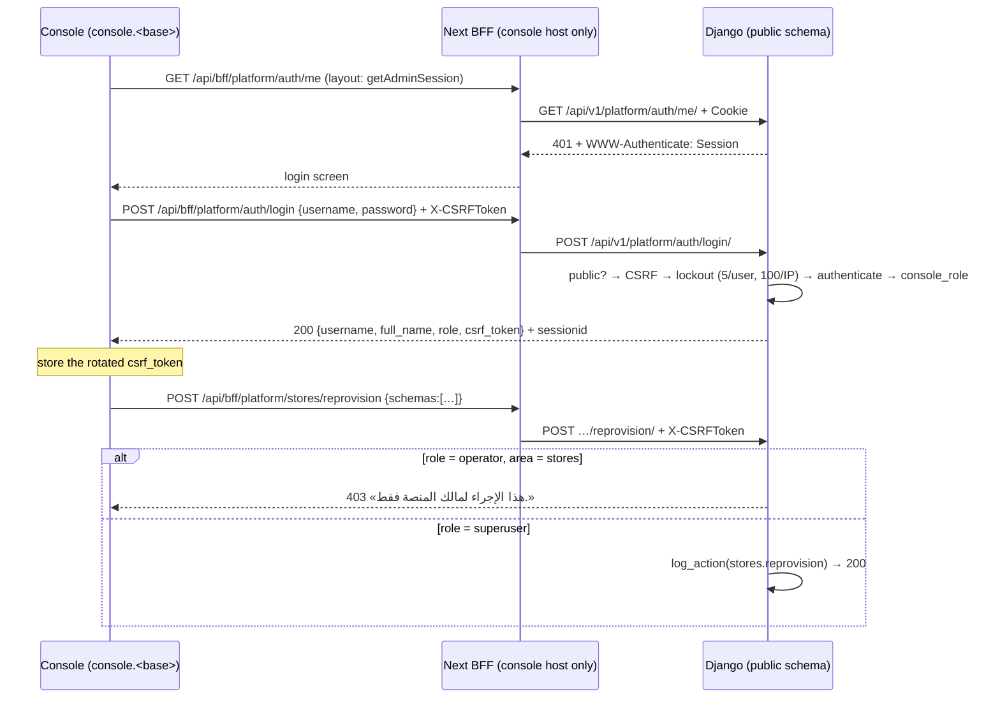

# Platform console auth API — M20 (لوحة مالك المنصة)

> **Source**: DOC-021 · INT-030 (M20) · inventory A.4 · Domain 16
> **Live key**: `platform` (`SHARWA_LIVE_MODULES`) for `auth/*`, overview, stores, clients, webhook events, features and overrides. The money rows use `platform_money`, the billing rows `platform_billing`. Without the key the console reads fixtures while `SHARWA_MOCKS=on`
> **Django provider**: `sharwa_saas/api/views_platform.py` (`ConsoleLoginView`, `ConsoleLogoutView`, `ConsoleMeView`, `ConsoleView`, `ConsoleSessionAuthentication`) · `tenants/console_service.py` (`console_role`, `can_write`, `OPERATOR_WRITES`, `session_payload`, `Actor`, `log_action`)
> **Frontend contract**: `sharwa-frontend/src/features/platform-admin/schemas/auth.ts` (`adminSessionSchema`, `canWrite`) · `src/features/platform-admin/api/session.ts` (`getAdminSession`) · `src/app/(admin)/%5Fa/layout.tsx` (CSRF bootstrap) · BFF `src/app/api/bff/platform/[...path]/route.ts`
> **Tests**: `sharwa_saas/api/test_platform_console_api.py` — `test_session_roles_and_login`, `test_login_lockout_by_username`, `test_store_origin_gets_404`
> **Last verified against code**: 2026-10-27 (step 03)

## 1. Overview

The console (`console.<base>`) is for the platform's own people. Two roles exist, both ordinary **Django users of the public schema** (the same accounts as the Django admin gate):

| Role (`role` in the API) | Django flags | Arabic label | May write |
|---|---|---|---|
| `superuser` | `is_superuser` (and active) | «مالك المنصة» | everything |
| `operator` | `is_staff`, not superuser (and active) | «مشرف تشغيلي» | **dues** and **Sharwa Pay** only (FR-20.09) |
| *(none)* | any other user, or an inactive user | — | cannot log in; an existing session of such a user is refused with 401 |

A user who is both superuser and staff is `superuser` (the check is `is_superuser` first). The console runs **only on the public schema**: on a store host, or with an `X-Store-Domain` header, every console route answers **404** `{"detail": "غير موجود."}` (FR-20.01), so platform data is never exposed from a store origin. The Next.js BFF applies the same rule first (`/api/bff/platform/*` answers 404 «غير موجود.» unless the host is the console host).

Route reference for the rest of the console: [`m20-console.md`](m20-console.md) and the Domain 8/16 money pages.

## 2. Access — gate chain

`ConsoleView.initial()` evaluates, in order; the first failure answers:

| # | Gate | Requirement | Failure |
|---|---|---|---|
| 1 | Public schema | `connection.schema_name == 'public'` (`_public_only()`) | `404` `{"detail": "غير موجود."}` |
| 2 | Authentication + CSRF | `ConsoleSessionAuthentication` (DRF `SessionAuthentication`): a session user → the CSRF token must be valid on unsafe methods | `403` `{"detail": "CSRF Failed: …"}`. Without a session the request continues as anonymous |
| 3 | Console role | `console_role(user)` is `superuser` or `operator` | **`401`** `{"detail": "انتهت جلسة لوحة المنصة، سجّل الدخول مجدداً."}` + header `WWW-Authenticate: Session` (never 403, so the UI returns to the login screen) |
| 4 | Write permission | safe method, or `can_write(role, area)` | `403` `{"detail": "هذا الإجراء لمالك المنصة فقط."}` |

Gate 2 runs before gate 3 and 4: an operator who sends a forbidden write **without** a CSRF token gets the CSRF 403 first. There is no plan-feature or permission-key gate in the console.

## 3. Endpoint summary

| Method | Django path (`/api/v1/platform/…`) | BFF path (`/api/bff/platform/…`) | Purpose | Gate |
|---|---|---|---|---|
| `POST` | `auth/login/` | `auth/login` | log in | public schema, CSRF, lockout |
| `POST` | `auth/logout/` | `auth/logout` | log out | public schema; CSRF if a session exists |
| `GET` | `auth/me/` | `auth/me` | current session + a fresh CSRF token | gates 1–3 |

Server-side, the console layout reads the session with `getAdminSession()` (`src/features/platform-admin/api/session.ts`): when `platform` is live it calls Django `GET /api/v1/platform/auth/me/` with the browser's cookies (no `X-Store-Domain`); `401`, `403` or an unreachable backend mean «no session» and the console stays on its login screen. With mocks only, a dev marker cookie `sharwa_mock_admin` selects a fixture user.

## 4. Authentication routes

### `POST /api/v1/platform/auth/login/`

Authentication: none (`authentication_classes = []`); CSRF is enforced by hand (`SessionAuthentication().enforce_csrf`) **before** anything else except the schema check.

**Request body** (`application/json`)

| Field | Type | Required | Rules |
|---|---|---|---|
| `username` | string | yes | trimmed; the Django username |
| `password` | string | yes | not trimmed |

**Response `200`**

```json
{
  "username": "ops",
  "full_name": "ops",
  "role": "operator",
  "csrf_token": "<64-character token>"
}
```

| Field | Type | Meaning |
|---|---|---|
| `username` | string | `user.get_username()` |
| `full_name` | string | `get_full_name()` or, if empty, the username |
| `role` | `"superuser"` \| `"operator"` | `console_role(user)` |
| `csrf_token` | string | `get_token(request)` **after** `login()` — Django's `login()` rotates the CSRF secret, so the token the page held before is no longer valid; the client must store this one before its next write |

A session cookie (`sessionid`, public-schema session) is set. The frontend schema `adminSessionSchema` treats `csrf_token` as optional.

**Errors**

| Status | Body | When |
|---|---|---|
| `400` | `{"username": ["أدخل اسم المستخدم."], "password": ["أدخل كلمة المرور."]}` (only the missing ones) | missing field |
| `400` | `{"detail": "اسم المستخدم أو كلمة المرور غير صحيحة."}` | unknown user, wrong password, **or** a valid user who has no console role (same message — no account enumeration; a dummy `check_password` keeps timing equal) |
| `403` | `{"detail": "CSRF Failed: …"}` | missing/invalid token |
| `404` | `{"detail": "غير موجود."}` | store host or `X-Store-Domain` |
| `429` | `{"detail": "محاولات دخول كثيرة — حاول بعد 15 دقيقة."}` + `Retry-After: 900` | lockout |

**Rules**

- Order: public schema → CSRF → required fields → **lockout** → `authenticate` → role. The lockout is checked before the password, so a locked account refuses even the right password.
- **Lockout** (cache, window 900 s; failures counted for both keys, including «valid user without role»): `rl:public:console_login:user:<username lower-cased>` limit **5**; `rl:public:console_login:ip:<ip>` limit **100**. The per-IP ceiling is deliberately wide (decision 2026-10-21: Yemeni mobile networks sit behind CGNAT, so many people share one address); the real protection is the per-username counter. A success deletes the username counter only.
- Success: Django `login(request, user)` (cycle the session key and rotate CSRF), then the payload above.

### `POST /api/v1/platform/auth/logout/`

Authentication: `ConsoleSessionAuthentication`, no permission class. Runs `_public_only()`, then Django `logout()` (flushes the session). **`204`**; also `204` without a session (anonymous requests are not rejected). With a session, CSRF is enforced like any write.

### `GET /api/v1/platform/auth/me/`

`ConsoleView` (gates 1–3, a safe method so gate 4 passes). **Response `200`** — the login payload with a **fresh** `csrf_token`. **`401`** `{"detail": "انتهت جلسة لوحة المنصة، سجّل الدخول مجدداً."}` with `WWW-Authenticate: Session` when there is no session or the user is no longer a console user (for example `is_staff` was removed).

### Examples (curl)

Use a fixture or staging account; never put a real password in notes. Token handling is in [`../../overview/csrf.md`](../../overview/csrf.md).

```bash
BASE=http://localhost:8000          # public schema host, no X-Store-Domain
JAR="$(mktemp)"
T=$(curl -s -c "$JAR" -b "$JAR" "$BASE/api/v1/auth/csrf/" | python3 -c 'import sys,json; print(json.load(sys.stdin)["csrfToken"])')

# owner login → 200, then use the NEW csrf_token from the body
curl -s -c "$JAR" -b "$JAR" -H "X-CSRFToken: $T" -H "Content-Type: application/json" \
     -d '{"username":"owner","password":"<password>"}' "$BASE/api/v1/platform/auth/login/"
# {"username":"owner","full_name":"owner","role":"superuser","csrf_token":"…"}

# no session → 401 with WWW-Authenticate: Session
curl -si "$BASE/api/v1/platform/overview/" | sed -n '1p;/WWW-Authenticate/p'

# store origin → 404 (same route with a store header)
curl -s -b "$JAR" -H "X-Store-Domain: noor.localhost" "$BASE/api/v1/platform/auth/me/"
# {"detail":"غير موجود."}
```

## 5. Roles and the 403 matrix

`can_write(role, area)` = `role == 'superuser'` **or** (`role == 'operator'` and `area in ('dues', 'sharwa_pay')`). Every console view declares an `area` (default `stores`). Safe methods (`GET`, `HEAD`, `OPTIONS`) are open to both roles; the matrix is for `POST`/`PUT`/`PATCH`/`DELETE`. The frontend `canWrite()` (`schemas/auth.ts`) holds the same table; the server stays the final word.

| Area | Writes (examples; full list in `m20-console.md`) | `superuser` | `operator` |
|---|---|---|---|
| `stores` | `stores/reprovision/`, `stores/<schema>/sharwa-ship/`, `stores/<schema>/domains/…`, `stores/<schema>/deactivation/` | ✅ | ❌ 403 «هذا الإجراء لمالك المنصة فقط.» |
| `billing` | `stores/<schema>/features/` (PUT), `features/<code>/` (PATCH), `feature-overrides/bulk/`, `feature-overrides/<id>/` (DELETE), `plans/…`, `plan-features/`, `subscriptions/assign/`, `billing-settings/` | ✅ | ❌ 403 |
| `apps` | `apps/…`, `app-billing-overrides/…` | ✅ | ❌ 403 |
| `catalog` | `market-categories/…` (create, reorder, update, delete) | ✅ | ❌ 403 |
| `zones` | `sharwa-ship/zones/…` | ✅ | ❌ 403 |
| `webhooks` | `webhook-events/<id>/retry/`, `…/discard/` | ✅ | ❌ 403 |
| `dues` | `dues/<schema>/actions/` | ✅ | ✅ |
| `sharwa_pay` | `sharwa-pay/topups/<id>/<approve\|reject>/`, `sharwa-pay/withdrawals/<id>/<confirm\|reject>/` | ✅ | ✅ |
| any (read) | all `GET`s | ✅ | ✅ |

```json
{ "detail": "هذا الإجراء لمالك المنصة فقط." }
```

Status summary for a caller:

| Caller | `GET` any route | write in `dues` / `sharwa_pay` | write elsewhere |
|---|---|---|---|
| no session | 401 + `WWW-Authenticate: Session` | 401 | 401 |
| user without a console role / inactive | 401 | 401 | 401 |
| operator | 200 | 2xx | 403 «هذا الإجراء لمالك المنصة فقط.» |
| superuser | 200 | 2xx | 2xx |
| any session, bad CSRF token | — | 403 `CSRF Failed` | 403 `CSRF Failed` (before the role check) |
| any, store host / `X-Store-Domain` | 404 | 404 | 404 |

## 6. Audit: who did what

`Actor(user)` is built from the **session user** in `ConsoleView.initial()` (`username`, `role`), never from the request body. Every console write calls `log_action(client, actor, action, detail)` (`tenants/console_service.py`), which inserts a `PlatformActionLog` row: `client` (nullable), `schema_name`, `actor_username`, `actor_role`, `action`, `detail` (Arabic text), `created_at`. Action codes in the code: `stores.reprovision`, `sharwa_ship.activate|deactivate`, `deactivation.<action>`, `domain.add`, `domain.primary`, `feature.update`, `feature_override.update|bulk|delete`, `plan.create|update|delete`, `plan_feature.update`, `subscription.assign`, `billing_settings.update`, `app.create|update`, `app_override.create|delete`, `market_category.create|update|reorder|delete`, `zone.create|update|delete`, `dues.<action>`, `sharwa_pay.topup.<action>`, `sharwa_pay.withdrawal.<action>`, `webhook_event.retry|discard`. A failure to write the log (`DatabaseError`) is logged and does **not** fail the action. Login and logout are not logged. The rows are shown on the store detail screens as «من نفّذ» (FR-20.07).



> ⚠️ Discrepancy — roadmap says «`ConsoleSessionAuthentication`: no session ⇒ 401 with `WWW-Authenticate: Session`» and lists it for the whole console / code does: the header comes from `authenticate_header()` and applies to routes that use that class (`ConsoleView` subclasses and logout). `ConsoleLoginView` uses `authentication_classes = []`, so a login failure is a plain 400/403/429 (no `WWW-Authenticate`), as documented above.

## 7. Gaps closed, bugs fixed and migrations

- **INT-030 (2026-10)**: console auth went live on the Django admin session; `csrf_token` returned by login and `me` so the first write after login does not fail (Django's `login()` rotates the secret).
- **FR-20.01**: public-schema-only (`_public_only`), enforced both by the BFF host check and by Django.
- No migration is owned by this page; `PlatformActionLog` is documented with the console models.

## 8. Open items and legacy-only behaviour

- No MFA and no password change in the console; accounts are managed in the Django admin gate.
- `Actor.role` falls back to `operator` for a user whose role cannot be resolved (only reachable by a race after the gates).
- Console sessions share Django's session cookie rules (`SESSION_EXPIRE_AT_BROWSER_CLOSE = True`); there is no idle timeout beyond that.

## 9. Related pages

- [`../../overview/auth.md`](../../overview/auth.md#console) · [`../../overview/csrf.md`](../../overview/csrf.md) · [`../../overview/rate-limits.md`](../../overview/rate-limits.md)
- [`m20-console.md`](m20-console.md) — stores, features, webhook events, domains (planned).
