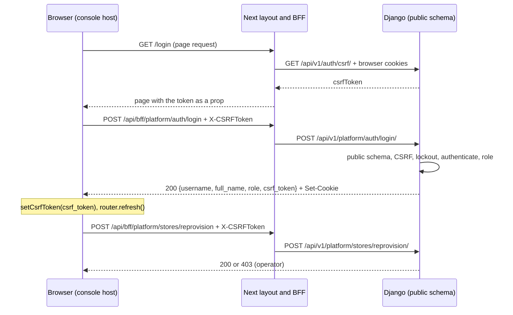
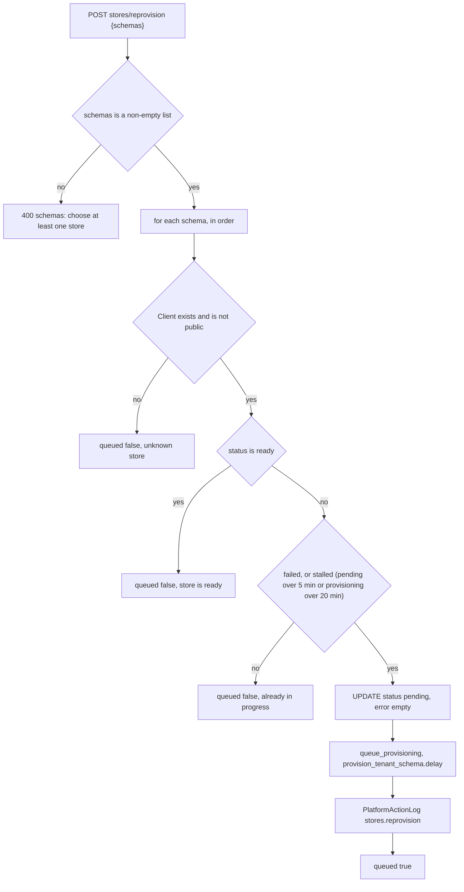
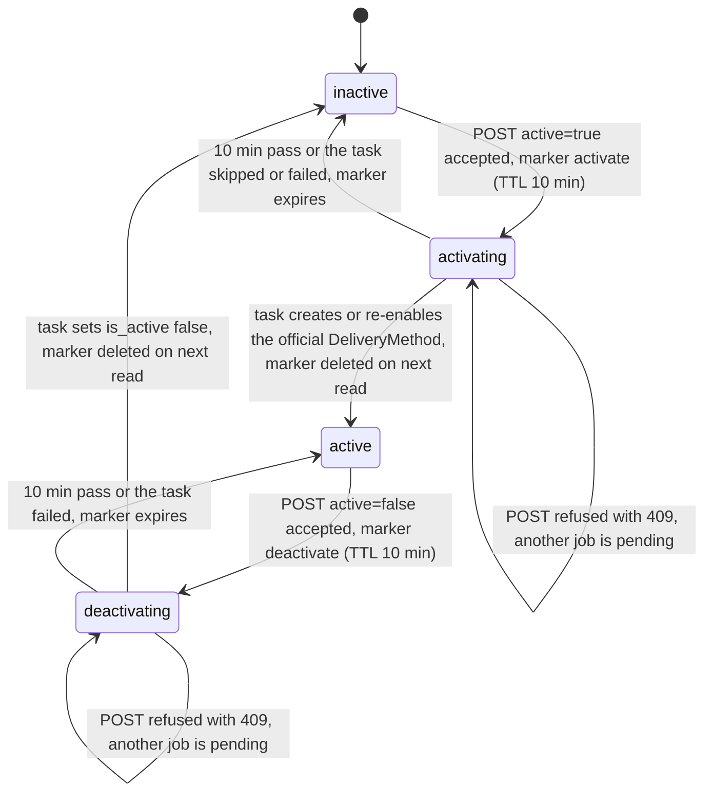
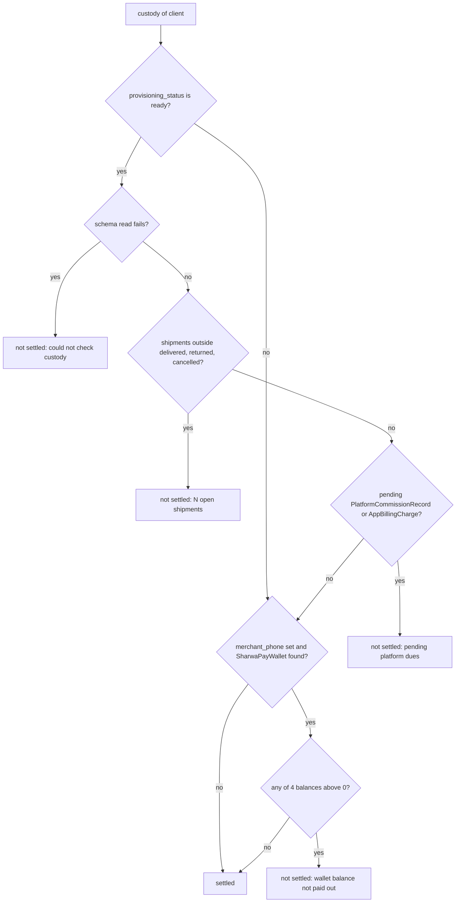
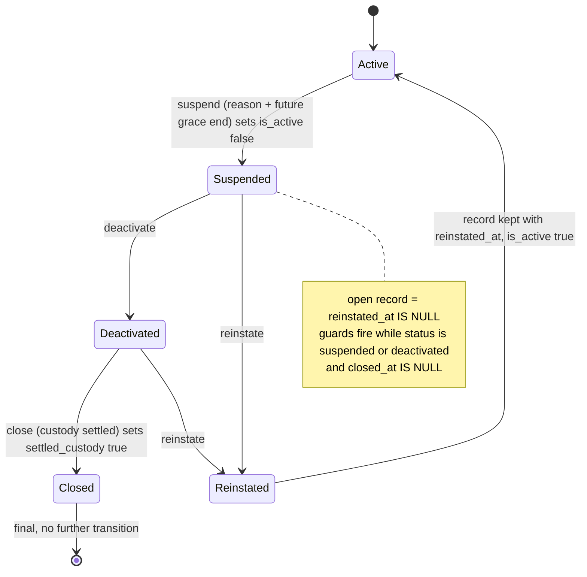
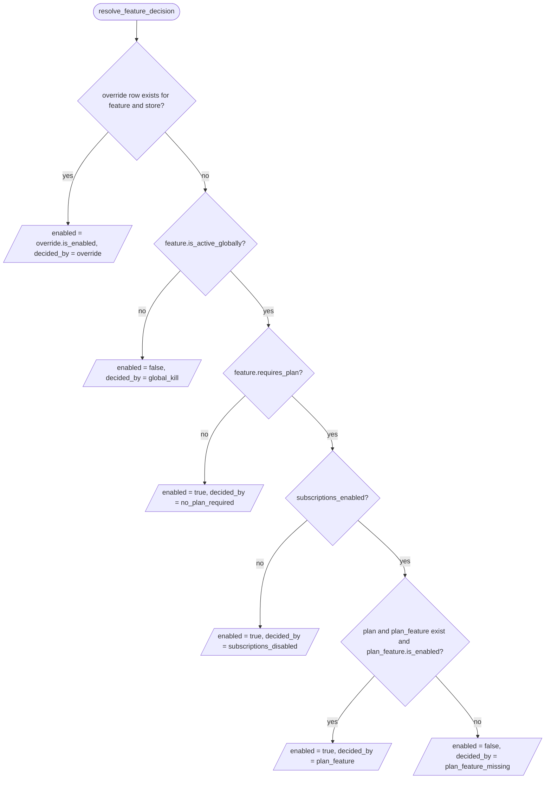
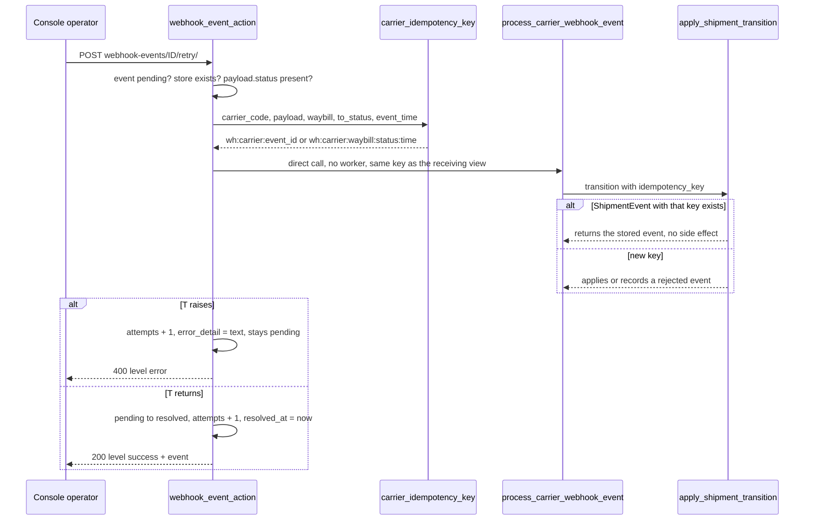

# Platform console API — M20 (لوحة مالك المنصة)

> **Source**: DOC-266, DOC-267, DOC-268, DOC-269, DOC-270, DOC-271, DOC-272, DOC-273 · INT-030 (M20), INT-032 (stores list `plan` filter), INT-021 (carrier DLQ) · inventory Domain 16, A.3, A.4, A.5, A.8, A.9, A.11, A.12
> **Live key**: `platform` (`SHARWA_LIVE_MODULES`) for every route on this page. The money rows use `platform_money` and the billing rows `platform_billing` (see the BFF section). Without the key the console reads fixtures while `SHARWA_MOCKS=on`
> **Django provider**: `sharwa_saas/api/views_platform.py` (`ConsoleView` and one view class per route) · `sharwa_saas/tenants/console_service.py` (all M20 logic) · `billing/models.py` (`resolve_feature_decision`) · serializers: none, the service returns plain dicts shaped by the Zod schemas
> **Frontend contract**: `sharwa-frontend/src/features/platform-admin/schemas/{auth,stores,billing,common}.ts` · fixtures `src/mocks/platform/` · BFF `src/app/api/bff/platform/[...path]/route.ts`
> **Tests**: `sharwa_saas/api/test_platform_console_api.py` (14) · mock E2E `scripts/admin-stores-check.ts`
> **Last verified against code**: 2026-10-28 (step 40)

## 1. Overview

The platform owner console (`console.<base>`) is the operations screen of the Sharwa team: it lists every store, re-queues failed provisioning, switches Sharwa Ship per store, decides which paid features a store sees, manages custom domains, suspends and reinstates stores, and works the carrier webhook dead-letter queue. Before Phase 002 these actions existed only as Django admin actions (`tenants/admin.py`) and the HTML `master-dashboard` (`config/urls_public.py:41`); M20 (INT-030) added **21 JSON routes** under `/api/v1/platform/` that carry the Next.js console's contract, without new decision logic: re-provisioning is the admin action itself, Sharwa Ship is two Celery tasks, features are resolved by `billing.models.resolve_feature_decision`, and a retried carrier event runs the same task with the same idempotency key.

Callers are Django users of the **public schema** with a console role: `superuser` («مالك المنصة») and `operator` («مشرف تشغيلي»). The console runs on the public schema only; every route answers `404` on a store host. Every action is recorded in `PlatformActionLog`. The sibling routes of the same prefix are documented in [`m45-dues-sharwa-pay-admin.md`](m45-dues-sharwa-pay-admin.md) (dues, Sharwa Pay, Sharwa Ship zones) and `m46-plans-billing.md` (plans, subscriptions, billing settings, apps, market categories); 44 `platform/` routes exist in total.

## 2. Access — gate chain

The gate chain, the error bodies and the role matrix are the same for every console route and are specified once in [`auth.md`](auth.md) (§2 and §5). In short, the first failing gate answers:

| # | Gate | Requirement | Failure |
|---|---|---|---|
| 1 | Public schema | not a store host, no `X-Store-Domain` | `404` `{"detail": "غير موجود."}` |
| 2 | Session + CSRF | Django admin session; CSRF token on every unsafe method | `403` `CSRF Failed: …` |
| 3 | Console role | `superuser` or `operator` | `401` «انتهت جلسة لوحة المنصة، سجّل الدخول مجدداً.» + `WWW-Authenticate: Session` |
| 4 | Write permission | `GET` for both roles; every M20 write needs `superuser` | `403` «هذا الإجراء لمالك المنصة فقط.» |

There is no plan-feature or permission-key gate. The per-route role × capability matrix is in section 4.1.

## 3. Endpoint summary

The complete table (method, Django path, BFF path, view class, area, who may write) is in section 4.8, "The 21 M20 routes". By task:

| Group | Routes | Documented in |
|---|---|---|
| Authentication | `auth/login/`, `auth/logout/`, `auth/me/` | 4.1 (details in [`auth.md`](auth.md)) |
| Overview, stores list, clients | `overview/`, `stores/`, `clients/` | 4.2 |
| Re-provisioning | `stores/reprovision/` | 4.3 |
| Store detail, Sharwa Ship | `stores/<schema>/`, `stores/<schema>/sharwa-ship/` | 4.4 |
| Per-store features, domains, deactivation | `stores/<schema>/features/`, `stores/<schema>/domains/`, `stores/<schema>/domains/<id>/`, `stores/<schema>/deactivation/` | 4.5 |
| Feature catalogue and overrides | `features/`, `features/<code>/`, `features/<code>/resolve/`, `feature-overrides/`, `feature-overrides/bulk/`, `feature-overrides/<id>/` | 4.6 |
| Carrier dead-letter queue | `webhook-events/`, `webhook-events/<id>/<action>/` | 4.7 |
| Migrations, robustness, BFF, tests, route table | all | 4.8 |

## 4. Endpoint groups

### 4.1 Console authentication and roles (DOC-266)

The M20 provider is `sharwa_saas/api/views_platform.py` (views, 552 lines) over `sharwa_saas/tenants/console_service.py` (logic). It exposes **21 routes** under `/api/v1/platform/` (`api/urls.py:473-493`; the rest of the `platform/` block, `:494-518`, belongs to M45/M46 and the money/billing pages). Before INT-030 the same actions existed only as Django-admin actions (`tenants/admin.py`) and the HTML `master-dashboard`. Login, logout and `me` payloads are in [`auth.md`](auth.md) (login request/response, the 400/403/404/429 bodies, the gate chain table in its §2); this section adds the role matrix over all 21 routes, the lockout algorithm, the CSRF rotation and the frontend session behaviour.

#### The 21 M20 routes — role × capability matrix

`area` is the class attribute of the view (`ConsoleView.area`, default `'stores'`, `views_platform.py:101`). `can_write(role, area)` (`console_service.py:90`) is true for `superuser` on every area and for `operator` only on `dues` and `sharwa_pay` (`OPERATOR_WRITES`, `console_service.py:77`), so **an operator can write nothing in M20**. Safe methods (`GET`, `HEAD`, `OPTIONS`) skip the area check: both roles read every route below.

| # | Method | Path (`/api/v1/platform/…`) | View (`views_platform.py`) | `area` | `superuser` | `operator` | Documented in |
|---|---|---|---|---|---|---|---|
| 1 | `POST` | `auth/login/` | `ConsoleLoginView` `:133` | — (no console gate) | any visitor with a valid CSRF token and a console account | same | [`auth.md`](auth.md) |
| 2 | `POST` | `auth/logout/` | `ConsoleLogoutView` `:177` | — | `204` | `204` | [`auth.md`](auth.md) |
| 3 | `GET` | `auth/me/` | `ConsoleMeView` `:189` | `stores` (read) | `200` | `200` | [`auth.md`](auth.md) |
| 4 | `GET` | `overview/` | `ConsoleOverviewView` `:198` | `stores` (read) | `200` | `200` | DOC-267 |
| 5 | `GET` | `clients/` | `ConsoleClientOptionsView` `:210` | `stores` (read) | `200` | `200` | DOC-267 |
| 6 | `GET` | `stores/` | `ConsoleStoreListView` `:204` | `stores` (read) | `200` | `200` | DOC-267 |
| 7 | `POST` | `stores/reprovision/` | `ConsoleReprovisionView` `:216` | `stores` | `200` | **`403`** | DOC-268 |
| 8 | `GET` | `stores/<schema>/` | `ConsoleStoreDetailView` `:222` | `stores` (read) | `200` | `200` | DOC-269 |
| 9 | `POST` | `stores/<schema>/sharwa-ship/` | `ConsoleSharwaShipView` `:228` | `stores` | `200` | **`403`** | DOC-269 |
| 10 | `GET` / `PUT` | `stores/<schema>/features/` | `ConsoleStoreFeaturesView` `:235` | `billing` | `GET` `200`, `PUT` `200` | `GET` `200`, `PUT` **`403`** | per-store features |
| 11 | `POST` | `stores/<schema>/domains/` | `ConsoleDomainListView` `:246` | `stores` | `201` | **`403`** | domains |
| 12 | `POST` | `stores/<schema>/domains/<id>/` | `ConsoleDomainPrimaryView` `:252` | `stores` | `200` | **`403`** | domains |
| 13 | `GET` / `POST` | `stores/<schema>/deactivation/` | `ConsoleDeactivationView` `:258` | `stores` | `GET` `200`, `POST` `200` | `GET` `200`, `POST` **`403`** | deactivation |
| 14 | `GET` | `features/` | `ConsoleFeatureListView` `:284` | `billing` (read) | `200` | `200` | feature catalogue |
| 15 | `PATCH` | `features/<code>/` | `ConsoleFeatureDetailView` `:292` | `billing` | `200` | **`403`** | feature catalogue |
| 16 | `GET` | `features/<code>/resolve/` | `ConsoleFeatureResolveView` `:300` | `billing` (read) | `200` | `200` | feature catalogue |
| 17 | `GET` | `feature-overrides/` | `ConsoleOverrideListView` `:308` | `billing` (read) | `200` | `200` | feature catalogue |
| 18 | `POST` | `feature-overrides/bulk/` | `ConsoleOverrideBulkView` `:316` | `billing` | `200` | **`403`** | feature catalogue |
| 19 | `DELETE` | `feature-overrides/<id>/` | `ConsoleOverrideDetailView` `:324` | `billing` | `204` | **`403`** | feature catalogue |
| 20 | `GET` | `webhook-events/` | `ConsoleWebhookEventListView` `:267` | `webhooks` (read) | `200` | `200` | webhook DLQ |
| 21 | `POST` | `webhook-events/<id>/<retry or discard>/` | `ConsoleWebhookEventActionView` `:275` | `webhooks` | `200` | **`403`** | webhook DLQ |

Rows 10 and 13 are the only M20 routes that mix a read and a write method; the area applies to the write only. `403` above always means the body `{"detail": "هذا الإجراء لمالك المنصة فقط."}` (`OWNER_ONLY`, `views_platform.py:75`). The write areas outside M20 (`dues`, `sharwa_pay`, `apps`, `catalog`, `zones`) are listed in [`auth.md` §5](auth.md); the frontend copy of the table is `canWrite()` in `src/features/platform-admin/schemas/auth.ts:24-27`, the UI half of the gate (`useCanWrite(area)`, `components/admin-session.tsx`) — the server stays the final word.

#### 401, 403 and 404 — who gets what

`ConsoleView.initial()` (`views_platform.py:103-111`) runs: `_public_only()` → DRF `initial()` (session authentication, **CSRF on unsafe methods for a logged-in user**) → `console_role(user)` → area check. The first failure answers; the whole chain is `auth.md` §2. The rules a caller must know:

| Situation | Answer | Source |
|---|---|---|
| Store host, or any request carrying `X-Store-Domain` | `404` `{"detail": "غير موجود."}` — before authentication | `views_platform.py:90-92` |
| No session, or a session whose user is inactive, or a user who is neither superuser nor staff | **`401`** `{"detail": "انتهت جلسة لوحة المنصة، سجّل الدخول مجدداً."}` + `WWW-Authenticate: Session` (never `403`, so the UI returns to the login screen) | `views_platform.py:74,83-87,106-108` |
| Logged-in session, unsafe method, CSRF token missing or wrong | `403` `{"detail": "CSRF Failed: …"}` — **before** the role check, so an operator's forbidden write without a token gets the CSRF message | DRF `SessionAuthentication.enforce_csrf` |
| Operator, unsafe method, any M20 route | `403` «هذا الإجراء لمالك المنصة فقط.» — also on a method the route does not implement (the check runs before DRF looks up the handler), so `POST overview/` is `403` for an operator and `405` for a superuser | `views_platform.py:109-110` |
| Superuser, any valid request | gates pass; the business rules of each route apply | — |

The role is read from the database user on **every** request, never cached in the session: removing `is_staff` turns the next request into `401` (no role), downgrading a superuser to staff turns the next write into `403`. `ConsoleView` sets `permission_classes = []` and `throttle_classes = []`, so the global anonymous throttle (120/minute) does not apply to console routes; the only rate limit is the login lockout below.

#### Lockout rules (`POST auth/login/`)

Constants: `LOGIN_WINDOW_SECONDS = 15 * 60`, `LOGIN_MAX_FAILURES_PER_USER = 5`, `LOGIN_MAX_FAILURES_PER_IP = 100` (`views_platform.py:78-81`). Counters live in the Django cache (Redis in production).

| Counter | Cache key | Limit | Counted on |
|---|---|---|---|
| per username | `rl:public:console_login:user:<username, stripped and lower-cased>` | **5** | every failed login for that name: unknown user, wrong password, **and** a valid user without a console role (all answer the same `400`) |
| per IP | `rl:public:console_login:ip:<REMOTE_ADDR>` | **100** (loose ceiling: Yemeni mobile networks sit behind CGNAT, decision 2026-10-21, comment at `:80`) | the same events |

Algorithm (`views_platform.py:138-173`):

1. Not the public schema → `404`. CSRF invalid → `403` (nothing is counted).
2. `username` or `password` empty → `400` field errors (nothing is counted).
3. **Lockout check before the password**: if `cache.get(user_key) >= 5` or `cache.get(ip_key) >= 100` → `429` `{"detail": "محاولات دخول كثيرة — حاول بعد 15 دقيقة."}` + `Retry-After: 900`. A locked account refuses even the correct password.
4. `authenticate()`; if it fails a dummy `check_password` equalises the timing. Failure (no user, or no console role) → both counters are incremented through `cache_rate_limit` (`products/utils.py:213`, `cache.add` then `cache.incr`) and the answer is `400` «اسم المستخدم أو كلمة المرور غير صحيحة.».
5. Success → the **username counter is deleted** (the IP counter is not), `login()` rotates the session and CSRF secret, the payload carries the new `csrf_token`.

Timeline for one username: failures 1–5 each answer `400` (counter 1…5); the **6th attempt** is `429` whatever the password; the lock ends when the counter key expires. The window is fixed and anchored on the **first** failure (`cache.add` sets the 900 s TTL, `cache.incr` does not renew it), and `Retry-After` is always `900` even when less time is left. There is no unlock endpoint in the console. Tests: `test_login_lockout_by_username` (5 failures then `429` with `Retry-After`).

#### CSRF: bootstrap, rotation and retry

Django enforces CSRF on the login and on every write of a logged-in session (`CSRF_COOKIE_HTTPONLY = True`, `config/settings.py:382`), so the browser cannot read the cookie; the token reaches the client as data. Verified in the frontend:

| Step | Where | Behaviour |
|---|---|---|
| 1. Bootstrap | `src/app/(admin)/%5Fa/layout.tsx:46-51` (`CsrfBootstrap`, inside `<Suspense>`) | server-side `getCsrfToken(null, cookies)` → `GET {UPSTREAM}/api/v1/auth/csrf/` with the browser's `cookie` header and **no** `X-Store-Domain` (`src/lib/csrf.ts:50-60,85-87`; Django `CsrfTokenView`, `api/views_auth.py:65-81`, route `api/urls.py:219`); the token is handed to `<ApiClientProvider csrfToken>` (`components/providers/api-client-provider.tsx`) and kept in a module variable, never in storage or `document.cookie`. Same mechanism as the merchant dashboard |
| 2. Send | `src/lib/api-client.ts:72` | `X-CSRFToken` on `POST`/`PUT`/`PATCH`/`DELETE` |
| 3. Rotate on login | `ConsoleLoginView` (`views_platform.py:169-173`); `useAdminLogin().onSuccess` (`api/hooks.ts:105-107`) | Django's `login()` rotates the CSRF secret, so the token held before login is dead; the response `csrf_token` (`get_token` after `login()`) replaces it via `setCsrfToken`. The `Set-Cookie` of the response travels through the BFF (`forwardResponse`) so cookie and token stay a pair |
| 4. Refresh | `auth/me/` (`views_platform.py:190-193`) and `src/lib/api-client.ts:88-91` | `auth/me/` answers a fresh `csrf_token` too. On a `403` whose detail matches `/csrf/i`, the client calls `GET /api/bff/auth/csrf` (`src/app/api/bff/auth/csrf/route.ts`, forwards `Set-Cookie`) and retries **once** |



#### Frontend session: `getAdminSession()` and the layouts

`getAdminSession()` (`src/features/platform-admin/api/session.ts:19-40`):

- **Live** — `isModuleLive("platform")` is true when `SHARWA_MOCKS=off`, or `platform` (or `*`) is in `SHARWA_LIVE_MODULES` (`src/mocks/runtime.ts:156-163`). It then reads `jar.toString()`; **no cookies at all → `null` without calling Django**. Otherwise `GET {UPSTREAM}/api/v1/platform/auth/me/` (`accept: application/json`, the browser cookies, `cache: "no-store"`, `redirect: "manual"`). Any non-2xx (`401`, `403`, a redirect), a body that fails `adminSessionSchema`, or a network error → `null`.
- **Mock** (module not live and mocks on) — the dev cookie `sharwa_mock_admin` (`superuser` or `operator`) selects a fixture session (`src/mocks/platform/auth.ts`); mocks off and not live → `null`.
- `requireAdminSession()` redirects to `/login` when the result is `null`. The `(console)` layout awaits it in the layout body (`(admin)/%5Fa/(console)/layout.tsx:16-19`, `instant = false`), so a request without a session gets a real redirect, never a flushed `200`; `/login` redirects to `/` when a session already exists (`login/page.tsx:13-16`).
- The session (`username`, `full_name`, `role`, optional `csrf_token`) is passed to `AdminSessionProvider`; `useCanWrite(area)` disables write controls for an operator (read-only note, no row selection on `/stores`).

The BFF catch-all `src/app/api/bff/platform/[...path]/route.ts` answers `404` «غير موجود.» unless the host resolves to the reserved `admin` group (the console host), then maps the first path segment to a live key: `auth`, `overview`, `stores`, `clients`, `webhook-events`, `features`, `feature-overrides` → `platform` (`:31`); `dues`, `sharwa-pay`, `sharwa-ship` → `platform_money`; the M46 rows → `platform_billing`. A live row forwards verbatim (cookies, CSRF header, query string, status and body) to `/api/v1/platform/<path>/` with Django's trailing slash. See [`../../overview/bff.md`](../../overview/bff.md) and [`../../overview/csrf.md`](../../overview/csrf.md).

> ⚠️ Discrepancy — roadmap says «Lockout after 5 failures per username / 15 min» / code does: the lock applies when the counter is **already ≥ 5**, i.e. from the 6th attempt, in a fixed 900 s window anchored on the first failure, and `Retry-After` is a constant `900` (`views_platform.py:78-79,153-157`; `products/utils.py:223-227`). Reported in step 40.

**Tests**: `test_session_roles_and_login`, `test_login_lockout_by_username`, `test_store_origin_gets_404` (`api/test_platform_console_api.py:99,120,127`). The suite uses DRF `APIClient` without `enforce_csrf_checks`, so the CSRF behaviour described above is read from code, not asserted by a test.

---

### 4.2 Overview, stores list and clients (DOC-267)

Common to the three routes: console session (`auth.md`), read-only, so both roles may call them; every store row comes from `store_row()` (`console_service.py:248-264`); the `public` client is always excluded (`store_queryset()` does `Client.objects.exclude(schema_name='public')`, `:136-153`). There is no store-scoped cache: each call reads the database.

#### `GET /api/v1/platform/overview/`

BFF: `GET /api/bff/platform/overview`. Frontend: `useOverview()` → `overviewSchema` (`schemas/stores.ts:52-63`). View: `ConsoleOverviewView` → `svc.overview()` (`console_service.py:344-363`).

**Response `200`**

```json
{
  "total_stores": 112,
  "display_total_sales": "48,230.50 ر.س",
  "total_orders": 1894,
  "failed_stores": 3,
  "stalled_stores": 1,
  "pending_topups": 4,
  "pending_withdrawals": 2,
  "pending_webhook_events": 5,
  "snapshot_date": "2026-10-27",
  "recent_stores": [
    {
      "schema_name": "noor",
      "name": "Noor Store",
      "primary_domain": "noor.example.com",
      "merchant_phone": "9677XXXXXXXX",
      "provisioning_status": "ready",
      "is_stalled": false,
      "current_plan": { "id": 3, "code": "pro", "name": "Pro" },
      "is_active": true,
      "deactivation_status": null,
      "sharwa_ship": "inactive",
      "created_on": "2026-10-20T09:14:03.512000+00:00"
    }
  ]
}
```

| Field | Type | Source |
|---|---|---|
| `total_stores` | int | `Client.objects.exclude(schema_name='public').count()` — **every** store, active or not, in any provisioning status |
| `display_total_sales` | string | `Sum(TenantStatsSnapshot.revenue_sar)` over **all** snapshot rows (every day, every store), formatted by `format_money(total, 'SAR')`: integers without decimals, otherwise two decimals with thousand separators, suffix « ر.س» (`products/models/base.py:75-93`); `"0 ر.س"` when there are no snapshots (`test_overview_and_store_list_contract`). The client shows the string as sent |
| `total_orders` | int | `Sum(TenantStatsSnapshot.orders_count)`, same scope |
| `failed_stores` | int | `provisioning_status = 'failed'` |
| `stalled_stores` | int | `stalled_q(now)`: the sweeper rule, thresholds in the stores section below |
| `pending_topups` | int | `SharwaPayTopupRequest` with `status='pending'` |
| `pending_withdrawals` | int | `SharwaPayWithdrawalRequest` with `status='pending'` |
| `pending_webhook_events` | int | `PendingWebhookEvent` with `status='pending'` (the carrier dead-letter queue) |
| `snapshot_date` | date string or `null` | `Max(TenantStatsSnapshot.date)`, ISO `YYYY-MM-DD` |
| `recent_stores` | array (max 50) | the newest 50 stores by `created_on desc, id desc` (`RECENT_STORES = 50`, `:47`), each a **store row** (field table below) |

**Errors**: `401`, `404` (store host) per the gate chain; no other. **Rules**: the snapshots are written nightly by `aggregate_tenant_stats`; the overview never queries store schemas for sales, orders or counts (only each row's `sharwa_ship` does, see Open).

> ⚠️ Discrepancy — roadmap says «sum of `TenantStatsSnapshot` like the old master dashboard» / code does: the sales and order sums are the same all-rows aggregate as the legacy view, but `total_stores` is not: the legacy `platform_master_dashboard` counts only `is_active=True` stores (`tenants/views.py:275,286`), the console counts every non-public store (`console_service.py:348,353`). Also the UI label «المبيعات (آخر لقطة)» (`components/overview-screen.tsx:43`) says "last snapshot" while the server sums all snapshots (`console_service.py:349-350`). Reported in step 40.

#### `GET /api/v1/platform/stores/`

BFF: `GET /api/bff/platform/stores`. Frontend: `useStores(params)` → `storeListSchema` (`api/hooks.ts:120-127`); screen `components/stores/stores-screen.tsx`. View: `ConsoleStoreListView` → `svc.list_stores(request.query_params)` (`console_service.py:294-323`).

**Query parameters** (all optional; blank values are ignored; filters combine with AND)

| Name | Type | Default | Notes |
|---|---|---|---|
| `status` | string | — | One of `pending`, `provisioning`, `ready`, `failed` (`Client.PROVISIONING_STATUS_CHOICES`, `tenants/models.py:60-69`) filters on the stored `provisioning_status`; **`stalled`** is a derived filter (see thresholds). The stored value for "being built" is `provisioning`, not `in_progress`. Any other value is **silently ignored** (no filter, no error) |
| `plan` | string | — | A plan `code` (options come from the M46 plans list, `GET plans/`: the frontend `usePlans()` fills the select) keeps stores whose **current** subscription (`is_current=True`) is on that plan. **`none`** keeps stores with no current subscription row at all (`exclude(subscriptions__is_current=True)`); a cancelled or expired subscription still flagged current counts as a plan. An unknown code returns an empty list |
| `is_active` | `true` or `false` | — | Exactly these two lowercase strings filter `Client.is_active` (the merchant-store flag); anything else is ignored |
| `q` | string | — | Trimmed. Case-insensitive substring match (`icontains`) on **name**, **schema_name**, **merchant_phone** and any **domain** of the store (`domains__domain`). If `q` holds **6 or more digits** (non-digits stripped), the digits are also normalised by `clean_phone_number` and matched against `merchant_phone`: the Yemeni local form `0777000001` becomes `967777000001`, which is how phones are stored (`products/utils.py:111-130`, `console_service.py:267-277`). Test: `q=0777000001` finds the store with phone `967777000001` (`test_overview_and_store_list_contract`) |
| `ordering` | string | `-created_on` | One of `name`, `created_on`, `schema_name`, optionally prefixed by `-` for descending; always followed by `-id` as tie-break (`STORE_ORDERING`, `:291,314-319`). Anything else falls back to `created_on desc, id desc`. The stores screen has no sortable column header, so `?ordering=` only comes from a typed or shared URL |
| `page` | int | `1` | `max(1, n)`; non-numeric falls back to `1` |
| `page_size` | int | `50` | clamped to `1…100` (`PAGE_SIZE_DEFAULT = 50`, `PAGE_SIZE_MAX = 100`, `:45-46`); non-numeric falls back to `50`. The UI offers 20, 50 and 100 |

**Response `200`** — `{count, results}`: `count` is the number of matching stores (after `distinct()`, so the domain join cannot double-count), `results` the requested slice (`qs[(page-1)*size : page*size]`). There is no `next` or `previous`; a page past the end returns `results: []` with the real `count`.

```json
{
  "count": 112,
  "results": [
    {
      "schema_name": "noor",
      "name": "Noor Store",
      "primary_domain": "noor.example.com",
      "merchant_phone": "9677XXXXXXXX",
      "provisioning_status": "provisioning",
      "is_stalled": true,
      "current_plan": null,
      "is_active": true,
      "deactivation_status": "suspended",
      "sharwa_ship": "activating",
      "created_on": "2026-10-20T09:14:03.512000+00:00"
    }
  ]
}
```

**Store row** (same object in `overview.recent_stores[]`, `stores/<schema>/` and `sharwa-ship` answers; `storeRowSchema`, `schemas/stores.ts:35-48`)

| Field | Type | Meaning |
|---|---|---|
| `schema_name` | string | `Client.schema_name`, the store key in every console URL |
| `name` | string | `Client.name` |
| `primary_domain` | string | the `is_primary` domain, else the first domain, else `""` (`_primary_domain`, `:190-193`) |
| `merchant_phone` | string or `null` | `Client.merchant_phone`, stored as `967…`; `null` when empty |
| `provisioning_status` | `pending`, `provisioning`, `ready`, `failed` | stored status |
| `is_stalled` | bool | derived with the same `now` as the filter (`is_stalled`, `:174-180`) |
| `current_plan` | `{id, code, name}` or `null` | the `is_current` subscription's plan |
| `is_active` | bool | `Client.is_active` |
| `deactivation_status` | `suspended`, `deactivated`, `closed` or `null` | status of the newest **open** `TenantDeactivationRecord` (`reinstated_at IS NULL`, newest `created_at, id`), else `null` |
| `sharwa_ship` | `inactive`, `activating`, `active`, `deactivating` | see the Sharwa Ship section (DOC-269) |
| `created_on` | ISO datetime | `Client.created_on` |

##### Stalled — the exact sweeper thresholds

`stalled` is **not** a stored status. It reuses the rule of the Celery Beat sweeper `retry_stalled_tenant_provisioning` (`tenants/tasks.py:207-234`), which `stalled_q()` copies "literally" (`console_service.py:163-171`) and imports the two constants from:

| `provisioning_status` | Clock compared | Stalled when | Constant |
|---|---|---|---|
| `pending` | `created_on` | older than **5 minutes** | `STALLED_PENDING_AFTER_MINUTES = 5` (`tenants/tasks.py:203`) |
| `provisioning` | `provisioning_started_at` | older than **20 minutes** | `STALLED_IN_PROGRESS_AFTER_MINUTES = 20` (`tenants/tasks.py:204`) |
| `ready`, `failed` | — | never | — |

The comparison is strict (`<` now minus the threshold). A `provisioning` store whose `provisioning_started_at` is `NULL` is never stalled. The sweeper runs every 5 minutes (`crontab(minute='2-59/5')`, `config/settings.py:625-628`) and **only re-queues** the task; it never changes the status and never touches `failed` stores, which is why the console offers re-provisioning (DOC-268). `status=stalled` and `status=pending` are independent filters: a stalled `pending` store appears under both. Architecture: [`../../../architecture/11-provisioning.md`](../../../architecture/11-provisioning.md) §4.3.

> ⚠️ Discrepancy — roadmap says «sweeper thresholds pending > 5 min / provisioning > 20 min» / code does exactly that on the server, but the console UI and a schema comment state **30 minutes**: the filter option «متعثّر (> 30 دقيقة)» (`components/stores/stores-screen.tsx:136`), the overview figure «متعثّرة (> 30 دقيقة)» (`components/overview-screen.tsx:52`) and the comment in `schemas/stores.ts:41` ("`provisioning` for > 30 min"). The mock follows the server (`src/mocks/platform/state.ts:733-739`). Reported in step 40.

##### Polling

The stores screen (`stores-screen.tsx:44-49`) and the store detail (`store-detail.tsx:40-42`) refetch **every 3000 ms** while at least one visible row is in flight: `isProvisioningLive` = status `pending` **or** `provisioning` **and not stalled** (`components/stores/store-bits.tsx:36-38`), or `sharwa_ship` is `activating` or `deactivating`. A stalled store does not keep the poll alive, and the screen shows «مهام قيد المعالجة — تتحدّث القائمة كل 3 ثوانٍ» while polling. Polling is purely client-side: the server has no long-poll or push.

> ⚠️ Discrepancy — roadmap says «screens poll on `pending`» / code does: they poll while `pending` or `provisioning` and not stalled, or while a Sharwa Ship job is pending (`store-bits.tsx:36-38`, `stores-screen.tsx:48`). Reported in step 40.

**Errors**: `401`, `404` per the gate chain. There is no `400`: invalid parameters degrade to their defaults.

**Mapping / mock**: the fixture router (`src/mocks/platform/router.ts:162-185`) mirrors the filters but differs in three places: it does not normalise a local `0777…` phone, it returns an empty list for an unknown `status` (Django ignores it), and its `stalled` rule is skipped while a mock job is queued.

#### `GET /api/v1/platform/clients/`

The store picker behind the command palette (⌘K) and the bulk tools. BFF: `GET /api/bff/platform/clients?q=`. Frontend: `useClients(q)` → `clientOptionListSchema` (`schemas/stores.ts:150-159`). View: `ConsoleClientOptionsView` → `svc.client_options(q)` (`console_service.py:326-341`).

**Query parameters**

| Name | Type | Default | Notes |
|---|---|---|---|
| `q` | string | — | Same matcher as the stores list (name, schema, phone, domain, local `0777…` form). Empty `q` returns the first 20 stores |

No `page`, no `status` filter: the picker returns stores in **any** provisioning or activity state, ordered by `name, id`, **at most 20** (`[:20]`).

**Response `200`** — a bare array (not `{count, results}`):

```json
[
  {
    "schema_name": "noor",
    "name": "Noor Store",
    "merchant_phone": "9677XXXXXXXX",
    "primary_domain": "noor.example.com",
    "current_plan": "Pro"
  }
]
```

`current_plan` is the plan **name** string (or `null`), unlike `current_plan` in a store row, which is an object. Test: `picker` assertion in `test_overview_and_store_list_contract`.

**Open (DOC-267)**: see the list at the end of section 4.4.

---

### 4.3 Store re-provisioning (DOC-268)

#### `POST /api/v1/platform/stores/reprovision/`

BFF: `POST /api/bff/platform/stores/reprovision`. Frontend: `useReprovision()` → `reprovisionReportSchema` (`api/hooks.ts:151-157`); callers: the stores table bulk action «إعادة التجهيز» (`ReprovisionDialog`, `components/stores/bulk-dialogs.tsx:17-48`) and the action on the store detail (`store-detail.tsx:69,73-83`). View: `ConsoleReprovisionView` → `svc.reprovision(schemas, actor)` (`console_service.py:431-454`). Area `stores`: `superuser` only (operator gets `403`).

Re-provisioning is for **failed or stalled** stores only. It is the console version of the Django admin action «🔁 إعادة تجهيز المتاجر المحددة (الفاشلة/العالقة)» (`tenants/admin.py:126-144`): set the status back to `pending`, clear the error, and queue `provision_tenant_schema` through `queue_provisioning`.

**Request body** (`application/json`)

| Field | Type | Required | Rules / limits |
|---|---|---|---|
| `schemas` | array of strings | yes | non-empty list; each item is coerced with `str()` and trimmed; no maximum length, duplicates are processed one by one. A non-list or empty list is `400` |

```json
{ "schemas": ["noor", "zahra", "ghost"] }
```

**Response `200`** — always `200` when the list is valid, even if every store is refused; the outcome is per store:

```json
{
  "detail": "أُرسلت 1 من 3 مهمة إعادة تجهيز.",
  "results": [
    { "schema_name": "noor", "queued": true, "reason": null },
    { "schema_name": "zahra", "queued": false, "reason": "المتجر جاهز — لا شيء لإعادة تجهيزه." },
    { "schema_name": "ghost", "queued": false, "reason": "متجر غير معروف." }
  ]
}
```

| Field | Type | Meaning |
|---|---|---|
| `detail` | string | `أُرسلت {queued} من {total} مهمة إعادة تجهيز.` with Western digits; `أُرسلت 0 من N …` when all are refused |
| `results[]` | array | one entry per item of `schemas`, in request order |
| `results[].schema_name` | string | the trimmed input |
| `results[].queued` | bool | `true` if this call set the status to `pending` and called `queue_provisioning` |
| `results[].reason` | string or `null` | the refusal sentence when `queued` is `false`, else `null` |

**Per-store decision** (`console_service.py:436-452`, first match wins)

| # | Store | `queued` | `reason` (verbatim) |
|---|---|---|---|
| 1 | no `Client` with that `schema_name`, or `public` | `false` | «متجر غير معروف.» |
| 2 | `provisioning_status = ready` | `false` | «المتجر جاهز — لا شيء لإعادة تجهيزه.» |
| 3 | not `failed` **and** not stalled (a `pending` younger than 5 min, or a `provisioning` within 20 min of `provisioning_started_at`) | `false` | «إعادة تجهيز قيد التنفيذ بالفعل.» |
| 4 | `failed`, or stalled (`pending` older than 5 min, `provisioning` older than 20 min) | `true` | `null` |

**Errors**

| Status | Body | When |
|---|---|---|
| `400` | `{"schemas": ["اختر متجراً واحداً على الأقل."]}` | `schemas` missing, not a list, or empty (`test_reprovision_and_detail`) |
| `401` / `403` / `404` | per the gate chain | no console session / operator or CSRF / store host. The operator answer is «هذا الإجراء لمالك المنصة فقط.» |

**Rules**

- Eligibility is decided per store from the **current** row, one store at a time; a refusal of one store never fails the call.
- The console is stricter than the admin action: the admin re-queues **any** non-ready store, including a `provisioning` one still inside its 20 minutes; the console refuses those with row 3 (`tenants/admin.py:126-144`; already reported in [`../../../architecture/11-provisioning.md`](../../../architecture/11-provisioning.md) §4.6).

> ⚠️ Discrepancy — roadmap/code comment says the console action is «the admin action verbatim» (`console_service.py:8,448`) / code does: the write is identical (`pending`, empty error, `queue_provisioning`), the eligibility is not — the admin accepts every non-ready store, the console only `failed` or stalled ones (`console_service.py:445` vs `tenants/admin.py:130-135`). Reported in step 40 (first reported in step 06).

**Side effects** (for each queued store, in this order)

1. `Client.objects.filter(pk=…).update(provisioning_status='pending', provisioning_error='')` — one `UPDATE`, autocommit (the project does not use `ATOMIC_REQUESTS`). `provisioning_started_at`, `provisioned_at` and `created_on` are **not** touched.
2. `provisioning.queue_provisioning(client.pk)` (`tenants/provisioning.py:116-125`) → `provision_tenant_schema.delay(client_id)`. It never raises: with the broker down it logs and returns `False`; **the console ignores that return value and still answers `queued: true`**; the store then stays `pending` and the sweeper re-sends it within 5 minutes.
3. `log_action(client, actor, 'stores.reprovision', 'أُرسلت مهمة إعادة التجهيز (provision_tenant_schema).')` → a `PlatformActionLog` row (visible in the store's last 20 actions). A failing log write does not fail the call.
4. The task (`tenants/tasks.py:175-200`) takes the per-store cache lock, sets `provisioning` + a fresh `provisioning_started_at`, creates the schema or resumes the migrations, seeds the store and writes `ready`; on the 4th failure `mark_failed` writes `failed` and the error text. Details: [`../../../architecture/11-provisioning.md`](../../../architecture/11-provisioning.md) §4.2–4.3.

**Idempotency / concurrency**: no idempotency key. Calling twice is safe because `run_provisioning` takes an atomic `cache.add` lock per store and a task that finds the store `ready` returns without redoing anything; but see the stalled-after-reprovision note in the Open list.



**Mock aligned**: the fixture router `POST stores/reprovision` (`src/mocks/platform/router.ts:199-215`) returns the same `detail` format and the same three reasons. It differs in the write: the mock sets the store straight to `provisioning` with a fresh start time and a queued job that resolves to `ready` after 3 reads (`tickJobs`, `src/mocks/platform/state.ts:718-731`), while Django writes `pending`. The functional script `scripts/admin-stores-check.ts` (`SHARWA_CHROMIUM=… npx tsx scripts/admin-stores-check.ts [port]`, mock mode, console host `console.localhost`) covers it at lines 98-108: it selects the two `ready` stores `atyab` and `zahra` on `/stores?status=ready`, opens the bulk dialog, asserts the preview text «المؤهَّل منها (فاشل أو متعثّر): 0» and that the report lists the refused stores with «مرفوضة» and the server reason «المتجر جاهز»; line 86 asserts `status=stalled` lists the fixture `pending1`. The Django side is `test_reprovision_and_detail`.

---

### 4.4 Store detail and the per-store Sharwa Ship toggle (DOC-269)

#### `GET /api/v1/platform/stores/<schema>/`

BFF: `GET /api/bff/platform/stores/<schema>`. Frontend: `useStore(schema)` → `storeDetailSchema` (`schemas/stores.ts:130-141`), screen `components/stores/store-detail.tsx` (tabs: subscription, domains, features, apps, deactivation, actions). View: `ConsoleStoreDetailView` → `svc.store_detail(schema)` (`console_service.py:409-427`). Both roles may read it.

**Response `200`** — a store row (table in DOC-267) plus these blocks:

```json
{
  "schema_name": "noor",
  "name": "Noor Store",
  "primary_domain": "noor.example.com",
  "merchant_phone": "9677XXXXXXXX",
  "provisioning_status": "ready",
  "is_stalled": false,
  "current_plan": { "id": 3, "code": "pro", "name": "Pro" },
  "is_active": true,
  "deactivation_status": null,
  "sharwa_ship": "active",
  "created_on": "2026-10-20T09:14:03.512000+00:00",
  "provisioning_error": null,
  "provisioned_at": "2026-10-20T09:16:40.100000+00:00",
  "interested_categories": ["Fashion", "Electronics"],
  "terms_accepted_at": "2026-10-20T09:13:50.000000+00:00",
  "domains": [
    { "id": 11, "domain": "noor.example.com", "is_primary": true },
    { "id": 12, "domain": "shop.example.com", "is_primary": false }
  ],
  "subscription": {
    "id": 41, "schema_name": "noor", "store_name": "Noor Store",
    "plan": { "id": 3, "code": "pro", "name": "Pro" },
    "status": "active", "is_current": true,
    "started_at": "2026-10-20T09:14:04.000000+00:00",
    "current_period_end": "2026-11-20T09:14:04.000000+00:00",
    "cancelled_at": null, "notes": ""
  },
  "subscription_history": [
    { "id": 41, "schema_name": "noor", "store_name": "Noor Store", "plan": { "id": 3, "code": "pro", "name": "Pro" }, "status": "active", "is_current": true, "started_at": "2026-10-20T09:14:04.000000+00:00", "current_period_end": "2026-11-20T09:14:04.000000+00:00", "cancelled_at": null, "notes": "" },
    { "id": 17, "schema_name": "noor", "store_name": "Noor Store", "plan": { "id": 1, "code": "free", "name": "Free" }, "status": "cancelled", "is_current": false, "started_at": "2026-08-01T10:00:00.000000+00:00", "current_period_end": null, "cancelled_at": "2026-10-20T09:14:04.000000+00:00", "notes": "" }
  ],
  "installations": [
    {
      "id": 5, "app_code": "whatsapp", "app_name": "WhatsApp",
      "is_active": true, "suspended_by_platform": false,
      "subscription_expires_at": "2026-12-01T00:00:00+00:00",
      "installed_at": "2026-09-02T12:00:00+00:00"
    }
  ],
  "override_count": 2,
  "recent_actions": [
    {
      "id": 903, "at": "2026-10-27T08:30:12.000000+00:00",
      "actor": { "username": "owner", "role": "superuser" },
      "action": "sharwa_ship.activate",
      "detail": "أُرسلت مهمة activate_sharwa_ship_task."
    }
  ]
}
```

| Block | Source and rules |
|---|---|
| store row fields | `store_row(client)` (DOC-267). `sharwa_ship` here is the live state with the pending marker applied |
| `provisioning_error` | `Client.provisioning_error`, `null` when empty (the text written by `mark_failed`, cut to 2000 chars). Shown only to the platform owner; the registrant never sees it |
| `provisioned_at`, `terms_accepted_at` | ISO datetimes or `null` |
| `interested_categories` | names of `Client.interested_categories` (the market categories the merchant ticked at sign-up), ordered by `display_order, name` |
| `domains` | `Domain.objects.filter(tenant=client)` as `{id, domain, is_primary}`, primary first, then by `id` (`_domains`, `:381-383`). Not capped |
| `subscription` | the current subscription (`is_current=True`) as `subscription_view` (`:366-378`), or `null` |
| `subscription_history` | **all** subscriptions of the store, the current one included, newest `started_at` first then `id` desc; same shape as `subscription`; not capped. Status values `active`, `cancelled`, `expired` |
| `installations` | **read from the store schema**: `StoreAppInstallation` rows, newest `installed_at` first (`_installations`, `:386-406`). Returned only when `provisioning_status = ready`, otherwise `[]`. `app_name` comes from the public `appstore.App` catalogue by `app_code` (fallback: the code itself); `installed_at` falls back to `created_at`. The read runs in `transaction.atomic()` (a savepoint) inside `schema_context(schema)`; a `DatabaseError` (for example a deleted schema) is logged as a warning and the block becomes `[]` without poisoning the request (`MissingSchemaTests`). `suspended_by_platform` is the dues suspension flag |
| `override_count` | `client.feature_overrides.count()`: the number of `TenantFeatureOverride` rows (enabled or blocked) for the store |
| `recent_actions` | the last **20** `PlatformActionLog` rows of the store, `created_at` desc then `id` desc (`RECENT_ACTIONS = 20`, `:48`). `actor.role` is `superuser` or `operator` (anything else is shown as `operator`). Codes are listed in [`auth.md` §6](auth.md) |

**Errors**

| Status | Body | When |
|---|---|---|
| `404` | `{"detail": "المتجر غير موجود."}` | unknown `schema`, or `public` (`get_client`, `:156-160`) |
| `401` / `404` | per the gate chain | no console session / store host (`{"detail": "غير موجود."}`) |

The route `stores/reprovision/` is registered before `stores/<schema>/` (`api/urls.py:479-480`), so the literal wins. Tests: `test_reprovision_and_detail` (key set equals `DETAIL_KEYS`, unknown schema → `404`), `TenantSchemaReadsTests.test_reads_come_from_the_store_schema` (a real tenant-schema read of Sharwa Ship and installations), `MissingSchemaTests.test_missing_schema_does_not_break_the_request`.

#### `POST /api/v1/platform/stores/<schema>/sharwa-ship/`

BFF: `POST /api/bff/platform/stores/<schema>/sharwa-ship`. Frontend: `useSharwaShip(schema)` (`api/hooks.ts:159-166`); the action button and its confirmation are in `store-detail.tsx`. View: `ConsoleSharwaShipView` → `svc.toggle_sharwa_ship(schema, active, actor)` (`console_service.py:457-491`). Area `stores`: `superuser` only.

Sharwa Ship (شروة شيب) is the official delivery method of a store. **The truth is `DeliveryMethod.is_sharwa_official` in the store's own schema**: a store has Sharwa Ship when a `DeliveryMethod` row with `is_sharwa_official = True` **and** `is_active = True` exists (`sharwa_ship_active`, `:224-233`). The toggle does not write that row itself; it dispatches a Celery task and records a short-lived marker so the UI can show a pending state.

**Request body** (`application/json`)

| Field | Type | Required | Rules / limits |
|---|---|---|---|
| `active` | boolean | yes | `true` (or the string `"true"`) requests **activation**. Every other value — `false`, `"false"`, a missing key, `null`, `1`, `"True"` — requests **deactivation** (`active is True or active == 'true'`, `views_platform.py:231`) |

**Response `200`**

```json
{
  "detail": "قيد تفعيل شروة شيب — يتحدّث تلقائياً.",
  "store": {
    "schema_name": "noor", "name": "Noor Store", "primary_domain": "noor.example.com",
    "merchant_phone": "9677XXXXXXXX", "provisioning_status": "ready", "is_stalled": false,
    "current_plan": { "id": 3, "code": "pro", "name": "Pro" }, "is_active": true,
    "deactivation_status": null, "sharwa_ship": "activating",
    "created_on": "2026-10-20T09:14:03.512000+00:00"
  }
}
```

`detail` is «قيد تفعيل شروة شيب — يتحدّث تلقائياً.» for activation and «قيد إلغاء شروة شيب.» for deactivation. `store` is the store row **after** the marker was set, so `sharwa_ship` is already `activating` or `deactivating` (`test_sharwa_ship_toggle`).

**Errors** (in the order the server checks them; the first match answers)

| # | Status | Body | When |
|---|---|---|---|
| 1 | `404` | `{"detail": "المتجر غير موجود."}` | unknown schema or `public` |
| 2 | `400` | `{"detail": "المتجر غير جاهز بعد."}` | `provisioning_status` is not `ready` |
| 3 | `409` | `{"detail": "مهمة أخرى قيد المعالجة على هذا المتجر."}` | the marker says `activating` or `deactivating` |
| 4 | `409` | `{"detail": "شروة شيب مفعّلة بالفعل."}` or `{"detail": "شروة شيب غير مفعّلة أصلاً."}` | the requested state equals the real state (activate when active, deactivate when inactive) |
| 5 | `400` | `{"detail": "ميزة «شروة شيب» غير متاحة لهذا المتجر — فعّلها من «الميزات» أولاً."}` | **activation only**: the `sharwa_ship` feature is off for the store (below) |
| 6 | `503` | `{"detail": "تعذّر إرسال المهمة الآن — حاول بعد قليل."}` | `task.delay(...)` raised (broker down); the marker is removed again |
| — | `401` / `403` / `404` | gate chain | no session / operator or CSRF / store host |

**Feature guard (row 5).** Before dispatching an activation the view loads `Feature.objects.filter(code='sharwa_ship').first()` and refuses with row 5 when `feature.is_enabled_for_client(client)` is false, i.e. the single feature hierarchy says the store may not have it (override, global kill switch, plan; see [`../../../architecture/15-plans-and-features.md`](../../../architecture/15-plans-and-features.md)). Before INT-030 the same condition made `activate_sharwa_ship_task` **skip the store silently** (`skipped += 1`, `tenants/tasks.py:45-49`), leaving the UI "activating" for nothing; the console now says so up front. Deactivation has no feature guard. The task keeps its own guard as a second line of defence.

> ⚠️ Discrepancy — roadmap says «refused up front when the `sharwa_ship` feature is off for the store» / code does: the refusal happens only when a `Feature` row with code `sharwa_ship` exists; with no such catalogue row the guard is skipped (`feature is not None and …`, `console_service.py:469-471`, same condition in `tenants/tasks.py:47`). The status is `400` (not `403` or `409`). Reported in step 40.

##### The pending marker («قيد التفعيل» / «قيد الإلغاء»)

On accepted requests the view writes `cache.set('platform:sharwa-ship-job:<schema>', 'activate' or 'deactivate', 600)` (`SHIP_JOB_TTL_SECONDS = 10 * 60`, `:49,206-207,472-476`) **before** calling `activate_sharwa_ship_task.delay([schema])` or `deactivate_sharwa_ship_task.delay([schema])`. The marker is not state, only "a job was sent for this store"; the shown state is computed on every read by `sharwa_ship_state` (`:236-245`) from the marker and the real row:

| Marker | Real `is_sharwa_official and is_active` | `sharwa_ship` returned | Marker afterwards |
|---|---|---|---|
| none | false | `inactive` | — |
| none | true | `active` | — |
| `activate` | false | **`activating`** (UI «قيد التفعيل») | kept |
| `activate` | true | `active` (the job reached its target) | **deleted** |
| `deactivate` | true | **`deactivating`** (UI «قيد الإلغاء») | kept |
| `deactivate` | false | `inactive` (target reached) | **deleted** |

So the marker lives **until the real state matches the target, or 10 minutes pass, whichever comes first**. The TTL is set once at dispatch and never renewed. The marker is removed lazily by whatever read first sees the match (the list, the detail, the toggle). A cache read error is treated as "no marker" and a cache write error is ignored, so the state then simply shows the real value. For a store that is not `ready`, `sharwa_ship_active` is `false` without a schema read. The UI labels (`SHARWA_SHIP_LABELS`, `schemas/stores.ts:14-21`): `inactive` «غير مفعّل», `activating` «قيد التفعيل», `active` «مفعّل», `deactivating` «قيد الإلغاء»; the screens poll every 3 s while the state is transitional (DOC-267).



**What the tasks do** (`tenants/tasks.py`, run on a Celery worker; each enters the store with `schema_context`)

- `activate_sharwa_ship_task(schema_names)` (`:20-84`): `get_or_create(is_sharwa_official=True, defaults={name: «توصيل شروة السريع», price 0, is_active True, sort_order 0})`; an existing disabled row is switched back on (`reactivated`). Skips `public`, unknown clients (`failed`) and stores whose `sharwa_ship` feature is off (`skipped`). Returns counters `activated, reactivated, already_active, failed, skipped`.
- `deactivate_sharwa_ship_task(schema_names)` (`:87-117`): `filter(is_sharwa_official=True, is_active=True).update(is_active=False)`: **disable, never delete** (price and name are kept, so a re-activation is instant). Returns `deactivated, not_found, failed`.

**Side effects**: the marker; one Celery task with the single schema; `log_action(client, actor, 'sharwa_ship.activate' or 'sharwa_ship.deactivate', 'أُرسلت مهمة activate_sharwa_ship_task.' or 'أُرسلت مهمة إلغاء شروة شيب.')`. The log row is written when the task was **sent**, not when it succeeded.

**Idempotency / concurrency**: no key. The marker check (rows 3 and 4) is a read followed by `cache.set`, not an atomic `cache.add`, so two simultaneous requests for the same store can both pass and send two tasks; the tasks are idempotent (`get_or_create`, `update`), so the end state is still correct. The mock mirrors the refusals and sentences (`src/mocks/platform/router.ts:243-253`) but models the marker as a job that resolves after 2 reads, not a 10-minute TTL (`state.ts:718-731`); `scripts/admin-stores-check.ts:176-190` toggles `bunn`, waits for the transitional `sharwa-ship-activating` state, then for the settled state without a reload, and toggles back; line 248 asserts an operator's `POST …/sharwa-ship` is `403`.

---

#### Open (DOC-266 to DOC-269) — not resolved by this section

- **Re-provisioned store counts as stalled at once.** `reprovision` sets `pending` but keeps the old `created_on`; `is_stalled` / `stalled_q` judge a `pending` store by `created_on` (`console_service.py:166-168,176-177`), so for any store older than 5 minutes the row is `pending` **and** `is_stalled = true` until the worker flips it to `provisioning`. Consequences read from code (not exercised at runtime): the same schema repeated in one request is queued again instead of being refused with row 3; and `isProvisioningLive` ignores stalled rows (`store-bits.tsx:36-38`), so if the worker has not started when the page refetches after the action, the 3 s polling does not start. The mock avoids both (`isStalled` is false while a mock job exists, `state.ts:733-739`).
- `queued: true` means "status written and dispatch attempted", not "accepted by the broker" (`queue_provisioning` result is ignored).
- A Sharwa Ship job that is skipped (feature turned off between the check and the task) or that fails leaves the marker, so the store shows `activating` or `deactivating` for up to 10 minutes; the task result is not surfaced anywhere.
- Every store row computes `sharwa_ship` with one tenant-schema read per `ready` store (`store_row` → `sharwa_ship_state`, savepoint + `schema_context`): up to 100 reads per stores page and 50 for the overview.
- `status=<unknown>` and `is_active=<other>` are ignored silently; the mock returns an empty list for an unknown `status`.
- A store whose schema is literally `reprovision` could not be opened on `stores/<schema>/` (the literal route wins); `reprovision` is not in `RESERVED_SUBDOMAINS`.
- Lockout is per username: anyone can lock the owner's account for 15 minutes by sending 5 wrong passwords, and there is no unlock route. The 100-per-IP ceiling is deliberately loose.
- CSRF behaviour of the first visit from a browser with no `csrftoken` cookie is not asserted by any test or script (`CsrfBootstrap` forwards no `Set-Cookie`; the client falls back to `/api/bff/auth/csrf` on a CSRF `403`, `api-client.ts:88-91`).

### 4.5 Per-store features, domains and deactivation (DOC-270)

Four views under `stores/<schema>/` (`api/views_platform.py:235-265`; logic in `tenants/console_service.py`). `<schema>` is the tenant `schema_name` (`noor` in the examples). All of them resolve the store with `get_client()` (`console_service.py:156`), which excludes the `public` row; an unknown schema answers `404` `{"detail": "المتجر غير موجود."}` after the gate chain of [`auth.md`](auth.md#2-access--gate-chain). Reads are open to both roles. Writes: `features` PUT is area `billing`, `domains` and `deactivation` POST are area `stores` — both **superuser only** (`403` «هذا الإجراء لمالك المنصة فقط.» for an operator).

#### `GET /api/v1/platform/stores/<schema>/features/`

Every `Feature` row as the server resolves it for this store, plus the store's own override. `ConsoleStoreFeaturesView.get` → `store_features(client)` (`console_service.py:495`). No query parameters, no paging. Ordered by `module_group`, `name`, `id`.

**Response `200`** — a JSON array:

```json
[
  {
    "code": "pos",
    "name": "Point of sale",
    "module_group": "sales",
    "effective": true,
    "source": "override",
    "override": { "is_enabled": true, "notes": "trial for noor" }
  },
  {
    "code": "orders",
    "name": "Orders",
    "module_group": "core",
    "effective": true,
    "source": "no_plan_required",
    "override": null
  }
]
```

| Field | Type | Meaning |
|---|---|---|
| `code`, `name` | string | `Feature.code`, `Feature.name` |
| `module_group` | string | `Feature.module_group`, `""` when blank (grouping only; no effect on the decision) |
| `effective` | boolean | element `[0]` of `resolve_feature_decision(...)` |
| `source` | string | element `[1]` of the same call — the step that decided; one of `override`, `global_kill`, `no_plan_required`, `subscriptions_disabled`, `plan_feature`, `plan_feature_missing` (algorithm in [Feature catalogue, resolution and overrides](#46-feature-catalogue-resolution-and-overrides-doc-271)) |
| `override` | object or `null` | `{is_enabled, notes}` of this store's `TenantFeatureOverride`, `notes` `""` when blank |

**Rules**

- Inputs to every call: the store's override for that feature, the **current** subscription's plan (`is_current=True`; `plan = None` when the store has none), that plan's `PlanFeature` cell, and `PlatformBillingSettings.load().subscriptions_enabled` (read once per request).
- `store_features` does not check `provisioning_status`; a failed or pending store answers like any other (everything comes from the public schema).

#### `PUT /api/v1/platform/stores/<schema>/features/`

Sets, changes or removes this store's overrides. `save_store_features` (`console_service.py:520`).

**Request body**

```json
{
  "overrides": [
    { "code": "pos", "is_enabled": true, "notes": "trial for noor" },
    { "code": "orders", "is_enabled": null }
  ]
}
```

| Field | Type | Required | Rules |
|---|---|---|---|
| `overrides` | array | yes | not a list → `400` `{"overrides": ["أرسل قائمة الاستثناءات."]}` |
| `overrides[].code` | string | yes | trimmed; must be an existing `Feature.code` |
| `overrides[].is_enabled` | `true`, `false` or `null` | no | `null` **or omitted** = remove the override (back to the hierarchy). Anything else is invalid |
| `overrides[].notes` | string | no | trimmed, max **255** characters (`TenantFeatureOverride.notes`, `billing/models.py:305`); an omitted `notes` is stored as `""` |

**Response `200`** — the same array as `GET` (re-resolved after the save), so the screen replaces its state with the server's `effective`/`source`.

**Errors** (validation runs over the whole list first and nothing is written if any item fails; the body maps `overrides.<code>` to a message list)

| Status | Body | When |
|---|---|---|
| `400` | `{"overrides.<code>": ["ميزة غير معروفة."]}` | unknown or empty `code` (key is `overrides.` for an empty code) |
| `400` | `{"overrides.<code>": ["قيمة غير صالحة."]}` | `is_enabled` outside `true/false/null` (for example the string `"yes"`) |
| `400` | `{"overrides.<code>": ["الملاحظة أطول من 255 حرفاً."]}` | `notes` longer than 255 |
| `400` | `{"overrides": ["أرسل قائمة الاستثناءات."]}` | `overrides` is not a list |
| `403` | `{"detail": "هذا الإجراء لمالك المنصة فقط."}` | operator |
| `404` | `{"detail": "المتجر غير موجود."}` | unknown schema |

**Rules**

- An explicit override is **kept even when it equals the default** (`console_service.py:521-523`): an owner decision for one store must survive a later plan change.
- Duplicate `code` entries are applied in list order; the last one wins.
- `update_or_create` per item inside one `transaction.atomic()`; `updated_at` (`auto_now`) moves on every save, including a no-op one.

**Side effects** — one audit row `feature_override.update` with the number of overrides actually changed (a removal of a non-existent override is not counted); no row when the count is `0`.

**Idempotency & concurrency** — the body is declarative (target state per code), so replaying it converges to the same rows. Two concurrent PUTs on the same pair are serialised by the `unique_feature_override_per_client` constraint (`billing/models.py:313`); the last writer wins.

#### `POST /api/v1/platform/stores/<schema>/domains/`

Adds a `Domain` row (django-tenants routing) to the store. `ConsoleDomainListView.post` → `add_domain` (`console_service.py:732`). There is **no `GET` on this path** (the domain list is part of the store detail: `domains[]`) and no `DELETE` anywhere in the console.

**Request body** `{"domain": "shop.example.com"}`

**Response `201`**

```json
{ "domains": [
  { "id": 41, "domain": "noor.example.com", "is_primary": true },
  { "id": 57, "domain": "shop.example.com", "is_primary": false }
] }
```

Ordered primary first, then by `id` (`_domains`, `console_service.py:381`).

**Validation order** (first failure answers, body `{"domain": [message]}`, status `400`)

| # | Check | Message |
|---|---|---|
| 1 | Normalise: `strip()`, lower-case, trailing `.` removed. Length ≤ 253 **and** matches `^[a-z0-9-]+(\.[a-z0-9-]+)+$` (at least two labels; no underscore, no port, no scheme) | «صيغة النطاق غير صحيحة (مثل example.com).» |
| 2 | **Reserved-name validator** `validate_domain_not_reserved` (`tenants/validators.py:91`) | «هذا النطاق محجوز للنظام ولا يمكن ربطه بمتجر.» |
| 3 | `Domain.objects.filter(domain=…)` exists for **any** tenant | «هذا النطاق مرتبط بمتجر بالفعل.» |

**Reserved-name rule** — with `base = settings.TENANT_BASE_DOMAIN` (env `TENANT_BASE_DOMAIN`, default `localhost`):

1. the domain equals `base` itself → rejected;
2. the domain is exactly `<label>.<base>` where `<label>` is in `RESERVED_SUBDOMAINS` → rejected. The list (`tenants/validators.py:17`): `www`, `admin`, `administrator`, `root`, `api`, `dashboard`, `mail`, `email`, `support`, `help`, `app`, `sharwa`, `sharrwah`, `static`, `media`, `test`, `demo`, `staging`, `public`, `localhost`, `ai`, `console`.
3. Anything else passes: a custom domain outside the base (`shop.example.com`), a deeper name (`a.ai.<base>` has `rest != base`), or a label that merely contains a reserved word. The rule exists because an explicit DNS record wins over the wildcard: a store bound to `ai.<base>` would be unreachable, since that host is the AI engine. The same validator guards the Django admin domain form (`tenants/admin.py:103`) and the store-name checks.

**Rules**

- `is_primary` is `true` only when the store had **no** domain yet (`not Domain.objects.filter(tenant=client).exists()`); otherwise the new row is secondary — switch it with the next call.
- No DNS or ownership check and no `provisioning_status` check: the console adds the row as the owner's decision (customer-driven custom domains go through `CustomDomain`, see [`../../../architecture/12-custom-domains.md`](../../../architecture/12-custom-domains.md)).

**Side effects** — `Domain` row; audit `domain.add`.

**Idempotency & concurrency** — not idempotent: the second identical call answers the duplicate error above. The duplicate check and the insert are not in one lock; two simultaneous adds of the same name rely on the unique `Domain.domain` column (django-tenants `DomainMixin`) and the loser would surface as a database error rather than the field message (see *Open*).

#### `POST /api/v1/platform/stores/<schema>/domains/<id>/`

Makes domain `<id>` the store's primary one (`ConsoleDomainPrimaryView`, `set_primary_domain`, `console_service.py:748`). Empty body. **`200`** `{"domains": [ … ]}` — same shape as above, primary first.

| Status | Body | When |
|---|---|---|
| `404` | `{"detail": "النطاق غير موجود."}` | the id does not belong to this store (also: another store's id) |
| `404` | `{"detail": "المتجر غير موجود."}` | unknown schema |

**Rules / side effects** — inside `transaction.atomic()`: every other domain of the store gets `is_primary=False` through one `UPDATE`, then the chosen one `True`; audit `domain.primary`. Calling it on the domain that is already primary is a no-op that still returns `200` and still writes an audit row. The store list/detail `primary_domain` follows (`_primary_domain` falls back to the first domain when none is flagged).

#### `GET /api/v1/platform/stores/<schema>/deactivation/`

The deactivation state of a store: the open record, the full history and which transitions are allowed right now. `deactivation_state(client)` (`console_service.py:814`). Both roles.

**Response `200`**

```json
{
  "current": {
    "id": 12,
    "status": "suspended",
    "reason": "Payment dispute under review",
    "grace_period_ends_at": "2026-11-04T20:59:59+00:00",
    "settled_custody": false,
    "created_at": "2026-10-28T09:15:00+00:00",
    "updated_at": "2026-10-28T09:15:00+00:00",
    "by": "owner",
    "reinstated_at": null
  },
  "history": [
    { "id": 12, "status": "suspended", "reason": "Payment dispute under review",
      "grace_period_ends_at": "2026-11-04T20:59:59+00:00", "settled_custody": false,
      "created_at": "2026-10-28T09:15:00+00:00", "updated_at": "2026-10-28T09:15:00+00:00",
      "by": "owner", "reinstated_at": null },
    { "id": 9, "status": "suspended", "reason": "Test",
      "grace_period_ends_at": "2026-09-02T20:59:59+00:00", "settled_custody": false,
      "created_at": "2026-08-30T08:00:00+00:00", "updated_at": "2026-08-31T10:00:00+00:00",
      "by": "owner", "reinstated_at": "2026-08-31T10:00:00+00:00" }
  ],
  "options": [
    { "action": "suspend",    "allowed": false, "reason": "المتجر معلّق أو معطّل بالفعل." },
    { "action": "deactivate", "allowed": true,  "reason": null },
    { "action": "close",      "allowed": false, "reason": "يُغلق المتجر المعطّل فقط." },
    { "action": "reinstate",  "allowed": true,  "reason": null }
  ]
}
```

| Field | Type | Meaning |
|---|---|---|
| `current` | record or `null` | the **open** record: `reinstated_at IS NULL`, newest first (`-created_at, -id`). A `closed` record is still "open" in this sense (it is never reinstated) |
| `history` | record[] | every record of the store, newest first, **including** the open one and the reinstated ones |
| `options` | 4 items | always in the order `suspend`, `deactivate`, `close`, `reinstate`; `reason` is `null` when `allowed` |
| record `id`, `status` | int, `suspended` or `deactivated` or `closed` | `TenantDeactivationRecord` |
| record `reason` | string | free text (`""` when empty) |
| record `grace_period_ends_at` | ISO or `null` | end of the grace period |
| record `settled_custody` | boolean | for a `closed` or reinstated record: the **stored** value (`true` once closed). For an open `suspended`/`deactivated` record: the **live** custody check right now (`console_service.py:799-806`); the same live value is applied to every non-frozen row |
| record `created_at`, `updated_at` | ISO | `updated_at` falls back to `created_at` |
| record `by` | string | `actor` — the console username of the **last** transition; `"—"` when empty (legacy rows made in the Django admin) |
| record `reinstated_at` | ISO or `null` | set by «إعادة التفعيل»; the record is then closed but kept |

**Allowed transitions** (`status` = status of the open record, `None` when there is none)

| `action` | `allowed` when | `reason` when refused |
|---|---|---|
| `suspend` | `status is None` | «المتجر مغلق بالفعل.» if `closed`, else «المتجر معلّق أو معطّل بالفعل.» |
| `deactivate` | `status == 'suspended'` | «يُعطَّل المتجر المعلّق فقط.» |
| `close` | `status == 'deactivated'` **and** custody settled | «يُغلق المتجر المعطّل فقط.» when the status is not `deactivated`; otherwise the custody sentence (below) |
| `reinstate` | `status` in `suspended`, `deactivated` | «الإغلاق نهائي.» if `closed`, else «المتجر نشط.» |

**Custody «مسوّاة»** — `custody(client)` (`console_service.py:783`) is settled when **all three** hold: no open shipments, no pending platform dues, zero merchant Sharwa Pay balance. Checks run in this order and the first failing one gives the sentence:



| Blocker | Sentence (verbatim) | Source |
|---|---|---|
| open shipments — `ShipmentOrder` whose status is **not** in `delivered`, `returned`, `cancelled` (`CLOSED_SHIPMENT_STATUSES`) | «N شحنة جارية لم تُسلَّم أو تُرجَع بعد — العهدة غير مسوّاة.» (N = count) | `console_service.py:768,777` |
| pending platform dues — any `PlatformCommissionRecord` or `AppBillingCharge` with `status='pending'` (waived or collected rows do not block) | «مستحقات معلّقة على المتجر — حصّلها أو أعفِها أولاً.» | `console_service.py:769-779` |
| schema unreadable (`DatabaseError`, read inside a savepoint) | «تعذّر فحص عهدة المتجر الآن — حاول مجدداً.» | `console_service.py:774-775` |
| wallet — `SharwaPayWallet` found by `clean_phone_number(client.merchant_phone)` with any of `balance_sar`, `balance_usd`, `balance_yer_old`, `balance_yer_new` above 0 | «رصيد محفظة شروة باي للتاجر لم يُصرف — العهدة غير مسوّاة.» | `console_service.py:787-794` |

A store that is not `ready` has no tenant schema: the shipment/dues part is skipped (settled), only the wallet check can still block. A store without `merchant_phone` skips the wallet check. Because "close only after dues are settled" is the **only** custody gate, `deactivate` and `reinstate` never look at custody.

#### `POST /api/v1/platform/stores/<schema>/deactivation/`

Performs one lifecycle transition. `deactivation_action` (`console_service.py:850`). Superuser only.

**Request body**

```json
{ "action": "suspend", "reason": "Payment dispute under review", "grace_period_ends_at": "2026-11-04" }
```

| Field | Type | Required | Rules |
|---|---|---|---|
| `action` | string | yes | `suspend`, `deactivate`, `close` or `reinstate` |
| `reason` | string | `suspend`: yes. Others: no | trimmed; **no length limit** (`TenantDeactivationRecord.reason` is a `TextField`). On `deactivate`/`close`/`reinstate` a non-empty value **replaces** the record's reason |
| `grace_period_ends_at` | string | `suspend` only | `YYYY-MM-DD` = **end of that day** (`23:59:59`, `Asia/Riyadh`), or a full ISO timestamp (taken as such when it contains `T`). Must be in the future |

**Response `200`** — the new state, same body as `GET` (`deactivation_state(get_client(schema))`), not `201`.

**Errors**

| Status | Body | When |
|---|---|---|
| `400` | `{"action": ["إجراء غير معروف."]}` | `action` is not one of the four |
| `409` | `{"detail": <the option's reason from the table above>}` | the transition is not allowed now (checked **before** field validation), for example `close` while custody is not settled gives the custody sentence |
| `400` | `{"reason": ["اذكر سبب التعليق — يراه فريق الدعم."], "grace_period_ends_at": ["اختر تاريخ نهاية مهلة في المستقبل."]}` (only the failing keys) | `suspend` with empty reason, or a missing/unparsable/past date |
| `409` | `{"detail": "تم التعامل معه مسبقاً — للمتجر سجل تعطيل مفتوح."}` | `suspend` but an open record appeared meanwhile |
| `409` | `{"detail": "تم التعامل معه مسبقاً — لا سجل تعطيل مفتوح."}` | any other action but no open record any more (for example two operators pressing «إعادة التفعيل» together) |
| `403` | `{"detail": "هذا الإجراء لمالك المنصة فقط."}` | operator |
| `404` | `{"detail": "المتجر غير موجود."}` | unknown schema |

**Lifecycle**



*Active* is "no open record"; *Reinstated* is not a stored status — it is the moment `reinstated_at` is set on the record, after which the record leaves the open set and the store is *Active* again (a later `suspend` creates a **new** record).

| Transition | Record change | `Client.is_active` | Audit `action` |
|---|---|---|---|
| `suspend` | **creates** a record: `status='suspended'`, `reason`, `grace_period_ends_at`, `actor` | set `False` | `deactivation.suspend` |
| `deactivate` | open record → `status='deactivated'`, `deactivated_at=now`, `actor` | unchanged | `deactivation.deactivate` |
| `close` | open record → `status='closed'`, `closed_at=now`, `settled_custody=True`, `actor` | unchanged (stays `False`) | `deactivation.close` |
| `reinstate` | open record → `reinstated_at=now`, `actor` (status keeps its value; **nothing is deleted**) | set `True` | `deactivation.reinstate` |

**Reinstatement is a close, not a delete.** The legacy mock deleted the record on «إعادة التفعيل»; the server keeps it, shows it in `history[]` with `reinstated_at` set and the label «أُعيد التفعيل» on the screen, and removes it from `current`. `updated_at` (`auto_now`) and `actor` track the last transition.

**Guards that read the open set.** The model comment (`tenants/models.py:409-410`, Arabic, paraphrased) says a record with `reinstated_at` no longer suspends the store and every guard must filter `reinstated_at__isnull=True`. Verified in code — exactly two consumers of `TenantDeactivationRecord` exist outside the console:

| Guard | Code | Filter | Effect |
|---|---|---|---|
| Waybill issue — `issue_waybill` | `products/services/shipping_billing_service.py:55-62` | `client=…, status in ['suspended','deactivated'], closed_at__isnull=True, reinstated_at__isnull=True`, read via `schema_context('public')` | `WaybillError` «المتجر موقوف/معطَّل مؤقتاً — لا يمكن إصدار بوليصات شحن جديدة.» |
| Edge-cases banner — `_active_suspension` | `products/views/edge_cases.py:28-40` (used at line 19) | same four filters, newest first | the merchant dashboard shows the suspension banner |

> ⚠️ Discrepancy — roadmap says the guards "filter `reinstated_at__isnull`" only / code does: both guards also require `status in (suspended, deactivated)` and `closed_at__isnull=True`, so a **closed** record (which also has `closed_at` set) does **not** trigger either guard (`shipping_billing_service.py:58-59`, `edge_cases.py:37-38`). Reported in step 40.

**Side effects** — `Client.objects.filter(pk=…).update(is_active=…)` (a queryset update: no model signals); one audit row `deactivation.<action>` whose Arabic detail is built from the verbs «عُلِّق», «عُطِّل», «أُغلق», «أُعيد تفعيل» plus the reason; the whole transition runs in `transaction.atomic()`.

**Idempotency & concurrency**

- Not idempotent: replaying a finished transition answers `409` with the option's reason (or the «تم التعامل معه مسبقاً» sentences).
- The open record is re-read with `select_for_update()` inside the transaction, which serialises two simultaneous writers on one store. Only the **existence** of the open record is re-checked under the lock — the allowed-transition check and the custody check run **before** the lock (see *Open*).

> ⚠️ Discrepancy — roadmap says "notes ≤ 255" in the deactivation bullet / code does: the deactivation `reason` has **no** length limit (`TextField`, no check in `deactivation_action`). The 255 limit belongs to feature-override `notes` (`console_service.py:542`, `:697`; `billing/models.py:305`). Reported in step 40.

> ⚠️ Discrepancy — roadmap says `stores/<schema>/domains/ + domains/<id>/` as a pair of endpoints / code does: `domains/` accepts `POST` only (no list, no delete) and `domains/<id>/` accepts `POST` only (primary switch; no `PUT`/`PATCH`/`DELETE`) (`api/urls.py:483-484`, `views_platform.py:246-255`). Reported in step 40.

**Tests** — `test_deactivation_lifecycle` (`api/test_platform_console_api.py:287`: suspend validation, `is_active` flip, close refused while the wallet is positive and accepted at zero, reinstate keeps one record), `test_domains` (`:273`), `test_feature_resolution_and_overrides` (`:202`), `TenantSchemaReadsTests.test_reads_come_from_the_store_schema` (real tenant-schema custody read). The reserved-name branch of `add_domain` has no console test; the validator itself is covered in `tenants/test_reserved_names.py` (admin domain form).

---

### 4.6 Feature catalogue, resolution and overrides (DOC-271)

Area `billing` for every write (superuser only); reads open to both roles. Views `api/views_platform.py:284-331`; logic `console_service.py:565-730`; rules `billing/models.py:176-210`.

#### `GET /api/v1/platform/features/`

The catalogue: one object per `Feature`, ordered `module_group`, `name`, `id`. No paging, no filters. `feature_views()` (`console_service.py:573`).

**Response `200`**

```json
[
  {
    "code": "pos",
    "name": "Point of sale",
    "description": "Cash register and shifts",
    "module_group": "sales",
    "is_active_globally": true,
    "requires_plan": true,
    "override_count": 2,
    "enabled_override_schemas": ["noor", "zahra"],
    "plans_enabled": 1
  }
]
```

| Field | Meaning |
|---|---|
| `is_active_globally` | the **kill switch** (`Feature.is_active_globally`, default `true`) |
| `requires_plan` | `false` = open to every plan with no `PlanFeature` row; `true` = limited to plans that grant it |
| `override_count` | number of `TenantFeatureOverride` rows (any value) |
| `enabled_override_schemas` | sorted `schema_name`s of overrides with `is_enabled=true` — the stores that keep working after a kill |
| `plans_enabled` | number of `PlanFeature` rows with `is_enabled=true` |
| `description`, `module_group` | `""` when blank |

#### `PATCH /api/v1/platform/features/<code>/`

Edits the kill switch, `requires_plan`, name and description. `<code>` is a slug (`ConsoleFeatureDetailView.patch` → `patch_feature`, `console_service.py:599`). The `code` itself is immutable.

**Request body** — any subset (unknown keys are ignored):

| Field | Type | Rules |
|---|---|---|
| `is_active_globally` | boolean | strictly boolean, else `400` `{"is_active_globally": ["قيمة غير صالحة."]}` |
| `requires_plan` | boolean | same, key `requires_plan` |
| `name` | string | trimmed, non-empty (`400` `{"name": ["أدخل اسم الميزة."]}`), **silently cut to 100 characters** |
| `description` | string | trimmed; may be empty |

**Response `200`** — the feature's catalogue object (same shape as above). **`404`** `{"detail": "الميزة غير موجودة."}`; **`403`** for an operator.

**Rules / side effects** — validation happens before `save(update_fields=[…, 'updated_at'])`, so a rejected key persists nothing. An empty body saves nothing, writes no audit row and returns the current object. Audit `feature.update` (no store: `client` is null) with the feature name and the two switch states. The effect on every store is immediate because every resolver reads the row at call time; flipping `is_active_globally` to `false` switches the feature off for all stores except those with an override (step 1 below).

#### `GET /api/v1/platform/features/<code>/resolve/?schema=<schema>`

"Is this feature available to this store, and why" (`resolve_for_store`, `console_service.py:628`) — used by the resolution check on the features screen.

| Query | Type | Required | Notes |
|---|---|---|---|
| `schema` | string | yes | trimmed; must be an existing, non-`public` store |

**Response `200`**

```json
{ "feature_code": "pos", "schema_name": "noor", "enabled": false, "decided_by": "plan_feature_missing", "plan": "Starter" }
```

`plan` is the **name** of the store's current plan (`null` when it has none), returned whatever the decision was.

| Status | Body | When |
|---|---|---|
| `404` | `{"detail": "الميزة غير موجودة."}` | unknown `code` (checked first) |
| `400` | `{"schema": ["متجر غير معروف."]}` | `schema` missing, empty, `public` or unknown |

#### The single decision source — `resolve_feature_decision`

`billing.models.resolve_feature_decision(*, feature, override, plan, plan_feature, subscriptions_enabled)` returns `(enabled, decided_by)` (`billing/models.py:192`). It is the **only** place the hierarchy is coded:

- `_resolve_feature_enabled(...)` (`billing/models.py:176`) calls it and returns element `[0]`; its callers in the container copy are `Feature.is_enabled_for_client` (programmatic checks, e.g. the Sharwa Ship waybill guard, `billing/models.py:269`) and the Django-admin per-store feature editor (`tenants/admin.py:53`). The docstring also names the template flags (`FeatureFlags` in `billing/context_processors.py`), a file that is not in the container copy (not verified).
- `store_features` (`stores/<schema>/features/`) and `resolve_for_store` (`features/<code>/resolve/`) call it directly and return both elements, so the console can never show a verdict that differs from what the platform enforces.
- `is_enabled_for_client` only loads the plan and the `PlanFeature` cell when `requires_plan` is true; the console loads them always. The result is the same because they are unused before step 4.

**Algorithm — evaluated top to bottom, first match returns**

```text
inputs: feature, override (store x feature or None), plan (current plan or None),
        plan_feature (plan x feature cell or None), subscriptions_enabled (singleton)

1. if override is not None:                      return (bool(override.is_enabled), "override")
2. if not feature.is_active_globally:            return (False, "global_kill")
3. if not feature.requires_plan:                 return (True,  "no_plan_required")
4. if not subscriptions_enabled:                 return (True,  "subscriptions_disabled")
5. if plan is None or plan_feature is None
      or not plan_feature.is_enabled:            return (False, "plan_feature_missing")
   else:                                         return (True,  "plan_feature")
```



| Step | Condition | `enabled` | `decided_by` | Frontend `DECIDED_BY_STEP` |
|---|---|---|---|---|
| 1 | a `TenantFeatureOverride` exists for the pair | `override.is_enabled` | `override` | 1 |
| 2 | `is_active_globally = false` | `false` | `global_kill` | 2 |
| 3 | `requires_plan = false` | `true` | `no_plan_required` | 3 |
| 4 | `PlatformBillingSettings.subscriptions_enabled = false` (default) | `true` | `subscriptions_disabled` | 4 |
| 5a | plan has an enabled `PlanFeature` cell | `true` | `plan_feature` | 5 |
| 5b | no plan, or no cell, or the cell is disabled | `false` | `plan_feature_missing` | 5 |

Six `decided_by` values, five steps (step 5 splits in two). The frontend mirrors them in `DECIDED_BY` and `RESOLUTION_STEPS` (`src/features/platform-admin/schemas/billing.ts:138-155`).

**Edge cases**

- **`requires_plan` with no plan at all** (a store with no current subscription): with `subscriptions_enabled = true` it falls through to step 5 and answers `false` / `plan_feature_missing` — absence is not a grant, the screen's wording is «الغياب = غير متاحة». With `subscriptions_enabled = false` step 4 answers `true` first, plan or not (`billing/models.py:206-207`; pinned by `test_feature_resolution_and_overrides`).
- An override beats the kill switch (step 1 before 2): an explicit `true` keeps one store running after a global kill, an explicit `false` blocks one store while everyone else has the feature. After the kill, `resolve` of a store without override reports `global_kill`; removing the override changes `override` into `global_kill` (`test_feature_catalog_and_bulk_overrides`).
- An override with `is_enabled=false` is a block — `enabled=false`, still `decided_by=override`.

> ⚠️ Discrepancy — roadmap says "the resolution steps in order (kill switch, override, plan, …)" / code does: **override first, then the kill switch** (`billing/models.py:200-203`; the docstring of `Feature.is_enabled_for_client` and `RESOLUTION_STEPS` agree). Reported in step 40.

> ⚠️ Discrepancy — roadmap says "requires_plan with no plan ⇒ step 5 «غير متاحة»" as if the server returned that sentence / code does: the server returns only `enabled: false`, `decided_by: "plan_feature_missing"`; «غير متاحة» is frontend wording in `RESOLUTION_STEPS` (`billing.ts:154`) and in the audit detail of `plan_feature.update` (`console_billing_service.py:216`). Reported in step 40.

#### `GET /api/v1/platform/feature-overrides/`

Every override of every store (`list_overrides`, `console_service.py:662`). Used by the overrides screen and the stores bulk dialog.

**Query parameters**

| Name | Type | Default | Notes |
|---|---|---|---|
| `feature` | string | — | exact `Feature.code` |
| `schema` | string | — | exact `Client.schema_name` |
| `page` | int | `1` | below 1 or non-numeric → `1` |
| `page_size` | int | `50` | clamped to `1…100`; non-numeric → `50` |

Order: `-updated_at`, `-id` (hence the `updated_at` column added by `billing/0012_tenantfeatureoverride_updated_at.py`: `auto_now`, existing rows backfilled with `created_at`).

**Response `200`**

```json
{
  "count": 1,
  "results": [
    {
      "id": 7,
      "feature_code": "pos",
      "schema_name": "noor",
      "store_name": "Noor Store",
      "is_enabled": true,
      "notes": "trial for noor",
      "updated_at": "2026-10-28T09:20:00+00:00"
    }
  ]
}
```

`updated_at` is `o.updated_at or o.created_at`. An unknown `feature` or `schema` is not an error: it returns `{"count": 0, "results": []}`.

#### `POST /api/v1/platform/feature-overrides/bulk/`

One feature on many stores in a single call (`bulk_override`, `console_service.py:676`).

**Request body**

```json
{ "feature_code": "pos", "schema_names": ["noor", "zahra"], "is_enabled": true, "notes": "trial" }
```

| Field | Type | Rules |
|---|---|---|
| `feature_code` | string | an existing `Feature.code` |
| `schema_names` | string[] | non-empty; each must be an existing non-`public` store; duplicates are collapsed |
| `is_enabled` | `true`, `false` or `null` | `null` **or omitted** removes the overrides of the selected stores |
| `notes` | string | trimmed, ≤ 255; applied to every created or updated row (an empty `notes` overwrites the old note) |

**Response `200`**

```json
{ "detail": "2 استثناءات (2 جديد، 0 محدَّث).", "created": 2, "updated": 0, "removed": 0 }
```

When `is_enabled` is `null`: `{"detail": "أُزيل N استثناء.", "created": 0, "updated": 0, "removed": N}` (stores that had no override do not count).

**Errors** — all validation messages are collected and returned together (`400`), nothing is written:

| Key | Message |
|---|---|
| `feature_code` | «اختر ميزة.» (missing or unknown) |
| `schema_names` | «اختر متجراً واحداً على الأقل.» (empty) or «متاجر غير معروفة: …» (names joined with «، ») |
| `is_enabled` | «قيمة غير صالحة.» |
| `notes` | «الملاحظة أطول من 255 حرفاً.» |

**Side effects** — all rows in one `transaction.atomic()`; **one audit row per store** with action `feature_override.bulk` (removals log only when a row was actually deleted). **Idempotency** — declarative like the PUT: repeating the same call reports `created: 0, updated: N` and leaves the same rows.

#### `DELETE /api/v1/platform/feature-overrides/<id>/`

Removes one override (`delete_override`, `console_service.py:721`). **`204`** with no body. Unknown or already removed id → **`409`** `{"detail": "الاستثناء غير موجود أو تم التعامل معه مسبقاً."}` (a double click is a conflict, not a 404; `test_feature_catalog_and_bulk_overrides` deletes twice). Audit `feature_override.delete`. The feature falls back to steps 2–5 immediately.

**Tests** — `test_feature_resolution_and_overrides` (`:202`: `source` per feature, store 2 getting `plan_feature_missing`, PUT/removal/unknown code, `override_count`, and `resolve_feature_decision(...) == (True, 'subscriptions_disabled')`), `test_feature_catalog_and_bulk_overrides` (`:234`: bulk, catalogue keys, overrides list keys, resolve, DELETE 204 then 409, PATCH kill switch, override-wins, `removed: 1`, PATCH unknown → 404).

---

### 4.7 Carrier webhook dead-letter queue (DOC-272)

Area `webhooks` (superuser writes; both roles read). Views `api/views_platform.py:267-281`; logic `console_service.py:904-1000`. The queue is `PendingWebhookEvent` in the public schema (`tenants/models.py:358`): carrier events whose Celery task `products.tasks.process_carrier_webhook_event` failed for good (a permanent error such as an unknown waybill, or the transient retries exhausted — `max_retries=8`). The task's failure hook `_WebhookDLQTask.on_failure` (`products/tasks/shipping.py:38-61`) inserts the row with `attempts = max_retries`, the error text and the raw payload. Row lifecycle: `pending` → `resolved` (a successful retry) or `discarded` (an operator's decision); both set `resolved_at`.

| `PendingWebhookEvent` field | Notes |
|---|---|
| `waybill_number` | the carrier's waybill (indexed) |
| `tenant_schema_name` | `""` when the view did not know the store (the task then resolves it from `WaybillRegistry`) |
| `carrier_code` | model default `sharwa_ship`; set from the webhook URL otherwise |
| `payload` (JSON), `error_detail`, `attempts` | raw body, last error (≤ 2000 characters on a retry failure), tries |
| `status` | `pending`, `resolved`, `discarded` |
| `created_at`, `updated_at` (`auto_now`), **`resolved_at`** | `resolved_at` is the moment of the decision, added by `tenants/0027_platform_console_api.py`; `NULL` while pending |

#### `GET /api/v1/platform/webhook-events/`

`list_webhook_events` (`console_service.py:937`).

**Query parameters**

| Name | Type | Default | Notes |
|---|---|---|---|
| `status` | string | none (all rows) | `pending`, `resolved` or `discarded`; **any other value (including `all` or empty) means no status filter** — it is not rejected. The console screen defaults to `pending` |
| `source` | string | none | trimmed; **exact match on `carrier_code`**, free text, not validated against a list. `sharwa_ship` (the model default and a key of `CARRIER_WEBHOOK_SECRETS`) is a valid value like any other; an unknown source returns an empty page |
| `page` | int | `1` | as in the other list endpoints |
| `page_size` | int | `50` | clamped to `1…100` |

Order: `-created_at`, `-id`.

**Response `200`**

```json
{
  "count": 1,
  "results": [
    {
      "id": 31,
      "source": "sharwa_ship",
      "event_type": "delivered",
      "schema_name": "noor",
      "store_name": "Noor Store",
      "store_missing": false,
      "status": "pending",
      "reason": "بوليصة غير موجودة بعد في schema: W1",
      "payload": "{\n  \"waybill_number\": \"W1\",\n  \"status\": \"delivered\",\n  \"event_id\": \"e1\"\n}",
      "attempts": 8,
      "received_at": "2026-10-28T08:00:00+00:00",
      "resolved_at": null
    }
  ]
}
```

| Field | Meaning |
|---|---|
| `source` | `carrier_code` |
| `event_type` | first non-empty of `payload.status`, `payload.event_type`, `payload.event`; `"—"` when none |
| `schema_name`, `store_name` | `schema_name` is `null` when the row has none; `store_name` is the `Client.name` or `null` |
| `store_missing` | `true` when the row names a schema and no `Client` has it any more (deleted store) |
| `status` | the model status |
| `reason` | `error_detail` (`""` when empty) |
| `payload` | **a string**: the payload re-serialised with `json.dumps(..., ensure_ascii=False, indent=2, default=str)`, not an object |
| `attempts` | stored count |
| `received_at` | `created_at` |
| `resolved_at` | ISO or `null` |

> ⚠️ Discrepancy — roadmap says "source filter gains `sharwa_ship`" / code does: the backend filter has no list and no code was added for it; `sharwa_ship` works because it is the `carrier_code` default (`tenants/models.py:371`) and the exact-match filter accepts any value (`console_service.py:942-944`). The "gain" is the frontend dropdown `SOURCES = sharwa_ship, aramex, smsa, jeeb, kuraimi, whatsapp` (`webhook-events-screen.tsx:26`). Reported in step 40.

#### `POST /api/v1/platform/webhook-events/<id>/<action>/`

`ConsoleWebhookEventActionView` → `webhook_event_action` (`console_service.py:953`). `<action>` is `retry` or `discard`; empty body. The role gate runs first (operator → `403` even for a bad action), then:

| Status | Body | When |
|---|---|---|
| `404` | `{"detail": "الإجراء غير موجود."}` | `<action>` is neither `retry` nor `discard` |
| `409` | `{"detail": "الحدث غير موجود أو تم التعامل معه مسبقاً."}` | no such id, or `status` is not `pending` (already `resolved`/`discarded`) |

Both actions answer `200` with `{detail, level, event}`, where `event` is the refreshed list item above.

##### `discard`

A conditional `UPDATE … WHERE pk=… AND status='pending'` sets `status='discarded'`, `resolved_at=now`; zero rows updated (a concurrent decision) → the same `409`. Response `{"detail": "تم تجاهل الحدث.", "level": "success", "event": {…}}`. Audit `webhook_event.discard`. No carrier or shipment side effect. Works for a deleted store too (the only action available then).

##### `retry`

Re-runs the failed task **synchronously, inside the request**, with no worker.

Pre-checks (each `400` `{"detail": …}`, nothing changes):

| Message | When |
|---|---|
| «المتجر لم يعد موجوداً — التجاهل فقط.» | `store_missing` (named schema, no `Client`) |
| «الحدث بلا حالة مستهدفة في حمولته — التجاهل فقط.» | `payload.status` is empty or absent |

Then, in order:

1. `to_status = str(payload['status']).strip()`; `event_time = payload['event_time']` or, when absent, `event.created_at.isoformat()`.
2. `key = carrier_idempotency_key(event.carrier_code, payload, event.waybill_number, to_status, event_time)` — imported from `products.tasks.shipping`.
3. `process_carrier_webhook_event(waybill, to_status, carrier_code, tenant_schema_name or '', payload, event_time, key)` inside `transaction.atomic()`.
4. **Failure** (any exception): `attempts = attempts + 1`, `error_detail = str(exc)[:2000]` are saved by a queryset update, the row **stays `pending`**, and the response is `400` `{"detail": "تعذّرت إعادة المعالجة: <exception text>", "level": "error"}` — the exception text is shown to the operator verbatim.
5. **Success**: a conditional update `pending → resolved` with `attempts + 1` and `resolved_at = now` (zero rows → `409` as above). Response `{"detail": "أُعيدت معالجة الحدث بنجاح.", "level": "success", "event": {…}}`. Audit `webhook_event.retry`.



**Retry idempotency — why a retry cannot apply an event twice**

1. **One key function for two entry points.** `carrier_idempotency_key(carrier_code, payload, waybill_number, to_status, event_time)` (`products/tasks/shipping.py:28`) is called by the receiving `CarrierWebhookView` (`api/views.py:726-727`, route `POST /api/v1/webhooks/carrier/<carrier_code>/`) and by the console retry. The key is `wh:<carrier>:<payload.event_id>` when the carrier sent an `event_id`, else `wh:<carrier>:<waybill>:<status>:<event_time>`. The DLQ row stores the **same payload**, `waybill_number`, `carrier_code` and (derived from the payload) status, so the retry rebuilds the same key. `test_carrier_webhook_uses_the_shared_idempotency_key` (`:367`) pins both forms at the receiving side, `test_webhook_events` pins `wh:aramex:e1` on the retry side.
2. **The key is the dedup token of the state machine.** `apply_shipment_transition` (`products/services/shipment_state_service.py:131`) first looks up a `ShipmentEvent` with that `idempotency_key` (a unique column, `products/models/shipping.py:142`) and returns it with **no side effect** if it exists; its own insert path (`_create_event`) absorbs a unique-key collision from a racing writer. So an original run that got as far as writing the event before failing later (the case the docstring of `carrier_idempotency_key` names: "succeeded partially before dropping") is not applied again by the retry.
3. **Decision is conditional.** The final `pending → resolved` is `UPDATE … WHERE status='pending'`; two operators retrying the same row cannot both finish it — the second gets `409`.
4. **A failed retry is repeatable.** The row stays `pending`, `attempts` grows by one per failed click, and the next retry uses the same key.

Calling the task function directly (not `.delay`) means Celery's `autoretry_for` backoff does not run and the dead-letter hook `on_failure` is not triggered by the console call, so a failed retry does not create a second queue row — it updates this one. (Celery behaviour for a directly-called task; this repo's tests replace the task with a mock, see *Open*.)

> ⚠️ Discrepancy — roadmap says the retry uses "the SAME idempotency key as the receiving view" / code does: identical whenever the carrier payload has `event_id` **or** `event_time`. When it has neither, the receiving view falls back to `timezone.now()` at reception (`api/views.py:721`) while the retry falls back to the row's `created_at` (`console_service.py:978`), so the two keys differ (`wh:<carrier>:<waybill>:<status>:<time>`). Reported in step 40.

**Side effects** — queue row update; `retry` may change a shipment's state (and the usual consequences of `apply_shipment_transition`, for example the delivered→returned review hook); audit rows `webhook_event.retry` / `webhook_event.discard` (store = the named `Client`, or the schema name only when the store is gone). **Concurrency** — `retry` holds no row lock while the task runs (a synchronous request, so it can be slow); the conditional updates decide the winner. The BFF has no retry of its own: a client-side repeat after a timeout is safe for the reasons above.

**Tests** — `test_webhook_events` (`:330`: list filters `status` and `source`, `store_missing`, retry refused for a missing store, retry failure → `attempts` 8→9 and `error_detail` kept, retry success → `resolved` with `attempts` 10 and `resolved_at`, second action `409`, discard text), `test_carrier_webhook_uses_the_shared_idempotency_key` (`:367`).

---

**Open (DOC-270 → DOC-272)**

- `add_domain` checks for a duplicate with `exists()` and then inserts without a lock (`console_service.py:741-743`); a race on the unique `Domain.domain` column is not translated into the field error (would be a database error).
- `deactivation_action` validates the transition and the custody **before** taking the row lock and re-checks only that an open record exists (`console_service.py:853-883`); two interleaved transitions (for example `deactivate` and `close`) could apply a transition the state no longer allows. Not covered by a test.
- A `closed` record does not trigger the waybill or banner guards (they require `closed_at IS NULL`), while `Client.is_active` stays `False` after `suspend`; how an inactive tenant is blocked elsewhere is outside this section.
- `retry` returns the raw exception text in `detail` (`console_service.py:992`), which may carry internal messages; and the retry-with-neither-`event_id`-nor-`event_time` key mismatch above leaves the state-machine validity check as the only guard in that case (not analysed).
- Celery's behaviour for a **directly called** `bind=True` task with `autoretry_for` (exception propagates, no backoff, no `on_failure`) is stated from the library's semantics; no test in the repo exercises the real task through the console (the console tests patch `products.tasks.process_carrier_webhook_event`). Celery is not installed in this documentation container, so it was not run.
- `QuerySet.update()` on `PendingWebhookEvent` (`status`, `resolved_at`, `attempts`) does not move `updated_at` (`auto_now`); `updated_at` is not exposed by the API. The Django admin (`tenants/admin.py:333-343`) lets staff edit `status` in the list view without setting `resolved_at`.
- The frontend `SOURCES` list includes `jeeb`, `kuraimi`, `whatsapp`; `CARRIER_WEBHOOK_SECRETS` (`config/settings.py:781`) holds only `aramex`, `smsa`, `sharwa_ship`, and `CarrierWebhookView` answers `401` for any other carrier, so rows with those sources cannot be produced by that route.
- `TenantDeactivationRecord.deactivated_at` and `closed_at` are stored but not returned by the API.

### 4.8 M20 migrations, robustness, BFF wiring and tests (DOC-273)

This group closes the M20 reference: the complete route table, the schema changes behind the console, how reads from store schemas are isolated, how the one Next.js catch-all reaches Django, and the test suite that pins the contract. Authentication, roles and the 403 matrix are in [`auth.md`](auth.md) and are not repeated here.

#### The 21 M20 routes

Verified against `sharwa_saas/api/urls.py:473-493` (21 `path(...)` entries, all under `/api/v1/platform/`) and `api/views_platform.py`. The M45 block (`urls.py:495-504`, 10 routes) and the M46 block (`urls.py:506-518`, 13 routes) follow it: 44 `platform/` routes in total. Every route is **public schema only**: `ConsoleView.initial()` calls `_public_only()` first (`views_platform.py:104`), so a store host or `X-Store-Domain` answers `404 {"detail": "غير موجود."}`. The BFF path is `/api/bff/platform/<path>` with the Django path minus the leading `platform/` and the trailing slash (the BFF adds the slash back, `route.ts:51`).

`Area` is the `area` class attribute that gate 4 uses (`ConsoleView.area` defaults to `stores`, `views_platform.py:101`). **Who may write** applies to the non-safe methods only; every `GET` is open to both roles (`superuser`, `operator`) once gates 1–3 pass.

| # | Method | Django path (`/api/v1/platform/…`) | BFF path (`/api/bff/platform/…`) | View class (`views_platform.py`) | Area | Who may write |
|---|---|---|---|---|---|---|
| 1 | `POST` | `auth/login/` | `auth/login` | `ConsoleLoginView` (:133) | — (own auth, `authentication_classes = []`) | any account with a console role, after CSRF and lockout checks |
| 2 | `POST` | `auth/logout/` | `auth/logout` | `ConsoleLogoutView` (:177) | — (`ConsoleSessionAuthentication`, no role gate) | anyone (`204`, also without a session) |
| 3 | `GET` | `auth/me/` | `auth/me` | `ConsoleMeView` (:189) | `stores` (read only) | — read-only |
| 4 | `GET` | `overview/` | `overview` | `ConsoleOverviewView` (:198) | `stores` (read only) | — read-only |
| 5 | `GET` | `clients/` | `clients` | `ConsoleClientOptionsView` (:210) | `stores` (read only) | — read-only |
| 6 | `GET` | `stores/` | `stores` | `ConsoleStoreListView` (:204) | `stores` (read only) | — read-only |
| 7 | `POST` | `stores/reprovision/` | `stores/reprovision` | `ConsoleReprovisionView` (:216) | `stores` | `superuser` only |
| 8 | `GET` | `stores/<schema>/` | `stores/<schema>` | `ConsoleStoreDetailView` (:222) | `stores` (read only) | — read-only |
| 9 | `POST` | `stores/<schema>/sharwa-ship/` | `stores/<schema>/sharwa-ship` | `ConsoleSharwaShipView` (:228) | `stores` | `superuser` only |
| 10 | `GET`, `PUT` | `stores/<schema>/features/` | `stores/<schema>/features` | `ConsoleStoreFeaturesView` (:235) | `billing` | `PUT`: `superuser` only |
| 11 | `POST` (`201`) | `stores/<schema>/domains/` | `stores/<schema>/domains` | `ConsoleDomainListView` (:246) | `stores` | `superuser` only |
| 12 | `POST` | `stores/<schema>/domains/<id>/` (`<int:pk>`) | `stores/<schema>/domains/<id>` | `ConsoleDomainPrimaryView` (:252) | `stores` | `superuser` only |
| 13 | `GET`, `POST` | `stores/<schema>/deactivation/` | `stores/<schema>/deactivation` | `ConsoleDeactivationView` (:258) | `stores` | `POST`: `superuser` only |
| 14 | `GET` | `features/` | `features` | `ConsoleFeatureListView` (:284) | `billing` (read only) | — read-only |
| 15 | `PATCH` | `features/<code>/` (`<slug:code>`) | `features/<code>` | `ConsoleFeatureDetailView` (:292) | `billing` | `superuser` only |
| 16 | `GET` | `features/<code>/resolve/?schema=` | `features/<code>/resolve` | `ConsoleFeatureResolveView` (:300) | `billing` (read only) | — read-only |
| 17 | `GET` | `feature-overrides/` | `feature-overrides` | `ConsoleOverrideListView` (:308) | `billing` (read only) | — read-only |
| 18 | `POST` | `feature-overrides/bulk/` | `feature-overrides/bulk` | `ConsoleOverrideBulkView` (:316) | `billing` | `superuser` only |
| 19 | `DELETE` (`204`) | `feature-overrides/<id>/` (`<int:pk>`) | `feature-overrides/<id>` | `ConsoleOverrideDetailView` (:324) | `billing` | `superuser` only |
| 20 | `GET` | `webhook-events/` | `webhook-events` | `ConsoleWebhookEventListView` (:267) | `webhooks` (read only) | — read-only |
| 21 | `POST` | `webhook-events/<id>/<action>/` (`<int:pk>/<str:action>`, `retry` or `discard`) | `webhook-events/<id>/<action>` | `ConsoleWebhookEventActionView` (:275) | `webhooks` | `superuser` only |

Reading the table:

- **Count**: 21 paths and 23 method handlers (rows 10 and 13 each carry two methods). The roadmap's "21 routes" is the path count, and it matches the code.
- **Operators write nothing here.** `OPERATOR_WRITES = ('dues', 'sharwa_pay')` (`console_service.py:77`), and none of the areas `stores`, `billing`, `webhooks` is in it. An operator who sends row 7, 9–13, 15, 18, 19 or 21 gets `403` «هذا الإجراء لمالك المنصة فقط.» (`views_platform.py:110`, text at `:75`), after the CSRF check (see the gate order in [`auth.md`](auth.md#2-access--gate-chain)).
- **`billing` area on read routes.** Rows 14, 16 and 17 declare `area = 'billing'` although they only read; the area matters only for their (non-existent) writes. Rows 10 (`PUT`), 15, 18 and 19 are the writes of that area.
- **URL order matters.** `stores/reprovision/` (`urls.py:479`) is declared before `stores/<str:schema>/` (`urls.py:480`), so `reprovision` is never read as a schema name. Likewise `feature-overrides/bulk/` (`urls.py:490`) precedes `feature-overrides/<int:pk>/` (`urls.py:491`, an integer converter, so no clash).
- **Unknown webhook action**: any `<action>` other than `retry` or `discard` answers `404` `{"detail": "الإجراء غير موجود."}` before the event is looked up (`console_service.py:955`, `webhook_event_action`). Detail of rows 20–21 is in the webhook-events group (DOC-272).

> ⚠️ Discrepancy — none on the count: roadmap says "21 routes under `/api/v1/platform/`" / code has 21 `path('platform/…')` entries in `api/urls.py:473-493`. Reported in step 40 as verified.

#### Migrations

Both migrations were added by INT-030 (M20). Neither is destructive; both back-fill existing rows.

**`tenants/migrations/0027_platform_console_api.py`** — depends on `('tenants', '0026_customdomain')`. Operations in order:

| # | Operation | Model | Field / detail |
|---|---|---|---|
| 1 | `AddField` | `PendingWebhookEvent` | `resolved_at` — `DateTimeField(blank=True, null=True)`; the moment a pending event was resolved or discarded |
| 2 | `AddField` | `TenantDeactivationRecord` | `reinstated_at` — `DateTimeField(blank=True, null=True)`; «إعادة التفعيل» closes the record instead of deleting it |
| 3 | `AddField` | `TenantDeactivationRecord` | `actor` — `CharField(max_length=150, blank=True)`; the console user who ran the last transition |
| 4 | `AddField` | `TenantDeactivationRecord` | `updated_at` — `DateTimeField(auto_now=True)` |
| 5 | `RunPython(backfill_updated_at, noop)` | `TenantDeactivationRecord` | `update(updated_at=F('created_at'))` — existing rows get `updated_at = created_at`; `actor` stays empty. Reverse is a no-op |
| 6 | `CreateModel` | `PlatformActionLog` | see below |

`PlatformActionLog` (table created in this migration; model at `tenants/models.py:463`):

| Field | Type | Notes |
|---|---|---|
| `id` | `BigAutoField` | primary key |
| `client` | `ForeignKey(tenants.Client, null=True, blank=True, on_delete=SET_NULL, related_name='platform_actions')` | the log line survives deleting the store |
| `schema_name` | `CharField(max_length=63, blank=True, db_index=True)` | stored as text so the line stays readable after the store is gone, and for actions without a store (a webhook event for a missing store) |
| `actor_username` | `CharField(max_length=150)` | the session user, never the request body |
| `actor_role` | `CharField(max_length=10, choices=superuser, operator)` | `superuser` = «مالك المنصة», `operator` = «مشرف تشغيلي» |
| `action` | `CharField(max_length=60, db_index=True)` | action code, for example `stores.reprovision`, `deactivation.reinstate`, `dues.collect_charge` (list in [`auth.md`](auth.md#6-audit-who-did-what)) |
| `detail` | `TextField(blank=True)` | Arabic sentence shown as «من نفّذ» |
| `created_at` | `DateTimeField(auto_now_add=True, db_index=True)` | |

`Meta.ordering = ['-created_at', '-id']`. Rows are written only by `log_action()` (`console_service.py:110-123`); a `DatabaseError` there is logged and swallowed so the audit trail never fails the action itself.

**`billing/migrations/0012_tenantfeatureoverride_updated_at.py`** — depends on `('billing', '0011_seed_dropshipping_feature')`:

| # | Operation | Detail |
|---|---|---|
| 1 | `AddField` `TenantFeatureOverride.updated_at` | `DateTimeField(auto_now=True)` (`billing/models.py:308`); the console lists overrides ordered by it |
| 2 | `RunPython(backfill, noop)` | `update(updated_at=F('created_at'))` for existing rows |

Run order for a deployment: `python manage.py migrate_schemas --shared` applies both (both models live in the public schema). They add columns and one table only.

#### Savepoint robustness (verified, not assumed)

A tenant-schema read from the console happens while the connection is on the **public** schema: the code enters `schema_context(<schema>)` for one query set. If the schema is missing (dropped by hand, half-provisioned) or the table is missing, PostgreSQL raises `ProgrammingError` (a `DatabaseError`) and, inside an open transaction, **aborts the whole transaction** unless the failing statement sits in a savepoint. The pattern the console uses is `with transaction.atomic(), schema_context(name): …` inside a `try … except DatabaseError`: `atomic()` becomes a savepoint inside an outer transaction (the test case, any caller already in `atomic`), the exception rolls back to it, and the outer transaction stays usable. `ATOMIC_REQUESTS` is not set in `config/settings.py`, so in production each request is in autocommit unless the code opens `atomic()` itself; the savepoint matters most when a read happens inside an action's transaction and in the test suite.

| Read | Where | Savepoint | Fallback when the schema is unreadable |
|---|---|---|---|
| Sharwa Ship state (`DeliveryMethod.is_sharwa_official`, `is_active`) | `console_service.py:224-233` (`sharwa_ship_active`) | yes, `:229` | logs a warning, returns `False` (state `inactive`) |
| Installed apps of a store | `console_service.py:386-410` (`_installations`) | yes, `:393` | logs a warning, returns `[]` |
| Custody blocker: open shipments and pending platform dues | `console_service.py:761-780` (`tenant_custody_blocker`) | yes, `:767` | logs a warning, returns the blocker «تعذّر فحص عهدة المتجر الآن — حاول مجدداً.», so `custody()` is "not settled" and close stays refused |
| Pending dues count across all ready stores (dues overview) | `console_money_service.py:121-153` (`_pending_counts`) | yes: one `UNION ALL` in `atomic()` at `:137`, then a per-store loop in `atomic()` at `:146` | the store that cannot be read counts as `0` with a warning |
| Installation counts per app (M46 apps list) | `console_billing_service.py:341-368` | yes, `:354` and `:363` | unreadable store is skipped |
| Per-store dues detail (`dues/<schema>/`) | `console_money_service.py:249-257` (`dues_detail`) | **no**: bare `schema_context` at `:254` | none: a missing schema raises `ProgrammingError`, which the view does not catch (`ConsoleView.handle_exception` handles only `ConsoleError`), so the request answers `500` |
| Dues action (`dues/<schema>/actions/`) | `console_money_service.py:324-344` (`due_action`) | **no** around the `schema_context` at `:334`; each action opens its own `atomic()` with a row lock inside | same as above |

Other reads in `console_service.py` (stores list, store detail, features, overrides, deactivation records, webhook events, action log) read **public** tables only and need no savepoint.

> ⚠️ Discrepancy — roadmap says "every tenant-schema read wrapped in a savepoint (missing schema never poisons the request)" / code wraps every tenant-schema read in `console_service.py` (3 of 3) and the cross-store counts in `console_money_service.py` and `console_billing_service.py`, but the two M45 per-store reads (`dues_detail`, `console_money_service.py:254`, and `due_action`, `:334`) enter `schema_context` without `atomic()`. They are guarded only by `_ready_client()` (`provisioning_status == ready`, `:202-209`), so a store whose schema was removed by hand would answer `500` on `dues/<schema>/`. Reported in step 40.

**Why `provisioning_status == ready` is the first filter.** Every tenant read is skipped for a store that is not `ready` (`sharwa_ship_active`, `_installations`, `tenant_custody_blocker` return early; the dues routes answer `404` «متجر غير معروف أو غير جاهز.»): a store in `pending`, `provisioning` or `failed` has no tables yet.

#### `PlatformActionLog` is read-only in the Django admin

`PlatformActionLogAdmin` (`tenants/admin.py:347-362`) shows `created_at`, `actor_username`, `actor_role`, `action`, `schema_name`, filters by role and action, searches `schema_name`, `actor_username`, `detail`, lists every field in `readonly_fields`, and returns `False` from `has_add_permission`, `has_change_permission` and `has_delete_permission`. The log is append-only through `log_action()`; no admin user can add, edit or delete a row.

#### BFF catch-all `src/app/api/bff/platform/[...path]/route.ts`

One adapter serves every console route. The path after `platform/` is forwarded verbatim to `/api/v1/platform/<path>/` (`route.ts:51`), with query string, cookies, CSRF header, status and body passed through (`forwardLive` in `src/lib/bff/live-route.ts`). Because the paths are identical, a row going live changes no screen, hook or Zod schema.

Order of decisions in `handle()` (`route.ts:42-55`):

1. **Host**: only the console host passes (`resolveTenant(...)` must give `kind === "reserved"` and `reservedGroup === "admin"`); anything else answers `404` `{"detail": "غير موجود."}` (`route.ts:46`). Django refuses the same request again.
2. **Row group** (`liveModuleFor`, `route.ts:35-40`): the first path segment selects the live key.
3. **Live?** `isModuleLive(key)` is true when `SHARWA_MOCKS=off`, or when `SHARWA_LIVE_MODULES` lists the key (or `*`) (`src/mocks/runtime.ts:48-55`); then the request is forwarded to Django.
4. **Otherwise**: with mocks off and no live key, `notAvailable()` answers `501` `{"detail": "غير متاح بعد."}` (`runtime.ts:58-60`); with mocks on, the fixture router `platformMock` answers (cookie `sharwa_mock_admin` selects the fixture role).

Which paths map to which key (regular expressions at `route.ts:31-33`):

| `SHARWA_LIVE_MODULES` key | First path segment matches | Milestone | Console routes it switches |
|---|---|---|---|
| `platform` | `auth`, `overview`, `stores`, `clients`, `webhook-events`, `features`, `feature-overrides` | M20, INT-030 | the 21 routes in the table above — all of them, including `stores/<schema>/sharwa-ship`, `…/features`, `…/domains`, `…/deactivation` (their first segment is `stores`) |
| `platform_money` | `dues`, `sharwa-pay`, `sharwa-ship` | M45, INT-031 | the 10 money routes: `dues/overview`, `dues/<schema>`, `dues/<schema>/actions`, `sharwa-pay/topups…`, `sharwa-pay/withdrawals…`, `sharwa-pay/wallets/<phone>`, `sharwa-ship/zones…` |
| `platform_billing` | `plans`, `plan-features`, `subscriptions`, `billing-settings`, `apps`, `app-billing-overrides`, `market-categories` | M46, INT-032 | the 13 plans, apps and categories routes |
| *(none)* | anything else | — | not live-able; falls through to mocks, or `501` when mocks are off |

Two consequences worth knowing: (a) `stores/<schema>/sharwa-ship/` is switched by `platform`, not by `platform_money`, because the regex looks at the **first** segment only; the `platform_money` key's `sharwa-ship` prefix is for `sharwa-ship/zones`; (b) the dev flag `.env.example` documents the three keys together, so a half-live console (for example `platform` on, `platform_money` off) is possible and each half then reads its own fixtures or Django.

**`reinstated_at` in the frontend record schema.** `deactivationRecordSchema` (`src/features/platform-admin/schemas/stores.ts:82-93`) declares `reinstated_at: z.string().nullable().default(null)` with the comment that «إعادة التفعيل» closes the record without deleting it. The `.default(null)` keeps older fixtures that lack the key parsing. The Django serializer `_record_view()` (`console_service.py:798`) always sends it; the record keys are `id`, `status`, `reason`, `grace_period_ends_at`, `settled_custody`, `created_at`, `updated_at`, `by`, `reinstated_at` (`RECORD_KEYS` in the test file). A record with `reinstated_at` set no longer suspends the store: `_record_view` freezes `settled_custody` for `closed` or reinstated records, and every guard filters `reinstated_at__isnull=True`.

#### Tests — `sharwa_saas/api/test_platform_console_api.py`

Run with `python manage.py test api.test_platform_console_api`. The file holds **14** `def test_` methods in three classes; this matches the roadmap's count.

`PlatformConsoleApiTests` (`TestCase`, `ROOT_URLCONF = config.urls_public`) — 12 tests. Its `setUpClass` patches `Client.auto_create_schema = False` and replaces the three tenant reads (`sharwa_ship_active`, `_installations`, `tenant_custody_blocker`) because the fixture stores `alpha`, `beta` have no real schema; that is why the two classes below exist.

| # | Test | Line | What it pins |
|---|---|---|---|
| 1 | `test_session_roles_and_login` | 99 | anonymous `GET overview/` is `401`; a user without a console role gets `400` «اسم المستخدم أو كلمة المرور غير صحيحة.»; empty body returns the `username` and `password` field errors; `ops` logs in as `operator` with a `csrf_token`; operator reads `stores/` (`200`) and is refused `stores/reprovision/` with `403` «هذا الإجراء لمالك المنصة فقط.»; logout `204`, then `auth/me/` is `401` |
| 2 | `test_login_lockout_by_username` | 120 | five wrong passwords, then the right one: `429` with `Retry-After` |
| 3 | `test_store_origin_gets_404` | 127 | with `connection.schema_name` patched to a store schema, `overview/` answers `404` |
| 4 | `test_overview_and_store_list_contract` | 134 | overview counts (`total_stores` 3, `failed_stores` 1, `stalled_stores` 1 for an in-progress store 45 min old, `pending_webhook_events` 1, `display_total_sales`), row keys, `page_size`, `q` with the local phone form, `plan=none`, `status=stalled`, `ordering=schema_name`, the `clients/` picker shape |
| 5 | `test_reprovision_and_detail` | 165 | reprovision queues only the failed store (`queued` `[true, false, false]`, `queue_provisioning` called once, status back to `pending`, error cleared), empty `schemas` is a field error, detail keys, `recent_actions[0]` is `stores.reprovision` by `owner`/`superuser`, unknown schema `404` |
| 6 | `test_sharwa_ship_toggle` | 184 | refused for a non-ready store (`400`), queues `activate_sharwa_ship_task` for a ready one (`activating`), second request `409`, refused when the `sharwa_ship` feature is off for the store |
| 7 | `test_feature_resolution_and_overrides` | 202 | per-store feature `effective` and `source` (`no_plan_required`, `plan_feature`, `global_kill`, `plan_feature_missing`), `PUT` overrides, clearing with `null`, unknown code field error, `override_count`, `resolve_feature_decision` returns `(True, 'subscriptions_disabled')` |
| 8 | `test_feature_catalog_and_bulk_overrides` | 234 | `bulk` created/updated/removed counters and field errors, catalogue keys and counts, overrides page keys, `resolve` with `decided_by` `override`, `plan_feature_missing`, `global_kill`; `DELETE` `204` then `409`; kill switch `PATCH`; unknown feature `404` |
| 9 | `test_domains` | 273 | add (lower-cased, not primary), duplicate domain field error, malformed domain `400`, switch primary |
| 10 | `test_deactivation_lifecycle` | 287 | options matrix, suspend validation, `suspend` → `is_active=False`, `close` blocked by a non-zero merchant Sharwa Pay balance (`409`) and allowed at zero, `reinstate` closes the record and keeps it in `history` with `reinstated_at`, one `deactivation.reinstate` log row |
| 11 | `test_webhook_events` | 330 | list with `status` and `source` filters, `store_missing`, retry refused for a missing store (`400`), failed retry keeps it `pending` and bumps `attempts` (8 → 9), successful retry resolves it with the key `wh:aramex:e1`, discard, second discard `409` |
| 12 | `test_carrier_webhook_uses_the_shared_idempotency_key` | 367 | the receiving view and the console retry build the key with the same function: `wh:aramex:e9` with an `event_id`, `wh:aramex:W9:returned:2026-10-25T11:00:00` without one |

`TenantSchemaReadsTests` (`TenantTestCase`, a **real tenant schema**) — 1 test:

| # | Test | Line | What it pins |
|---|---|---|---|
| 13 | `test_reads_come_from_the_store_schema` | 383 | with a real `DeliveryMethod(is_sharwa_official=True)` and a `StoreAppInstallation(app_code='whatsapp')` in the schema, `store_detail` reports `sharwa_ship == 'active'` and `installations == ['whatsapp']`, `custody(...)` returns `(True, None)`, and `connection.schema_name` is back to `public` afterwards (no leaked schema context) |

`MissingSchemaTests` (`TestCase`) — 1 test:

| # | Test | Line | What it pins |
|---|---|---|---|
| 14 | `test_missing_schema_does_not_break_the_request` | 404 | a `ready` store `ghost` with no schema: `sharwa_ship_state` is `'inactive'`, `store_detail('ghost')['installations']` is `[]`, `custody(ghost)[0]` is false, and the `Client` row is still readable afterwards, which proves the savepoints kept the transaction alive |

The savepoint guarantee is therefore tested for the three M20 reads (tests 13 and 14), not for the M45 reads in `console_money_service.py` (see the discrepancy above). The M45 tests live in `api/test_platform_money_api.py`.

**Open**

- `dues_detail` and `due_action` read a tenant schema without a savepoint (`console_money_service.py:254`, `:334`); no test covers a missing schema for the dues routes.
- `ATOMIC_REQUESTS` is not set; whether production runs with an outer transaction around console requests was not verified beyond `config/settings.py`.
- The frontend fixture router (`src/mocks/platform/router.ts`) and its checks were not diffed route by route against the 21 Django routes; only the BFF wiring above was verified.

## 5. Gaps closed, bugs fixed and migrations

What Phase 002 changed in Django for this contract (details in section 4.8):

- **Migrations**: `tenants/0027_platform_console_api` (`TenantDeactivationRecord.reinstated_at`, `actor`, `updated_at`; `PendingWebhookEvent.resolved_at`) and `billing/0012_tenantfeatureoverride_updated_at`. Both are shared (public) apps, applied by `migrate_schemas --shared`.
- **Reinstatement closes the record** instead of deleting it: the history is kept and the mock, which deleted it, was aligned (section 4.5).
- **Sharwa Ship** is refused up front when the `sharwa_ship` feature is off for the store; the Celery task used to skip silently (section 4.4; see the discrepancy there for the case with no catalogue row).
- **One decision source** for features: `resolve_feature_decision` returns `(enabled, decided_by)` and the console shows the step that decided (section 4.6).
- **Dead-letter retry** runs `process_carrier_webhook_event` synchronously with the idempotency key of the receiving view (section 4.7).
- **Robustness**: the three M20 tenant-schema reads are wrapped in savepoints, so a ready store with no schema never poisons the request; the two M45 reads are not (section 4.8).

## 6. Open items and legacy-only behaviour

- Every endpoint group above ends with its own **Open** list of code-versus-code gaps found while writing this page (for example: a re-provisioned store reads as stalled at once, the lockout can be triggered by anyone, `add_domain` has no lock around its duplicate check). They are not fixed here and not repeated.
- The HTML `master-dashboard` (`config/urls_public.py:41`) and `master-dashboard/dues/` (`:44`) still exist next to the JSON routes. Their figures differ in places from the console (for example the legacy dashboard counts only active stores in `total_stores`; see the discrepancy in section 4.2).
- Console fixtures (`src/mocks/platform/`) and `scripts/admin-stores-check.ts` were read, not run; the fixture router was not compared route by route with the 21 Django routes.

## 7. Related pages

- Authentication detail: [`auth.md`](auth.md)
- Same prefix: [`m45-dues-sharwa-pay-admin.md`](m45-dues-sharwa-pay-admin.md), `m46-plans-billing.md` (step 41)
- API overview: [`../../overview/bff.md`](../../overview/bff.md) · [`../../overview/csrf.md`](../../overview/csrf.md) · [`../../overview/conventions.md`](../../overview/conventions.md) · [`../../overview/plan-features.md`](../../overview/plan-features.md) · [`../../overview/idempotency.md`](../../overview/idempotency.md)
- Architecture: [`../../../architecture/11-provisioning.md`](../../../architecture/11-provisioning.md) · [`../../../architecture/12-custom-domains.md`](../../../architecture/12-custom-domains.md) · [`../../../architecture/14-store-lifecycle.md`](../../../architecture/14-store-lifecycle.md) · [`../../../architecture/15-plans-and-features.md`](../../../architecture/15-plans-and-features.md) · [`../../../architecture/37-audit.md`](../../../architecture/37-audit.md) · [`../../../architecture/50-background-jobs.md`](../../../architecture/50-background-jobs.md)
