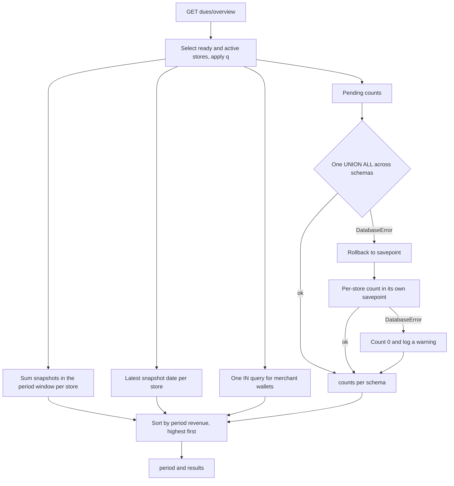
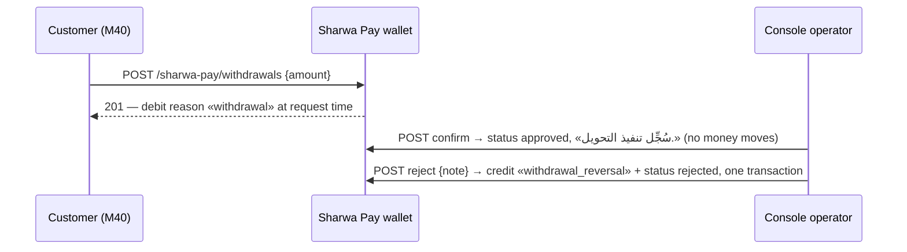

# Platform dues and Sharwa Pay administration API — M45 (لوحة مستحقات المنصة)

> **Source**: DOC-274, DOC-275, DOC-276, DOC-277, DOC-278 · INT-031 (M45), INT-020, INT-021, INT-047, INT-048 · inventory Domain 16, A.6, A.7
> **Live key**: `platform_money` (`SHARWA_LIVE_MODULES`). Without the key the console reads fixtures while `SHARWA_MOCKS=on`; with mocks off and no key the BFF answers `501` «غير متاح بعد.»
> **Django provider**: `sharwa_saas/api/views_platform.py` (`ConsoleDuesOverviewView` … `ConsoleZoneDetailView`, `:334-419`) · `tenants/console_money_service.py` (whole file) · money paths reused verbatim: `products/models/billing.py` (`.collect()`), `tenants/merchant_billing.py` (`collect_platform_fee_from_merchant`), `products/services/app_marketplace_service.py` (`generate_billing_charge`, `suspend_app_for_billing`, `reactivate_app_after_payment`), `sharwapay/models.py` (`apply_credit_if_approved`, `SharwaPayWalletManager`)
> **Frontend contract**: `sharwa-frontend/src/features/platform-admin/schemas/money.ts` (`duesOverviewSchema`, `duesDetailSchema`, `dueActionInputSchema`, `topupSchema`, `withdrawalSchema`, `walletDetailSchema`) · zones `schemas/catalog.ts` (`zoneSchema`, `zoneInputSchema`, `zoneUpdateSchema`) · `src/features/platform-admin/api/hooks.ts` (`useDuesOverview`, `useDues`, `useDueAction`, `useTopups`, `useTopupAction`, `useWithdrawals`, `useWithdrawalAction`, `useWallet`, `useZones`, `useSaveZone`, `useDeleteZone`) · screens `components/money/*`, `components/zones/zones-screen.tsx` · fixtures `src/mocks/platform/router.ts` (`dues/**`, `sharwa-pay/**`, `sharwa-ship/zones`) · BFF `src/app/api/bff/platform/[...path]/route.ts`
> **Tests**: `sharwa_saas/api/test_platform_money_api.py` (7 `def test_` methods, 5 cover this page: `test_overview_and_detail_contract`, `test_suspended_store_dues_stay_reachable` — DOC-274; `test_actions_end_to_end` — DOC-275; `test_topup_approve_reject_and_unmatched` — DOC-276; `test_withdrawal_confirm_and_reject_reverses` — DOC-277; `test_operator_cannot_edit_zones`, `test_zone_crud_and_rules` — DOC-278) · mock E2E `scripts/admin-money-check.ts`
> **Last verified against code**: 2026-10-28 (steps 40 and 41)

## 1. Overview

The platform owner console (`console.<base>`, public schema only, see [`auth.md`](auth.md)) shows what each merchant owes the platform. Two kinds of dues exist, both stored **inside each store's own schema**:

- **Sales commissions** (`PlatformCommissionRecord`): one row per order, created when the store's plan carries a commission (`products/services/commission_service.py:33-90`). The amount is a snapshot of the plan at sale time.
- **App billing charges** (`AppBillingCharge`): one row per `(installation, period)` for a paid app, generated by hand by the platform (there is no periodic job), unique per period (`unique_app_charge_per_period`, `products/models/billing.py:125`).

Collection is the only debit in the system from the merchant's **Sharwa Pay wallet** (public schema). This page covers all ten M45 routes:

- `GET dues/overview/` — one row per ready, active store: period sales from the daily snapshots, the merchant's wallet balances and how many dues wait (§4.1).
- `GET dues/<schema>/` — the full dues of one store, in blocks the screen renders as sections, with totals **per currency** (amounts of different currencies are never added together) (§4.2).
- `POST dues/<schema>/actions/` — the eight dues actions: collect / waive a commission, collect / waive / unwaive a charge, generate a charge, suspend / reactivate an app (§4.4).
- `GET sharwa-pay/topups/` + `POST sharwa-pay/topups/<id>/<approve|reject>/` — the Sharwa Pay top-up review queue (§4.5).
- `GET sharwa-pay/withdrawals/` + `POST sharwa-pay/withdrawals/<id>/<confirm|reject>/` + `GET sharwa-pay/wallets/<phone>/` — withdrawal review and the wallet lookup (§4.6).
- `GET|POST sharwa-ship/zones/` + `PATCH|DELETE sharwa-ship/zones/<id>/` — Sharwa Ship zone administration (§4.7).

Before M45 this was the HTML page `master-dashboard/dues/` (`tenants/views.py:378`, `platform_dues_dashboard`) with eight POST actions; the JSON contract keeps its aggregation logic but changes some rules (see the table in §5).

## 2. Access — gate chain

All ten routes are `ConsoleView` subclasses; the two dues reads and the action route carry `area = 'dues'`, the four Sharwa Pay routes `area = 'sharwa_pay'`, the two zone routes `area = 'zones'` (`views_platform.py:334-419`). The gates are the console chain documented in [`auth.md`](auth.md#2-access--gate-chain); the first failure answers.

| # | Gate | Requirement | Failure |
|---|---|---|---|
| 1 | Public schema | `connection.schema_name == 'public'` | `404` `{"detail": "غير موجود."}` (store host or `X-Store-Domain`) |
| 2 | Authentication + CSRF | `ConsoleSessionAuthentication` (CSRF is enforced on every write — §4.4–§4.7) | `403` `{"detail": "CSRF Failed: …"}` for an unsafe method with a bad token |
| 3 | Console role | `console_role(user)` is `superuser` or `operator` | `401` `{"detail": "انتهت جلسة لوحة المنصة، سجّل الدخول مجدداً."}` + `WWW-Authenticate: Session` |
| 4 | Write permission | not evaluated for `GET`. For writes in `dues` and `sharwa_pay` both roles pass (`OPERATOR_WRITES`, `console_service.py:77`); zones are **owner-only** — an operator's `POST sharwa-ship/zones/` gets `403` «هذا الإجراء لمالك المنصة فقط.» (`test_operator_cannot_edit_zones`) | `403` «هذا الإجراء لمالك المنصة فقط.» (zones writes by an operator) |
| 5 | Resource state | dues routes: store exists, is not `public`, `provisioning_status == ready`; top-up/withdrawal: row exists and is `pending`; zone: row exists | `404` `{"detail": "متجر غير معروف أو غير جاهز."}` · `409` «… غير موجود أو تم التعامل معه مسبقاً.» · `404` `{"detail": "المنطقة غير موجودة."}` |

Both roles read everything. There is no plan-feature or permission-key gate. Store `is_active` is **not** a gate on the dues routes (see §4.3).

## 3. Endpoint summary

All ten M45 routes, as declared in `api/urls.py:495-504`, documented in the sections named in the last column.

| Method | Django path (`/api/v1/platform/…`) | BFF path (`/api/bff/platform/…`) | View class (`views_platform.py`) | Area | Who may write | Section |
|---|---|---|---|---|---|---|
| `GET` | `dues/overview/` | `dues/overview` | `ConsoleDuesOverviewView` (:334) | `dues` | read-only | §4.1 (DOC-274) |
| `GET` | `dues/<schema>/` | `dues/<schema>` | `ConsoleDuesDetailView` (:342) | `dues` | read-only | §4.2 (DOC-274) |
| `POST` | `dues/<schema>/actions/` | `dues/<schema>/actions` | `ConsoleDueActionView` (:350) | `dues` | `superuser` and `operator` | §4.4 (DOC-275) |
| `GET` | `sharwa-pay/topups/` | `sharwa-pay/topups` | `ConsoleTopupListView` (:359) | `sharwa_pay` | read-only | §4.5 (DOC-276) |
| `POST` | `sharwa-pay/topups/<id>/<action>/` | `sharwa-pay/topups/<id>/<action>` | `ConsoleTopupActionView` (:367) | `sharwa_pay` | `superuser` and `operator` | §4.5 (DOC-276) |
| `GET` | `sharwa-pay/withdrawals/` | `sharwa-pay/withdrawals` | `ConsoleWithdrawalListView` (:375) | `sharwa_pay` | read-only | §4.6 (DOC-277) |
| `POST` | `sharwa-pay/withdrawals/<id>/<action>/` | `sharwa-pay/withdrawals/<id>/<action>` | `ConsoleWithdrawalActionView` (:383) | `sharwa_pay` | `superuser` and `operator` | §4.6 (DOC-277) |
| `GET` | `sharwa-pay/wallets/<phone>/` | `sharwa-pay/wallets/<phone>` | `ConsoleWalletView` (:391) | `sharwa_pay` | read-only | §4.6 (DOC-277) |
| `GET`, `POST` | `sharwa-ship/zones/` | `sharwa-ship/zones` | `ConsoleZoneListView` (:400) | `zones` | `POST`: `superuser` only | §4.7 (DOC-278) |
| `PATCH`, `DELETE` | `sharwa-ship/zones/<id>/` | `sharwa-ship/zones/<id>` | `ConsoleZoneDetailView` (:411) | `zones` | `superuser` only | §4.7 (DOC-278) |

- All ten are switched by one live key, `platform_money`: the BFF matches the first path segment against `^(dues|sharwa-pay|sharwa-ship)(\/|$)` (`route.ts:32`) and forwards to `/api/v1/platform/<path>/` (`route.ts:51`).
- Operators (`is_staff`, not superuser) may write `dues` and `sharwa_pay`; zones are owner-only (`can_write`, `console_service.py:90`). The role × area matrix is in [`auth.md`](auth.md#5-roles-and-the-403-matrix).
- The path `dues/overview/` is declared before `dues/<str:schema>/` (`urls.py:495-496`), so a store whose schema name is literally `overview` cannot be opened through the detail route (see §6).

## 4. Routes

### 4.1 `GET /api/v1/platform/dues/overview/`

One row per store that is `provisioning_status = ready` **and** `is_active = true`, excluding the `public` client. Suspended or deactivated stores are not listed here; their dues stay reachable by schema (§4.3).

**Query parameters**

| Name | Type | Default | Notes |
|---|---|---|---|
| `period` | `today`, `7d`, `30d` | `30d` | Window for the sales sum: `today` = 1 day, `7d` = 7 days, `30d` = 30 days, counting today (`PERIOD_DAYS`, `console_money_service.py:29`). Any other value is **not** an error: it falls back to `30d`, and the response `period` shows the value that was used |
| `q` | string | — | Trimmed. Case-insensitive substring match on store `name`, `schema_name` or `merchant_phone` (no local-form `0777…` conversion here, unlike the stores list). The fixture router matches `name` and `schema_name` only |

There is **no** `page` / `page_size`: the answer is the whole filtered set, and the envelope is `{period, results}` without `count` (the frontend `duesOverviewSchema` has no `count` either).

**Response `200`**

```json
{
  "period": "30d",
  "results": [
    {
      "schema_name": "noor",
      "name": "Noor Store",
      "merchant_phone": "9677XXXXXXXX",
      "snapshot": { "date": "2026-10-27", "orders_count": 42, "display_revenue_sar": "1,250 ر.س" },
      "wallet": [
        { "currency": "SAR", "display_balance": "2 ر.س" },
        { "currency": "USD", "display_balance": "$15" }
      ],
      "pending_count": 3
    },
    {
      "schema_name": "dawn",
      "name": "Dawn Shop",
      "merchant_phone": null,
      "snapshot": null,
      "wallet": null,
      "pending_count": 0
    }
  ]
}
```

| Field | Type | Meaning (Django source) |
|---|---|---|
| `period` | string | the effective period (`dues_overview`, `:158`) |
| `results[].schema_name`, `name` | string | `Client.schema_name`, `Client.name` |
| `results[].merchant_phone` | string or null | `Client.merchant_phone`, `null` when empty |
| `results[].snapshot` | object or null | `null` when the store has **no** `TenantStatsSnapshot` row at all; see the rules below |
| `snapshot.date` | string (`YYYY-MM-DD`) | date of the store's **latest** snapshot row, regardless of the period |
| `snapshot.orders_count` | integer | **sum** of `orders_count` over the snapshots inside the period (0 when none) |
| `snapshot.display_revenue_sar` | string | **sum** of `revenue_sar` over the same rows, formatted by the server (`format_money`, SAR) |
| `results[].wallet` | array or null | merchant's Sharwa Pay balances, one object `{currency, display_balance}` per currency; `null` when the store has no merchant phone or no wallet matches |
| `results[].pending_count` | integer | pending commissions plus pending app charges in the store schema (`PlatformCommissionRecord.status = 'pending'` plus `AppBillingCharge.status = 'pending'`) |

**Errors**

| Status | Body | When |
|---|---|---|
| `401` | `{"detail": "انتهت جلسة لوحة المنصة، سجّل الدخول مجدداً."}` | no session or no console role |
| `404` | `{"detail": "غير موجود."}` | store host or `X-Store-Domain` |

There is no `400`/`403`/`409` path on this route.

**Rules**

- **Store set**: `Client` where `schema_name != 'public'`, `provisioning_status = 'ready'`, `is_active = true` (`:159-162`), then `q`, ordered by `name`, `id` (`:166`).
- **Period window**: `since = today − (days − 1)` with `today = timezone.localdate()`; snapshots with `date >= since` are summed per store (`:167-172`). `orders_count` and `display_revenue_sar` are **period sums**, while `snapshot.date` is the latest snapshot date overall. A store whose last snapshot is older than the window therefore shows an old `date`, `orders_count: 0` and `"0 ر.س"`.
- **Snapshot source**: `TenantStatsSnapshot` rows in the public schema, one per store per day. They are filled by the nightly task `products.tasks.populate_tenant_stats_snapshot` (beat entry `populate-tenant-stats-snapshot`, 00:40, `config/settings.py:750-753`) from the store's `DailyStoreMetrics`; `revenue_sar` is converted to SAR with the store's own exchange rates (`products/tasks/reports.py:63-98`). The console never queries orders live. A newly created store has no row until the first run.
- **Ordering**: highest period revenue first. The sort key is the period revenue sum for a store that has a snapshot, and `-1` for a store without one; a store with snapshots but **zero** period revenue also gets `-1` (a zero sum is falsy in the key expression, `:189`). Ties keep the name order of the query (stable sort), so all "no revenue" stores sit at the bottom in name order.
- **Wallet**: wallets are matched by exact `SharwaPayWallet.customer_phone == Client.merchant_phone` in one `IN` query (`:177-178`). `wallet_balances()` always includes `SAR` (even when zero) and adds `USD`, `YER_OLD`, `YER_NEW` only when non-zero (`:64-73`). The per-store detail uses a wider match (see §4.2 and §6).
- **`pending_count`**: counted by **one** `UNION ALL` statement across all listed store schemas (two `SELECT … COUNT(*) … WHERE status = 'pending'` per store, one on the commission table and one on the charge table, `_pending_counts`, `:121-153`), instead of entering each schema. The statement runs inside `transaction.atomic()` (a savepoint). If it fails, for example because one schema or table is missing, the whole statement is rolled back to the savepoint and the code falls back to a **per-store loop**, each count again in its own `atomic()` + `schema_context`. A store that cannot be read counts as `0` and a warning is logged (`:143`, `:152`), so `0` can also mean "unreadable".
- **Roles**: both roles read; no filtering by role.



**Mapping**

| Contract field | Django source |
|---|---|
| `snapshot.date` | `max(TenantStatsSnapshot.date)` per client (`DISTINCT ON client_id`, `:173-176`) |
| `snapshot.orders_count`, `display_revenue_sar` | `Sum('orders_count')`, `Sum('revenue_sar')` over `date >= since` |
| `wallet[].display_balance` | `format_money(balance, currency)`: `SAR` → `1,250 ر.س`, `USD` → `$15`, `YER_OLD` and `YER_NEW` → `… ر.ي` (`products/models/base.py:75-93`) |
| `pending_count` | `PlatformCommissionRecord` + `AppBillingCharge` with `status = 'pending'` |

**Side effects** — none. Read-only; no audit row.

**Idempotency / concurrency** — a plain `GET`; the counts are a point-in-time read across schemas and may differ by a few rows from the detail fetched a moment later.

### 4.2 `GET /api/v1/platform/dues/<schema>/`

The dues of one store. `<schema>` is a `str` path segment (the store's `schema_name`).

**Query parameters** — none.

**Response `200`**

```json
{
  "schema_name": "noor",
  "name": "Noor Store",
  "merchant_phone": "9677XXXXXXXX",
  "pending_commissions": [
    {
      "id": 41,
      "order_id": 1207,
      "plan_name_snapshot": "Growth",
      "commission_type": "percentage",
      "commission_value": "2.50",
      "display_amount": "2.50 ر.س",
      "currency": "SAR",
      "created_at": "2026-10-26T09:14:03.512340+00:00",
      "collectable": true
    },
    {
      "id": 40,
      "order_id": 1198,
      "plan_name_snapshot": "Growth",
      "commission_type": "fixed",
      "commission_value": "1.00",
      "display_amount": "$1",
      "currency": "USD",
      "created_at": "2026-10-25T17:02:44.120000+00:00",
      "collectable": true
    }
  ],
  "pending_charges": [
    {
      "id": 12,
      "installation_id": 8,
      "app_code": "telegram",
      "app_name_snapshot": "Telegram",
      "period_label": "2026-10",
      "display_price": "10 ر.س",
      "currency": "SAR",
      "created_at": "2026-10-20T08:00:00+00:00"
    }
  ],
  "uninvoiced": [
    { "installation_id": 7, "app_code": "whatsapp", "app_name": "WhatsApp", "period_label": "2026-10", "already_generated": false },
    { "installation_id": 8, "app_code": "telegram", "app_name": "Telegram", "period_label": "2026-10", "already_generated": true }
  ],
  "waived_charges": [
    {
      "id": 9,
      "installation_id": 9,
      "app_code": "bookings",
      "app_name_snapshot": "Bookings",
      "period_label": "2026-09",
      "display_price": "10 ر.س",
      "currency": "SAR",
      "created_at": "2026-09-02T08:00:00+00:00"
    }
  ],
  "installations": [
    { "installation_id": 9, "app_code": "bookings", "app_name": "Bookings", "suspended_by_platform": false, "subscription_expires_at": "2026-09-30T00:00:00+00:00", "expired": true },
    { "installation_id": 8, "app_code": "telegram", "app_name": "Telegram", "suspended_by_platform": false, "subscription_expires_at": null, "expired": false },
    { "installation_id": 7, "app_code": "whatsapp", "app_name": "WhatsApp", "suspended_by_platform": true, "subscription_expires_at": null, "expired": false }
  ],
  "totals": [
    { "currency": "SAR", "display_commissions": "2.50 ر.س", "display_charges": "10 ر.س" },
    { "currency": "USD", "display_commissions": "$1", "display_charges": "$0" }
  ],
  "wallet": [ { "currency": "SAR", "display_balance": "2 ر.س" } ],
  "snapshot": { "date": "2026-10-27", "orders_count": 3, "display_revenue_sar": "300 ر.س" },
  "has_dues": true
}
```

The key set is pinned by `DETAIL_KEYS` in the test file (12 keys). Each block, in the order the screen shows them:

| Block | Type | Contents and rules |
|---|---|---|
| `schema_name`, `name`, `merchant_phone` | string, string, string or null | the store; `merchant_phone` is `null` when empty |
| `pending_commissions` | array | `PlatformCommissionRecord` with `status = 'pending'`, newest first (`created_at`, `id` descending, `:255`). Per row: `id`, `order_id`, `plan_name_snapshot`, `commission_type`, `commission_value` (the stored decimal as text, for example `"2.50"`; for `percentage` it is the percentage, for `fixed` the amount), `display_amount` (server string in the row's own `currency`), `currency`, `created_at`, and **`collectable`** |
| `pending_commissions[].collectable` | boolean | `true` when `amount > 0` **and** `commission_type != 'none'` (`_commission_view`, `:222-233`). When `false` the screen disables «collect» and offers waive only. The service that creates records never writes a zero amount or type `none` (`commission_service.py:50-61`), so `false` is a defensive state for rows edited by hand or created by other code |
| `pending_charges` | array | `AppBillingCharge` with `status = 'pending'` (with `installation` joined), newest first. Per row: `id`, `installation_id`, `app_code`, `app_name_snapshot`, `period_label`, `display_price` (from `price_snapshot`), `currency`, `created_at` (`_charge_view`, `:236-246`). There is no `status` key; the block name carries the status |
| `uninvoiced` | array | **Billable installations with no bill for the current period**, or with one that already exists; see the rule below. Per row: `installation_id`, `app_code`, `app_name`, `period_label`, **`already_generated`** |
| `waived_charges` | array | `AppBillingCharge` with `status = 'waived'`, newest first, **all periods** (not only the current one). Same row shape as `pending_charges`. These are the rows that can be reinstated by the `unwaive_charge` action (DOC-275) |
| `installations` | array | **every** `StoreAppInstallation` of the store, ordered by `app_code`, `id`. Per row: `installation_id`, `app_code`, `app_name` (catalogue name, or the code when the app is not in the public catalogue), `suspended_by_platform`, `subscription_expires_at` (ISO or `null`), **`expired`** |
| `installations[].expired` | boolean | `true` only when `subscription_expires_at` is set and strictly earlier than now; an installation without an expiry date is never expired (`_expired`, `:217-219`) |
| `totals` | array | one row per currency that appears in **pending** commissions or **pending** charges, ordered `SAR`, `USD`, `YER_OLD`, `YER_NEW`: `{currency, display_commissions, display_charges}`. A currency with only one side shows the other as zero (`"$0"`). Waived and uninvoiced rows are not in the totals. **There is no grand total and the server never adds amounts of different currencies**; the screen shows one line per currency and adds nothing up (`dues-detail-screen.tsx:20-27`). Empty array when nothing is pending |
| `wallet` | array or null | the merchant's Sharwa Pay balances, same shape as in the overview (SAR always present, other currencies when non-zero); `null` when there is no merchant phone or no wallet. The wallet is looked up by the raw `merchant_phone` first, then by the cleaned phone number (`_merchant_wallet`, `:76-84`) |
| `snapshot` | object or null | the store's **latest** `TenantStatsSnapshot` row with that **day's own** figures: `date`, `orders_count`, `display_revenue_sar`; `null` when none. Not a period sum, unlike the overview |
| `has_dues` | boolean | `true` when there is at least one **pending** commission or **pending** charge. Uninvoiced and waived rows do not count (`:303`); the legacy page counted them too |

**The `uninvoiced` rule** (`dues_detail`, `:260-271`). An installation is listed when all of these hold:

1. it is `is_active` **or** `suspended_by_platform` (an app the merchant switched off is not billable; one the platform suspended until payment still is);
2. its app exists in the public catalogue (`appstore.App`);
3. it is **not expired** (`expired == false`);
4. `app.is_billed_for_client(client)` is true: a per-store `AppBillingOverride` wins over everything; otherwise the app must not be `is_free` and must have `billing_enabled` (`appstore/models.py:89-108`).

`period_label` is `YYYY-MM` (for example `2026-10`) when the app's `billing_interval` is `monthly`, otherwise the four-digit year (`_period_label`, `:212-214`; computed from `timezone.now()`, so month and year boundaries follow UTC). **`already_generated`** is `true` when a charge already exists for `(installation_id, period_label)` in **any** status (pending, collected or waived), because of the unique constraint on that pair: generating again would fail. The screen disables «generate» for these rows, and the same pair that sits in `waived_charges` for the current period needs `unwaive_charge` instead.

**Errors**

| Status | Body | When |
|---|---|---|
| `401` | `{"detail": "انتهت جلسة لوحة المنصة، سجّل الدخول مجدداً."}` | no session or no console role |
| `404` | `{"detail": "غير موجود."}` | store host or `X-Store-Domain` |
| `404` | `{"detail": "متجر غير معروف أو غير جاهز."}` | no client with this `schema_name`, the schema is `public`, or `provisioning_status != ready` (`_ready_client`, `:202-209`) |

**Rules**

- The three reads of the tenant schema (commissions, charges and installations) plus the set of generated `(installation, period)` pairs run inside **one** `schema_context(client.schema_name)` block (`:254-259`). That block has **no savepoint** (unlike the overview count and the M20 reads): a store marked `ready` whose schema is missing would raise an uncaught `DatabaseError` and answer `500`. See §6.

> ⚠️ Discrepancy — roadmap (DOC-273, `documentation-roadmap.md` under "Every tenant-schema read wrapped in a savepoint") says every console tenant-schema read is wrapped in a savepoint / code does: `dues_detail` (`tenants/console_money_service.py:254`) uses a bare `schema_context` with no `transaction.atomic()` and no `except DatabaseError`, so a `ready` store with a missing schema answers `500` (`handle_exception` only converts `ConsoleError`). The overview count is protected (section 4.1). Reported in step 40.
- The public-schema reads (app catalogue, wallet, latest snapshot) happen outside that block.
- `uninvoiced` calls `is_billed_for_client` once per installation (one extra query each, N+1), acceptable for the handful of installations a store has.
- Money is only ever a server string (`display_*`, `format_money`); `commission_value` is a decimal text, not a display amount.

**Mapping**

| Contract field | Django source |
|---|---|
| `pending_commissions[]` | `PlatformCommissionRecord` (store schema) → `_commission_view` |
| `pending_charges[]`, `waived_charges[]` | `AppBillingCharge` + `installation.app_code` → `_charge_view` |
| `uninvoiced[]` | `StoreAppInstallation` × `appstore.App` × `AppBillingCharge(installation, period_label)` |
| `installations[]` | `StoreAppInstallation` (+ `App.name`) |
| `wallet` | `sharwapay.SharwaPayWallet` (public) → `wallet_balances` |
| `snapshot` | `client.stats_snapshots.order_by('-date').first()` |

**Side effects** — none; read-only, no audit row (only the actions in DOC-275 log `dues.<action>`).

**Idempotency / concurrency** — a plain `GET`. The action route returns this same payload as `entry` after every write, so a screen can refresh the row in place; races between two operators are resolved by the row locks in the actions (DOC-275).

### 4.3 Dues of a suspended store stay reachable

`_ready_client()` filters on `provisioning_status = ready` and excludes `public`; it deliberately has **no** `is_active` filter (`console_money_service.py:202-209`, docstring: dues of a suspended store must be settled before it can be closed). The reason is the lifecycle in the deactivation tab:

- `suspend` sets `Client.is_active = false` (`console_service.py:880`), and `reinstate` sets it back to `true` (`:889`);
- `close` is refused while the store has pending platform dues, with «مستحقات معلّقة على المتجر — حصّلها أو أعفِها أولاً.» (`tenant_custody_blocker`, `console_service.py:761-780`).

The legacy page loaded a store's dues only when `is_active=True` (`tenants/views.py:511`), so a suspended store's dues could not be opened and the store could never be closed. In the new code:

| Route | Suspended store (`is_active = false`, `ready`) |
|---|---|
| `GET dues/overview/` | **not listed** (only `is_active = true` rows) |
| `GET dues/<schema>/` | `200` with the full payload |
| `POST dues/<schema>/actions/` | allowed (same `_ready_client`); DOC-275 |

`test_suspended_store_dues_stay_reachable` (`test_platform_money_api.py:115`) sets `is_active = false` and expects `200` on the detail and `200` on a `waive_commission` action. The store detail screen links to `/dues/<schema>` from its apps tab (`components/stores/detail-tabs.tsx:214`), which is how an operator reaches a suspended store's dues. A store that is not `ready` (pending, provisioning, failed) has no tables and always answers `404`.

### 4.4 `POST /api/v1/platform/dues/<schema>/actions/` — the eight dues actions

One route, eight actions (`DUE_ACTIONS`, `console_money_service.py:318-321`) — the same set the legacy `platform_dues_dashboard` exposed as eight separate POST forms. The frontend mirrors them in `DUE_ACTIONS` (`schemas/money.ts:14-23`, FR-45.03).

**Request body** (`application/json`)

| Field | Type | Required | Rules / limits |
|---|---|---|---|
| `action` | string | yes | one of `collect_commission · waive_commission · collect_charge · waive_charge · unwaive_charge · generate_charge · suspend_app · reactivate_app`; anything else → `400` `{"action": ["إجراء غير معروف."]}` |
| `record_id` | integer | commission / charge actions | id of the `PlatformCommissionRecord` or `AppBillingCharge`; ignored by `generate_charge` and the app actions |
| `installation_id` | integer | `generate_charge`, `suspend_app`, `reactivate_app` | id of the `StoreAppInstallation`; `app_code` (string) is accepted as an alternative identifier (`_installation`) |
| `app_code` | string | optional | fallback when `installation_id` is absent |

**Response `200`**

```json
{
  "detail": "تم تحصيل عمولة الطلب #1207 من محفظة شروة باي للتاجر.",
  "level": "success",
  "entry": { "…": "the full dues detail payload of §4.2, refreshed after the write" }
}
```

`entry` is exactly the `GET dues/<schema>/` payload, so the screen replaces its row in place after every action.

**Per action** (`due_action`, `:324-435`):

| Action | Effect | `detail` on success | `level` |
|---|---|---|---|
| `collect_commission` | `PlatformCommissionRecord.collect()` — the **only** debit of a commission: `collect_platform_fee_from_merchant` debits the merchant's Sharwa Pay wallet (reason `platform_fee`), then the row becomes `collected` with `collected_at` | «تم تحصيل عمولة الطلب #1207 من محفظة شروة باي للتاجر.» | `success` |
| `waive_commission` | row becomes `waived`, no money moves | «تم إعفاء عمولة الطلب #1207 بلا أي خصم.» | `success` |
| `collect_charge` | `AppBillingCharge.collect()` — same wallet debit for an app invoice | «تم تحصيل فاتورة «Telegram» للفترة 2026-10 من محفظة شروة باي للتاجر.» | `success` |
| `waive_charge` | row becomes `waived` | «تم إعفاء فاتورة «Telegram» للفترة 2026-10 بلا أي خصم.» | `success` |
| `unwaive_charge` | a `waived` row becomes `pending` again (all periods — §4.2 lists waived charges of every period) | «أُلغي إعفاء فاتورة «Telegram» للفترة 2026-10 — عادت مستحقة.» | `warning` |
| `generate_charge` | `generate_billing_charge(installation, period_label)` creates a `pending` `AppBillingCharge` for the current period (§4.2's `uninvoiced` rule) | «وُلِّدت فاتورة «Telegram» للفترة 2026-10.» | `success` |
| `suspend_app` | `suspend_app_for_billing`: `is_active = false` **and** `suspended_by_platform = true` — the merchant's own `activate_app` cannot undo it | «عُلِّق «Telegram» لدى Noor Store حتى السداد.» | `warning` |
| `reactivate_app` | `reactivate_app_after_payment`: both flags back to `true`/`false` | «أُعيد تفعيل «Telegram» لدى Noor Store.» | `success` |

**Errors**

| Status | Body | When |
|---|---|---|
| `400` | `{"action": ["إجراء غير معروف."]}` | unknown action code |
| `409` | `{"detail": "سجل العمولة غير موجود أو تم التعامل معه مسبقاً."}` | commission row missing or no longer `pending` (already collected / waived) |
| `409` | `{"detail": "فاتورة التطبيق غير موجود أو تم التعامل معه مسبقاً."}` | charge row missing or not in the status the action needs (`pending` for collect/waive, `waived` for unwaive) |
| `409` | `{"detail": "التثبيت غير موجود أو تم التعامل معه مسبقاً."}` | `generate_charge` / app actions: no such installation in this store |
| `409` | `{"detail": "فاتورة 2026-10 مولَّدة بالفعل لهذا التثبيت.", "level": "error"}` | `generate_charge`: a charge for `(installation, period)` already exists — in **any** status (`unique_app_charge_per_period`) |
| `409` | `{"detail": "التطبيق معلَّق بالفعل.", "level": "error"}` / `{"detail": "التطبيق غير معلَّق.", "level": "error"}` | `suspend_app` on an already-suspended installation / `reactivate_app` on a running one |
| `400` | `{"detail": "…", "level": "error"}` | money failure, server sentence verbatim — see below |
| `400` | `{"detail": "لا مبلغ للتحصيل في هذا السجل — استخدم «إعفاء».", "level": "error"}` | `collect_commission` on a zero-amount row (the `collectable: false` case of §4.2) |
| `400` | `{"detail": "هذا التطبيق لا يُفوتر لهذا المتجر.", "level": "error"}` | `generate_charge`: `App.is_billed_for_client` is false |
| `400` | `{"detail": "انتهى اشتراك التطبيق — لا فاتورة للدورة.", "level": "error"}` | `generate_charge`: installation expired |
| `404` | `{"detail": "متجر غير معروف أو غير جاهز."}` | store gate (§2, gate 5) |

**The money sentence** — when collection fails, `collect()` returns the error of `collect_platform_fee_from_merchant` (`tenants/merchant_billing.py:29-67`) verbatim inside «تعذّر التحصيل: …»:

- no merchant phone on the store: «تعذّر التحصيل: لا يوجد رقم جوال تاجر مسجَّل لهذا المتجر — لا يمكن تحديد محفظة شروة باي الخاصة به.»
- no wallet for that phone: «تعذّر التحصيل: لا توجد محفظة شروة باي مسجَّلة برقم التاجر (9677XXXXXXXX) بعد — اطلب منه شحنها أولاً بتحويل بنكي لحساب المنصة قبل إعادة محاولة التحصيل.»
- insufficient balance: «تعذّر التحصيل: الرصيد غير كافٍ (SAR): المتاح 2، المطلوب 2.50» (`InsufficientSharwaPayBalanceError`, `sharwapay/models.py:65-67`).

**Rules**

- The commission and charge rows are locked before any decision: `select_for_update()` inside `transaction.atomic()` (`_commission_action`, `:347-362`; `_charge_action`, `:365-384`). Two operators acting on the same row serialise; the loser sees the 409 «تم التعامل معه مسبقاً» sentence.
- `.collect()` stays the single debit path (FR-45.04): no console code writes a balance directly. The wallet row itself is locked again inside `SharwaPayWallet.objects.debit` (`sharwapay/models.py:55-77`).
- `generate_charge` runs the pre-check (`is_billed_for_client`, expiry, existing period charge) in the store schema, then delegates to `generate_billing_charge` (`products/services/app_marketplace_service.py:232-282`), which snapshots `app.name`, `price` and `currency` into the charge.
- The whole action runs inside `schema_context(client.schema_name)`; the `entry` refresh re-reads the same schema.
- A suspended store's dues stay actionable (§4.3).

**Side effects** — every successful action writes a `PlatformActionLog` row `dues.<action>` with the actor (`log_action`, `console_money_service.py:343`); collect actions also write a `SharwaPayWalletTransaction` (reason `platform_fee`) in the merchant's wallet, and `suspend_app`/`reactivate_app` write an `AppInstallationEvent` (`suspended_by_platform` / `reactivated_by_platform`, `app_marketplace_service.py:102-134`).

**Idempotency / concurrency** — there is no client idempotency key. Retrying a succeeded action gets the 409 handled-sentence rather than a second debit: the row status is re-checked under the row lock, and for top-up-like double clicks the wallet manager's own `select_for_update` serialises the two attempts.

### 4.5 `GET /api/v1/platform/sharwa-pay/topups/` · `POST …/topups/<id>/<approve|reject>/` — top-up review

The queue of Sharwa Pay top-up requests: bank transfers uploaded by customers with a receipt («شحن بمراجعة», M40/INT-048) and unmatched Kuraimi webhook transfers (§4.5 rules). Before M45 these were the bulk actions `approve_topup` / `reject_topup` of `SharwaPayTopupRequestAdmin` (`sharwapay/admin.py:51-102`).

**`GET` query parameters**

| Name | Type | Default | Notes |
|---|---|---|---|
| `status` | `pending`, `approved`, `rejected` | — | any other value is ignored (no filter) |
| `q` | string | — | case-insensitive substring on wallet phone, `claimed_phone` and `bank_transaction_id`; a numeric-ish `q` is also cleaned (`0770000999` matches `967770000999`) |
| `page`, `page_size` | integer | 1 / 50 | page size capped at 100 |

Ordering is **pending first**, then newest (`_pending_first`, `:462-464`). The envelope is `{count, results}`.

**`GET` response `200`** (row shape pinned by `TOPUP_KEYS`)

```json
{
  "count": 2,
  "results": [
    {
      "id": 61,
      "customer_phone": "967770000111",
      "customer_name": "سارة",
      "amount": "50.00",
      "display_amount": "50 ر.س",
      "currency": "SAR",
      "bank_name": "—",
      "bank_transaction_id": "",
      "receipt_image": "/media/sharwa_pay_topups/receipt-61.png",
      "status": "pending",
      "note": "حوالة من بنك التضامن",
      "created_at": "2026-10-27T10:12:00+00:00",
      "decided_at": null,
      "decided_by": null
    }
  ]
}
```

| Field | Type | Meaning (Django source) |
|---|---|---|
| `customer_phone` | string | `wallet.customer_phone`, or `claimed_phone` for an unmatched transfer (`_topup_phone`, `:439-440`) |
| `customer_name` | string or null | `wallet.customer_name`; `null` when there is no wallet yet |
| `bank_name` | string | `bank_name`, or `"—"` when empty (bank-webhook rows carry «كريمي») |
| `receipt_image` | string | `/media/…` URL or `""`; the screen renders it as an image only when it starts with `/media/` or is an absolute URL, otherwise as text (`topups-screen.tsx:227-249` — same-origin proxy, INT-031) |
| `note` | string | `rejection_reason` first, else the customer's `reference_note` |
| `decided_at`, `decided_by` | string/`null` | `reviewed_at`, `reviewed_by` — `null` while `pending` |

**`POST …/<id>/approve/`** (`topup_action`, `:485-537`) — no body fields. Inside one `transaction.atomic()` with the request row locked (`select_for_update`):

1. the row must exist and be `pending`, else `409` `{"detail": "طلب الشحن غير موجود أو تم التعامل معه مسبقاً."}` — **the `credited_at` guard makes a double approval impossible**: even two racing approvals can only credit once (`apply_credit_if_approved`, `sharwapay/models.py:208-253`: it re-locks the row and stops if `credited_at` is already set);
2. if the request carries a `bank_transaction_id`, another **approved** request with the same id → `400` `{"detail": "رقم الحوالة TX-9 مستخدم في طلب مقبول سابق (#41).", "duplicate_of": 41}`;
3. an unmatched transfer (`wallet` is null) is linked to the wallet of its **claimed phone** — but only if that wallet exists by now: the platform never creates a wallet for an unproven number. Otherwise `400` `{"detail": "لا محفظة شروة باي بالرقم الوارد (967770000999) — اطلب من العميل فتح محفظته ثم أعد القبول، أو اربط الطلب بمحفظته من لوحة Django.", "level": "error"}`;
4. status → `approved`, `reviewed_at`/`reviewed_by` stamped, then `apply_credit_if_approved()` — the **single** credit point: it credits the wallet with reason `topup_auto` (bank transaction id, no receipt) or `topup_manual` (customer request with receipt — the INT-048 labelling) and stamps `credited_at`.

Response `200`: `{"detail": "قُبل الشحن وأُضيف 50 ر.س إلى محفظة العميل.", "level": "success", "topup": <row>}`.

**`POST …/<id>/reject/`** — body `{"note": "…"}`; the note is **required** and reaches the customer: `400` `{"note": ["اذكر سبب الرفض — يصل للعميل."]}`. On success: `{"detail": "رُفض طلب الشحن.", "level": "success", "topup": <row with status "rejected", note = the reason>}`.

An unknown `<action>` segment → `404` `{"detail": "الإجراء غير موجود."}`.

**Migration `sharwapay/0003_console_review_fields`** — adds `SharwaPayTopupRequest.bank_name` / `claimed_phone` / `reviewed_by` and `SharwaPayWithdrawalRequest.reviewed_by`. The data backfill marks every existing bank-webhook top-up `bank_name = «كريمي»` and parses the claimed phone out of legacy notes matching «… — الرقم الوارد: X». The Kuraimi webhook (`tenants/webhooks.py:102-128`) stores both on every new transfer: a matched transfer is created `approved` + `credited_at` immediately (auto credit, reason `topup_auto`), an unmatched one is created `pending` with `rejection_reason` «رقم الهاتف غير مسجَّل — يتطلب مراجعة يدوية وربط بمحفظة صحيحة.» waiting for this queue.

### 4.6 `GET …/sharwa-pay/withdrawals/` · `POST …/withdrawals/<id>/<confirm|reject>/` · `GET …/sharwa-pay/wallets/<phone>/`

Withdrawal review and the wallet lookup. Before M45: the bulk actions `approve_withdrawal` / `reject_withdrawal` of `SharwaPayWithdrawalRequestAdmin` (`sharwapay/admin.py:104-117+`).

**`GET withdrawals/`** — same `status` / `page` / `page_size` parameters, pending-first ordering and `{count, results}` envelope as the top-up list (there is no `q`). Row shape (`WITHDRAWAL_KEYS`):

```json
{
  "id": 18,
  "customer_phone": "967770000111",
  "customer_name": "سارة",
  "amount": "3.00",
  "display_amount": "3 ر.س",
  "currency": "SAR",
  "destination": "كريمي 123",
  "status": "pending",
  "note": "",
  "created_at": "2026-10-27T09:00:00+00:00",
  "decided_at": null,
  "decided_by": null
}
```

`destination` is the customer-entered `payout_destination` (bank/account text); `note` is the rejection reason (empty while pending).

**The debit-at-request model** — the amount is **debited from the wallet the moment the customer files the request** (`create_withdrawal` → `SharwaPayWallet.objects.debit(…, reason='withdrawal')`, `sharwapay/customer_api.py:401-430`). The console therefore never moves money on confirm:

- `POST …/<id>/confirm/` — body `{}`. The row must be `pending` (else `409` «طلب السحب غير موجود أو تم التعامل معه مسبقاً.»); it becomes `approved` — «سُجِّل تنفيذ التحويل.» — recording that the operator performed the actual bank transfer outside the system.
- `POST …/<id>/reject/` — body `{"note": "…"}`, note required (`400` `{"note": ["اذكر سبب الرفض."]}`). The amount is credited back with reason `withdrawal_reversal` (`SharwaPayWallet.objects.credit`, description «إعادة رصيد — رُفِض طلب السحب #18») **in the same transaction** as the status flip to `rejected` (`withdrawal_action`, `:569-599`) — the money can never be both transferred and returned.

Both answer `{"detail", "level": "success", "withdrawal": <row>}` and stamp `reviewed_at` / `reviewed_by` (migration `sharwapay/0003`); an unknown action segment → `404` `{"detail": "الإجراء غير موجود."}`.



**`GET wallets/<phone>/`** (`wallet_detail`, `:87-117`) — the support lookup behind the console's wallet screen. `<phone>` accepts the local `0777…` form: it is cleaned with `clean_phone_number` (`0770000111` → `967770000111`) before the search. Response `200` (`walletDetailSchema`):

```json
{
  "customer_phone": "967770000111",
  "customer_name": "سارة",
  "is_merchant": false,
  "balances": [{ "currency": "SAR", "display_balance": "7 ر.س" }],
  "transactions": [
    {
      "id": 91,
      "reason": "withdrawal_reversal",
      "display_amount": "2 ر.س",
      "currency": "SAR",
      "direction": "credit",
      "reference": "إعادة رصيد — رُفِض طلب السحب #19",
      "created_at": "2026-10-27T11:30:00+00:00"
    }
  ]
}
```

- `is_merchant` is true when any non-public `Client` has this phone as `merchant_phone` (raw or as stored).
- `balances` always includes `SAR`, plus every currency that is non-zero **or** appears in the listed transactions.
- `transactions` are the **last 100** movements (`WALLET_TRANSACTIONS = 100`), newest first; `reason` is one of the seven `REASON_CHOICES` (`topup_manual`, `topup_auto`, `purchase`, `purchase_refund`, `withdrawal`, `withdrawal_reversal`, `platform_fee`), `direction` is `credit`/`debit`.
- No wallet with that phone → `404` `{"detail": "المحفظة غير موجودة."}`.

### 4.7 `GET|POST /api/v1/platform/sharwa-ship/zones/` · `PATCH|DELETE …/zones/<id>/`

Sharwa Ship delivery-zone administration, owner-only (area `zones` is not in `OPERATOR_WRITES`; `test_operator_cannot_edit_zones` expects `403` for an operator's `POST`). Zones live in the **public** schema (`sharwa_ship.SharwaShipZone`) and feed the merchant `shipping/sharwa-ship/zones/` read route and waybill pricing.

**`GET zones/`** — no parameters; every zone ordered by `sort_order`, `name`, `id`. Row shape (`ZONE_KEYS`):

```json
{
  "id": 3,
  "code": "SAN-01",
  "name": "صنعاء — داخل المدينة",
  "price": "500.00",
  "display_price": "500 ر.ي",
  "currency": "YER_OLD",
  "volumetric_divisor": 5000,
  "center_latitude": "15.3694",
  "center_longitude": "44.1910",
  "radius_km": "25",
  "is_active": true,
  "sort_order": 1
}
```

**`POST zones/`** — creates a zone. **The code is immutable and typed once**: a new zone's code must match `^[A-Z]{3}-\d{2}$` («مثل SAN-01.» — three capital letters, dash, two digits) and be unique case-insensitively. Existing zones — including legacy slugs like `sanaa_inner_city` — keep their code forever: issued waybills store it as a reference. The form locks the field and simply does not send a `code` on edit (`zoneUpdateSchema` has no `code` field, `schemas/catalog.ts:104-109`); the server also refuses one: `PATCH` with a different code → `400` `{"code": ["الكود ثابت لا يتغيّر بعد الإنشاء — البوالص السابقة تشير إليه."]}`.

Validation (`_zone_fields`, `:643-697`) — every message is a field error (`400` `{field: [message]}`):

| Field | Rule | Error message |
|---|---|---|
| `code` (create) | `^[A-Z]{3}-\d{2}$`, unique | «مثل SAN-01.» / «الكود مستخدم لمنطقة أخرى.» |
| `name` | required, ≤ 100 chars | «أدخل اسم المنطقة.» / «الاسم أطول من 100 حرف.» |
| `price` | `^\d+(\.\d{1,2})?$` | «أدخل سعراً صحيحاً.» |
| `currency` | one of the four | «عملة غير معروفة.» |
| `volumetric_divisor` | integer 1000–10000 | «بين 1000 و10000 (الافتراضي 5000).» |
| `center_latitude` / `center_longitude` / `radius_km` | optional, **all three or none**; ranges −90…90, −180…180, 0 < r ≤ 999.99 | «خط عرض صحيح.» / «خط طول صحيح.» / «نصف قطر صحيح بالكيلومتر.» / «حدود المنطقة ثلاثية: المركز ونصف القطر معاً أو لا شيء.» |
| `is_active` | `true` or `"true"` | (anything else is `false`) |
| `sort_order` | integer ≥ 0, default 0 | |

Coordinates are stored with **7 decimals** (`.quantize(Decimal('0.0000001'))`), `radius_km` with 2. A zone with no geo bounds is legal: the console's map simply skips it (a circle needs a centre, `zone-map.tsx:35`) and the table shows «بلا حدود» (`zones-screen.tsx:82`). The schema fields are nullable for exactly that case.

**`PATCH zones/<id>/`** — partial update (fields merged over the current row, so an update may omit anything except what the form always sends); success returns the updated row. **`DELETE zones/<id>/`** — deletes the zone; issued waybills are untouched because each one snapshots the zone price at issue time. Missing zone on `PATCH` → `404` `{"detail": "المنطقة غير موجودة."}`; on `DELETE` (or a second delete) → `409` `{"detail": "المنطقة غير موجودة أو تم التعامل معه مسبقاً."}`. Success: `201` (create) / `200` (update) / `204` (delete, no body).

**Side effects** — create/update/delete log `zone.create` / `zone.update` / `zone.delete` («أُضيفت منطقة SAN-01.» …) in `PlatformActionLog`.

**Rules** — all zone state is public-schema; no tenant schema is entered. Both roles read (`GET`); only the owner writes.

## 5. Gaps closed, bugs fixed and migrations

### 5.1 Dues reads (DOC-274)

- **No migration** belongs to these two routes. They read existing tables: `TenantStatsSnapshot` (public, `tenants.0019`), `PlatformCommissionRecord` and `AppBillingCharge` (store schemas), `SharwaPayWallet` (public). The audit table `PlatformActionLog` (migration `tenants/0027_platform_console_api`) is written only by the actions (DOC-275).
- **Behaviour changes from the legacy `platform_dues_dashboard`** (`tenants/views.py:378`, `_dues_overview_rows` `:545`, `_collect_tenant_dues` `:578`), visible to callers of the JSON contract:

| Aspect | Legacy HTML page | `dues/…` JSON routes |
|---|---|---|
| Detail of a suspended store | refused (`is_active=True` filter, `views.py:511`) | allowed (§4.3) |
| Overview sales figures | the latest snapshot's own orders and revenue | **sum over the chosen period** (`today`, `7d`, `30d`); `snapshot.date` is still the latest date |
| Overview ordering | revenue of the latest snapshot | revenue summed over the period |
| `pending_count` | not in the overview (counts only in the detail) | in every overview row, from one `UNION ALL` with a per-schema savepoint fallback |
| Uninvoiced installations | only installations without any bill for the period; billable apps only | adds `already_generated` (a bill exists in any status) and skips inactive or expired installations |
| Waived charges | only the current period's | all periods |
| `has_dues` | pending, uninvoiced or waived-this-period | pending commissions or pending charges only |
| Totals | one `total_due` number summed over rows | per currency, no cross-currency sum |
| Wallet match | exact `merchant_phone` | raw phone, then cleaned phone (detail) |

- **`q` on the overview** is new in the JSON contract (name, schema or merchant phone).

### 5.2 Dues actions (DOC-275)

- **Bug fixed — `generate_billing_charge` savepoint** (`products/services/app_marketplace_service.py:268-282`): the service used to catch `IntegrityError` without an inner savepoint, so when the console called it inside the action's transaction, a duplicate-period insert poisoned the outer transaction and the follow-up `existing` query raised `TransactionManagementError`. The `create` is now wrapped in its own `transaction.atomic()` (INT-031); the duplicate falls through to the pair check and surfaces as the route's `409` «فاتورة … مولَّدة بالفعل لهذا التثبيت.».
- **No new migration**: the actions reuse `PlatformCommissionRecord`, `AppBillingCharge`, `StoreAppInstallation`, `SharwaPayWallet` and `PlatformActionLog` exactly as the legacy dashboard did — the roadmap's "legacy model methods verbatim" holds: `.collect()` (`products/models/billing.py:56-86`, `:131-154`) is the only debit, `suspend_app_for_billing` / `reactivate_app_after_payment` are the only suspension writers.

### 5.3 Sharwa Pay review (DOC-276, DOC-277)

- **Migration `sharwapay/0003_console_review_fields`**: `SharwaPayTopupRequest.bank_name` / `claimed_phone` / `reviewed_by`, `SharwaPayWithdrawalRequest.reviewed_by`, plus the «كريمي» / «الرقم الوارد: X» backfill (§4.5). The Kuraimi webhook writes both fields on every new transfer.
- **Gap closed — the credit guard** (`apply_credit_if_approved`, `sharwapay/models.py:208-253`): approval from **any** path (console, admin form, webhook, bulk action) now credits exactly once, guarded by `credited_at` under a row lock — closing the real incident of an «approved» 100 SAR top-up with a 0.00 balance.
- **Gap closed — unmatched transfers** (INT-031): a bank transfer whose phone matched no wallet used to sit unapprovable; it is now listed with its claimed phone and linked on approval to that wallet if it exists by then (§4.5 rule 3) — never auto-created.
- **`topup_auto` vs `topup_manual`** (INT-048 fix): the credit reason distinguishes a webhook bank operation (id, no receipt) from a customer-uploaded request (id + receipt, «شحن بمراجعة»).

### 5.4 Zones (DOC-278)

- **No migration**: `SharwaShipZone` already existed; the console adds the first write API for it (the legacy path was the Django admin only). Geo bounds were already nullable columns.

## 6. Open items and legacy-only behaviour

- **No savepoint around the tenant read of `dues/<schema>/`** (`console_money_service.py:254`): a `ready` store with a missing schema gives `500`. The overview count is protected, the detail is not. The dues **actions** share the same bare `schema_context` (`due_action`, `:334`).
- **Overview and detail disagree on the wallet lookup**: the overview matches `customer_phone` exactly against `Client.merchant_phone` (`:177-178`), the detail also tries the cleaned number (`_merchant_wallet`, `:76-84`). A merchant whose wallet is stored under the cleaned number can show `wallet: null` in the overview and balances in the detail.
- **`pending_count` of `0` is ambiguous**: it can mean "nothing pending" or "schema unreadable" (the fallback logs a warning only).
- **Schema `overview`**: `dues/overview/` is matched before `dues/<str:schema>/`, so a store named `overview` has no detail URL. `overview` is not in `RESERVED_SUBDOMAINS` (`tenants/validators.py:17`).
- **Snapshot freshness**: the overview is only as fresh as the 00:40 snapshot task; today's orders appear after the next run. The older task `tenants.tasks.aggregate_tenant_stats` (`tenants/tasks.py:121`) is not in `CELERY_BEAT_SCHEDULE`.
- **`collectable` false-case** is not reachable through the normal commission service; kept for manual rows.
- **`_installation` ignores `record_id` context**: `generate_charge` accepts `app_code` alone; two installations of the same app cannot exist in one store (unique per store), so the ambiguity is theoretical.
- **Fixture differences** (`src/mocks/platform/router.ts`): the overview scales a single stored snapshot by 1/30, 7/30 or 1 instead of summing daily rows, and ignores `merchant_phone` in `q` (`:897-921`); the mock `q` on top-ups matches phone and bank id only (Django also matches `claimed_phone`, `:473-479`); the **mock approves an unmatched top-up by creating a wallet** (`router.ts:1085-1092`) while Django refuses with the 400 sentence of §4.5 rule 3 — the mock exists to demo the happy path only; the mock wallet has no `credited_at` concept, so a mock double-approve also 409s by status alone.
- **Not verified**: the exact table names used in the `UNION ALL` SQL (taken from `Model._meta.db_table` at run time), and performance with many stores (two sub-selects per store in one statement).

## 7. Related pages

- [`auth.md`](auth.md) — console gate chain, roles, 403 matrix, audit log.
- [`../../overview/bff.md`](../../overview/bff.md) · [`../../overview/conventions.md`](../../overview/conventions.md) · [`../../overview/csrf.md`](../../overview/csrf.md)
- Architecture: [`../../../architecture/40-money.md`](../../../architecture/40-money.md) · [`../../../architecture/13-cross-schema-access.md`](../../../architecture/13-cross-schema-access.md) · [`../../../architecture/14-store-lifecycle.md`](../../../architecture/14-store-lifecycle.md) · [`../../../architecture/22-live-module-keys.md`](../../../architecture/22-live-module-keys.md)
- [`m20-console.md`](m20-console.md) — stores, deactivation lifecycle, features, webhook events (the M20 route table and BFF wiring are there). · [`m46-plans-billing.md`](m46-plans-billing.md) — plans, subscriptions, apps, market categories (M46).
