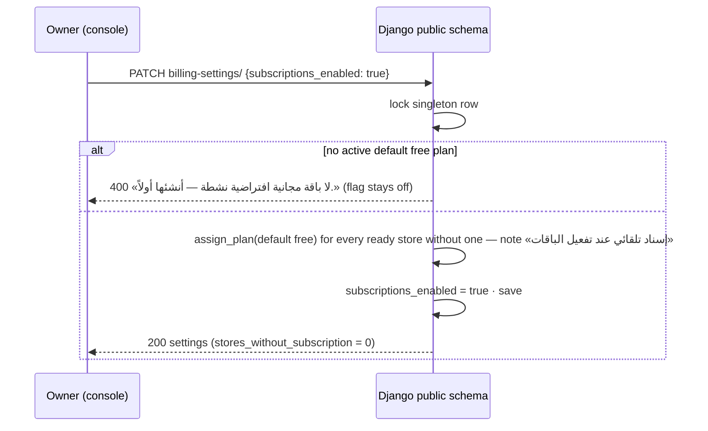

# Plans, subscriptions & feature billing API — M46 (إدارة الباقات والاشتراكات وأعلام الميزات)

> **Source**: DOC-279, DOC-280, DOC-281, DOC-282, DOC-283 · INT-032 (M46), INT-040, INT-004 · inventory Domain 16
> **Live key**: `platform_billing` (`SHARWA_LIVE_MODULES`). Without the key the console reads fixtures while `SHARWA_MOCKS=on`; with mocks off and no key the BFF answers `501` «غير متاح بعد.»
> **Django provider**: `sharwa_saas/api/views_platform.py` (`ConsolePlanListView` … `ConsoleCategoryDetailView`, `:424-552`) · `tenants/console_billing_service.py` (whole file) · rules reused verbatim from `billing/models.py` (`Plan.save`, `Subscription.assign_plan`, `PlatformBillingSettings`, `resolve_feature_decision`) and `appstore/models.py` (`App.is_billed_for_client`)
> **Frontend contract**: `sharwa-frontend/src/features/platform-admin/schemas/billing.ts` (`planSchema`, `planInputSchema`, `planFeatureCellSchema`, `assignInputSchema`, `billingSettingsSchema`) · apps & categories `schemas/catalog.ts` (`appSchema`, `appInputSchema`, `appOverrideSchema`, `marketCategorySchema`) · `src/features/platform-admin/api/hooks.ts` (`usePlans`, `useSavePlan`, `useDeletePlan`, `useMatrix`, `useToggleCell`, `useSubscriptions`, `useAssignPlan`, `useBillingSettings`, `usePatchBillingSettings`, `useApps`, `useSaveApp`, `useAppOverrides`, `useCreateAppOverride`, `useDeleteAppOverride`, `useCategories`, `useCategoryMutations`, …) · screens `components/billing/{plans,matrix,subscriptions,settings}-screen.tsx`, `components/catalog/apps-screen.tsx` · fixtures `src/mocks/platform/router.ts` (`plans`, `plan-features`, `subscriptions`, `billing-settings`, `apps`, `app-billing-overrides`, `market-categories`) · BFF `src/app/api/bff/platform/[...path]/route.ts`
> **Tests**: `sharwa_saas/api/test_platform_billing_api.py` (7 `def test_` methods: `test_plans_crud_and_rules`, `test_matrix_and_subscriptions`, `test_enabling_plans_assigns_the_default_free_plan`, `test_apps_and_overrides`, `test_market_categories`, `test_operator_reads_but_cannot_write`, and `InstallationCountTests.test_counts_come_from_store_schemas` — a real tenant-schema installation count) · mock E2E `scripts/admin-billing-check.ts`
> **Last verified against code**: 2026-10-28 (step 41)

## 1. Overview

The business-model half of the platform console: subscription **plans** and their commission settings, the **plan × feature matrix**, per-store **subscriptions**, the two **master switches** of the billing system (`subscriptions_enabled`, `commission_enabled`), the **app catalogue** with its per-app pricing, per-store **app billing overrides**, and the **market categories** a merchant ticks at registration. Everything lives in public-schema tables (`billing`, `appstore`, `marketing` apps), so no store schema is read except one counter: `apps/` counts installations across every ready store with a single `UNION ALL` (§4.4).

Before M46 all of this was manageable only through the Django admin (`billing/admin.py` — `Plan`, `Subscription`, `PlatformBillingSettings`, `Feature`, `TenantFeatureOverride`; `appstore/admin.py` — `App`, `AppBillingOverride`; `marketing/admin.py` — `MarketCategory`). The console routes add no new rule: `Plan.save()` still keeps a single default plan, `Subscription.assign_plan` stays the only assignment point, `Subscription.plan` stays `PROTECT`, and `App.code` / `Plan.code` stay fixed after creation because code everywhere references them programmatically.

Writes are **owner-only** on every M46 route; operators read everything (FR-20.09, `test_operator_reads_but_cannot_write`). The feature catalogue itself (kill switch, `requires_plan`, per-store overrides) is documented in [`m20-console.md`](m20-console.md) §4.6 — those routes share the `billing` area with the plans family.

## 2. Access — gate chain

All thirteen routes are `ConsoleView` subclasses (`views_platform.py:424-552`). The gates are the console chain documented in [`auth.md`](auth.md#2-access--gate-chain); the first failure answers.

| # | Gate | Requirement | Failure |
|---|---|---|---|
| 1 | Public schema | `connection.schema_name == 'public'` | `404` `{"detail": "غير موجود."}` (store host or `X-Store-Domain`) |
| 2 | Authentication + CSRF | `ConsoleSessionAuthentication`; CSRF enforced on every write | `401` `{"detail": "انتهت جلسة لوحة المنصة، سجّل الدخول مجدداً."}` + `WWW-Authenticate: Session` · `403` `{"detail": "CSRF Failed: …"}` |
| 3 | Console role | `console_role(user)` is `superuser` or `operator` | `401` (as above) |
| 4 | Write permission | writes need `can_write(role, area)`; M46 areas are `billing` (plans, plan-features, subscriptions, billing-settings), `apps` (apps, app-billing-overrides) and `catalog` (market-categories) — **none** is in `OPERATOR_WRITES` (`console_service.py:77`), so every M46 write is owner-only; operators get `403` «هذا الإجراء لمالك المنصة فقط.» | `403` «هذا الإجراء لمالك المنصة فقط.» |
| 5 | Resource state | plan / app / category row exists; subscription assignment targets a real store and an active plan | `404` `{"detail": "الباقة غير موجودة."}` / `{"detail": "التطبيق غير موجود."}` / `{"detail": "الفئة غير موجودة."}` · `400` field errors |

There is no plan-feature or permission-key gate; the plan system is what this page administers.

## 3. Endpoint summary

All thirteen M46 routes, as declared in `api/urls.py:506-518`.

| Method | Django path (`/api/v1/platform/…`) | BFF path (`/api/bff/platform/…`) | View class (`views_platform.py`) | Area | Purpose | Section |
|---|---|---|---|---|---|---|
| `GET`, `POST` | `plans/` | `plans` | `ConsolePlanListView` (:424) | `billing` | list / create plans | §4.1 |
| `PATCH`, `DELETE` | `plans/<id>/` | `plans/<id>` | `ConsolePlanDetailView` (:435) | `billing` | update / delete a plan | §4.1 |
| `GET`, `PUT` | `plan-features/` | `plan-features` | `ConsolePlanFeaturesView` (:447) | `billing` | plan × feature matrix; set one cell | §4.2 |
| `GET` | `subscriptions/` | `subscriptions` | `ConsoleSubscriptionListView` (:458) | `billing` | filterable subscription history | §4.2 |
| `POST` | `subscriptions/assign/` | `subscriptions/assign` | `ConsoleSubscriptionAssignView` (:466) | `billing` | assign a plan to a store | §4.2 |
| `GET`, `PATCH` | `billing-settings/` | `billing-settings` | `ConsoleBillingSettingsView` (:474) | `billing` | the two master switches | §4.3 |
| `GET`, `POST` | `apps/` | `apps` | `ConsoleAppListView` (:486) | `apps` | app catalogue with installation counts | §4.4 |
| `PATCH` | `apps/<code>/` | `apps/<code>` | `ConsoleAppDetailView` (:497) | `apps` | update an app | §4.4 |
| `GET`, `POST` | `app-billing-overrides/` | `app-billing-overrides` | `ConsoleAppOverrideListView` (:505) | `apps` | per-store billing overrides | §4.4 |
| `DELETE` | `app-billing-overrides/<id>/` | `app-billing-overrides/<id>` | `ConsoleAppOverrideDetailView` (:516) | `apps` | remove an override | §4.4 |
| `GET`, `POST` | `market-categories/` | `market-categories` | `ConsoleCategoryListView` (:525) | `catalog` | registration market categories | §4.5 |
| `POST` | `market-categories/reorder/` | `market-categories/reorder` | `ConsoleCategoryReorderView` (:536) | `catalog` | reorder the full set | §4.5 |
| `PATCH`, `DELETE` | `market-categories/<id>/` | `market-categories/<id>` | `ConsoleCategoryDetailView` (:544) | `catalog` | update / delete a category | §4.5 |

- All thirteen are switched by one live key, `platform_billing`: the BFF matches the first path segment against `^(plans|plan-features|subscriptions|billing-settings|apps|app-billing-overrides|market-categories)(\/|$)` (`route.ts:33`) and forwards to `/api/v1/platform/<path>/` (`route.ts:51`). With this key every console row group has a Django provider.
- All list answers are arrays (no paging) except `subscriptions/`, which pages.

## 4. Endpoint groups

### 4.1 `GET|POST /api/v1/platform/plans/` · `PATCH|DELETE …/plans/<id>/` — plans

**`GET plans/`** — every plan ordered by `display_order`, `price`, `id`. Row shape (`PLAN_KEYS`):

```json
{
  "id": 2,
  "code": "growth",
  "name": "النمو",
  "description": "",
  "is_free": false,
  "price": "49.00",
  "display_price": "49 ر.س",
  "currency": "SAR",
  "billing_interval": "monthly",
  "commission_type": "percentage",
  "commission_value": "2.50",
  "display_commission": "2.50%",
  "max_products": null,
  "max_orders_per_month": 500,
  "is_active": true,
  "is_default_free": false,
  "display_order": 1,
  "current_subscriptions": 3
}
```

| Field | Type | Meaning (Django source) |
|---|---|---|
| `display_price` | string | `format_money(price, currency)` — e.g. `49 ر.س`, `$12.50`; the browser never formats |
| `display_commission` | string | `—` when `commission_type = none`; `2.50%` (`f'{value:.2f}%'`) when `percentage`; the formatted amount (`3 ر.س`) when `fixed` (`plan_view`, `console_billing_service.py:44-72`) |
| `commission_value` | string | decimal text; a percentage when `percentage`, an amount in the plan currency when `fixed` |
| `max_products`, `max_orders_per_month` | integer or null | `null` = unlimited |
| `current_subscriptions` | integer | subscriptions with `is_current = true` (one annotated `Count`, not N+1) |

**`POST plans/` / `PATCH plans/<id>/`** — body (`planInputSchema`, FR-46.02 — exactly the model fields):

| Field | Type | Required | Rules / limits |
|---|---|---|---|
| `code` | string | create only | `^[a-z0-9_]{2,30}$`, unique → «حروف لاتينية صغيرة وأرقام و_ (2–30).» / «الكود مستخدم لباقة أخرى.»; on `PATCH` a changed code → «الكود ثابت لا يتغيّر بعد الإنشاء — يُستخدم برمجياً.» |
| `name` | string | yes | ≤ 100 chars («أدخل اسم الباقة.» / «الاسم أطول من 100 حرف.») |
| `description` | string | no | truncated to 2000 chars server-side |
| `is_free` | boolean | yes | with `price > 0` → «الباقة المجانية سعرها 0.» |
| `price` | string | yes | `^\d+(\.\d{1,2})?$` («أدخل سعراً صحيحاً (مثال: 49.00).») |
| `currency` | string | yes | one of `SAR · USD · YER_OLD · YER_NEW` («عملة غير معروفة.») |
| `billing_interval` | string | yes | `monthly · yearly · lifetime` («فترة غير معروفة.») |
| `commission_type` | string | yes | `none · percentage · fixed` («نوع عمولة غير معروف.») |
| `commission_value` | string | yes | decimal; `percentage` capped at 100 («النسبة 100 على الأكثر.») |
| `max_products`, `max_orders_per_month` | string | no | digits only or empty = unlimited («رقم صحيح أو فارغ (بلا حد).») |
| `is_active` | boolean | yes | inactive plans cannot be assigned |
| `is_default_free` | boolean | yes | requires `is_free` → «الباقة الافتراضية يجب أن تكون مجانية.» and `is_active` → «الباقة الافتراضية يجب أن تكون نشطة — التسجيل يُسندها للمتاجر الجديدة.» |
| `display_order` | integer | yes | ≥ 0 |

**Rules**

- **One default plan** — `Plan.save()` strips `is_default_free` from every other plan on each save (`billing/models.py:83-88`); creating a second default flips the first one off (`test_plans_crud_and_rules`).
- **Code fixed once created** — checked in `_plan_fields` and enforced by usage: plan codes appear in `stores/?plan=` filters, snapshots and seeds.
- **Registration depends on the default free plan**: it must be free **and** active, because onboarding assigns it to new stores (§4.3).

**`DELETE plans/<id>/`** — the two refusals:

| Status | Body | When |
|---|---|---|
| `409` | `{"detail": "لا يمكن حذف باقة عليها 1 اشتراكاً حالياً — انقلها إلى باقة أخرى أولاً.", "current_subscriptions": 1}` | any subscription with `is_current = true` points at it |
| `409` | `{"detail": "الباقة مرتبطة باشتراكات سابقة في سجل المتاجر — عطّلها («غير نشطة») بدل الحذف.", "current_subscriptions": 0}` | only historical subscriptions exist — `Subscription.plan` is `PROTECT`, so the subscription history is never deleted (`delete_plan`, `:175-196`) |
| `204` | — | nothing references the plan |

A missing plan on `PATCH`/`DELETE` → `404` `{"detail": "الباقة غير موجودة."}`. Every write logs `plan.create` / `plan.update` / `plan.delete` («أُنشئت الباقة «النمو».» …) in `PlatformActionLog`.

### 4.2 `GET|PUT …/plan-features/` · `GET …/subscriptions/` · `POST …/subscriptions/assign/`

**The matrix** — `GET plan-features/` returns every **existing** cell `{plan_id, feature_code, is_enabled}` (absence = the feature is not granted by that plan; the deciding algorithm is `resolve_feature_decision`, documented in [`m20-console.md`](m20-console.md) §4.6). `PUT plan-features/` sets **one cell** via `update_or_create` — the same body comes back:

```json
{ "plan_id": 1, "feature_code": "pos", "is_enabled": true }
```

An unknown plan id or feature code → `400` `{"detail": "باقة أو ميزة غير معروفة."}`. The write logs `plan_feature.update` (««مجاني» × «نقطة البيع» = متاحة.»).

**Subscriptions list** — `GET subscriptions/` with filters (all optional):

| Name | Type | Notes |
|---|---|---|
| `schema` | string | exact `Client.schema_name` |
| `status` | string | `active · cancelled · expired` (a `Subscription.STATUS_CHOICES` value; anything else is ignored) |
| `current` | `true` | only `is_current = true` rows |
| `plan` | string | plan **code** |
| `q` | string | substring on store name or schema |
| `page`, `page_size` | integer | default 50, max 100 |

Ordered newest first (`-started_at`, `-id`); the `public` client is excluded. Envelope `{count, results}`; row shape (`subscription_view`, `console_service.py:366-378`):

```json
{
  "id": 41,
  "schema_name": "alpha",
  "store_name": "متجر alpha",
  "plan": { "id": 1, "code": "free", "name": "مجاني" },
  "status": "cancelled",
  "is_current": false,
  "started_at": "2026-10-20T08:00:00+00:00",
  "current_period_end": "2027-01-31T23:59:59+00:00",
  "cancelled_at": "2026-10-27T09:00:00+00:00",
  "notes": "تجربة"
}
```

**Assignment** — `POST subscriptions/assign/` (`assign_subscription`, `:259-288`). Body (`assignInputSchema`):

| Field | Type | Required | Rules |
|---|---|---|---|
| `schema_name` | string | yes | a non-public store → «اختر متجراً.» |
| `plan_id` | integer | yes | an **active** plan → «اختر باقة.» / «الباقة غير نشطة.» |
| `status` | string | no | `active` (default) · `cancelled` · `expired` |
| `current_period_end` | string | no | `YYYY-MM-DD` (or datetime); a date means **end of day** 23:59:59 in the server timezone; malformed → «تاريخ غير صحيح.» |
| `notes` | string | no | ≤ 255 chars («الملاحظة أطول من 255 حرفاً.») |

`Subscription.assign_plan` (`billing/models.py:126-137`, `@classmethod @atomic`) is the **only** assignment point — used by this route, by registration and by the §4.3 auto-assignment. Its side effects, in one transaction:

1. the store's previous current **active** subscription is marked `cancelled` with `cancelled_at = now` (`console_billing_service.py:285`) — the history says what actually happened, it is never left as an off-current «active» row;
2. `assign_plan` flips `is_current = false` on any other current row and creates the new `is_current = true` subscription.

Response `201` = the new `subscription_view`. The write logs `subscription.assign` («أُسندت الباقة «النمو» (assign_plan).») against the store.

### 4.3 `GET|PATCH /api/v1/platform/billing-settings/` — the master switches

**`GET` response `200`** (`billingSettingsSchema`):

```json
{
  "subscriptions_enabled": false,
  "commission_enabled": false,
  "stores_without_subscription": 1,
  "default_free_plan": "مجاني",
  "updated_at": "2026-10-27T18:00:00+00:00"
}
```

`stores_without_subscription` counts **ready** stores with no `is_current` subscription of any status — the stores the plan gate (step 4 of `resolve_feature_decision`) would treat as plan-less. `default_free_plan` is the name of the `is_default_free` plan, `null` when none exists.

**`PATCH` body** — either or both flags (`subscriptions_enabled`, `commission_enabled`). The row is a strict singleton (`PlatformBillingSettings`, `pk = 1`, `save()` forces it, `delete()` is a no-op — `billing/models.py:163-173`), locked with `select_for_update` inside one transaction.

**The enable-plans transaction** (gap closed, INT-032): before M46, flipping `subscriptions_enabled` on with stores that had no plan instantly denied them every `requires_plan` feature (a plan-less store fails step 5 — the `resolve_feature_decision` docstring puts it as «الغياب = عدم منح», `billing/models.py:258`: absence is not a grant) — and the old admin help text promised «لا يؤثر بأثر رجعي على المتاجر المسجَّلة قبل التفعيل — أسندها يدوياً من شاشة الاشتراكات إن أردت.». Now, **inside the same transaction as the flip**:

1. an active default free plan must exist, else `400` `{"detail": "لا باقة مجانية افتراضية نشطة — أنشئها أولاً."}` and **nothing changes** (the flag stays off);
2. every ready store without a current subscription gets the default free plan via `Subscription.assign_plan` with the note «إسناد تلقائي عند تفعيل الباقات» (`AUTO_ASSIGN_NOTE`);
3. stores that already have a current subscription are untouched; not-ready stores are skipped.



`commission_enabled` only gates whether sales write commission records; collection stays manual (see [`m45-dues-sharwa-pay-admin.md`](m45-dues-sharwa-pay-admin.md)). Both flips log one `billing_settings.update` row («الباقات: مفعّلة · العمولة: متوقفة · أُسندت الباقة الافتراضية لـ 2 متجراً.»).

### 4.4 `GET|POST …/apps/` · `PATCH …/apps/<code>/` · `GET|POST …/app-billing-overrides/` · `DELETE …/app-billing-overrides/<id>/`

**The app catalogue** — `GET apps/` returns every app ordered by `name`, `code` (row shape `APP_KEYS`):

```json
{
  "code": "whatsapp_bot",
  "name": "بوت واتساب",
  "description": "",
  "icon": "message-circle",
  "is_listed": true,
  "is_free": false,
  "price": "29.00",
  "display_price": "29 ر.س",
  "currency": "SAR",
  "billing_interval": "monthly",
  "billing_enabled": true,
  "installations": 12
}
```

| Field | Type | Meaning |
|---|---|---|
| `icon` | string | **`App.icon_name`** — the name of an icon from the frontend UI library (`^[a-z0-9-]+$`, ≤ 40 chars), e.g. `message-circle`. The console shows no brand marks; the legacy `App.icon` image column stays untouched for the old templates (comment in `appstore/models.py:43-45`) |
| `display_price` | string | `مجاني` when `is_free`, else `format_money(price, currency)` |
| `installations` | integer | count of `StoreAppInstallation` rows for this app across **every ready store schema** — one `UNION ALL` statement (`SELECT app_code, COUNT(*) … GROUP BY app_code` per schema, `_installation_counts`, `:341-368`); if the statement fails (a schema or table missing) it rolls back to a savepoint and falls back to a per-schema loop, each in its own savepoint — unreadable schemas contribute 0 with a warning. Verified against a real tenant schema by `InstallationCountTests` |

**`POST apps/` / `PATCH apps/<code>/`** — body (`appInputSchema`): `code` (create only, `^[a-z0-9_]{2,40}$`, unique — «الكود مستخدم.»; fixed after creation: «الكود ثابت لا يتغيّر بعد الإنشاء — التثبيتات تشير إليه.»), `name` (required ≤ 100), `description`, `icon` (library name; «اسم أيقونة من المكتبة (مثل message-circle).»), `is_listed`, `is_free`, `price`, `currency`, `billing_interval` (`monthly · yearly`), `billing_enabled`. `POST` answers `201` with `installations: 0`; `PATCH` re-counts installations. Missing app → `404` `{"detail": "التطبيق غير موجود."}`. Writes log `app.create` / `app.update`.

**Migration `appstore/0007_app_icon_name`** adds the `icon_name` column (blank `CharField(40)`) — no backfill; the console fills names as apps are edited.

**App billing overrides** — one row per `(app, store)` (`unique_app_billing_override_per_client`), consumed by `App.is_billed_for_client` — the single decision point for whether an app is paid for a store:

1. the store's override wins outright (`is_billed` true **or** false), even over `is_free`;
2. without an override: `is_free` → not billed;
3. otherwise `billing_enabled`.

That order lets the platform bill exactly one store for a nominally free app, or exempt one store from a globally billed app (`appstore/models.py:89-108`).

`GET app-billing-overrides/?app=<code>` lists newest first: `{id, app_code, app_name, schema_name, store_name, is_billed, notes}`. `POST` body `{app_code, schema_name, is_billed, notes}` — unknown app/store → «اختر تطبيقاً.» / «اختر متجراً.», `notes` ≤ 255; a second override for the same pair → `400` `{"schema_name": ["لهذا المتجر استثناء على هذا التطبيق — عدّل القائم."]}` (checked, and again on the `IntegrityError` race). `DELETE <id>/` → `204`, or `409` `{"detail": "الاستثناء غير موجود أو تم التعامل معه مسبقاً."}` when already gone. Writes log `app_override.create` / `app_override.delete` against the store.

### 4.5 `GET|POST …/market-categories/` · `POST …/market-categories/reorder/` · `PATCH|DELETE …/market-categories/<id>/`

The market sectors a merchant ticks during registration (onboarding step, INT-004; the public list they choose from is `GET /api/v1/public/market-categories/`, `views_onboarding.MarketCategoryListView`). The console manages the same `marketing.MarketCategory` table.

**`GET` / `POST` response** — the full list ordered by `display_order`, `name`, `id` (create and update return the same list):

```json
[
  { "id": 1, "name": "أزياء", "display_order": 2, "is_active": true, "stores_count": 3 },
  { "id": 2, "name": "عطور", "display_order": 1, "is_active": false, "stores_count": 0 }
]
```

`stores_count` = distinct stores whose `Client.interested_categories` (M2M `tenants_client_interested_categories`) include the category — i.e. stores that ticked it at registration. A new category (`POST {name, is_active?}` — `is_active` defaults to true) appends with `display_order = max + 1`. Errors: «أدخل اسم الفئة.» / «الاسم أطول من 100 حرف.» / «الفئة موجودة.».

**`POST reorder/`** — body `{"ids": [full id set in the new order]}`; it must contain **every** category id exactly once («أرسل كل الفئات بترتيبها الجديد.»), then renumbers `display_order = 1..n` in one transaction. Returns the reordered list.

**`PATCH <id>/`** — partial `{name?, is_active?}` (same name rules, excluding itself on the duplicate check). **`DELETE <id>/`** — `204`, or while any store still ticks it:

| Status | Body | When |
|---|---|---|
| `409` | `{"detail": "الفئة مختارة لدى 3 متجراً — عطّلها بدل الحذف."}` | `interested_clients` is non-empty — disable (`is_active = false`) instead |
| `404` / `409` | `{"detail": "الفئة غير موجودة."}` / `{"detail": "الفئة غير موجودة أو تم التعامل معه مسبقاً."}` | missing on `PATCH` / already deleted on `DELETE` |

Writes log `market_category.create` / `update` / `reorder` / `delete`.

## 5. Gaps closed, bugs fixed and migrations

- **Migration `appstore/0007_app_icon_name`** — `App.icon_name` (§4.4): the console names an icon from the UI library instead of uploading brand marks; the legacy `icon` image column is kept for the old HTML templates.
- **Gap closed — enabling plans no longer strands plan-less stores** (§4.3): the enable transaction assigns the active default free plan to every ready store without one, in the same transaction, with the note «إسناد تلقائي عند تفعيل الباقات». Before M46 the flag alone would instantly deny every `requires_plan` feature for those stores (and the old help text «لا يؤثر بأثر رجعي…» told the admin to assign them by hand).
- **No new money rules**: plan commissions, `assign_plan`, `PROTECT` and the single-default invariant are the pre-existing `billing` model behaviour, now reachable through the console contract; the mock router is aligned with them (fixed plan code, PROTECT on historical subscriptions, active default plan required, icon names validated).

## 6. Open items and legacy-only behaviour

- **The stale help text is still on the model**: `PlatformBillingSettings.subscriptions_enabled.help_text` still says «لا يؤثر بأثر رجعي على المتاجر المسجَّلة قبل التفعيل — أسندها يدوياً من شاشة الاشتراكات إن أردت.» while the code now assigns automatically (§4.3) — visible to anyone still using the Django admin form.
- **Frontend/backend length asymmetries**: the console forms cap `name` at 80 and `description` at 500 (`planInputSchema`, `appInputSchema`) while Django allows 100 / truncates at 2000 — the frontend is simply stricter; an API caller gets the server limits.
- **`PATCH` merges over the current row** (`_plan_fields`, `_app_fields`): an omitted field keeps its old value, so a `PATCH` that omits `is_free` cannot accidentally flip pricing; callers relying on "omit = clear" will not get that.
- **`stores_without_subscription` counts any current subscription** as covered, including a `cancelled` current row — a store whose only subscription was cancelled-by-hand (without a replacement) still counts as covered.
- **`plan-features/` has no DELETE**: a cell can only be turned off (`is_enabled: false`), never removed — absence and `false` both mean "not granted" in the resolution algorithm, so this is cosmetic.
- **`billing-settings/` PATCH with an unknown key** silently ignores it (no error).
- **Installation counts include suspended and inactive installations** — the count is of `StoreAppInstallation` rows, whatever their flags.

## 7. Related pages

- [`auth.md`](auth.md) — console gate chain, roles, 403 matrix, audit log.
- [`m20-console.md`](m20-console.md) — feature catalogue, kill switch, `resolve_feature_decision`, per-store feature overrides, the 21 M20 routes.
- [`m45-dues-sharwa-pay-admin.md`](m45-dues-sharwa-pay-admin.md) — commission collection and app-billing charges driven by these plans.
- [`../../overview/bff.md`](../../overview/bff.md) · [`../../overview/conventions.md`](../../overview/conventions.md) · [`../../overview/csrf.md`](../../overview/csrf.md)
- Architecture: [`../../../architecture/22-live-module-keys.md`](../../../architecture/22-live-module-keys.md) · [`../../../architecture/40-money.md`](../../../architecture/40-money.md) · [`../../../architecture/14-store-lifecycle.md`](../../../architecture/14-store-lifecycle.md)
