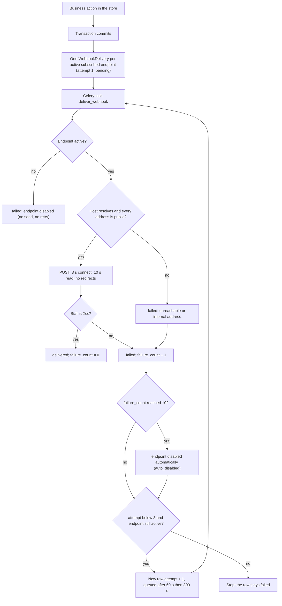

# Outgoing webhooks — security and delivery spec (integrator reference)

> **Source**: DOC-218 · INT-023 (M19) · inventory Domain 12, A.8
> **Live key**: *Django-first, no switch of its own.* The merchant dashboard manages endpoints through the M19 routes (live key `integrations`, see [M19](../domains/12-settings-staff-integrations/m19-domains-integrations.md#webhooks)); the sending engine is Django and has no mock.
> **Django provider**: `sharwa_saas/products/services/webhook_service.py` (engine) · `products/models/webhooks.py` (`WebhookEndpoint`, `WebhookDelivery`, `AUTO_DISABLE_AFTER`) · `products/tasks/operations.py` (`deliver_webhook`, `dispatch_low_stock_webhooks`) · `api/views_integrations.py` (management routes)
> **Frontend contract**: none for the receiving side. The dashboard side is `sharwa-frontend/src/features/integrations/schemas.ts` (see M19).
> **Tests**: `sharwa_saas/api/test_integrations_api.py` — class `WebhookApiTests` (8 of the file's 21 tests)
> **Last verified against code**: 2026-10-27 (step 28)

<a id="overview"></a>

## 1. Overview

A store owner can register up to 10 HTTPS URLs (*endpoints*). When a subscribed thing happens in the store — an order is created, a shipment moves, a product changes — Sharwa sends one signed `POST` with a JSON body to each subscribed endpoint. This page is the contract for the **person who writes the receiving server**. It answers four questions: what Sharwa will and will not connect to, what exactly arrives, how to prove that it came from Sharwa, and what happens when your server is slow or down.

Read the pages in this order:

| Page | Use it for |
|---|---|
| This page (DOC-218) | URL rules, secret, headers, retries, auto-disable, idempotency |
| [`webhooks-events.md`](webhooks-events.md) (DOC-219) | The 7 events, when each fires, a sample body each |
| [`webhooks-verify-samples.md`](webhooks-verify-samples.md) (DOC-220) | Tested Node.js and Python code that checks the signature |
| [M19 §6](../domains/12-settings-staff-integrations/m19-domains-integrations.md#webhooks) | The owner-facing routes that create endpoints, rotate secrets and read the delivery log |

> **Not in scope here**: webhooks that Sharwa *receives* (bank, carriers, WhatsApp, Meta, suppliers). They are in [`webhooks-inbound.md`](webhooks-inbound.md) (DOC-221). The two directions share no code and no secret.

<a id="quickstart"></a>

## 2. Build a compliant receiver — the checklist

1. Serve an HTTPS URL with a certificate that a normal client trusts, on a public host name. See [§3](#url-rules).
2. Ask the store owner to add the URL in the dashboard and **copy the `whsec_…` secret at once** — it is shown one time. See [§4](#secret).
3. Read the **raw body bytes** of each request before any JSON parsing.
4. Verify `X-Sharwa-Signature` ([§6](#signature), code in [DOC-220](webhooks-verify-samples.md)). Reject with a 4xx on failure. Also reject a timestamp more than 5 minutes away from your clock.
5. Take the body field `id` (`evt_…`) as the **idempotency key** ([§9](#idempotency)). If you have seen it, answer `200` and stop.
6. Answer any `2xx` within **10 seconds**. Put the real work on a queue.
7. Ask the owner to press «إرسال حدث تجريبي» (the test event, [§8.1](#test-event)). A `delivered` row in the delivery log means your receiver is wired correctly.

<a id="url-rules"></a>

## 3. Endpoint URL rules and the SSRF guard

Sharwa runs on a shared platform and connects to addresses that tenants type in. To stop a tenant from pointing a webhook at the platform's own network, the URL is checked twice: when it is **saved** and again **every time a request is sent**. Redirects are never followed.

### 3.1 Checks at save time (`url_error`)

The checks run in this order; the first failure is returned as `400 {"url": ["…"]}`.

| # | Rule | Message |
|---|---|---|
| 1 | The URL parses | «عنوان غير صالح.» |
| 2 | Not empty | «أدخل عنوان نقطة النهاية.» |
| 3 | Scheme is exactly `https` (so `http://…` is refused) | «العنوان يجب أن يبدأ بـ https://» |
| 4 | Host is not `localhost` and does not end in `.local`, `.internal` or `.localhost` | «لا تُقبل العناوين الداخلية — استخدم عنواناً عاماً.» |
| 5 | Host exists, contains a dot (or a colon for an IPv6 literal), and the whole URL is at most 500 characters | «عنوان غير صالح.» |
| 6 | If the host is an **IP literal**, it must be globally routable (`ipaddress.is_global`): private, loopback, link-local, CGNAT, documentation and similar ranges are refused | «لا تُقبل العناوين الداخلية — استخدم عنواناً عاماً.» |
| 7 | If the host is a **name**, it is resolved (`getaddrinfo`, port 443). If **any** returned address is private, loopback, link-local, reserved, multicast or unspecified, the URL is refused | «لا تُقبل العناوين الداخلية — استخدم عنواناً عاماً.» |

Two more rules come from the service layer: the URL must be unique inside the store («هذا العنوان مضاف بالفعل.») and a store may have at most 10 endpoints («الحد الأقصى {MAX_ENDPOINTS} نقاط نهاية لكل متجر.», where the limit is `MAX_ENDPOINTS = 10`).

A host name that **does not resolve** at save time is accepted (the resolver returns "unknown", which is not a refusal). It is refused later, at send time, if it still does not resolve.

### 3.2 Check at send time (DNS-rebinding guard)

Before each request, `send()` resolves the host again. The request is made **only** if the host resolves and **every** address is public. Otherwise no connection is opened and the delivery fails with the error «تعذّر الوصول للعنوان أو أنه عنوان داخلي.». This closes the trick of saving a harmless name and later changing its DNS record to an internal address. Such a failure counts like any other failure ([§7](#auto-disable)).

### 3.3 No redirects

The request is sent with `allow_redirects=False`. A `301`/`302` answer is not a success (only `2xx` is), so the delivery is marked `failed` with the HTTP reason as its error. Register the **final** URL. Test `test_test_event_signed` asserts the flag.

<a id="secret"></a>

## 4. The signing secret

| Property | Value |
|---|---|
| Format | `whsec_` followed by 32 URL-safe characters (`secrets.token_urlsafe(24)`) |
| One per endpoint | Yes; there is no store-wide secret |
| Storage | Encrypted at rest (`django_cryptography`); no route returns it after creation |
| When you see it | In the response of **create** (`201`) and of **rotate** (`200`), field `secret`. `GET` shows only `has_secret: true` |
| Rotation | `POST …/rotate-secret/`. The new secret signs every delivery from that moment. **The old secret stops working at once — there is no grace period**, so deploy the new secret to your receiver before you press rotate, or accept a short window of rejected deliveries (they will be retried, [§7](#retries)). |

Treat the secret like a password: keep it in a secret store, not in source code, and rotate it if it leaks. Its only job is the HMAC key of [§6](#signature).

<a id="request"></a>

## 5. What arrives — the request

```
POST /your/path HTTP/1.1
Host: erp.example.com
Content-Type: application/json
User-Agent: Sharwa-Webhooks/1.0
X-Sharwa-Event: webhook.test
X-Sharwa-Delivery: 71
X-Sharwa-Signature: t=1793133300,v1=40fcd1e873627…(64 hex characters)

{"id":"evt_9f1c…","event":"webhook.test","created_at":"2026-10-27T09:00:00+00:00","store":{"schema":"demo_store","name":"متجر العود"},"data":{"message":"حدث تجريبي من شروة — تحقّق من التوقيع ثم أعد 2xx."}}
```

### 5.1 Headers

| Header | Value | Use |
|---|---|---|
| `Content-Type` | `application/json` | |
| `User-Agent` | `Sharwa-Webhooks/1.0` | Log filtering only — do not trust it for authentication |
| `X-Sharwa-Event` | the event code, e.g. `order.created` | Route before parsing the body |
| `X-Sharwa-Delivery` | the numeric id of this **attempt** (the `WebhookDelivery` row) | Support and log correlation. **Not** a dedupe key ([§9](#idempotency)) |
| `X-Sharwa-Signature` | `t=<unix seconds>,v1=<64 hex>` | Authentication ([§6](#signature)) |

### 5.2 Body

The body is one JSON object, serialized **compactly** (no spaces after `,` or `:`) and as **UTF-8 without `\uXXXX` escapes**: Arabic text is sent as real Arabic characters. This is why you must verify the signature on the bytes you received and never on a re-serialized copy ([§6](#signature)).

| Field | Type | Meaning |
|---|---|---|
| `id` | string | `evt_` + 32 hex characters. Created once per event and **identical in every attempt and redelivery** of that event |
| `event` | string | The event code; same value as `X-Sharwa-Event` |
| `created_at` | string | ISO-8601 time the event was recorded. Not changed by retries |
| `store` | object | `{"schema": "<store schema name>", "name": "<store name>"}` |
| `data` | object | Event-specific fields — see [`webhooks-events.md`](webhooks-events.md) |

Body size: there is no documented limit; payloads are small flat objects of a few hundred bytes.

### 5.3 What counts as success

* **Success** — any status from `200` to `299`. The response body and headers are ignored and not stored.
* **Failure** — any other status, a timeout, a TLS or connection error, or a refused address. The error text saved in the delivery log is the HTTP reason phrase (up to 255 characters, or `HTTP {code}` when the server sent no phrase), «انتهت مهلة الاستجابة.», «تعذّر الاتصال: {exception name}» or «تعذّر الوصول للعنوان أو أنه عنوان داخلي.».
* **Timeouts** — `3 s` to connect and `10 s` to read the response (`TIMEOUT = (3, 10)`).

<a id="signature"></a>

## 6. Proving the request is from Sharwa — the signature

```
X-Sharwa-Signature: t=<timestamp>,v1=<digest>
digest = lowercase hex( HMAC-SHA256( key = secret, message = "<timestamp>." + <raw body bytes> ) )
```

* `<timestamp>` is the **Unix time in seconds at the moment this attempt was sent** (`int(time.time())`). Every attempt, retry and redelivery gets a **fresh timestamp and a fresh signature**; only the body is identical.
* The signed message is the timestamp as text, one dot, then the body bytes exactly as sent.
* The key is the `whsec_…` string encoded as UTF-8, **including the `whsec_` prefix**.

Verification steps (the code is in [DOC-220](webhooks-verify-samples.md)):

1. Split the header on `,`, then each part on the first `=`; read `t` and `v1`.
2. Reject if the header is missing, or `t` or `v1` is absent or malformed.
3. Reject if `abs(your_clock − t) > 300` seconds (replay protection, [§9.2](#replay)).
4. Recompute the digest over `t + "." + raw body` with your stored secret.
5. Compare with `v1` using a **constant-time** function (`timingSafeEqual`, `hmac.compare_digest`) — never `==`.
6. Only now parse the JSON.

> **Warning** — Do not verify against `JSON.stringify(req.body)` or `json.dumps(request.json)`. Any change of spacing, key order or escaping changes the bytes and the check fails (or, worse, is skipped by a developer in frustration). Frameworks that parse JSON before your handler need a raw-body hook; the samples show how for Express, Next.js, Flask and Django.

<a id="lifecycle"></a>

## 7. Delivery lifecycle, retries and auto-disable

<a id="retries"></a>

### 7.1 From event to delivery rows

1. A business action happens (an order is created, a shipment moves…). The code calls `emit(event, data)`.
2. `emit` finds the store's **active** endpoints whose `events` list contains this event. If there are none it does nothing.
3. **After the database transaction commits** (`transaction.on_commit`), one `WebhookDelivery` row is created per endpoint (`status = pending`, `attempt = 1`) and the Celery task `products.tasks.deliver_webhook` is queued. If the business transaction rolls back, nothing is sent.
4. `emit` never raises: a failure to queue is logged and the business action is not affected.

If two endpoints subscribe to the same event, they get two rows with the **same** `id` in the body.

### 7.2 Automatic attempts

| Attempt | Sent | Runs if |
|---|---|---|
| 1 | right after commit (queue latency only) | endpoint is active |
| 2 | 60 s after attempt 1 failed | attempt 1 failed and the endpoint is still active |
| 3 | 300 s after attempt 2 failed | attempt 2 failed and the endpoint is still active |

`AUTO_RETRIES = 3`, `RETRY_DELAYS = (60, 300)`. After a failed attempt 3, Sharwa stops. A worst-case event is therefore tried over roughly **6 minutes** (plus up to 13 s per attempt and queue latency). Each retry is a **new row** (`attempt` 2, 3) with the same event id and payload; the failed row is left untouched, so the log is a complete history.

If a queued attempt runs while the endpoint has been disabled, it is not sent: the row becomes `failed` with the error «نقطة النهاية معطّلة.» and no further attempt is scheduled. The test event is the exception — it is sent even to a disabled endpoint.



<a id="auto-disable"></a>

### 7.3 Auto-disable after 10 consecutive failures

Each endpoint has a counter `failure_count`, updated after **every** attempt under a row lock:

* a `2xx` answer sets it to `0`;
* any failure adds `1`;
* when it reaches `AUTO_DISABLE_AFTER = 10` and the endpoint is active, Sharwa sets `is_active = false` and `auto_disabled = true`.

The counter counts **attempts**, not events: one event that fails all three attempts adds 3, so about four consecutive failing events disable the endpoint. Test events and manual redeliveries count like any other attempt. The dashboard shows `failure_count` and `auto_disabled` in the endpoint object.

While an endpoint is disabled it receives **no new events and they are not stored for later** — there is no backlog to replay. To resume, the owner re-enables it (`PATCH …/endpoints/<pk>/` with `"is_active": true`). Switching from disabled to enabled **resets** `auto_disabled` to `false` and `failure_count` to `0`.

Nothing in the code notifies the owner by email or push when an endpoint is auto-disabled; the owner learns it from the dashboard ([§11](#discrepancies)).

<a id="manual"></a>

## 8. Manual operations the owner can run

<a id="test-event"></a>

### 8.1 Test event

`POST /api/v1/webhooks/endpoints/<pk>/test/` sends one `webhook.test` event **synchronously** and returns the delivery. It uses the same URL checks, headers and signature as a real event, so it is the right way to validate a receiver. It is sent even if the endpoint is disabled (so you can test before enabling), whatever the endpoint's event list says, and it counts toward `failure_count`. Its body is:

```json
{
  "id": "evt_…",
  "event": "webhook.test",
  "created_at": "2026-10-27T09:00:00+00:00",
  "store": { "schema": "demo_store", "name": "متجر العود" },
  "data": { "message": "حدث تجريبي من شروة — تحقّق من التوقيع ثم أعد 2xx." }
}
```

### 8.2 Redeliver

`POST /api/v1/webhooks/deliveries/<pk>/redeliver/` works on **failed** rows only (a row in any other status answers `400 «إعادة الإرسال للتسليمات الفاشلة فقط.»`). It creates a new row with `attempt + 1`, sends it **synchronously** with the original payload (same `id`, new timestamp and signature) and returns it. A manual redeliver can push `attempt` above 3. It does not check whether the endpoint is active and does not re-enable it.

### 8.3 Delivery log

`GET /api/v1/webhooks/endpoints/<pk>/deliveries/` — newest first, filters `status` (`pending`, `delivered`, `failed`), `event`, `from` and `to` (`YYYY-MM-DD`), `page`, `page_size` (1–100, default 20). The exact response shape and rules are in [M19 §6.6](../domains/12-settings-staff-integrations/m19-domains-integrations.md#webhooks-deliveries). The log keeps the HTTP status (`response_code`), `duration_ms`, `attempt` and `error`; the response body of your server is not kept.

<a id="idempotency"></a>

## 9. Duplicates, ordering and replay — receiver guidance

<a id="idempotency-key"></a>

### 9.1 Treat delivery as at-least-once and dedupe on the body `id`

Sharwa retries on any non-`2xx`, including a `2xx` that arrives after the 10-second read timeout. If your server processed the event but the answer was lost, the same event arrives again. Therefore:

* **Dedupe key = the `id` field of the JSON body** (`evt_…`). It is the same in attempts 1, 2 and 3 and in manual redeliveries. Store it in a table with a `UNIQUE` constraint, or in a cache with a TTL longer than 6 minutes plus your tolerance.
* On a repeat, answer `200` and do nothing. Do not answer `4xx`: it would only trigger more retries and move the endpoint towards auto-disable.
* **`X-Sharwa-Delivery` is not stable.** It is the id of the attempt row and changes at every retry and redelivery. Use it to quote in a support request, not to deduplicate.
* Events are **not ordered**: `order.created` and a later `order.status_changed` are independent tasks and a retry can overtake a newer event. Compare the timestamps and states in `data` instead of relying on arrival order, and re-read the order from the API when exactness matters.

<a id="replay"></a>

### 9.2 Replay protection

The signature covers the timestamp, so an attacker cannot change `t` without the secret, but a captured request can be re-sent unchanged. Limit this by rejecting any request whose `t` differs from your clock by more than **300 seconds** (the same tolerance Sharwa applies to the webhooks it receives, `tenants/webhook_replay.py`), and by deduplicating on `id` as above. Keep your server clock synchronized (NTP). The tolerance is a recommendation: Sharwa does not enforce anything on your side.

Because each attempt is re-signed at send time, a retry sent 5 minutes after the event still carries a fresh timestamp and passes a 300-second check.

### 9.3 Security checklist

* Use HTTPS only and keep the secret out of logs.
* Verify on raw bytes, compare in constant time, check the timestamp, then parse.
* Return a generic `400` for any verification failure; do not say which part failed to the caller (the samples return a short code only for easy debugging — remove it in production if you prefer).
* Answer fast; never do slow work before the `2xx`.
* Only act on the event type you expect; ignore unknown `event` values with `200` so that new events added later do not break you.

<a id="limits"></a>

## 10. Limits at a glance

| Limit | Value | Source |
|---|---|---|
| Endpoints per store | 10 | `MAX_ENDPOINTS` |
| URL length | 500 characters | `url_error`, `URLField(max_length=500)` |
| Description | 200 characters | `_input` |
| Automatic attempts | 3 (now, +60 s, +300 s) | `AUTO_RETRIES`, `RETRY_DELAYS` |
| Timeouts | 3 s connect, 10 s read | `TIMEOUT` |
| Auto-disable | 10 consecutive failed attempts | `AUTO_DISABLE_AFTER` |
| Celery time limit per attempt | soft 300 s, hard 360 s | `TENANT_TASK_LIMITS` |
| Who can manage endpoints | the store owner only (staff get `403`) | M19, FR-19.09 |
| Redirects followed | never | `allow_redirects=False` |

<a id="discrepancies"></a>

## 11. Discrepancies and open items

> ⚠️ Discrepancy — roadmap says integrators should deduplicate "using `X-Sharwa-Delivery`" / code does: that header is the primary key of the **attempt** row (`str(delivery.pk)`), and `_next_attempt` creates a new row for every retry and redelivery, so the value changes each time. The stable identifier shared by all attempts is the body field `id` (stored as `WebhookDelivery.event_id`). This page therefore instructs integrators to deduplicate on the body `id` ([§9.1](#idempotency-key)).

> ⚠️ Discrepancy — roadmap says "auto-disable after 10 consecutive failures" / code does: it counts consecutive failed **attempts**, not failed events. With the three automatic attempts, 4 failing events (12 attempts) are enough; test events and manual redeliveries are counted too ([§7.3](#auto-disable)). The behaviour matches the code constant, but "failures" in the roadmap should be read as attempts.

Open items (not discrepancies; behaviour observed in the code, not decided by the roadmap):

* **DNS check and connection are separate.** `send()` resolves the host with `getaddrinfo`, then `requests.post` resolves it again to connect. The address that was checked is not the address that is used, so a DNS answer that changes between the two lookups is not blocked. The save-time and send-time checks reduce, but do not remove, this window.
* **CGNAT range for host names.** A literal address in `100.64.0.0/10` is refused at save (it is not `is_global`), but the host-name path only rejects private, loopback, link-local, reserved, multicast and unspecified addresses (`_host_is_public`), so a name that resolves into `100.64.0.0/10` passes both the save check and the send check.
* **Port is not part of the check.** Host names are resolved for port 443 whatever port the URL names.
* **Pending rows are not swept.** If Celery cannot queue the task (`_enqueue` logs and returns), the row stays `pending`. No job in the sources read re-queues stale `pending` rows.
* **No owner alert on auto-disable.** The state is visible only in the dashboard and the API.
* **No retention job** for `WebhookDelivery` rows was found in the sources read.

<a id="related"></a>

## 12. Related pages

* Events and payloads: [`webhooks-events.md`](webhooks-events.md)
* Verification code: [`webhooks-verify-samples.md`](webhooks-verify-samples.md)
* Inbound receivers: [`webhooks-inbound.md`](webhooks-inbound.md)
* Owner routes (create, rotate, test, log): [M19 — §6](../domains/12-settings-staff-integrations/m19-domains-integrations.md#webhooks)
* Folder index: [`README.md`](README.md)
