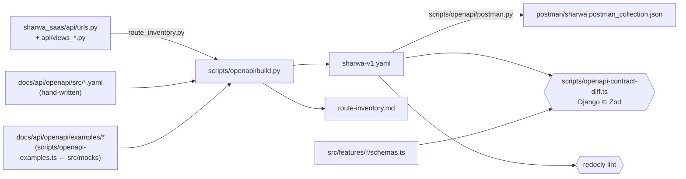

# OpenAPI — strategy, pipeline and examples

> **Source**: DOC-007 (decision record) · DOC-013 (examples) · inventory A.1, A.2, A.12 · all 49 INT tasks
> **Files**: [`sharwa-v1.yaml`](sharwa-v1.yaml) (generated) · [`src/`](src/) (hand-written fragments) · [`examples/`](examples/README.md) · [`route-inventory.md`](route-inventory.md) (generated) · [`contract-diff.md`](contract-diff.md) · [`redocly.yaml`](redocly.yaml)
> **Last verified against code**: 2026-10-27 (step 02)

## 1. Decision record — how `/api/v1/` is described (DOC-007)

| | |
|---|---|
| **Decision** | **Hybrid** (option C below): the route inventory is generated from `sharwa_saas/api/urls.py`; every request/response shape is hand-written per domain in `src/NN-<domain>.yaml`, from the Django code, and diffed against the frontend Zod contracts. |
| **Status** | ☑ **Approved by fares on 2026-10-30** (proposed 2026-10-27, step 02; sign-off recorded in Step 52) |
| **Owner** | fares |
| **Applies from** | Phase 003, Step 02. Every domain step of `specs/003-documentation/execution-plan.md` adds its fragment. |

### 1.1 What the code looks like (measured 2026-10-27)

| Fact | Evidence |
|---|---|
| `drf-spectacular==0.30.0` is **already installed** and wired. | `sharwa_saas/requirements.txt`; `drf_spectacular` in `SHARED_APPS`; `REST_FRAMEWORK.DEFAULT_SCHEMA_CLASS = drf_spectacular.openapi.AutoSchema`; `SPECTACULAR_SETTINGS` (title «واجهة شروة البرمجية (Sharwa Headless API)», `SCHEMA_PATH_PREFIX='/api/v1'`); `/api/schema/`, `/api/docs/`, `/api/redoc/` in both `config/urls_tenant.py` and `config/urls_public.py`. |
| 501 routes · 641 operations in `api/urls.py`, across 46 view modules. | `scripts/openapi/route_inventory.py` → [`route-inventory.md`](route-inventory.md). |
| ~477 view classes; 398 plain `APIView`s and only 8 DRF generic views. 15 `serializer_class` declarations in total. | Static scan of `api/views*.py`. |
| 482 `@extend_schema(...)` decorators, and **453 of them declare only `tags` + `summary`** (Arabic). None declares `responses=` or `request=`. | Same scan. |
| Most views delegate to a service that **builds the response dict by hand** (e.g. `report_data()` in `products/services/reports_contract.py`, `ReportsAPIMixin.gate()` answers). | `api/views_reports.py` and the other `views_*.py` modules. |
| Arabic messages, gates (session → plan feature → permission → owner-only → state) and conflicts live in those services, not in serializers. | Same files. |

### 1.2 Options compared

| | A — drf-spectacular auto-generation | B — fully hand-written YAML | **C — hybrid (chosen)** |
|---|---|---|---|
| Routes & methods | ✔ complete | ✘ easy to miss a route of 501 | ✔ complete, generated from `urls.py` |
| Response shapes | ✘ unknown for every view without a serializer or `responses=` — all but about 15 serializer-backed views; they come out empty/`Any` | ✔ | ✔ hand-written per domain from Django |
| Equal to the Zod contracts | ✘ not checkable | ~ by review only | ✔ checked by `scripts/openapi-contract-diff.ts` (Django ⊆ Zod) |
| Arabic messages, gates, conflict shapes | ✘ | ✔ | ✔ |
| Multipart routes (theme logo, offers image, feeds, product import, Sharwa Pay top-up, checkout receipt) | ~ only where a serializer exists | ✔ | ✔ |
| Public-schema-only routes (console, Sharwa Pay) vs store-host routes | ✘ one flat schema | ✔ | ✔ separate servers + security schemes, separate Postman origin folders |
| Detects a route removed/renamed in Django | ~ | ✘ | ✔ the build fails when a fragment names a route that is no longer in `urls.py` |
| Django changes needed | `@extend_schema(request=…, responses=…)` on ~470 views (application code) | none | **none** |
| New dependency | none (already installed) | none | **none** — PyYAML for the build; `zod`, `tsx` (already in `package.json`) and `js-yaml` (present through eslint) for the checks |

**Why C.** Option A cannot describe what most views return without decorating about 470 views, which is application work outside Phase 003, and it still could not prove equality with the Zod contracts. Option B forgets routes. Option C keeps the route list exact and automatic, keeps the shapes faithful to Django, and turns "matches the frontend contract" into a check that fails on drift.

drf-spectacular stays useful as a **cross-check**. When fares runs `python manage.py spectacular --file schema-drf.yaml --validate` in `sharwa_saas`, its path list must equal [`route-inventory.md`](route-inventory.md). That is a manual check: Claude cannot run Django from the documentation workspace.

> ⚠️ Decision for fares — `/api/schema/`, `/api/docs/` and `/api/redoc/` are served on every store host and on the public host, in production too (`AllowAny`, no `DEBUG` guard in `config/urls_*.py`). They expose the route list with its Arabic summaries (no data). Restricting them to `DEBUG` or to staff is a Django change, outside documentation.

### 1.3 Hard requirements every fragment meets

1. JSON shapes equal the Zod schemas in `src/features/<module>/schemas.ts` (or `schemas/index.ts`). The diff proves Django ⊆ Zod.
2. Arabic messages are quoted verbatim, copied from the Django code.
3. Per-operation gates appear in the order session → plan feature → permission key → owner-only → state, with their status codes.
4. Multipart bodies are declared as `multipart/form-data` with their file fields and limits (8 MB `DATA_UPLOAD_MAX_MEMORY_SIZE`, image types).
5. The origin is explicit. Store-host routes use `storeSession`; console routes use `consoleSession` (public schema, 404 on a store host); Sharwa Pay uses `sharwaPaySession` (platform origin, 404 on a store host or with `X-Store-Domain`).

## 2. Pipeline



| Step | Command (from `sharwa-frontend`) | Fails when |
|---|---|---|
| 1. Examples | `npx tsx scripts/openapi-examples.ts` | a fixture example does not parse with its Zod schema |
| 2. Build | `python scripts/openapi/build.py` (Django repo path optional; default `$SHARWA_SAAS`, else `C:\sharwa_saas`) | a fragment operation is not in `urls.py`, or a component is defined twice |
| 3. Lint | `npx @redocly/cli@1 lint docs/api/openapi/sharwa-v1.yaml --config docs/api/openapi/redocly.yaml` | invalid OpenAPI 3.1 |
| 4. Contract diff | `npx tsx scripts/openapi-contract-diff.ts` | Django sends something the Zod contract refuses ([contract-diff.md](contract-diff.md)) |
| 5. Postman | `python scripts/openapi/postman.py` | — |
| CI / pre-commit | `python scripts/openapi/build.py --check` · `python scripts/openapi/postman.py --check` · `npx tsx scripts/openapi-examples.ts --check` | a generated file is stale |

`sharwa-v1.yaml`, `route-inventory.md` and the Postman collection are **generated** — never edit them by hand.

**Python.** The two `scripts/openapi/*.py` need only PyYAML, and it is already in the Django virtualenv (a drf-spectacular dependency). On Windows, run them with `C:\sharwa_saas\venv\Scripts\python.exe scripts\openapi\build.py`. They read `sharwa_saas` as plain files: Django does not need to run, and no database is touched. The Django repo is found through `$SHARWA_SAAS`, a first argument, or by default `C:\sharwa_saas` (the folder next to `sharwa_front`).

### 2.1 Writing a domain fragment (every domain step)

`docs/api/openapi/src/NN-<slug>.yaml`:

```yaml
x-doc-page: docs/api/domains/NN-<slug>/
components:
  schemas:
    <module>.<Name>:            # naming rule: frontend module folder + Zod export without "Schema", PascalCase
      type: object               # written from the Django view/serializer/service, NOT copied from Zod
      required: [...]
      properties: {...}
operations:
  "GET /api/v1/<path>/":        # exactly as in route-inventory.md (path params as {name})
    description: ...
    x-zod: <module>.<zodExportName>   # the schema the browser parses the success body with
    parameters: [...]
    requestBody: {...}           # with an `example` → becomes the Postman body
    responses: {...}             # every status, Arabic messages verbatim in «…»
```

The build merges these fields onto the generated stub (`operationId`, tags, `x-live-key`, `x-view`, security), and marks the operation `documented`.

### 2.2 Vendor extensions

| Extension | Where | Meaning |
|---|---|---|
| `x-sharwa-status` | operation | `documented` (fragment + diff) or `stub` (inventory only) |
| `x-live-key` | operation | the `SHARWA_LIVE_MODULES` key of inventory A.3; `django-first` (no switch); `passthrough` (Next `/api/v1/*` «Ready» passthrough); `none` (not called by Next, e.g. inbound webhooks). Derived per module in step 02 and verified by each domain step. |
| `x-domain`, `x-module`, `x-int` | operation, tag | 1–16 · M01–M49 · INT-001…INT-049 |
| `x-view` | operation | the Django view (`sharwa_saas/api/<file>.py::<Class>`) |
| `x-zod` | operation | `<module>.<export>` the success body must satisfy |
| `x-doc-page`, `x-source-fragment` | operation | the Markdown page and the fragment that document it |
| `x-tagGroups` | root | 16 domain groups × 49 module tags (Redoc navigation) |
| `x-coverage` | `info` | routes · operations · documented · stub |

## 3. Examples (DOC-013)

**Rule.** Every example is produced by the same fixture function the mock BFF serves (`src/mocks/<module>`), run by [`scripts/openapi-examples.ts`](../../../scripts/openapi-examples.ts). Each INT task aligned those fixtures to Django. The script parses every example with the module's Zod schema before writing it, and refuses to write one that does not parse. Arabic sample text is kept as the fixture has it. The clock is frozen at the fixture epoch (`FIXTURE_NOW`), so the files are identical on every run. Files are named `examples/<operationId>.<status>.<json|csv>` and attached to their response as `externalValue`. The Postman collection reuses them as saved responses.

**Secrets never appear in examples.** Gateway and carrier credentials appear only as `masked_hint` «••••» + last 4. CAPI tokens are write-only (`has_*` flags). Webhook signing secrets appear only as the placeholder `whsec_…`. Personal access tokens appear as `shw_pat_…`. Phones and names come from the fixtures (fake `9677…` numbers), and the store is the fixture store `noor`.

**Fixtures aligned to Django during Phase 002** (so their examples match Django):

| INT | Module | What was aligned |
|---|---|---|
| INT-005 | M04 Products | variant-sum stock mirror; `<sku>-<n>` variant SKUs |
| INT-013 | M11 Cart | free-shipping threshold compared in the dashboard currency (noor fixture 30000 → 300) |
| INT-014 | M12 Checkout | COD off with deposits; transfer receipt required |
| INT-015 | M41 Order Tracking | prepared delivery = «جاهز للشحن»; pickup code only once ready; returned explanation text |
| INT-016 | M44 PWA | order-derived phone; 300/min; same messages |
| INT-017 | M07 Customers | spend excludes cancelled orders |
| INT-021 | M15 Shipping | carrier credential fields (aramex / smsa) |
| INT-022 | M18 Staff | reset-password row + temporary password |
| INT-023 | M19 Domains & Integrations | subdomain row id 0; tracking input limits |
| INT-024 | M21 Inventory | `items` / `reservations` paged like Django |
| INT-025 | M22 Locations | `display_type` ported verbatim from `Location.display_type` |
| INT-027 | M25 Reports | report statuses (`ai_forecasting` = `coming_soon`, `whatsapp_costs` = `available`, 6 disabled rows); `has_locations` only on the 4 order-derived reports |
| INT-029 | M42 Wishlist & Reviews | review moderation (`approved`) |
| INT-030 | M20 Console | reinstate keeps history; reprovision reasons; stall thresholds; Sharwa Ship feature guard |
| INT-031 | M45 Dues & Sharwa Pay admin | immutable zone code; optional geo |
| INT-032 | M46 Plans & billing | fixed plan code; PROTECT on historical subscriptions; active default plan; icon names |
| INT-033 | M16 POS | one receipt per discount approval |
| INT-034 | M17 Affiliates | owed = live orders minus clawback; eligible-only, oldest-first mark-paid |
| INT-035 | M23 Procurement | unique supplier name; delete blocked by any order |
| INT-036 | M26 Bookings | 15-min hold; 30-min step; overlap ⇒ held/booked |
| INT-037 | M27 Inbox & channels | keyword unique per word; WhatsApp access rows |
| INT-038 | M28 Marketplaces | noon connect: seller id + country |
| INT-039 | M29 Dropshipping | credentials, bounds, secret, capabilities, engine formula, file-schedule refusal |
| INT-040 | M30 App Store | template default/revert; delisted installs |
| INT-041 | M31 Sharwa AI | QR + phone; reconnect; 409 when not usable; all-or-nothing settings; default 4; 900 s token |
| INT-042 | M32 Support | system events; cursor; phone / `closed_at` / inactive assignee; ticket views |
| INT-043 | M33 Expenses | 403 without `expenses.manage`; `created_by_name`; note length |
| INT-044 | M36 B2B | unsupported currency refused |
| INT-049 | M43 Rollup | owner gate kept |

Other modules' fixtures are confirmed by their domain step before the examples are added.

**Current coverage**: 14 examples for the 12 documented operations (the reports pilot + the CSRF handshake), all parsing with their Zod schema. Listed in [`examples/README.md`](examples/README.md).
