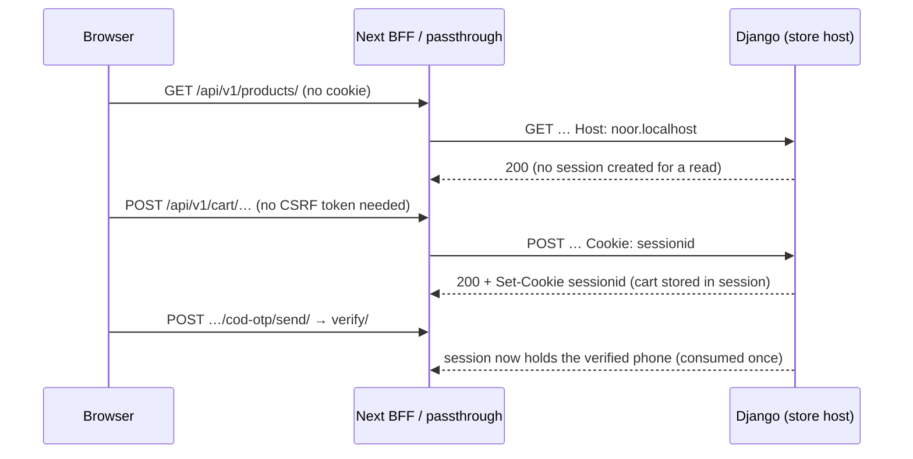
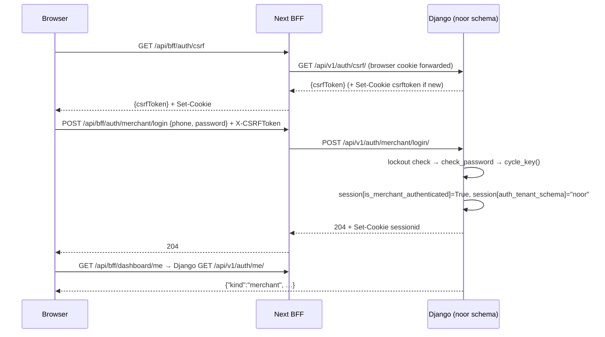
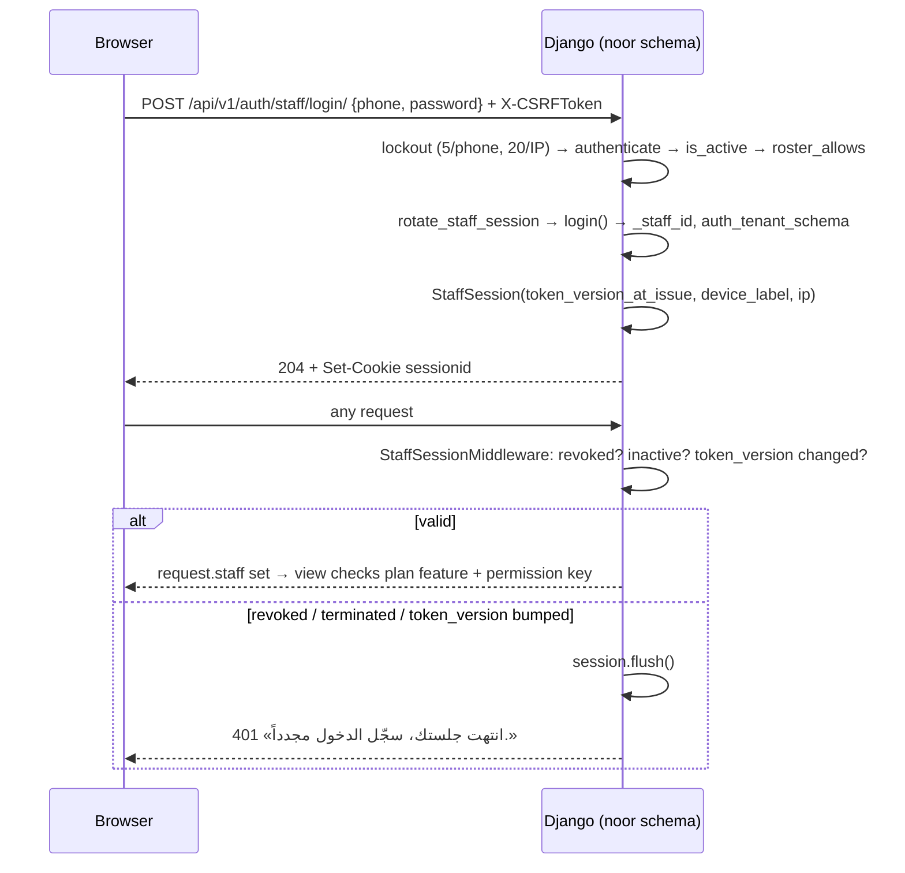
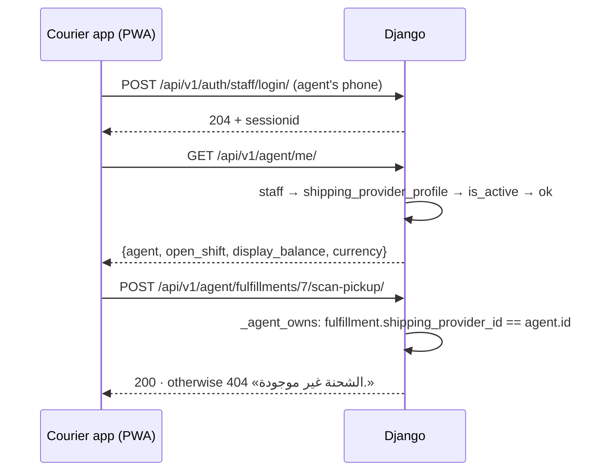
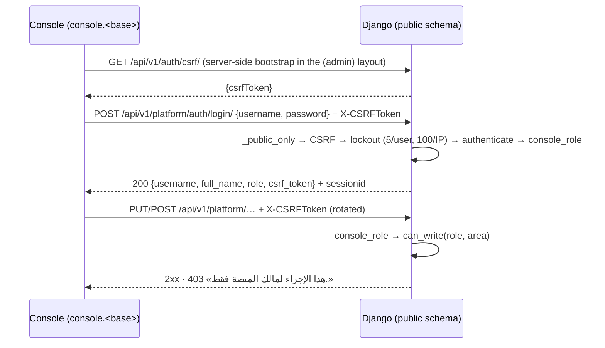
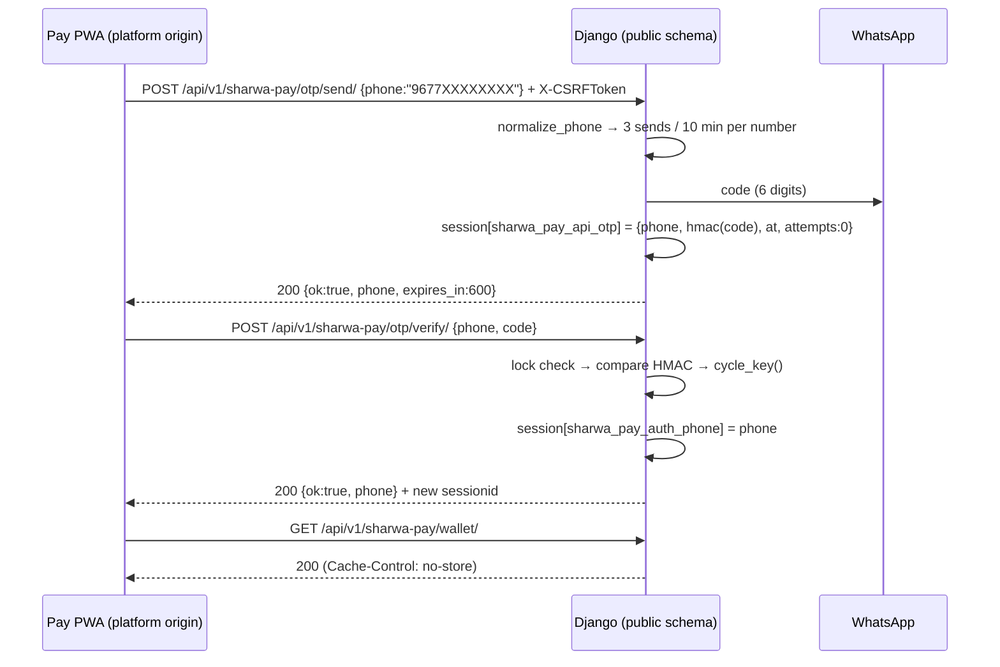

# Authentication & identities

> **Source**: DOC-015, DOC-020, DOC-022, DOC-023, DOC-024 · inventory A.4 · INT-002, INT-003, INT-022, INT-030, INT-041, INT-046, INT-048, INT-049
> **Code**: `sharwa_saas/api/authentication.py` · `api/permissions.py` · `api/middleware.py` · `api/views_auth.py` · `api/views_platform.py` · `api/views_sharwa_pay.py` · `sharwapay/customer_api.py` · `api/views_courier.py` + `api/views.py` (`_resolve_agent`, `_agent_owns`) · `api/views_rollup.py` · `tenants/merchant_rollup.py` · `tenants/middleware.py` · `products/middleware.py` · `products/services/{permission_resolver,staff_service}.py` · `products/models/staff_sessions.py`
> **Frontend**: `sharwa-frontend/src/lib/{csrf,api-client,api-error}.ts` · `src/lib/bff/{auth-adapter,upstream}.ts` · `src/app/api/bff/auth/**`
> **Tests**: `api/test_auth_api.py` (13) · `api/test_dashboard_api.py` (22) · `api/test_tenant_guard_api.py` (5) · `api/test_staff_api.py` (9) · `api/test_platform_console_api.py` (14) · `api/test_sharwa_pay_api.py` (9) · `api/test_courier_api.py` (5) · `api/test_rollup_api.py` (4)
> **Last verified against code**: 2026-10-27 (step 03)

This page answers one question for every caller of the API: **who is it, how did Django recognise it, and what can it call?** Money, errors and gates have their own pages ([`conventions.md`](conventions.md#gates) for the gate order, [`csrf.md`](csrf.md) for the token handshake, [`otp.md`](otp.md) for every WhatsApp code).

Fixture values used below (never real data): store host `noor.localhost`, store schema `noor`, owner phone `967770000011`, password `sharwa-local-demo`, OTP `123456` (the DEBUG static code).

## Common mechanics

- **Sessions are Django sessions in the database.** `django.contrib.sessions` is in both `SHARED_APPS` and `TENANT_APPS`, so the session table is **per store schema**; the platform origin and the console use the **public** schema's table. A cookie from one store is meaningless on another store's host. `SESSION_COOKIE_HTTPONLY = True`, `SESSION_COOKIE_SAMESITE = 'Lax'` (env override), `SESSION_EXPIRE_AT_BROWSER_CLOSE = True`; `CSRF_COOKIE_HTTPONLY = True` (see [`csrf.md`](csrf.md)).
- **No DRF default authentication.** `REST_FRAMEWORK["DEFAULT_AUTHENTICATION_CLASSES"] = []` and the default permission is `AllowAny`. Each view declares its own class. Three exist:

| Class | File | Used by | What it does |
|---|---|---|---|
| `MerchantSessionAuthentication` | `api/authentication.py` | every owner/staff route (`ProductsAPIMixin`, `MerchantAPIMixin`, `DashboardAPIMixin`, `AgentReadMixin`, `LogoutView`, `MeView`…) | If the session has `is_merchant_authenticated` **or** `request.staff` is set → run DRF `enforce_csrf` (403 `CSRF Failed: …` on a write without a valid `X-CSRFToken`) and return a lightweight `MerchantSessionUser` (`staff=None` ⇒ `is_merchant_owner=True`). With no session it returns `None`, and the view answers 401 itself. It never decides permissions. |
| `ConsoleSessionAuthentication` | `api/views_platform.py` | console routes (`ConsoleView`, logout) | DRF `SessionAuthentication` (real Django `User`, CSRF on writes) + `authenticate_header() = 'Session'`, so "no session" is **401** with `WWW-Authenticate: Session`, never 403. |
| none (`authentication_classes = []`) | — | storefront routes, logins, Sharwa Pay | Identity is read from `request.session` inside the view; CSRF is enforced by hand where it applies. |

- **`HasTenantContext`** (`api/permissions.py`) is on every store route: `connection.schema_name != 'public'`, otherwise **403** «لم يتم تحديد المتجر المطلوب. استخدم النطاق الفرعي للمتجر أو أرسل ترويسة X-Store-Domain.».
  **Which body a session route returns on the public host.** The sentence above is what a store route answers when it reaches `public` **with** a session cookie, and what the session-less routes (storefront, `config/`, logins) answer. A route that uses `MerchantSessionAuthentication` and receives **no session at all** answers `403` «لم يتم تزويد بيانات الدخول.» instead: the authenticator returns `None`, `HasTenantContext` fails, DRF's `permission_denied` raises `NotAuthenticated` because an authenticator exists and none succeeded (`rest_framework/views.py:178-179`), and the class has no `authenticate_header`, so DRF turns the `401` into a `403` (`views.py:458-466`). Probed live in Step 51 ([`../_verification.md`](../_verification.md#a-3)): `auth/me/`, `orders/`, `staff/`, `reports/`, `notifications/`, `search/`, `settings/`, `domains/`, `categories/`, `merchant/stores/`, `agent/me/`, `shipping/sharwa-ship/pending-orders/` → «لم يتم تزويد بيانات الدخول.»; `config/`, `catalog/products/`, `cart/` → the store sentence.
- **Owner has every permission.** `ProductsAPIMixin.gate()` / `can()` return "allowed" when `resolve_request_staff(request)` is `None` and the owner flag is set. Only a staff member is checked against permission keys (`staff_has_permission`). See [`permissions.md`](permissions.md).
- **A browser never calls Django directly.** It calls the Next.js BFF (`/api/bff/*`) or the `/api/v1/*` passthrough on its own origin; the server side forwards the cookie header and the store host (`X-Forwarded-Host`, `X-Store-Domain`, `Host`). See [`bff.md`](bff.md).

## 1. The identity matrix

| # | Identity | Established by | Session evidence | Gate class | CSRF | Domains it can call |
|---|---|---|---|---|---|---|
| 1 | [Storefront visitor](#visitor) | nothing (anonymous cookie, created on first write) | cart, `wishlist_phone`, booking holds, OTP keys, buy-now cart in `request.session` | none | **not enforced** (public views declare `authentication_classes = []`; DRF views are CSRF-exempt, so no token is checked) | **1** (store config probe, onboarding), **5** (catalog, cart, checkout), storefront rows of **6** (store wallet, loyalty), **7** (reviews, wishlist, back-in-stock), **13** (bookings, auctions) |
| 2 | [Store owner](#owner) | `POST /api/v1/auth/merchant/login/` (or `setup-password`, `reset-password`) | `is_merchant_authenticated=True` + `auth_tenant_schema=<schema>` | `MerchantSessionAuthentication` | every write | **2–4, 6–15** on the store host: all owner-visible rows, every permission key, plus the owner-only areas |
| 3 | [Staff member](#staff) | `POST /api/v1/auth/staff/login/` | Django `login()` + `_staff_id` + `auth_tenant_schema` + a `StaffSession` row; `request.staff` | `MerchantSessionAuthentication` + permission key | every write | same domains as the owner, narrowed per route by plan feature + permission key; never the owner-only routes |
| 4 | [Courier agent](#agent) | a staff login whose `StaffMember.shipping_provider_profile` is set | as staff | `AgentReadMixin` / `_resolve_agent` | every write | **11** (courier app: `agent/*`) only |
| 5 | [Platform console user](#console) | `POST /api/v1/platform/auth/login/` | Django auth session on the **public** schema (`superuser` or `is_staff`) | `ConsoleSessionAuthentication` + role/area | login and every write | **16** (console, M20/M45/M46); reads **8** platform-side rows (dues, Sharwa Pay topups) |
| 6 | [Sharwa Pay customer](#sharwa-pay) | `POST /api/v1/sharwa-pay/otp/send/` → `otp/verify/` | `sharwa_pay_auth_phone` in the **public** session | none (checked in `SharwaPayView.initial`) | every write, including `otp/send/` and `otp/verify/` | **8** (`sharwa-pay/*`, M40) only |
| 7 | [Multi-store owner](#multi-store) | the store-owner session (2) | same flag + pin, plus a `MerchantAccount` link in the public schema | `MerchantSessionAuthentication` + owner-only check | read-only route | **2** (`merchant/stores/`, store switcher M43) |

An identity is **never** inferred from a request body or header. The one explicit exception is `agent_id` in the courier actions, accepted only from the owner ([§ Courier agent](#agent)). `X-Store-Domain` only chooses *which* store a request addresses; it never authenticates ([§ Tenant pinning](#tenant-pinning)).

### 1.1 Storefront visitor

An anonymous Django session on the **store host**. There are no customer accounts: the visitor is whoever holds the cookie. Phone ownership is proved per action with a WhatsApp code and remembered only in the session (full list in [`otp.md`](otp.md)). Because the storefront views have no authentication class, **no CSRF token is required on storefront writes**; protection rests on the per-action OTPs and on rate limits.

| Session data | Key / owner | Used by |
|---|---|---|
| Cart and buy-now cart | cart items, `checkout_mode=buy_now` (`api/views_checkout.py`) | Domain 5 |
| Shopper phone | `wishlist_phone` (`SHOPPER_PHONE_KEY`, `engagement_service.py`) | wishlist, reviews, back-in-stock (Domain 7) |
| Booking holds | session-scoped holds | Domain 13 |
| OTP records | `wallet_checkout_otp*`, `sharwa_pay_otp*`, `cod_otp*`, `cod_otp_verified_phone`, `otp_rate_limit` | checkout (Domain 5), store wallet/loyalty (Domain 6) |
| Campaign | `utm_source`, `utm_medium`, `utm_campaign`, `_utm_captured` (`UTMTrackingMiddleware`, first touch only) | order attribution |

### 1.2 Store owner

Logs in with the store's WhatsApp phone and the password stored in `StoreSetting.admin_password`. There is no `User` row: the session flag is the identity. Details, request/response examples and the first-password flow: [`m03-auth.md#owner`](../domains/02-dashboard-shell/m03-auth.md#owner).

### 1.3 Staff member

A `StaffMember` with a Django `User` (username = the phone as the owner typed it). Login creates a `StaffSession`; `StaffSessionMiddleware` re-validates it on **every** request and sets `request.staff`. Details: [`m03-auth.md#staff`](../domains/02-dashboard-shell/m03-auth.md#staff).

Per request, `StaffSessionMiddleware` runs only on a store schema (it returns immediately on `public`) and only when a session cookie exists:

1. find the `StaffSession` row for `session.session_key` with `revoked_at IS NULL`;
2. keep the session only if `staff.is_active` **and** `staff_session.token_version_at_issue == staff.token_version`;
3. otherwise `session.flush()` — the next gate answers 401.

Permissions come from `resolve_context(staff)` (`permission_resolver.py`): role permissions per location (`StaffLocationRole`), plus per-staff overrides. The owner never goes through it.

### 1.4 Courier agent

Not a separate login. A staff session becomes an agent when the member has a linked `ShippingProvider` profile. The rules and failure responses are in [§ Courier agent](#agent).

### 1.5 Platform console user

A Django `User` of the **public** schema (the same accounts as the Django admin gate). `superuser` = «مالك المنصة»; `is_staff` without superuser = «مشرف تشغيلي»; anyone else cannot log in. Full flow, lockout and the 403 matrix: [`16-platform-console/auth.md`](../domains/16-platform-console/auth.md).

## 2. Sharwa Pay customer session

> Full route reference (wallet, transactions, requests, topups, withdrawals): [`08-finance/m40-sharwa-pay.md#auth`](../domains/08-finance/m40-sharwa-pay.md#auth). This section is the authentication summary only.

**Where it runs.** The **platform origin**, public schema only. Every `sharwa-pay/*` route calls `_public_only()` first: on a store host, or with an `X-Store-Domain` header, it answers **404** `{"detail": "غير موجود."}`, so a customer wallet is never readable from a store page (FR-40.01).

**Flow.** `POST sharwa-pay/otp/send/ {phone}` → WhatsApp code → `POST sharwa-pay/otp/verify/ {phone, code}` → `cycle_key()` (new `sessionid`, same data, no session fixation) → `session["sharwa_pay_auth_phone"] = <phone>`. The key is the same one the legacy `tenants/sharwa_pay_views.py` page uses, so the two stay in sync. `POST sharwa-pay/logout/` removes `sharwa_pay_auth_phone` and the pending OTP record, answers **204**, and works with or without a session.

| Rule | Value (`sharwapay/customer_api.py`) |
|---|---|
| Phone accepted | digits only after Arabic-digit normalisation; `967…` or `966…` + 8–9 digits (a local number gets `967`) → else **400** `{"phone": ["أدخل رقم جوال يمني أو سعودي صحيحاً."]}` |
| Code | 6 digits (`secrets.randbelow(900000)+100000`); stored in the session only as an HMAC-SHA256 of `sharwa-pay-otp:<phone>:<code>` keyed by `SECRET_KEY`; **bound to the session that requested it** |
| Validity | `OTP_TTL_SECONDS = 600` |
| Send limit | 3 per number per 600 s, counted in the cache by **phone only** (clearing cookies does not reset it) → **429** `{"detail": "طلبات كثيرة — حاول لاحقاً.", "retry_after": N}` + `Retry-After: N` |
| Verify limit | 5 wrong codes → 300 s lock on the number (cache) → **429** `{"detail": "محاولات كثيرة — أُقفل التحقق مؤقتاً.", "retry_after": N}` + `Retry-After`; the code itself stays valid after the lock |
| Delivery failure | **502** `{"detail": "تعذّر إرسال رمز التحقق. حاول مرة أخرى."}` |
| Verify reasons | **400** `{"detail": "اطلب رمزاً أولاً.", "reason": "no_code"}` · `{"detail": "انتهت صلاحية الرمز. اطلب رمزاً جديداً.", "reason": "expired"}` · `{"detail": "الرمز غير صحيح.", "reason": "invalid"}`; a code that is not 6 digits → **400** `{"code": ["الرمز 6 أرقام."]}` |
| No session | **401** `{"detail": "سجّل الدخول برقم جوالك."}` — the client returns to the phone screen |
| Suspended wallet | «المحفظة موقوفة — تواصل مع الدعم.» on money actions |
| Caching | `Cache-Control: no-store` on **every** response (`finalize_response`) |
| CSRF | enforced on every non-safe method by `SharwaPayView.initial()`, including `otp/send/` and `otp/verify/` and `logout/`. The `(pay)` layout has no server-side bootstrap, so the first write goes out without a token, gets the CSRF 403, and `api-client.ts` refreshes once and retries ([`csrf.md`](csrf.md)) |

Tests: `api/test_sharwa_pay_api.py` — `test_otp_login_wallet_logout`, `test_send_limit_and_verify_lock`, `test_expired_code_and_whatsapp_failure`, `test_csrf_enforced_on_writes`, `test_store_origin_is_404`, `test_suspended_wallet`.

## 3. Tenant pinning and session-switch protection

### 3.1 Why it exists

All stores share one base domain, and `X-Store-Domain` lets a client address a store by header (mobile apps, Postman, and the Next.js BFF, which reaches Django on one origin such as `localhost:8000`). Without a guard, a merchant signed in to store A could send `X-Store-Domain: store-b.example` with the same cookie and act inside store B. The 2026-09-16 fix and the 2026-10-20 session fix (both described in `api/middleware.py`) close that.

### 3.2 What runs, in order

`MIDDLEWARE` order in `config/settings.py` for an API request:

1. `RealIpMiddleware` — real client IP behind Nginx.
2. `TenantMainMiddleware` (django-tenants) — picks the store from `Host`. A host with no store is a **404** (django-tenants default; `SHOW_PUBLIC_IF_NO_TENANT_FOUND` is not set). A host outside `ALLOWED_HOSTS` is rejected by Django before any of this.
3. `SessionMiddleware`.
4. **`TenantHeaderOverrideMiddleware`** (`api/middleware.py`) — only for paths starting `/api/` and only when `X-Store-Domain` is non-empty (value stripped and lower-cased).
5. **`TenantProvisioningGuardMiddleware`** (`tenants/middleware.py`).
6. `CorsMiddleware` (when `CORS_ENABLED`), `SecurityMiddleware`, `UTMTrackingMiddleware`, `CommonMiddleware`, `CsrfViewMiddleware`, `AuthenticationMiddleware`, **`StaffSessionMiddleware`** (sets `request.staff`), `MessageMiddleware`, `XFrameOptionsMiddleware`.
7. The view: `HasTenantContext`, then its own authentication class and gates.

`TenantHeaderOverrideMiddleware` for `X-Store-Domain: <domain>`:

1. looks up `Domain` by the exact value → no match: **404** `{"detail": "لا يوجد متجر مرتبط بالنطاق \"<domain>\" في ترويسة X-Store-Domain."}`;
2. store `is_active = False` → **403** `{"detail": "هذا المتجر غير نشط حالياً."}`;
3. `connection.set_tenant(tenant)`, then it **reloads the session** from the target store's schema (`request.session = type(request.session)(session_key)`). Without that, a request that started on `public` read its session from the wrong table: login answered 204 and `auth/me/` answered 401 forever (2026-10-20 fix);
4. reads `auth_tenant_schema` from that session: if it is set **and differs** from the target store → connection back to `public` and **403** `{"detail": "الجلسة الحالية موثَّقة على متجر مختلف — لا يمكن التحويل إلى متجر آخر بهذه الجلسة."}`;
5. otherwise sets `request.tenant` and continues. An anonymous request (no `auth_tenant_schema`) may use the header freely — that is how storefront calls and logins reach a store.

`TenantProvisioningGuardMiddleware` runs after the switch: a store whose `provisioning_status` is not `ready` (`pending`, `in_progress`, `failed`) answers **503** with `Retry-After: 10` and `Cache-Control: no-store`, a rendered HTML page (`tenants/store_provisioning_wait.html`, not JSON; it shows a failure message when `failed`). The schema of a new store is created asynchronously (Celery), so this prevents a `relation does not exist` 500.

### 3.3 Everything a client can get before a view

| Status | Body | Raised by | Meaning / client action |
|---|---|---|---|
| `400` | Django `DisallowedHost` page | Django (`ALLOWED_HOSTS`) | host not allowed — configuration |
| `404` | django-tenants "No tenant for hostname" | `TenantMainMiddleware` | unknown store host; the frontend shows «لم نجد متجراً» |
| `404` | `{"detail": "لا يوجد متجر مرتبط بالنطاق \"…\" في ترويسة X-Store-Domain."}` | `TenantHeaderOverrideMiddleware` | header names no store |
| `403` | `{"detail": "هذا المتجر غير نشط حالياً."}` | `TenantHeaderOverrideMiddleware` | store deactivated; «غير متاح حالياً» |
| `403` | `{"detail": "الجلسة الحالية موثَّقة على متجر مختلف — لا يمكن التحويل إلى متجر آخر بهذه الجلسة."}` | `TenantHeaderOverrideMiddleware` | the cookie belongs to another store; log out or clear cookies of that host |
| `503` + `Retry-After: 10` | HTML wait page | `TenantProvisioningGuardMiddleware` | store schema not ready; poll again |
| `403` | `{"detail": "لم يتم تحديد المتجر المطلوب. استخدم النطاق الفرعي للمتجر أو أرسل ترويسة X-Store-Domain."}` | `HasTenantContext` (view layer) | no store resolved (request hit `public`) — with a session cookie, or on a session-less route |
| `403` | `{"detail": "لم يتم تزويد بيانات الدخول."}` | DRF `NotAuthenticated` (no `authenticate_header`, so 401 becomes 403) | no store resolved **and** no session on a `MerchantSessionAuthentication` route ([rule](#no-store-no-session)) |
| `404` | `{"detail": "غير موجود."}` | `_public_only()` in console and Sharwa Pay | platform-only route reached on a store host or with `X-Store-Domain` |

Only the header probe (`GET /api/v1/config/` with `X-Store-Domain`, `probeStore()` in the frontend) is documented to return 200 / 404 / 403 / 503 for a visitor; its tests are `api/test_tenant_guard_api.py`.

### 3.4 Who writes the pin

`session["auth_tenant_schema"] = connection.schema_name` is written by **owner login**, **owner `setup-password`**, **owner `reset-password`** and **staff login** (`api/views_auth.py`). Nothing else writes it. Readers: `TenantHeaderOverrideMiddleware`, `auth/me/`, `dashboard/*` (`DashboardAPIMixin.viewer`), `merchant/stores/`, and the Sharwa AI console-token route.

> ⚠️ Discrepancy — roadmap says «`auth_tenant_schema` written by owner login, staff login and the Sharwa AI console-token route» / code does: `SharwaAiConsoleTokenView` (`api/views_sharwa_ai.py`) only **reads** it. After the normal gate (session → plan feature `app_marketplace` → owner for writes → app installed) it answers **401** «انتهت جلستك، سجّل الدخول مجدداً.» when `session["auth_tenant_schema"] != connection.schema_name`. It also sets `Cache-Control: no-store` and `Referrer-Policy: no-referrer`. The pin is therefore a **requirement** of that route, not something it writes. A session without the pin (an owner session created before pins existed) cannot get a console token.

> ⚠️ Discrepancy — owner routes treat a missing pin as valid: `MeView`, `DashboardAPIMixin`, `MerchantStoresView` accept `auth_tenant_schema in (None, <this schema>)`, while the console-token route requires an exact match. Both are intentional per their docstrings; callers should assume every session created by the current login routes carries the pin.

**Host-based requests.** When the store is chosen by `Host` (store subdomain), no header is involved and the middleware does nothing: the session table is already that store's, so a cookie from store A simply does not exist there. The pin matters when the store is chosen by header.

## 4. Courier agent identity checks

The agent is a staff identity; there is no separate token. Two code paths apply the same rule: `AgentReadMixin.agent_or_error` (`api/views_courier.py`, the four reads) and `_resolve_agent` (`api/views.py`, the five actions). `_agent_owns` then limits the resource.

| Step | Check | Failure |
|---|---|---|
| 1 | a session exists (owner flag or `request.staff`) | reads: **401** `{"detail": "لم تُقدَّم بيانات الاعتماد."}` · actions: **401** `{"detail": "غير مصرح لك بالوصول."}` |
| 2 | **reads only** — the caller must be a staff session | owner session: **403** `{"detail": "هذا التطبيق لحسابات المندوبين. يدير مالك المتجر المندوبين من شاشة الإشراف في لوحة التحكم."}` |
| 3 | the staff member has a `shipping_provider_profile` | **403** `{"detail": "حساب الموظف هذا غير مرتبط بأي ملف مندوب شحن."}` |
| 4 | the profile is `is_active` | **403** `{"detail": "ملف المندوب هذا معطّل. تواصل مع مالك المتجر."}` |
| 5 | **actions, staff caller** — the agent is the caller's own profile; an `agent_id` in the body is ignored | — |
| 6 | **actions, owner caller** — `agent_id` in the body is the only way to pick the agent (`start shift`, `scan-pickup`, `partial-delivery`): missing or non-integer → **400** `{"detail": "agent_id مطلوب وصحيح."}` · unknown → **404** `{"detail": "المندوب غير موجود."}` | — |
| 7 | `_agent_owns` (staff agents only): the fulfillment's `shipping_provider_id` must equal the agent's id | **404** `{"detail": "الشحنة غير موجودة."}`. A missing fulfillment id answers the plain DRF 404 before this check. `end-and-handover` answers **404** `{"detail": "المناوبة غير موجودة."}` for a shift of another agent. |

Notes.

- The four reads (`agent/me/`, `agent/shipments/`, `agent/shipments/<id>/`, `agent/custody/`) **reject the owner** (step 2); the five actions (`agent/shifts/start/`, `agent/shifts/end-and-handover/`, `agent/fulfillments/<id>/scan-pickup/`, `agent/fulfillments/<id>/partial-delivery/`, `agent/shipments/<id>/status/`) **let the owner act for any agent**. This split is intentional (the owner supervises from the M39 screen) and is why the mock gate and the actions differ.
- `_resolve_agent` also contains a defensive **403** «غير مصرح لك بتحديد مندوب صراحة.» for a caller that is neither staff nor owner; the views' own 401 check runs first, so it is not reachable through the routes.
- Every action uses `MerchantSessionAuthentication`, so CSRF is enforced; the agent app is a staff session like any other ([`csrf.md`](csrf.md)).
- `agent/shipments/<id>/` for another agent's shipment is a 404 as well.

Tests: `api/test_courier_api.py` — `test_identity_gate`, `test_actions_refuse_shipments_of_another_agent`, `test_end_and_handover_only_my_open_shift`. Route reference: Domain 11.

## 5. Multi-store owner identity checks

`GET /api/v1/merchant/stores/?from&to` (M43, `api/views_rollup.py`) feeds «متاجري» and the top-bar store switcher. It uses `MerchantSessionAuthentication` + `HasTenantContext`, then:

| Order | Check | Failure |
|---|---|---|
| 1 | caller is **not** staff (`resolve_request_staff` is `None`) | **403** `{"detail": "هذه الصفحة لمالك المتجر فقط."}` — staff have no unified account |
| 2 | `session["is_merchant_authenticated"]` and `auth_tenant_schema in (None, this schema)` | **401** `{"detail": "انتهت جلستك، سجّل الدخول مجدداً."}` — the frontend returns to login |
| 3 | `MerchantAccount` linked to the **current** store (`MerchantAccountClient`, `_account_for`): if several accounts link the store, the one whose `owner_phone` equals the store's `merchant_phone` (raw or cleaned) wins, else the lowest id | no account → **200** with `has_account: false`, `stores: []`, zero totals (not an error) |

A store the account links to is `is_available: false` when the store is inactive or not `ready`. Only stores linked to the **same** account as the current store are listed, so the page cannot enumerate another merchant's stores. The response carries `Cache-Control: no-store`. Totals are computed on the server from `TenantStatsSnapshot` rows in the public schema; no per-store query runs. The session itself is the ordinary owner session — switching to another store means opening that store's host and logging in there (each store pins its own session).

Tests: `api/test_rollup_api.py` — `test_owner_only`, `test_rollup_contract_default_range`, `test_range_reversed_and_invalid`, `test_unavailable_and_no_account`. Route reference: [`m43-multi-store.md`](../domains/02-dashboard-shell/m43-multi-store.md).

## 6. Personal access tokens

Staff can have named API keys («الرموز الشخصية», the label of the staff screen, `sessions-tab.tsx`), managed from the staff screen (M18 US-18.4.2, migration `0223_staff_api`). The model is `PersonalAccessToken` (`products/models/staff_sessions.py`).

| Field | Meaning |
|---|---|
| `staff` | owner of the key |
| `name` | 2–100 characters, shown in the list |
| `token_hash` | SHA-256 hex of the raw key; unique. **The raw value is never stored.** |
| `token_version_at_issue` | copy of `StaffMember.token_version` at issue |
| `expires_at` | required, `now + 90 days` (`TOKEN_TTL_DAYS`) |
| `revoked_at` | set by revoke / terminate |
| `last_used_at` | nullable; see the discrepancy below |
| `created_at` | |

### Lifecycle

| Stage | Route | Gate | Behaviour |
|---|---|---|---|
| Create | `POST /api/v1/staff/<pk>/tokens/` `{name}` | `staff_rbac` feature, `staff.manage`; a member cannot target themselves (403 «لا يمكنك تعديل تعييناتك أو استثناءات صلاحياتك بنفسك.») | **201** `{id, name, created_at, last_used_at, token}` — `token` is `shw_pat_<43 url-safe chars>` and is returned **once**. Audit action `staff.token_created`. Refused for a terminated or inactive member (**400** «لا تُصدر مفاتيح لموظف غير نشط.»); `name` shorter than 2 → **400** `{"name": ["اسم الرمز مطلوب."]}`; longer than 100 → `{"name": ["100 حرف على الأكثر."]}`. |
| List | `GET /api/v1/staff/<pk>/tokens/` | `staff_rbac`, `staff.view_sessions` | array of `{id, name, created_at, last_used_at}` for tokens that are not revoked and not expired, newest first. No value, no hash. |
| Revoke | `DELETE /api/v1/staff/<pk>/tokens/<tid>/` | `staff_rbac`, `staff.manage` | **204**; sets `revoked_at`; audit `staff.token_revoked`. Unknown or already revoked → **404** «الرمز غير موجود.». |
| Expire | automatic | — | after 90 days the key disappears from the list (it is filtered on `expires_at > now`). |
| Terminate | `POST /api/v1/staff/<pk>/terminate/` | `staff.manage` | revokes **all** the member's tokens, ends sessions, bumps `token_version`. |
| Revoke sessions | `POST /api/v1/staff/<pk>/revoke-sessions/` | `staff.manage` | bumps `token_version`, ends sessions. **Does not** touch `PersonalAccessToken` rows. |

Tests: `api/test_staff_api.py` — `test_sessions_tokens_devices_roster`, `test_terminate_is_soft_and_revokes`.

### Which routes accept a PAT

**None.** A search of the whole backend finds `PersonalAccessToken` only in `products/services/staff_service.py` (create / list / revoke / terminate) and the model. No DRF authentication class, middleware or view reads the `Authorization` header, hashes a presented key, compares `token_version_at_issue`, or writes `last_used_at`. Every owner/staff route authenticates by session cookie only (`MerchantSessionAuthentication`). The key can be created, listed and revoked, but presenting it does not authenticate anything today.

> ⚠️ Discrepancy — roadmap says «`PersonalAccessToken.name` / `last_used_at`; … revoked on termination / revoke-sessions» and asks which routes accept a PAT / code does: (1) no route accepts a PAT; (2) `last_used_at` is never written, so it is always `null` in the list; (3) revoke-sessions bumps `token_version` but does not revoke PAT rows (terminate does). Because nothing validates a PAT, (3) has no runtime effect today; it would matter the day a PAT authenticator is added, since that check (`token_version_at_issue == staff.token_version`) is what the model's docstring promises. Decision needed — see the Step 03 report.

## 7. Related pages

- [`csrf.md`](csrf.md) — token handshake and curl walkthrough.
- [`otp.md`](otp.md) — every WhatsApp code in the platform.
- [`conventions.md`](conventions.md#gates) — gate order.
- [`m03-auth.md`](../domains/02-dashboard-shell/m03-auth.md) — owner and staff login, password reset.
- [`16-platform-console/auth.md`](../domains/16-platform-console/auth.md) — console login and 403 matrix.
- Glossary: [`../../glossary.md`](../../glossary.md) — Storefront visitor, Store owner, Staff member, Courier agent, Platform owner, Platform operator, Sharwa Pay customer, Multi-store owner.
