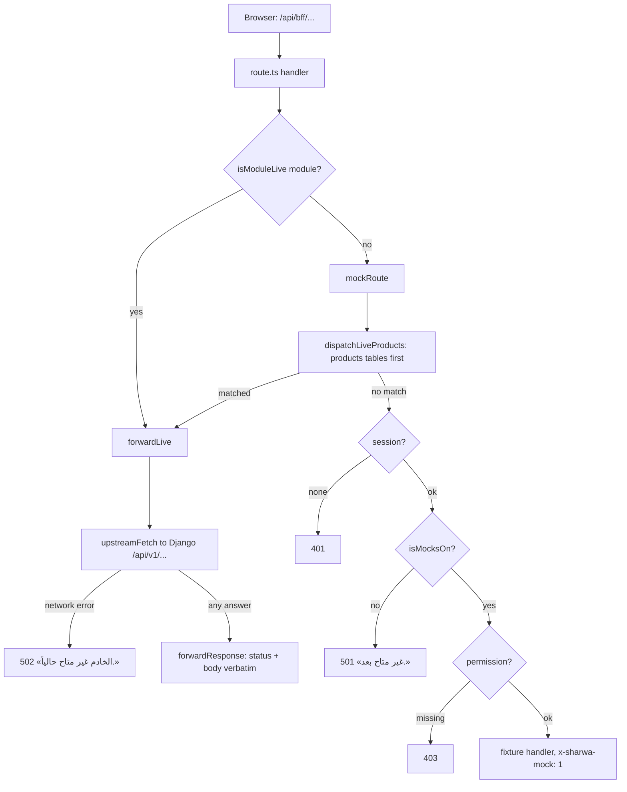
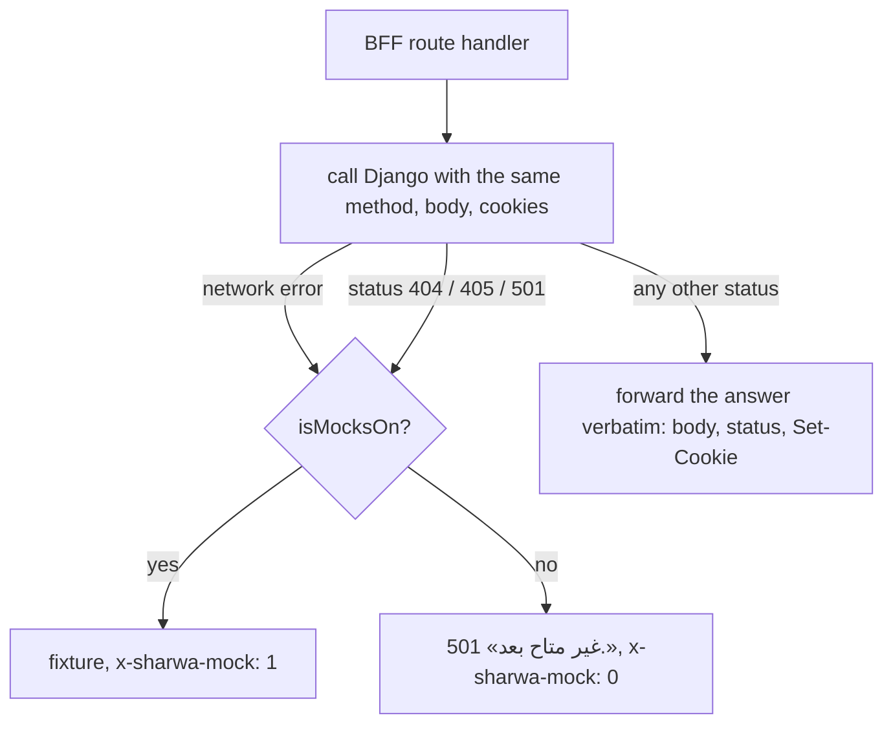

# BFF layer reference

> **Source**: DOC-040 · DOC-041 · DOC-042 (step 05) · DOC-043 · DOC-044 · DOC-045 · DOC-046 · DOC-047 (step 06) · inventory A.2, A.3, A.5, A.11, A.13 · INT-001 → INT-004, INT-011 → INT-016, INT-026, INT-030, INT-031, INT-032, INT-044, INT-045, INT-046 and the products integration Step 2
> **Code**: `src/lib/bff/{live-route,upstream,mock-route,live-products,target-adapter,auth-adapter,storefront-adapter}.ts` · `src/app/api/v1/[...path]/route.ts` · `src/mocks/runtime.ts` · `src/env.ts` · `src/app/api/bff/**/route.ts` · `src/app/api/bff/README.md`
> **Last verified against code**: 2026-10-27 (step 06)

The browser never calls Django. It calls the Next.js **BFF** (backend for frontend) at `/api/bff/*`, and the BFF either answers from a fixture (mock) or forwards the request to Django at `/api/v1/*` (live). This page explains the switch, the one table that routes the products screens, the one catch-all that routes the platform console, the Django-first adapters that have no switch, the `/api/v1/*` passthrough, the mock runtime, the request-buffering fix and the map of all 39 live keys.

Related pages: error bodies are in [`errors.md`](errors.md); the headers that cross the BFF are in [`conventions.md#headers`](conventions.md#headers); the gates are in [`conventions.md#gates`](conventions.md#gates).

<a id="liveormock"></a>
## 1. `liveOrMock` — the live/mock switch (DOC-040)

### 1.1 The environment switches

| Variable | Values | Meaning |
|---|---|---|
| `SHARWA_MOCKS` | `on` · `off` | `off`: **every** module is live. `on`: only the modules named in `SHARWA_LIVE_MODULES` are live. If unset: `on` outside production, `off` in production. `src/env.ts` validates the value (`z.enum(["on","off"])`) and applies the same default; `isMocksOn()` in `src/mocks/runtime.ts` reads `process.env` the same way |
| `SHARWA_LIVE_MODULES` | comma-separated list, e.g. `reports,products`, or `*` | module keys that answer from Django while mocks are on. Compared lower-case after trimming. `*` means all. Allowed characters: letters, digits, `_`, `*`, `,`, `-` and spaces |

```ts
// src/mocks/runtime.ts
export function isModuleLive(module: string): boolean {
  if (!isMocksOn()) return true;                       // SHARWA_MOCKS=off  -> everything live
  const live = (process.env.SHARWA_LIVE_MODULES ?? "")
    .split(",").map((m) => m.trim().toLowerCase()).filter(Boolean);
  return live.includes("*") || live.includes(module.toLowerCase());
}
```

> ⚠️ Discrepancy — glossary and README say `SHARWA_LIVE_MODULES=<keys>|*|none` / code gives `none` no special meaning. It is just a module key nobody uses, so it behaves like an empty list. Leave the variable unset to mean "no live module".

### 1.2 What happens to one request



`liveOrMock(request, module, upstreamPath, mock)` (`src/lib/bff/live-route.ts`) is the whole adapter for a route that has a Django provider:

```ts
export async function liveOrMock(request, module, upstreamPath, mock) {
  if (!isModuleLive(module)) return mock();
  return forwardLive(request, upstreamPath);
}
```

- `module` is the live-switch key (`"reports"`, `"orders"`, `"products"`…). One key may cover many routes.
- `upstreamPath` is the **full** Django path **with its trailing slash** (`/api/v1/reports/`). The BFF appends the original query string unchanged.
- `mock` is a function returning the fixture response. It is only called when the module is not live.

### 1.3 What `forwardLive` does

1. Reads the host and builds the context (`contextFromRequest`): store host, store slug, protocol and the visitor IP. See [`conventions.md#headers`](conventions.md#headers) for what is sent.
2. For a **write** (any method except `GET`, `HEAD`, `OPTIONS`), reads the body with `arrayBuffer()`; an empty body becomes `null`. The body is **buffered, never streamed**, because a chunked request has no `Content-Length` and Django read it as empty (every write answered "required field").
3. Calls `upstreamFetch` with `redirect: "manual"` and `cache: "no-store"`. There is no timeout and no retry in the BFF.
4. On a successful write (`res.ok`) from a **store host**, calls `revalidateTag(storeTag(store), { expire: 0 })`, so the storefront's cached reads for that store are dropped at once. On the platform origin there is no store tag and nothing is revalidated.
5. Returns `forwardResponse(res)`: same status, same body, the copied headers, every `Set-Cookie`, and `cache-control: no-store`. A `204` or `304` has no body.
6. If the network call throws, the BFF answers `502` `{"detail": "الخادم غير متاح حالياً."}` (`UpstreamUnavailableError`).

**Live mode has no Next-side session gate.** Django answers `401`/`403` itself, and its body reaches the browser untouched. The Next-side gates (session `401`, permission `403`) exist only in the mock path (`mockRoute`).

> ⚠️ Discrepancy — roadmap says live BFF writes are "buffered, 8 MB max" / the BFF buffers with **no limit of its own**. The comment in code points at `DATA_UPLOAD_MAX_MEMORY_SIZE` (8 MB), and production Nginx has `client_max_body_size 8M`; the cap is enforced there, not in the BFF. See [`conventions.md#uploads`](conventions.md#uploads).

> ⚠️ Discrepancy — the mock handlers of `reports/schedules*` gate on `reports.view`, while Django gates the same routes on `reports.export` (`EXPORT_PERMISSION`). A staff member with `reports.view` only can use schedules in mock mode and gets `403` «ليست لديك صلاحية لهذا الإجراء.» in live mode.

### 1.4 Answers the BFF produces itself

| Case | Status | Body | Header |
|---|---|---|---|
| Django unreachable | `502` | `{"detail": "الخادم غير متاح حالياً."}` | none beyond `no-store` |
| Mocks off, row has no Django provider (`notAvailable()`) | `501` | `{"detail": "غير متاح بعد."}` | `x-sharwa-mock: 0` |
| Mock fixture answered | the fixture's | the fixture's | `x-sharwa-mock: 1` |
| Platform route called from a non-console host | `404` | `{"detail": "غير موجود."}` | |
| Console fixture router: unknown path / wrong method | `404` / `405` | «المسار غير موجود.» / «الطريقة غير مسموحة.» | `x-sharwa-mock: 1` |

Everything else is Django's answer. `Retry-After` **is** forwarded (it is in the copied response headers), so a `429` from Django reaches the browser with its wait; `www-authenticate` is not. This is the answer to the question left open in [`rate-limits.md`](rate-limits.md).

### 1.5 One worked example per method

Each uses fixture data and the real route files.

#### GET — `reports`

`src/app/api/bff/reports/route.ts`:

```ts
export async function GET(request: Request) {
  return liveOrMock(request, "reports", "/api/v1/reports/", () =>
    mockRoute(request, ({ session }) => reportsFeatureOff(session) ?? mockJson(reportIndex(session), { delay: 160 }), { permission: "reports.view" }),
  );
}
```

```http
GET /api/bff/reports            ──live──▶  GET /api/v1/reports/
```

Live answer: Django's body, status and `Set-Cookie` as they come. Mock answer: `reportIndex(session)` with `x-sharwa-mock: 1`.

#### POST — `reports/schedules`

```ts
const UPSTREAM = "/api/v1/reports/schedules/";
export async function POST(request: Request) {
  return liveOrMock(request, "reports", UPSTREAM, () =>
    mockRoute(request, async ({ store, session }) => reportsFeatureOff(session) ?? respond(createSchedule(store, await readBody(request)), { delay: 220 }), { permission: "reports.view" }),
  );
}
```

```http
POST /api/bff/reports/schedules
Content-Type: application/json
X-CSRFToken: <token>

{"report_code": "<report_code>", "frequency": "weekly", "email": "owner@example.com"}
```

Live: forwarded as `POST /api/v1/reports/schedules/` with the buffered body; success is `201` with `{id, report_code, report_title, frequency, email, is_active, next_run_at, created_at}`. Failure is `400` with field messages, for example `{"email": ["أدخل بريداً إلكترونياً صحيحاً."]}` or `{"report_code": ["هذا التقرير غير متاح بعد."]}`. A successful write on a store host also drops that store's cache tag.

#### PATCH — `reports/schedules/[id]`

```ts
const upstream = (id: string) => `/api/v1/reports/schedules/${encodeURIComponent(id)}/`;
export async function PATCH(request: Request, ctx: RouteContext<"/api/bff/reports/schedules/[id]">) {
  const { id } = await ctx.params;
  return liveOrMock(request, "reports", upstream(id), () => mockRoute(/* … fixture … */));
}
```

```http
PATCH /api/bff/reports/schedules/7      {"is_active": false}   ──live──▶  PATCH /api/v1/reports/schedules/7/
```

The dynamic segment is `encodeURIComponent`-encoded before it is put into the upstream path. A missing subscription is `404` `{"detail": "الاشتراك غير موجود."}` in both modes.

#### DELETE — `reports/schedules/[id]`

```http
DELETE /api/bff/reports/schedules/7   ──live──▶  DELETE /api/v1/reports/schedules/7/   →  204 (no body)
```

`forwardResponse` returns a `204` with a `null` body. Writes also drop the store tag.

#### PUT — the platform console catch-all

PUT is not used by the `reports` routes; the console catch-all exports it (`export { handle as GET, handle as POST, handle as PUT, handle as PATCH, handle as DELETE }`):

```http
PUT /api/bff/platform/plan-features      {…matrix cell…}   ──live──▶  PUT /api/v1/platform/plan-features/
PUT /api/bff/platform/stores/<schema>/features  {"overrides": […]}  ──live──▶  PUT /api/v1/platform/stores/<schema>/features/
```

Both run only on the console host and only when the row's group is live (section 4). The same buffering rule applies. `payments/gateways/[code]/credentials` is also a `PUT` on the merchant side (listed in `src/app/api/bff/README.md`; its route file was not read in this step).

### 1.6 Adding a live route (checklist)

1. Pick the module key; use an existing key when the module is already integrated.
2. In the route file, return `liveOrMock(request, "<module>", "<full /api/v1 path with slash>", () => mockRoute(...))` and keep the mock branch unchanged.
3. Keep the browser hook and its Zod schema unchanged: the Django serializer must produce the mock's JSON shape.
4. Add the route to `src/app/api/bff/README.md` and to the OpenAPI fragment ([`conventions.md`](conventions.md#how-a-change-ships)).
5. Test with `SHARWA_MOCKS=on SHARWA_LIVE_MODULES=<module>`: this module is live, everything else stays on fixtures.

<a id="products-rules"></a>
## 2. Products live rules (DOC-041)

`src/lib/bff/live-products.ts` is **one table** instead of a `liveOrMock` call in each route file, because the products routes are up to eight folders deep and they all pass through `mockRoute()`, which asks `dispatchLiveProducts(request)` first. If a rule matches and its module is live, the request is forwarded; otherwise the request falls through to the fixture handler.

Three independent tables, checked in this order, each behind its own module key:

| Order | Table | Module key | Rows |
|---|---|---|---|
| 1 | `B2B_LIVE_RULES` (M36 quantity prices) | `b2b` | 2 |
| 2 | `ADVANCED_LIVE_RULES` (M37 extras and CSV import/export) | `advanced_products` | 14 |
| 3 | `PRODUCTS_LIVE_RULES` (Phase A products) | `products` | 21 (20 pass-through, 1 handler) |

A path is matched with the regex `^/api/bff/products<path>/?$`. In the tables `{id}` is `\d+` and `{job}` is `[\w-]+`. A path that matches nothing is a fixture route (`dispatchLiveProducts` returns `null`).

### 2.1 `products` (21 rows)

| # | BFF path (`/api/bff/products…`) | Upstream (`/api/v1/…`) |
|---|---|---|
| 1 | `` (base) | `products/` |
| 2 | `/quick` | `products/quick/` |
| 3 | `/bulk` | `products/bulk/` |
| 4 | `/formula-preview` | `products/formula-preview/` |
| 5 | `/{id}` | `products/{id}/` |
| 6 | `/{id}/changes` | `products/{id}/changes/` |
| 7 | `/{id}/stock` | `products/{id}/stock/` |
| 8 | `/{id}/images` | `products/{id}/images/` |
| 9 | `/{id}/images/reorder` | `products/{id}/images/reorder/` |
| 10 | `/{id}/images/{imageId}` | `products/{id}/images/{imageId}/` |
| 11 | `/{id}/variants/generate` | `products/{id}/variants/generate/` |
| 12 | `/{id}/variants/bulk` | `products/{id}/variants/bulk/` |
| 13 | `/variant-attributes` | `variant-attributes/` |
| 14 | `/variant-attributes/{id}` | `variant-attributes/{id}/` |
| 15 | `/variant-attributes/{id}/options` | `variant-attributes/{id}/options/` |
| 16 | `/variant-attributes/options/{id}` | `variant-attributes/options/{id}/` |
| 17 | `/templates` | `product-templates/` |
| 18 | `/templates/{id}` | `product-templates/{id}/` |
| 19 | `/templates/{id}/apply-global` | `product-templates/{id}/apply-global/` |
| 20 | `/templates/{id}/apply` | **handler** `applyTemplateLive` (section 2.4) |
| 21 | `/global-templates` | `global-variant-templates/` |

A rule matches the path for **any** method; Django decides which methods exist. Every upstream path in the three tables was checked against `api/urls.py` and exists. Image upload is one file per request because production Nginx caps a request at 8 MB (see [`conventions.md#uploads`](conventions.md#uploads)).

Permissions in live mode are Django's. For reference, the README records: reads need `inventory.view`, writes `catalog.manage`, stock `inventory.adjust`, sale fields `discounts.manage`.

### 2.2 `b2b` (2 rows)

| BFF path | Upstream |
|---|---|
| `/{id}/extras/tier-prices` | `products/{id}/tier-prices/` |
| `/{id}/extras/tier-prices/{tierId}` | `products/{id}/tier-prices/{tierId}/` |

Note the **sub-resource name moves**: the BFF keeps `extras/` in the path, Django does not.

### 2.3 `advanced_products` (14 rows)

| BFF path | Upstream |
|---|---|
| `/{id}/extras/bundle-components` | `products/{id}/bundle-components/` |
| `/{id}/extras/bundle-components/{id}` | `products/{id}/bundle-components/{id}/` |
| `/{id}/extras/compatibility-rules` | `products/{id}/compatibility-rules/` |
| `/{id}/extras/compatibility-rules/{id}` | `products/{id}/compatibility-rules/{id}/` |
| `/{id}/extras/personalization-fields` | `products/{id}/personalization-fields/` |
| `/{id}/extras/personalization-fields/reorder` | `products/{id}/personalization-fields/reorder/` |
| `/{id}/extras/personalization-fields/{id}` | `products/{id}/personalization-fields/{id}/` |
| `/{id}/extras/auction` | `products/{id}/auction/` |
| `/{id}/extras/auction/bids` | `products/{id}/auction/bids/` |
| `/{id}/extras/serials` | `products/{id}/serials/` |
| `/import` | `products/import/` |
| `/import/{job}` | `products/import/{job}/` |
| `/import/{job}/run` | `products/import/{job}/run/` |
| `/export.csv` | `products/export/` (the list filters stay in the query string) |

### 2.4 The one handler: `applyTemplateLive` (decision D7)

«تطبيق على منتجات» ("apply to products") is a frontend-only feature with **no Django endpoint**. In live mode the BFF orchestrates it:

1. Read `product_ids` from the body; keep unique positive integers. If none: `400` `{"product_ids": ["اختر منتجاً واحداً على الأقل."]}`.
2. `GET /api/v1/product-templates/{id}/` from Django. If that fails, its status and body are returned as they are. If the body does not match `productTemplateSchema`: `502` `{"detail": "تعذّرت قراءة القالب من الخادم."}`.
3. For each product **in turn** (sequential on purpose), `PATCH /api/v1/products/{id}/` with the template's `fields` plus `blueprint_id`. Each PATCH is atomic in Django and keeps its own validation (an active auction refuses the change).
4. If at least one product was applied on a store host, drop the store cache tag.

Response (`200`), the same shape as the mock:

```json
{
  "applied": 2,
  "skipped": [{"id": 31, "reason": "غير موجود"}],
  "fields": ["brand_id", "tax_class"]
}
```

`reason` comes from `reasonOf`: `404` → «غير موجود»; else the body's `detail` if it is a string; else the first message of the first field that has one; else, for `403`, «ليست لديك صلاحية»; else «تعذّر التطبيق». The step is not transactional across products: some can be applied while others are skipped.

> ⚠️ Discrepancy — roadmap says each product that fails is reported with "its Arabic reason" / code takes `detail` or the first field message first, and only uses «ليست لديك صلاحية» when the `403` body carries neither, so a `403` with a `detail` shows Django's sentence.

### 2.5 Dispatch order and what is *not* live

- `dispatchLiveProducts` runs **before** the session gate, so in live mode Django answers `401`/`403` for products; in mock mode the Next gate answers.
- Because `b2b` and `advanced_products` are checked first, `products` can be off while `b2b` is on (and the reverse). `products/export.csv`, `products/import/**` and `products/{id}/extras/**` are **not** in the `products` table; they depend on `advanced_products` (and `b2b` for tier prices).
- Phase B (decision D6) is why: those rows have their own switches, independent of `products`. Categories, brands, tags, collections and badges are a different module, `catalog`, wired with `liveOrMock` in their own route files (`src/app/api/bff/README.md`).

<a id="platform"></a>
## 3. Platform console routes (DOC-042)

`src/app/api/bff/platform/[...path]/route.ts` is **one catch-all** for the whole platform console. The path after `platform/` is the upstream path verbatim, so no screen changes when a row goes live.

### 3.1 The rule

```ts
const joined = path.filter(Boolean).map(encodeURIComponent).join("/");
const liveModule = liveModuleFor(joined);
if (liveModule && isModuleLive(liveModule)) return forwardLive(request, `/api/v1/platform/${joined}/`);
if (!isMocksOn()) return notAvailable();                      // 501
return platformMock(request, path, role);                     // fixtures
```

1. **Host gate first.** Only the console host answers (`tenant.kind === "reserved"` and `reservedGroup === "admin"`, for example `console.<base>`). A store origin, a custom domain or the marketing origin gets `404` `{"detail": "غير موجود."}`, and Django refuses it again because its platform views run on the public schema only.
2. Each path segment is `encodeURIComponent`-encoded, joined with `/`, prefixed with `/api/v1/platform/` and given a trailing slash.
3. The **first segment** picks the live group. The group is the module key tested by `isModuleLive`.
4. A path outside the three groups is never live: with mocks off it is `501`; with mocks on the fixture router answers (`404` «المسار غير موجود.» for an unknown path, `405` «الطريقة غير مسموحة.» for the wrong method).

### 3.2 Prefix → group map

| Group (module key) | Module | First segment of the BFF path | Django routes under `/api/v1/platform/` |
|---|---|---|---|
| `platform` | M20 · INT-030 | `auth` | `auth/login/` · `auth/logout/` · `auth/me/` |
| | | `overview` | `overview/` |
| | | `clients` | `clients/` |
| | | `stores` | `stores/` · `stores/reprovision/` · `stores/<schema>/` · `stores/<schema>/sharwa-ship/` · `stores/<schema>/features/` · `stores/<schema>/domains/` · `stores/<schema>/domains/<pk>/` · `stores/<schema>/deactivation/` |
| | | `features` | `features/` · `features/<code>/` · `features/<code>/resolve/` |
| | | `feature-overrides` | `feature-overrides/` · `feature-overrides/bulk/` · `feature-overrides/<pk>/` |
| | | `webhook-events` | `webhook-events/` · `webhook-events/<pk>/<action>/` |
| `platform_money` | M45 · INT-031 | `dues` | `dues/overview/` · `dues/<schema>/` · `dues/<schema>/actions/` |
| | | `sharwa-pay` | `sharwa-pay/topups/` · `…/topups/<pk>/<action>/` · `sharwa-pay/withdrawals/` · `…/withdrawals/<pk>/<action>/` · `sharwa-pay/wallets/<phone>/` |
| | | `sharwa-ship` | `sharwa-ship/zones/` · `sharwa-ship/zones/<pk>/` |
| `platform_billing` | M46 · INT-032 | `plans` | `plans/` · `plans/<pk>/` |
| | | `plan-features` | `plan-features/` (the plan × feature matrix) |
| | | `subscriptions` | `subscriptions/` · `subscriptions/assign/` |
| | | `billing-settings` | `billing-settings/` |
| | | `apps` | `apps/` · `apps/<code>/` |
| | | `app-billing-overrides` | `app-billing-overrides/` · `app-billing-overrides/<pk>/` |
| | | `market-categories` | `market-categories/` · `market-categories/reorder/` · `market-categories/<pk>/` |

Every `platform/*` route in `api/urls.py` (lines 473–518) falls under one of these three groups.

Two traps:

- The group follows the **first segment**, not the topic. `stores/<schema>/sharwa-ship/` belongs to `platform` (first segment `stores`), while `sharwa-ship/zones` belongs to `platform_money`.
- Money actions (`dues`, `sharwa-pay`) can go live without the billing group, and the reverse; a console page that mixes groups (a store page showing its plan and its dues) can be half live. That is by design for rollout, but it means the page can show real and fixture data side by side when only one group is on.

### 3.3 Permissions and the console session

Live: every console view extends `ConsoleView`. Its `initial()` runs three checks in order: the request must be on the public schema (`_public_only`, otherwise `NotFound` «غير موجود.»); the user must hold a console role (otherwise `401` `{"detail": "انتهت جلسة لوحة المنصة، سجّل الدخول مجدداً."}`); and for any unsafe method the role must be allowed to write in the view's **area** (`svc.can_write(role, area)`, otherwise `403` «هذا الإجراء لمالك المنصة فقط.»). The areas in use are `stores` (default), `billing`, `webhooks`, `dues`, `sharwa_pay` and `zones`. Reads are never blocked by the area. Mock: the role comes from the mock admin cookie (`parseAdminRole`). The console session itself is documented in the console domain pages ([`16-platform-console/`](../domains/16-platform-console/auth.md)).

> ⚠️ Discrepancy — roadmap says the console `401` is the contract for a lost session / Django adds `WWW-Authenticate: Session`, but the BFF does not forward `www-authenticate`. See [`errors.md`](errors.md#32-401-unauthorized).

<a id="django-first"></a>
## 4. Django-first adapters (DOC-043)

Sections 1–3 describe rows that have a **live key**: the module is on the fixture until its key is listed in `SHARWA_LIVE_MODULES`. The rows below have **no key and no switch**. They were integrated first, so the BFF asks Django on every request and uses a fixture only as a development fallback. There are five adapter shapes.

| Adapter | File | Used by | Django wins when | Fixture used when |
|---|---|---|---|---|
| Server fetchers | `features/storefront/api/{upstream,config,catalog}.ts`, `features/tracking/api.ts`, `features/tenant/api/probe.ts`, `features/landing/api/{plans,stats}.ts`, `features/dashboard-shell/api/overview.ts` | Server Components (first paint) | any answer the code accepts (see §4.2) | the answer is `404`/`405`/`501` or Django is down **and** `isMocksOn()` — landing, overview: see the discrepancy in §4.2 |
| `storefrontAdapter` | `src/lib/bff/storefront-adapter.ts` | storefront BFF rows (buyer) | status is **not** `404`/`405`/`501` | Django answers `404`/`405`/`501` or is unreachable, and `isMocksOn()`; otherwise `notAvailable()` |
| `tryTarget` | `src/lib/bff/target-adapter.ts` | platform-host onboarding rows | not "not shipped" | returns `null` → the route falls back |
| `tryStoreTarget` | same file | dashboard overview rows (store-scoped) | not "not shipped" | returns `null` → the route falls back |
| `tryTargetAuth` | `src/lib/bff/auth-adapter.ts` | the six auth rows | not "not shipped" | returns `null` → the route falls back |
| Legacy `upstreamFetch` | `src/lib/bff/upstream.ts` | `public/check-subdomain`, `public/plans`, `public/stats`, `public/provisioning/[token]`, the `/api/v1/*` passthrough | `plans`/`stats`: a `2xx` JSON answer; the others: any answer | `plans`/`stats`: **any** other outcome (non-OK, non-JSON, unreachable) with mocks on, `501` with mocks off; `check-subdomain`: unreachable with mocks on; `provisioning`: never; passthrough: `404` or unreachable, see §5 |

**"Not shipped" is one rule** (`notShipped(status)` in `target-adapter.ts`): the status is `404`, `405` or `501`. The thinking is that a route Django has not built yet answers one of those three, so the fixture may step in. Anything else — `400`, `401`, `403`, `409`, `410`, `429`, `5xx` — is a real Django answer and is forwarded as is.



### 4.1 Where a Django-first row differs from a live-key row

| | live-key row (`liveOrMock`) | Django-first row |
|---|---|---|
| Who decides to call Django | `isModuleLive(key)` | always called first |
| Fixture reachable in production | never | never — `SHARWA_MOCKS=off` (the production default) turns every fixture fallback into `notAvailable()` |
| Django down, mocks on | `502` «الخادم غير متاح حالياً.» | the **fixture** answers |
| Django `404` (route missing **or** record missing) | `404` forwarded | treated as "not shipped" → fixture (mocks on) or `501` (mocks off) |

The last line is a trap: see the discrepancy in §4.6.

### 4.2 Server fetchers

These run on the server while a page renders. They call Django directly with `fetch` (not through the BFF), send `x-store-domain` and `x-forwarded-host` for the store, and never send the visitor's cookie (except `probeStore` and `getOverview`, which need the session).

| Fetcher | Django path | Cache | Behaviour |
|---|---|---|---|
| `getPublicJson(path, storeHost)` | any public path | none (the callers cache) | returns `{status, data, isMockable}` where `isMockable` is `404`/`405`/`501`; `null` when Django is unreachable |
| `getStoreConfig` | `/api/v1/config/` | `"use cache"`, `cacheLife("minutes")`, tag `store:<store>` | `200` + valid → config. Invalid payload → throws `StorefrontUnavailableError`. `(null \| isMockable) && isMocksOn()` → fixture. Otherwise throws. Errors are never cached |
| `getCategories` | `/api/v1/catalog/categories/` | same | same rule; failure with a `200` that does not parse throws; any other failure returns `[]` |
| `getProducts` | `/api/v1/catalog/products/` | same | a `404` is a **result** (`{ok:false, status:404}`) so the listing can correct the page number |
| `getProduct` | `/api/v1/catalog/products/<id>/` | same | `404` → `null` (not-found page) |
| `getFacets`, `getOffers` | `/api/v1/catalog/facets/`, `/api/v1/catalog/offers/` | same | same rule as `getCategories` |
| `getTracking(store, storeHost, uuid)` | `/api/v1/orders/track/<uuid>/` | **none** — calls `connection()` so the page is dynamic | fixture only on `404`/`405`/`501` or unreachable (INT-015); `null` when nothing answers |
| `probeStore({store, storeHost, cookie})` | `/api/v1/config/` | `no-store`, `redirect: "manual"` | maps the status to a storefront behaviour — [`m47-tenant-guard.md`](../domains/01-public-onboarding/m47-tenant-guard.md) |
| `getPublicPlans`, `getProofStats` | `/api/v1/public/plans/`, `/api/v1/public/stats/` | `"use cache"`, `cacheLife("hours")`, tag `platform` | **any** failure → `plansMock()` (mocks on) or `{subscriptions_enabled:false, plans:[]}`; stats → the static `proofStats` — [`m01-landing.md`](../domains/01-public-onboarding/m01-landing.md) |
| `getOverview(store, storeHost)` | `/api/v1/dashboard/overview/` | none (cookie-dependent) | `200` + valid → data. Anything else with mocks on → fixture with `isMock: true`; mocks off → `data: null` |

> ⚠️ Discrepancy — roadmap says every server fetcher uses "fixture only on 404/405/501 or Django down" / code does it for the catalogue, config, tracking and probe fetchers only. `getPublicPlans`, `getProofStats` and `getOverview` fall back on **any** non-OK status, on an invalid payload, and on a network error. In particular a `401` from `getOverview` (expired session) with mocks on renders fixture numbers marked `isMock: true`. With mocks off the page gets `null`.

### 4.3 `storefrontAdapter` — the buyer-side BFF rows

```ts
// src/lib/bff/storefront-adapter.ts (shape)
storefrontAdapter(request, targetPath, mock, { invalidatesStore })
```

1. A store host is required (`contextFromRequest`). Without one the answer is `404` «استخدم النطاق الفرعي للمتجر.».
2. Django is called first at `targetPath` + the original query string, with the buyer's cookies and the CSRF header.
3. A status other than `404`/`405`/`501` is forwarded (`forwardResponse`). So are `400`, `409`, `429` and their `Retry-After`.
4. Otherwise, with `isMocksOn()` false the answer is `notAvailable()` (`501`). With mocks on the fixture runs with `cartId` taken from the `sharwa_mock_cart` cookie (the cookie is set on the response when it was new).
5. If `invalidatesStore` is set and the fixture succeeded, `revalidateTag(storeTag(store), { expire: 0 })` drops the store's cached catalogue (stock moved).

Consumers, by integration task:

| Task | BFF rows (`/api/bff/…`) | Django path (`/api/v1/…`) |
|---|---|---|
| INT-011 (M09) | `catalog/facets`, `catalog/offers` | `catalog/facets/`, `catalog/offers/` |
| INT-013 (M11) | `cart/contact`, `cart/coupon`, `cart/restore` | `cart/contact/`, `cart/coupon/`, `cart/restore/` |
| INT-014 (M12) | `checkout`, `checkout/quote`, `checkout/delivery-options`, `checkout/payment-options`, `checkout/cod-otp/send`, `checkout/cod-otp/verify`, `orders/public/[uuid]`, plus `orders/public/[uuid]/receipt` and `checkout/sharwa-pay/otp/send` ¹ | `checkout/`, `checkout/quote/`, … |
| INT-015 (M41) | `orders/track/[uuid]` | `orders/track/<uuid>/` |
| INT-028 (M35, five storefront rows) | `loyalty/balance`, `loyalty/redeem`, `loyalty/otp/send`, `wallet/otp/send`, `wallet/balance-preview` | `loyalty/…`, `wallet/…` |
| INT-029 (M42) | `shopper/phone`, `wishlist`, `wishlist/toggle`, `store-reviews`, `customers/otp/send` | `shopper/phone/`, `wishlist/`, `store-reviews/`, … |
| INT-034 | `storefront/referral` | `storefront/referral/` |
| INT-036 (M26 buyer rows) | `catalog/products/[id]/slots` (GET · POST hold) ¹ — the `bookings/[...path]` route comment states the buyer rows are Django-first through `storefrontAdapter`; the manager rows of that route are the live key `bookings` (§8) | `catalog/products/<id>/slots/`, `…/slots/hold/` |
| INT-045 (M37 auction and bids) | `catalog/products/[id]/{auction, auction/bids, available-slots, back-in-stock, quote, reviews, slots}` ¹ | `catalog/products/<id>/…` |

¹ These route files are nested deeper than the documentation staging limit and were **not read** for this page; their adapter is taken from `src/app/api/bff/README.md` ("Django since INT-014" and "target → mock"). Verify them with `grep -n storefrontAdapter` when the page is next edited.

### 4.4 `tryTarget`, `tryStoreTarget`, `tryTargetAuth` and the legacy adapter

| Helper | Scope | What it does |
|---|---|---|
| `tryTarget(request, path, ctx, {method, json?})` | **platform** origin, public URLConf | `omitStoreHeader` is set so Django does not resolve a store. Returns the Django `Response`, or `null` when the status is not shipped or Django is unreachable |
| `tryStoreTarget(request, path, ctx, method)` | **store** host | sends `x-store-domain`; for `POST` with no body it injects `x-csrftoken` from `getCsrfToken(storeHost, cookie)`; returns `null` as above |
| `tryTargetAuth(…)` | store host, auth routes | same idea plus the CSRF fetch and the cookie hand-over — [`m03-auth.md`](../domains/02-dashboard-shell/m03-auth.md#owner) |
| legacy `upstreamFetch` | either | no fallback logic of its own; the route decides |

Consumers:

| Helper | BFF rows | Task |
|---|---|---|
| `tryTarget` | `public/market-categories`, `public/register`, `public/register/verify-otp`, `public/register/resend-otp` | INT-004 |
| `tryStoreTarget` | `dashboard/overview`, `dashboard/counters` (GET); `dashboard/overview/refresh` (POST) | INT-003 |
| `tryTargetAuth` | `auth/forgot-password`, `auth/logout`, `auth/merchant/login`, `auth/reset-password`, `auth/setup-password`, `auth/staff/login` | INT-003 |
| legacy `upstreamFetch` | `public/check-subdomain` (→ `/register/check-subdomain/`), `public/plans`, `public/stats`, `public/provisioning/[token]` (→ `/register/status/<token>/`) | INT-001, INT-004 |

After `tryTarget`/`tryStoreTarget` return `null` the route does the same two things: with `isMocksOn()` false it answers `notAvailable()`; with mocks on it answers from its fixture. The dashboard rows check the session first (`401` «انتهت جلستك، سجّل الدخول مجدداً.») so the fixture never answers an anonymous request.

### 4.5 Rows that never call Django

| Row | What it does |
|---|---|
| `storefront/currency` | sets or reads the currency cookie |
| `public/reset-store-session` | expires the `sessionid` cookie and redirects (`302`, relative `next` only) |
| `auth/csrf` | asks Django for a token through `fetchCsrf` (`/api/v1/auth/csrf/`) — this one *does* call Django, but there is no fixture |
| `dashboard/me` | resolves the session from Django and strips `csrf_token` |
| ~~`account/stores`~~ | **removed in Step 52 (2026-10-30)** — superseded by `merchant/stores`; history in [`m03-overview.md#deprecated`](../domains/02-dashboard-shell/m03-overview.md#deprecated) |

### 4.6 What the "not shipped" rule gets wrong

> ⚠️ Discrepancy — roadmap says "fixture only on 404/405/501 or Django down" / code cannot tell a missing **route** from a missing **record**. A real Django `404` — for example an unknown tracking uuid on `orders/track/[uuid]`, or an unknown order on `orders/public/[uuid]` — is also `404`. With mocks on (development) the fixture answers instead of the real `404`. With mocks off (production) the BFF answers `501` «غير متاح بعد.» instead of Django's `404` body, and `getTracking()` returns `null`. Decision needed: should the adapters look at the response body (`{"detail": …}` from DRF versus the Django HTML 404) before calling a route "not shipped"?

---

<a id="passthrough"></a>
## 5. The `/api/v1/*` passthrough and the «Ready» list (DOC-044)

Besides `/api/bff/*`, the Next app serves **the same-origin `/api/v1/[...path]`**. It exists so the browser can call Django paths directly — the storefront cart, the PWA hooks, the returns and courier screens — without a BFF row per path. These are the rows that `specs/001-sharwa-frontend-platform/contracts/ready-api-v1.md` lists as «Ready»: Django had them before the BFF existed.

### 5.1 What the handler does

File `src/app/api/v1/[...path]/route.ts`. Methods: `GET`, `POST`, `PUT`, `PATCH`, `DELETE`, `HEAD`.

1. The target is `/api/v1/<segments>/` (trailing slash added) plus the original query string.
2. `upstreamFetch` forwards the request transparently (method, body, the allowed request headers and cookies — [`conventions.md#headers`](conventions.md#headers)).
3. The answer comes back through `forwardResponse` (status, body, allowed response headers, every `Set-Cookie`, `cache-control: no-store`).
4. **Django answered `404` and mocks are on** → `passthroughMock` looks the path up in the registered fixtures: `mocks/storefront/passthrough`, `mocks/returns/passthrough`, `mocks/b2b/passthrough`, `mocks/courier/passthrough`. A hit answers with `x-sharwa-mock: 1`; a miss forwards Django's `404`.
5. **Django is unreachable** → with mocks on, the fixture; otherwise `502` «الخادم غير متاح حالياً.».
6. `HEAD` answers carry no body. The provisioning poller relies on this: it probes `/api/v1/config/` with `HEAD`.

There is no live key. The passthrough is Django-first by construction, which is why a `404` is ambiguous here too (§4.6).

> Writes only reach Django with a body since the buffering fix in [§7](#buffering). Before it, every `POST` through this route answered `400` «required field».

### 5.2 Who calls it

| Caller | Rows | Task |
|---|---|---|
| Storefront cart | `GET/DELETE /api/v1/cart/`, `POST /api/v1/cart/actions/` (+ `cart/contact`, `coupon`, `restore` through `storefrontAdapter`) | INT-013 |
| PWA | rows #11–#14 | INT-016 |
| Returns | rows #15–#18, #27–#29 | INT-026 |
| B2B drafts | rows #19–#21 | INT-044 |
| Courier actions | rows #22–#26 | INT-046 |
| Config, catalogue, admin sections | rows #1–#4, #8–#10 (server-rendered or browser) | INT-002, INT-011, INT-012, INT-018 |

### 5.3 The Ready list, re-audited against code (2026-10-27)

All 30 rows still exist in `api/urls.py`. Thirteen have changed since the list was written; the list itself was last edited before INT-013/016/018/026/044/046. **This table replaces the list as the reference** until `ready-api-v1.md` is refreshed.

| # | Method · path | State | What the code does now |
|---|---|---|---|
| 1 | `GET /config/` | extended | the payload carries every field in [`config.md`](../domains/01-public-onboarding/config.md), plus `tracking` (INT-010/019/023) |
| 2 | `GET /catalog/categories/` | unchanged | |
| 3 | `GET /catalog/products/` | extended | card carries badges, `slug`, `is_free_shipping`, `image_url` |
| 4 | `GET /catalog/products/<id>/` | extended | detail adds `payment_policy` and the extra card fields |
| 5 | `GET /cart/` | **changed** | returns the full `storefront_cart_service.serialize` contract (INT-013), not just `{items, count, currency, display_subtotal}` |
| 6 | `DELETE /cart/` | unchanged | `204` |
| 7 | `POST /cart/actions/` | **changed** | accepts `variant_id`, `quantity`, `personalization` besides `size`/`color`. Errors: `400` `{"product_id": ["منتج غير صالح."]}`, `400` `{"action_type": ["إجراء غير معروف."]}`, `404` `{"detail": "هذا المنتج غير متاح."}`, `400` «اختر المقاس واللون أولاً.», `400` «المتغيّر المحدد لا يخص هذا المنتج.» |
| 8–10 | `admin/sections/…` | **changed** | moved to `views_design.py`; session is the **owner** session, no longer `IsAdminUser` (INT-018) |
| 11 | `POST /pwa/install-event/` | changed (INT-016) | 300/min/IP; `429` «طلبات كثيرة جداً، حاول لاحقاً.» |
| 12 | `GET /push/vapid-public-key/` | unchanged | |
| 13 | `POST /push/subscribe/` | changed (INT-016) | 120/min/IP; targeting phone derived from `order_uuid`'s order; unknown order → `400` `{"order_uuid": ["لم نجد هذا الطلب."]}` |
| 14 | `POST /push/unsubscribe/` | changed | missing endpoint → `400` `{"detail": "endpoint مطلوب."}` |
| 15–18 | `returns/…` | **changed** (INT-026) | new **plan feature gate** `refunds` → `403` «ميزة المرتجعات غير مفعّلة في خطتك.»; permission `orders.process_returns` → `403` «ليست لديك صلاحية لتنفيذ هذا الإجراء.»; no session → `401` «انتهت جلستك، سجّل الدخول مجدداً.»; create answers `201`; approve accepts `note` |
| 19 | `POST /orders/b2b-draft/` | **changed** (INT-044) | staff only (owner → `403` «يتطلب إنشاء طلب الجملة تسجيل دخول موظف.»); in a multi-location store `location_id` is required (`400` «لا يوجد فرع متاح — أنشئ فرعاً أولاً أو حدّد location_id.»); unknown currency → `400` «عملة غير مدعومة.»; prices come from the database with tier prices |
| 20 | `GET /orders/b2b-drafts/` | **changed** | accepts `orders.create_b2b` **or** `orders.approve_b2b` (the list says only create) |
| 21 | `POST …/resolve/` | changed | needs `orders.approve_b2b`; `version`; self-approval `403`; stale version `409`. Auth strings are the `MerchantAPIMixin` ones: `401` «غير مصرح لك بالوصول.», `403` «لا تملك صلاحية تنفيذ هذا الإجراء.» |
| 22 | `POST /agent/shipments/<id>/status/` | **changed** (INT-046) | a staff agent can act only on shipments assigned to them (`404` «الشحنة غير موجودة.»); disabled profile → `403` «ملف المندوب هذا معطّل. تواصل مع مالك المتجر.»; staff with no agent profile → `403` «حساب الموظف هذا غير مرتبط بأي ملف مندوب شحن.»; an owner session must send `agent_id` |
| 23 | `POST /agent/shifts/start/` | changed | returns `{shift_id, agent:{id,name}, started_at, closed_previous_shift_id}` |
| 24 | `POST /agent/shifts/end-and-handover/` | changed | `404` «المناوبة غير موجودة.», `400` «هذه المناوبة مغلقة مسبقاً.» |
| 25 | `POST /agent/fulfillments/<id>/scan-pickup/` | unchanged shape | ownership check applies |
| 26 | `POST …/partial-delivery/` | changed | returns `{collected_amount, display_collected_amount, currency, delivered, rejected, duplicate, status?}`; `409` `{"detail": "رُفض التسليم.", "rejection_reason": …}` |
| 27–29 | `returns/rma/create/`, `warehouse/returns/scan/`, `…/qa-decision/` | **changed** (INT-026) | same gates as #15–18; scan and QA also accept `inventory.adjust`; QA decisions are `restocked` and `rejected_disposal`. New routes: `returns/options/`, `returns/rma/`, `returns/rma/<pk>/`, `orders/refunds/` (permission `orders.refund`) |
| 30 | `POST /webhooks/carrier/<code>/` | unchanged | `401` `{"detail": "غير مصرح."}` for a bad signature or an unconfigured carrier; `400` for a missing waybill/status; `202` `{"received": true}`; Celery task `process_carrier_webhook_event` |

The four courier **reads** (`agent/me/`, `agent/shipments/`, `agent/shipments/<id>/`, `agent/custody/`) are not in the Ready list. They go through the `courier` live key (§8): an owner session gets `403`, no session gets `401` «لم تُقدَّم بيانات الاعتماد.».

> ⚠️ Discrepancy — roadmap says rows #11/#13 were updated in INT-016 and other Ready rows changed shape later / code shows the list is out of date for rows #1, #3–5, #7–10, #15–29. The list is not fixed by this step (it lives in `specs/001-…`, outside `docs/`). Decision needed: refresh `ready-api-v1.md` from the table above, or retire it.

---

<a id="mock-runtime"></a>
## 6. The mock runtime (DOC-045)

`src/mocks/runtime.ts` is the whole runtime. It is plain functions and a header constant; there is no server and no state outside the fixtures themselves.

### 6.1 The functions

| Function | Behaviour |
|---|---|
| `MOCK_HEADER` | the header name `x-sharwa-mock` |
| `isMocksOn()` | `SHARWA_MOCKS=on` → `true`; `off` → `false`; unset → `NODE_ENV !== "production"` |
| `isModuleLive(module)` | `!isMocksOn()` → `true`; otherwise `true` when `SHARWA_LIVE_MODULES` (split on `,`, trimmed, lower-cased) contains `*` or the module. `none` is not special |
| `mockJson(data, {status, delay, headers})` | a JSON `Response` with `cache-control: no-store` and **`x-sharwa-mock: 1`**; `null` data → `204`; `delay` (ms) is skipped when `NODE_ENV === "test"` |
| `mockError(status, detail, extra)` | `mockJson({detail, …extra}, {status})` |
| `mockFieldErrors(fields)` | `mockJson(fields, {status: 400})` — DRF field-error shape |
| `notAvailable()` | `501` `{"detail": "غير متاح بعد."}` with **`x-sharwa-mock: 0`** |

The header is how a developer tells the three kinds of answer apart:

| `x-sharwa-mock` | Meaning |
|---|---|
| `1` | a fixture answered |
| `0` | mocks are off and no Django endpoint exists for this row (`notAvailable()`) |
| absent | Django answered (the BFF copies every other header, so a Django answer never carries it) |

`x-sharwa-mock` is also in the list of response headers `forwardResponse` copies from Django, but Django never sets it.

### 6.2 Switching one module live or back to mock

1. Set `SHARWA_MOCKS=on` (the development default).
2. Set `SHARWA_LIVE_MODULES` to the module key, for example `orders`. Several keys are comma-separated; `*` means all. Keys are in [§8](#live-keys).
3. Restart `next dev` so the new environment is read (`src/env.ts` validates `SHARWA_MOCKS` at boot).
4. Live rows need a real Django session on the same store host: log in once at `http://<store>.localhost:8000/dashboard/login/`; cookies are shared across ports (see `.env.example`).
5. To go back to mock, remove the key. To make *everything* live, set `SHARWA_MOCKS=off`.

Production: `SHARWA_MOCKS=off`. With it, every `liveOrMock` row is live (the list is ignored), every Django-first row calls Django only, and a row with no Django route answers `501` «غير متاح بعد.».

### 6.3 Running the mock end-to-end scripts

The `scripts/*-check.ts` Playwright scripts authenticate with the fixture cookie `sharwa_mock_session`, which Django does not know. A row that is live answers `401` (or `503` with Django down), and the script fails far from the cause. So:

- start the dev server with **no live modules**;
- Windows `cmd`: `set SHARWA_LIVE_MODULES=&& npm run dev` — note that `set X=` **deletes** the variable; the `&&` must follow the `=` with no space before it, or the value becomes a space;
- the roadmap and glossary write `SHARWA_LIVE_MODULES=none`. It also works, but only because `none` is a key no route uses (see the discrepancy in [§1.1](#liveormock)); `unset`/empty is the clearer way.

`scripts/b2b-check.ts` shows the pattern. Its `requireMocks()` preflight fetches two routes (`/api/bff/products?page_size=1` for `products`, `/api/bff/b2b/options` for `b2b`) from a page on the `glow` store and reads **`x-sharwa-mock`**. A response without `1` means that module is live; the script prints which one, prints the `set SHARWA_LIVE_MODULES=&& npm run dev` hint, and exits with code `1`.

### 6.4 Rows that never go live

| Row | Reached how | Why it stays on the fixture |
|---|---|---|
| `pos/__reset` | `pos/[...path]`: `if (joined === "__reset") return mock()` before `liveOrMock` | the functional check resets the POS seed |
| `inbox/_mock/*` | `inbox/[...path]`: `if (segs[0] === "_mock") return mock()` | simulated inbound webhook and check reset |
| `b2b/_test/bump/<approval_id>` | `b2b/[[...path]]`: only `options` is live; everything else is `mock()` | `scripts/b2b-check.ts` uses it to make another approver decide first (the `409` path) |
| `agent/*` non-`GET` | the mock branch answers `405` `{"detail": "الطريقة «POST» غير مسموحة."}` (the method name is filled in; `isMocksOn()` is checked first) | the fixture serves the four M38 **reads** only. The five courier **actions** are called on the `/api/v1/agent/*` passthrough (§5) and never reach this fixture |

The first three go through `mockRoute`: session gate first (`401`), then `501` «غير متاح بعد.» when mocks are off. The `agent` fixture checks `isMocksOn()` first, then the method, then its own identity gate.

---

<a id="buffering"></a>
## 7. The request-buffering fix and forwarded headers (DOC-046)

### 7.1 The bug

The first version of `upstreamFetch` handed the incoming request's body to `fetch` as a stream. Node's `fetch` (undici) sends a stream **chunked, with no `Content-Length`**. Django — both `runserver` and gunicorn — builds `request.body` from `CONTENT_LENGTH`. It therefore saw an **empty body**.

Symptoms, all at once:

- every write through the `/api/v1/*` passthrough answered `400` with "required field" errors — the code comment names PWA install events (`POST /api/v1/pwa/install-event/`), push subscribe and storefront writes;
- only writes failed: a `GET` has no body, so reads through the same code were unaffected.

### 7.2 The fix

Two places, same rule:

| Place | Code |
|---|---|
| `upstreamFetch` (`src/lib/bff/upstream.ts`) | `bufferedBody(request)` returns `ArrayBuffer \| null`: `null` when there is no body, when `request.bodyUsed` is already true, or when it is zero bytes; otherwise the bytes, so `fetch` sends a `Content-Length` |
| `forwardLive` (`src/lib/bff/live-route.ts`) | for a write (anything but `GET`/`HEAD`/`OPTIONS`) reads `arrayBuffer()` itself and passes `{ body }` (`null` when empty) down to `upstreamFetch` |

`duplex: "half"` is added **only** when the body is a `ReadableStream`, which can now happen only when a caller passes an explicit stream. The 8 MB ceiling is Django's `DATA_UPLOAD_MAX_MEMORY_SIZE` (and Nginx `client_max_body_size 8M`), so buffering is bounded — [`conventions.md#uploads`](conventions.md#uploads).

Regression check: `POST` through `/api/bff/<live row>` and `/api/v1/pwa/install-event/` with `{"event_type":"prompt_shown","source":"nextjs_app"}` must answer `201` `{"ok": true}`, not `400`.

### 7.3 Headers the BFF sends and returns

Full table: [`conventions.md#headers`](conventions.md#headers). The parts that matter for this section:

| Direction | Headers |
|---|---|
| Browser → Django, **copied** | `cookie`, `content-type`, `accept`, `accept-language`, `x-csrftoken`, `idempotency-key`, `if-none-match` |
| Browser → Django, **always set** | `x-forwarded-host`, `x-forwarded-proto`, `x-forwarded-for` and `x-real-ip` (one entry, the visitor IP, overwriting anything inbound), `x-store-domain` (unless `omitStoreHeader`), `origin` and `referer` (same site as the browser host, for Django's CSRF referer check) |
| Django → browser, **copied** | `content-type`, `content-disposition`, `content-language`, `retry-after`, `etag`, `location`, `x-sharwa-mock`, **`x-export-rows`** (INT-017) |
| Django → browser, **always** | every `Set-Cookie`, and `cache-control: no-store` |

`x-export-rows` is the row count the customers export toast reports (INT-017); it is in the response allow-list so it reaches the browser.

---

<a id="live-keys"></a>
## 8. Live-key ↔ BFF row ↔ Django route map (DOC-047)

39 keys. "Rows" is the number of BFF `route.ts` files found in the code for that key (the roadmap's figure is in brackets when it differs). **46 route files are nested deeper than the documentation staging limit (7 folders) and were counted by their path prefix, not read.** With those added every roadmap figure reconciles, so they are shown as `+n deep`.

| # | Key | Task · Module | Rows | BFF location | Django provider (`sharwa_saas/api/`) |
|---|---|---|---|---|---|
| 1 | `reports` | INT-027 · M25 | 8 + 1 deep = 9 | `reports/**` | `views_reports.py` |
| 2 | `catalog` | INT-006 · M05 | 13 + 2 deep = 15 | `badges`, `brands`, `categories` (+`reorder`), `collections` (+`products`), `tags` (+`merge`) | `views_catalog.py` |
| 3 | `products` | INT-005 · M04 | via `PRODUCTS_LIVE_RULES` | `products/**` through `mockRoute` → `dispatchLiveProducts` ([§2](#products-rules)) | `views_products.py` |
| 4 | `orders` | INT-007 · M06 | 10 + 1 deep = 11 | `orders/**`, `order-statuses/**` (the print view reuses the detail row) | `views_orders.py` |
| 5 | `search` | INT-008 · M48 | 1 | `search` | `views_search.py` |
| 6 | `notifications` | INT-009 · M49 | 4 | `notifications`, `summary`, `read-all`, `[id]/read` | `views_notifications.py` |
| 7 | `settings` | INT-010 · M34 | 1 + 9 | `settings` + `settings/{identity, currency, policies, announcement, shipping, contact, seo, multi-location, payments}` through `settingsWrite(upstream, ownerOnly, apply)` | `views_settings.py` |
| 8 | `pwa` | INT-016 · M44 | 2 | `push/stats`, `push/test` (the buyer rows are Django-first, §5) | `views_push.py` |
| 9 | `customers` | INT-017 · M07 | 11 + 2 deep = 13 | `customers/**`, `reviews/[id]` | `views_customers.py` |
| 10 | `design` | INT-018 · M08 | 6 | `admin/sections` (+`[id]`, `reorder`), `store/announcement`, `store/theme`, `store/theme/presets` (multipart forwarded as is) | `views_design.py` |
| 11 | `marketing` | INT-019 · M13 | 15 + 3 deep = 18 | `marketing/**` | `views_marketing.py` |
| 12 | `payments` | INT-020 · M14 | 10 + 1 deep = 11 | `payments/gateways/**`, `payments/payout-accounts/**`, `store/payments`, `wallet`, `wallet/{dues, transactions, withdrawals}` | `views_payments.py` |
| 13 | `shipping` | INT-021 · M15 | 22 + 3 deep = 25 | `shipping/**` except the seven Sharwa Ship rows; also `orders/[id]/convert-to-pickup`, `shipments/[id]/address`; includes `shipping/sharwa-ship/zones` (the zones **list** only) | `views_shipping.py` |
| 14 | `staff` | INT-022 · M18 | 22 + 4 deep = 26 (25 + the reset-password row) | `staff/**`, `roles/**`, `permissions`, `approvals/**`, `audit-log`, `behavior-alerts/**` | `views_staff.py` |
| 15 | `integrations` | INT-023 · M19 | 9 + 4 deep = 13 | `domains/**`, `integrations/status`, `store/tracking`, `webhooks/**` | `views_integrations.py` |
| 16 | `inventory` | INT-024 · M21 | 8 | `inventory/**` | `views_inventory.py` |
| 17 | `locations` | INT-025 · M22 | 11 + 3 deep = 14 | `locations/**` | `views_locations.py` |
| 18 | `returns` | INT-026 · M24 | 4 | `returns/options`, `returns/rma`, `returns/rma/[id]`, `orders/refunds` | `views_returns.py` |
| 19 | `wallets` | INT-028 · M35 | 4 + 3 deep = 7 | `customers/wallets/**`, `loyalty/points/**`, `loyalty/program` | `views_wallets.py` |
| 20 | `platform` | INT-030 · M20 | catch-all | `platform/[...path]` ([§3](#platform)) | `views_platform.py` |
| 21 | `platform_money` | INT-031 · M45 | same catch-all | `dues/**`, `sharwa-pay`, `sharwa-ship` prefixes | `views_platform.py` |
| 22 | `platform_billing` | INT-032 · M46 | same catch-all | `plans/**`, `plan-features`, `subscriptions/**`, `market-categories` … | `views_platform.py` |
| 23 | `pos` | INT-033 · M16 | 1 | `pos/[...path]` (not `__reset`) | `views_pos.py` |
| 24 | `affiliates` | INT-034 · M17 | 2 | `affiliates/[[...path]]`, `influencers/[[...path]]` → `/api/v1/<kind>/<path>/` | `views_partners.py` |
| 25 | `procurement` | INT-035 · M23 | 2 | `suppliers/[[...path]]`, `purchase-orders/[[...path]]` → `/api/v1/<resource>/<path>/` | `views_procurement.py` |
| 26 | `bookings` | INT-036 · M26 | 1 | `bookings/[...path]` (manager rows; buyer rows are Django-first) | `views_bookings.py` |
| 27 | `channels` | INT-037 · M27 | 2 | `inbox/[...path]` (not `_mock/*`), `channels/[[...path]]` | `views_channels.py` |
| 28 | `marketplaces` | INT-038 · M28 | 1 | `marketplaces/[[...path]]` | `views_marketplaces.py` |
| 29 | `dropshipping` | INT-039 · M29 | 1 | `dropshipping/[[...path]]` | `views_dropshipping.py` |
| 30 | `apps` | INT-040 · M30 | 1 (shared) | `apps/[[...path]]` except `sharwa-ai/*` | `views_apps.py` |
| 31 | `sharwa_ai` | INT-041 · M31 | same route | `apps/[[...path]]` when the first segment is `sharwa-ai` (`status`, `reconnect`, `settings`, `console-token`) | `views_sharwa_ai.py` |
| 32 | `support` | INT-042 · M32 | 1 | `support/[...path]` | `views_support.py` |
| 33 | `expenses` | INT-043 · M33 | 1 | `expenses/[[...path]]` | `views_expenses.py` |
| 34 | `b2b` | INT-044 · M36 | 1 + 2 rules | `b2b/options` → `/api/v1/orders/b2b-options/`; tier prices via `B2B_LIVE_RULES` ([§2.2](#products-rules)) | `views_b2b.py` |
| 35 | `advanced_products` | INT-045 · M37 | 14 rules | `ADVANCED_LIVE_RULES` ([§2.3](#products-rules)) | `views_product_extras.py` |
| 36 | `courier` | INT-046 · M38 | 1 (four reads) | `agent/[...path]` → `/api/v1/agent/{me, shipments, shipments/<id>, custody}/` | `views_courier.py` |
| 37 | `sharwa_ship` | INT-047 · M39 | 7 | `shipping/{sharwa-ship, shipments, awb-queue, rate-cards, supervisor, agents, agent-shifts}` | `views_sharwa_ship.py` |
| 38 | `sharwa_pay` | INT-048 · M40 | 1 | `sharwa-pay/[...path]` — **platform origin only** | `views_sharwa_pay.py` |
| 39 | `rollup` | INT-049 · M43 | 1 | `merchant/stores` | `views_rollup.py` |

Notes on the table:

- `apps` and `sharwa_ai` share one route file; the first path segment picks the key (`path[0] === "sharwa-ai" ? "sharwa_ai" : "apps"`).
- `settings` uses `settingsWrite` for the nine write rows, each calling `liveOrMock(request, "settings", upstream, …)`; the read row is `settings`.
- The deep `customers/[phone]/notes/[id]` and `customers/[phone]/wallet/transactions` are assigned to `customers` by `src/app/api/bff/README.md` (row for M07); their code was not read.
- `platform`, `platform_money`, `platform_billing` are one file with a prefix → group map — see [§3.2](#platform).

### 8.1 Rows with no switch (Django-first)

| Rows | Task | Section |
|---|---|---|
| landing `public/plans`, `public/stats` and the server fetchers | INT-001 | [§4.2](#django-first) |
| tenant probe and `config` | INT-002 | [§4.2](#django-first) |
| `dashboard/{overview, counters, overview/refresh}`, the six `auth/*` rows | INT-003 | [§4.4](#django-first) |
| `public/{register, register/verify-otp, register/resend-otp, market-categories, check-subdomain, provisioning/[token]}` | INT-004 | [§4.4](#django-first) |
| catalogue, product, cart, checkout, tracking | INT-011 → INT-015 | [§4.2–4.3](#django-first) |
| PWA buyer rows #11–#14 | INT-016 | [§5](#passthrough) |
| `loyalty/*`, `wallet/otp/send`, `wallet/balance-preview` | INT-028 (storefront) | [§4.3](#django-first) |
| `shopper/phone`, `wishlist*`, `store-reviews`, `customers/otp/send` | INT-029 | [§4.3](#django-first) |
| `storefront/referral` | INT-034 | [§4.3](#django-first) |
| `catalog/products/<id>/slots` | INT-036 (buyer) | [§4.3](#django-first) |
| `catalog/products/<id>/auction`, `auction/bids` | INT-045 (buyer) | [§4.3](#django-first) |
| B2B draft rows #19–#21 | INT-044 | [§5](#passthrough) |
| courier actions #22–#26 | INT-046 | [§5](#passthrough) |

### 8.2 Recommended production values

```
SHARWA_MOCKS=off
# SHARWA_LIVE_MODULES is ignored when mocks are off. If you must keep mocks on,
# set it to "*" (all) or to the full list of 39 keys below:
SHARWA_LIVE_MODULES=reports,catalog,products,orders,search,notifications,settings,pwa,customers,design,marketing,payments,shipping,staff,integrations,inventory,locations,returns,wallets,platform,platform_money,platform_billing,pos,affiliates,procurement,bookings,channels,marketplaces,dropshipping,apps,sharwa_ai,support,expenses,b2b,advanced_products,courier,sharwa_ship,sharwa_pay,rollup
```

> ⚠️ Discrepancy — roadmap says the table "matches `.env.example` after its fix" / code: `.env.example` (line 79, commented) lists **35** keys and omits `inventory`, `locations`, `returns` and `wallets`. Anyone copying that line switches 35 modules and leaves those four on fixtures while the sidebar shows them as live. The file is application configuration, outside this documentation step; it is recorded in the Step 06 report. **Fixed in official Step 52 (2026-10-30)**: `.env.example` now lists all 39 keys (KI-01, DOC-461).

> ⚠️ Discrepancy — `src/app/api/bff/README.md` still lists `dashboard/me`, `dashboard/overview`, `overview/refresh`, `counters` and the auth rows as "mock", and `public/plans`, `public/stats` as "target → mock", while the code is Django-first for all of them. This page is the corrected reference.

---

## 9. Related pages

- [`errors.md`](errors.md) — what each failure looks like
- [`conventions.md#headers`](conventions.md#headers) — headers copied in both directions
- [`conventions.md#uploads`](conventions.md#uploads) — the 8 MB ceiling and image rules
- [`csrf.md`](csrf.md) — the token the BFF forwards
- [`idempotency.md`](idempotency.md) — `Idempotency-Key` pass-through
- [`rate-limits.md`](rate-limits.md) — `Retry-After` pass-through and the client IP
- [`../domains/01-public-onboarding/m01-landing.md`](../domains/01-public-onboarding/m01-landing.md), [`m47-tenant-guard.md`](../domains/01-public-onboarding/m47-tenant-guard.md), [`config.md`](../domains/01-public-onboarding/config.md), [`m02-onboarding.md`](../domains/01-public-onboarding/m02-onboarding.md) — Django-first onboarding rows
- [`../domains/02-dashboard-shell/m03-overview.md`](../domains/02-dashboard-shell/m03-overview.md) — Django-first dashboard rows
