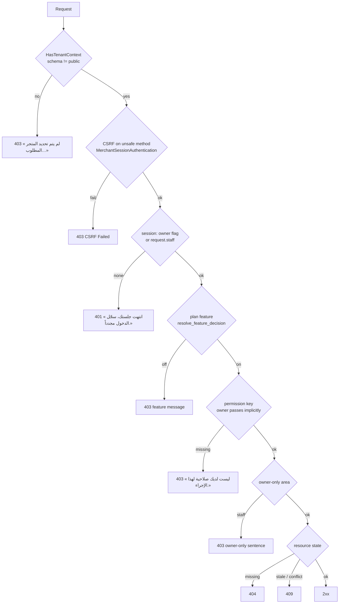

# API conventions

> **Source**: DOC-014 (Versioning, step 02) · DOC-026 (Gates) and DOC-036 (Headers), step 04 · DOC-038 (Uploads) and DOC-039 (Normalisation), step 05 · inventory A.5, A.13 · INT-003, INT-018, INT-049
> **Last verified against code**: 2026-10-27 (step 05)

> This page holds the versioning policy (step 02), the gate order and the caching and security headers (step 04), and the upload limits and the Arabic search and phone normalisation rules (step 05). Error bodies have their own page, [`errors.md`](errors.md) (DOC-037). The BFF's own behaviour is in [`bff.md`](bff.md).

## Versioning

**Status: ☑ approved by fares on 2026-10-30** (proposed 2026-10-27, step 02; sign-off recorded in Step 52, DOC-014).

### One version: `/api/v1/`

Every Django route is under `/api/v1/` (`config/urls_tenant.py` and `config/urls_public.py` both mount `api.urls` there; `SPECTACULAR_SETTINGS.SCHEMA_PATH_PREFIX = '/api/v1'`). The frontend and Django ship together and have one owner, so `/api/v1/` evolves **in place**, under the rules below. A `/api/v2/` is opened only if an external consumer (a mobile app, a partner integration) depends on a shape that has to change incompatibly. Then `v1` keeps running for that consumer until it moves.

The OpenAPI document carries its own semantic version (`info.version` in `sharwa-v1.yaml`):
- **major**: a breaking change;
- **minor**: an addition;
- **patch**: documentation only.

Phase 002 is **1.0.0**.

### What is breaking

The frontend parses every response with a Zod schema; a response the schema refuses becomes «استجابة غير متوقعة من الخادم.» on screen. So "breaking" is defined from the Zod side.

| Change | Breaking? | Why |
|---|---|---|
| Remove or rename a route, a method, a field, a query parameter | **Yes** | the caller's request or parse fails |
| Change a field's type, or make a field `null` where the contract does not allow it | **Yes** | Zod refuses it |
| **Add a value to an enum field** (status, type, kind…) | **Yes** | `z.enum([...])` refuses unknown values — add it to the Zod enum first |
| Make a response field optional / absent sometimes | **Yes** | a required Zod field fails |
| Change a status code, an error body shape, or a gate (plan feature, permission key, owner-only) | **Yes** | screens branch on them |
| Change an Arabic message | No, but announce it | screens show it verbatim; guides quote it |
| Add a response field | No | `z.object` strips unknown keys |
| Add a route, an optional query parameter, an optional request field | No | |
| Relax validation (accept more) | No | |

### How a change ships

1. Change the **Zod contract and Django in the same change set**. The contract stays the source of truth (A.1): a breaking change updates `schemas.ts` first, then Django.
2. Update the domain fragment `docs/api/openapi/src/NN-*.yaml`, then rebuild and check:
   - `python scripts/openapi/build.py`
   - `npx tsx scripts/openapi-contract-diff.ts` (must report 0 drift)
   - `npx tsx scripts/openapi-examples.ts`
   - `python scripts/openapi/postman.py`
3. Add an entry to [`docs/CHANGELOG.md`](../../CHANGELOG.md): date, route(s), module, INT/DOC task, and the word **Breaking** when it is one.
4. Bump `info.version` in `docs/api/openapi/src/00-base.yaml` by the rule above.

### Deprecation

A route or field to be removed:
- is marked `deprecated: true` in its fragment (OpenAPI flag);
- is listed under **Deprecated** in the changelog, with its replacement and the date;
- is removed only once no BFF row, screen or external consumer calls it (checked with the route inventory and a search of `src/`).

The same applies to BFF rows (`/api/bff/*`) and live module keys. Legacy Django HTML pages kept alongside the APIs are not part of the API contract; they are tracked as legacy surfaces (DOC-527), not versioned here.

Current deprecations (from the Phase 002 baseline, see the [changelog](../../CHANGELOG.md)):
- BFF `account/stores` was **removed** in Phase 003 Step 52 (2026-10-30, DOC-535). It had no consumer and was superseded by `merchant/stores` → `GET /api/v1/merchant/stores/` (INT-003 → INT-049).
- The DRF router entry `AdminStoreSectionViewSet` was **removed**. `admin/sections/*` is served by `api/views_design.py` with the owner session (INT-018).

Outgoing webhooks (`order.*`, `shipment.event`, `product.updated`, `inventory.low_stock`) are a contract with merchants' own systems. Their payload rules are versioned with the integrator spec (`docs/api/integrators/`, Step 28).

## Gates — the order every request is judged in

> **Source**: DOC-026 · inventory A.5 · INT-022, INT-030, INT-033, INT-037, INT-038, INT-039
> **Code**: `api/views_products.py` (`ProductsAPIMixin.gate`) · `api/views_settings.py` (`settings_feature_enabled`) · one mixin per module in `api/views_*.py` · `billing/models.py` (`resolve_feature_decision`) · `products/services/permission_resolver.py`

A request to a store route passes a chain of gates. **The first failing gate answers**, and later gates are never evaluated. The chain the roadmap describes is:

1. **Session** — `401`
2. **Plan feature** — `403`
3. **Permission key** (M18) — `403`
4. **Owner-only** — `403`
5. **Resource state** — `404` / `409`

The code follows this order in the *newer* modules only. Many older modules check the owner-only gate **before** the plan feature, or the permission **before** the feature. The table in [§ Per-module order](#gates-per-module) is the authority: it lists what each mixin actually does.

Gates that run **before** the chain (middleware and DRF): tenant resolution and pinning (`404`/`403`/`503`, see [`auth.md#tenant-pinning`](auth.md#tenant-pinning)) and CSRF ([`csrf.md`](csrf.md)). Storefront (visitor) routes have no session gate; they have their own state checks and rate limits ([`rate-limits.md`](rate-limits.md)).

### Status codes and example bodies

All bodies below are DRF `Response` objects with a `detail` key unless stated otherwise (error shapes are catalogued in [`errors.md`](errors.md)).

| # | Gate | Status | Example body | Raised by |
|---|---|---|---|---|
| 0 | Tenant context | `403` | `{"detail": "لم يتم تحديد المتجر المطلوب. استخدم النطاق الفرعي للمتجر أو أرسل ترويسة X-Store-Domain."}` — or `{"detail": "لم يتم تزويد بيانات الدخول."}` when a session route also has no session ([`auth.md`](auth.md#no-store-no-session)) | `HasTenantContext` (`api/permissions.py`); DRF `NotAuthenticated` |
| 0 | CSRF | `403` | `{"detail": "CSRF Failed: CSRF token missing."}` | DRF `enforce_csrf` inside `MerchantSessionAuthentication` |
| 1 | Session | `401` | `{"detail": "انتهت جلستك، سجّل الدخول مجدداً."}` | `ProductsAPIMixin.gate`, `ReportsAPIMixin.gate`, `DashboardAPIMixin`, `MerchantStoresView` |
| 2 | Plan feature | `403` | `{"detail": "هذه الميزة غير متاحة في باقتك الحالية"}` | the default `FEATURE_MESSAGE` (`views_settings.py`) — used by settings, marketing, payments, shipping, design, staff, wallets, inventory, locations |
| 2 | Plan feature (module sentence) | `403` | `{"detail": "ميزة المرتجعات غير مفعّلة في خطتك."}` | see the sentence table below |
| 2 | Plan feature (POS) | `403` | `{"detail": "ميزة نقطة البيع غير مفعّلة في خطتك.", "code": "feature_disabled"}` | `PosAPIMixin.run` — the **only** route family that adds `code` |
| 3 | Permission key | `403` | `{"detail": "ليست لديك صلاحية لهذا الإجراء."}` | `ProductsAPIMixin.gate(request, permission)` and the module mixins |
| 4 | Owner-only | `403` | `{"detail": "إعدادات الشحن مقصورة على مالك المتجر."}` | one sentence per area — full list in [`permissions.md#owner-only`](permissions.md#owner-only) |
| 5 | Resource state | `404` | `{"detail": "غير موجود."}` | service layer (`ProductApiError(404, …)`); wording differs per module |
| 5 | Resource state | `409` | `{"detail": "حُدِّث الطلب من مستخدم آخر.", "current_version": 7}` | optimistic-lock and state conflicts — shapes in [`conflicts.md`](conflicts.md) |

Plan-feature sentences (each is verbatim from code):

| Module | Sentence |
|---|---|
| default (settings, marketing, payments, shipping, design, staff, wallets, inventory, locations) | «هذه الميزة غير متاحة في باقتك الحالية» |
| Reports (`reports`) | «ميزة التقارير غير مفعّلة في خطتك.» |
| Returns (`refunds`) | «ميزة المرتجعات غير مفعّلة في خطتك.» |
| App store / Sharwa AI (`app_marketplace`) | «متجر التطبيقات غير مفعّل في خطتك.» |
| Channels / inbox (`social_channels`) | «ميزة قنوات التواصل غير مفعّلة في خطتك.» |
| Marketplaces | «ميزة الأسواق الإلكترونية غير مفعّلة في خطتك.» |
| Dropshipping | «ميزة الدروبشيبينغ غير مفعّلة في خطتك.» |
| POS | «ميزة نقطة البيع غير مفعّلة في خطتك.» (+ `code: feature_disabled`) |
| Bookings (storefront and dashboard) | «ميزة الحجوزات غير مفعّلة في خطتك.» |
| Sharwa Ship | «ميزة شروة شيب غير مفعّلة لمتجرك.» |
| Sharwa Ship courier supervision (needs `sharwa_ship` **or** `shipping_providers`) | «الإشراف على المندوبين يتطلب «شروة شيب» أو التوصيل المحلي.» |
| Tracking tools | «أدوات التتبع غير مفعّلة في خطتك.» |
| Affiliates | «ميزة التسويق بالعمولة غير مفعّلة في خطتك.» |
| Influencers | «ميزة المؤثرين غير مفعّلة في خطتك.» |

Permission-denied sentences other than the default:

| Where | Sentence |
|---|---|
| Returns (any of several keys) | «ليست لديك صلاحية لتنفيذ هذا الإجراء.» |
| Settings write by a non-owner staff without `catalog.manage` | «تعديل الإعدادات مقصور على المالك ومدير المتجر.» |
| Staff editing their own assignments or overrides | «لا يمكنك تعديل تعييناتك أو استثناءات صلاحياتك بنفسك.» |
| Support takeover | «ليست لديك صلاحية استلام جلسات الدعم.» |
| Sharwa Ship (`orders.view`) | «ليست لديك صلاحية لعرض الشحنات.» |
| Product discount fields without `discounts.manage` | «ليست لديك صلاحية تعديل الخصومات (السعر القديم وفترة التخفيض).» |
| Customer export — daily limit (`429`, not `403`) | «تجاوزت حدّ التصدير اليومي، راجع مدير المتجر.» |

### The owner holds every permission key

`resolve_request_staff(request)` returns `None` for the owner session. Every `gate()` / `can()` treats `None` as "allowed" (`ProductsAPIMixin.can` returns `staff is None or staff_has_permission(...)`). Permission keys therefore only ever restrict **staff**. Owner-only areas are the converse: they refuse any request where `resolve_request_staff` is not `None`, whatever keys the staff member holds.

### Per-module order (what the code really does)

`S` = session `401` · `F` = plan feature `403` · `P` = permission key `403` · `O` = owner-only `403` · `X` = resource state `404`/`409`.

| Order | Modules (file) | Notes |
|---|---|---|
| **S → F → P** | Staff (`views_staff.py`, `staff_rbac`) · inventory (`views_inventory.py`, `inventory`) · customer wallets and points (`views_wallets.py`) · returns (`views_returns.py`, `refunds`) · reports (`views_reports.py`, `reports`) | The standard order. Staff adds a self-edit check after `P`. |
| **S → F → P → O** | Sharwa Ship (`views_sharwa_ship.py`) | `orders.view` is required for every route; mutating routes then require the owner. |
| **S → F → (P or O)** | Locations (`views_locations.py`, `multi_location`) · channels / inbox (`views_channels.py`, `social_channels`) | The route chooses permission or owner. In channels the owner flag can be waived for holders of `channels.inbox.access` on some routes. |
| **S → F → O (writes)** | App store and Sharwa AI (`views_apps.py`, `views_sharwa_ai.py`, `app_marketplace`) · partners (`views_partners.py`, `affiliates`/`influencers`) | Reads need only `F`; writes also need `O`. |
| **S → F → O** | Integrations: domains, webhooks, tracking (`views_integrations.py`) | Feature, **then** owner. |
| **S → F → (service)** | POS (`views_pos.py`, `pos`) | The mixin checks only `S` and `F`. Roles, discount ceiling and manager rules are enforced inside `pos_service`. |
| **S → O → F** | Shipping (`views_shipping.py`) · design (`views_design.py`) · payments and merchant wallet (`views_payments.py`) | Owner before feature: a staff member on a plan *without* the feature still gets the owner sentence, not the feature one. |
| **S → O/P → F** | Settings writes (`views_settings.py`) | Section table in `settings_service.SECTIONS` decides owner-only vs `catalog.manage`; then the feature. |
| **S+P → O → F** | Marketing (`views_marketing.py`) | Coupons and offers need `discounts.apply` (read) / `discounts.manage` (write); carts, campaigns, timeline, loyalty and gifts are owner-only. |
| **S+P → F** | Marketplaces (`views_marketplaces.py`) · dropshipping (`views_dropshipping.py`) | **Permission before feature** (INT-038, INT-039): a staff member without `channels.*.manage` never learns whether the plan has the feature. |
| **S → P** (no feature) | Orders · customers · catalog and products · product extras · procurement · expenses · support · B2B · search · notifications · push stats | No plan feature is checked. Dues, `store/payments`, procurement, support and expenses are ungated *by design* (see [`plan-features.md`](plan-features.md#ungated)). |
| **O → S** (reversed) | Multi-store rollup `merchant/stores/` (`views_rollup.py`) | A staff session gets `403` «هذه الصفحة لمالك المتجر فقط.» **before** the session check, so an expired staff cookie and a live one answer the same. |
| **S → O** | Push test `push/test/` | «إرسال الإشعارات لكل المشتركين للمالك وحده.» |
| **F → X** (no session) | Storefront bookings (`catalog/products/<id>/slots/…`) | Public routes: the feature gate comes first, then `404` «not bookable». |

> ⚠️ Discrepancy — roadmap says the order is session → plan feature → permission → owner-only everywhere, with exceptions only for marketplaces, dropshipping and `StaffChannelAccess` / code does **seven** different orders (table above). Shipping, design, payments and the settings writes put owner-only **before** the plan feature; marketing puts the permission before the owner and the feature; integrations puts the feature before owner-only; the rollup puts owner-only before the session check. Clients cannot rely on "feature first" when a staff member is refused.

> ⚠️ Discrepancy — roadmap says "channels inbox: `StaffChannelAccess` applied inside the service (INT-037)". The route layer also checks `channels.inbox.access` (`_ChannelsBase.guard`) before calling the service; the service then narrows the visible channels per staff member.

### Single decision source for plan features

`billing.models.resolve_feature_decision(feature, override, plan, plan_feature, subscriptions_enabled)` returns `(enabled, decided_by)`. `_resolve_feature_enabled` takes `[0]`; `Feature.is_enabled_for_client(client)` calls it. Every API route reaches it through one of three thin wrappers that behave identically: `settings_feature_enabled(request, code)` (`views_settings.py`), `reports_feature_enabled(request)` (`views_reports.py`), `bookings_enabled(request)` (`booking_service.py`). The legacy `require_feature` decorator (`products/decorators.py`) calls the same method.

The five steps, in order — the first that applies decides:

| # | Condition | Result | `decided_by` |
|---|---|---|---|
| 1 | a `TenantFeatureOverride` exists for (feature, store) | `override.is_enabled` | `override` |
| 2 | `Feature.is_active_globally` is false | disabled | `global_kill` |
| 3 | `Feature.requires_plan` is false | enabled | `no_plan_required` |
| 4 | `PlatformBillingSettings.subscriptions_enabled` is false | enabled | `subscriptions_disabled` |
| 5 | the store's current plan has an enabled `PlanFeature` for it | enabled, otherwise disabled | `plan_feature` / `plan_feature_missing` |

Two properties matter to API callers:

- A feature code that is **absent from the `Feature` catalog counts as disabled** (`feature is None` ⇒ `False`). Seeding is therefore part of shipping a gated module (see [`plan-features.md`](plan-features.md)).
- While subscriptions are off (step 4) every feature that reaches step 4 or has `requires_plan = False` is on for every store that has not been overridden. A per-store override (step 1) beats everything, including the global kill switch. `pos` is the only seeded feature with `requires_plan = True`, so once subscriptions are turned on it follows the plan matrix.
- **Five features are seeded globally off** (`is_active_globally = False`, migrations `billing/0007`–`0011`): `multi_location`, `staff_rbac`, `social_channels`, `marketplaces`, `dropshipping`. A store gets them only through a `TenantFeatureOverride` with `is_enabled = true` (step 1 runs before the global kill, step 2). The other 35 are seeded on. See [`plan-features.md`](plan-features.md#seeding).

The console shows the same decision per store through `platform/features/<code>/resolve/` ([`16-platform-console/`](../domains/16-platform-console/auth.md)).

## Caching and security headers

> **Source**: DOC-036 · INT-001, INT-015, INT-039, INT-040, INT-041, INT-048
> **Code**: `api/views_*.py` (`response[...]` assignments) · `tenants/middleware.py` · `tenants/sharwa_pay_views.py` · `config/settings.py` §7 · `src/lib/bff/upstream.ts` · `src/lib/api-error.ts`

Django sets almost no HTTP caching headers. Where a response must never be stored it says so with `Cache-Control: no-store`, and the BFF then adds `no-store` to **every** response it forwards (`forwardResponse`). So the browser never caches an API response, whatever Django sent.

### Headers Django sets on API responses

| Header | Value | Routes | Why |
|---|---|---|---|
| `Cache-Control` | `no-store` | `auth/csrf/` | the body is a CSRF token |
| | `no-store` | `dashboard/overview/`, `dashboard/counters/` | live numbers |
| | `no-store` | `merchant/stores/` | multi-store rollup |
| | `no-store` | `customers/export.csv`, `inventory/export.csv`, `products/export/` | personal and stock data in a CSV |
| | `no-store` | `orders/track/<uuid>/` | public tracking page; see also `X-Robots-Tag` |
| | `no-store` | every `sharwa-pay/*` response (`SharwaPayView.finalize_response`) | money figures (§11 IX) |
| | `no-store` | `apps/sharwa-ai/console-token/` | a bearer token for the AI console |
| | `no-store` | `apps/whatsapp/connect-url/` | one-time SharwaConnect link |
| | `no-store` | `dropshipping/suppliers/<code>/webhook/rotate/` | the webhook URL and secret are shown once |
| | `no-store` | the `503` «متجرك قيد التجهيز» page (`tenants/middleware.py`) | a store that is still provisioning |
| | `no-cache` | the Sharwa Pay service worker script (`tenants/sharwa_pay_views.py`) | revalidate on each load; sent with `Service-Worker-Allowed: /` |
| `X-Robots-Tag` | `noindex, nofollow` | `orders/track/<uuid>/` | tracking links must not be indexed |
| `Referrer-Policy` | `no-referrer` | `apps/sharwa-ai/console-token/` | the token must not leak through `Referer` |
| `Retry-After` | seconds | every `429` that knows the wait, and the provisioning `503` | see [`rate-limits.md`](rate-limits.md) |
| `Content-Disposition` | `attachment; filename="…"` | `customers-<YYYY-MM-DD>.csv`, `inventory-<YYYY-MM-DD>.csv`, `products.csv`, `marketplace-job-<id>-errors.csv`, dropshipping feed and job `errors.csv` | file download |
| `X-Export-Rows` | row count | `customers/export.csv`, `inventory/export.csv` | the export toast reports it (INT-017) |
| `Set-Cookie` | `sessionid`, `csrftoken` | login, `auth/csrf/` | `HttpOnly`, `SameSite=Lax`; `Secure` outside `DEBUG`; the session cookie ends with the browser (`SESSION_EXPIRE_AT_BROWSER_CLOSE`). See [`csrf.md`](csrf.md) |

Outside `DEBUG`, Django also sends the standard security headers: `Strict-Transport-Security` (1 year, `includeSubDomains`), `X-Content-Type-Options: nosniff`, `X-Frame-Options: DENY`, and redirects HTTP to HTTPS (`SECURE_SSL_REDIRECT`). They come from `SecurityMiddleware` and `XFrameOptionsMiddleware`, not from the API views.

### Server-side caches (not HTTP caching)

These are Redis entries. They change how fresh a body is, not what a browser or CDN may store.

| What | TTL | Key / scope | Source |
|---|---|---|---|
| `public/stats/` body `{stores, orders_30d}` | 1 h | `public:landing_stats:v1` (one key for the platform) | `api/views_public.py` `STATS_CACHE_SECONDS` |
| Location-filtered report days that are **before today** | 1 h | `reports:location-day:<schema>:<location>:<day>` | `reports_contract.py` `LOCATION_CACHE_SECONDS` |
| Notification sync | 20 s between runs | per store | `notification_service.SYNC_INTERVAL` |
| Report and dashboard «refresh today» | 5 min cooldown | per store | `REFRESH_COOLDOWN_SECONDS`, answers `429` + `Retry-After` |

> ⚠️ Discrepancy — roadmap says `public/plans/` and `public/stats/` are "cached 1 h", and "past report days cached 1 h" is a response header / code does neither with a header. Only `public/stats/` is cached (Redis, 1 h). `public/plans/` is recomputed on every request. Past report days are cached in Redis only on the **location-filtered** path (`?location=`). No Django view sets `max-age` or `ETag` for any of them.

> ⚠️ Discrepancy — roadmap says tracking sends `X-Robots-Tag: noindex` / code sends `X-Robots-Tag: noindex, nofollow` (`api/views_tracking.py`).

### Headers the BFF forwards

`src/lib/bff/upstream.ts` is the only bridge between the browser and Django. Cookies and a few headers pass through; everything else is dropped.

| Direction | Headers | Notes |
|---|---|---|
| Browser → Django (copied) | `cookie`, `content-type`, `accept`, `accept-language`, `x-csrftoken`, `idempotency-key`, `if-none-match` | `idempotency-key` is what makes retries safe ([`idempotency.md`](idempotency.md)) |
| Browser → Django (set by the BFF) | `x-forwarded-host`, `x-forwarded-proto`, `x-forwarded-for` and `x-real-ip` (one entry, the visitor's IP), `x-store-domain` (on a store host), `origin`, `referer` | `x-forwarded-for` is **overwritten**, never appended, so a visitor cannot choose it. Django's `RealIpMiddleware` trusts it because the Next server is in `REAL_IP_TRUSTED_PROXIES`. See [`rate-limits.md`](rate-limits.md#cgnat) |
| Django → browser (copied) | `content-type`, `content-disposition`, `content-language`, `retry-after`, `etag`, `location`, `x-sharwa-mock`, `x-export-rows` | `x-sharwa-mock: 1` marks a mock answer (`ApiError.isMock`) |
| Django → browser (all) | every `Set-Cookie` | this is how the session and the rotated CSRF cookie reach the browser |
| BFF → browser (always) | `cache-control: no-store` | overrides whatever Django sent |

The BFF buffers the request body (`arrayBuffer()`) so Django receives a `Content-Length`. It does not stream.

> ⚠️ Discrepancy — roadmap (and the first version of this page) says the BFF buffers write bodies "up to 8 MB" / code buffers with no limit of its own (`upstreamFetch` in `src/lib/bff/upstream.ts`). The 8 MB ceiling is enforced downstream: production Nginx `client_max_body_size 8M` and Django `DATA_UPLOAD_MAX_MEMORY_SIZE = 8 MB`. See [Uploads](#uploads).

> ⚠️ Discrepancy — the BFF forwards `if-none-match` and `etag`, but no Django code in `api/` or `config/` sets an `ETag` and `ConditionalGetMiddleware` is not installed. The two forwarded headers are inert today.

`parseApiError` reads `Retry-After` only when it is a plain integer (`/^\d+$/`) and exposes it as `ApiError.retryAfter`. A date value is ignored.

## Uploads — formats, sizes and checks

> **Source**: DOC-038 · inventory A.13 · INT-006, INT-016, INT-027
> **Code**: `core/uploads.py` · `api/serializers_catalog.py` (`Base64ImageField`) · `api/views_products.py` (`_clean_upload`) · `products/services/{design,marketing,product_import,checkout,storefront_checkout}_service.py` · `products/forms.py` (`validate_receipt_image`) · `sharwapay/customer_api.py` (`_receipt_error`) · `products/services/suppliers/{api_service,feed_reader}.py` · `config/settings.py` (`DATA_UPLOAD_MAX_MEMORY_SIZE`)
> **Frontend**: BFF write routes forward the body untouched; the product image uploader sends one file per request.

There is **no single upload validator**. Each route checks what it needs, so formats, limits and messages differ. All size limits below are **bytes in the file**, not in the encoded request. Every error is a `400` unless stated; the body is `{"<field>": ["«…»"]}` (see [`errors.md`](errors.md#2-body-shapes), shape S2).

### Common ground

- **Where files go.** Uploaded images are stored per store: `tenant_upload_path` (`core/uploads.py`) builds `<schema>/<base>/<name>`, so one store's files never share a folder with another's. A file name with non-ASCII characters is replaced by `<uuid4 hex>.<ext>`, and the base64 image field always saves as `<uuid>.<ext>`.
- **Extension allow-lists** (`core/uploads.py`): images `jpg, jpeg, png, webp, gif`; documents `pdf, jpg, jpeg, png, webp`; feeds `csv, tsv, txt, xlsx`. A name with another extension is refused with code `invalid_extension`: «امتداد الملف «<ext>» غير مسموح. الامتدادات المسموحة: <list>.»
- **SVG is never accepted.** It is not in any list, and the base64 field takes the extension from the **decoded image format**, not from the client's MIME type.
- **The overall request ceiling is 8 MB.** `DATA_UPLOAD_MAX_MEMORY_SIZE` is 8 MB and production Nginx has `client_max_body_size 8M`. A request above the Nginx limit is refused by Nginx before Django sees it. Django's own limit counts the request body **excluding multipart file parts**, so a multipart upload is bounded by Nginx and by each route's own limit, while a JSON body carrying a base64 image counts in full. A base64 image of 5 MB is about 6.7 MB of text, so a JSON request can carry **one** such image, not two.
- **Two carriers.** *Multipart* (`images`, `file`, `logo`, `receipt_image`) is used for the files a person picks; *JSON data URL* (`data:image/png;base64,…`) is used where an image is one field among others (SEO image, category image, theme logo, option image, section items).

### Per route

| What | Carrier / field | Accepts | Max size | Content check | Messages (verbatim) |
|---|---|---|---|---|---|
| Product images (`products/<id>/images/`) | multipart `images`, one file per request from the BFF | extension `jpg, jpeg, png, webp, gif` | 5 MB | extension from the file name, size, then **Pillow** opens it | «اختر صورة واحدة على الأقل.» · «الصيغ المسموحة: jpg, jpeg, png, webp, gif» · «حجم الصورة أكبر من 5MB.» |
| SEO image, category image, theme logo, variant option image | JSON data URL (`Base64ImageField`) | `jpg, jpeg, png, webp, gif` (by decoded format) | 5 MB (`MAX_IMAGE_BYTES`) and 40,000,000 pixels (`MAX_IMAGE_PIXELS`) | **Pillow** decodes it | «الصيغ المسموحة: jpg, jpeg, png, webp, gif» · «حجم الصورة 5MB على الأكثر.» · «أبعاد الصورة كبيرة جداً.» |
| Storefront section items (`design_service`, stored as files under `<schema>/store_sections/`) | JSON data URL in `items[n].image` | `jpg, jpeg, png, webp, gif` (regex on the data URL header) | 5 MB | **none** beyond the regex and size | `items.N.image` keys, dotted (shape S3) |
| Store logo (`design_service`) | multipart `logo` | extension and content type | 5 MB | extension + content type, no Pillow | «حجم الشعار 5MB على الأكثر.» |
| Offer image (`marketing_service`) | multipart | extension | 5 MB | extension + size, no Pillow | «حجم الصورة أكبر من 5MB.» |
| Checkout payment receipt (dashboard and storefront checkout) | multipart `receipt_image` | **JPEG and PNG only** (content type) | 5 MB | content type and size | «صيغة الملف غير مدعومة. يُسمح فقط بصور JPEG أو PNG.» · «حجم الملف كبير جداً. الحد الأقصى المسموح به 5MB.» |
| Sharwa Pay top-up receipt (`sharwapay/customer_api.py`) | multipart | `jpg, jpeg, png, webp, gif` | 5 MB (`RECEIPT_MAX_BYTES`) | extension, size, then **Pillow** (`forms.ImageField`) | «أرفق صورة الإيصال.» · «الصيغ المسموحة: jpg, jpeg, png, webp, gif.» · «حجم الصورة أكبر من 5 ميغابايت.» · «الملف ليس صورة صالحة.» |
| Product import (`products/import/`) | multipart `file` | `csv, tsv, txt, xlsx` | **20,000 rows**; the reader allows 50 MB (`MAX_FILE_BYTES`), production Nginx stops a request at 8 MB first | the first bytes are sniffed (`sniff_upload`), not just the extension; encoding and delimiter auto-detected | `{"file": ["اختر ملفاً."]}` · «الصيغ المسموحة: csv, tsv, txt, xlsx» · «الملف فارغ.» · «الملف لا يحوي صفوف بيانات.» · «الملف أكبر من 20,000 صف — قسّمه إلى ملفات أصغر.» · more in [Import files and feeds](#uploads-feeds) |
| Supplier / dropshipping feed (`dropshipping/feeds/`) | multipart `file` **or** a URL | `csv, tsv, txt, xlsx` | **200,000 rows**, 50 MB, 200 columns | same reader | «اختر ملفاً أو أدخل رابطاً.» · «الامتدادات المسموحة: csv, tsv, txt, xlsx» · see [Import files and feeds](#uploads-feeds) |

> ⚠️ Discrepancy — roadmap says product images and receipts are "JPEG/PNG/WebP/GIF ≤ 5 MB" / code has two receipt rules: the checkout receipt takes **JPEG and PNG only**, the Sharwa Pay receipt takes the five image types. The two receipt validators also use different wording for the size error.

> ⚠️ Discrepancy — roadmap says every image is verified as a real image / code runs **Pillow** only for product images, the base64 image field and the Sharwa Pay receipt. Section item images, the store logo, offer images and the checkout receipt are checked by extension or content type and size, so a mislabelled file passes.

### Import files and feeds

Both the products import and the supplier feeds read the file with the same streaming reader, `FeedReader` (`products/services/suppliers/feed_reader.py`), so they share its detection rules. They differ only in the row ceiling.

- **Format check** (`sniff_upload`): the file must not be empty, must not exceed `MAX_FILE_BYTES` (50 MB), and its first bytes decide the format. A `.xlsx` name whose content is not a zip is refused, an old `.xls` is refused, and a binary file is refused. Messages: «الملف فارغ.» · «حجم الملف أكبر من 50MB.» · «الامتداد xlsx لكن المحتوى ليس ملف Excel.» · «صيغة Excel القديمة (.xls) غير مدعومة — احفظ الملف بصيغة .xlsx أو CSV.» · «الملف ليس نصاً (CSV) ولا Excel (xlsx).»
- **Encoding** (`detect_encoding`, setting `auto`): a UTF-8 byte-order mark means `utf-8-sig`; otherwise plain `utf-8` if the first 64 KB sample decodes; otherwise **Windows-1256** (`cp1256`, the usual Arabic Excel export). The products import adds a last-resort error, «الملف ليس بترميز UTF-8؛ احفظه بترميز UTF-8 ثم أعد الرفع.», for a file whose sample looked like UTF-8 but fails to decode later.
- **Delimiter** (`detect_delimiter`, setting `auto`): the character among `,` `;` tab `|` that occurs most often in the first line; `,` if none occurs. No regular expression is used.
- **Limits per reader**: `MAX_ROWS` 200,000, `MAX_COLUMNS` 200, `MAX_CELL` 10,000 characters; for `.xlsx` also `MAX_XLSX_SHEET_BYTES` 300 MB uncompressed (zip-bomb guard) and `MAX_SHARED_STRINGS` 500,000. XML is parsed with `defusedxml`.
- **Products import** (`product_import_service.py`) adds its own ceiling of **20,000 non-empty rows** (`MAX_ROWS`), a preview of the first **20** rows (`PREVIEW`) and a run in chunks of **200** (`CHUNK`). Recognised columns include English names and the Arabic headers «الاسم» · «اسم المنتج» · «السعر» · «المخزون» · «التصنيف» · «الوصف» · «الباركود». Row messages (not HTTP errors) are listed per row in `row_errors`, for example «الاسم فارغ» · «السعر فارغ» · «سعر غير صالح «x»».
- **Supplier feeds** (`suppliers/api_service.py`, `create_feed`): a file or a URL (the URL is the alternative when no file is sent). A store may keep only `FeedMapping.MAX_FEEDS` active feeds: `409` «الحد الأقصى N ملفاً نشطاً — عطّل ملفاً قديماً أولاً.» A second fetch of the same feed within two minutes answers `429` «جلبٌ آخر جرى للتو — انتظر دقيقتين ثم أعد المحاولة.»

> ⚠️ Discrepancy — roadmap says "CSV/feeds: csv/tsv/txt/xlsx, UTF-8 or Windows-1256, sniffed delimiter, ≤ 20,000 rows" / matches for the **products import**. Supplier feeds use the same reader but allow **200,000 rows**. The 50 MB file limit is the reader's; a browser upload in production is stopped earlier by Nginx at 8 MB.

### Rules for clients

1. Check the size in the browser first (5 MB per image) so the user is not told after a long upload.
2. Send multipart files one at a time to the product image route, as the BFF does, so one bad file does not block the others.
3. Do not set `Content-Type` by hand on a multipart request; the browser adds the boundary.

## Arabic search and phone normalisation

> **Source**: DOC-039 · inventory A.13 · INT-005, INT-008, INT-040
> **Code**: `products/services/search_service.py` (`normalize_arabic`, `normalized`) · `products/utils.py` (`clean_phone_number`) · `products/services/customer_service.py` (`customer_key`) · `products/services/wallet_service.py` · `sharwapay/customer_api.py` (`normalize_phone`, `PHONE_RE`)
> **Frontend**: `src/lib/i18n/normalize.ts` (`normalizeArabic`, `matchScore`, `includesNormalized`) · `src/lib/format.ts` (`normalizePhone`)

Two different normalisations exist and must not be confused: one for **text search** (so «إلكترونيات» finds «الكترونيات»), one for **phone numbers** (so `0777000001` and `+967777000001` are the same customer).

### Arabic text

The frontend function and the Django function follow the same table, character for character, so a client-side filter and the server-side search agree. The Django side is used by search, the storefront catalogue, inventory, locations, customers, wallets, marketing and returns (`search_service.py` and the services that import its helpers); the TypeScript side is the shared helper for client-side matching and scoring.

| Step | Rule |
|---|---|
| 1 | Remove diacritics (tashkeel): U+0610–U+061A, U+064B–U+065F, U+0670, U+06D6–U+06ED |
| 2 | Remove tatweel (kashida) U+0640 |
| 3 | Letters: `أ` `إ` `آ` `ٱ` → `ا` · `ة` → `ه` · `ى` → `ي` · `ؤ` → `و` · `ئ` → `ي` |
| 4 | Digits: Arabic-Indic U+0660–U+0669 and Persian U+06F0–U+06F9 → `0–9` |
| 5 | Lower-case (Latin), collapse runs of whitespace to one space, trim |

Equivalent inputs (all give the same key):

| Typed | Normalised |
|---|---|
| «إلكترونيات» · «الكترونيات» · «الكترونيّات» | `الكترونيات` |
| «مدرسة» · «مدرسه» | `مدرسه` |
| «أحمد» · «احمد» | `احمد` |
| «٣ قطع» · «3 قطع» | `3 قطع` (digits mapped) |

**Server search** (`search_service.py`) applies the same rules in two places: Python `normalize_arabic` for the query, and a SQL expression `normalized(field)` = `Lower(translate(field, _FROM, _TO))` on the stored column, where `_FROM` is the eight letters plus tatweel plus the diacritics and `_TO` is `ااااهيوي`. Characters in `_FROM` with no counterpart in `_TO` are **deleted** by `translate`, which is how tatweel and diacritics disappear. The search endpoint ignores queries under 2 characters, returns 5 results by default and at most 10, and strips a leading `#` (order numbers).

**Client scoring** (`matchScore`): a word that **starts** with the query scores 30, a substring 18, a fuzzy match 8. The fuzzy tolerance is 2 edits for tokens of 6+ letters, 1 for 4–5, 0 for shorter. The article `ال` is stripped from tokens first. `includesNormalized(haystack, needle)` is the plain "contains" used by list filters.

> ⚠️ Discrepancy — roadmap says "digits are normalised by search" / the SQL side of the server search does **not** map digits (`translate` has no digit mapping); only the Python query and the TypeScript function do. A product stored with Arabic-Indic digits in its name is therefore not found by a Western-digit query on the server.

### Phone numbers

Yemen (`967`) is the default country; Saudi Arabia (`966`) is also accepted. There are **four** normalisers (three in Python, one in TypeScript), and the one that applies depends on the module.

| Function | Where | Steps |
|---|---|---|
| `clean_phone_number(p, default_country_code='967')` | most services | remove `+`, spaces and `-`; strip a leading `00`; strip a leading `0`; if the result is 9 digits starting with `7`, prefix `967` |
| `customer_key(phone)` | customers (`customer_service.py`) | map Arabic and Persian digits to Western; apply `clean_phone_number`; keep digits only; add `966` to a 9-digit number starting with `5` |
| `normalize_phone` (`sharwapay/customer_api.py`) | Sharwa Pay | map Arabic digits; strip `00`; if it does not already start with `967` or `966`, prefix `967` after stripping leading zeros; then must match `^(967|966)\d{8,9}$` |
| `normalizePhone(input, defaultCountry = "967")` (`src/lib/format.ts`) | forms (onboarding register, owner login…) | map Arabic digits; drop every non-digit; strip `00`; keep a number that already starts with `967` or `966`; otherwise strip one leading `0` and prefix the default country. Sharwa Pay's Python function mirrors it |

Equivalent inputs for a Yemeni mobile (fixture number):

| Typed | Stored / compared as |
|---|---|
| `777000001` | `967777000001` |
| `0777000001` | `967777000001` |
| `+967 777-000-001` | `967777000001` |
| `00967777000001` | `967777000001` |
| `٠٧٧٧٠٠٠٠٠١` | `967777000001` (customers and Sharwa Pay only; `clean_phone_number` alone does not map Arabic digits) |

Validation regexes after normalisation:

| Pattern | Used by |
|---|---|
| `^(967\|966)\d{9}$` | storefront checkout and cart, settings, partners, order API, onboarding |
| `^(967\|966)\d{8,9}$` | staff, Sharwa Pay, shipping ("same as the frontend") |

Searches by phone also accept the local form. Wallet search (`wallet_service._search`) is a "contains" on the stored phone, so a local `0777…` is searched with its leading zeros removed to match `967777…`; the platform console store search and the console money searches pass the typed number through `clean_phone_number` first. The affiliate/partner phone is validated with `^(967|966)\d{9}$` (`partners_service.py`).

> ⚠️ Discrepancy — roadmap says phone normalisation is one rule / code has the three functions above and two regexes (`{9}` and `{8,9}`). A client that validates with one pattern can be refused by another module for the same number.

> ⚠️ Discrepancy — `normalizePhone` in `src/lib/format.ts` documents `0501234567` → `966501234567`, but the code prefixes the **default country** (`967`) to any number that does not already start with `967`/`966`, so `0501234567` becomes `967501234567` unless the caller passes `"966"`. Sharwa Pay's `normalize_phone` does the same, and the result matches its regex, so a local Saudi `05XXXXXXXX` number is accepted as a (wrong) Yemeni-prefixed number instead of being refused. `customer_key` handles the `5…` case correctly (it adds `966`).

### Rules for clients

1. Send phones as typed; do not try to normalise them yourself except to validate the shape with the module's regex.
2. Compare phones only after the server has returned them (`967…` form), never with the typed value.
3. Search text goes through `normalizeArabic` on the client for local lists and is sent raw to the server, which normalises again.
