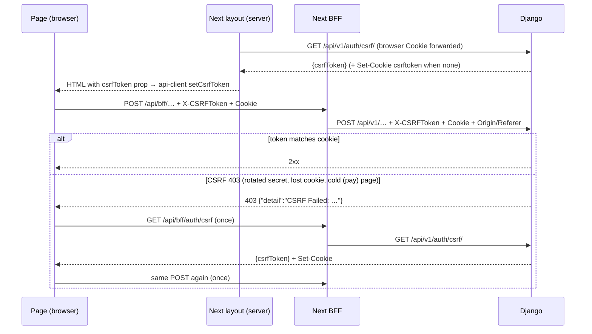

# CSRF

> **Source**: DOC-016 (step 03) · DOC-012 (Postman section, step 02) · inventory A.4, A.11 · INT-003, INT-030, INT-048
> **Code**: `sharwa_saas/api/views_auth.py` (`CsrfTokenView`, `_enforce_csrf`) · `api/authentication.py` (`MerchantSessionAuthentication`) · `api/views_platform.py` (console login) · `api/views_sharwa_pay.py` (`SharwaPayView.initial`) · `config/settings.py` · `sharwa-frontend/src/lib/csrf.ts`, `src/lib/api-client.ts`, `src/lib/api-error.ts`, `src/lib/bff/{auth-adapter,upstream}.ts`, `src/app/api/bff/auth/csrf/route.ts`, layouts `src/app/(dashboard)/%5Fd/[store]/dashboard/layout.tsx`, `src/app/(admin)/%5Fa/layout.tsx`, `src/app/(pay)/sharwa-pay/layout.tsx`
> **Tests**: `api/test_auth_api.py` (`test_csrf_is_enforced`, `test_csrf_endpoint_token_matches_the_browser_cookie`) · `api/test_sharwa_pay_api.py` (`test_csrf_enforced_on_writes`) · `api/test_platform_console_api.py` (`test_session_roles_and_login`)
> **Last verified against code**: 2026-10-27 (step 03)

This page has three parts: the rule, the end-to-end handshake (browser → BFF → Django, and the same flow with `curl`), and the Postman procedure.

## The rule in one paragraph

Django keeps the CSRF secret in an **HttpOnly** cookie (`CSRF_COOKIE_HTTPONLY = True`, `CSRF_COOKIE_SAMESITE = 'Lax'` in `config/settings.py`), so no client script can read it. The token travels in the body of **`GET /api/v1/auth/csrf/`** → `{"csrfToken": "…"}`. That view calls Django's `get_token`, which returns a masked token derived from the request's own `csrftoken` cookie, or creates a new cookie pair when there is none. The response is `Cache-Control: no-store`. Clients send the token back in the **`X-CSRFToken`** header on every `POST`/`PUT`/`PATCH`/`DELETE` of a session-authenticated route, and on the logins themselves (no «Login CSRF»). A missing or wrong token answers **`403 {"detail": "CSRF Failed: …"}`**. The frontend recognises it as a CSRF failure (403 with "csrf" in `detail`, `src/lib/api-error.ts`), refreshes the token once and retries once (`src/lib/api-client.ts`).

| Origin | Who enforces CSRF | Notes |
|---|---|---|
| Store host (owner / staff) | `MerchantSessionAuthentication` (DRF `SessionAuthentication`) on writes; `_enforce_csrf()` explicitly on merchant/staff login, logout, password flows | The token endpoint works on every store host. |
| Console (public schema) | `SessionAuthentication` on every write and on `POST /api/v1/platform/auth/login/` | Login and `GET /api/v1/platform/auth/me/` answer a rotated **`csrf_token`** in their body. |
| Sharwa Pay (platform origin) | `SharwaPayView.initial()` → `SessionAuthentication().enforce_csrf()` on **every** non-safe method, including `otp/send/` and `otp/verify/` | Login runs `request.session.cycle_key()` (new `sessionid`, same session data). |

## The handshake end to end

### Settings that shape it (`config/settings.py`)

| Setting | Value | Consequence |
|---|---|---|
| `CSRF_COOKIE_HTTPONLY` | `True` | the browser (and any script) never reads the `csrftoken` cookie; the token must come from a response body |
| `CSRF_COOKIE_SAMESITE` | `'Lax'` | cookie is not sent on cross-site POSTs |
| `CSRF_COOKIE_SECURE`, `SESSION_COOKIE_SECURE` | `True` in the production block | HTTPS only in production; over HTTPS Django also checks `Referer` (the BFF sets `Origin` and `Referer` to the browser's own origin) |
| `CSRF_TRUSTED_ORIGINS` | `CSRF_TRUSTED_ORIGINS` env list + `http://localhost:8000`, `http://127.0.0.1:8000` + `https://<base>` and `https://*.<base>` (when the base is not `localhost`) + the `:3000` dev origins in DEBUG | an `Origin` header must be trusted |
| Middleware | `CsrfViewMiddleware` is installed, but DRF views are CSRF-exempt at the middleware; CSRF is enforced **inside** DRF by the authentication class or by an explicit `enforce_csrf()` | see "Who enforces it" |

### Step by step

1. **Bootstrap (server side).** The dashboard layout (`(dashboard)/%5Fd/[store]/dashboard/layout.tsx`) and the console layout (`(admin)/%5Fa/layout.tsx`) both render a `<CsrfBootstrap>` server component. It calls `getCsrfToken(storeHost, cookieHeader)` from `src/lib/csrf.ts` and hands the token to the browser client as a prop of `<ApiClientProvider csrfToken={…}>`, which stores it in `api-client.ts` (`setCsrfToken`). The dashboard passes the store host; the console passes `null` (platform host, public schema, no `X-Store-Domain`). The browser's cookie header **must** be forwarded; without it Django mints a fresh pair whose cookie never reaches the browser and every write fails with «CSRF token incorrect».
2. **Token source.** `src/lib/csrf.ts` calls Django `GET /api/v1/auth/csrf/` (`CsrfTokenView`, no authentication, no tenant requirement, `Cache-Control: no-store`). The view returns `{"csrfToken": "<64-char masked token>"}` from Django's `get_token(request)`. That token is derived from the secret in the request's own `csrftoken` cookie, so it always matches it; when the request has no cookie, Django creates a secret and `CsrfViewMiddleware` adds `Set-Cookie: csrftoken=…; HttpOnly; SameSite=Lax` to this response. Fallback for an older backend only: the `Set-Cookie` of `GET /dashboard/login/` (it sends no cookie when the browser already has one, which is why it is only a fallback).
3. **BFF route.** `GET /api/bff/auth/csrf` (`src/app/api/bff/auth/csrf/route.ts`) runs the same acquisition and returns `{"csrfToken": "…"}` with every upstream `Set-Cookie` appended verbatim, so the pair in the browser matches the token. A mock token (`MOCK_CSRF_TOKEN`) is returned **only** when Django is unreachable and `SHARWA_MOCKS=on`; Django rejects it, so it never stands in for a live token.
4. **Unsafe requests.** `src/lib/api-client.ts` adds `X-CSRFToken: <token>` to every `POST`/`PUT`/`PATCH`/`DELETE` when it holds a token (never from `document.cookie`). The BFF forwards the header (`x-csrftoken` is in `FORWARD_REQUEST_HEADERS`) together with the cookie, and sets `Origin` and `Referer` to the browser's own origin so Django's referer check passes. The auth BFF routes (`tryTargetAuth`) use the incoming `x-csrftoken`, or fetch a token server-side with the browser's cookie when the header is missing.
5. **Django check.** The request is accepted when the `X-CSRFToken` value unmasks to the secret in the `csrftoken` cookie. Otherwise DRF answers **`403 {"detail": "CSRF Failed: CSRF token missing."}`** (or `… CSRF cookie not set.` / `… CSRF token incorrect.`).
6. **Refresh once and retry.** `ApiError.isCsrf` is `status === 403 && /csrf/i.test(detail)` (`src/lib/api-error.ts`). On such an error, for an unsafe method and `attempt === 0`, `api-client.ts` calls `refreshCsrf()` (`GET /api/bff/auth/csrf`, `credentials: "include"`) and repeats the **same** request once. A second CSRF 403 is thrown to the caller.
7. **Rotation.** Django's `login()` rotates the CSRF secret, so the token a page already holds stops matching the new cookie. **Staff login** and **console login** call `login()`; the console login answers a fresh `csrf_token` in its body for that reason, and staff login relies on step 6. **Owner login, `setup-password`, `reset-password` and Sharwa Pay `otp/verify/`** only call `session.cycle_key()` (new `sessionid`, same data), which does not touch the CSRF secret: the token stays valid.

### Who enforces it

| Route family | Enforced by | On | Notes |
|---|---|---|---|
| Owner / staff (`ProductsAPIMixin`, `MerchantAPIMixin`, `DashboardAPIMixin`, courier, rollup, `LogoutView`, `MeView`…) | `MerchantSessionAuthentication` (`api/authentication.py`) | every write of a request that carries an owner flag or `request.staff` | **Every merchant write.** A request without a session returns `None` from the authenticator, so CSRF is not checked there and the view answers 401 itself. `GET`/`HEAD`/`OPTIONS` are never checked. |
| Owner/staff **logins and password flows** (`merchant/login`, `setup-password`, `forgot-password`, `reset-password`, `staff/login`) | `_enforce_csrf(request)` → `SessionAuthentication().enforce_csrf` | the first line of `post()` | There is no session yet, so the class cannot do it; this blocks «Login CSRF» (forcing the victim into an attacker's session). |
| Console (`ConsoleView`, `ConsoleLoginView`, logout) | `ConsoleSessionAuthentication` (DRF `SessionAuthentication`) for authenticated requests; `enforce_csrf` by hand in the login | login and every write | `login()` rotates the secret, so **`POST /api/v1/platform/auth/login/` and `GET /api/v1/platform/auth/me/` answer `csrf_token`** (`get_token`) in the body. The client must store it before the next write (INT-030). |
| Sharwa Pay (`SharwaPayView`) | `SharwaPayView.initial()` → `SessionAuthentication().enforce_csrf` | **every** non-safe method, including `otp/send/`, `otp/verify/` and `logout/` | The `(pay)` layout has no server-side bootstrap: the first write carries no token, gets the CSRF 403, refreshes and retries once (INT-048). `otp/verify/` runs `cycle_key()`; the CSRF secret is unaffected, the session key changes. |
| Storefront (visitor) public routes | **not enforced** | — | `authentication_classes = []` ⇒ DRF's `csrf_exempt` wrapper applies and nothing re-enables the check. See [`auth.md`](auth.md#visitor). |
| Webhooks (carrier, payment gateways) | not applicable | — | machine callers, authenticated by their own signature/idempotency rules |

### Reproduce the flow with `curl`

Run Django locally (`python manage.py runserver 8000`) with a store `noor` whose host is `noor.localhost`, fixture owner phone `967770000011` and password `sharwa-local-demo` (the Phase 002 seed). The cookie jar plays the role of the browser. Replace the values for another environment; never paste real credentials into shared notes.

```bash
BASE=http://localhost:8000
STORE=noor.localhost
JAR="$(mktemp)"

# 1. Token. -c writes the Set-Cookie (csrftoken) into the jar, -b sends it back on later calls.
TOKEN=$(curl -s -c "$JAR" -b "$JAR" -H "X-Store-Domain: $STORE" "$BASE/api/v1/auth/csrf/" \
        | python3 -c 'import sys,json; print(json.load(sys.stdin)["csrfToken"])')
echo "$TOKEN" | wc -c        # 65 = 64 characters + newline

# 2. A write WITHOUT the header is refused (proves the check is on).
curl -s -i -c "$JAR" -b "$JAR" -H "X-Store-Domain: $STORE" -H "Content-Type: application/json" \
     -d '{"phone":"967770000011","password":"sharwa-local-demo"}' "$BASE/api/v1/auth/merchant/login/" | head -n 1
# HTTP/1.1 403 Forbidden            body: {"detail":"CSRF Failed: CSRF token missing."}

# 3. The same write WITH the header succeeds and sets the session cookie.
curl -s -i -c "$JAR" -b "$JAR" -H "X-Store-Domain: $STORE" -H "X-CSRFToken: $TOKEN" \
     -H "Content-Type: application/json" \
     -d '{"phone":"967770000011","password":"sharwa-local-demo"}' "$BASE/api/v1/auth/merchant/login/" | head -n 1
# HTTP/1.1 204 No Content

# 4. An authenticated read, then an authenticated write (token still valid: owner login does not rotate it).
curl -s -b "$JAR" -H "X-Store-Domain: $STORE" "$BASE/api/v1/auth/me/"
# {"kind":"merchant","store_name":"…","store_host":"noor.localhost","features":[…]}
curl -s -i -b "$JAR" -c "$JAR" -H "X-Store-Domain: $STORE" -H "X-CSRFToken: $TOKEN" -X POST "$BASE/api/v1/auth/logout/" | head -n 1
# HTTP/1.1 204 No Content
```

Over HTTPS (staging) also send `-H "Referer: https://noor.<base>/"` (and `Origin` if your client adds one): Django's secure-request check requires a same-site referer. A **staff** login rotates the secret: after step 3 with `/api/v1/auth/staff/login/`, call `/api/v1/auth/csrf/` again and use the new token (or let the client's refresh-once-and-retry do it).

Console (public schema, no `X-Store-Domain`; use a Django superuser or `is_staff` account):

```bash
CJAR="$(mktemp)"
CT=$(curl -s -c "$CJAR" -b "$CJAR" "$BASE/api/v1/auth/csrf/" | python3 -c 'import sys,json; print(json.load(sys.stdin)["csrfToken"])')
curl -s -c "$CJAR" -b "$CJAR" -H "X-CSRFToken: $CT" -H "Content-Type: application/json" \
     -d '{"username":"<console-user>","password":"<console-password>"}' "$BASE/api/v1/platform/auth/login/"
# {"username":"…","full_name":"…","role":"superuser","csrf_token":"<NEW token — use this one from now on>"}
```

Sharwa Pay (platform origin): same jar discipline; `otp/send/` and `otp/verify/` also need `X-CSRFToken`:

```bash
PJAR="$(mktemp)"
PT=$(curl -s -c "$PJAR" -b "$PJAR" "$BASE/api/v1/auth/csrf/" | python3 -c 'import sys,json; print(json.load(sys.stdin)["csrfToken"])')
curl -s -c "$PJAR" -b "$PJAR" -H "X-CSRFToken: $PT" -H "Content-Type: application/json" \
     -d '{"phone":"9677XXXXXXXX"}' "$BASE/api/v1/sharwa-pay/otp/send/"
# {"ok":true,"phone":"9677XXXXXXXX","expires_in":600}   (the code arrives on WhatsApp; DEBUG logs it, static 123456)
```

### Sequence



## Postman

The collection ([`../postman/sharwa.postman_collection.json`](../postman/sharwa.postman_collection.json)) runs [`csrf-pre-request.js`](../postman/csrf-pre-request.js) before every request:

1. It sets `idempotency_key` to a new UUID (`{{$guid}}`). Unsafe requests send it as `Idempotency-Key`.
2. On `POST`/`PUT`/`PATCH`/`DELETE`, it calls `GET {{base_url}}/api/v1/auth/csrf/` with `pm.sendRequest`. If the store environment sets `x_store_domain`, the call carries `X-Store-Domain`.
3. It stores the answer's `csrfToken` in `csrf_token` and writes it into the request's `X-CSRFToken` header.

**Why every unsafe request fetches a fresh token.** The browser client refreshes once and **retries** on a CSRF 403. Postman cannot replay a request from its test script, so the script fetches first instead. That also covers a login that rotates the CSRF secret: Django's `login()` does, and the console login uses it, so an older token would be rejected after it.

**Rules the script follows**

- It never reads the cookie (`CSRF_COOKIE_HTTPONLY=True`, and the frontend contract forbids reading it too). The token always comes from the JSON body.
- It relies on Postman's **cookie jar per origin**. The `csrftoken` cookie set by the first token call is sent back on the next calls, and the token is derived from it, so the pair always matches. The three origin folders and their environments keep store, console and Sharwa Pay cookies apart. Locally, the platform and console environments share `localhost:8000` and therefore one jar; clear its cookies when switching ([../postman/README.md §2](../postman/README.md#2-environments-doc-011)).
- **Console.** The login request's test script also stores the rotated `csrf_token` returned by `POST /api/v1/platform/auth/login/` (and by `GET …/auth/me/`).
- **Sharwa Pay.** `otp/send/` and `otp/verify/` are unsafe, so they get a token like any other write. After `otp/verify/` the `sessionid` changes (`cycle_key()`); the jar picks up the new cookie automatically.

**Verified (step 02).** Newman 6 ran the generated *0 · Smoke — store* folder against a stand-in server that enforces Django's rule (the token must match the `csrftoken` cookie, otherwise 403 «CSRF Failed»). Result: 5 requests and 4 assertions passed. The token call reused the jar's cookie, the login `POST` carried the matching `X-CSRFToken` and received the session cookie, and both authenticated `GET`s passed. Running the same folders against the real Django (store, console) is the acceptance check of DOC-011/DOC-012 — **done in Step 51 (2026-10-30)**: 0 failures on the three origins and 0 CSRF refusals on 1,300 unsafe requests ([`../_verification.md#smoke`](../_verification.md#smoke)); fares accepted it as the acceptance of DOC-011/DOC-012 on 2026-10-30 (the `staging-*` environments are run when a staging host exists):

```bash
npx newman run docs/api/postman/sharwa.postman_collection.json -e docs/api/postman/environments/local-store.json   --folder "0 · Smoke — store (login + authenticated GET)"   --env-var merchant_phone=<phone> --env-var merchant_password=<password>
npx newman run docs/api/postman/sharwa.postman_collection.json -e docs/api/postman/environments/local-console.json --folder "0 · Smoke — console (login + authenticated GET)" --env-var console_username=<user> --env-var console_password=<password>
```

For Sharwa Pay, run `otp/send/` → `otp/verify/` by hand in Postman (the code arrives on WhatsApp), then any wallet `GET` or write.

## Troubleshooting

| Symptom | Cause | Fix |
|---|---|---|
| `403 {"detail": "CSRF Failed: CSRF token missing."}` | the request was sent without the collection pre-request script (e.g. copied out of the collection) | run it from the collection, or add `X-CSRFToken: {{csrf_token}}` and fetch `/api/v1/auth/csrf/` first |
| `403 {"detail": "CSRF Failed: CSRF cookie not set."}` | the token call and the request did not share a cookie jar (different host, or cookies disabled for the domain) | keep `base_url` identical for both; enable cookies for the host in Postman settings |
| `403 … CSRF token incorrect.` | the cookie jar was cleared or switched between the token call and the request | send again; the script fetches a fresh pair |
| `403 «الجلسة الحالية موثَّقة على متجر مختلف — لا يمكن التحويل إلى متجر آخر بهذه الجلسة.»` | `x_store_domain` names another store than the signed-in one | log out, or clear the cookies of that host |
| `404 «غير موجود.»` on Sharwa Pay, or 404 on `/api/v1/platform/*` | the request reached a store host, or carries `X-Store-Domain` | use the platform / console environment with `x_store_domain` empty |
