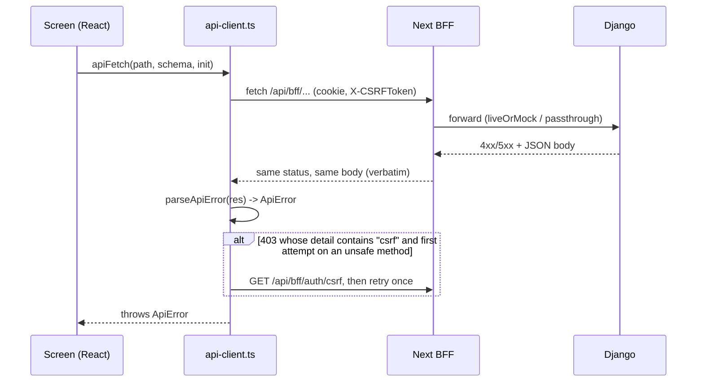

# Errors: body shapes and status codes

> **Source**: DOC-037 · inventory A.2, A.5, A.7 · INT-004, INT-026, INT-033 (and every module that returns a `400`)
> **Code**: `products/services/product_api_errors.py` (`ProductApiError`, `not_found`, `conflict`) · `api/permissions.py` · `api/authentication.py` · `api/middleware.py` · `tenants/middleware.py` · `api/views_platform.py` (`ConsoleView`, `handle_exception`) · `tenants/console_money_service.py` (`ConsoleError`) · `sharwapay/customer_api.py` (`PayError`) · `products/services/{pos,returns_api,booking,product_extras,domain,sharwa_ai_api}_service.py` · `api/views_onboarding.py` · `api/views_auth.py` · `api/views_reports.py` · `api/views_expenses.py` · `config/settings.py` (`REST_FRAMEWORK`)
> **Frontend**: `src/lib/api-error.ts` (`ApiError`, `parseApiError`, `defaultMessage`) · `src/lib/api-client.ts` · `src/lib/bff/upstream.ts` (`unavailableResponse`) · `src/mocks/runtime.ts` (`notAvailable`, `mockError`) · `src/components/shared/{error-state,field}.tsx`
> **Last verified against code**: 2026-10-27 (step 05)

Every failed call answers with a non-2xx status and a JSON object. There is **no single envelope**: Django has no custom DRF exception handler (`REST_FRAMEWORK` in `config/settings.py` sets none), so each view and service builds the body it wants, and about a dozen shapes are in use. This page lists them all, then walks the status codes one by one with an example body and the screens that read it.

Related pages: the order in which gates reject a request is in [`conventions.md#gates`](conventions.md#gates). The 409 shapes are in [`conflicts.md`](conflicts.md). The 429 numbers are in [`rate-limits.md`](rate-limits.md). OTP failures are in [`otp.md`](otp.md).

## 1. How an error travels



The BFF does not rewrite Django's errors. It adds only three of its own (sections 3.9, 3.10 and 3.11): `501` when a mocked row has no Django provider yet, `502` when Django cannot be reached, and `404` for a console path on the wrong host. See [`bff.md`](bff.md).

### 1.1 What the browser keeps: `ApiError`

`parseApiError` (`src/lib/api-error.ts`) turns every non-2xx response into one `ApiError`:

| Property | Filled from | Notes |
|---|---|---|
| `status` | the HTTP status | |
| `detail` | `body.detail` when it is a **string** | |
| `fields` | every **other** key of the body whose value is an array of strings **or a single string** | a string-valued sibling key such as `code`, `level`, `challenge` or `sent_to` therefore also lands in `fields` as `{code: ["otp_required"]}`. Numbers, booleans, objects and arrays of objects are skipped |
| `body` | the whole parsed JSON | the only place nested shapes survive (`line_items`, `results`, `current_version`, `codes`/`duplicates`, `session`, `order`) |
| `retryAfter` | the `Retry-After` header, only if it is plain digits | a date value is ignored. The body field `retry_after` (Sharwa Pay) is **not** read |
| `isMock` | header `x-sharwa-mock: 1` | |
| `isCsrf` | `status === 403` and `detail` matches `/csrf/i` | triggers the one automatic retry |
| `userMessage` | `detail`, else the first field message, else `defaultMessage(status)` | what generic screens print |

A response that is not JSON (an HTML `503` page, a plain-text `404`) keeps `status` but has no `detail`, `fields` or `body`; `userMessage` falls back to the default for the status (section 4).

Two consequences clients must know:

1. **Nested errors are only in `body`.** `{"line_items": [{...}]}` and `{"results": [{...}]}` are arrays of objects, so `parseApiError` leaves them out of `fields`. Screens read `err.body` (returns form, bookings availability).
2. **A network failure is not an `ApiError`.** `fetch` throws a `TypeError`; `rawFetch` does not catch it. Screens test `isApiError(e)` first and show a "connection" message when it is false.

`apiFetch` also **creates** one error itself: if the response is 2xx but fails the Zod schema, it throws `new ApiError({status: 500, detail: "استجابة غير متوقعة من الخادم."})` (and logs the Zod issues outside production). That `500` never crossed the network.

## 2. Body shapes

| # | Shape | Status | Where it is produced | Client reads |
|---|---|---|---|---|
| S1 | `{"detail": "«…»"}` | any | everywhere: gates, services, DRF exceptions | `detail` |
| S2 | `{"<field>": ["«…»", …]}` | `400` | DRF `serializer.errors`; `_fail({...})` in services | `fields[<field>]` |
| S3 | `{"items.0.title": ["«…»"]}` (dotted flat keys) | `400` | storefront sections (`design_service`) | `fields["items.0.title"]` |
| S4 | `{"line_items": [{"quantity_returned": ["«…»"]}, {}]}` (per-line) | `400` | returns create | `body.line_items[i]` |
| S5 | `{"results": [{"end_time": ["«…»"]}, {}]}` (per-row) | `400` | bookings availability save | `body.results[i]` |
| S6 | `{"detail", "code": "<machine_code>"}` | `400`, `403`, `409`, `428` | seven families, section 2.6 | `body.code` (and `fields.code[0]`) |
| S7 | `{"code": ["«…»"]}` (a **field** named `code`) | `400` | OTP verification | `fields.code[0]` |
| S8 | `{"detail", "level": "error"}` | `400`, `409` | platform console money actions | `body.level` |
| S9 | `{"codes": ["«…»"], "duplicates": ["…"]}` | `400` | serial-number paste (M37) | `body.duplicates` |
| S10 | `{"detail": "CashLiquidityError: …"}` | `400` | return approval | `detail` (screen strips the prefix) |
| S11 | `{"detail", <data keys>}` | `409` | version and state conflicts | see [`conflicts.md`](conflicts.md) |
| S12 | `{"detail", "retry_after": <seconds>}` + `Retry-After` header | `429` | Sharwa Pay customer API | header only (see 1.1) |
| S13 | non-JSON (HTML or plain text) | `503`, `404` | tenant provisioning guard, dev media | status only |

### 2.1 S1 — `{detail}`

The default. DRF exceptions (`NotFound`, `NotAuthenticated`, `PermissionDenied`, `ParseError`, `MethodNotAllowed`, `UnsupportedMediaType`, `Throttled`) render `{"detail": "<message>"}` through DRF's built-in handler, and `ProductApiError(status, {"detail": …})` does the same by hand. Wording comes from the code that raised it: Arabic sentences written in the view or service (quoted verbatim in every module page), or DRF's own text where the view passed none (the CSRF failure and the generic throttle are English, see [`conventions.md#gates`](conventions.md#gates) and [`rate-limits.md`](rate-limits.md)).

```json
{"detail": "ليست لديك صلاحية لهذا الإجراء."}
```

### 2.2 S2 — `{field: [msg]}`

A `400` where each key is a request field and each value a list of messages. The frontend shows the first message under the field (`Field` component, `data-field-error`). The key can be a field the form does not have; `applyApiError` (login and password forms) only places keys the form declares and sends the rest to the form-level line.

```json
{
  "phone": ["أدخل رقم الهاتف."],
  "password": ["أدخل كلمة المرور."]
}
```

Messages that are the same in the mock and in Django (the contract the frontend was built on) are the ones a Zod schema or a screen already shows; where Django's wording differs, Django's wording is what the user sees in live mode.

Other verbatim examples from the code:

| Route | Body |
|---|---|
| `POST products/<id>/images/` with no file | `{"images": ["اختر صورة واحدة على الأقل."]}` |
| `POST products/<id>/images/` with a bad file | `{"images": ["الصيغ المسموحة: jpg, jpeg, png, webp, gif"]}` or `{"images": ["حجم الصورة أكبر من 5MB."]}` |
| storefront price offer with a value of zero | `{"value": ["أدخل قيمة أكبر من صفر."]}` |
| POS refund with a wrong code | `{"otp_code": ["رمز التحقق غير صحيح. المتبقي 2 محاولتان."]}` |
| product import with too many rows | `{"file": ["الملف أكبر من 20,000 صف — قسّمه إلى ملفات أصغر."]}` |

### 2.3 S3 — dotted flat keys

Storefront section items are validated one by one, but the errors come back as **flat keys with the index inside the name**, not as nested arrays:

```json
{"items.0.title": ["أدخل عنواناً أو صورة."], "items.1.link": ["الرابط يبدأ بـ / أو https://"]}
```

The frontend reads them as ordinary `fields`. This is the only family that encodes the row in the key; S4 and S5 use arrays.

### 2.4 S4 — nested per line (returns)

`POST returns/` takes `line_items: [{fulfillment_item_id, quantity_returned, restock}]`. When any line is wrong the body is `{"line_items": [e0, e1, …]}`: **one object per submitted line, in the same order**, `{}` for a line with no error. Lines are checked against what was already returned, so a screen can re-send the same order twice and see the remaining quantity shrink.

```json
{
  "line_items": [
    {},
    {"quantity_returned": ["الكمية تتجاوز المتبقي (1)."]},
    {"fulfillment_item_id": ["العنصر لا ينتمي لهذا الطلب."]}
  ]
}
```

Possible messages (verbatim): «أدخل كمية صحيحة (1 أو أكثر).» · «الكمية تتجاوز المتبقي (N).» · «أُرجع هذا العنصر بالكامل.» · «العنصر لا ينتمي لهذا الطلب.». An empty list is a plain S2: `{"line_items": ["حدد سطراً واحداً على الأقل."]}` (an array of **strings**, so this one does reach `fields`). A fully refunded order gives S1: «استُرجع هذا الطلب بالكامل — لا عناصر قابلة للإرجاع.»

The screen `new-return-screen.tsx` walks `body.line_items`, puts the first message of line `k` under that line's quantity box and focuses it. A bare string inside the array is shown as the form error.

### 2.5 S5 — per row (bookings availability)

`PUT` of a service's weekly windows (`results` mirrors the submitted rows). The failing body is `{"results": [e0, e1, …]}`, again one object per row in order. Each row is checked for day, start, end and overlap with the earlier valid windows of the same day.

```json
{
  "results": [
    {},
    {"weekday": ["يوم غير صالح (0 = الاثنين … 6 = الأحد)."]},
    {"end_time": ["يجب أن ينتهي الوقت بعد بدايته."]},
    {"start_time": ["تتداخل مع نافذة أخرى في اليوم نفسه."]}
  ]
}
```

Other messages: «وقت غير صالح.» (start or end). The screen `availability-screen.tsx` shows the first message of each row against that row and a toast «تحقق من النوافذ المعلّمة.» when the body has no `detail`.

> The response of a **successful** save is also `{... , "results": [...]}` (the saved windows). Only the status distinguishes the two.

### 2.6 S6 — `code` as a machine code

Seven families add a stable `code` string next to `detail`. All other errors have **no** machine code, so a client must not expect one.

| `code` | Status | Route family | Meaning |
|---|---|---|---|
| `feature_disabled` | `403` | POS (`pos/*`), the only gate that adds `code` | the `pos` plan feature is off. Body also has `detail`: «ميزة نقطة البيع غير مفعّلة في خطتك.» |
| `discount_exceeds_limit` | `403` | POS sale/quote | the discount is above the cashier's ceiling. Extra key: `max_discount_percent` (string). The sell screen then asks for manager approval |
| `otp_required` | `428` | POS refund | a large refund needs the owner's code. Extra keys: `challenge: "large_refund"`, `sent_to` (masked phone, e.g. `967•••••802`) |
| `setup_required` | `409` | owner login, owner reset-password request | the store has no dashboard password yet: «لم تُعيَّن كلمة مرور لوحة التحكم بعد — عيّنها أولاً من «تعيين كلمة المرور».» |
| `already_set` | `409` | owner setup-password | «كلمة مرور المتجر معيّنة بالفعل — سجّل الدخول.» |
| `setup_token_invalid` | `403` | owner setup-password | the signed link is wrong or expired (message in [`auth.md`](auth.md)) |
| `has_pending_withdrawal` | `400` | merchant payment accounts delete | the account has a pending withdrawal; disable it instead |

Because `code` is a string, `parseApiError` also copies it into `fields.code`. The screens read the typed `body` instead (`otpRequiredSchema` and `discountExceededSchema`, imported from `@/features/pos/schemas`), never `fields.code`.

### 2.7 S7 — a *field* named `code`

The OTP verify routes (onboarding verify, owner reset-password) name their input `code`. A wrong code is therefore an ordinary S2 error whose field is `code`, **an array of strings**, not a machine code:

```json
{"code": ["الرمز غير صحيح."]}
```

Do not confuse S6 and S7: `body.code` is a string in S6 and an array in S7. The onboarding OTP form reads `fields.code[0]` and shows it under the digit boxes.

### 2.8 S8 — `{detail, level}` (platform console money)

The platform console's money actions (dues, Sharwa Pay top-ups and withdrawals) answer with a one-line message and a severity. A failed action is `400` (or `409` when the record was already handled) with `level: "error"`; a successful action is `200` with `level: "success"` plus the updated entity. The console screen colours its toast by `level`.

```json
{"detail": "لا مبلغ للتحصيل في هذا السجل — استخدم «إعفاء».", "level": "error"}
```

Raised by `ConsoleError` in `tenants/console_money_service.py`; the console view's `handle_exception` returns it as-is. Field-style console errors (`{"note": ["اذكر سبب الرفض — يصل للعميل."]}`, `{"action": ["إجراء غير معروف."]}`) are S2 and carry **no** `level`.

### 2.9 S9 — `{codes, duplicates}` (serial numbers)

Pasting serial numbers for a serial-tracked product (M37) validates the batch as a whole:

```json
{"codes": ["أكواد مكررة: SN-001، SN-002"], "duplicates": ["SN-001", "SN-002"]}
```

`codes` is the S2 message (the duplicates joined with «، »); `duplicates` is the list the screen can highlight. A race between two adds ends in `{"codes": ["أكواد مكررة."], "duplicates": []}`. Other `codes` errors: «ألصق كوداً واحداً على الأقل.», «الكود 255 حرفاً على الأكثر.».

### 2.10 S10 — `CashLiquidityError: …`

Approving a return can fail because the store's cash position cannot cover the refund. The message is the exception text with a fixed prefix, as a `400`:

```json
{"detail": "CashLiquidityError: <server message>"}
```

The prefix is part of the contract: `return-detail.tsx` tests `/CashLiquidityError/i` on `detail` to choose the "liquidity" layout, then strips the prefix before showing the rest in the error colour. Do not translate or rename it.

### 2.11 S12 — `retry_after` in the body

Only the Sharwa Pay customer API puts the wait in the body (`PayError(429, {detail, retry_after}, retry_after=…)`), and it also sets the `Retry-After` header, so the browser still gets `ApiError.retryAfter`. Every other `429` sends the header, the body wording, or neither; see [`rate-limits.md`](rate-limits.md).

### 2.12 S13 — non-JSON

- **Store still provisioning** — `TenantProvisioningGuardMiddleware` answers **every** request to a store whose schema is not `ready`, API included, with an HTML page («متجرك قيد التجهيز» template `tenants/store_provisioning_wait.html`), status `503`, `Retry-After: 10`, `Cache-Control: no-store`. A client calling `/api/v1/*` gets HTML, not JSON.
- **Development only** — `DevMediaMiddleware` answers a missing media file with plain text «الملف غير موجود.» (`404`).
- **Downloads** — the report export download sends the file on success and JSON errors on failure (404, 409, 410, 403, section 3).

## 3. Status codes

Gate order and the wording of the `401`/`403` gates are in [`conventions.md#gates`](conventions.md#gates); they are not repeated here. Each section gives the shapes in use, one example and the screens that read it. "Screens" lists only code verified in this step; modules not listed have no handler beyond the generic one (section 4).

### 3.1 `400 Bad Request`

Shapes: S2, S3, S4, S5, S7, S9, S10, S1 for rule violations («المنتج بسعر ثابت»), S6 `has_pending_withdrawal`. The most common code in the API (67 uses in the view modules, many more in services).

```json
{"phone": ["أدخل رقم الهاتف."], "password": ["أدخل كلمة المرور."]}
```

| Screen | What it does |
|---|---|
| owner login, forgot/reset password, setup password | `applyApiError`: declared fields under inputs, `detail` above the form |
| onboarding register / OTP | `fields.subdomain[0]` under the subdomain; a draft-field error returns the user to the details step; `fields.code[0]` under the digit boxes |
| returns create | S4 per line, `reason` and `refund_method` under their fields |
| bookings availability | S5 per row |
| POS refund / sale | `fields.otp_code`, `fields.amount`, `fields.manager_code` |

### 3.2 `401 Unauthorized`

Shape: S1. Merchant and staff routes: «انتهت جلستك، سجّل الدخول مجدداً.» (the same sentence is the BFF fixture's and `defaultMessage(401)`). Platform console: «انتهت جلسة لوحة المنصة، سجّل الدخول مجدداً.» (`ConsoleView.initial` raises `NotAuthenticated`) and Django adds `WWW-Authenticate: Session` because `ConsoleSessionAuthentication.authenticate_header` returns `"Session"`; without it DRF would turn "no session" into a 403.

```http
HTTP/1.1 401 Unauthorized
WWW-Authenticate: Session
Content-Type: application/json

{"detail": "انتهت جلسة لوحة المنصة، سجّل الدخول مجدداً."}
```

> ⚠️ Discrepancy — roadmap says the console `401` carries `WWW-Authenticate: Session` to the browser / code sends it from Django but `FORWARD_RESPONSE_HEADERS` in `src/lib/bff/upstream.ts` does not include `www-authenticate`, so the BFF drops it. The browser sees the `401` status and body only. Reported in step 05.

Screens: no screen-specific handler was found in the files read; the message is shown by `ErrorState` or a toast through `ApiError.userMessage`. How the session is renewed is in [`auth.md`](auth.md).

### 3.3 `403 Forbidden`

Shapes: S1 (gates: tenant context, CSRF, plan feature, permission, owner-only, console role), S6 (`feature_disabled`, `discount_exceeds_limit`, `setup_token_invalid`), and one tenant-pinning body from `TenantHeaderOverrideMiddleware`:

| Body | Raised by |
|---|---|
| «لم يتم تحديد المتجر المطلوب. استخدم النطاق الفرعي للمتجر أو أرسل ترويسة X-Store-Domain.» | `HasTenantContext` (a session route reached `public` with a session, or a session-less store route) |
| «لم يتم تزويد بيانات الدخول.» | DRF `NotAuthenticated` turned into `403`: a `MerchantSessionAuthentication` route reached `public` with **no** session ([`auth.md`](auth.md#no-store-no-session)) |
| «هذا المتجر غير نشط حالياً.» | `TenantHeaderOverrideMiddleware` (store deactivated) |
| «الجلسة الحالية موثَّقة على متجر مختلف — لا يمكن التحويل إلى متجر آخر بهذه الجلسة.» | `TenantHeaderOverrideMiddleware` (session pinned to another store) |
| `{"detail": "CSRF Failed: CSRF token missing."}` | `MerchantSessionAuthentication` → DRF `enforce_csrf` |
| «هذا الإجراء لمالك المنصة فقط.» | console `ConsoleView.initial` (operator role writing outside its areas) |
| «ليست لديك صلاحية لهذا الإجراء.» | permission-key gate |

The CSRF `403` is the only error the client retries on its own: `rawFetch` calls `refreshCsrf()` once and repeats the same request (unsafe methods only, first attempt only). Full flow in [`csrf.md`](csrf.md).

Screens: `PosPlanGate` renders `PosFeatureOff` instead of the till when its `enabled` prop is false (the `403 feature_disabled` is the server-side answer for the same state); the POS sell screen parses `err.body` with `discountExceededSchema` and shows the manager-approval flow (`fields.manager_code` for a wrong approver code).

### 3.4 `404 Not Found`

Shape: S1. Wording differs per module: «غير موجود.» (generic, console `_public_only`), «المنتج غير موجود.», «لا عميل بهذا الرقم في متجرك.», «مهمة التصدير غير موجودة.», «الاشتراك غير موجود.» (reports schedules, BFF mock). The tenant middleware sends its own when `X-Store-Domain` names an unknown store:

```json
{"detail": "لا يوجد متجر مرتبط بالنطاق \"unknown.example\" في ترويسة X-Store-Domain."}
```

Screens: returns detail, new return and bookings availability test `status === 404` to show a "not found" state instead of the generic error.

### 3.5 `405 Method Not Allowed`

Shape: S1. Three sources:

| Source | Body |
|---|---|
| Expenses `PATCH`/`PUT`/`DELETE`/`GET` on `expenses/<id>/` (`ExpenseDetailView`) | «تعديل المصروفات وحذفها غير متاحَين بعد.» — edit and delete are outside the contract (FR-33.06) |
| Mock agent route (`src/app/api/bff/agent/[...path]`, mock mode only), any method but `GET` | «الطريقة «POST» غير مسموحة.» (the method name is inserted) |
| Mock console router, a known path with the wrong method | «الطريقة غير مسموحة.» |
| Any DRF view that does not define the method | DRF `MethodNotAllowed` → `{"detail": "<DRF text>"}` |

No shipped screen calls the expenses edit/delete route as far as the files read in this step show; the status exists so a client that tries gets a clear answer.

### 3.6 `409 Conflict`

Shapes: S11 (all of them are in [`conflicts.md`](conflicts.md)), S6 (`setup_required`, `already_set`), S8 (console, `level: "error"`). The generic client message is «تغيّرت البيانات من جهة أخرى، أعد التحميل ثم حاول مجدداً.»

```json
{"detail": "حُدِّث طلب الإرجاع من مستخدم آخر.", "current_version": 3}
```

Screens: the return decision (`return-detail.tsx`) shows a "conflict" panel and re-reads the return (toast «حُسم الإرجاع من مستخدم آخر: …» when it was decided meanwhile).

### 3.7 `410 Gone`

Shape: S1. Four uses:

| Route | Body |
|---|---|
| onboarding OTP verify/resend, request older than its TTL | «انتهت صلاحية الطلب، ابدأ من جديد.» |
| onboarding OTP verify, code expired | «انتهت صلاحية الرمز» |
| report export download, file expired | «انتهت صلاحية الملف — أعد التصدير.» |
| report export download, file missing from storage | «انتهت صلاحية الملف — أعد التصدير.» |

Screens: the onboarding OTP form (`otp-form.tsx`) treats any `410` as "start again": it sets `serverExpired` and sends the user back to the details step.

### 3.8 `428 Precondition Required`

Shape: S6 `otp_required`. One route: `POST pos/orders/<id>/refund/` when the amount is above the store's refund limit and the body has no `otp_code`. Django has already created the challenge and sent the code to the store owner's WhatsApp when it answers.

```json
{
  "code": "otp_required",
  "detail": "استرجاع كبير — أدخل رمز التحقق المرسل إلى جوال مالك المتجر.",
  "challenge": "large_refund",
  "sent_to": "967•••••802"
}
```

The client re-sends the same request with `otp_code`. Rules: the code lives 300 s, 3 wrong tries lock the refund for 15 minutes («أُقفل الاسترجاع مؤقتاً بعد 3 محاولات خاطئة. حاول بعد 15 دقيقة أو راجع المدير.», a `429`), at most 3 codes are sent per receipt per window. See [`otp.md`](otp.md).

Screens: `receipts-screen.tsx` parses `err.body` with `otpRequiredSchema`; on `428` it opens the code box with `detail` as the hint and `sent_to` beside it. `defaultMessage(428)` is «يلزم تأكيد إضافي لإتمام هذا الإجراء.»

### 3.9 `429 Too Many Requests`

Shapes: S1 (most), S12 (Sharwa Pay), plus the header `Retry-After` on some routes. The numbers, windows and wording are in [`rate-limits.md`](rate-limits.md). Two bodies as examples:

```json
{"detail": "طلبات كثيرة جداً، حاول لاحقاً."}
```

```json
{"detail": "محاولات كثيرة، حاول بعد 900 ثانية"}
```

(the second is sent together with `Retry-After: 900`).

The BFF forwards `Retry-After` (it is in `FORWARD_RESPONSE_HEADERS`), so the header reaches the browser. Screens: the onboarding OTP form locks the input until `now + retryAfter` (default 60 s to verify, 30 s to resend); `ErrorState` prints «حاول بعد N ثانية.» when `retryAfter` is set.

### 3.10 `500 Internal Server Error`

Two sources, with different meaning:

1. **Django**: the only deliberate `500` in the views is store creation, `POST` of the onboarding registration, when provisioning throws: `{"detail": "حدث خطأ غير متوقع أثناء إعداد متجرك. يرجى المحاولة مرة أخرى لاحقاً أو التواصل مع الدعم الفني."}`. Any other unhandled exception is Django's own `500` page (HTML, no JSON), because there is no custom exception or `handler500` in the API app.
2. **The browser client**: `apiFetch` throws a synthetic `ApiError` with `status: 500` and «استجابة غير متوقعة من الخادم.» when a 2xx body does not match the Zod schema.

### 3.11 `501 Not Implemented`, `502 Bad Gateway`, `503 Service Unavailable`

| Status | Body | Raised by | When |
|---|---|---|---|
| `501` | «غير متاح بعد.» + header `x-sharwa-mock: 0` | BFF `notAvailable()` (`src/mocks/runtime.ts`) | a mocked row is called with `SHARWA_MOCKS=off` and the row has no Django provider. Never sent by Django |
| `502` | «الخادم غير متاح حالياً.» | BFF `unavailableResponse()` | Django unreachable (network error in `upstreamFetch`) |
| `502` | «تعذّر إرسال رمز التحقق عبر واتساب. يرجى المحاولة مرة أخرى.» | storefront checkout OTP, storefront wallet OTP, engagement OTP | WhatsApp provider failed |
| `502` | «تعذّر إرسال رمز التحقق. يرجى المحاولة مرة أخرى.» | storefront checkout (second path) | WhatsApp provider failed |
| `502` | «تعذّر إرسال رمز التحقق إلى واتساب المتجر. حاول مرة أخرى.» | POS refund challenge | WhatsApp provider failed |
| `502` | «تعذّر إرسال رمز التحقق. حاول مرة أخرى.» | Sharwa Pay customer OTP | WhatsApp provider failed |
| `502` | «تعذّر إرسال رمز التحقق إلى هذا الرقم على واتساب. تأكد من الرقم وحاول مرة أخرى.» | onboarding OTP resend | WhatsApp provider failed |
| `502` | «تعذّر إرسال رمز التحقق إلى رقم واتساب المتجر. حاول مرة أخرى.» | owner reset-password request | WhatsApp provider failed |
| `502` | «تعذّر إنشاء رابط الدخول للوحة شروة كونكت. حاول مجدداً.» | apps (SharwaConnect) link | provider failed |
| `503` | «فحص DNS غير متاح على الخادم الآن — حاول لاحقاً.» | custom-domain verify (`domain_service`) | `dnspython` is not installed on the server (`DnsUnavailable`) |
| `503` | «رابط لوحة شروه AI غير مضبوط بعد (SHARWA_AI_CONSOLE_URL).» | Sharwa AI console token | the console URL setting is empty or not `http(s)` |
| `503` | «الدخول الموحد إلى لوحة شروه AI غير مهيأ بعد.» | Sharwa AI console token | SSO keys are not configured (`SsoNotConfigured`) |
| `503` | HTML wait page, `Retry-After: 10` | `TenantProvisioningGuardMiddleware` | the store's schema is not ready (S13) |

The client defaults are `defaultMessage(502|504)` = «الخادم غير متاح حالياً.» and `defaultMessage(503)` = «المتجر قيد التجهيز، حاول بعد قليل.» The returns detail screen treats `status === 0` or `status >= 502` as a "network" failure and offers a retry instead of showing the message.

> ⚠️ Discrepancy — roadmap says the `502` family is "WhatsApp/upstream failure" and the `503` "dnspython unavailable, Sharwa AI SSO keys missing" / code matches, but there are **eight** different `502` WhatsApp sentences (table above) and the `503` for Sharwa AI has two causes (URL and SSO keys). A client that matches on message text must handle all of them; match on the status.

### 3.12 Codes the API does not use

`422`, `423`, `451` and `5xx` other than the ones above are not sent by any view. DRF's `ParseError` (malformed JSON) and `UnsupportedMediaType` (for example multipart sent to a JSON-only view, see [`conventions.md#uploads`](conventions.md#uploads)) are produced by DRF itself as `400` and `415` with `{"detail": "<DRF text>"}`.

## 4. Client defaults (`defaultMessage`)

Used by `ApiError.userMessage` when the body has neither `detail` nor a field message:

| Status | Message |
|---|---|
| `400` | «تحقق من البيانات المدخلة.» |
| `401` | «انتهت جلستك، سجّل الدخول مجدداً.» |
| `403` | «ليست لديك صلاحية لهذا الإجراء.» |
| `404` | «العنصر غير موجود.» |
| `409` | «تغيّرت البيانات من جهة أخرى، أعد التحميل ثم حاول مجدداً.» |
| `428` | «يلزم تأكيد إضافي لإتمام هذا الإجراء.» |
| `429` | «طلبات كثيرة جداً، حاول لاحقاً.» |
| `501` | «غير متاح بعد.» |
| `502`, `504` | «الخادم غير متاح حالياً.» |
| `503` | «المتجر قيد التجهيز، حاول بعد قليل.» |
| anything else | «حدث خطأ غير متوقع.» |

## 5. Rules for a new client

1. Branch on **status first**, then on the keys you know. Do not parse `detail` text, except the one documented prefix `CashLiquidityError:`.
2. Read nested errors from the parsed body, not from a "fields" map.
3. On `403` with "CSRF" in `detail`, fetch a fresh token and retry once; any other `403` is final.
4. Treat `409` as "reload and re-apply" ([`conflicts.md`](conflicts.md)), `429` as "wait" (`Retry-After` when present), `502`/`503` as "retry later", and `428` as "ask for the extra step and send the same request again".
5. A mutation that never got an answer (no `ApiError`) may or may not have happened. Retry only with the same `Idempotency-Key` ([`idempotency.md`](idempotency.md)); the POS sale screen keeps its key for exactly this reason.

## 6. Discrepancies found while writing this page

> ⚠️ Discrepancy — roadmap lists `{code}` as one shape / code has two unrelated meanings of the word: a machine-code **string** next to `detail` (S6, seven families) and an **array of messages** under a field named `code` (S7, OTP verification).

> ⚠️ Discrepancy — roadmap says `{detail, level}` belongs to "console dues" / code uses it for the whole money area of the console (dues, Sharwa Pay top-ups and withdrawals) and also in `200` success bodies (`level: "success"`).

> ⚠️ Discrepancy — roadmap says `410` is used by onboarding / code also uses it for expired report exports (`ReportExportDownloadView`).

> ⚠️ Discrepancy — roadmap says `428` is "POS refund OTP" / matches; and `501` is «غير متاح بعد.» "(mocks off, no endpoint)" / matches, but it is produced only by the Next.js BFF, never by Django.

> ⚠️ Discrepancy — roadmap says `405` is "mock non-GET agent" and "expenses edit/delete" / matches, and the mock console router adds a third: «الطريقة غير مسموحة.».

## 7. Related pages

- Gate order and `401`/`403` sentences: [`conventions.md#gates`](conventions.md#gates)
- 409 bodies and recovery: [`conflicts.md`](conflicts.md)
- 429 limits: [`rate-limits.md`](rate-limits.md)
- Idempotency keys: [`idempotency.md`](idempotency.md)
- CSRF retry: [`csrf.md`](csrf.md)
- OTP families: [`otp.md`](otp.md)
- How the BFF forwards errors: [`bff.md`](bff.md)
