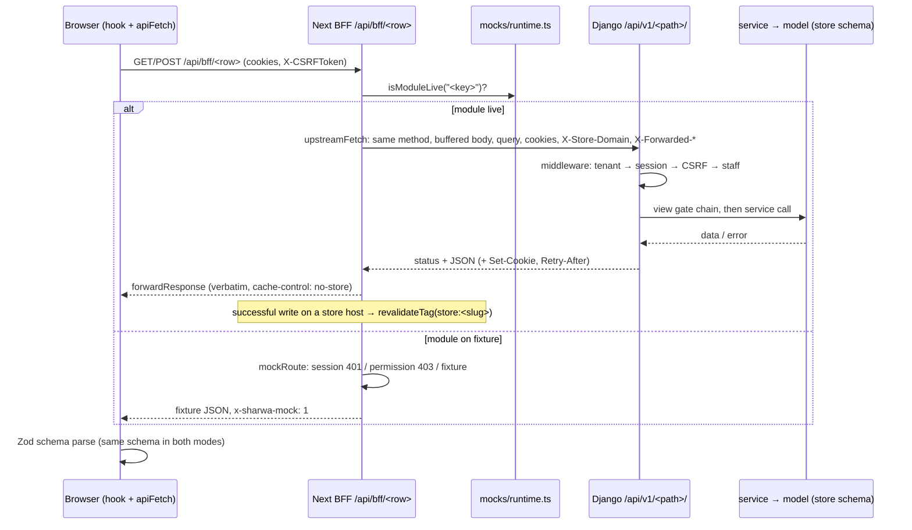
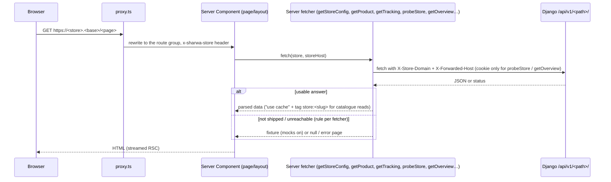
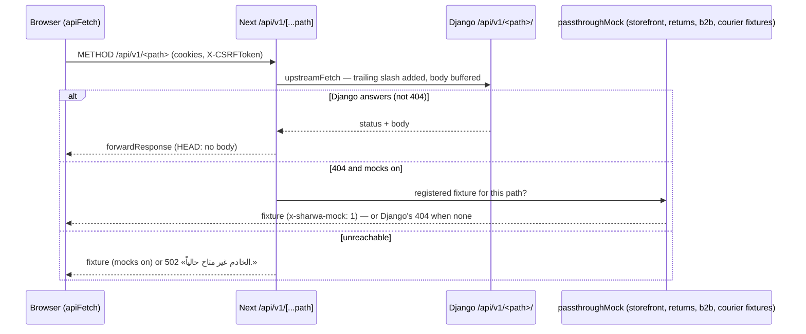

# System architecture overview

> **Source**: DOC-444 · inventory header, A.1, A.2, A.3, A.8, A.10, A.11 · INT-001 → INT-049
> **Code**: `sharwa-frontend/src/proxy.ts` · `sharwa-frontend/src/lib/bff/*` · `sharwa-frontend/src/app/api/{bff,v1}/**` · `sharwa-frontend/src/lib/api-client.ts` · `sharwa-frontend/src/mocks/runtime.ts` · `sharwa-frontend/src/env.ts` · `sharwa_saas/config/{settings,urls_public,urls_tenant,middleware,celery}.py` · `sharwa_saas/api/{urls,middleware}.py` · `sharwa_saas/tenants/middleware.py`
> **Last verified against code**: 2026-10-27 (official Step 06)

## 1. Purpose

This page is the map of the whole system: which processes run, which repository owns what, and the four paths a request can take from the browser to a Django model. After reading it you should be able to take any screen and follow its call to the database:

1. **screen** → the hook or server fetcher it uses (`src/features/<module>/`);
2. **BFF** row (`src/app/api/bff/<path>/route.ts`) and its adapter (`src/lib/bff/*`);
3. **Django view** (`sharwa_saas/api/urls.py` → `api/views_<module>.py`);
4. **service** (`products/services/<module>_service.py`, `tenants/*`, `sharwapay/*`);
5. **model** (`products/models/*`, `tenants/models.py`, `billing`, `appstore`, `sharwapay`…), in the store schema or the public schema.

§6 gives the recipe and a worked example. What this page does **not** cover: the schema split in detail ([`10-multi-tenancy.md`](10-multi-tenancy.md)), the BFF switch internals ([`20-bff.md`](20-bff.md) and the API-side reference [`../api/overview/bff.md`](../api/overview/bff.md)), security ([`30-security.md`](30-security.md)) and background jobs ([`50-background-jobs.md`](50-background-jobs.md)).

## 2. Components

| Component | Location | Role |
|---|---|---|
| **Next.js app** (App Router) | `sharwa-frontend/src/app/` | Every screen. Route groups: `(storefront)` (buyer storefront + PWA), `(dashboard)` (merchant dashboard), `(admin)` (platform console `console.<base>`), `(onboarding)` (registration wizard, tenant error pages), `(marketing)` (landing page), `(pay)` (Sharwa Pay wallet, platform origin only), `(pos)` (point of sale), `(courier)` (courier app) |
| **Tenant proxy** | `sharwa-frontend/src/proxy.ts` + `src/lib/tenant.ts` | Next 16 `proxy.ts`. Pure host routing, no I/O: resolves the host to `platform`, `reserved` (e.g. `console.`), `subdomain`, `custom_domain` or `invalid`, then rewrites the path into the right route group and passes the store as the internal header `x-sharwa-store`. It skips `/api/*`, `/_next/*` and `/media/*` |
| **Browser API client** | `sharwa-frontend/src/lib/api-client.ts` | `apiFetch(path, zodSchema)`: same-origin only (`/api/bff/*` or `/api/v1/*`), validates every answer with the caller's Zod schema, sends `X-CSRFToken` on unsafe methods (token from `GET /api/bff/auth/csrf`, never from `document.cookie`), refreshes the token once and retries on a CSRF `403` |
| **BFF** (backend for frontend) | `sharwa-frontend/src/app/api/bff/**/route.ts` + `src/lib/bff/*` | Server-side route handlers. Each row either answers from a fixture (mock) or forwards to Django. Adapters: `liveOrMock`/`forwardLive` (`live-route.ts`), the products rule tables (`live-products.ts`), `storefrontAdapter`, `tryTarget`/`tryStoreTarget` (`target-adapter.ts`), `tryTargetAuth` (`auth-adapter.ts`), and the shared `upstreamFetch`/`forwardResponse` (`upstream.ts`) |
| **`/api/v1/*` passthrough** | `sharwa-frontend/src/app/api/v1/[...path]/route.ts` | Same-origin transparent proxy to Django for the «Ready» rows (cart, PWA, returns, B2B drafts, courier actions). `GET`/`POST`/`PUT`/`PATCH`/`DELETE`/`HEAD` |
| **Mock runtime** | `sharwa-frontend/src/mocks/` (`runtime.ts`: `isMocksOn`, `isModuleLive`, `notAvailable`) | Fixtures for every module; every mocked answer carries `x-sharwa-mock: 1`. Controlled by `SHARWA_MOCKS` and `SHARWA_LIVE_MODULES` |
| **Django + DRF** | `sharwa_saas/` | The backend and the authority for every business rule. JSON API under `/api/v1/` (`api/urls.py`, `api/views_*.py`, `api/serializers*.py`), business logic in services (`products/services/*`, `tenants/*`, `sharwapay/*`), the legacy HTML screens (§7) |
| **django-tenants on PostgreSQL** | `config/settings.py` (`ENGINE: django_tenants.postgresql_backend`, `TENANT_MODEL = "tenants.Client"`, `TENANT_DOMAIN_MODEL = "tenants.Domain"`) | One database. The **public** schema holds the platform apps (`SHARED_APPS`: `tenants`, `core`, `billing`, `sharwapay`, `appstore`, `marketing`, `sharwa_ship`, auth/admin/sessions); **one schema per store** holds `products` and `api` (`TENANT_APPS`). See [`10-multi-tenancy.md#schemas`](10-multi-tenancy.md#schemas) |
| **Middleware chain** | `config/settings.py` `MIDDLEWARE` | In order: `RealIpMiddleware` (client IP from the trusted proxy) → (DEBUG only: `DevMediaMiddleware`) → `TenantMainMiddleware` (schema from Host) → `SessionMiddleware` → `TenantHeaderOverrideMiddleware` (`/api/` only: `X-Store-Domain`, refuses switching a store-bound session) → `TenantProvisioningGuardMiddleware` (`503` while a store is not ready) → (CORS when enabled) → security, UTM capture, common, CSRF, auth, `StaffSessionMiddleware` (fills `request.staff`), messages, clickjacking |
| **URL configurations** | `config/urls_public.py` (`PUBLIC_SCHEMA_URLCONF`) · `config/urls_tenant.py` (`ROOT_URLCONF`) | Both include `path('api/v1/', include('api.urls'))`. The public one also serves registration, the platform HTML pages, the Sharwa Pay HTML page, public webhooks (`webhooks/*`) and the OpenAPI schema (`api/schema/`, `api/docs/`, `api/redoc/`); the tenant one serves the legacy store HTML screens |
| **Celery workers + Celery Beat** | `config/celery.py` · `CELERY_*` in `config/settings.py` · `products/tasks/`, `tenants/tasks.py` | Redis broker (database 1 by default, `CELERY_BROKER_URL`); default queue `default`, plus dedicated queues (e.g. `whatsapp`, `channels_broadcast`, marketplace queues routed per call); `acks_late`, prefetch 1, results ignored. Beat has 26 schedule entries (provisioning retry, campaigns, low-stock webhooks, POS force-close, approvals escalation, channel/marketplace/supplier jobs…). Register: [`50-background-jobs.md`](50-background-jobs.md) |
| **Cache** | `CACHES` in `config/settings.py` | Redis database 0 by default (`REDIS_CACHE_URL`), key prefix `sharwa`, 2-second socket timeouts; `LocMemCache` only under `DJANGO_TESTING=1`. Holds throttles, OTP HMACs and attempt counters, cooldown keys (e.g. the 5-minute reports/overview refresh), notification-sync throttle markers and the console's 10-minute Sharwa Ship marker |
| **Media storage** | `MEDIA_ROOT = BASE_DIR/media`, `MEDIA_URL = /media/` | Local file storage, per-store upload paths (`TenantUploadTo`, `tenant_upload_path` — non-ASCII names stored under a uuid). Next rewrites `/media/*` to Django (the proxy matcher skips `/media/`); under DEBUG `DevMediaMiddleware` and `urls_public` serve the files ([`62-infra-fixes.md`](62-infra-fixes.md)) |

### Component diagram

```mermaid
flowchart LR
  subgraph Browser
    UI[Screens<br/>src/features/*]
    AC[api-client.ts<br/>apiFetch + Zod + X-CSRFToken]
  end
  subgraph Next["Next.js (sharwa-frontend)"]
    PX[proxy.ts<br/>host → route group]
    RSC[Server Components<br/>server fetchers]
    BFF[/api/bff/* route handlers<br/>src/lib/bff/*/]
    PT[/api/v1/[...path]<br/>passthrough/]
    MK[(src/mocks<br/>fixtures)]
  end
  subgraph Django["Django + DRF (sharwa_saas)"]
    MW[Middleware chain<br/>RealIp → TenantMain → Session →<br/>TenantHeaderOverride → ProvisioningGuard → … → StaffSession]
    URL[urls_public / urls_tenant<br/>→ api/urls.py]
    V[api/views_*.py<br/>+ serializers]
    S[services<br/>products/services, tenants, sharwapay]
    HTML[legacy HTML views<br/>products/views, tenants/views]
  end
  subgraph Data
    PG[(PostgreSQL<br/>public + one schema per store)]
    RC[(Redis db 0<br/>cache)]
    RB[(Redis db 1<br/>Celery broker)]
    MD[(media/)]
  end
  W[Celery workers + Beat]

  UI --> AC --> BFF
  AC --> PT
  UI -. page request .-> PX --> RSC
  RSC -- fetch --> MW
  BFF -- forwardLive / adapters --> MW
  BFF -. mock mode .-> MK
  PT --> MW
  MW --> URL --> V --> S --> PG
  URL --> HTML --> S
  S --> RC
  S -- delay / on_commit --> RB --> W --> S
  S --> MD
```

## 3. Conventions used in every page

- **Repository-relative paths.** `sharwa_saas/…` is the Django repository, `sharwa-frontend/…` the Next.js repository. Inside a page that is clearly about one side, the prefix is often dropped (`api/views_orders.py`, `src/lib/bff/upstream.ts`).
- **Two route families.** Django routes are under `/api/v1/` (all declared in `sharwa_saas/api/urls.py`, included by both URL configurations). BFF routes are under `/api/bff/` (one `route.ts` per row under `src/app/api/bff/`). The browser only ever calls same-origin paths: `/api/bff/*` or the `/api/v1/*` passthrough.
- **Arabic sentences in «…»** are the exact server or UI strings, copied from the code. They are never translated in place.
- **Money** crosses the API only as server-formatted strings (`display_*`, `format_money`); see [`40-money.md`](40-money.md) and [`../api/overview/money.md`](../api/overview/money.md).
- **Django is the authority.** Where a fixture and Django disagree, Django wins and the mock is aligned ([`02-integration-protocol.md`](02-integration-protocol.md)).

## 4. Hosts and origins

| Host (with `TENANT_BASE_DOMAIN = <base>`) | `proxy.ts` kind | Route group | Django schema |
|---|---|---|---|
| `<base>` (platform origin) | `platform` | `(marketing)`, `(onboarding)`, `(pay)` | public (`urls_public`) |
| `console.<base>` | `reserved` (`admin`) | `(admin)` — the platform console | public; console routes answer `404` on a store host or with `X-Store-Domain` |
| `<store>.<base>` | `subdomain` | `(storefront)`, `(dashboard)`, `(pos)`, `(courier)` by path (`groupForStorePath`) | the store schema (`TenantMainMiddleware` by Host, or `X-Store-Domain` on `/api/`) |
| a verified custom domain | `custom_domain` | same as a subdomain | the store schema through its `tenants.Domain` row ([`12-custom-domains.md`](12-custom-domains.md)) |

`/sharwa-pay` on a store host is redirected (`308`) to the platform origin: the Sharwa Pay wallet is cross-store and lives in the public schema. A store that is unknown, inactive or still provisioning is turned into `404` / `403` / `503 + Retry-After: 10` by `probeStore()` and the `/_tenant/<outcome>` rewrite ([`10-multi-tenancy.md#resolution`](10-multi-tenancy.md#resolution), [`../api/domains/01-public-onboarding/m47-tenant-guard.md`](../api/domains/01-public-onboarding/m47-tenant-guard.md)).

Next reaches Django at `API_PROXY_URL` (optional) or `API_INTERNAL_URL` (required, validated in `src/env.ts`). Every upstream call (`upstreamFetch`) sends `x-forwarded-host` (the browser's host), `x-forwarded-proto`, one `x-forwarded-for`/`x-real-ip` entry (the visitor IP, so Django's per-IP limits do not see every visitor as the Next server), `x-store-domain` on a store host, and a same-site `origin`/`referer` for Django's CSRF check. Header lists: [`../api/overview/conventions.md#headers`](../api/overview/conventions.md#headers).

## 5. The four request paths

Every call from the frontend to Django takes exactly one of these four paths.

| # | Path | Adapter | Switch | When the fixture answers |
|---|---|---|---|---|
| 1 | Browser → BFF → Django | `liveOrMock` / `forwardLive`; the products rule tables; the platform catch-all | yes: module key in `SHARWA_LIVE_MODULES` (39 keys), or `SHARWA_MOCKS=off` | whenever the module is not live |
| 2 | Browser → BFF Django-first adapter → Django | `storefrontAdapter`, `tryTarget` / `tryStoreTarget`, `tryTargetAuth`, the legacy `upstreamFetch` rows | none | Django answers `404`/`405`/`501` or is unreachable, **and** mocks are on |
| 3 | Next server (Server Component) → Django | server fetchers: `getPublicJson`, `getStoreConfig`/catalogue fetchers, `getProduct()`, `getTracking()`, `probeStore()`, the landing fetchers, `getOverview()` | none | per fetcher (see [`../api/overview/bff.md#django-first`](../api/overview/bff.md#django-first)) |
| 4 | Browser → `/api/v1/*` passthrough → Django | `src/app/api/v1/[...path]/route.ts` | none | Django answers `404` and a fixture is registered for that path, or Django is unreachable — mocks on only |

With `SHARWA_MOCKS=off` (the production default) no fixture can answer on any path: path 1 is always live, and paths 2–4 answer `501` «غير متاح بعد.» (BFF) or `502` «الخادم غير متاح حالياً.» instead of a fixture.

### 5.1 Path 1 — browser → BFF `liveOrMock` → Django

Used by every dashboard and console module that has a live key (the full map: [`01-domain-map.md`](01-domain-map.md), [`../api/overview/bff.md#live-keys`](../api/overview/bff.md#live-keys)).



Live mode has **no Next-side session gate**: Django answers `401`/`403` itself. A network failure answers `502` «الخادم غير متاح حالياً.».

### 5.2 Path 2 — browser → BFF Django-first adapter → Django

Used by the buyer storefront rows (INT-011 → INT-015 and the buyer rows of INT-028, INT-029, INT-034, INT-036, INT-045), onboarding (INT-004), the dashboard overview rows and auth (INT-003).

```mermaid
sequenceDiagram
  participant B as Browser
  participant N as Next BFF (storefrontAdapter / tryTarget / tryStoreTarget / tryTargetAuth)
  participant D as Django /api/v1/<path>/
  participant M as Fixture (src/mocks)
  B->>N: request to /api/bff/<row>
  N->>D: call Django first (store rows: X-Store-Domain + buyer cookies; platform rows: no store header)
  alt Django answers a status other than 404/405/501
    D-->>N: status + body
    N-->>B: forwarded verbatim (incl. 400/409/429 + Retry-After)
  else 404 / 405 / 501, or network error
    alt isMocksOn()
      N->>M: fixture handler
      M-->>B: fixture, x-sharwa-mock: 1
    else mocks off
      N-->>B: 501 «غير متاح بعد.» (x-sharwa-mock: 0)
    end
  end
```

`storefrontAdapter` refuses a request that does not come from a store host with `404` «استخدم النطاق الفرعي للمتجر.». The "not shipped" rule cannot tell a missing route from a missing record — see [`../api/overview/bff.md#django-first`](../api/overview/bff.md#django-first) §4.6.

### 5.3 Path 3 — Next server fetchers → Django

Server Components fetch on the server during rendering (first paint, SEO, cached catalogue). They do not go through `/api/bff/`.



`probeStore()` hits `/api/v1/config/` before the storefront layout renders; its `404`/`403`/`503` outcome becomes the `/_tenant/<outcome>` rewrite with the matching HTTP status. Catalogue reads are cached per store (`cacheLife("minutes")`, tag `store:<slug>`) and dropped by any successful live write on that store (path 1).

### 5.4 Path 4 — browser → `/api/v1/*` passthrough → Django

Used by the rows Django served before the BFF existed («Ready» rows in `specs/001-sharwa-frontend-platform/contracts/ready-api-v1.md`): the cart (`/api/v1/cart*`, INT-013), PWA rows #11–#14 (INT-016), returns rows (INT-026), B2B draft rows (INT-044) and the five courier actions (INT-046).



Writes reach Django with a body only since the buffering fix in `upstream.ts` (inventory A.11): a streamed body went out chunked with no `Content-Length` and Django read it as empty. The provisioning poller relies on the `HEAD` support (`/api/v1/config/`).

## 6. Tracing a screen to the database

**Recipe**

1. Find the screen's route under `src/app/(group)/…` (the URL path after the `proxy.ts` rewrite; `(dashboard)` pages live under the store host).
2. Open the feature it imports: `src/features/<module>/` holds the Zod contract (`schemas.ts`), the hooks (`api.ts` / `use-*.ts`) and, for first paint, the server fetchers (`api/*.ts`).
3. The hook's path tells you the path family: `/api/bff/<row>` (paths 1–2) or `/api/v1/<path>` (path 4). A Server Component fetcher is path 3.
4. For a BFF row open `src/app/api/bff/<row>/route.ts`: `liveOrMock(request, "<key>", "/api/v1/<path>/", mock)` names both the live key and the Django path. Products rows are in the tables of `src/lib/bff/live-products.ts`; console rows in the prefix map of `platform/[...path]`.
5. In Django, find `/api/v1/<path>/` in `sharwa_saas/api/urls.py`: it names the view class in `api/views_<module>.py`.
6. The view runs its gate chain (tenant, session, plan feature, permission key, owner-only — [`../api/overview/conventions.md#gates`](../api/overview/conventions.md#gates)) and calls a service in `products/services/` (store data), `tenants/` (platform console, rollup, provisioning) or `sharwapay/` (Sharwa Pay).
7. The service imports its models from `products.models` (store schema) or from the public apps (`tenants`, `core`, `billing`, `appstore`, `sharwapay`, `marketing`, `sharwa_ship`). The schema is the one the middleware selected for this request.

**Worked example — the ⌘K command palette (M48, INT-008)**

| Hop | Where | What happens |
|---|---|---|
| Screen | dashboard topbar, ⌘K | the hook `features/command-palette/use-palette-search.ts` requests `/api/bff/search?q=…` and parses the answer with `searchResultSchema` (`features/command-palette/schemas.ts`) |
| BFF | `src/app/api/bff/search/route.ts` | `liveOrMock(request, "search", "/api/v1/search/", mock)` — live when `search` is in `SHARWA_LIVE_MODULES` or mocks are off |
| Upstream | `src/lib/bff/upstream.ts` | `GET <API_INTERNAL_URL>/api/v1/search/?q=…` with the session cookie and `x-store-domain: <store>.<base>` |
| Middleware | `config/settings.py` `MIDDLEWARE` | the store schema is selected (Host, or `X-Store-Domain` on `/api/` for an unbound request); `StaffSessionMiddleware` fills `request.staff` |
| URL | `api/urls.py` | `path('search/', views_search.PaletteSearchView.as_view(), name='palette-search')` |
| View | `api/views_search.py` `PaletteSearchView(ProductsAPIMixin, APIView)` | session gate, then trims groups by permission (`orders.view`, `customers.view`) |
| Service | `products/services/search_service.py` | `search_orders`, `search_products`, `search_customers` with Arabic normalisation |
| Models | `products.models.Order`, `products.models.Product` (store schema) | queried in the current store's schema only |

Full contract: [`../api/domains/02-dashboard-shell/m48-search.md`](../api/domains/02-dashboard-shell/m48-search.md).

## 7. Legacy Django HTML screens beside the API

Phase 002 did **not** replace the Django HTML screens. They are still served:

- **Store side** — `config/urls_tenant.py` (about 350 `path()` entries): the legacy merchant dashboard and storefront templates (`products/views/`, `products/templates/`).
- **Platform side** — `config/urls_public.py`: registration (`register/`, `register/check-subdomain/`, `register/verify-otp/`, `register/status/<token>/`), the platform master dashboards (`master-dashboard/`, `master-dashboard/dues/`), the Sharwa Pay HTML page and its OTP/top-up/withdraw/logout endpoints, the public webhook receivers (`webhooks/*`), the Django admin, and the OpenAPI schema views.

**Rule: one engine, two surfaces.** Each API view calls the same service the HTML view calls; no business rule was duplicated for the API. Examples verified in the integration write-ups and the code:

| Area | Shared engine |
|---|---|
| Orders (INT-007) | the dashboard orders API reuses the legacy order engine (no parallel state machine) |
| Products (INT-005) | the legacy product delete and attribute/option delete go through the same guards as the API (archive instead of delete when orders exist; `409` when dependencies exist); `ProductTemplateForm` reads and writes the same JSON blueprint |
| Channels, marketplaces, dropshipping, POS, bookings (Domain 13) | "the legacy HTML screens and the new APIs call the same services" |
| Registration (INT-004) | the API onboarding views and the legacy `register/*` pages share the registration and provisioning code (`tenants/registration.py`, `tenants/provisioning.py`) |
| Platform console (INT-030 → INT-032) | `master-dashboard/` pages stay; the console API uses its own services (`tenants/console_*_service.py`) over the same models |

The legacy-only features (no API, HTML only) are listed in [`91-legacy-surfaces.md`](91-legacy-surfaces.md).

## 8. Configuration

| Setting | Side | Default | Effect |
|---|---|---|---|
| `TENANT_BASE_DOMAIN` | Next (`src/env.ts`, required) | — | base host for `proxy.ts` and `resolveTenant` |
| `API_INTERNAL_URL` / `API_PROXY_URL` | Next (`src/env.ts`) | required / optional | Django origin for every upstream call (`API_PROXY_URL` wins when set) |
| `SHARWA_MOCKS` | Next | `on` outside production, `off` in production | `off` = every module live and no fixture fallback |
| `SHARWA_LIVE_MODULES` | Next | unset | live keys while mocks are on; `*` = all |
| `PUBLIC_SCHEMA_URLCONF` / `ROOT_URLCONF` | Django | `config.urls_public` / `config.urls_tenant` | URLConf per schema |
| `DATA_UPLOAD_MAX_MEMORY_SIZE` | Django | 8 MB | request body bound (also the size the BFF buffers) |
| `REDIS_CACHE_URL` / `CELERY_BROKER_URL` | Django | Redis db 0 / db 1 | cache / broker |

The full environment reference is [`../ops/environment.md`](../ops/environment.md) (planned, DOC-511).

## 9. Failure modes and fixes

| Failure | Symptom | Cause | Handling / fix |
|---|---|---|---|
| Django unreachable | `502` «الخادم غير متاح حالياً.» on a live row; fixture on Django-first rows with mocks on | network / Django down | `UpstreamUnavailableError` in `upstream.ts` |
| Write reaches Django with an empty body | `400` "required field" on every passthrough write | streamed request body without `Content-Length` | bodies buffered in `upstreamFetch` and `forwardLive` (inventory A.11) |
| Every visitor seen as one IP | per-IP limits lock out everybody behind the Next server | Django saw the Next server's address | Next forwards one `x-real-ip`/`x-forwarded-for` entry; Django `RealIpMiddleware` trusts it only from `REAL_IP_TRUSTED_PROXIES` |
| Store not ready | `500` (`relation does not exist`) before the schema existed | request reached store tables during provisioning | `TenantProvisioningGuardMiddleware` → `503` + `Retry-After: 10` |
| A bound session switching store | cross-store access through `X-Store-Domain` | header override did not check the session's store (fixed 2026-09-16) | `TenantHeaderOverrideMiddleware` refuses a switch when `auth_tenant_schema` is set |
| Stale storefront after a dashboard edit | renamed category still shown | cached catalogue | successful live write → `revalidateTag(storeTag(store))` |

## 10. Open items

- The "not shipped" rule of the Django-first adapters reads a real record `404` as a missing route ([`../api/overview/bff.md#django-first`](../api/overview/bff.md#django-first) §4.6).
- ~~`.env.example` lists 35 of the 39 live keys~~ (inventory A.13) — fixed in Step 52 (DOC-461, 2026-10-30).
- Registers: [`90-open-items.md`](90-open-items.md), [`92-inconsistencies.md`](92-inconsistencies.md).

## 11. Related pages

- [`01-domain-map.md`](01-domain-map.md) — the 16 domains, 49 modules and live keys
- [`02-integration-protocol.md`](02-integration-protocol.md) — how a module is integrated
- [`10-multi-tenancy.md`](10-multi-tenancy.md) · [`20-bff.md`](20-bff.md) · [`30-security.md`](30-security.md) · [`50-background-jobs.md`](50-background-jobs.md)
- API side: [`../api/overview/bff.md`](../api/overview/bff.md) · [`../api/overview/conventions.md`](../api/overview/conventions.md) · [`../api/overview/auth.md`](../api/overview/auth.md)
