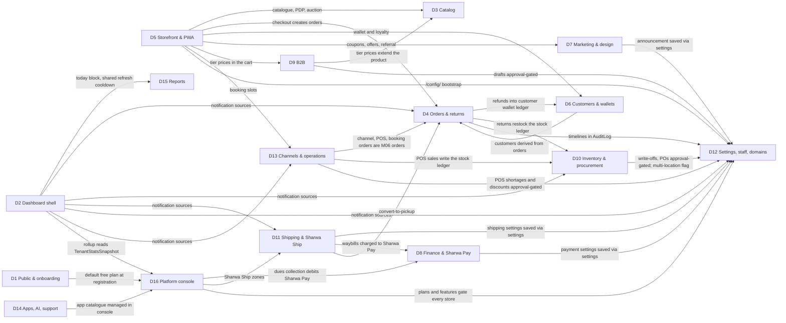

# Domain map — 16 domains × 49 modules × live keys

> **Source**: DOC-445 · inventory Table of contents, Part B domain overview tables and "Domain relationship" paragraphs, Part C traceability matrix, A.3, A.9, A.12 · INT-001 → INT-049
> **Code**: `sharwa_saas/api/views_*.py` · `sharwa_saas/products/services/**` · `sharwa_saas/tenants/*` · `sharwa_saas/sharwapay/customer_api.py` · `sharwa-frontend/src/app/api/bff/**/route.ts` · `sharwa-frontend/src/lib/bff/live-products.ts`
> **Last verified against code**: 2026-10-27 (official Step 06)

## 1. Purpose

Phase 002 integrated the 49 frontend modules (M01–M49) with Django in 49 tasks (INT-001 → INT-049), between 2026-10-24 and 2026-10-26. The integration inventory regroups those tasks into **16 domains**. This page is the single lookup table: for every task, its domain, module, Django provider files, live key and integration date, then the dependencies between domains.

The same 16 domain slugs name the folders of every documentation track ([`../README.md`](../README.md) §2.1): `docs/api/domains/NN-<slug>/`, `docs/guides/merchant/NN-<slug>/`. The live keys are explained in [`../api/overview/bff.md#live-keys`](../api/overview/bff.md#live-keys) and the request paths in [`00-system-overview.md`](00-system-overview.md).

**How to read the "Live key" column.** A key is a value of `SHARWA_LIVE_MODULES` (Next.js): while mocks are on, the module's BFF rows answer from Django only when its key is listed (with `SHARWA_MOCKS=off` every key is live). "Django-first, no switch" means the rows always call Django first and fall back to a fixture only when the route is missing or Django is down (development only).

## 2. Totals

**49 tasks · 49 modules · 16 domains · 39 live keys · 28 migration-ledger rows (32 migration files) · 49 task test suites (50 test files)**

| Figure | Roadmap | Verified against | Result |
|---|---|---|---|
| Tasks / modules | 49 / 49 | Part C matrix, this page §3 | ✔ every INT id and every module appears once |
| Domains | 16 | inventory Part B | ✔ |
| Live keys | 39 | the BFF route files and `live-products.ts`, as mapped in [`bff.md#live-keys`](../api/overview/bff.md#live-keys) (DOC-047) | ✔ 39 keys — one per keyed module; 10 modules are Django-first with no key (§4) |
| Migrations | 28 | inventory A.9 + `products/`, `tenants/`, `billing/`, `sharwapay/`, `appstore/` migration folders | see the discrepancy below |
| Test suites | 49 | inventory A.12 + `sharwa_saas/api/test_*_api.py` | ✔ one suite per task, all 50 files present (INT-006 has two) |

> ⚠️ Discrepancy — roadmap says "28 migrations" / code has **32 migration files** for Phase 002: the ledger counts `products/0211`–`0215` (INT-005) as one row, and every one of the 32 files exists (`products/0211`–`0236`, `tenants/0026`–`0027`, `billing/0012`–`0013`, `sharwapay/0003`, `appstore/0007`). In addition, INT-006's three migrations `products/0208_catalog_org_contract`, `0209_backfill_catalog_org`, `0210_seed_catalog_manage_permission` (2026-10-21, before the Phase 002 tracker started) are **not** in the ledger, and A.9 lists INT-006 under "No migration". The figure "28" is therefore "28 ledger rows". Reported in official Step 06.

Test-suite note: INT-003 also has `api/test_auth_api.py` (merchant and staff auth) besides `test_dashboard_api.py`; A.12 lists only the latter for INT-003.

## 3. The 49 modules by domain

Dates are the integration dates of Part C: INT-001 → INT-021 on 2026-10-24, INT-022 → INT-037 on 2026-10-25, INT-038 → INT-049 on 2026-10-26. Provider paths are relative to `sharwa_saas/`; every file named here was checked to exist.

### D1 — Public site, onboarding & tenant resolution «الصفحة الترويجية والتسجيل وحلّ المستأجر» (`01-public-onboarding`)

| INT | Module | Django provider | Live key | Date |
|---|---|---|---|---|
| INT-001 | M01 Marketing Landing Page | `api/views_public.py` | Django-first, no switch | 2026-10-24 |
| INT-002 | M47 Tenant Resolution & Guard | `api/middleware.py` (`TenantHeaderOverrideMiddleware`), `tenants/middleware.py` (`TenantProvisioningGuardMiddleware`), `api/views.py` (`StoreConfigView`, `config/`), `tenants/views.py` (`tenant_provisioning_status`) | Django-first, no switch (direct probe) | 2026-10-24 |
| INT-004 | M02 Onboarding Wizard | `api/views_onboarding.py`, `tenants/registration.py` (`create_pending_tenant`), `tenants/provisioning.py` (`queue_provisioning`), legacy `tenants/views.py` (`register/check-subdomain/`, `register/status/<token>/`) | Django-first, no switch | 2026-10-24 |

### D2 — Dashboard shell, auth, overview, search, notifications & multi-store «هيكل اللوحة والمصادقة والإشعارات» (`02-dashboard-shell`)

| INT | Module | Django provider | Live key | Date |
|---|---|---|---|---|
| INT-003 | M03 Dashboard Shell, Auth & Overview | `api/views_auth.py`, `api/views_dashboard.py`, `products/services/dashboard_service.py` | Django-first, no switch (`tryStoreTarget`, `tryTargetAuth`) | 2026-10-24 |
| INT-008 | M48 Command Palette | `api/views_search.py`, `products/services/search_service.py` | `search` | 2026-10-24 |
| INT-009 | M49 Notification Center | `api/views_notifications.py`, `products/services/notification_service.py`, `products/models/notifications.py` | `notifications` | 2026-10-24 |
| INT-049 | M43 Multi-Store Rollup | `api/views_rollup.py`, `tenants/merchant_rollup.py` | `rollup` | 2026-10-26 |

### D3 — Core catalog & advanced products «الكتالوج الأساسي والمنتجات المتقدمة» (`03-catalog`)

| INT | Module | Django provider | Live key | Date |
|---|---|---|---|---|
| INT-005 | M04 Products (Phase A) | `api/views_products.py`, `api/serializers_products.py`, `products/services/{product_service,variant_service,product_template_service}.py` | `products` (`PRODUCTS_LIVE_RULES`) | 2026-10-24 |
| INT-006 | M05 Catalog Organization | `api/views_catalog.py`, `api/serializers_catalog.py`, `products/services/catalog_org_service.py` | `catalog` | 2026-10-24 |
| INT-045 | M37 Advanced Products + Products Phase B | `api/views_product_extras.py`, `products/services/{product_extras_service,product_import_service,storefront_auction_service}.py` | `advanced_products` (`ADVANCED_LIVE_RULES`); storefront auction rows Django-first | 2026-10-26 |

### D4 — Order management & returns «إدارة الطلبات والمرتجعات» (`04-orders-returns`)

| INT | Module | Django provider | Live key | Date |
|---|---|---|---|---|
| INT-007 | M06 Orders | `api/views_orders.py`, `api/serializers_orders.py`, `products/services/order_api_service.py` | `orders` | 2026-10-24 |
| INT-026 | M24 Returns & RMA | `api/views_returns.py`, `products/services/returns_api_service.py` | `returns`; «Ready» rows through the `/api/v1/*` passthrough | 2026-10-25 |

### D5 — Storefront, purchase journey & PWA «واجهة المتجر ورحلة الشراء وتطبيق PWA» (`05-storefront`)

| INT | Module | Django provider | Live key | Date |
|---|---|---|---|---|
| INT-011 | M09 Storefront Home & Catalog Listing | `api/views_storefront.py`, `products/services/storefront_catalog_service.py` | Django-first, no switch | 2026-10-24 |
| INT-012 | M10 Product Detail Page | `products/services/storefront_product_service.py` (via `ProductDetailSerializer`) | Django-first, no switch | 2026-10-24 |
| INT-013 | M11 Cart | `products/services/storefront_cart_service.py` (cart views in `api/views.py`) | Django-first, no switch (`/api/v1/cart*` passthrough + `storefrontAdapter`) | 2026-10-24 |
| INT-014 | M12 Checkout | `api/views_checkout.py`, `products/services/storefront_checkout_service.py` | Django-first, no switch | 2026-10-24 |
| INT-015 | M41 Order Tracking | `api/views_tracking.py`, `products/services/order_tracking_service.py` | Django-first, no switch | 2026-10-24 |
| INT-016 | M44 PWA | `api/views_push.py`, PWA views in `api/views.py`, `products/services/order_push_service.py` | `pwa` (the two new merchant rows `push/stats`, `push/test`); buyer rows through the passthrough | 2026-10-24 |
| INT-029 | M42 Wishlist & Reviews | `api/views_engagement.py`, `products/services/engagement_service.py` | Django-first, no switch | 2026-10-25 |

### D6 — Customers, customer wallets & loyalty «العملاء ومحافظ العملاء والولاء» (`06-customers-wallets`)

| INT | Module | Django provider | Live key | Date |
|---|---|---|---|---|
| INT-017 | M07 Customers | `api/views_customers.py`, `products/services/customer_service.py` | `customers` | 2026-10-24 |
| INT-028 | M35 Customer Wallets & Loyalty Points | `api/views_wallets.py`, `products/services/{wallet_service,storefront_wallet_service}.py` | `wallets` (merchant rows); storefront rows Django-first | 2026-10-25 |

### D7 — Marketing, storefront design & partners «التسويق والتصميم والمسوّقون والمؤثرون» (`07-marketing-design-partners`)

| INT | Module | Django provider | Live key | Date |
|---|---|---|---|---|
| INT-018 | M08 Theme Customizer | `api/views_design.py`, `products/services/design_service.py` | `design` | 2026-10-24 |
| INT-019 | M13 Marketing | `api/views_marketing.py`, `products/services/marketing_service.py` | `marketing` | 2026-10-24 |
| INT-034 | M17 Affiliates & Influencers | `api/views_partners.py`, `products/services/partners_service.py` | `affiliates`; `storefront/referral` Django-first | 2026-10-25 |

### D8 — Finance: payments, merchant wallet, expenses & Sharwa Pay «المالية والمحفظة» (`08-finance`)

| INT | Module | Django provider | Live key | Date |
|---|---|---|---|---|
| INT-020 | M14 Payments & Merchant Wallet | `api/views_payments.py`, `products/services/payments_service.py` | `payments` | 2026-10-24 |
| INT-043 | M33 Expenses | `api/views_expenses.py`, `products/services/expenses_api_service.py` | `expenses` | 2026-10-26 |
| INT-048 | M40 Sharwa Pay (customer side) | `api/views_sharwa_pay.py`, `sharwapay/customer_api.py` | `sharwa_pay` (platform origin only) | 2026-10-26 |

### D9 — B2B wholesale «البيع بالجملة B2B» (`09-b2b`)

| INT | Module | Django provider | Live key | Date |
|---|---|---|---|---|
| INT-044 | M36 B2B Wholesale | `api/views_b2b.py`, `products/services/{b2b_api_service,tier_pricing}.py`, draft views in `api/views.py` | `b2b` (options + tier prices via `B2B_LIVE_RULES`); draft rows through the passthrough | 2026-10-26 |

### D10 — Inventory, locations & procurement «المخزون والمواقع والمشتريات» (`10-inventory-locations-procurement`)

| INT | Module | Django provider | Live key | Date |
|---|---|---|---|---|
| INT-024 | M21 Inventory | `api/views_inventory.py`, `products/services/inventory_service.py` | `inventory` | 2026-10-25 |
| INT-025 | M22 Locations | `api/views_locations.py`, `products/services/location_service.py` | `locations` | 2026-10-25 |
| INT-035 | M23 Suppliers & Purchase Orders | `api/views_procurement.py`, `products/services/procurement_service.py` | `procurement` | 2026-10-25 |

### D11 — Shipping, couriers & Sharwa Ship «الشحن والمندوبون وشروة شيب» (`11-shipping`)

| INT | Module | Django provider | Live key | Date |
|---|---|---|---|---|
| INT-021 | M15 Shipping | `api/views_shipping.py`, `products/services/shipping_service.py` | `shipping` | 2026-10-24 |
| INT-046 | M38 Courier App | `api/views_courier.py`, `products/services/courier_app_service.py`, agent action views in `api/views.py` | `courier` (4 reads); the 5 actions through the passthrough | 2026-10-26 |
| INT-047 | M39 Sharwa Ship | `api/views_sharwa_ship.py`, `products/services/sharwa_ship_api_service.py` | `sharwa_ship` | 2026-10-26 |

### D12 — Store settings, staff & permissions, domains & integrations «الإعدادات والفريق والصلاحيات والتكاملات» (`12-settings-staff-integrations`)

| INT | Module | Django provider | Live key | Date |
|---|---|---|---|---|
| INT-010 | M34 Store Settings | `api/views_settings.py`, `products/services/settings_service.py`, `StoreConfigSerializer` (the `/config/` extensions) | `settings` | 2026-10-24 |
| INT-022 | M18 Staff & Permissions | `api/views_staff.py`, `products/services/staff_service.py` | `staff` | 2026-10-25 |
| INT-023 | M19 Domains & Integrations | `api/views_integrations.py` over `products/services/{domain_service,integrations_service,webhook_service}.py` | `integrations` | 2026-10-25 |

### D13 — Sales channels & operations: inbox, marketplaces, dropshipping, POS, bookings «القنوات والأسواق والدروبشيبينغ ونقطة البيع والحجوزات» (`13-channels-operations`)

| INT | Module | Django provider | Live key | Date |
|---|---|---|---|---|
| INT-033 | M16 Point of Sale | `api/views_pos.py`, `products/services/pos_service.py` | `pos` | 2026-10-25 |
| INT-036 | M26 Bookings | `api/views_bookings.py`, `products/services/booking_service.py` | `bookings` (merchant rows); buyer rows Django-first | 2026-10-25 |
| INT-037 | M27 Unified Inbox & Social Channels | `api/views_channels.py`, `products/services/social_channels/{inbox_api_service,channels_api_service}.py` | `channels` | 2026-10-25 |
| INT-038 | M28 Marketplaces | `api/views_marketplaces.py`, `products/services/marketplaces/api_service.py` | `marketplaces` | 2026-10-26 |
| INT-039 | M29 Dropshipping | `api/views_dropshipping.py`, `products/services/suppliers/api_service.py` | `dropshipping` | 2026-10-26 |

### D14 — Apps, AI & automation, support «التطبيقات والذكاء الاصطناعي والدعم» (`14-apps-ai-support`)

| INT | Module | Django provider | Live key | Date |
|---|---|---|---|---|
| INT-040 | M30 App Store | `api/views_apps.py`, `products/services/apps_api_service.py` | `apps` | 2026-10-26 |
| INT-041 | M31 Sharwa AI | `api/views_sharwa_ai.py`, `products/services/sharwa_ai_api_service.py` | `sharwa_ai` | 2026-10-26 |
| INT-042 | M32 Support | `api/views_support.py`, `products/services/support_api_service.py` | `support` | 2026-10-26 |

### D15 — Reports & analytics «التقارير والتحليلات» (`15-reports`)

| INT | Module | Django provider | Live key | Date |
|---|---|---|---|---|
| INT-027 | M25 Reports | `api/views_reports.py`, `products/services/{reports_contract,reports_aggregation,reports_registry}.py` | `reports` (the first live module, pre-Phase 002) | 2026-10-25 |

### D16 — Platform owner console «لوحة مالك المنصة» (`16-platform-console`)

| INT | Module | Django provider | Live key | Date |
|---|---|---|---|---|
| INT-030 | M20 Platform Admin Console | `api/views_platform.py`, `tenants/console_service.py` | `platform` | 2026-10-25 |
| INT-031 | M45 Platform Dues & Sharwa Pay Administration | `api/views_platform.py`, `tenants/console_money_service.py` | `platform_money` | 2026-10-25 |
| INT-032 | M46 Plans, Features & Subscriptions | `api/views_platform.py`, `tenants/console_billing_service.py` | `platform_billing` | 2026-10-25 |

The three console keys share one BFF catch-all (`src/app/api/bff/platform/[...path]`) that picks the key per path prefix ([`../api/overview/bff.md#platform`](../api/overview/bff.md#platform)).

## 4. Live keys per module — the 39 keys at a glance

| Group | Modules |
|---|---|
| **No key** — Django-first (10 modules) | M01, M47, M02, M03, M09, M10, M11, M12, M41, M42 |
| **One key each** (39 modules) | every other module. M44 (`pwa`), M24 (`returns`), M35 (`wallets`), M17 (`affiliates`), M36 (`b2b`), M38 (`courier`), M26 (`bookings`) and M37 (`advanced_products`) are keyed for their merchant/editor rows only and keep Django-first or passthrough rows beside them. M30 (`apps`) and M31 (`sharwa_ai`) share one BFF route file whose first path segment picks the key; M20/M45/M46 share the platform catch-all whose path prefix picks `platform` / `platform_money` / `platform_billing` |

Key list in switch order: `reports`, `catalog`, `products`, `orders`, `search`, `notifications`, `settings`, `pwa`, `customers`, `design`, `marketing`, `payments`, `shipping`, `staff`, `integrations`, `inventory`, `locations`, `returns`, `wallets`, `platform`, `platform_money`, `platform_billing`, `pos`, `affiliates`, `procurement`, `bookings`, `channels`, `marketplaces`, `dropshipping`, `apps`, `sharwa_ai`, `support`, `expenses`, `b2b`, `advanced_products`, `courier`, `sharwa_ship`, `sharwa_pay`, `rollup` — **39**. 49 modules − 10 keyless = 39 keyed modules, one key each.

> ⚠️ Discrepancy — roadmap says the live-key table "matches `.env.example`" / `sharwa-frontend/.env.example` lists 35 keys and omits `inventory`, `locations`, `returns` and `wallets` (already recorded by DOC-047 in [`bff.md#live-keys`](../api/overview/bff.md#live-keys); fix tracked as DOC-461). Reported in official Step 06. **Fixed in official Step 52 (2026-10-30)**: `.env.example` now lists all 39 keys (KI-01, DOC-461).

## 5. Dependencies between domains

An arrow `A --> B` means "A reads from, writes into or is gated by B". Every arrow comes from a "Domain relationship" paragraph of the inventory, checked against the provider files named in §3.

| From | To | Why (inventory "Domain relationship", checked against the providers in §3) |
|---|---|---|
| D1 | D16 | registration assigns the active default free plan (`tenants/registration.py` imports `billing.models.Plan`, `Subscription`) |
| D2 | D15 | the overview «today» refresh shares the 5-minute cooldown key with the reports refresh; both read `DailyStoreMetrics` |
| D2 | D4, D10, D11, D12, D13 | notification kinds are synced from orders, low stock, AWB failures, approvals and behaviour alerts, the inbox and sync jobs (INT-009) |
| D2 | D16 | the multi-store rollup reads the public `TenantStatsSnapshot` (INT-049) |
| D4 | D6 | refunds credit the same customer-wallet ledger that checkout uses |
| D4 | D10 | returns restock into the single stock ledger (`StockMovement`) |
| D4 | D12 | order and return timelines live in the append-only `AuditLog` (no new tables) |
| D5 | D3, D4, D6, D7, D9, D12, D13 | the buyer journey reads the catalogue (and auctions), creates orders, redeems wallet and loyalty, applies coupons/offers/referral (marketing writes the same models the cart reads — no parallel pricing), charges tier prices, holds booking slots and bootstraps from `/config/` |
| D6 | D4 | Sharwa has no tenant customer model: a customer is derived from a normalized phone across orders |
| D7, D8, D10, D11 | D12 | settings is the single row others reuse: `patch_announcement` (M08), `patch_payments` (M14), `set_multi_location` (M22), `patch_shipping` (M15) |
| D9 | D3 | quantity (tier) prices are a catalogue extension on the same product model, on their own switch `b2b` |
| D9, D10, D13 | D12 | the M18 approvals queue gates B2B drafts, write-offs, purchase orders, POS shortages and discounts |
| D11 | D8 | Sharwa Ship waybills are charged to the merchant's Sharwa Pay wallet |
| D11 | D4 | convert-to-pickup changes an order |
| D13 | D4, D10 | chat-to-order, marketplace, dropship, POS and booking orders are real M06 orders with their `sales_channel`; POS sales write the stock ledger |
| D14 | D16 | the app catalogue (`appstore.App`) is managed in the console and installed per store (`StoreAppInstallation`) |
| D14 | D14 | the Sharwa AI bot (M31) hands conversations to humans through the support-session lock service (M32) — inside the domain |
| D16 | D8, D11, D12 | the console collects dues from the merchant's Sharwa Pay wallet, administers Sharwa Ship zones, and decides plan features for every store |

## 6. Related pages

- [`00-system-overview.md`](00-system-overview.md) — components and request paths
- [`02-integration-protocol.md`](02-integration-protocol.md) — how each module was integrated
- [`03-phase-history.md`](03-phase-history.md) — integration timeline and checkpoints
- [`22-live-module-keys.md`](22-live-module-keys.md) — the live-key register (DOC-459)
- [`../api/domains/README.md`](../api/domains/README.md) — the API pages per domain
- [`../api/overview/bff.md#live-keys`](../api/overview/bff.md#live-keys) — key ↔ BFF row ↔ Django route map
- [`../glossary.md`](../glossary.md#4-modules-m01m49) — module names in Arabic and English
