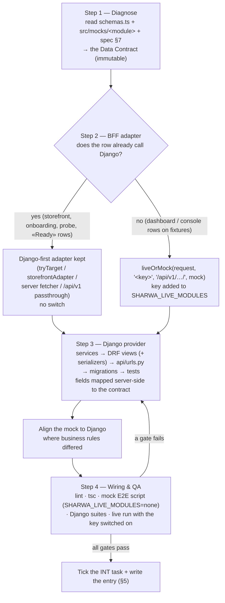

# Integration protocol — the mock-adapter pipeline

> **Source**: DOC-446 · inventory A.1, A.2, A.3, A.12, A.13 · project instructions «FULL-STACK INTEGRATION PROTOCOL (MOCK-ADAPTER)» · all INT-001 → INT-049
> **Code**: `sharwa-frontend/src/lib/bff/live-route.ts` (`liveOrMock`, `forwardLive`) · `sharwa-frontend/src/mocks/runtime.ts` (`isMocksOn`, `isModuleLive`, `notAvailable`, `mockJson`) · `sharwa-frontend/src/lib/bff/{target-adapter,storefront-adapter,mock-route,live-products,upstream}.ts` · `sharwa-frontend/.env.example` · `sharwa-frontend/scripts/*-check.ts` · `sharwa_saas/api/urls.py`, `api/views_*.py`, `api/serializers_*.py`, `products/services/*`, `api/test_*_api.py`
> **Last verified against code**: 2026-10-27 (official Step 06)

## 1. Purpose

This page is the **standard procedure for connecting a frontend module to Django**. All 49 modules of Phase 002 (INT-001 → INT-049) were integrated with it, and any new module must follow it. You should be able to integrate a module from this page alone, without reading the Phase 002 specs.

The protocol has four steps and one non-negotiable direction of authority:

- **Shapes** — the frontend Data Contract (Zod schema + fixture) is the source of truth. Django adapts its JSON to it, never the reverse ("frontend is the source of truth for the Django API contract").
- **Behaviour** — Django is the authority for business rules. Where the mock and Django disagree, the mock is changed to match Django ("mock aligned"), not the other way round.

It does **not** cover how the BFF itself works internally. That is in [`../api/overview/bff.md`](../api/overview/bff.md) (`#liveormock`, `#django-first`, `#passthrough`, `#mock-runtime`, `#buffering`, `#live-keys`) and in the planned architecture pages [`20-bff.md`](20-bff.md), [`21-mock-runtime.md`](21-mock-runtime.md) and [`22-live-module-keys.md`](22-live-module-keys.md).

## 2. Components

| Component | Location | Role in the protocol |
|---|---|---|
| Data Contract — schema | `sharwa-frontend/src/features/<module>/schemas.ts` (some modules split it under `schemas/`, e.g. `features/products/schemas/*.ts`, `features/orders/schemas/*.ts`, `features/platform-admin/schemas/*.ts`, `features/storefront/schemas/*.ts`) | Zod schemas every hook parses responses with. **Immutable** during integration. |
| Data Contract — fixture | `sharwa-frontend/src/mocks/<module>/` | In-memory data + handlers that answer in mock mode. Shows the exact JSON, edge cases and Arabic messages the screens expect. |
| Module spec §7 «عقد البيانات» | `sharwa-frontend/specs/001-sharwa-frontend-platform/modules/M*.md` | The per-row list of what each screen needs (`Ready` or `[NEEDS BACKEND]`). |
| `liveOrMock` adapter | `src/lib/bff/live-route.ts` | Step 2 switch: fixture in mock mode, transparent passthrough to Django in live mode. |
| Django-first adapters | `src/lib/bff/target-adapter.ts` (`tryTarget` / `tryStoreTarget`), `src/lib/bff/storefront-adapter.ts`, server fetchers (`getPublicJson`, `getProduct()`, `getTracking()`, `probeStore()`) | Step 2 alternative: Django answers win as soon as the route exists; the fixture is a fallback. No switch. |
| Rule tables | `src/lib/bff/live-products.ts` (`PRODUCTS_LIVE_RULES`, `B2B_LIVE_RULES`, `ADVANCED_LIVE_RULES`) | Step 2 alternative for one BFF tree shared by several modules: one row-by-row table per switch. |
| Mock runtime | `src/mocks/runtime.ts` | `isMocksOn()`, `isModuleLive(module)`, `notAvailable()` (501), `x-sharwa-mock: 1` on every fixture answer. |
| Live switch | `SHARWA_MOCKS`, `SHARWA_LIVE_MODULES` (see §7) | Decide per module whether rows are live. |
| Django provider | `sharwa_saas/products/services/<x>_service.py` (or `tenants/…`, `sharwapay/…`), `api/views_<x>.py`, `api/serializers_<x>.py`, `api/urls.py`, migrations, `api/test_<x>_api.py` | Step 3: fulfils the contract. |
| QA tools | `npm run lint`, `npx tsc --noEmit` (`npm run typecheck`), `scripts/<module>-check.ts` (Playwright, mock mode), Django `python manage.py test api.test_<x>_api` | Step 4 gates. |

## 3. The pipeline



### 3.1 Step 1 — Diagnose (the Data Contract)

1. Open the module's Zod schemas (`src/features/<module>/schemas.ts` or `schemas/`) and its fixture under `src/mocks/<module>/`. List every BFF row the screens call (the route files under `src/app/api/bff/<module>/` and the hooks in `src/features/<module>/api*.ts`).
2. For each row, write down: method, BFF path, query parameters, request body, response JSON **exactly as the Zod schema parses it**, status codes and the Arabic messages the fixture answers with.
3. Read the module spec §7 «عقد البيانات» for rows that are `Ready` (already on `/api/v1/`, see `specs/001-sharwa-frontend-platform/contracts/ready-api-v1.md`) and rows that are `[NEEDS BACKEND]`.
4. Read what Django already has for the domain: models, legacy HTML views, services, admin actions. Most Phase 002 modules found the domain modelled in Django but exposed only through HTML screens ("**Before**: Django had the models … behind the HTML screens only").
5. Record the gaps: missing fields, missing routes, rule differences between the fixture and Django.

**Rule**: the contract does not change to suit Django. If Django cannot produce a field under its natural name, the serializer or the service renames it. If Django lacks the data, Step 3 adds it (a migration), or the row stays an open item.

### 3.2 Step 2 — BFF adapter

Choose one adapter per row. The choice depends on how the row is already wired, not on the module's preference.

| The row today | Adapter to use | What changes in the frontend |
|---|---|---|
| A dashboard or console row answered by the fixture (most `[NEEDS BACKEND]` rows) | `liveOrMock(request, "<key>", "/api/v1/<path>/", mock)` in the BFF route handler, with a new lowercase **live key** | The route handler only. Hooks, schemas and screens stay the same. |
| A row already calling Django first (storefront rows, onboarding, the tenant probe, the dashboard overview) | Keep the Django-first adapter (`storefrontAdapter`, `tryTarget` / `tryStoreTarget`, server fetcher). | Nothing: Django answers win as soon as the route exists. No key. |
| A «Ready» row of `ready-api-v1.md` | The transparent `/api/v1/*` passthrough (`src/app/api/v1/[...path]/route.ts`). | Nothing, unless the shape changed (then update the Ready list). |
| A BFF tree shared by several modules (`/api/bff/products/**`) | One row in the matching rule table of `live-products.ts`, each table on its own switch (`products`, `b2b`, `advanced_products`). | The table only. |
| A catch-all serving several modules (`/api/bff/platform/[...path]`) | Group rows by key inside the catch-all (`platform`, `platform_money`, `platform_billing`). | The catch-all only. |

`liveOrMock` behaviour that every adapter relies on (`src/lib/bff/live-route.ts`):

- **Mock mode** → the existing fixture handler runs unchanged and answers with `x-sharwa-mock: 1`.
- **Live mode** (`SHARWA_MOCKS=off`, or the key listed in `SHARWA_LIVE_MODULES`, `*` = all) → `forwardLive` sends the request to Django: query string, cookies, CSRF header, status and body are forwarded verbatim.
- **No Next-side gate in live mode.** Django answers `401` / `403` itself. The Next-side permission checks exist only inside the fixture handlers.
- **Write bodies are buffered** before forwarding (`Content-Length` set; 8 MB maximum = Django `DATA_UPLOAD_MAX_MEMORY_SIZE`). A streamed body would arrive at Django empty.
- **A successful live write on a store host drops that store's cached storefront reads** (`revalidateTag(storeTag(store), { expire: 0 })`), as the fixture handlers do in mock mode.
- If Django cannot be reached, the adapter answers with the upstream-unavailable response (see [`../api/overview/bff.md#liveormock`](../api/overview/bff.md#liveormock)).

Naming a new key: lowercase, the module's noun (`orders`, `inventory`, `sharwa_pay`), unique among the 39 existing keys ([`../api/overview/bff.md#live-keys`](../api/overview/bff.md#live-keys)). Add it to the sample `SHARWA_LIVE_MODULES` line of `.env.example` in the same change (see §8, failure 4).

### 3.3 Step 3 — Django provider

Build in this order, so each layer is testable before the next one depends on it:

| # | Layer | File | Rules |
|---|---|---|---|
| 1 | **Service** | `sharwa_saas/products/services/<x>_service.py` (store-schema domains) · `sharwa_saas/tenants/<x>_service.py` / `console_*_service.py` (public-schema domains) | All business rules live here. **Reuse** the functions the legacy HTML views already call; never write a second engine. Multi-step writes are atomic. |
| 2 | **DRF views** | `sharwa_saas/api/views_<x>.py` | Gate + routing only: tenant, session, plan feature, permission key, then call the service. No business rule in the view. |
| 3 | **Serializers** (where used) | `sharwa_saas/api/serializers_<x>.py` | Map model ⇄ contract: rename fields, format money as `display_*` strings, translate enums, apply the contract's validation with the fixture's Arabic messages. |
| 4 | **Routes** | `sharwa_saas/api/urls.py` | One `path()` per contract row, under `/api/v1/`, trailing slash. Static segments (`reorder/`, `merge/`) before `<int:pk>/`. |
| 5 | **Migrations** | `sharwa_saas/<app>/migrations/` | Additive only. Data migrations idempotent. Recorded in the migrations ledger. |
| 6 | **Tests** | `sharwa_saas/api/test_<x>_api.py` | Assert the JSON against the contract (field names, types, the Arabic messages), every gate (anonymous `401`, staff without the key `403`, owner allowed), and every rule the step touched. |

Rules that held across Phase 002:

- **Same services for both surfaces.** The legacy HTML screen and the new JSON view call the same service functions. A rule fixed in the service is fixed on both surfaces.
- **Map in Django, not in Next.** The BFF forwards; it does not rename fields. All mapping lives in the serializer or service.
- **Money leaves Django formatted.** Every amount a screen shows is a server `display_*` string ([`../api/overview/money.md`](../api/overview/money.md)).
- **Gate order is fixed**: tenant → session → plan feature → permission key → owner-only → resource state ([`../api/overview/conventions.md`](../api/overview/conventions.md), planned [`31-authorization.md`](31-authorization.md)).
- **No role names in code.** Writes are gated by permission keys (for example `catalog.manage`); a migration may seed a key onto system roles once.

### 3.4 Step 4 — Wiring & QA gates

A task is ticked **only after every gate below passes**:

| # | Gate | Command | Passes when |
|---|---|---|---|
| 1 | Lint | `npm run lint` | no errors |
| 2 | Types | `npx tsc --noEmit` (or `npm run typecheck`) | no errors |
| 3 | Mock E2E | start Next with mocks only (Windows `cmd`: `set SHARWA_LIVE_MODULES=none&& npm run dev`; `set X=` would delete the variable), then `npx tsx scripts/<module>-check.ts [port]` (`SHARWA_CHROMIUM=<path>` when Chromium is not on the default path) | every check `✓`, 0 console errors. Some scripts refuse to run on live data (`scripts/b2b-check.ts` has a `requireMocks()` preflight that checks `x-sharwa-mock`). |
| 4 | Django suites | `python manage.py test api.test_<x>_api` (+ the legacy suites of the same domain) | all green; failures that also fail on untouched code are recorded as pre-existing drift, not ignored |
| 5 | Live run | Next with the key switched on (`SHARWA_LIVE_MODULES=<key>` or `SHARWA_MOCKS=off`) against a migrated Django | every screen of the module works on Django, and no response of the module carries `x-sharwa-mock: 1` |

In practice the mock E2E script proves that the screens still match the contract and the fixture, while the Django suites and the live run prove that Django matches the same contract.

## 4. "Django is the authority" and "mock aligned"

When the fixture and Django disagree on a **business rule** (not on a shape), Django wins, and the fixture is changed in the same task so that mock mode keeps telling the truth. The Phase 002 write-ups record this as **Mock aligned to Django** (or "mock aligned").

| Example (INT) | Django rule kept | Mock change |
|---|---|---|
| INT-005 Products | variant stock is the sum of its variants; variant SKUs are `<sku>-<n>` | fixture mirrors the variant sum and the SKU pattern |
| INT-015 Order tracking | Django `ready_for_pickup` means «ready for pickup OR shipping» | prepared delivery shows «جاهز للشحن»; pickup code only once ready |
| INT-024 Inventory | `items` and `reservations` are paginated | the fixture pages them like Django |
| INT-035 Procurement | a supplier referenced by any order cannot be deleted | fixture refuses the delete too |

When a difference cannot be aligned yet (no screen offers the setting, or the legacy rule is pinned by a test), the row is listed as **open (Django rule kept)** in the open-items register (planned [`90-open-items.md`](90-open-items.md)).

The reverse direction is not allowed: a mock rule is never copied into Django just because the screens were built against it. If the rule is wrong in Django, that is a separate, explicit decision by fares.

> ⚠️ Discrepancy — roadmap says the mock is aligned to Django as a required step / code does not always hold it: Step 07 and Step 08 of this documentation found fixtures that still differ from Django on validation and edge cases (for example the M05 brand/tag/collection/badge fixtures and the M37 bundle total, `src/mocks/product-extras/state.ts:216`). They are recorded on [`../api/domains/03-catalog/m05-organization.md`](../api/domains/03-catalog/m05-organization.md) and [`../api/domains/03-catalog/m37-advanced-products.md`](../api/domains/03-catalog/m37-advanced-products.md). Reported in official Step 06.

## 5. Write-up entry template (copy for every new module)

Every integration is recorded as one entry in the integration log (Phase 002: `specs/002-sharwa-integration/integration-tasks.md`, regrouped in `integration-inventory.md`). Copy this block; delete a heading only when it truly has nothing to say.

```markdown
### INT-0XX — MXX <Module name> (<what it covers>) — YYYY-MM-DD
- **Before**: what the frontend used (fixture / Django-first / Ready) and what Django had (models, HTML views, admin actions, nothing).
- **Django provider**: `products/services/<x>_service.py` + `api/views_<x>.py` (+ `api/serializers_<x>.py`) — N routes.
- **Routes & payloads**: one line per route — method, `/api/v1/<path>/`, query, body, response shape, status codes.
- **Gates**: tenant · session · plan feature `<code>` · permission keys `<read>` / `<write>` · owner-only parts.
- **Rules**: the business rules Django enforces (Django is the authority).
- **Mapping**: contract field ⇄ model field, enum translations, money formatting.
- **Gaps closed / migrations**: `<app>/<NNNN>_<name>` — fields added, data migrations.
- **Bugs fixed**: behaviour callers can observe that changed.
- **Mock aligned to Django**: what the fixture changed to match.
- **Frontend**: BFF rows → `liveOrMock(…, "<key>", …)` (or Django-first, no switch); `.env.example` adds `<key>`; anything else touched.
- **Tests**: `api/test_<x>_api.py` (N) · mock E2E `scripts/<module>-check.ts`.
- **Out of scope / open**: rows not built, legacy-only behaviour, decisions pending.
```

How strictly Phase 002 followed the structure (counted in `integration-inventory.md`): **Tests** 48 entries, **Before** 42, **Django provider** 40, **Frontend** 37, **Gaps closed** 22 (17 + 5 "Gaps closed in Django"), **Gates** 15 (11 + 4 "Gate"), **Rules** 5 (+ 2 "Rules kept from Django"), **Mapping** 5, **Bugs fixed** 5 (3 + 2 "Bug fixed"), **Out of scope** 4, **Mock aligned to Django** 2 as a heading (and "mock aligned" inside 20+ entries). Route lists were written inside **Django provider** rather than under a separate **Routes & payloads** heading. New entries should use the template above so that every heading is searchable.

## 6. The `[NEEDS BACKEND]` marker

**Convention (Phase 001).** While the frontend was built against fixtures, every contract row with no Django endpoint was marked `[NEEDS BACKEND]`:

- in the status column of the module spec §7 table (`specs/001-sharwa-frontend-platform/modules/M*.md`), the source of truth;
- in the generated index `specs/001-sharwa-frontend-platform/contracts/needs-backend-inventory.md`, rebuilt by `npx tsx scripts/needs-backend-inventory.ts` (`--check` exits 1 when the file is stale). Its summary counts 453 rows: 78 Ready, 353 `[NEEDS BACKEND]`, 22 n/a / local; `docs/DELIVERY-REPORT.md` (2026-10-19) reports 362 rows consumed through the fixtures;
- in code comments next to the contract (schema headers, BFF route headers, fixture headers, `src/app/api/bff/README.md` row status "mock (`[NEEDS BACKEND]`)");
- at run time by the fixture's `x-sharwa-mock: 1` header, which the development shell shows as a 1-px amber bar with «بيانات تجريبية» (`src/components/shared/mock-indicator.tsx`); with `SHARWA_MOCKS=off` a row with no endpoint answers `501` `{"detail": "غير متاح بعد."}` (`notAvailable()`).

**How Phase 002 cleared it.** A row stops being `[NEEDS BACKEND]` when Step 3 ships its Django route and Step 2 switches it (`liveOrMock` key, rule-table row, or a Django-first adapter that now finds the route). Each write-up's **Before** line names the rows that were `[NEEDS BACKEND]`. The glossary records the result: every row was closed in Phase 002 except the open items of the inventory A.13 ([`../glossary.md`](../glossary.md)). The runtime marker clears by itself: in live mode no response of the module carries `x-sharwa-mock: 1`. A few tasks also updated the comments (INT-011: "`[NEEDS BACKEND]` notes updated"; INT-015: "notes updated (route, schema, api, BFF README)").

> ⚠️ Discrepancy — roadmap says the `[NEEDS BACKEND]` marker "was cleared" / code still carries it: the written markers were **not** removed. In the 127 frontend source files staged for this step, 35 files still contain 67 `[NEEDS BACKEND]` comments for rows that Phase 002 integrated: `src/app/api/bff/README.md` (row status column), `src/app/api/bff/products/{route,formula-preview/route}.ts`, the schema headers of `features/{bookings,channels,command-palette,dashboard-shell,inbox,integrations,notifications,onboarding,organization,settings,shipping,staff}/schemas.ts`, `features/landing/schemas/stats.ts`, `features/orders/schemas/order.ts`, `features/platform-admin/schemas/{auth,common}.ts`, `features/products/schemas/{product,variants}.ts`, `features/storefront/schemas/{cart,catalog,config}.ts`, `features/products/components/editor/product-editor.tsx:379`, `lib/bff/{auth-adapter,mock-route,storefront-adapter,target-adapter}.ts`, `mocks/{runtime,catalog/organization,catalog/products,integrations/domains,notifications/state,product-extras/state}.ts`. The generated `needs-backend-inventory.md` is dated 2026-10-19 (the `DATE` constant of `scripts/needs-backend-inventory.ts`) and still lists the 353 rows, and the module specs §7 were not updated. Other source files were not staged, so the real count may be higher. These are comment and spec drift only; no behaviour depends on them. Reported in official Step 06.

**Rule for future modules.** In the same change that ticks Step 4: (1) set the row's status in the module spec §7 to `Ready (INT-0XX)`, (2) regenerate `needs-backend-inventory.md`, (3) replace the `[NEEDS BACKEND]` comment with the Django route it now reaches, (4) update the row in `src/app/api/bff/README.md`. A `[NEEDS BACKEND]` comment that remains must mean an open item, not history.

## 7. Configuration

| Variable | Where | Values | Effect |
|---|---|---|---|
| `SHARWA_MOCKS` | Next server env (`.env.example`, default `on`) | `on` · `off` · unset | `on`: fixtures answer every row that is not live. `off`: every integrated row is live; a row with no endpoint answers `501` «غير متاح بعد.». Unset: `on` outside production, `off` in production (`isMocksOn()`). |
| `SHARWA_LIVE_MODULES` | Next server env | comma-separated keys · `*` · `none` | With `SHARWA_MOCKS=on`, the listed modules answer from Django while the others stay on fixtures (case-insensitive; `*` = all). `none` (any value that is not a key) keeps everything on fixtures, as the mock E2E scripts need. |
| `API_INTERNAL_URL` / `API_PROXY_URL` | Next server env | URL | Where the BFF reaches Django (`upstream.ts`). |
| `DATA_UPLOAD_MAX_MEMORY_SIZE` | Django settings | 8 MB | Matches the BFF's buffered body limit; production Nginx `client_max_body_size` must match. |

Full environment reference: planned `docs/ops/environment.md` (DOC-511).

## 8. Failure modes and fixes

| Failure | Symptom | Cause | Handling / fix |
|---|---|---|---|
| 1. Empty bodies on live writes | every live `POST`/`PATCH` answered «required field» | the BFF streamed the body (chunked, no `Content-Length`); Django read an empty body | `forwardLive` and `upstream.ts` buffer write bodies (A.11; [`../api/overview/bff.md#buffering`](../api/overview/bff.md#buffering)) |
| 2. A real Django `404` served as a fixture | a deleted resource "comes back" from the fixture in mock mode, or `501` with mocks off | Django-first adapters read `404` as "route not shipped yet" | known limitation of the Django-first rule; recorded in [`../api/overview/bff.md#django-first`](../api/overview/bff.md#django-first) |
| 3. Mock E2E run against live data | a check script passes or fails for the wrong reason | the shell still had `SHARWA_LIVE_MODULES` set | start Next with `SHARWA_LIVE_MODULES=none`; scripts with `requireMocks()` stop early |
| 4. Live key missing from the sample env | a developer copying `.env.example` never switches the module on | the sample line was not updated in the task | add the key to `.env.example` in the same change (the sample line today lacks `inventory`, `locations`, `returns`, `wallets`, inventory A.13; fix tracked as DOC-461) |
| 5. Stale storefront after a dashboard edit | a renamed category stays old on the storefront | cached storefront reads not dropped | `forwardLive` calls `revalidateTag(storeTag(store), { expire: 0 })` after a successful write |
| 6. Contract drift | a Zod parse error in the browser after Django changes | a Django change renamed or removed a field | the contract-diff procedure ([`../api/openapi/contract-diff.md`](../api/openapi/contract-diff.md)) and the module's Django tests asserting the contract |

## 9. Checklist for a new module

Copy into the task.

- [ ] **Diagnose**: schemas and fixture read; every BFF row listed with method, path, body, response, statuses and Arabic messages; Django's existing models, services and HTML views listed; gaps written down.
- [ ] **Adapter**: each row has exactly one adapter (`liveOrMock` key / rule-table row / Django-first / Ready passthrough); a new key is lowercase and unique, and added to `.env.example`.
- [ ] **Service** reuses the legacy functions; multi-step writes are atomic.
- [ ] **Views** only gate and route; the gate order is tenant → session → plan feature → permission key → owner-only → state.
- [ ] **Serializer / service** maps every field to the contract name; money is a `display_*` string.
- [ ] **Routes** added to `api/urls.py` with trailing slashes; static segments before `<int:pk>/`.
- [ ] **Migrations** additive, data migrations idempotent, listed for the migrations ledger.
- [ ] **Django tests** assert the contract, every gate and every rule.
- [ ] **Mock aligned** to every Django rule that differed.
- [ ] `npm run lint` ✓ · `npx tsc --noEmit` ✓ · `scripts/<module>-check.ts` ✓ with `SHARWA_LIVE_MODULES=none` · Django suites ✓ · live run ✓ with no `x-sharwa-mock: 1` on the module's responses.
- [ ] `[NEEDS BACKEND]` cleared in the spec §7, the generated inventory, the code comments and the BFF README (§6).
- [ ] Write-up entry (§5) added; the matching documentation page updated (docs README §7 maintenance rule).

## 10. Open items

- The `[NEEDS BACKEND]` comments, the module specs §7 and the generated `needs-backend-inventory.md` still describe the pre-Phase 002 state (§6). Cleaning them is a code-comment change, outside this documentation step.
- ~~`.env.example` sample line lacks four keys~~ (§8 failure 4) — fixed in Step 52 (DOC-461, 2026-10-30).
- `ready-api-v1.md` needs a re-audit after INT-026, INT-044 and INT-046 changed «Ready» rows (DOC-463, planned [`23-ready-api-v1-audit.md`](23-ready-api-v1-audit.md)).

## 11. Related pages

- BFF reference: [`../api/overview/bff.md`](../api/overview/bff.md) — `#liveormock`, `#products-rules`, `#platform`, `#django-first`, `#passthrough`, `#mock-runtime`, `#buffering`, `#live-keys`
- Architecture (planned): [`20-bff.md`](20-bff.md) · [`21-mock-runtime.md`](21-mock-runtime.md) · [`22-live-module-keys.md`](22-live-module-keys.md) · [`23-ready-api-v1-audit.md`](23-ready-api-v1-audit.md) · [`31-authorization.md`](31-authorization.md) · [`90-open-items.md`](90-open-items.md)
- System overview and domain map: [`00-system-overview.md`](00-system-overview.md) · [`01-domain-map.md`](01-domain-map.md)
- Project history and checkpoints: [`03-phase-history.md`](03-phase-history.md)
- Conventions: [`../api/overview/conventions.md`](../api/overview/conventions.md) · [`../api/overview/errors.md`](../api/overview/errors.md) · [`../api/overview/money.md`](../api/overview/money.md)
- Worked examples of the protocol: [`../api/domains/03-catalog/m04-products.md`](../api/domains/03-catalog/m04-products.md) (rule table) · [`../api/domains/03-catalog/m05-organization.md`](../api/domains/03-catalog/m05-organization.md) (`liveOrMock`) · [`../api/domains/02-dashboard-shell/m03-overview.md`](../api/domains/02-dashboard-shell/m03-overview.md) (Django-first)
