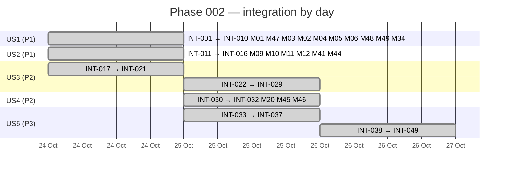

# Project phase history and checkpoints

> **Source**: DOC-447 · inventory A.1, A.12, Part C ("Phase checkpoints") · `specs/002-sharwa-integration/integration-tasks.md` · `specs/001-sharwa-frontend-platform/tasks.md`
> **Code**: `sharwa-frontend/specs/001-sharwa-frontend-platform/tasks.md` · `sharwa-frontend/specs/002-sharwa-integration/{integration-tasks,integration-inventory}.md` · `sharwa-frontend/docs/DELIVERY-REPORT.md` · `sharwa-frontend/scripts/*-check.ts` · `sharwa_saas/api/test_*_api.py`
> **Last verified against code**: 2026-10-27 (official Step 06)

## 1. Purpose

This page answers three questions for anyone joining the project:

1. **How the system was built**: the three project phases (frontend on fixtures → Django integration → documentation) and what each one left behind.
2. **When each module reached Django**: the Phase 002 timeline, day by day.
3. **Which checkpoints hold, on what evidence, and how to re-check each one.**

The per-module detail of every integration is in the API pages (`docs/api/domains/`), and the procedure every integration followed is in [`02-integration-protocol.md`](02-integration-protocol.md).

## 2. The three project phases

| Phase | Spec folder | What it produced | Ended |
|---|---|---|---|
| **001 — Frontend platform** | `specs/001-sharwa-frontend-platform/` (`spec.md`, `plan.md`, 49 module specs, `contracts/`, `tasks.md` T001 → T196) | The Next.js app: storefront, merchant dashboard, courier app, Sharwa Pay, platform console, the BFF under `/api/bff/`. All 49 modules ran on **fixtures** (`src/mocks/**`, `x-sharwa-mock: 1`) with Django read-only. The contracts are the Zod schemas in `src/features/**`. | 2026-10-19: delivery report `docs/DELIVERY-REPORT.md` («كل الوحدات الـ 49 مبنية على **mocks** بنفس عقود المواصفات»); retroactive tasks T195–T196 on 2026-10-24 |
| **002 — API integration** | `specs/002-sharwa-integration/` (`integration-tasks.md` INT-001 → INT-049, `integration-inventory.md`) | Every module connected to Django `/api/v1/` with the mock-adapter protocol; 39 live module keys; 28 migrations; 49 task test suites. | 2026-10-26: all 49 tasks ticked |
| **003 — Documentation** | `specs/003-documentation/` (`documentation-roadmap.md` DOC-001 → DOC-536, `execution-plan.md` 52 steps) | This documentation tree (`docs/`). | in progress (see `docs/CHANGELOG.md`) |

### 2.1 Phase 001 sub-phases (frontend build order)

`specs/001-sharwa-frontend-platform/tasks.md` built the frontend in eight phases. Phases 3–7 are user stories; Phase 002 reused exactly these phases, stories and priorities for the integration order.

| Phase | Name in `tasks.md` | Priority | Content |
|---|---|---|---|
| 1 | Setup (Shared Infrastructure) | — | design tokens, fonts, RTL, env schema (`src/env.ts`: `SHARWA_MOCKS`, `API_INTERNAL_URL`…), ESLint rules, shadcn components, `scripts/visual-check.ts` (T001–T009) |
| 2 | Foundational (Blocking Prerequisites) | — | tenant resolution (`src/lib/tenant.ts`, `src/proxy.ts`), `ApiError`, **BFF core `src/lib/bff/upstream.ts`**, the `/api/v1/*` passthrough, **the mock runtime `src/mocks/runtime.ts`**, **`src/lib/api-client.ts`**, query keys / cache tags, formatters, access keys, shared components, the mock indicator, `src/app/api/bff/README.md` (T010–T026) |
| 3 | US1 — «التاجر يُطلق متجره ويبيع أول طلب» | P1 (MVP) | 3A M01 · 3B M47 + M03 · 3C M02 · 3D M04 M05 M06 M48 M49 · 3E M34 |
| 4 | US2 — «المشتري يتصفح ويشتري» | P1 | M09 M10 M11 M12 M41 M44 |
| 5 | US3 — «إدارة يومية على نطاق أوسع» | P2 | M07 M08 M13 M14 M15 M18 M19 M21 M22 M24 M25 M35 M42 |
| 6 | US4 — «مالك المنصة» | P2 | M20 M45 M46 |
| 7 | US5 — «القنوات والامتدادات المتقدمة» | P3 | M16 M17 M23 M26–M33 M36–M40 M43 |
| 8 | Polish & Cross-Cutting Concerns | — | cache-key ESLint rule, RTL audit, anti-AI visual audit, Lighthouse, `scripts/tenant-isolation-check.ts`, regenerated `needs-backend-inventory.md`, delivery report, clean-build run (T187–T194) |

### 2.2 Out of scope of Phase 002

Phase 002 has **no INT task** for Phase 1 (Setup), Phase 2 (Foundational) or Phase 8 (Polish). Phase 2 already delivered everything the integration needed — the BFF core (`upstream.ts`), the `/api/v1/*` passthrough, `api-client` and the mock runtime — so integration only added adapters on top (`live-route.ts`, `live-products.ts`, `target-adapter.ts`, `storefront-adapter.ts`). Phase 8 work (audits, Lighthouse, delivery report) was not repeated.

## 3. State before the integration started

Recorded in `integration-tasks.md` as the "live status when this file was created (2026-10-24)":

| Item | State on 2026-10-24 |
|---|---|
| `SHARWA_LIVE_MODULES` | `reports,catalog,products` |
| `reports` (M25) | the first live module, live before Phase 002 (inventory A.3) |
| `catalog` (M05 Organization) | live-tested and committed (2026-10-22) |
| `products` (M04 Products) | Steps 1–3 committed (Django provider, migrations `products/0211`–`0215`, 2026-10-22); Step 4 live QA in progress |
| Merchant auth (M03) | merchant login, logout, `auth/me`, `auth/csrf`, `setup-password` already built; INT-003 added staff login |
| Frontend | complete on fixtures since 2026-10-19 (Phase 001) |

## 4. Integration timeline (Phase 002)

Dates are taken from each task's dated line in `integration-tasks.md` and match the task headings of `integration-inventory.md` and its Part C table.

| Date | Tasks | Modules |
|---|---|---|
| **2026-10-24** | INT-001 → INT-021 (21) | M01 M47 M03 M02 M04 M05 M06 M48 M49 M34 (US1) · M09 M10 M11 M12 M41 M44 (US2) · M07 M08 M13 M14 M15 (start of US3) |
| **2026-10-25** | INT-022 → INT-037 (16) | M18 M19 M21 M22 M24 M25 M35 M42 (rest of US3) · M20 M45 M46 (US4) · M16 M17 M23 M26 M27 (start of US5) |
| **2026-10-26** | INT-038 → INT-049 (12) | M28 M29 M30 M31 M32 M33 M36 M37 M38 M39 M40 M43 (rest of US5) |



Several tasks were **already integrated** before their day and only recorded then: INT-002 (tenant probe), INT-004 (onboarding), INT-006 (M05, live-tested 2026-10-22), and INT-005 Phase A (Django Steps 1–3 on 2026-10-22).

## 5. Checkpoints

### 5.1 What "holds" means here

Each INT task was ticked only after its own Step 4 passed: `npm run lint`, `npx tsc --noEmit`, the module's mock E2E script, the Django suites and a live run with the module switched on ([`02-integration-protocol.md`](02-integration-protocol.md) §3.4). A checkpoint is therefore **recorded as holding** when every task of its phase is ticked `[x]` in `integration-tasks.md`.

The specs do **not** record a separate end-to-end run of each checkpoint on Django (no dated "checkpoint passed" line exists in `integration-tasks.md` or `integration-inventory.md`). **None of the checks below was re-run in this documentation step**: this page has no runtime access to either repository. The "Re-verify" columns give the exact commands to run.

### 5.2 Status

| Checkpoint | Definition (Phase 002, `integration-tasks.md`) | Phase 001 version (`tasks.md`) | Tasks | Status |
|---|---|---|---|---|
| **Foundation** | — (not part of Phase 002) | «الأساس جاهز — يمكن بدء قصص المستخدم.» | T001–T026 | held at Phase 001 (all `[X]`) |
| **US1** | «`/` → متجر → منتج → طلب مكتمل على Django بلا mocks.» | the same chain on mocks | INT-001 → INT-010 | **recorded** — 10/10 ticked; not re-run |
| **US2** | «جلسة شراء كاملة على Django.» | a full buying session on mocks (and on Django where available for config/catalog/cart) | INT-011 → INT-016 | **recorded** — 6/6 ticked; not re-run |
| **US3** | «كل وحدة P2 تعمل على Django وحدها.» | every P2 module checked on its own | INT-017 → INT-029 | **recorded** — 13/13 ticked; not re-run |
| **US4** | «إعادة تجهيز متجر، تفعيل ميزة، قبول شحن محفظة، تحصيل مستحق — على Django.» | — | INT-030 → INT-032 | **recorded** — 3/3 ticked; **Phase 6 (US4 — platform owner) complete on Django**; not re-run |
| **US5** | «كل وحدة P3 تعمل على Django دون تضارب حالات مع M06/M21.» | — | INT-033 → INT-049 | **recorded** — 17/17 ticked; not re-run |

The Arabic checkpoint sentences are quoted from the spec files (`integration-tasks.md` lines 56, 75, 108, 121, 162; `tasks.md` line 68); they are spec text, not UI messages.

### 5.3 Evidence and how to re-verify

**Common set-up for every live check.** Run Django with all migrations applied (`python manage.py migrate_schemas`), then start Next with **every integrated module live**:

```bat
:: Windows cmd — note: no space before &&
set SHARWA_MOCKS=off&& npm run dev
```

With `SHARWA_MOCKS=off` every row is live, a row with no endpoint answers `501` «غير متاح بعد.», and the development mock indicator (amber line + «بيانات تجريبية») never appears. A checkpoint run is valid only if **no response carries `x-sharwa-mock: 1`** (check the Network panel, or watch for the mock indicator).

**Common set-up for the mock E2E scripts** (they prove the screens still match the contract, on fixtures):

```bat
set SHARWA_LIVE_MODULES=none&& npm run dev
:: in another terminal
npx tsx scripts/<script>.ts [port]
```

Set `SHARWA_CHROMIUM=<path to chrome>` when Chromium is not on the default path.

#### US1 — merchant launches a store and sells a first order

- **Django suites** (inventory A.12, + `test_auth_api.py`):
  ```bash
  python manage.py test api.test_public_api api.test_tenant_guard_api api.test_auth_api api.test_dashboard_api api.test_onboarding_api api.test_products_api api.test_catalog_api api.test_catalog_serializers api.test_orders_api api.test_search_api api.test_notifications_api api.test_settings_api
  ```
- **Mock E2E**: `scripts/onboarding-check.ts`, `tenant-shell-check.ts`, `catalog-orders-check.ts`, `product-editor-ux-check.ts`, `product-minimum-check.ts`, `settings-check.ts`.
- **Live walk-through** (`SHARWA_MOCKS=off`): open `/` → register a store (OTP) → wait for provisioning → set the first password from the setup link → create a product → on the storefront, buy it → in the dashboard, move the order to completed. Pass = the order shows as completed with no fixture response on the way.

#### US2 — a shopper browses and buys

- **Django suites**:
  ```bash
  python manage.py test api.test_storefront_catalog_api api.test_storefront_product_api api.test_storefront_cart_api api.test_storefront_checkout_api api.test_order_tracking_api api.test_pwa_push_api
  ```
- **Mock E2E**: `scripts/storefront-check.ts`.
- **Live walk-through**: storefront home → category → product page (variant) → cart → checkout (OTP) → success page → tracking page. Pass = the order exists in Django and the tracking page reads it.

#### US3 — wider day-to-day management (every P2 module alone on Django)

- **Django suites**:
  ```bash
  python manage.py test api.test_customers_api api.test_design_api api.test_marketing_api api.test_payments_api api.test_shipping_api api.test_staff_api api.test_integrations_api api.test_inventory_api api.test_locations_api api.test_returns_api api.test_reports_api api.test_wallets_api api.test_engagement_api
  ```
- **Mock E2E**: `scripts/customers-check.ts`, `theme-check.ts`, `marketing-check.ts`, `payments-check.ts`, `shipping-check.ts`, `staff-check.ts`, `domains-check.ts`, `inventory-check.ts`, `locations-check.ts`, `returns-check.ts`, `reports-check.ts`, `wallets-check.ts`, `engagement-check.ts`, `phase5-decisions-check.ts`.
- **Live check "alone"**: for each P2 key, start Next with `SHARWA_MOCKS=on` and `SHARWA_LIVE_MODULES=<that key>` only (`customers`, `design`, `marketing`, `payments`, `shipping`, `staff`, `integrations`, `inventory`, `locations`, `returns`, `reports`, `wallets`; M42 has no key — it is Django-first) and walk the module's screens. Pass = the module works with every other module still on fixtures.

#### US4 — platform owner (Phase 6)

- **Django suites**:
  ```bash
  python manage.py test api.test_platform_console_api api.test_platform_money_api api.test_platform_billing_api
  ```
- **Mock E2E**: `scripts/admin-shell-check.ts`, `admin-stores-check.ts`, `admin-money-check.ts`, `admin-billing-check.ts`.
- **Live walk-through** on the console origin (public schema only), the four actions of the checkpoint:

  | Action | Console route (`/api/v1/platform/…`) | Pass when |
  |---|---|---|
  | Re-provision a store | `stores/reprovision/` (failed or stalled stores only) | the store returns to `pending`, then `ready` |
  | Enable a feature | `stores/<schema>/features/` (PUT) | the store's feature list shows it with `source` = the deciding step |
  | Approve a wallet top-up | `sharwa-pay/topups/<id>/approve/` | the wallet is credited once (a second approve does not credit again) |
  | Collect a due | `dues/<schema>/actions/` with `collect_commission` or `collect_charge` | the action answers `{detail, level, entry}` and the store's dues page shows the entry as collected |

#### US5 — channels and advanced extensions (every P3 module, no state conflicts with M06/M21)

- **Django suites**:
  ```bash
  python manage.py test api.test_pos_api api.test_partners_api api.test_procurement_api api.test_bookings_api api.test_channels_api api.test_marketplaces_api api.test_dropshipping_api api.test_apps_api api.test_sharwa_ai_api api.test_support_api api.test_expenses_api api.test_b2b_api api.test_product_extras_api api.test_courier_api api.test_sharwa_ship_api api.test_sharwa_pay_api api.test_rollup_api
  ```
- **Mock E2E**: `scripts/pos-check.ts`, `affiliates-check.ts`, `procurement-check.ts`, `bookings-check.ts`, `inbox-check.ts`, `marketplaces-check.ts`, `dropshipping-check.ts`, `apps-support-check.ts`, `expenses-check.ts`, `b2b-check.ts`, `bundles-check.ts`, `courier-check.ts`, `sharwa-ship-check.ts`, `sharwa-pay-check.ts`, `rollup-check.ts`, `phase7-decisions-check.ts`.
- **"No state conflicts with M06/M21"** (`SHARWA_MOCKS=off`): create an order from each P3 channel that creates orders (POS sale, B2B draft approval, marketplace / dropshipping order, booking) and check that it appears in the M06 order list with its channel, and that the M21 stock movements show one movement per stock change with the right reference. Pass = no duplicate or missing order, and stock equals the sum of its movements.

#### Cross-cutting

- `scripts/tenant-isolation-check.ts` (10 stores in one process, compares `store_name` in every response) — run on fixtures in Phase 001 (T191); re-run it with `SHARWA_MOCKS=off` to check isolation on Django.

> ⚠️ Discrepancy — roadmap says the page should state which checkpoints hold / the specs record only per-task Step 4 results, never a checkpoint run: `integration-tasks.md` writes each checkpoint as a goal line («**Checkpoint US1**: …») with no result or date, and no other spec file records one. The status column above is therefore "recorded (all tasks ticked)", not "verified end to end". Reported in official Step 06.

## 6. After Phase 002

| Date | Event | Record |
|---|---|---|
| 2026-10-26 | Phase 003 documentation started (Step 01: documentation home, tree, glossary, templates) | `docs/CHANGELOG.md` |
| 2026-10-27 | Prompt runs 02 → 08 wrote 64 of 536 DOC tasks; the run numbers were re-synced to `execution-plan.md` (official Steps 01, 03, 04, 05, 11 and 17 complete; Step 02 waiting on approvals) | `docs/CHANGELOG.md` — "Re-sync with `execution-plan.md`" |

## 7. Related pages

- [`02-integration-protocol.md`](02-integration-protocol.md) — the procedure each INT task followed
- [`00-system-overview.md`](00-system-overview.md) · [`01-domain-map.md`](01-domain-map.md) — what was integrated, by component and by domain
- [`../api/overview/bff.md`](../api/overview/bff.md) — live keys and adapters
- Testing guide (planned, DOC-520 → DOC-522): `docs/ops/testing.md`
- [`../CHANGELOG.md`](../CHANGELOG.md) — Phase 003 progress
